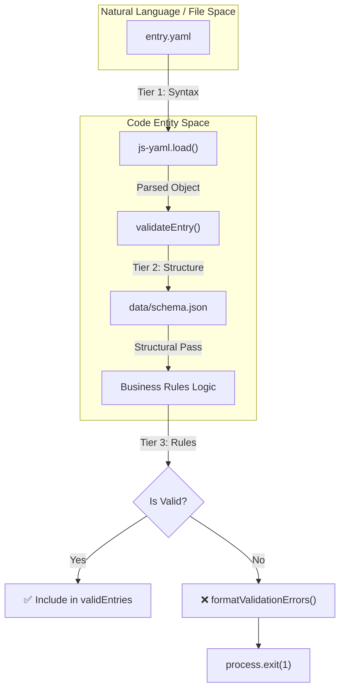
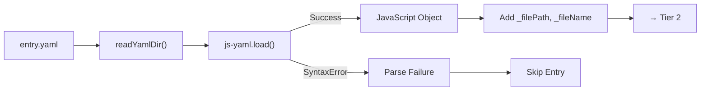
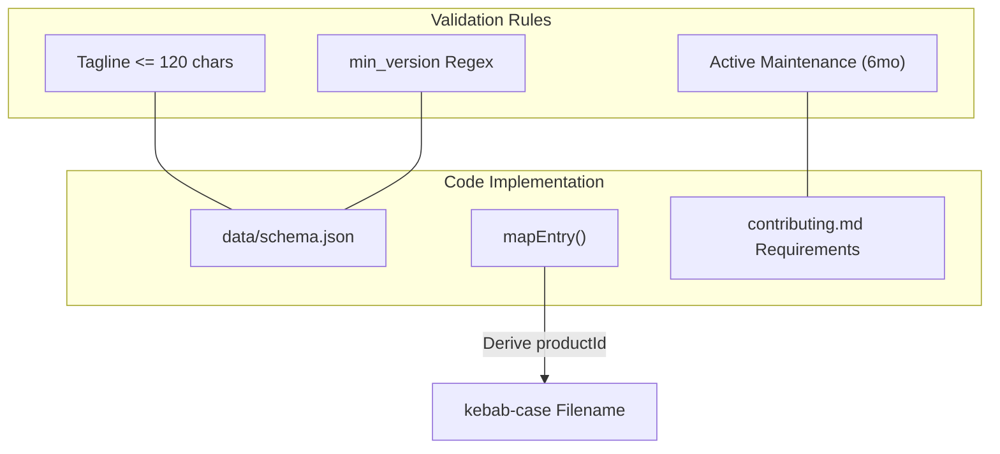

<!-- source: DeepWiki mcp.deepwiki.com · repo awesome-opencode/awesome-opencode · page 5.3 Validation System · fetched 2026-10-30 -->

# Validation System

<details>
<summary>Relevant source files</summary>

The following files were used as context for generating this wiki page:

- [.github/PULL_REQUEST_TEMPLATE.md](.github/PULL_REQUEST_TEMPLATE.md)
- [contributing.md](contributing.md)
- [data/schema.json](data/schema.json)
- [docs/schema-design.md](docs/schema-design.md)

</details>


The validation system ensures data quality across all YAML entry files through a three-tier validation architecture. This system runs both during local development and in the automated build pipeline, preventing invalid or low-quality entries from being processed into the final `README.md` and `registry.json` artifacts.

---

## Three-Tier Validation Architecture

The validation system implements three sequential validation layers, each checking progressively more complex constraints. All three tiers must pass for an entry to be considered valid.

### Validation Flow Logic

The diagram below illustrates how a single YAML file transitions from a raw text file to a validated code entity ready for the registry.

**Diagram: Validation Tier Logic**



**Sources:** [scripts/generate-readme.js:49-61](), [scripts/export-json.js:92-97](), [scripts/utils/validation.js:1-12]()

---

## Tier 1: YAML Syntax Validation

The first validation tier checks whether the file can be successfully parsed as valid YAML. This tier uses the `js-yaml` library (via the `readYamlDir` utility) to parse files and catches syntax errors such as invalid indentation or malformed structures.

### Parse Check Process

The YAML parsing occurs in the `readYamlDir` utility function, which reads all `.yaml` and `.yml` files from a category directory. Parse failures immediately reject the entry before any further validation occurs.

**Diagram: YAML Parsing Flow**



**Sources:** [scripts/utils/yaml.js:11-11](), [scripts/generate-readme.js:39-39](), [scripts/export-json.js:84-84]()

---

## Tier 2: Schema Structure Validation

The second tier validates that the parsed YAML object conforms to the JSON Schema specification defined in `data/schema.json`. This validation ensures all required fields are present, field types are correct, and optional fields follow the expected structure.

### Required Field Validation

Each entry must include these mandatory fields defined in the schema's `required` array [data/schema.json:61-61]():

| Field | Type | Constraint |
|-------|------|------------|
| `name` | string | Must be non-empty [data/schema.json:8-12]() |
| `repo` | string | Must be a valid URI [data/schema.json:13-17]() |
| `tagline` | string | Must be 1-120 characters [data/schema.json:18-23]() |
| `description` | string | Must be non-empty [data/schema.json:24-28]() |

### Optional Field Validation

Optional fields are validated if present:

| Field | Type | Constraint |
|-------|------|------------|
| `scope` | array | Elements must be "global" or "project" [data/schema.json:29-38]() |
| `tags` | array | Array of strings [data/schema.json:39-45]() |
| `min_version` | string | Must follow semantic version pattern `^[0-9]+\.[0-9]+\.[0-9]+` [data/schema.json:46-50]() |
| `homepage` | string | Must be a valid URI [data/schema.json:51-55]() |
| `installation` | string | Markdown string for instructions [data/schema.json:56-59]() |

### Validation Implementation

The `validateEntry` function in `scripts/utils/validation.js` implements schema validation. It is imported by both the README generator [scripts/generate-readme.js:12-12]() and the JSON exporter [scripts/export-json.js:12-12]().

**Sources:** [data/schema.json:1-63](), [scripts/utils/validation.js:12-12]()

---

## Tier 3: Business Rules Validation

The third tier enforces content quality and consistency rules that go beyond structural validation. These rules ensure entries meet quality standards and follow repository conventions.

### Business Rule Enforcement

**Diagram: Business Rules and Data Mapping**



### Rule Details

**1. Tagline Length Constraint**
- Maximum: 120 characters.
- Enforcement: Defined in the JSON schema [data/schema.json:21-21]() and requested in the PR template [ .github/PULL_REQUEST_TEMPLATE.md:31-31]().

**2. Semantic Version Format**
- Pattern: `^[0-9]+\.[0-9]+\.[0-9]+`.
- Enforcement: Defined in the JSON schema for `min_version` [data/schema.json:48-48]().

**3. Filename and ID Convention**
- The system derives `productId` from the filename [scripts/export-json.js:26-28]().
- Filenames must be kebab-case (e.g., `my-plugin.yaml`) [contributing.md:23-23]().

**4. Maintenance and Relevance**
- High-level design principles require entries to be discoverable and "Downstream Ready" [docs/schema-design.md:12-17]().
- Entries must have active commits within the last 6 months [contributing.md:49-49]().

**Sources:** [data/schema.json:21-48](), [scripts/export-json.js:25-33](), [docs/schema-design.md:11-18](), [contributing.md:45-52]()

---

## Validation Entry Points

The validation logic is integrated into the two primary data processing scripts.

### Entry Point 1: README Generation

The README generation script validates each entry before adding it to the `validEntries` collection [scripts/generate-readme.js:52-60]().

```javascript
const result = validateEntry(entry, entry._filePath || path.join(categoryPath, `${entry.name || 'unknown'}.yaml`));

if (result.valid) {
  validEntries.push(entry);
} else {
  const errorMsg = formatValidationErrors(result);
  errors.push(errorMsg);
  console.error(errorMsg);
}
```

### Entry Point 2: Registry Export

The `export-json.js` script validates entries during the loading phase [scripts/export-json.js:93-97]().

```javascript
const result = validateEntry(entry, entry._filePath || categoryPath);
if (!result.valid) {
  errors.push(formatValidationErrors(result));
  continue;
}

const mapped = mapEntry(entry, category);
```

**Sources:** [scripts/generate-readme.js:52-60](), [scripts/export-json.js:93-97]()

---

## Error Handling and Reporting

The validation system provides structured error reporting that identifies the file, field, and specific validation failure.

### Exit Code Behavior

Both scripts exit with a non-zero status code when validation errors occur to signal failure to the CI/CD environment:

- **README Generation:** Exits with `1` if `errorCount > 0` [scripts/generate-readme.js:149-149]().
- **Registry Export:** Exits with `1` if `errors.length > 0` [scripts/export-json.js:151-152]().

**Sources:** [scripts/generate-readme.js:149-149](), [scripts/export-json.js:150-153]()

---

## Validation in CI/CD Pipeline

The validation system is enforced by GitHub Actions to prevent regressions.

1. **Pull Request Validation:** The `validate-pr.yml` (referenced in [contributing.md:55-55]()) runs on every PR targeting `data/`.
2. **Post-Merge Validation:** The `generate-readme.yml` workflow executes validation on every push to `main` [ .github/workflows/generate-readme.yml:4-8]().
3. **Execution:** Runs `node scripts/generate-readme.js` [ .github/workflows/generate-readme.yml:34-34]() and `node scripts/export-json.js` [ .github/workflows/generate-readme.yml:37-37]().
4. **Enforcement:** If either script fails validation and exits with code 1, the workflow terminates [ .github/workflows/generate-readme.yml:39-45]().

**Sources:** [.github/workflows/generate-readme.yml:1-46](), [contributing.md:53-59]()

---

