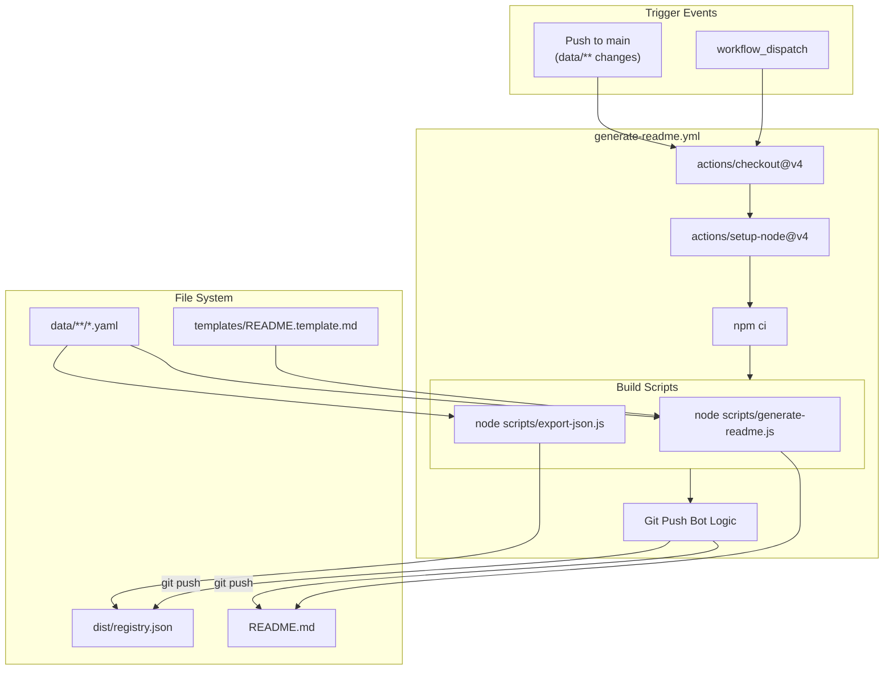
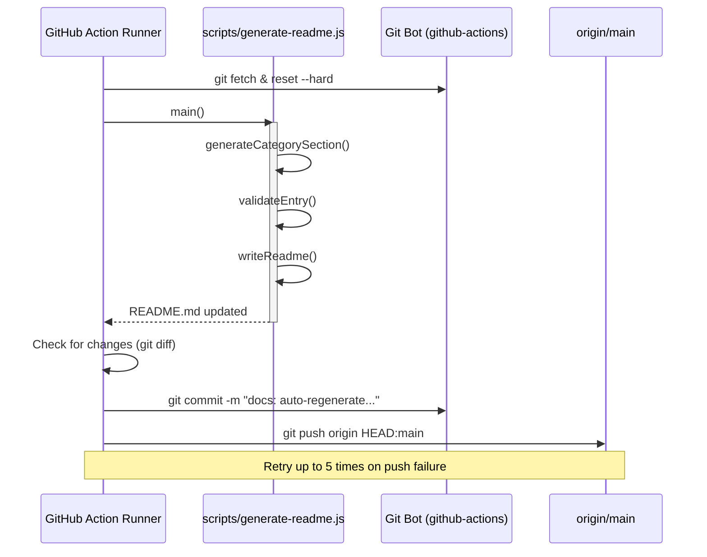

<!-- source: DeepWiki mcp.deepwiki.com · repo awesome-opencode/awesome-opencode · page 5.4 GitHub Actions Workflows · fetched 2026-10-30 -->

# GitHub Actions Workflows

Relevant source files

The following files were used as context for generating this wiki page:

- [.github/workflows/generate-readme.yml](.github/workflows/generate-readme.yml)
- [scripts/generate-readme.js](scripts/generate-readme.js)
- [scripts/utils/template.js](scripts/utils/template.js)

This document describes the CI/CD automation pipelines that maintain the integrity and presentation of the `awesome-opencode` registry. The repository utilizes two primary GitHub Actions workflows to validate contributions and synchronize generated artifacts with source YAML data.

---

## 1. Pull Request Validation (`validate-pr.yml`)

The validation workflow ensures that every contribution adheres to the repository's schema and business rules before it can be merged.

### Workflow Configuration
This workflow executes on every pull request targeting the `main` branch that modifies files within the `data/` directory.

**Key Characteristics:**
- **Trigger:** `pull_request` on paths `data/**`.
- **Purpose:** Prevents invalid YAML or schema-breaking changes from entering the codebase.
- **Validation Logic:** Uses `scripts/utils/validation.js` to verify fields against `data/schema.json`.

### Validation Pipeline
When a contributor submits a PR, the following sequence occurs:
1. **Linting:** Checks YAML syntax using `js-yaml`.
2. **Schema Validation:** Ensures required fields like `name`, `repo`, and `tagline` are present via `validateEntry()` [scripts/generate-readme.js:51-54]().
3. **Constraint Checks:** Validates business rules, such as ensuring the `tagline` is descriptive and concise.
4. **Naming Conventions:** Verifies the filename uses `kebab-case`.

**Sources:** [scripts/generate-readme.js:51-61](), [scripts/utils/validation.js:1-40]()

---

## 2. Artifact Regeneration (`generate-readme.yml`)

The regeneration workflow is a CD (Continuous Deployment) pipeline that updates the human-readable `README.md` and the machine-readable `dist/registry.json` whenever the source of truth changes.

### Workflow Configuration
Defined in [.github/workflows/generate-readme.yml:1-70](), this workflow executes automatically on every push to `main` that modifies `data/` or via manual trigger [.github/workflows/generate-readme.yml:4-9]().

| Trigger Type | Configuration | Purpose |
|--------------|---------------|---------|
| `push` | `branches: [main]`, `paths: ['data/**']` | Auto-sync artifacts on merge |
| `workflow_dispatch` | N/A | Manual rebuild of registry |

The workflow requires `contents: write` permissions to commit updates back to the branch [.github/workflows/generate-readme.yml:11-12]().

**Sources:** [.github/workflows/generate-readme.yml:1-12]()

---

## 3. Workflow Architecture

The following diagram maps the GitHub Action execution steps to the specific script entities and file outputs.

### Code Entity Mapping

**Sources:** [.github/workflows/generate-readme.yml:18-70](), [scripts/generate-readme.js:82-144]()

---

## 4. Execution Steps

### Environment Setup
The runner uses `ubuntu-latest` [.github/workflows/generate-readme.yml:20]() and configures Node.js 20 [.github/workflows/generate-readme.yml:32](). It performs a clean install using `npm ci` [.github/workflows/generate-readme.yml:35]() to ensure a deterministic build environment.

### Generation Logic
The workflow invokes two critical scripts within a retry loop to handle potential race conditions [.github/workflows/generate-readme.yml:44-66]():

1.  **`scripts/generate-readme.js`**: Orchestrates the reading of `CATEGORIES` (plugins, themes, agents, projects, resources) [scripts/generate-readme.js:16-25](), validates entries, and uses `replacePlaceholder()` to inject HTML into the template [.scripts/generate-readme.js:120-124]().
2.  **`scripts/export-json.js`**: Generates the machine-readable registry [.github/workflows/generate-readme.yml:50]().

### Template Rendering (`utils/template.js`)
The `generate-readme.js` script relies on `utils/template.js` for formatting [scripts/generate-readme.js:13]():

| Function | Code Entity | Logic |
| :--- | :--- | :--- |
| **Read Template** | `readTemplate()` | Loads `templates/README.template.md` [scripts/utils/template.js:12-15](). |
| **HTML Generation** | `generateEntryHtml()` | Creates `
` blocks with GitHub star badges [scripts/utils/template.js:34-69](). |
| **Placeholder Logic** | `replacePlaceholder()` | Uses Regex to swap `{{PLUGINS}}`, `{{THEMES}}`, etc. [scripts/utils/template.js:24-27](). |
| **File Writing** | `writeReadme()` | Persists the final string to `README.md` [scripts/utils/template.js:75-78](). |

**Sources:** [scripts/utils/template.js:1-85](), [scripts/generate-readme.js:32-77]()

---

## 5. Data Flow and Persistence

The workflow utilizes a robust retry mechanism to ensure that automated updates are pushed to `main` even if other commits occur simultaneously.

### Persistence Sequence

### Git Identity and Concurrency
The workflow is configured with a specific bot identity to separate automated changes from human contributions [.github/workflows/generate-readme.yml:41-42]():
- **User:** `github-actions[bot]`
- **Email:** `41898282+github-actions[bot]@users.noreply.github.com`
- **Concurrency:** The workflow uses a concurrency group `auto-generate-readme-main` with `cancel-in-progress: false` to ensure sequential updates and avoid write conflicts [.github/workflows/generate-readme.yml:14-16]().

**Sources:** [.github/workflows/generate-readme.yml:14-66](), [scripts/generate-readme.js:127-132]()

---

## 6. Error Handling

If any entry fails validation during the workflow execution, the scripts behave as follows:
1.  **Logging:** Errors are formatted via `formatValidationErrors()` and printed to the console [scripts/generate-readme.js:57-60]().
2.  **Skipping:** Invalid entries are excluded from the `validEntries` array to prevent corrupting the README [scripts/generate-readme.js:50-55]().
3.  **Exit Code:** The script exits with code `1` if the `errorCount` is greater than zero [scripts/generate-readme.js:148-150]().
4.  **Workflow Failure:** A non-zero exit code stops the GitHub Action [.github/workflows/generate-readme.yml:39](), preventing the push of incomplete documentation.

**Sources:** [scripts/generate-readme.js:135-154](), [.github/workflows/generate-readme.yml:37-40]()

---

