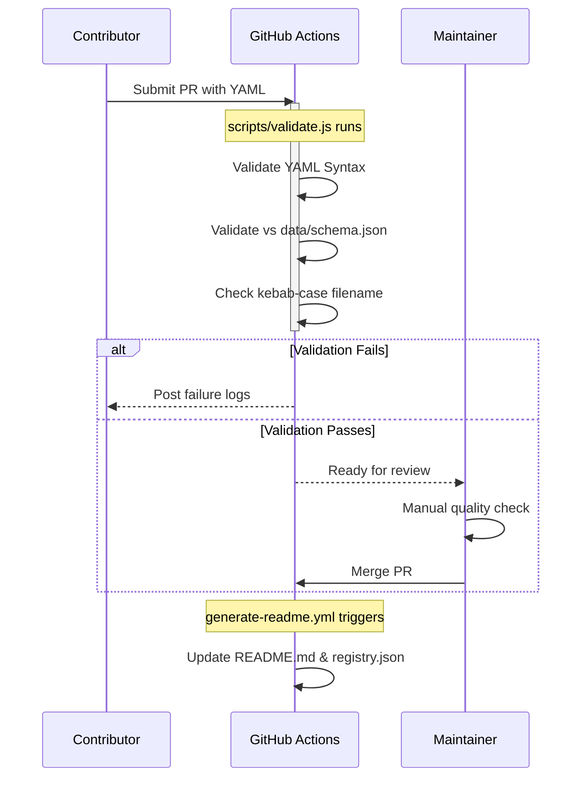

<!-- source: DeepWiki mcp.deepwiki.com · repo awesome-opencode/awesome-opencode · page 6 Contributing · fetched 2026-10-30 -->

# Contributing

<details>
<summary>Relevant source files</summary>

The following files were used as context for generating this wiki page:

- [.github/PULL_REQUEST_TEMPLATE.md](.github/PULL_REQUEST_TEMPLATE.md)
- [contributing.md](contributing.md)

</details>


This document describes the process for contributing new entries to the `awesome-opencode` catalog. Contributors add entries by creating YAML files in the `data/` directory rather than editing the generated `README.md` directly [[contributing.md:3-3]]().

For information about how the build system processes these YAML files into generated artifacts, see [Build System](#5). For details on the schema and validation rules applied to entries, see [Data Model](#3).

## Contribution Architecture

The contribution system follows a data-driven workflow where YAML files serve as the single source of truth. All documentation artifacts are generated from these files through automated build processes [[contributing.md:58-60]]().

### Submission Pipeline

The following diagram illustrates the path from a contributor's local environment to the final published artifacts.

```mermaid
graph TB
    ["Fork Repository"] --> ["Create YAML File"]
    ["Create YAML File"] --> DIR_SELECT{{"Select Directory"}}
    
    DIR_SELECT -->|"data/plugins/"| P_YAML["my-plugin.yaml"]
    DIR_SELECT -->|"data/themes/"| T_YAML["my-theme.yaml"]
    DIR_SELECT -->|"data/agents/"| A_YAML["my-agent.yaml"]
    DIR_SELECT -->|"data/projects/"| PR_YAML["my-project.yaml"]
    DIR_SELECT -->|"data/resources/"| R_YAML["my-resource.yaml"]
    
    P_YAML --> COMMIT["git commit & push"]
    T_YAML --> COMMIT
    A_YAML --> COMMIT
    PR_YAML --> COMMIT
    R_YAML --> COMMIT
    
    COMMIT --> PR["Open Pull Request"]
    
    PR --> VALIDATION{{"validate-pr.yml"}}
    VALIDATION -->|"Syntax Check"| JS_YAML["js-yaml.load()"]
    VALIDATION -->|"Schema Check"| SCHEMA["data/schema.json"]
    VALIDATION -->|"Business Rules"| RULES["tagline <= 120 chars"]
    
    JS_YAML -->|"Pass"| REVIEW{{"Maintainer Review"}}
    SCHEMA -->|"Pass"| REVIEW
    RULES -->|"Pass"| REVIEW
    
    REVIEW -->|"Approve"| MERGE["Merge to main"]
    
    MERGE --> GHA_BUILD[".github/workflows/generate-readme.yml"]
    GHA_BUILD --> GENSCRIPT["scripts/generate-readme.js"]
    GHA_BUILD --> EXPSCRIPT["scripts/export-json.js"]
    
    GENSCRIPT --> README["README.md"]
    EXPSCRIPT --> REGISTRY["dist/registry.json"]
```

**Contribution Flow from Fork to Publication**

The contribution process enforces data quality through automated validation layers before human review. Once merged, GitHub Actions automatically regenerate both human-readable and machine-readable artifacts [[contributing.md:53-58]]().

Sources: [contributing.md:1-61](), [.github/workflows/validate-pr.yml:1-25]()

## Quick Start

The contribution process is designed to be straightforward: fork the repository, add a single YAML file, and submit a PR.

1.  **Fork & Clone**: Create a local copy of the repository [[contributing.md:7-12]]().
2.  **Create YAML**: Add a file to the appropriate `data/{category}/` directory [[contributing.md:14-21]]().
3.  **Submit PR**: Push your changes and open a Pull Request on GitHub [[contributing.md:34-43]]().

For a step-by-step guide with command examples, see [Quick Start](#6.1).

Sources: [contributing.md:5-43]()

## Entry Requirements

To maintain catalog quality, every submission must meet specific standards:

*   **Relevance**: Must be directly related to the OpenCode ecosystem [[contributing.md:47-47]]().
*   **Accessibility**: The repository or homepage must be public [[contributing.md:48-48]]().
*   **Maintenance**: Active commits or updates within the last 6 months [[contributing.md:49-49]]().
*   **Completeness**: All required fields (`name`, `repo`, `tagline`, `description`) must be present [[contributing.md:27-32]]().

For a full list of quality standards and field constraints, see [Entry Requirements](#6.2).

Sources: [contributing.md:45-51](), [.github/PULL_REQUEST_TEMPLATE.md:15-22]()

## Pull Request Process

Every Pull Request triggers the `validate-pr.yml` workflow, which ensures the submission adheres to the project's technical requirements.

### Validation Workflow



**Pull Request Lifecycle**

Maintainers review the content for relevance and quality after automated checks pass. Once merged, the README and JSON registry are updated automatically—contributors should never edit these files manually [[contributing.md:53-60]]().

For details on the review workflow and automated triggers, see [Pull Request Process](#6.3).

Sources: [contributing.md:53-60](), [.github/workflows/validate-pr.yml:1-25]()

## File Naming Conventions

The repository uses a strict "one-file-per-entry" approach to avoid merge conflicts and simplify management.

*   **Format**: Filenames must be `kebab-case` (e.g., `my-cool-plugin.yaml`) [[contributing.md:23-23]]().
*   **Structure**: Files must be placed in the directory corresponding to their type (e.g., `data/plugins/`) [[contributing.md:16-21]]().
*   **Identification**: The `productId` used in the generated `registry.json` is derived directly from the filename [[.github/PULL_REQUEST_TEMPLATE.md:22-22]]().

For documentation on naming requirements and directory organization, see [File Naming Conventions](#6.4).

Sources: [contributing.md:14-23](), [.github/PULL_REQUEST_TEMPLATE.md:21-22]()

---

