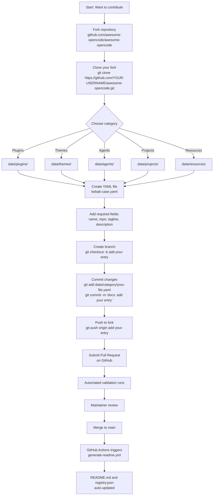
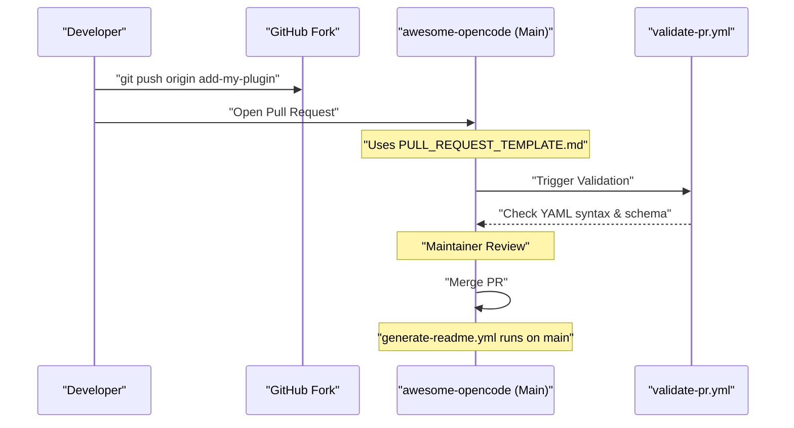

<!-- source: DeepWiki mcp.deepwiki.com · repo awesome-opencode/awesome-opencode · page 6.1 Quick Start · fetched 2026-10-30 -->

# Quick Start

<details>
<summary>Relevant source files</summary>

The following files were used as context for generating this wiki page:

- [.github/PULL_REQUEST_TEMPLATE.md](.github/PULL_REQUEST_TEMPLATE.md)
- [contributing.md](contributing.md)
- [data/examples/plugin.yaml](data/examples/plugin.yaml)

</details>


This page provides a step-by-step guide for contributors to add new entries to the `awesome-opencode` repository. By following these steps, you will fork the repository, create a YAML file in the appropriate category directory using provided examples as a reference, and submit a pull request. The automated build system then handles the generation of `README.md` and `registry.json`.

---

## Overview of the Contribution Workflow

The contribution process is designed to be simple and requires no manual editing of the main documentation. All data is stored as individual YAML files in the `data/` directory, organized by category.

**Contribution Workflow Diagram**



Sources: [contributing.md:1-61]()

---

## Step 1: Fork and Clone the Repository

Begin by forking the repository to your GitHub account, then clone it locally.

```bash
# Fork via GitHub UI at https://github.com/awesome-opencode/awesome-opencode
# Then clone your fork
git clone https://github.com/YOUR-USERNAME/awesome-opencode.git
cd awesome-opencode
```

Replace `YOUR-USERNAME` with your actual GitHub username.

Sources: [contributing.md:7-12]()

---

## Step 2: Choose the Appropriate Category Directory

The `data/` directory contains subdirectories for each entry type. Select the directory that matches your contribution:

| Category | Directory | Purpose | Reference Example |
|----------|-----------|---------|-------------------|
| Plugins | `data/plugins/` | JavaScript/TypeScript modules extending OpenCode | `data/examples/plugin.yaml` |
| Themes | `data/themes/` | JSON configurations for visual customization | N/A |
| Agents | `data/agents/` | AI agent configurations and SKILL.md files | N/A |
| Projects | `data/projects/` | Standalone applications, tools, and utilities | N/A |
| Resources | `data/resources/` | Guides, templates, and MCP server configs | N/A |

The directory location determines the entry's `type` field in the generated `registry.json`. No `type` field is needed in the YAML itself as it is inferred from the folder.

Sources: [contributing.md:14-22](), [data/examples/plugin.yaml:1-3]()

---

## Step 3: Create Your YAML File

Create a new file in the selected category directory. The filename must be in kebab-case format (lowercase with hyphens).

### File Naming Convention

```
data/plugins/my-plugin-name.yaml     ✓ Correct
data/plugins/MyPluginName.yaml       ✗ Wrong (not kebab-case)
data/plugins/my_plugin_name.yaml     ✗ Wrong (underscores)
```

Sources: [contributing.md:23-23](), [.github/PULL_REQUEST_TEMPLATE.md:21-22]()

---

## Step 4: Add YAML Content using Examples

Every entry must include four required fields: `name`, `repo`, `tagline`, and `description`. Use `data/examples/plugin.yaml` as a reference for the full schema.

### Required vs Optional Fields

| Field | Type | Description | Required? |
|-------|------|-------------|-----------|
| `name` | String | Display name of the entry | Yes |
| `repo` | URL | GitHub repository URL | Yes |
| `tagline` | String | Short summary (max 120 chars) | Yes |
| `description` | String | Full description (can be multi-line) | Yes |
| `scope` | Array | Installation scope: `global`, `project` | No |
| `tags` | Array | Strings for filtering | No |
| `min_version` | String | Minimum OpenCode version (semver) | No |
| `homepage` | URL | Documentation URL if different from repo | No |
| `installation` | Markdown | Custom installation instructions | No |

### Minimal Example

```yaml
name: Your Entry Name
repo: https://github.com/owner/repo
tagline: Short punchy summary (shown in collapsed view)
description: Longer description explaining what it does.
```

Sources: [contributing.md:27-32](), [data/examples/plugin.yaml:5-42](), [.github/PULL_REQUEST_TEMPLATE.md:28-33]()

---

## Step 5: Commit and Submit PR

Create a new branch, commit your YAML file, and push to your fork.

```bash
git checkout -b add-my-plugin
git add data/plugins/my-plugin.yaml
git commit -m "docs: add my-plugin to plugins"
git push origin add-my-plugin
```

When opening the Pull Request on GitHub, fill out the `PULL_REQUEST_TEMPLATE.md` which includes a checklist for relevance, public access, and maintenance status.

**PR Submission Flow**



Sources: [contributing.md:34-43](), [.github/PULL_REQUEST_TEMPLATE.md:1-22]()

---

## Step 6: Automated Validation and Merge

Once the PR is submitted, the following automated process begins:

1.  **Validation runs**: Automated checks verify the YAML format and schema.
2.  **Maintainer review**: A maintainer verifies the content for relevance and quality standards (e.g., active commits within the last 6 months).
3.  **Merge**: Once approved, the PR is merged into the `main` branch.
4.  **Auto-regeneration**: The system automatically regenerates `README.md` and `dist/registry.json`.

**Do not edit README.md directly.** It is derived from the YAML files in `data/`.

Sources: [contributing.md:45-60]()

---

