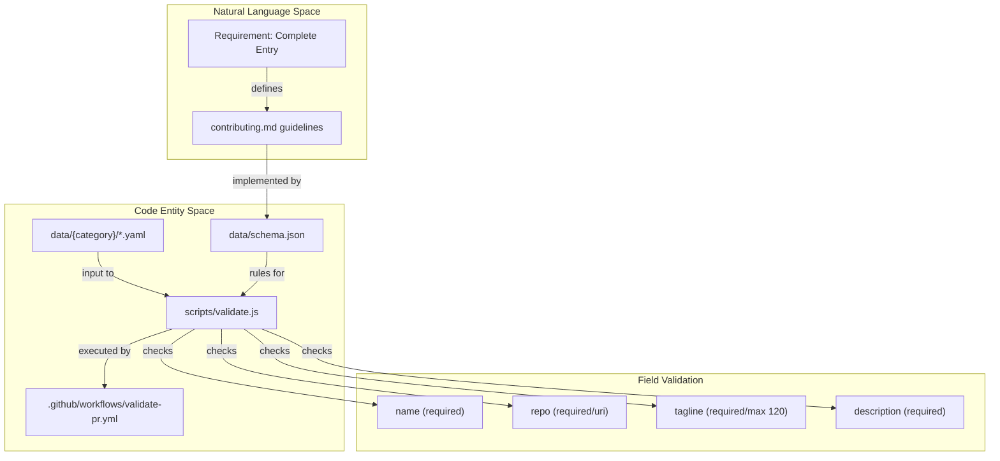
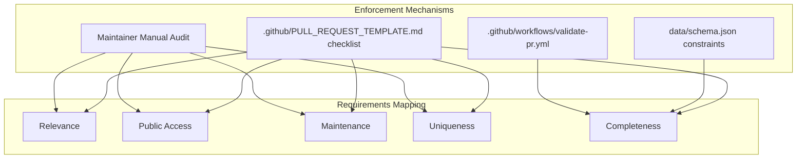

<!-- source: DeepWiki mcp.deepwiki.com · repo awesome-opencode/awesome-opencode · page 6.2 Entry Requirements · fetched 2026-10-30 -->

# Entry Requirements

<details>
<summary>Relevant source files</summary>

The following files were used as context for generating this wiki page:

- [.github/PULL_REQUEST_TEMPLATE.md](.github/PULL_REQUEST_TEMPLATE.md)
- [contributing.md](contributing.md)
- [data/schema.json](data/schema.json)
- [docs/schema-design.md](docs/schema-design.md)

</details>


## Purpose and Scope

This document defines the quality standards and acceptance criteria that all entries must meet to be included in the awesome-opencode registry. These requirements ensure that the catalog maintains high quality, relevance, and usability for both human users reading the README and machine consumers using the JSON registry.

For information about the submission process and workflow, see [Pull Request Process](#6.3). For technical details about required YAML fields and schema validation, see [Schema System](#3.1).

---

## Overview of Requirements

All entries submitted to the awesome-opencode registry must satisfy five core requirements. These requirements are checked during both automated validation and manual review stages of the pull request process.

| Requirement | Description | Enforcement Stage |
|-------------|-------------|-------------------|
| **Relevant** | Directly related to OpenCode ecosystem | Manual review |
| **Public** | Repository is publicly accessible | Automated + Manual |
| **Maintained** | Active commits within last 6 months | Manual review |
| **Unique** | Not a duplicate of existing entry | Manual review |
| **Complete** | All required YAML fields included | Automated validation |

Sources: [contributing.md:45-51](), [.github/PULL_REQUEST_TEMPLATE.md:16-22]()

---

## Requirement 1: Relevance to OpenCode

### Definition

Entries must be **directly related to the OpenCode ecosystem**. This means the entry must serve one of the purposes defined by the directory structure in `data/`:

- **Plugin**: JavaScript/TypeScript modules extending core functionality [docs/schema-design.md:48-50]().
- **Theme**: JSON configurations for visual customization [docs/schema-design.md:61-63]().
- **Agent**: AI agent configurations and `SKILL.md` instruction sets [docs/schema-design.md:74-77]().
- **Project**: Standalone tools, GUIs, or integrations built for OpenCode [docs/schema-design.md:88-90]().
- **Resource**: Guides, MCP servers, or configuration templates [docs/schema-design.md:98-102]().
- **Fork**: Modified builds of OpenCode with custom features [docs/schema-design.md:115-117]().

### Validation Method

This requirement is primarily enforced through **manual review** by maintainers. The automated validation system verifies the file location but does not assess the semantic relevance of the content.

### Rejection Criteria

Entries will be rejected if they:
- Are generic tools with no OpenCode-specific integration.
- Are unrelated to coding, AI agents, or developer tools.
- Duplicate functionality of the core OpenCode product without differentiation.

Sources: [contributing.md:47](), [.github/PULL_REQUEST_TEMPLATE.md:17](), [docs/schema-design.md:44-123]()

---

## Requirement 2: Public Accessibility

### Definition

The entry's repository must be **publicly accessible** without authentication requirements. This ensures that:
- Users can freely discover and install the entry.
- The repository URL in the `repo` field can be validated.
- The community can assess quality and maintenance status.

### Technical Implementation

The `repo` field in YAML must be a valid URI pointing to a public repository [data/schema.json:13-17]().

```yaml
repo: https://github.com/owner/repository-name
```

### Validation Method

1. **Automated**: The `validate.js` script (via `schema.json`) checks that the `repo` field is a valid URI format [data/schema.json:15]().
2. **Manual**: Maintainers verify the link is reachable and contains the source code described.

Sources: [contributing.md:48](), [.github/PULL_REQUEST_TEMPLATE.md:18](), [data/schema.json:13-17]()

---

## Requirement 3: Active Maintenance

### Definition

Entries must demonstrate **active maintenance** with commits or releases within the **last 6 months** [contributing.md:49](). This requirement ensures:
- Entries remain compatible with current OpenCode versions.
- Security vulnerabilities are addressed.
- The catalog doesn't accumulate abandoned projects.

### Validation Method

**Manual review** by maintainers who check the repository's commit history and issue activity.

### Grace Period

Projects may be retained if:
- They are feature-complete and stable (no active bugs).
- Maintainers explicitly mark them as "complete" rather than abandoned.
- They have recent community activity (forks, PRs from others).

Sources: [contributing.md:49](), [.github/PULL_REQUEST_TEMPLATE.md:19]()

---

## Requirement 4: Uniqueness

### Definition

Entries must **not duplicate existing catalog entries** [contributing.md:50](). The catalog avoids:
- Multiple listings for the same repository.
- Near-identical functionality with minimal differentiation.
- Forks without substantial new features.

### Validation Method

**Manual review** by maintainers who search existing YAML files in `data/` for matching repository URLs or names.

Sources: [contributing.md:50](), [.github/PULL_REQUEST_TEMPLATE.md:20]()

---

## Requirement 5: Completeness

### Definition

Entries must include **all required YAML fields** as defined in the JSON schema [data/schema.json:61]().

| Field | Type | Constraint | Purpose |
|-------|------|------------|---------|
| `name` | string | minLength: 1 | Display name of the project [data/schema.json:8-12]() |
| `repo` | string | format: uri | Public repository URL [data/schema.json:13-17]() |
| `tagline` | string | max 120 chars | Short summary for collapsed views [data/schema.json:18-23]() |
| `description` | string | minLength: 1 | Full explanation of the project [data/schema.json:24-28]() |

### Validation Flow

The following diagram illustrates how the `validate.js` script and `schema.json` enforce completeness.

**Entry Validation Logic**


Sources: [data/schema.json:61](), [contributing.md:51](), [contributing.md:27-32]()

---

## Requirements Enforcement Architecture

The enforcement of these standards is split between the contributor's self-check, automated CI pipelines, and manual human review.

**Enforcement Strategy Mapping**


### Business Rules Beyond Schema

In addition to the JSON schema, the repository enforces several technical conventions:
1. **File Naming**: YAML filename must be kebab-case (e.g., `my-plugin.yaml`) [contributing.md:23]().
2. **Directory Placement**: Entries must be in the correct subfolder of `data/` (e.g., `data/plugins/`) [contributing.md:16-21]().
3. **Derived Fields**: The `type` of an entry is derived from its parent directory, and `productId` is derived from the filename [docs/schema-design.md:17]().

Sources: [contributing.md:23](), [contributing.md:45-51](), [docs/schema-design.md:17](), [data/schema.json:1-63]()

---

## Validation Examples

### Valid Entry
```yaml
name: CC Safety Net
repo: https://github.com/opencode-ai/cc-safety-net
tagline: Prevents destructive commands in OpenCode
description: A security-focused plugin that intercepts shell commands.
```

### Invalid Entry (Too Long Tagline)
```yaml
name: Long Tagline Plugin
repo: https://github.com/user/repo
tagline: This tagline is way too long because it tries to explain every single feature of the plugin in more than one hundred and twenty characters which violates the schema.
description: Valid description.
```
**Result**: `scripts/validate.js` will report a schema violation because `tagline` exceeds `maxLength: 120` [data/schema.json:21]().

### Invalid Entry (Missing Required Field)
```yaml
name: Missing Description Plugin
repo: https://github.com/user/repo
tagline: A useful tool
```
**Result**: `scripts/validate.js` will fail because `description` is in the `required` array [data/schema.json:61]().

Sources: [data/schema.json:18-28](), [data/schema.json:61](), [contributing.md:27-32]()

---

