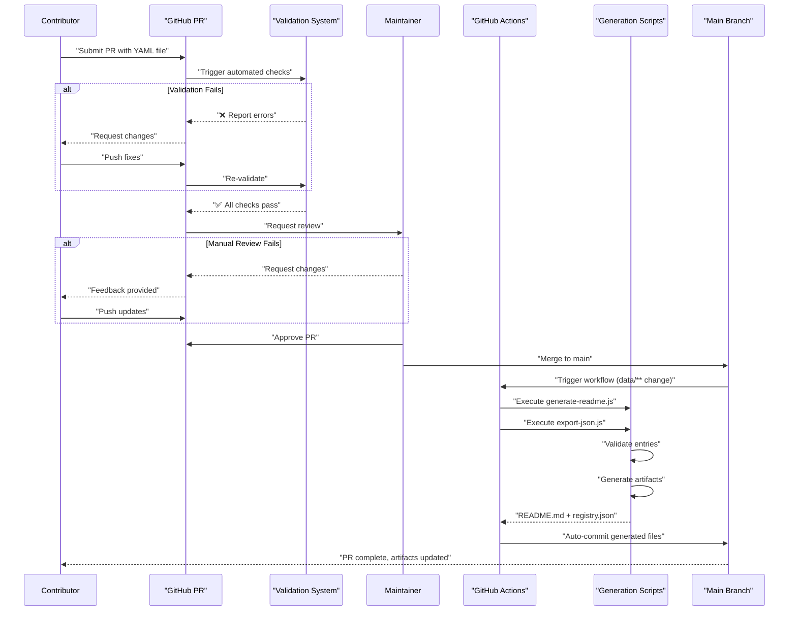
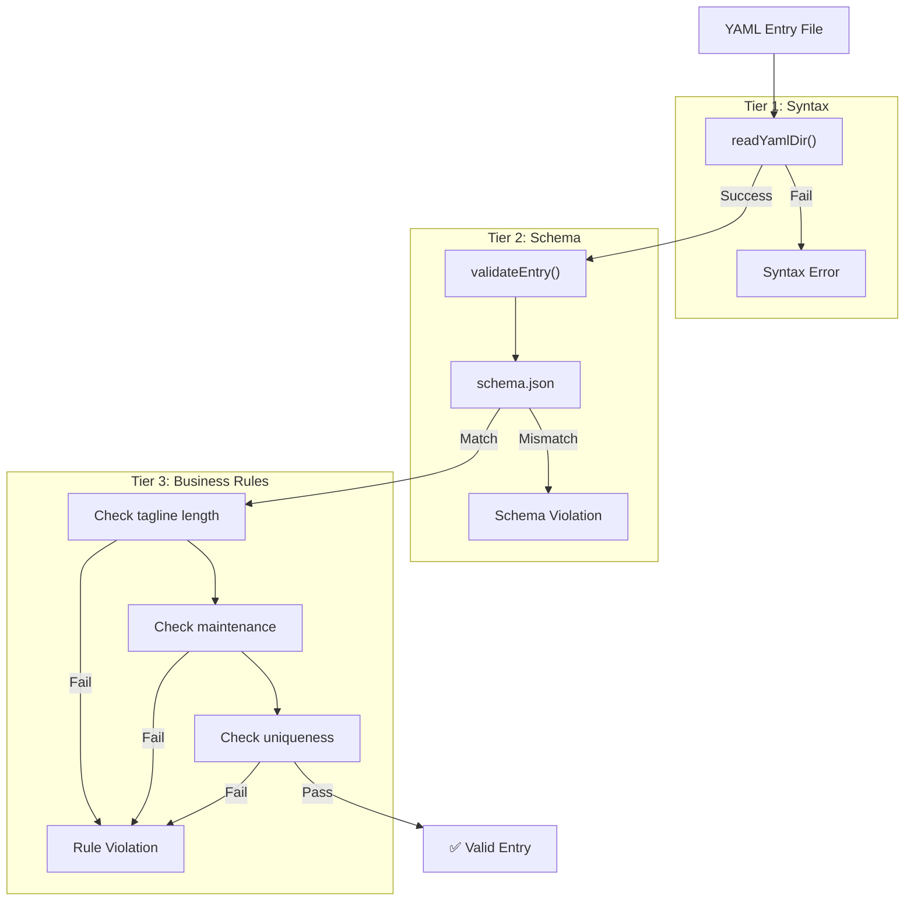
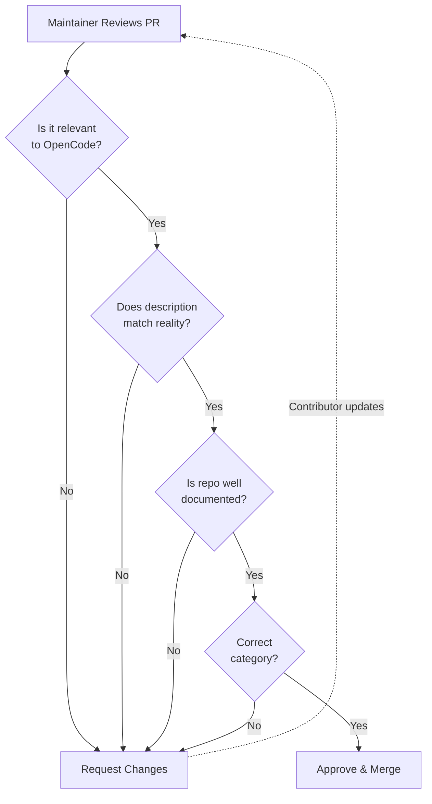
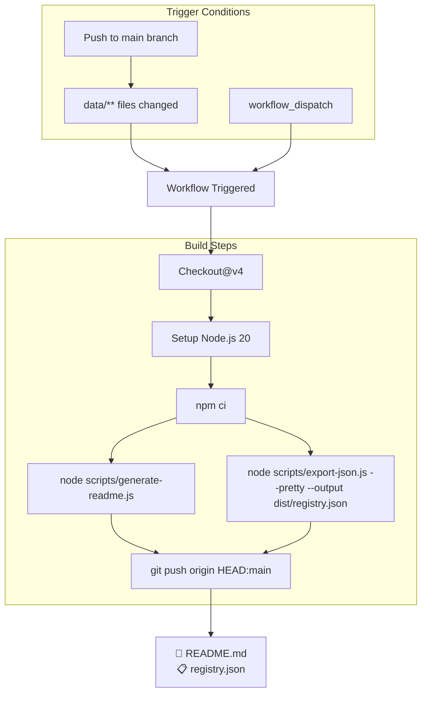
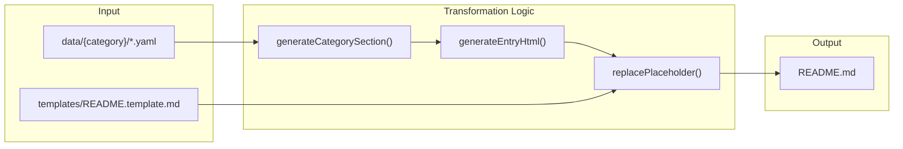

<!-- source: DeepWiki mcp.deepwiki.com · repo awesome-opencode/awesome-opencode · page 6.3 Pull Request Process · fetched 2026-10-30 -->

# Pull Request Process

<details>
<summary>Relevant source files</summary>

The following files were used as context for generating this wiki page:

- [.github/PULL_REQUEST_TEMPLATE.md](.github/PULL_REQUEST_TEMPLATE.md)
- [.github/workflows/generate-readme.yml](.github/workflows/generate-readme.yml)
- [contributing.md](contributing.md)
- [scripts/generate-readme.js](scripts/generate-readme.js)
- [scripts/utils/template.js](scripts/utils/template.js)

</details>


## Purpose and Scope

This document explains the complete pull request (PR) review workflow from submission to merge and automated artifact regeneration. It covers automated validation, maintainer review criteria, and the CI/CD pipeline that regenerates `README.md` and `dist/registry.json` after merge.

For guidelines on creating YAML entries and requirements, see [6.2 Entry Requirements](). For step-by-step submission instructions, see [6.1 Quick Start]().

---

## Pull Request Lifecycle Overview

The PR process consists of three sequential phases: automated validation, manual review, and post-merge regeneration. Each phase must complete successfully before proceeding to the next.

### Workflow Sequence Diagram



**Sources:** [.github/workflows/generate-readme.yml:1-12](), [contributing.md:53-60](), [.github/PULL_REQUEST_TEMPLATE.md:1-36]()

---

## Phase 1: Automated Validation

When a PR is submitted, the validation system performs checks to ensure data quality. These checks run automatically before any manual review begins.

### Three-Tier Validation Pipeline

| Tier | Check Type | Validates | Failure Example |
|------|-----------|-----------|-----------------|
| **1** | YAML Syntax | Valid YAML format | Malformed indentation, unclosed quotes |
| **2** | Schema Structure | Required fields, data types | Missing `repo` field, invalid URL format |
| **3** | Business Rules | Content quality standards | Tagline >120 chars, inactive repository |

### Validation Implementation

The validation logic is implemented in utility scripts and called during the generation phase to prevent invalid data from entering the registry.



The validation process is integrated into the generation scripts:

- **Entry Validation:** Handled by `validateEntry()` and `formatValidationErrors()` [scripts/generate-readme.js:12-12]().
- **Error Handling:** Entries failing validation are logged and skipped during README generation [scripts/generate-readme.js:51-61]().
- **Process Exit:** The generation script exits with status `1` if any validation errors are found to block the CI pipeline [scripts/generate-readme.js:149-149]().

### Common Validation Failures

**Schema Violations:**
- Missing required fields: `name`, `repo`, `tagline`, `description` [contributing.md:27-32]().
- Malformed URLs in the `repo` field [contributing.md:29-29]().

**Business Rule Violations:**
- Tagline exceeds 120 characters [contributing.md:30-30]().
- Repository shows no commits in last 6 months (inactive maintenance) [contributing.md:49-49]().
- Duplicate entry exists in same category [contributing.md:50-50]().
- Filename not in kebab-case format [contributing.md:23-23]().

**Sources:** [scripts/generate-readme.js:49-77](), [contributing.md:45-51](), [.github/PULL_REQUEST_TEMPLATE.md:16-22]()

---

## Phase 2: Manual Review

After automated validation passes, a maintainer reviews the PR for content quality, relevance, and accuracy.

### Review Criteria

Maintainers verify the following criteria that cannot be fully automated:

| Criterion | Description | Rejection Examples |
|-----------|-------------|-------------------|
| **Relevance** | Directly related to OpenCode ecosystem | Generic dev tools, unrelated projects |
| **Accuracy** | Description matches actual functionality | Misleading claims, outdated information |
| **Quality** | Well-documented, production-ready | Experimental prototypes, broken repos |
| **Completeness** | Description provides sufficient context | Vague descriptions, missing key details |
| **Category** | Placed in correct `data/` subdirectory | Plugin categorized as project |

### Pull Request Template Checklist

Contributors use the PR template to self-verify requirements:

```yaml
## Checklist

- [ ] Relevant to OpenCode
- [ ] Repository is public and accessible
- [ ] Actively maintained
- [ ] Not a duplicate
- [ ] YAML file in correct folder (`data/{category}/`)
- [ ] Filename is kebab-case (e.g., `my-plugin.yaml`)
```

**Template Location:** [.github/PULL_REQUEST_TEMPLATE.md:15-23]()

### Review Decision Tree



**Sources:** [contributing.md:45-51](), [.github/PULL_REQUEST_TEMPLATE.md:16-22]()

---

## Phase 3: Post-Merge Regeneration

Upon merge to `main`, the `Auto-Generate README` workflow automatically regenerates all documentation artifacts. This ensures `README.md` and `dist/registry.json` remain synchronized with the YAML source files.

### GitHub Actions Workflow

The workflow is defined in `.github/workflows/generate-readme.yml` and triggers on:

1. **Push to main** with changes in `data/**` paths [.github/workflows/generate-readme.yml:4-8]().
2. **Manual trigger** via `workflow_dispatch` [.github/workflows/generate-readme.yml:9]().



### Workflow Implementation Detail

The workflow uses a retry loop to handle race conditions where multiple PRs might be merged simultaneously [.github/workflows/generate-readme.yml:44-66]().

**Step 1: Environment Setup**
- Checkout repository with `persist-credentials: true` [.github/workflows/generate-readme.yml:23-27]().
- Setup Node.js 20 and install dependencies [.github/workflows/generate-readme.yml:29-35]().

**Step 2: Generation Logic**
- `generate-readme.js`: Reads `templates/README.template.md` using `readTemplate()` [scripts/utils/template.js:12-15](), processes each category in `CATEGORIES` [scripts/generate-readme.js:16](), and writes the final file via `writeReadme()` [scripts/utils/template.js:75-78]().
- `export-json.js`: Exports the machine-readable registry [.github/workflows/generate-readme.yml:50]().

**Step 3: Automated Commit**
- The bot configures its identity as `github-actions[bot]` [.github/workflows/generate-readme.yml:41-42]().
- If changes are detected in `README.md` or `dist/registry.json`, it commits with the message `"docs: auto-regenerate README and registry data"` [.github/workflows/generate-readme.yml:57-58]().

### README Generation Process

The `generate-readme.js` script performs the following transformations:



**Key Features:**
- **HTML Generation:** Entries are rendered as `<details>` elements [scripts/utils/template.js:61-68]().
- **GitHub Badges:** Star badges are automatically added for standard GitHub repositories [scripts/utils/template.js:52-57]().
- **Sorting:** Entries are sorted alphabetically (case-insensitive) within their categories [scripts/generate-readme.js:64-68]().

**Sources:** [.github/workflows/generate-readme.yml:37-66](), [scripts/generate-readme.js:82-144](), [scripts/utils/template.js:34-69]()

---

## Expected Timeline and Feedback

### Timeline Estimates

| Phase | Duration | Notes |
|-------|----------|-------|
| Automated Validation | < 1 minute | Feedback on syntax and schema |
| Manual Review | 1-3 days | Depends on maintainer availability |
| Post-Merge Build | 1-2 minutes | Automatic regeneration of artifacts |

### Receiving Feedback

**Validation Errors:**
- Displayed in the PR logs.
- Errors are formatted via `formatValidationErrors()` [scripts/generate-readme.js:57]().
- Affected entries are skipped from generation until fixed [scripts/generate-readme.js:138]().

**Build Failures:**
- If the generation scripts fail (e.g., missing template), the workflow exits with status `1` [.github/workflows/generate-readme.yml:69]().
- The `Auto-Generate README` workflow uses a concurrency group `auto-generate-readme-main` to prevent overlapping runs [.github/workflows/generate-readme.yml:14-16]().

**Sources:** [contributing.md:53-60](), [.github/workflows/generate-readme.yml:1-17](), [scripts/generate-readme.js:147-155]()

---

