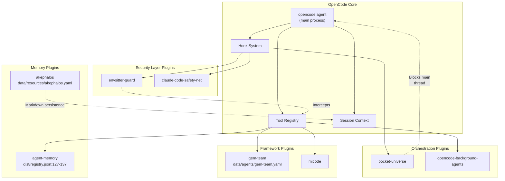
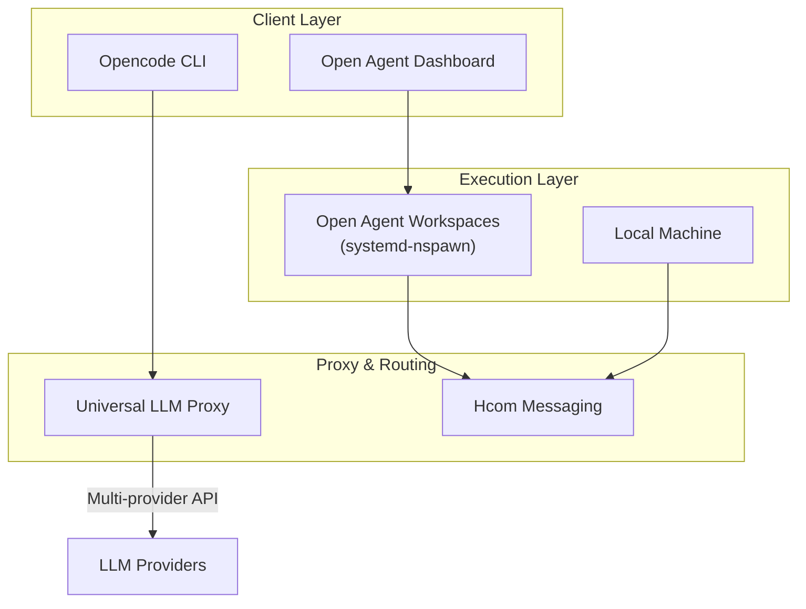

<!-- source: DeepWiki mcp.deepwiki.com · repo awesome-opencode/awesome-opencode · page 7 Notable Examples · fetched 2026-10-30 -->

# Notable Examples

Relevant source files

The following files were used as context for generating this wiki page:

- [README.md](README.md)
- [data/agents/gem-team.yaml](data/agents/gem-team.yaml)
- [data/plugins/opencode-mystatus.yaml](data/plugins/opencode-mystatus.yaml)
- [data/resources/akephalos.yaml](data/resources/akephalos.yaml)
- [dist/registry.json](dist/registry.json)
- [scripts/export-json.js](scripts/export-json.js)

This page showcases significant entries from the Awesome OpenCode catalog that exemplify different categories, use cases, and architectural patterns. These examples illustrate how the ecosystem has evolved to address specific developer needs, from security and orchestration to memory management and multi-agent coordination.

For general information about entry types and their schemas, see [Entry Types](#4). For detailed deep-dives into specific featured items, see [Featured Plugins](#7.1) and [Featured Projects](#7.2).

---

## Overview of Notable Patterns

The catalog contains several distinct patterns that have emerged within the OpenCode ecosystem:

| Pattern | Purpose | Example Entries |
|---------|---------|-----------------|
| **Security & Safety** | Prevent unintended actions or data leaks | `envsitter-guard`, `claude-code-safety-net` |
| **Async Orchestration** | Coordinate parallel subagent execution | `pocket-universe`, `opencode-background-agents` |
| **Memory Systems** | Persistent context across sessions | `akephalos`, `opencode-agent-memory` |
| **Multi-Agent Frameworks** | Complete orchestration harnesses | `gem-team`, `micode`, `nerv` |
| **Control Planes** | External management interfaces | `open-agent`, `vibe-kanban` |
| **Infrastructure Tools** | Supporting utilities | `universal-llm-proxy`, `hcom` |

Sources: [README.md:49-1036](), [dist/registry.json:46-68]()

---

## Plugin Architecture Patterns

The following diagram illustrates how notable plugins integrate with OpenCode's core architecture by hooking into the agent process or extending the tool registry.

**OpenCode Plugin Integration Map**

Sources: [README.md:83-89](), [dist/registry.json:127-137](), [data/resources/akephalos.yaml:1-7](), [data/agents/gem-team.yaml:1-5]()

---

## Featured Plugins

Detailed analysis of these plugins can be found in [Featured Plugins](#7.1).

### Security and Safety
*   **Envsitter Guard**: Prevents agents from reading sensitive `.env` values while allowing key inspection via deterministic fingerprints.
*   **CC Safety Net**: A "safety net" that catches destructive git and filesystem commands before execution [README.md:128-134]().

### Orchestration and Async Coordination
*   **Pocket Universe**: Solves the "fire and forget" problem by providing a closed-loop execution environment that blocks the main thread until subagents complete [README.md:425-431]().
*   **Micode**: An AST-aware multi-agent workflow that optimizes code understanding and modification tasks [README.md:214-220]().

### Observability
*   **OpenTelemetry Plugin**: Provides industry-standard observability for agent actions and tool executions [README.md:386-392]().

For more technical details on implementation, see [Featured Plugins](#7.1).

---

## Featured Projects

Detailed analysis of these projects can be found in [Featured Projects](#7.2).

### Control Planes and Management
*   **Open Agent**: A self-hosted control plane that uses `systemd-nspawn` for isolated Linux workspaces and features a multi-platform dashboard.
*   **Vibe Kanban**: A task management system specifically designed for agent-led development workflows [README.md:1020-1026]().

### Infrastructure and Tooling
*   **Universal LLM Proxy**: A gateway that translates OpenAI/Anthropic API calls to multiple providers, supporting intelligent load balancing.
*   **Hcom**: A messaging protocol and toolset for inter-agent communication, allowing disparate agents to collaborate [README.md:739-745]().

**Project Infrastructure Overview**

Sources: [README.md:739-745](), [README.md:1020-1026]()

For more technical details on implementation, see [Featured Projects](#7.2).

---

## Ecosystem Integration Examples

### Quota Management
The `opencode-mystatus` plugin exemplifies how the ecosystem handles multi-provider infrastructure. It allows users to check subscription quotas for OpenAI, Zhipu AI, and Google Antigravity within a single command [data/plugins/opencode-mystatus.yaml:1-5]().

### Multi-Agent Framework Evolution
The ecosystem has evolved from simple tool additions to complex frameworks like **NERV**, which scaffolds 45+ files including SDD skills, slash commands, and persistent semantic memory (MAGI) via `nerv init` [dist/registry.json:58-68]().

Sources: [data/plugins/opencode-mystatus.yaml:1-5](), [dist/registry.json:58-68]()

---

