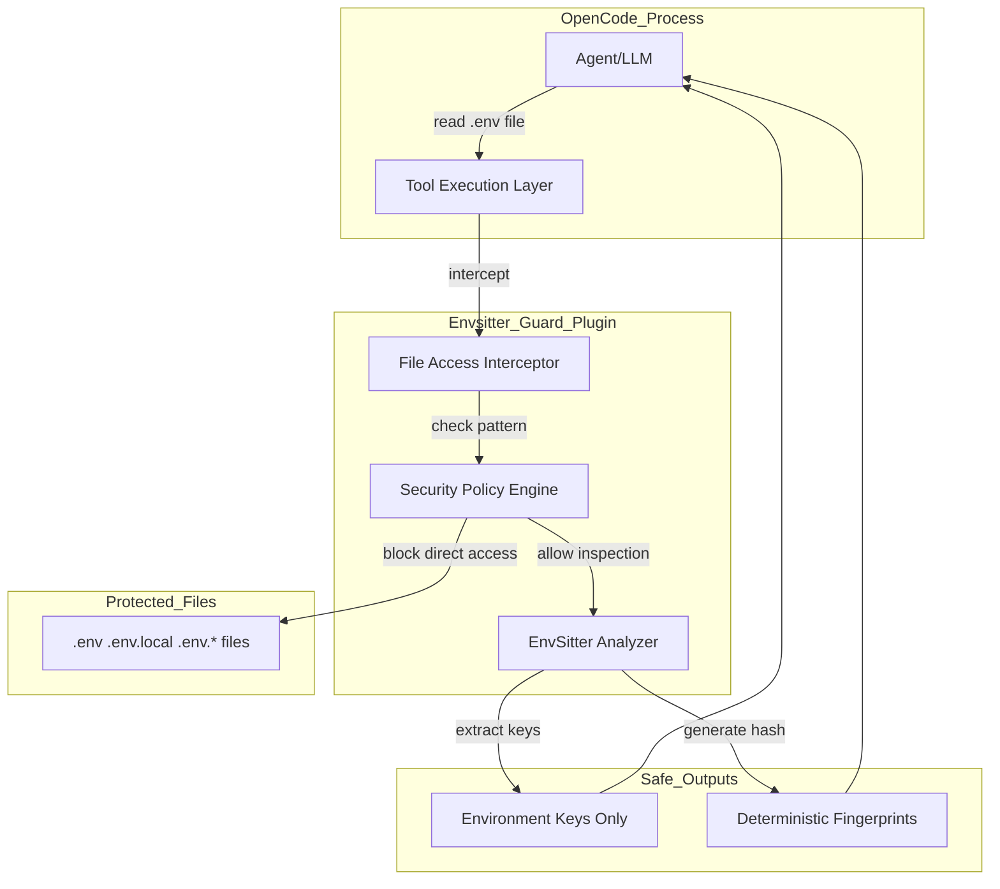
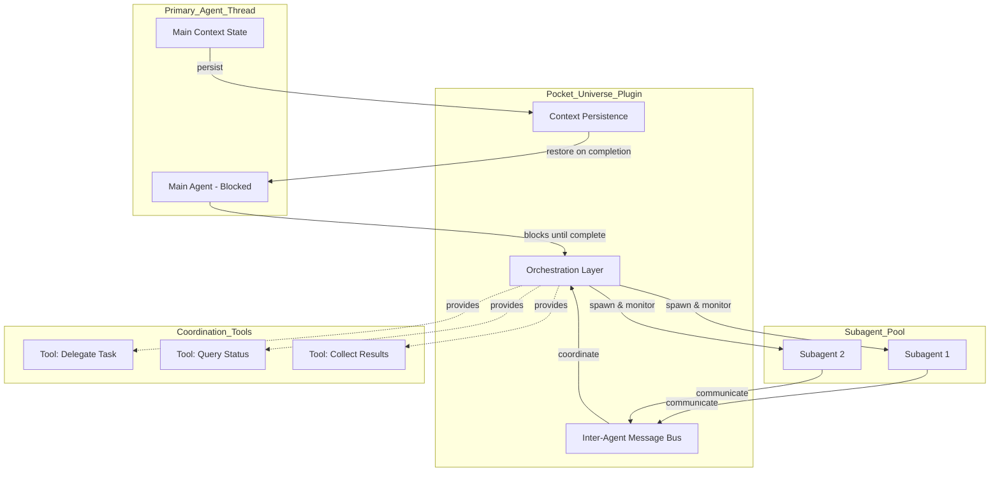
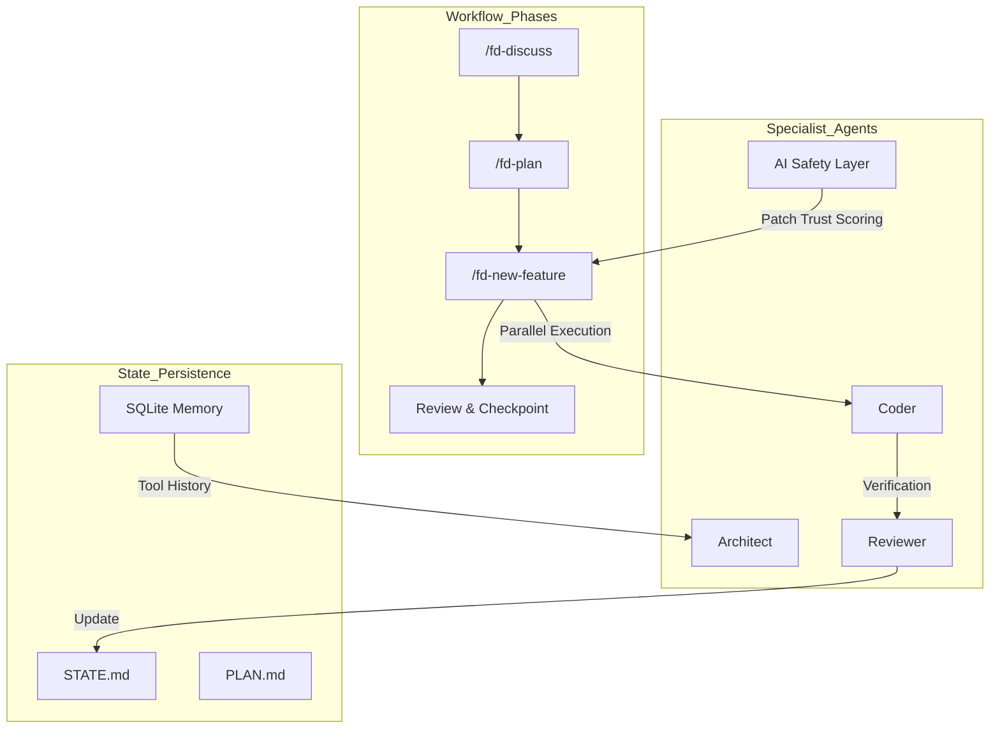

<!-- source: DeepWiki mcp.deepwiki.com · repo awesome-opencode/awesome-opencode · page 7.1 Featured Plugins · fetched 2026-10-30 -->

# Featured Plugins

Relevant source files

The following files were used as context for generating this wiki page:

- [data/plugins/envsitter-guard.yaml](data/plugins/envsitter-guard.yaml)
- [data/plugins/flowdeck.yaml](data/plugins/flowdeck.yaml)
- [data/plugins/hiai-opencode.yaml](data/plugins/hiai-opencode.yaml)
- [data/plugins/opencode-plugin-otel.yaml](data/plugins/opencode-plugin-otel.yaml)
- [data/plugins/pocket-universe.yaml](data/plugins/pocket-universe.yaml)
- [data/projects/open-agent.yaml](data/projects/open-agent.yaml)

This document highlights significant plugins from the OpenCode ecosystem that demonstrate notable architectural patterns, solve critical problems, or provide exceptional functionality. These plugins serve as exemplars for understanding the breadth and depth of OpenCode's extensibility.

For information about the plugin data model and schema requirements, see [Plugins](#4.1). For the complete catalog of all available plugins, refer to the generated `README.md`.

---

## Selection Criteria

Featured plugins are selected based on:

- **Architectural Innovation**: Novel approaches to OpenCode extension patterns.
- **Problem Significance**: Solutions to critical security, performance, or workflow challenges.
- **Technical Complexity**: Sophisticated implementations that push plugin capabilities.
- **Ecosystem Impact**: Wide applicability or unique functionality.

---

## Security & Environment Protection

### Envsitter Guard
**Repository**: [envsitter-guard](https://github.com/boxpositron/envsitter-guard)  
**Category**: Security plugin preventing sensitive data leakage.

Envsitter Guard addresses a critical security concern in AI-assisted development: preventing LLM agents from inadvertently reading or exposing sensitive environment variables stored in `.env` files [data/plugins/envsitter-guard.yaml:4-4]().

**Diagram: Envsitter Guard Data Flow**

**Key Implementation Details**:
- **Access Pattern**: Intercepts file operations before they reach the OpenCode tool layer.
- **Inspection Mode**: Provides `EnvSitter` API returning key names and deterministic fingerprints (hashes) but never actual secret values [data/plugins/envsitter-guard.yaml:4-4]().
- **Pattern Matching**: Blocks reads/writes to files matching `.env*` glob patterns.
- **Zero-Knowledge Verification**: Agents can verify environment configuration exists without accessing secrets.

**Sources**: [data/plugins/envsitter-guard.yaml:1-5]()

---

## Async Agent Orchestration

### Pocket Universe
**Repository**: [pocket-universe](https://github.com/spoons-and-mirrors/pocket-universe)  
**Category**: Subagent orchestration and coordination.

Pocket Universe solves the "fire-and-forget" problem inherent in async agent delegation by extending OpenCode's native subagent paradigm with closed-loop, resilient coordination [data/plugins/pocket-universe.yaml:4-4]().

**Diagram: Pocket Universe Orchestration**

**Key Implementation Details**:
- **Blocking Paradigm**: Main agent execution blocks until all subagents complete, preventing context loss [data/plugins/pocket-universe.yaml:4-4]().
- **Three-Tool System**: Ships with three specific tools to create a robust system for parallel subagents to communicate and coordinate work [data/plugins/pocket-universe.yaml:4-4]().
- **Context Preservation**: Maintains full conversation context across async boundaries.

**Sources**: [data/plugins/pocket-universe.yaml:1-5]()

---

## Observability & Monitoring

### OpenTelemetry Plugin (opencode-plugin-otel)
**Repository**: [opencode-plugin-otel](https://github.com/DEVtheOPS/opencode-plugin-otel)  
**Category**: Telemetry and Observability.

This plugin exports metrics, logs, and traces from OpenCode sessions via OTLP/gRPC to any OpenTelemetry-compatible backend (Datadog, Honeycomb, Grafana, etc.) [data/plugins/opencode-plugin-otel.yaml:4-4]().

**Instrumentation Scope**:
- **Session Lifecycle**: Tracks session start/stop events.
- **Token Usage & Cost**: Mirrors Claude Code monitoring signals for resource consumption [data/plugins/opencode-plugin-otel.yaml:4-4]().
- **Tool Performance**: Measures durations of tool executions.
- **Git Integration**: Instruments git commits performed by agents.

**Sources**: [data/plugins/opencode-plugin-otel.yaml:1-5]()

---

## Advanced Multi-Agent Workflows

### FlowDeck
**Repository**: [FlowDeck](https://github.com/DVNghiem/FlowDeck)  
**Category**: Multi-agent orchestration and safety.

FlowDeck represents the most comprehensive orchestration plugin in the registry, coordinating 25 specialist agents through a structured four-phase lifecycle: discuss, plan, execute, and review [data/plugins/flowdeck.yaml:5-8]().

**Diagram: FlowDeck Orchestration Cycle**

**Key Features**:
- **Persistence**: Uses `.planning/STATE.md` to allow sessions to survive restarts [data/plugins/flowdeck.yaml:12-12]().
- **Safety Intelligence**: Implements patch trust scoring, edit gates, and failure replay [data/plugins/flowdeck.yaml:14-14]().
- **Parallelism**: Employs wave-based parallel execution for independent tasks [data/plugins/flowdeck.yaml:13-13]().
- **Ensemble Reasoning**: Uses `/fd-council` to synthesize consensus from multiple agents [data/plugins/flowdeck.yaml:17-17]().

**Sources**: [data/plugins/flowdeck.yaml:1-50]()

---

### hiai-opencode
**Repository**: [hiai-opencode](https://github.com/HiAi-gg/hiai-opencode)  
**Category**: Unified Agent Model.

A canonical 12-agent model (including Bob, Coder, Strategist, and Guard) that bundles comprehensive capabilities into a single installation [data/plugins/hiai-opencode.yaml:4-4]().

**Bundled Capabilities**:
- **Multi-Layer Continuation**: Features the `ralph-loop` and `ULTRAWORK` auto-start systems for sustained agent activity [data/plugins/hiai-opencode.yaml:4-4]().
- **Integrated Tooling**: Bundles MCP wiring for Playwright, Firecrawl, and RAG [data/plugins/hiai-opencode.yaml:4-4]().
- **Skill Materialization**: Includes hidden sub-skills and agent-specific specialized skills [data/plugins/hiai-opencode.yaml:4-4]().

**Sources**: [data/plugins/hiai-opencode.yaml:1-5]()

---

## Plugin Data Model Reference

All featured plugins are defined using the common schema in `data/plugins/*.yaml` with the following required fields:

| Field | Type | Purpose |
|-------|------|---------|
| `name` | string | Plugin display name |
| `repo` | string | GitHub repository URL |
| `tagline` | string | Brief description (≤120 chars) |
| `description` | string | Detailed explanation of functionality |

**Type Derivation**: Plugin entries are automatically classified as `type: "plugin"` based on their location in the `data/plugins/` directory, following the repository's convention-over-configuration architecture.

**Sources**: [data/plugins/envsitter-guard.yaml:1-5](), [data/plugins/pocket-universe.yaml:1-5](), [data/plugins/flowdeck.yaml:1-31]()

---

