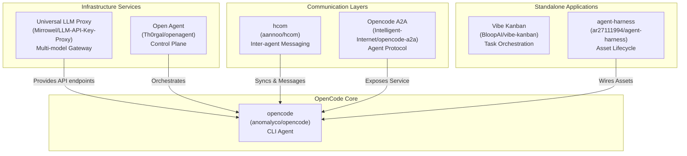
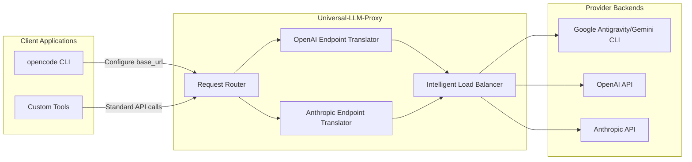
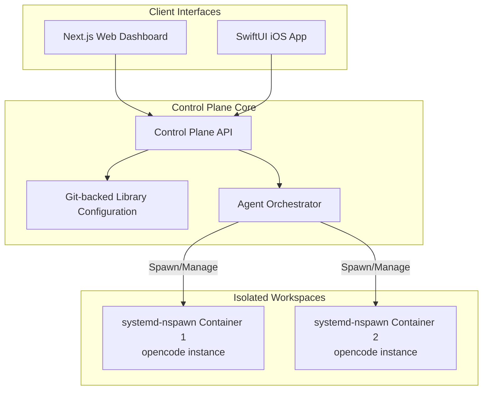
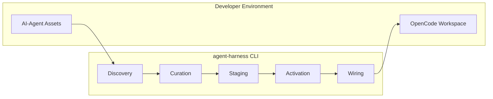

<!-- source: DeepWiki mcp.deepwiki.com · repo awesome-opencode/awesome-opencode · page 7.2 Featured Projects · fetched 2026-10-30 -->

# Featured Projects

Relevant source files

The following files were used as context for generating this wiki page:

- [data/plugins/envsitter-guard.yaml](data/plugins/envsitter-guard.yaml)
- [data/projects/agent-harness.yaml](data/projects/agent-harness.yaml)
- [data/projects/open-agent.yaml](data/projects/open-agent.yaml)
- [data/projects/opencode-a2a.yaml](data/projects/opencode-a2a.yaml)
- [data/projects/universal-llm-proxy.yaml](data/projects/universal-llm-proxy.yaml)

This page showcases notable standalone projects from the awesome-opencode catalog. Projects are distinct from plugins (see [Featured Plugins](#7.1)) in that they are independent applications, tools, or infrastructure components that integrate with or support the OpenCode ecosystem, rather than being installed as extensions within OpenCode itself.

For information about the general definition and schema of project entries, see [Projects](#4.4). For the complete list of all projects in the catalog, refer to the generated `README.md`.

## Project Categories Overview

Projects in the awesome-opencode catalog fall into several architectural categories based on their integration patterns with OpenCode:

**Sources:** [data/projects/universal-llm-proxy.yaml:1-13](), [data/projects/open-agent.yaml:1-5](), [data/projects/opencode-a2a.yaml:1-5](), [data/projects/agent-harness.yaml:1-11]()

## Universal LLM API Proxy

The Universal LLM API Proxy (`Mirrowel/LLM-API-Key-Proxy`) is a multi-provider gateway that translates between different LLM APIs, enabling OpenCode to use any LLM through standardized OpenAI or Anthropic-compatible endpoints.

### Architecture

**Sources:** [data/projects/universal-llm-proxy.yaml:1-4]()

### Key Features

The proxy provides several critical capabilities documented in [data/projects/universal-llm-proxy.yaml:4]():

| Feature | Description |
|---------|-------------|
| **API Translation** | Converts OpenAI/Anthropic requests to provider-specific formats |
| **Multi-Provider Support** | Best-in-class support for Antigravity/Gemini CLI |
| **Load Balancing** | Intelligent request distribution across multiple backends |
| **Zero-Code Integration** | Works with any tool supporting custom base URLs |

### Community Context

The Universal LLM Proxy emerged from community discussions in the OpenCode Discord, as documented in the [data/projects/universal-llm-proxy.yaml:4]() description referencing the `Opencode Discord discussion`. This collaborative origin is reflected in the `tags` field [data/projects/universal-llm-proxy.yaml:5-13](), which includes the `community` tag.

**Sources:** [data/projects/universal-llm-proxy.yaml:4-13]()

## Open Agent Control Plane

Open Agent (`Th0rgal/openagent`) is a self-hosted control plane for managing multiple OpenCode agent instances with isolated workspaces and centralized configuration.

### System Architecture

**Sources:** [data/projects/open-agent.yaml:1-5]()

### Isolation and Configuration

Open Agent uses `systemd-nspawn` for lightweight Linux container isolation [data/projects/open-agent.yaml:4](). It also implements a GitOps pattern for agent configuration via "git-backed Library configuration" [data/projects/open-agent.yaml:4]().

**Sources:** [data/projects/open-agent.yaml:4]()

## Opencode A2A

The `opencode-a2a` project (`Intelligent-Internet/opencode-a2a`) provides full A2A (Agent-to-Agent) Protocol support for OpenCode.

### Implementation Details

This project acts as a bridge that exposes OpenCode as a standardized Agent-to-Agent service [data/projects/opencode-a2a.yaml:4](). It is designed for production environments to enable:
- **Cross-agent collaboration**: Standardized communication between different agent architectures.
- **Automated workflows**: Enabling OpenCode to be triggered or consumed by other A2A-compliant services.

**Sources:** [data/projects/opencode-a2a.yaml:1-4]()

## Agent Harness

`agent-harness` (`ar27111994/agent-harness`) is a Node.js CLI tool focused on the lifecycle management of reusable AI-agent assets within developer workspaces.

### Asset Lifecycle Flow

**Sources:** [data/projects/agent-harness.yaml:1-11]()

### Capabilities

As defined in [data/projects/agent-harness.yaml:4](), the tool provides a structured way to:
- **Curate and Stage**: Organize AI-agent assets before deployment.
- **Activate and Wire**: Seamlessly integrate discovered assets into an active OpenCode workspace.

**Sources:** [data/projects/agent-harness.yaml:4-11]()

## Project Discovery

All projects are cataloged in the data-driven registry system and can be discovered through:

1. **README.md**: Human-readable catalog generated by `scripts/generate-readme.js`.
2. **registry.json**: Machine-readable format generated by `scripts/export-json.js` with derived `type: "project"` fields.

For contributing new projects to the catalog, see [Contributing](#6) and specifically [Entry Requirements](#6.2).

---

