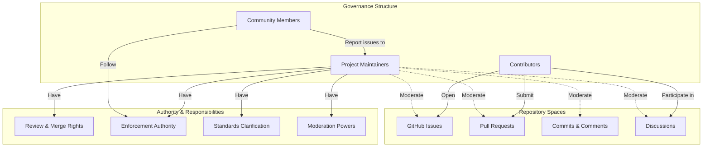
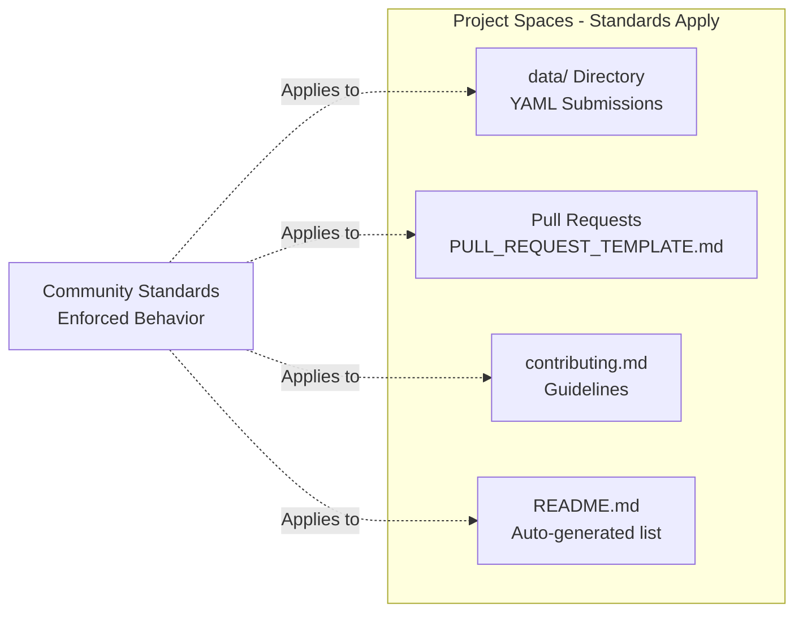

<!-- source: DeepWiki mcp.deepwiki.com · repo awesome-opencode/awesome-opencode · page 8 Community · fetched 2026-10-30 -->

# Community

Relevant source files

The following files were used as context for generating this wiki page:

- [.github/PULL_REQUEST_TEMPLATE.md](.github/PULL_REQUEST_TEMPLATE.md)
- [contributing.md](contributing.md)

This page documents the community guidelines, behavioral standards, and governance structure for the `awesome-opencode` repository. It covers the Code of Conduct, enforcement mechanisms, and community participation spaces. For information about the technical contribution process (forking, YAML files, and pull requests), see [Contributing](#6).

## Governance and Maintenance

The `awesome-opencode` repository operates under a maintainer-driven governance model. The project functions as a curated registry, meaning maintainers act as gatekeepers to ensure quality and relevance standards are met. Maintainers are responsible for reviewing submissions to ensure they meet the active maintenance requirements (e.g., commits within the last 6 months) and are relevant to the OpenCode ecosystem.

For details, see [Governance and Maintenance](#8.2).

### Maintainer Workflow

**Governance Structure and Authority Distribution**

Sources: [contributing.md:53-57](), [.github/PULL_REQUEST_TEMPLATE.md:1-23]()

## Code of Conduct

The repository adopts standards to establish behavioral expectations for all participants. These standards apply to all project spaces including GitHub issues, pull requests, and comments. The goal is to provide a harassment-free experience for everyone, regardless of experience level or background.

For details, see [Code of Conduct](#8.1).

### Core Values and Behaviors

| Behavior | Description |
|----------|-------------|
| **Welcoming Language** | Using inclusive and accessible communication |
| **Respectful Discourse** | Being respectful of differing viewpoints and experiences |
| **Constructive Feedback** | Gracefully accepting constructive criticism |
| **Community Focus** | Focusing on what is best for the community |

### Unacceptable Behaviors

Prohibited behaviors include harassment, trolling, insulting/derogatory comments, and publishing others' private information without permission. Both public and private harassment are prohibited in all project-related communications.

## Scope of Application

The community guidelines apply in two primary contexts:

### 1. Project Spaces

All spaces within the GitHub repository where technical work and discussion occur:
- Pull request reviews (e.g., verifying `data/{category}/your-entry.yaml`)
- Issue discussions
- Commit messages and comments

**Application of Standards to Repository Entities**

Sources: [contributing.md:3-4](), [contributing.md:14-22](), [.github/PULL_REQUEST_TEMPLATE.md:24-33]()

### 2. Public Representation

When individuals represent the project or community in public spaces, such as acting as an appointed representative at online or offline events.

## Enforcement Process

### Reporting and Investigation

Instances of unacceptable behavior may be reported to the project team. Maintainers are obligated to review and investigate all complaints and take appropriate corrective action.

### Enforcement Principles

1. **Review and Investigation**: All complaints are reviewed by maintainers.
2. **Appropriate Response**: Responses are tailored to the severity of the violation.
3. **Confidentiality**: Maintainers must maintain confidentiality regarding the reporter.
4. **Maintainer Accountability**: Maintainers who do not follow or enforce the standards in good faith may face repercussions.

## Maintainer Responsibilities

Maintainers have the authority to:
- Remove, edit, or reject contributions (YAML files in `data/`) that do not align with the project's quality or behavioral standards.
- Moderate discussions in Issues and Pull Requests.
- Verify that entries meet the **Entry Requirements** (Relevant, Public, Maintained, Unique, Complete).

Sources: [contributing.md:45-51](), [contributing.md:56-57]()

## Relationship to Contribution Process

The community standards are integrated into the technical workflow. For example, the `PULL_REQUEST_TEMPLATE.md` requires contributors to confirm their submission is relevant and public, while the `contributing.md` guide directs users to follow these standards when interacting with the repository.

- **Entry requirements**: See [Entry Requirements](#6.2)
- **YAML submission**: See [Quick Start](#6.1)
- **Review workflow**: See [Pull Request Process](#6.3)

Sources: [contributing.md:5-43](), [.github/PULL_REQUEST_TEMPLATE.md:15-23]()

---

