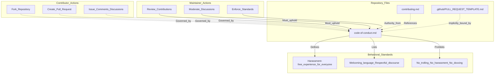
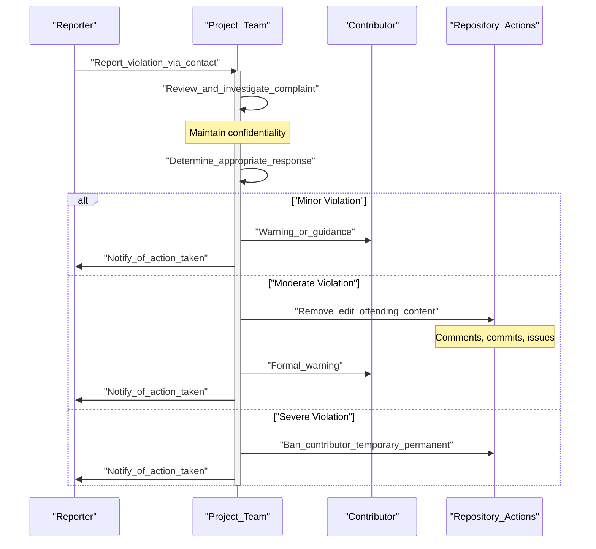
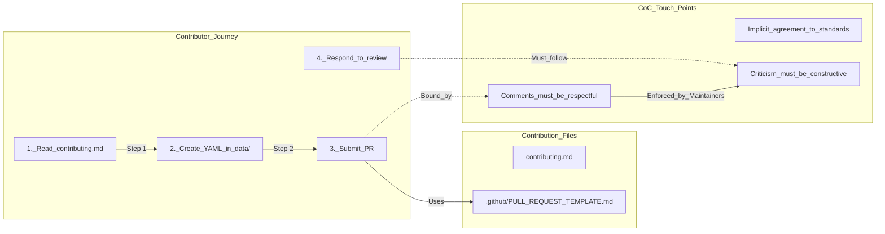

<!-- source: DeepWiki mcp.deepwiki.com · repo awesome-opencode/awesome-opencode · page 8.1 Code of Conduct · fetched 2026-10-30 -->

# Code of Conduct

Relevant source files

The following files were used as context for generating this wiki page:

- [.github/PULL_REQUEST_TEMPLATE.md](.github/PULL_REQUEST_TEMPLATE.md)
- [contributing.md](contributing.md)

This page documents the behavioral standards and enforcement mechanisms that govern the `awesome-opencode` contributor community. The Code of Conduct defines expected behavior, unacceptable conduct, and the process for addressing violations.

For information about the technical contribution process, see [6. Contributing](). For pull request procedures, see [6.3. Pull Request Process]().

## Purpose and Scope

The `awesome-opencode` repository adopts the Contributor Covenant Code of Conduct (version 1.4) to ensure a harassment-free, inclusive environment for all participants. This document applies to all interactions within project spaces and when representing the project in public spaces.

The Code of Conduct establishes both the standards for participation and the enforcement procedures for violations. It ensures that the curated registry remains a professional space for both human and machine consumers.

**Sources:** [contributing.md:1-5](), [.github/PULL_REQUEST_TEMPLATE.md:1-35]()

## Document Location and Attribution

The Code of Conduct is typically stored as a standalone markdown file at the repository root. This ensures the repository follows a widely-adopted, community-vetted standard rather than creating custom policies.

| File | Purpose | Standard |
|------|---------|----------|
| `code-of-conduct.md` | Defines community behavioral standards | Contributor Covenant v1.4 |

**Sources:** [contributing.md:1-5]()

## Code of Conduct Integration in Repository Workflow

The following diagram illustrates how behavioral standards interface with the technical entities of the repository, specifically during the Pull Request lifecycle.

**Diagram: Code of Conduct Integration in Repository Workflow**

This diagram shows how the Code of Conduct establishes behavioral standards that apply to all contributor actions (forking, submitting PRs, commenting) and grants maintainers authority to enforce these standards.

**Sources:** [contributing.md:1-5](), [.github/PULL_REQUEST_TEMPLATE.md:1-35]()

## Behavioral Standards

The community environment is built on positive contributions and the strict prohibition of unacceptable conduct.

### Positive Behaviors

These behaviors contribute to a welcoming environment:

| Behavior | Description |
|----------|-------------|
| Welcoming language | Use inclusive terminology that makes all participants feel valued |
| Respectful discourse | Honor differing viewpoints and experiences without dismissal |
| Graceful criticism | Accept and provide constructive feedback without defensiveness |
| Community focus | Prioritize collective benefit over individual preferences |
| Empathy | Show understanding and consideration for other members |

### Unacceptable Behaviors

These behaviors are prohibited:

| Behavior | Description |
|----------|-------------|
| Sexualized content | Language, imagery, or unwelcome sexual attention |
| Trolling | Deliberate provocation, insults, or derogatory comments |
| Personal attacks | Attacks based on identity, politics, or personal characteristics |
| Harassment | Public or private harassment of any kind |
| Doxxing | Publishing private information without explicit permission |
| Unprofessional conduct | Behavior inappropriate in a professional setting |

## Scope of Application

The Code of Conduct applies in two contexts:

### Within Project Spaces

All interactions within the repository boundaries are covered:
- Pull request comments and reviews (triggered by `.github/PULL_REQUEST_TEMPLATE.md`)
- Issue discussions and bug reports
- Wiki edits and documentation contributions
- Commit messages and code comments

### Public Representation

The Code of Conduct extends to public spaces when representing the project, such as official social media accounts or community meetups.

**Sources:** [contributing.md:43-45](), [.github/PULL_REQUEST_TEMPLATE.md:1-8]()

## Enforcement Mechanism

**Diagram: Code of Conduct Enforcement Process**

This sequence diagram maps the enforcement workflow. The process begins with a reporter contacting the project team, proceeds through confidential investigation, and results in graduated responses based on violation severity.

## Maintainer Responsibilities

Project maintainers have specific duties to ensure the health of the community.

### Clarification Duty

Maintainers must clarify standards of acceptable behavior, providing guidance when contributors have questions regarding the appropriateness of an entry or comment.

### Corrective Action Authority

Maintainers have the right and responsibility to take corrective action, including:
- Removing comments violating the Code of Conduct.
- Rejecting Pull Requests that contain offensive material.
- Banning contributors who engage in threatening or harmful behavior.

**Sources:** [contributing.md:53-57]()

## Integration with Contribution Workflow

The contribution process explicitly requires adherence to standards. When a contributor opens a Pull Request using the `.github/PULL_REQUEST_TEMPLATE.md`, they are interacting with the project's governance.

**Diagram: Code of Conduct Touch Points in Contribution Workflow**

This diagram shows how the Code of Conduct implicitly governs every stage of the contribution workflow, from the initial fork to the final merge.

**Sources:** [contributing.md:7-43](), [.github/PULL_REQUEST_TEMPLATE.md:1-35]()

## Enforcement vs. Technical Validation

The Code of Conduct enforcement process operates independently from the repository's automated validation systems.

| System | Scope | Automation Level |
|--------|-------|------------------|
| **Code of Conduct** | Behavioral standards, community interaction | Manual (human review) |
| **Technical Validation** | YAML syntax, schema compliance | Automated (GitHub Actions) |
| **PR Review** | Entry quality, maintenance status | Mixed (automated + manual) |

Automated validation [contributing.md:55-56]() checks for file structure and required fields, but maintainer review [contributing.md:56-57]() encompasses both the technical relevance of the entry and the behavioral conduct of the contributor.

**Sources:** [contributing.md:53-58](), [.github/PULL_REQUEST_TEMPLATE.md:15-23]()

---

