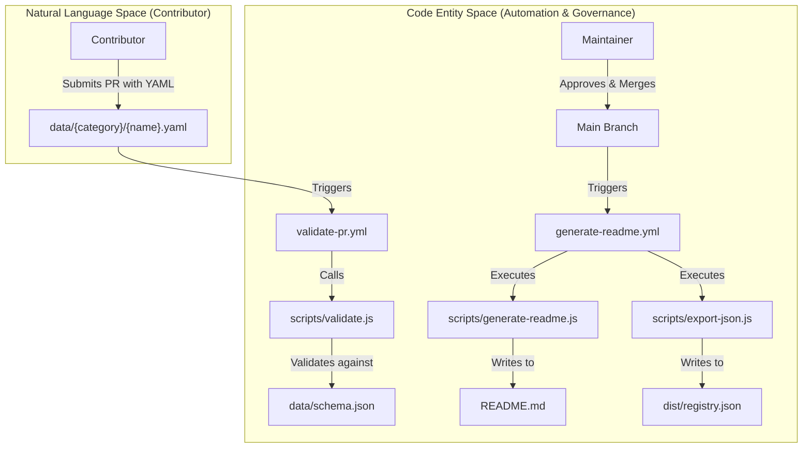
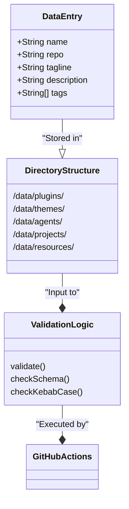

<!-- source: DeepWiki mcp.deepwiki.com · repo awesome-opencode/awesome-opencode · page 8.2 Governance and Maintenance · fetched 2026-10-30 -->

# Governance and Maintenance

Relevant source files

The following files were used as context for generating this wiki page:

- [.github/PULL_REQUEST_TEMPLATE.md](.github/PULL_REQUEST_TEMPLATE.md)
- [README.md](README.md)
- [contributing.md](contributing.md)
- [data/agents/gem-team.yaml](data/agents/gem-team.yaml)
- [data/plugins/opencode-mystatus.yaml](data/plugins/opencode-mystatus.yaml)
- [data/resources/akephalos.yaml](data/resources/akephalos.yaml)

The `awesome-opencode` repository is a curated registry designed to serve both human developers and automated systems within the OpenCode ecosystem. Maintenance is governed by a strict "Data-as-Code" philosophy where the repository's state is derived from individual YAML entries rather than manual document editing.

## Maintenance Model

The repository is maintained through a decoupled architecture that separates data entry from presentation. Maintainers do not edit the `README.md` [README.md:1-61]() or `dist/registry.json` files directly; instead, they manage the lifecycle of YAML files within the `data/` directory [contributing.md:16-21]().

### Decision Making Process

Decisions regarding the inclusion of new entries are governed by a set of quality standards enforced during the Pull Request (PR) review process [contributing.md:45-52]().

| Criterion | Requirement | Verification Method |
| :--- | :--- | :--- |
| **Relevance** | Must be directly related to OpenCode [contributing.md:47]() | Manual Maintainer Review |
| **Publicity** | Repository must be publicly accessible [contributing.md:48]() | Automated/Manual Check |
| **Maintenance** | Active commits within the last 6 months [contributing.md:49]() | Manual Maintainer Review |
| **Uniqueness** | Not a duplicate of an existing entry [contributing.md:50]() | Manual Maintainer Review |
| **Completeness** | All required fields (name, repo, tagline, description) [contributing.md:51]() | `scripts/validate.js` via Schema |

**Sources:** [contributing.md:45-61](), [.github/PULL_REQUEST_TEMPLATE.md:15-23]()

## Maintainer Workflow and Automation

The following diagram illustrates the lifecycle of a maintenance action, from contributor submission to automated artifact generation.

### Contribution and Maintenance Data Flow

**Sources:** [contributing.md:53-61](), [.github/PULL_REQUEST_TEMPLATE.md:1-36]()

## Submission Governance

Contributors are required to follow a specific protocol to ensure the registry remains machine-parsable and human-readable.

1.  **Categorization**: Entries must be placed in one of the five primary directories: `plugins/`, `themes/`, `agents/`, `projects/`, or `resources/` [contributing.md:16-21]().
2.  **Naming Convention**: Filenames must use `kebab-case` (e.g., `my-plugin.yaml`) [contributing.md:23]().
3.  **Required Metadata**: Every entry must include `name`, `repo`, `tagline`, and `description` [contributing.md:27-32]().

### Entry Lifecycle Diagram
This diagram bridges the conceptual entry types to the physical directory structure and the validation logic.

**Sources:** [contributing.md:14-41](), [.github/PULL_REQUEST_TEMPLATE.md:25-34]()

## Long-term Vision

The registry aims to be the authoritative source of truth for the OpenCode ecosystem. By providing both a human-readable `README.md` [README.md:1-61]() and a machine-readable `registry.json`, the project enables:
*   **Discovery**: Developers can find tools through GitHub or the official website.
*   **Integration**: OpenCode clients can programmatically fetch and install plugins or agents by parsing the exported registry artifacts.
*   **Stability**: Strict schema enforcement ensures that third-party tools consuming the registry data do not break due to malformed entries.

**Sources:** [contributing.md:1-4](), [README.md:22-27]()

---

