# Page: Overview

# Overview

<details>
<summary>Relevant source files</summary>

The following files were used as context for generating this wiki page:

- [README.md](README.md)
- [data/agents/gem-team.yaml](data/agents/gem-team.yaml)
- [data/plugins/opencode-mystatus.yaml](data/plugins/opencode-mystatus.yaml)
- [data/resources/akephalos.yaml](data/resources/akephalos.yaml)
- [dist/registry.json](dist/registry.json)
- [scripts/export-json.js](scripts/export-json.js)

</details>


The awesome-opencode repository is a curated, community-maintained registry of extensions, tools, and resources for the [OpenCode AI coding agent](https://opencode.ai/). It functions as both a human-readable catalog and a machine-consumable data source, serving as the definitive directory of the OpenCode ecosystem.

This page provides a high-level introduction to the repository's architecture and operational model. For details on specific subsystems, see:
- Architecture and data flow: [Architecture](#2)
- Entry schema and validation: [Data Model](#3)
- Contribution workflow: [Contributing](#6)

## Purpose and Scope

The repository serves three primary functions:

1. **Discovery Platform**: Provides a browsable catalog of 100+ plugins, themes, agents, projects, and resources through [README.md:1-962]().
2. **Data Registry**: Offers structured, validated data via `dist/registry.json` [dist/registry.json:1-217]() for downstream tools and platforms.
3. **Community Hub**: Enables open contribution through standardized YAML entry submission.

**Key Principle**: All documentation artifacts are generated from source data. Contributors modify YAML files in `data/`, never the generated outputs.

Sources: [README.md:1-962](), [dist/registry.json:1-217]()

## Entry Categories

The registry catalogs six distinct types of OpenCode ecosystem entries. The category is derived from the file's directory location rather than a field within the YAML itself, as implemented in the `CATEGORIES` array and the `loadEntries` function [scripts/export-json.js:14-14](), [scripts/export-json.js:79-104]().

| Category | Directory | Count | Purpose |
|----------|-----------|-------|---------|
| **Plugins** | `data/plugins/` | 60+ | JavaScript/TypeScript modules extending OpenCode functionality |
| **Themes** | `data/themes/` | 4+ | JSON configurations for visual customization |
| **Agents** | `data/agents/` | 4+ | AI agent configurations and SKILL.md files |
| **Projects** | `data/projects/` | 30+ | Standalone applications and tools |
| **Resources** | `data/resources/` | 3+ | Guides, MCP servers, configuration templates |
| **Forks** | `data/forks/` | 0+ | Modified OpenCode builds with custom features |

Sources: [README.md:49-952](), [scripts/export-json.js:14-14](), [scripts/export-json.js:79-81]()

## Repository Architecture

### Data Flow Model

The repository uses a build pipeline to transform raw YAML data into human and machine-readable formats.

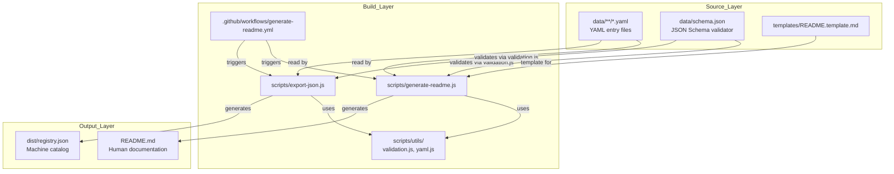

**Key Characteristics**:
- **Single Source of Truth**: YAML files in `data/` are the only manually edited files.
- **Automated Generation**: The `Auto-Generate README` workflow [ .github/workflows/generate-readme.yml:1-46]() triggers a rebuild on any push to `main` affecting the `data/` path.
- **Dual Output**: Human-optimized markdown and machine-optimized JSON.
- **Schema Validation**: All entries are validated using `validateEntry` [scripts/export-json.js:93-97]() before inclusion in artifacts.

Sources: [.github/workflows/generate-readme.yml:1-46](), [scripts/export-json.js:1-159]()

### Component Mapping

This diagram maps natural language concepts to actual code entities, highlighting how specific scripts interact with data.

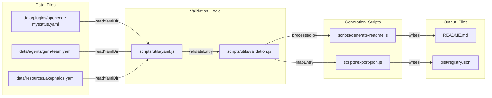

- **Data Files**: Individual YAML entries like [data/plugins/opencode-mystatus.yaml:1-5](), [data/agents/gem-team.yaml:1-5](), and [data/resources/akephalos.yaml:1-16]().
- **Validation Logic**: `scripts/utils/validation.js` ensures data integrity using the `validateEntry` function [scripts/export-json.js:93-93]().
- **Generation Scripts**: `scripts/export-json.js` creates the machine-readable registry by iterating through `CATEGORIES` [scripts/export-json.js:14-14]() and writing to `outputPath` [scripts/export-json.js:139-148]().

Sources: [scripts/export-json.js:11-14](), [scripts/export-json.js:93-99](), [data/plugins/opencode-mystatus.yaml:1-5](), [data/agents/gem-team.yaml:1-5](), [data/resources/akephalos.yaml:1-16]()

## Consumer Model

### Human Consumers
**Primary Interface**: [README.md:1-962]()
- Developers browsing for tools via the categorized sections (Plugins, Themes, Agents, etc.) [README.md:27-27]().
- Uses GitHub-flavored markdown with collapsible `<details>` tags to manage the high volume of entries [README.md:51-62]().

### Machine Consumers
**Primary Interface**: `dist/registry.json` [dist/registry.json:1-217]()
- **Format**: A flat JSON array of objects generated by `export-json.js` [scripts/export-json.js:137-137]().
- **Derived Fields**: Includes `productId` (derived from filename via `buildProductId`) and `type` (derived from the directory name) [scripts/export-json.js:25-63]().
- **Automation**: Used by external sites like `opencode.cafe` to provide a searchable UI.

Sources: [README.md:27-62](), [scripts/export-json.js:25-63](), [dist/registry.json:1-217]()

## Operational Model

### Entry Lifecycle

The workflow ensures that only valid data enters the registry:

1. **Submission**: A contributor creates a new YAML file in a `data/` subdirectory.
2. **CI Validation**: GitHub Actions run validation scripts to check schema compliance.
3. **Merge**: Once approved and merged to `main`, the `Auto-Generate README` workflow triggers [.github/workflows/generate-readme.yml:3-8]().
4. **Artifact Update**: `scripts/generate-readme.js` and `scripts/export-json.js` run, updating the `README.md` and `dist/registry.json` [.github/workflows/generate-readme.yml:33-37]().
5. **Auto-Commit**: The workflow commits the updated artifacts back to the repo [.github/workflows/generate-readme.yml:39-45]().

Sources: [.github/workflows/generate-readme.yml:1-46](), [scripts/export-json.js:109-154]()

### Convention Over Configuration

The repository minimizes manual configuration through smart defaults:
- **Type Derivation**: The `type` field in the final registry is taken from the directory name (`plugins`, `themes`, etc.) [scripts/export-json.js:79-99]().
- **Product Identification**: The `productId` is generated from the `_fileName` property assigned during the YAML read process, or slugified from the name [scripts/export-json.js:25-33]().
- **Sanitization**: The `sanitizeArray` function ensures fields like `scope` default to `['global']` and `tags` default to `[]` if not provided in the source YAML [scripts/export-json.js:35-56]().

Sources: [scripts/export-json.js:25-63](), [scripts/export-json.js:79-104]()

---

# Page: Architecture

# Architecture

<details>
<summary>Relevant source files</summary>

The following files were used as context for generating this wiki page:

- [.github/workflows/generate-readme.yml](.github/workflows/generate-readme.yml)
- [data/schema.json](data/schema.json)
- [dist/registry.json](dist/registry.json)
- [docs/schema-design.md](docs/schema-design.md)
- [scripts/export-json.js](scripts/export-json.js)
- [scripts/generate-readme.js](scripts/generate-readme.js)
- [scripts/utils/template.js](scripts/utils/template.js)

</details>


## Purpose and Scope

This document describes the high-level architecture of the awesome-opencode repository, explaining how YAML data files, build scripts, validation systems, and generated artifacts work together to maintain a curated catalog of OpenCode extensions. The architecture follows a **data-driven, convention-over-configuration** approach where YAML files serve as the single source of truth, and all documentation artifacts are automatically generated.

For detailed information about the data model and schema validation rules, see [Data Model](#3). For specifics on the build pipeline and generation scripts, see [Build System](#5). For the file and folder organization, see [Directory Structure](#2.1).

## Design Principles

The repository architecture is built on three core principles:

| Principle | Implementation | Benefit |
|-----------|---------------|---------|
| **Generated Artifacts** | `README.md` and `dist/registry.json` are never manually edited | Ensures consistency between data and documentation |
| **Convention Over Configuration** | Type derived from directory, `productId` from filename | Reduces boilerplate and prevents configuration drift |
| **Validation at Build Time** | Schema validation via JSON Schema and business rules | Catches errors before merge, maintains data quality |

The entire system operates as a **compile-time transformation pipeline**: source YAML files are validated and transformed into human-readable (`README.md`) and machine-readable (`dist/registry.json`) outputs through automated build scripts triggered by GitHub Actions.

Sources: [docs/schema-design.md:9-18](), [.github/workflows/generate-readme.yml:49-58]()

## System Component Architecture

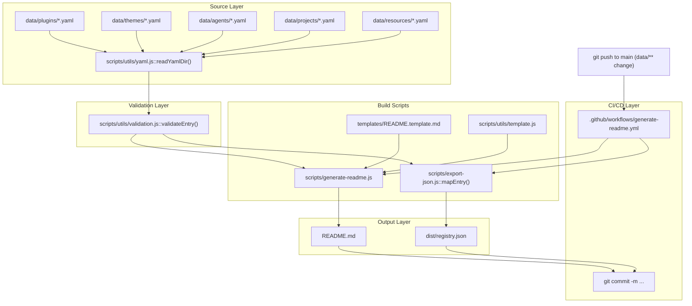

**System Component Architecture**

This diagram shows the complete data flow from source YAML files through validation and transformation to generated outputs. The build process is stateless and deterministic: given the same input YAML files, it always produces identical outputs.

Sources: [scripts/export-json.js:75-107](), [scripts/generate-readme.js:32-77](), [.github/workflows/generate-readme.yml:44-66]()

## Core Components

### Data Layer (`data/` directory)

The data layer contains YAML files organized by extension type. Each category maps to a specific extension type:

| Directory | Type Value | Purpose |
|-----------|-----------|---------|
| `data/plugins/` | `"plugins"` | JavaScript/TypeScript modules that extend OpenCode [docs/schema-design.md:48-50]() |
| `data/themes/` | `"themes"` | Color schemes and visual themes [docs/schema-design.md:61-63]() |
| `data/agents/` | `"agents"` | AI agents and subagents [docs/schema-design.md:74-76]() |
| `data/projects/` | `"projects"` | Tools, GUIs, integrations, and utilities [docs/schema-design.md:88-90]() |
| `data/resources/` | `"resources"` | Guides, templates, and configurations [docs/schema-design.md:98-100]() |
| `data/forks/` | `"forks"` | Modified builds of OpenCode [docs/schema-design.md:115-117]() |

The **type derivation convention** eliminates the need to store type in YAML: `scripts/export-json.js` reads the directory path and assigns the `type` automatically [scripts/export-json.js:42-63](). Similarly, the **productId** is derived from the filename (without `.yaml` extension) [scripts/export-json.js:25-33](), ensuring unique identifiers without manual configuration.

Sources: [docs/schema-design.md:19-35](), [scripts/export-json.js:25-33](), [scripts/export-json.js:42-63]()

### Build Scripts (`scripts/` directory)

Two primary generation scripts transform YAML data into outputs:

**1. `scripts/generate-readme.js`** - Creates human-readable documentation
- Reads YAML files using `readYamlDir()` [scripts/generate-readme.js:11]()
- Validates each entry via `validateEntry()` [scripts/generate-readme.js:52]()
- Loads the template via `readTemplate()` [scripts/generate-readme.js:88]()
- Generates HTML snippets for each entry with collapsible `<details>` sections [scripts/utils/template.js:34-69]()
- Injects content into template placeholders like `{{PLUGINS}}` [scripts/generate-readme.js:123]()
- Writes the final `README.md` [scripts/generate-readme.js:128]()

**2. `scripts/export-json.js`** - Creates machine-readable catalog
- Iterates categories defined in `CATEGORIES` array [scripts/export-json.js:14]()
- Calls `mapEntry()` function [scripts/export-json.js:42-63]() to transform YAML to JSON
- Adds derived fields: `type` from directory, `productId` from filename [scripts/export-json.js:49-50]()
- Sorts by `type` then `productId` [scripts/export-json.js:122-128]()
- Outputs to `dist/registry.json` [scripts/export-json.js:144]()

Sources: [scripts/generate-readme.js:1-154](), [scripts/export-json.js:1-159](), [scripts/utils/template.js:1-85]()

### Validation System

Three-tier validation ensures data quality before generation:

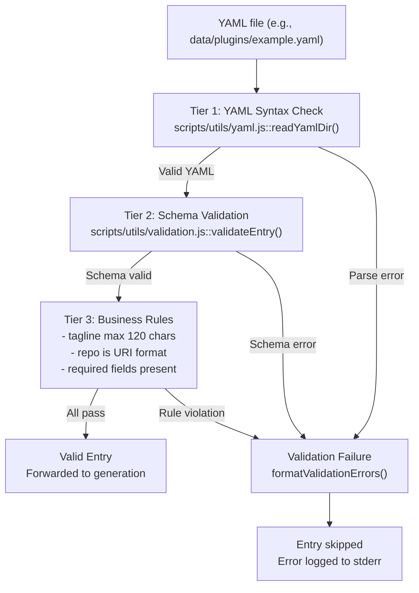

**Validation Pipeline**

The validation system processes each YAML file through three progressive checks. Files that fail any tier are excluded from generation with descriptive error messages [scripts/generate-readme.js:56-61](). Tier 2 and 3 are enforced by the JSON schema in `data/schema.json` [data/schema.json:1-63]().

Sources: [scripts/generate-readme.js:49-61](), [scripts/export-json.js:92-97](), [data/schema.json:1-63]()

### Template System

The template system uses placeholder replacement for README generation:

**Template Structure** (`templates/README.template.md`)
- Contains static header content (badges, description, navigation)
- Includes placeholder markers like `{{PLUGINS}}`, `{{THEMES}}`, etc. [scripts/generate-readme.js:19-25]()
- Maintains consistent formatting across regenerations

**Generation Process** (`scripts/generate-readme.js`)
1. Parse all YAML files by category [scripts/generate-readme.js:99-118]()
2. For each category, generate HTML using `generateEntryHtml()` [scripts/utils/template.js:34-69]()
3. Create GitHub star badges via `badgen.net` [scripts/utils/template.js:55-57]()
4. Replace template placeholders with generated content [scripts/generate-readme.js:123]()
5. Write complete file to `README.md` [scripts/utils/template.js:75-78]()

The README is **never manually edited** - all changes must be made to source YAML files or the template [scripts/generate-readme.js:4-7]().

Sources: [scripts/generate-readme.js:82-144](), [scripts/utils/template.js:12-85]()

## Data Flow Architecture

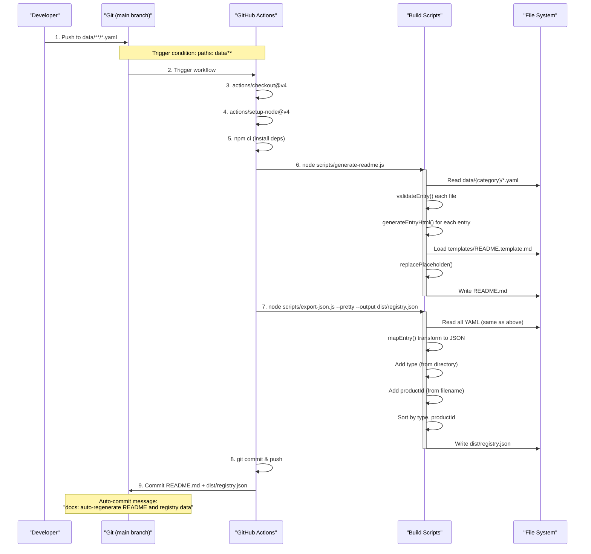

**Complete Build Pipeline Sequence**

This sequence diagram shows the exact execution flow when changes are pushed to the `data/` directory. The workflow is idempotent: running it multiple times with the same input produces no additional commits due to the `git diff --quiet` check [.github/workflows/generate-readme.yml:52-55]().

Sources: [.github/workflows/generate-readme.yml:1-70](), [scripts/generate-readme.js:82-144](), [scripts/export-json.js:109-153]()

## Convention-Driven Field Derivation

The architecture minimizes explicit configuration through convention-based field derivation:

### Type Derivation

Type is **never stored in YAML files**. Instead, `scripts/export-json.js` derives it from the directory structure [scripts/export-json.js:42-63]():

```javascript
function mapEntry(entry, category) {
  const output = {
    productId,
    type: category, // 'plugins', 'themes', 'agents', etc.
    // ...
  };
}
```

### ProductId Derivation

The `productId` field is derived from the filename [scripts/export-json.js:25-33]():

```javascript
function buildProductId(entry) {
  if (entry._fileName) {
    return entry._fileName; // filename without .yaml extension
  }
  // ...
}
```

### Default Value Assignment

Optional fields receive defaults during JSON export [scripts/export-json.js:35-40]():

```javascript
function sanitizeArray(value, fallback) {
  if (Array.isArray(value) && value.length > 0) {
    return value;
  }
  return fallback;
}
```

**Default Values:**
| Field | Default | Assignment Location |
|-------|---------|-------------------|
| `scope` | `["global"]` | [scripts/export-json.js:55]() |
| `tags` | `[]` | [scripts/export-json.js:56]() |

Sources: [scripts/export-json.js:25-63]()

## Output Artifacts

The build system produces two artifacts, each optimized for different consumers:

### README.md - Human-Facing Documentation

**Purpose:** Primary discovery interface for GitHub visitors  
**Format:** Markdown with embedded HTML (`<details>` elements) [scripts/utils/template.js:61-69]()  
**Key Features:**
- GitHub star badges via `badgen.net` [scripts/utils/template.js:55-56]()
- Collapsible entry details [scripts/utils/template.js:61-68]()

**Generation Command:** `node scripts/generate-readme.js` [.github/workflows/generate-readme.yml:49]()

### dist/registry.json - Machine-Readable Catalog

**Purpose:** Structured data for downstream platforms  
**Format:** JSON array of entry objects [dist/registry.json:1-13]()  
**Structure Example:**
```json
{
  "productId": "agentic",
  "type": "agents",
  "displayName": "Agentic",
  "repoUrl": "https://github.com/Cluster444/agentic",
  "tagline": "Modular AI agents",
  "description": "Modular AI agents and commands for structured software development with opencode.",
  "scope": ["global"],
  "tags": []
}
```

**Generation Command:** `node scripts/export-json.js --pretty --output dist/registry.json` [.github/workflows/generate-readme.yml:50]()

Sources: [dist/registry.json:1-126](), [scripts/export-json.js:42-63](), [scripts/utils/template.js:34-69]()

## CI/CD Integration

The GitHub Actions workflow ensures outputs stay synchronized with source data:

**Workflow Triggers** [.github/workflows/generate-readme.yml:3-9]()
- Push to `main` branch
- Changes to `data/**` directory
- Manual trigger via `workflow_dispatch`

**Execution Steps** [.github/workflows/generate-readme.yml:44-66]()
1. **Fetch & Reset:** Ensures generation happens on the latest `main` branch.
2. **Generate README:** `node scripts/generate-readme.js`
3. **Generate registry JSON:** `node scripts/export-json.js --pretty --output dist/registry.json`
4. **Commit changes:** Automatically commits and pushes `README.md` and `dist/registry.json` if they have changed.

The workflow has `contents: write` permission [.github/workflows/generate-readme.yml:11-12]() to push commits back to the repository.

Sources: [.github/workflows/generate-readme.yml:1-70]()

---

# Page: Directory Structure

# Directory Structure

<details>
<summary>Relevant source files</summary>

The following files were used as context for generating this wiki page:

- [.github/workflows/generate-readme.yml](.github/workflows/generate-readme.yml)
- [README.md](README.md)
- [data/agents/gem-team.yaml](data/agents/gem-team.yaml)
- [data/plugins/opencode-mystatus.yaml](data/plugins/opencode-mystatus.yaml)
- [data/resources/akephalos.yaml](data/resources/akephalos.yaml)
- [scripts/generate-readme.js](scripts/generate-readme.js)
- [scripts/utils/template.js](scripts/utils/template.js)

</details>


This document describes the file and folder organization of the `awesome-opencode` repository. It covers the root-level layout, the data layer where YAML entries are stored, the build system directories, and where generated artifacts are written.

For information about the YAML schema and field definitions, see **3. Data Model**. For details on how YAML files are processed into outputs, see **5. Build System**.

---

## Purpose and Scope

The `awesome-opencode` repository follows a **convention-over-configuration** architecture where directory placement determines extension type. The repository separates source data (`data/`), build scripts (`scripts/`), templates (`templates/`), documentation (`docs/`), and generated artifacts (`README.md`, `dist/`).

---

## Root Directory Layout

The repository is organized into distinct top-level directories, each serving a specific purpose in the data-driven documentation system:

```
awesome-opencode/
├── .github/                 # CI/CD workflows and PR templates
├── data/                    # Source of truth: YAML entries
├── dist/                    # Machine-readable registry output
├── docs/                    # Schema and contribution documentation
├── scripts/                 # Build automation and validation
├── templates/               # README generation templates
├── README.md                # Generated human-readable catalog
└── package.json             # Project dependencies and build scripts
```

**Sources:** [.github/workflows/generate-readme.yml:7-8](), [scripts/generate-readme.js:33-34](), [scripts/utils/template.js:13-15](), [scripts/utils/template.js:75-78]()

---

## Data Layer Organization

### Category Directories

The `data/` directory contains YAML files organized by extension type. The directory structure defines the `type` field for each entry through **type derivation**:

```
data/
├── plugins/           # JavaScript/TypeScript modules (type: "plugins")
│   └── *.yaml
├── themes/            # Visual customization configs (type: "themes")
│   └── *.yaml
├── agents/            # AI agent configs and skills (type: "agents")
│   └── *.yaml
├── projects/          # Standalone applications (type: "projects")
│   └── *.yaml
├── resources/         # Guides, MCP servers, tools (type: "resources")
│   └── *.yaml
└── examples/          # Reference templates (not processed)
```

### Type Derivation Mapping

The build system in `scripts/generate-readme.js` processes these directories in a specific order to populate the final catalog.

| Directory Path | Category Key | Purpose |
|----------------|--------------|---------|
| `data/plugins/` | `plugins` | Extend OpenCode functionality with JS/TS modules [scripts/generate-readme.js:16-20]() |
| `data/themes/` | `themes` | Visual customization via JSON configs [scripts/generate-readme.js:16-21]() |
| `data/agents/` | `agents` | AI agent configurations and SKILL.md files [scripts/generate-readme.js:16-22]() |
| `data/projects/` | `projects` | Standalone applications and tools [scripts/generate-readme.js:16-23]() |
| `data/resources/` | `resources` | MCP servers, guides, configs, CLI tools [scripts/generate-readme.js:16-24]() |

**Sources:** [scripts/generate-readme.js:15-25](), [scripts/generate-readme.js:32-47]()

---

## YAML Entry File Naming

YAML files in category directories follow kebab-case naming conventions. While the `name` field provides the display title, the build system uses the file location and structure to validate and categorize the entry.

Example YAML entry structure from `data/plugins/opencode-mystatus.yaml`:

```yaml
name: opencode-mystatus
repo: https://github.com/vbgate/opencode-mystatus
tagline: Check AI subscription quotas
description: Check all your AI subscription quotas in one command...
```

**Sources:** [data/plugins/opencode-mystatus.yaml:1-4](), [data/resources/akephalos.yaml:1-7]()

---

## Data Flow: Directory to Generated Artifacts

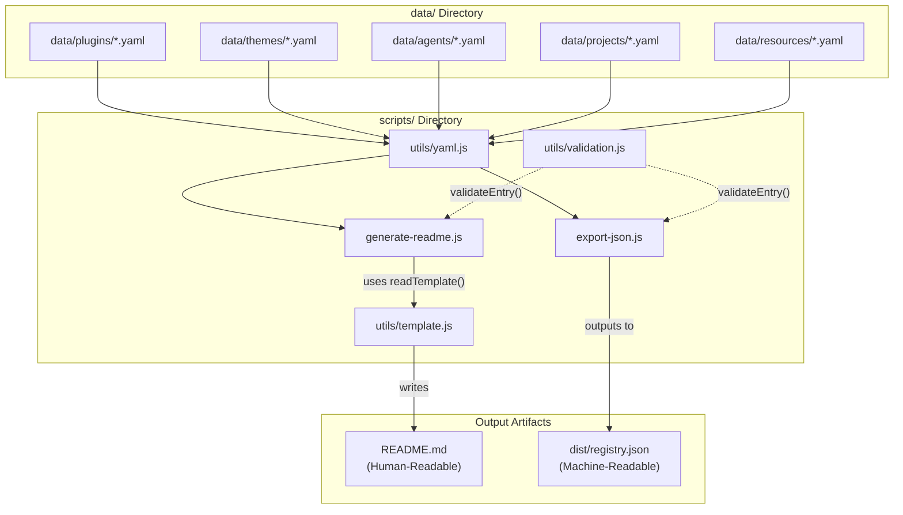

**Diagram: Data Directory to Build Outputs**

The diagram shows how source YAML files are parsed and processed by the main build scripts. `generate-readme.js` uses `utils/template.js` to inject HTML blocks into the README template.

**Sources:** [scripts/generate-readme.js:10-14](), [scripts/generate-readme.js:82-133](), [scripts/utils/template.js:12-27](), [.github/workflows/generate-readme.yml:49-50]()

---

## Build System Directories

### scripts/ Directory

Contains Node.js build scripts and validation utilities:

| Script | Purpose |
|--------|---------|
| `generate-readme.js` | Main orchestrator that reads all categories, validates entries, and generates the final `README.md`. [scripts/generate-readme.js:3-7]() |
| `export-json.js` | Generates the machine-readable `dist/registry.json` file. [.github/workflows/generate-readme.yml:50]() |
| `utils/template.js` | Contains `generateEntryHtml()` which converts YAML objects into the `<details>` HTML blocks used in the README. [scripts/utils/template.js:34-69]() |
| `utils/validation.js` | Logic for checking entries against schema and formatting errors. [scripts/generate-readme.js:12]() |
| `utils/yaml.js` | Helper to read and parse YAML files from a directory. [scripts/generate-readme.js:11]() |

**Sources:** [scripts/generate-readme.js:1-14](), [scripts/utils/template.js:1-85](), [.github/workflows/generate-readme.yml:49-50]()

### templates/ Directory

Contains Markdown templates used by the build system:

```
templates/
└── README.template.md    # Base template containing {{CATEGORY}} placeholders
```

The `readTemplate()` function specifically looks for this file to begin the generation process.

**Sources:** [scripts/utils/template.js:12-15](), [scripts/generate-readme.js:85-92]()

---

## CI/CD and GitHub Configuration

### .github/ Directory Structure

```
.github/
└── workflows/
    ├── generate-readme.yml     # Auto-regenerates README and JSON on data merges to main
    └── validate-pr.yml         # Validates YAML changes on Pull Requests
```

The `generate-readme.yml` workflow triggers on pushes to `main` that modify files in `data/**`. It performs a clean checkout, installs dependencies via `npm ci`, and runs the generation scripts.

**Sources:** [.github/workflows/generate-readme.yml:3-8](), [.github/workflows/generate-readme.yml:34-50]()

---

## Output Artifacts Location

### Generated Files

| File | Generator | Purpose |
|------|-----------|---------|
| `README.md` | `generate-readme.js` | Human-readable catalog for GitHub visitors, featuring expandable details and star badges. [scripts/utils/template.js:49-68]() |
| `dist/registry.json` | `export-json.js` | Machine-readable catalog for downstream tools and the OpenCode client. [.github/workflows/generate-readme.yml:50]() |

The generation process is idempotent; if the scripts produce no changes compared to the existing files, the CI workflow exits without committing.

**Sources:** [.github/workflows/generate-readme.yml:52-55](), [scripts/utils/template.js:75-78]()

---

## Directory Structure to Code Entity Mapping

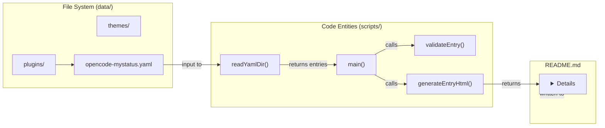

**Diagram: File System to Code Execution Mapping**

This diagram illustrates how the `generate-readme.js` script interacts with the directory structure. The `main()` function iterates through `CATEGORIES`, calling `readYamlDir()` for each folder, validating the content, and finally assembling the HTML via `generateEntryHtml()`.

**Sources:** [scripts/generate-readme.js:32-77](), [scripts/generate-readme.js:82-118](), [scripts/utils/template.js:34-69]()

---

## Summary Table: Directory Purposes

| Directory | Mutability | Purpose |
|-----------|------------|---------|
| `data/` | Manual | **Source of truth**: YAML entries edited by contributors. |
| `scripts/` | Manual | **Logic**: Build automation, template rendering, and validation. |
| `dist/` | Generated | **Distribution**: Machine-readable `registry.json`. |
| `templates/` | Manual | **Layout**: The base `README.template.md` with placeholders. |
| `.github/` | Manual | **Automation**: Workflows for CI/CD and PR validation. |

**Sources:** [scripts/generate-readme.js:15-25](), [scripts/utils/template.js:13-15](), [.github/workflows/generate-readme.yml:7-8]()

---

# Page: Data Layer

# Data Layer

<details>
<summary>Relevant source files</summary>

The following files were used as context for generating this wiki page:

- [data/examples/agent.yaml](data/examples/agent.yaml)
- [data/examples/fork.yaml](data/examples/fork.yaml)
- [data/examples/plugin.yaml](data/examples/plugin.yaml)
- [data/examples/project.yaml](data/examples/project.yaml)
- [data/examples/resource.yaml](data/examples/resource.yaml)
- [data/examples/theme.yaml](data/examples/theme.yaml)
- [data/schema.json](data/schema.json)
- [docs/schema-design.md](docs/schema-design.md)

</details>


The Data Layer is the single source of truth for all extension entries in the `awesome-opencode` repository. It consists of YAML files organized into category-specific directories under `data/`, where each file represents one cataloged extension, tool, or resource [docs/schema-design.md:9](). The type of each entry is derived from its directory location rather than being stored within the file itself [docs/schema-design.md:17]().

This document covers the organization, structure, and conventions of the data layer.

---

## Directory Structure

The data layer follows a strict directory hierarchy where category determines entry type. All extension data files reside under the `data/` directory, organized into subdirectories by category [docs/schema-design.md:21-40]().

### Data Directory Layout

```
data/
├── plugins/          # JavaScript/TypeScript modules that extend OpenCode
│   └── *.yaml
├── themes/           # Visual customization JSON configurations
│   └── *.yaml
├── agents/           # AI agent configurations and SKILL.md files
│   └── *.yaml
├── projects/         # Standalone applications and tools
│   └── *.yaml
├── resources/        # Guides, MCP servers, tools, commands
│   └── *.yaml
├── forks/            # Modified builds of OpenCode
│   └── *.yaml
├── examples/         # Template files showing all possible fields
│   ├── plugin.yaml
│   ├── theme.yaml
│   ├── agent.yaml
│   ├── project.yaml
│   ├── resource.yaml
│   └── fork.yaml
└── schema.json       # JSON Schema specification for validation
```

**Sources:** [docs/schema-design.md:21-40](), [data/examples/plugin.yaml:3](), [data/schema.json:1-64]()

### Directory Structure Diagram

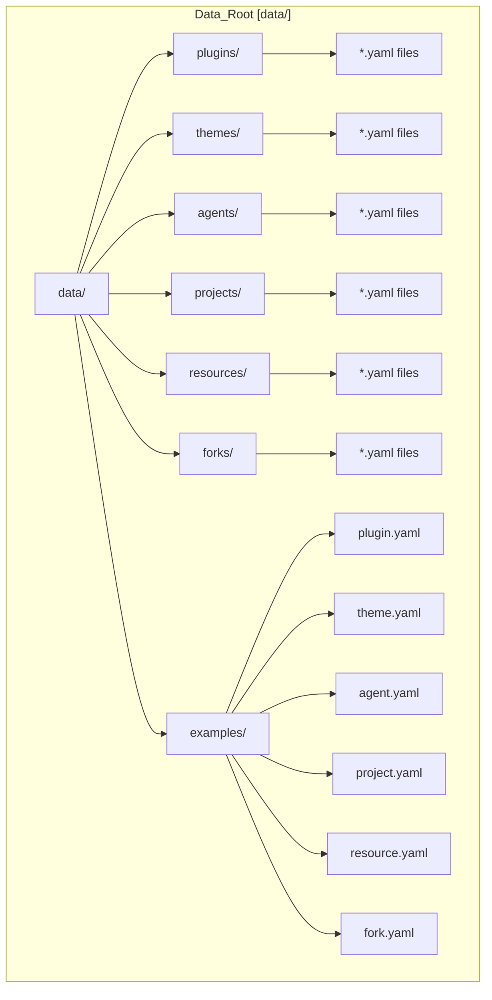

**Sources:** [docs/schema-design.md:21-40](), [data/examples/plugin.yaml:1-3](), [data/examples/agent.yaml:1-4]()

---

## Category-Based Organization

Each category directory serves a specific purpose in the OpenCode ecosystem. The category determines not only the type of entry but also its intended use case and installation pattern [docs/schema-design.md:44-46]().

### Category Definitions

| Directory | Type Value | Purpose | Installation Target |
|-----------|-----------|---------|-------------------|
| `data/plugins/` | `plugin` | JS/TS modules extending OpenCode | `~/.config/opencode/plugin/` |
| `data/themes/` | `theme` | JSON files for visual customization | `~/.config/opencode/themes/` |
| `data/agents/` | `agent` | AI agent configs and skills | `~/.config/opencode/agent/` |
| `data/projects/` | `project` | Standalone applications | Varies by project |
| `data/resources/` | `resource` | Guides, MCP servers, tools | Varies (e.g., `npm -g`) |
| `data/forks/` | `fork` | Modified OpenCode builds | Replaces binary |

**Sources:** [docs/schema-design.md:48-123](), [docs/schema-design.md:130-157](), [data/examples/plugin.yaml:25-26](), [data/examples/agent.yaml:26-27](), [data/examples/theme.yaml:23](), [data/examples/fork.yaml:24]()

### Category Purposes

#### Plugins (`data/plugins/`)
Plugins are JavaScript or TypeScript modules loaded by OpenCode to extend core functionality [docs/schema-design.md:48-50]().
- **Scope:** Can be `global` or `project` specific [data/examples/plugin.yaml:24-26]().
- **Example:** [data/examples/plugin.yaml:1-81]()

#### Themes (`data/themes/`)
Themes define color schemes and syntax highlighting for the OpenCode editor interface [docs/schema-design.md:61-63]().
- **Scope:** Typically `global` only [data/examples/theme.yaml:22-23]().
- **Example:** [data/examples/theme.yaml:1-59]()

#### Agents (`data/agents/`)
Agents include both AI agent configurations (system prompts) and reusable skill instruction sets in `SKILL.md` format [docs/schema-design.md:74-80]().
- **Scope:** `global` or `project` [data/examples/agent.yaml:25-27]().
- **Example:** [data/examples/agent.yaml:1-89]()

#### Projects (`data/projects/`)
Projects are standalone applications, utilities, and tools built for or with OpenCode, rather than extensions to it [docs/schema-design.md:88-90]().
- **Example:** [data/examples/project.yaml:1-72]()

#### Resources (`data/resources/`)
Resources encompass guides, configurations, and MCP (Model Context Protocol) servers [docs/schema-design.md:98-107]().
- **Example:** [data/examples/resource.yaml:1-80]()

#### Forks (`data/forks/`)
Forks are modified builds of OpenCode itself. Unlike other types, they replace the entire installation [docs/schema-design.md:115-117]().
- **Example:** [data/examples/fork.yaml:1-89]()

---

## Type Derivation System

A key architectural principle of the data layer is **type derivation from directory location** [docs/schema-design.md:17](). The `type` field is never stored in YAML files; instead, it is computed from the file's directory path during the build process.

### Type Derivation Mechanism

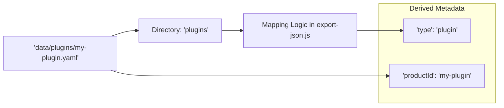

**Sources:** [docs/schema-design.md:17](), [docs/schema-design.md:21-38]()

### ProductId Derivation
The `productId` is derived from the filename (without extension). For example, `data/plugins/my-plugin.yaml` results in a `productId` of `my-plugin`.

**Sources:** [docs/schema-design.md:17](), [docs/schema-design.md:24-25]()

---

## YAML File Structure

Each YAML file in the data layer must conform to the repository's JSON schema [data/schema.json:1-64]().

### Required Fields
Every entry must include these four fields [data/schema.json:61]():

| Field | Description | Constraints |
|-------|-------------|-------------|
| `name` | Human-readable display name | [data/schema.json:8-12]() |
| `repo` | URL to the source repository | Must be URI [data/schema.json:13-17]() |
| `tagline` | Short summary | Max 120 chars [data/schema.json:18-23]() |
| `description` | Detailed explanation | [data/schema.json:24-28]() |

**Sources:** [docs/schema-design.md:199-210](), [data/schema.json:61]()

### Optional Fields
| Field | Purpose | Constraints |
|-------|---------|-------------|
| `scope` | Where the entry can be installed | `global` or `project` [data/schema.json:29-38]() |
| `tags` | Filtering and discoverability | Array of strings [data/schema.json:39-45]() |
| `min_version` | Minimum OpenCode version | Semver format [data/schema.json:46-50]() |
| `homepage` | External documentation URL | URI [data/schema.json:51-55]() |
| `installation` | Markdown instructions | String [data/schema.json:56-59]() |

**Sources:** [docs/schema-design.md:212-225](), [data/schema.json:7-60]()

---

## Examples Directory

The `data/examples/` directory contains reference templates demonstrating all available fields for each entry type [docs/schema-design.md:36-37](). These serve as the primary guide for new contributors.

| Template | File Path | Key Features Shown |
|----------|-----------|--------------------|
| **Plugin** | [data/examples/plugin.yaml]() | Global/Project scope, config JSON |
| **Theme** | [data/examples/theme.yaml]() | Color scheme files, `opencode.json` theme key |
| **Agent** | [data/examples/agent.yaml]() | `SKILL.md` installation, system prompts |
| **Project** | [data/examples/project.yaml]() | Docker usage, standalone prerequisites |
| **Resource** | [data/examples/resource.yaml]() | MCP server configuration, env variables |
| **Fork** | [data/examples/fork.yaml]() | Build from source, binary replacement |

---

## Data Flow and Single Source of Truth

The repository enforces a strict policy where YAML files in `data/` are the only source of truth [docs/schema-design.md:9](). All other representations are generated artifacts.

### Build and Validation Flow

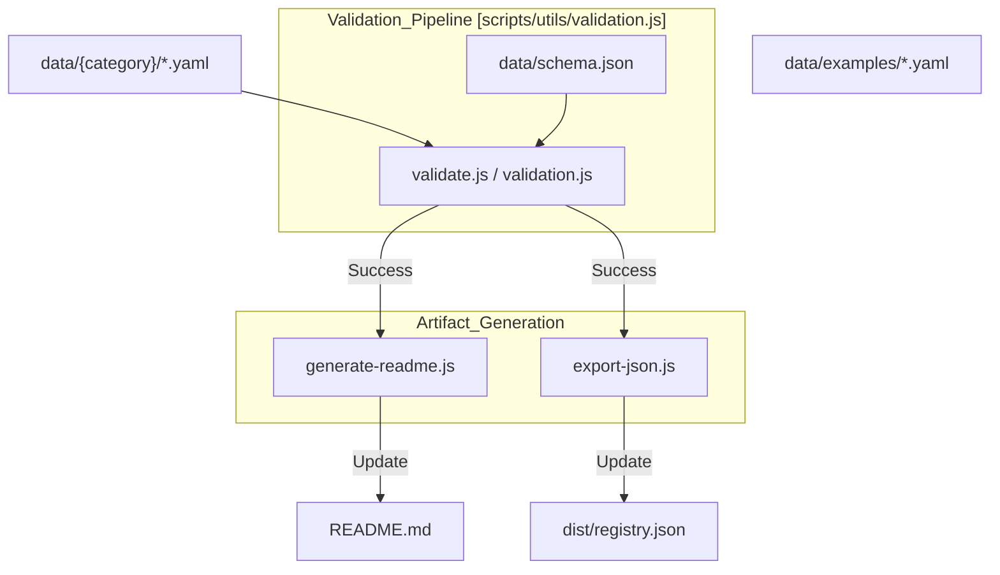

**Sources:** [docs/schema-design.md:9](), [data/schema.json:1-64]()

### Read-Only Principle
- **README.md:** Automatically regenerated from YAML files; manual edits will be overwritten.
- **dist/registry.json:** Machine-readable export used by external tools, generated during the build process to include derived fields like `type` and `productId`.

**Sources:** [docs/schema-design.md:9-17]()

---

# Page: Generated Artifacts

# Generated Artifacts

<details>
<summary>Relevant source files</summary>

The following files were used as context for generating this wiki page:

- [.github/workflows/generate-readme.yml](.github/workflows/generate-readme.yml)
- [dist/registry.json](dist/registry.json)
- [scripts/export-json.js](scripts/export-json.js)
- [scripts/generate-readme.js](scripts/generate-readme.js)
- [scripts/utils/template.js](scripts/utils/template.js)

</details>


This document describes the two primary output artifacts produced by the awesome-opencode repository: `README.md` and `dist/registry.json`. These files are **generated artifacts that must never be manually edited**. Both are automatically produced from YAML source files in the `data/` directory by build scripts and GitHub Actions workflows.

---

## Overview

The repository maintains two parallel output formats serving different consumption patterns:

| Artifact | Target Audience | Format | Primary Use Case |
|----------|----------------|--------|------------------|
| `README.md` | Humans | Markdown with HTML | GitHub browsing, discovery, documentation |
| `dist/registry.json` | Machines | JSON | API consumption, downstream tools, CLIs |

Both artifacts are derived from the same source of truth—YAML files in the `data/` directory—ensuring consistency between human and machine interfaces.

### Data Flow Diagram

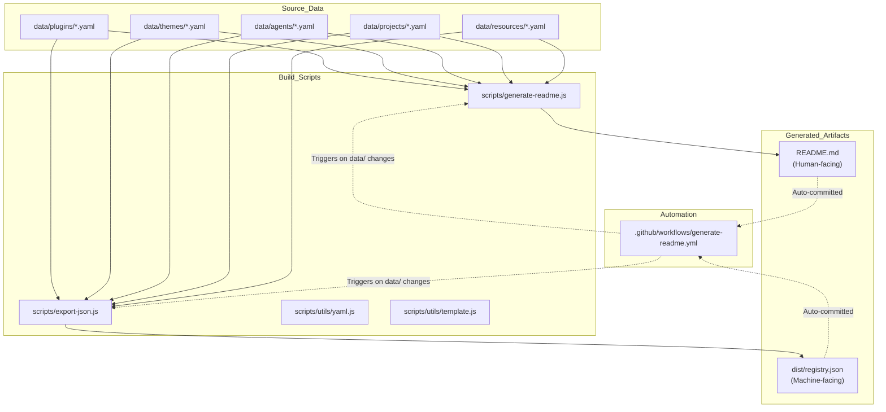

**Sources:** [dist/registry.json:1-13](), [.github/workflows/generate-readme.yml:1-46](), [scripts/generate-readme.js:15-25](), [scripts/export-json.js:14-15]()

---

## README.md Structure

The `README.md` file serves as the primary human-facing documentation. It is viewed on GitHub and provides rich, formatted content with badges, collapsible sections, and GitHub star counts.

### Content Organization

The README is generated by injecting HTML blocks into a template. The categories follow a specific order defined in the build script [scripts/generate-readme.js:16]().

| Section | Placeholder | Content Type |
|---------|-------------|--------------|
| Plugins | `{{PLUGINS}}` | Collapsible plugin entries |
| Themes | `{{THEMES}}` | Collapsible theme entries |
| Agents | `{{AGENTS}}` | Collapsible agent entries |
| Projects | `{{PROJECTS}}` | Collapsible project entries |
| Resources | `{{RESOURCES}}` | Collapsible resource entries |

Each entry is rendered as a `<details>` element using the `generateEntryHtml` function [scripts/utils/template.js:34-69]().

### HTML Entry Mapping

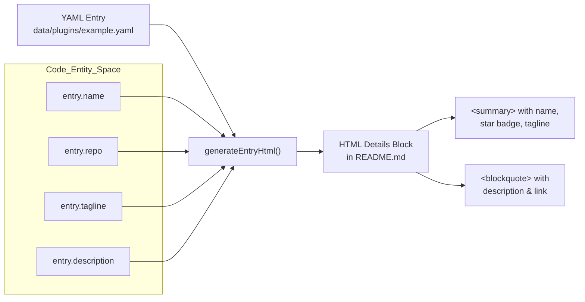

**Sources:** [scripts/utils/template.js:34-69](), [scripts/generate-readme.js:15-25]()

### Generation Process

The README generation is handled by `scripts/generate-readme.js`, which:
1. Loads the template via `readTemplate()` [scripts/utils/template.js:12-15]().
2. Iterates through `CATEGORIES` [scripts/generate-readme.js:16]().
3. Reads and validates YAML files from the corresponding `data/` subdirectory [scripts/generate-readme.js:32-61]().
4. Sorts entries alphabetically by name [scripts/generate-readme.js:64-68]().
5. Replaces placeholders (e.g., `{{PLUGINS}}`) with joined HTML parts [scripts/generate-readme.js:122-124]().
6. Writes the final content to the root `README.md` [scripts/utils/template.js:75-78]().

---

## registry.json Structure

The `dist/registry.json` file provides a machine-readable catalog in a flat JSON array format. It is consumed by downstream tools that need programmatic access to the registry data.

### JSON Schema and Field Mapping

The `mapEntry` function in `scripts/export-json.js` transforms raw YAML data into the standardized registry format [scripts/export-json.js:42-63]().

| Field | Type | Source | Description |
|-------|------|--------|-------------|
| `productId` | string | Derived | Kebab-case identifier from filename or name |
| `type` | string | Derived | Category from directory path (e.g., "plugins") |
| `displayName` | string | YAML `name` | Human-readable name |
| `repoUrl` | string | YAML `repo` | Repository URL |
| `tagline` | string | YAML `tagline` | Short description |
| `description` | string | YAML `description` | Full description |
| `scope` | string[] | YAML `scope` | Array of scopes (defaults to `["global"]`) |
| `tags` | string[] | YAML `tags` | Array of tags (defaults to `[]`) |
| `homepageUrl` | string? | YAML `homepage` | Optional homepage URL |
| `installation` | string? | YAML `installation` | Optional install instructions |
| `minVersion` | string? | YAML `min_version` | Optional minimum version |

**Sources:** [scripts/export-json.js:48-60](), [dist/registry.json:1-13]()

### Derived Fields

Two critical fields are **derived during export** rather than stored in YAML:

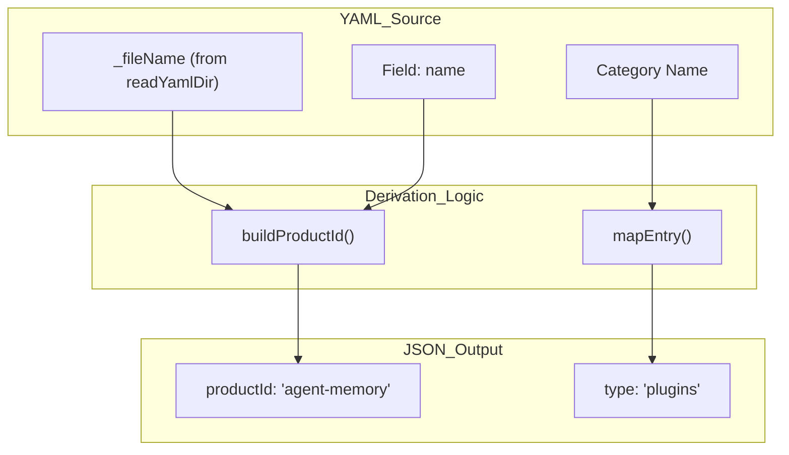

#### productId Derivation
The `productId` is derived using the `buildProductId()` function. It prioritizes the `_fileName` (kebab-case filename) provided by the YAML utility [scripts/export-json.js:25-33]().

#### type Derivation
The `type` field is derived from the directory path where the YAML file is located during the `loadEntries()` loop [scripts/export-json.js:79-107]().

---

## Generation Pipeline

### Build Scripts Flow

The `export-json.js` script processes data through several utility functions to ensure a clean, sorted output.

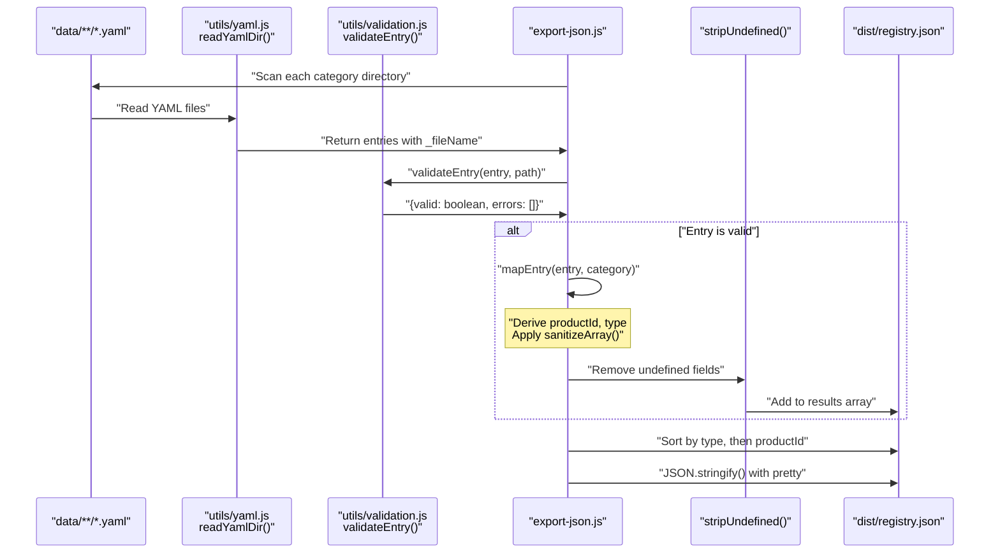

**Sources:** [scripts/export-json.js:75-107](), [scripts/export-json.js:122-128](), [scripts/export-json.js:65-73]()

### GitHub Actions Automation

The generation is automated via the `Auto-Generate README` workflow [/.github/workflows/generate-readme.yml:1]().

1. **Trigger**: Push to `main` branch affecting the `data/` directory [/.github/workflows/generate-readme.yml:4-8]().
2. **Setup**: Uses Node.js 20 and installs dependencies via `npm ci` [/.github/workflows/generate-readme.yml:29-35]().
3. **Execution**:
    - Runs `node scripts/generate-readme.js` [/.github/workflows/generate-readme.yml:49]().
    - Runs `node scripts/export-json.js --pretty --output dist/registry.json` [/.github/workflows/generate-readme.yml:50]().
4. **Persistence**: The workflow uses a retry loop to fetch the latest `main`, regenerate the artifacts, and push the changes back to the repository [/.github/workflows/generate-readme.yml:44-66]().

---

## Key Principles

### Single Source of Truth
The YAML files in `data/` are the only files that should be manually edited. Any manual changes to `README.md` or `dist/registry.json` will be overwritten by the CI/CD pipeline [/.github/workflows/generate-readme.yml:52-60]().

### Sorting Consistency
- **README.md**: Entries are sorted alphabetically by name (case-insensitive) within each category [scripts/generate-readme.js:64-68]().
- **registry.json**: Entries are sorted primarily by `type` and secondarily by `productId` [scripts/export-json.js:122-128]().

### Undefined Field Handling
To maintain a clean JSON output, the `stripUndefined` function removes any keys with `undefined` values before they are added to the final registry array [scripts/export-json.js:65-73](). This prevents the JSON from being cluttered with empty optional fields.

**Sources:** [scripts/export-json.js:122-128](), [scripts/generate-readme.js:64-68](), [scripts/export-json.js:65-73]()

---

# Page: Data Model

# Data Model

<details>
<summary>Relevant source files</summary>

The following files were used as context for generating this wiki page:

- [data/plugins/kilo-auth.yaml](data/plugins/kilo-auth.yaml)
- [data/schema.json](data/schema.json)
- [docs/schema-design.md](docs/schema-design.md)

</details>


This document defines the data model used throughout the awesome-opencode repository. It covers the YAML schema structure, field definitions, validation rules, and type derivation conventions. The data model serves as the contract between contributors who create YAML entries and downstream systems that consume the registry.

For information about how this schema is validated during the build process, see [Validation System](#5.3). For details about the structure of generated output artifacts, see [Data Layer](#2.2).

---

## Schema Architecture

The data model uses a two-tier validation system: a JSON Schema specification ([data/schema.json:1-63]()) defines structural constraints, while additional business rules are enforced programmatically during build time.

**Diagram: Schema Validation Architecture**

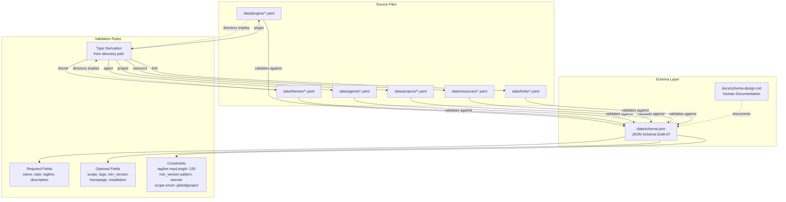

Sources: [docs/schema-design.md:1-63](), [data/schema.json:1-63]()

For more details on the validation pipeline, see [Schema System](#3.1).

---

## Required Fields

All YAML entries must contain four required fields. These fields are enforced by the JSON Schema at [data/schema.json:61]().

| Field | Type | Constraint | Description |
|-------|------|------------|-------------|
| `name` | `string` | `minLength: 1` | Display name of the extension or project |
| `repo` | `string` | `format: uri` | HTTPS repository URL (e.g., `https://github.com/user/repo`) |
| `tagline` | `string` | `minLength: 1`<br/>`maxLength: 120` | Short summary displayed in collapsed view |
| `description` | `string` | `minLength: 1` | Full description, may be multi-line markdown |

The `name` field ([data/schema.json:8-11]()) represents the human-readable display name. The `tagline` field ([data/schema.json:18-22]()) has a strict 120-character limit enforced at the schema level.

For details on all standard fields, see [Common Fields](#3.2).

Sources: [data/schema.json:7-27](), [data/schema.json:61](), [docs/schema-design.md:199-238]()

---

## Optional Fields

Five optional fields provide enhanced metadata and installation guidance. When omitted, sensible defaults are applied by the build system.

| Field | Type | Default | Constraint | Description |
|-------|------|---------|------------|-------------|
| `scope` | `array` | `["global"]` | items: `"global"` or `"project"` | Installation scope (user-wide vs project-specific) |
| `tags` | `array` | `[]` | items: `string` | Freeform tags for filtering and discovery |
| `min_version` | `string` | (none) | pattern: `^[0-9]+\.[0-9]+\.[0-9]+` | Minimum OpenCode version required (semver) |
| `homepage` | `string` | (none) | format: `uri` | Documentation URL if different from `repo` |
| `installation` | `string` | (none) | (none) | Detailed installation instructions in markdown |

The `scope` field ([data/schema.json:29-38]()) determines if an extension is installed to `~/.config/opencode/` (global) or `.opencode/` (project). If omitted, the build system defaults to `["global"]` ([docs/schema-design.md:210]()).

For details on how these fields are used, see [Common Fields](#3.2).

Sources: [data/schema.json:29-59](), [docs/schema-design.md:209-217]()

---

## Type Derivation System

The extension type and unique identifier are **not stored in YAML files**. Instead, they are derived from the directory path and filename. This convention-over-configuration approach ensures consistency and prevents type mismatches.

**Diagram: Directory-to-Type Mapping**

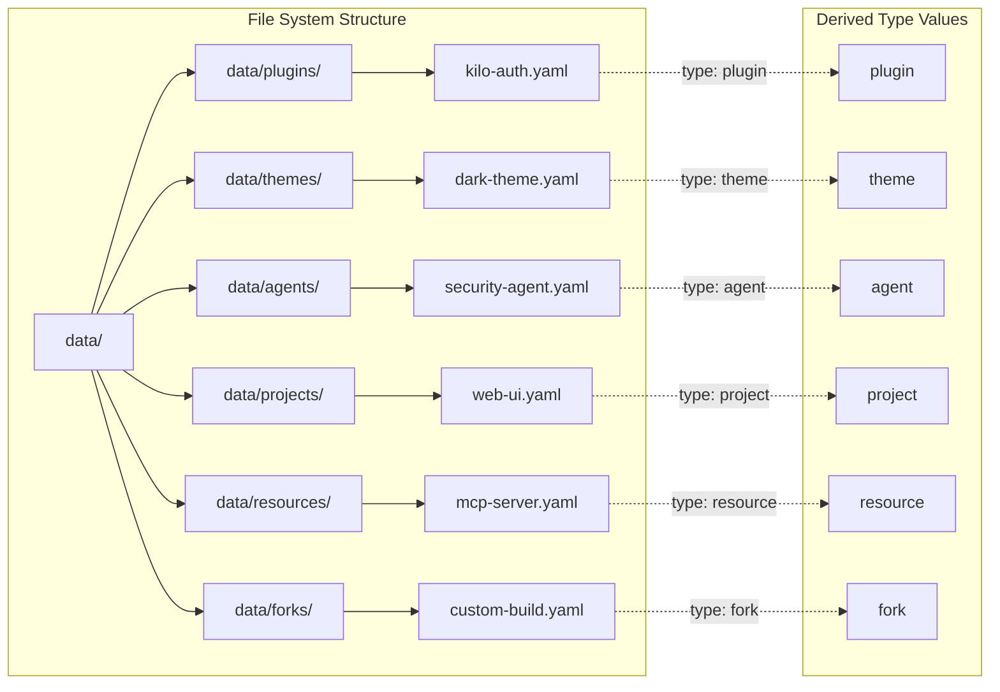

### Key Derivations

*   **Type**: Extracted from the parent directory name (e.g., `data/plugins/` implies `type: plugin`).
*   **Product ID**: Extracted from the filename without extension (e.g., `kilo-auth.yaml` implies `productId: kilo-auth`).

For more details on the derivation logic, see [Type Derivation](#3.3).

Sources: [docs/schema-design.md:17](), [docs/schema-design.md:218-230](), [data/plugins/kilo-auth.yaml:1-4]()

---

## Downstream Field Mapping

The YAML data model is transformed into a machine-readable JSON format for consumption by downstream platforms. This mapping adds derived fields and renames fields for API consistency.

**Diagram: YAML to JSON Transformation**

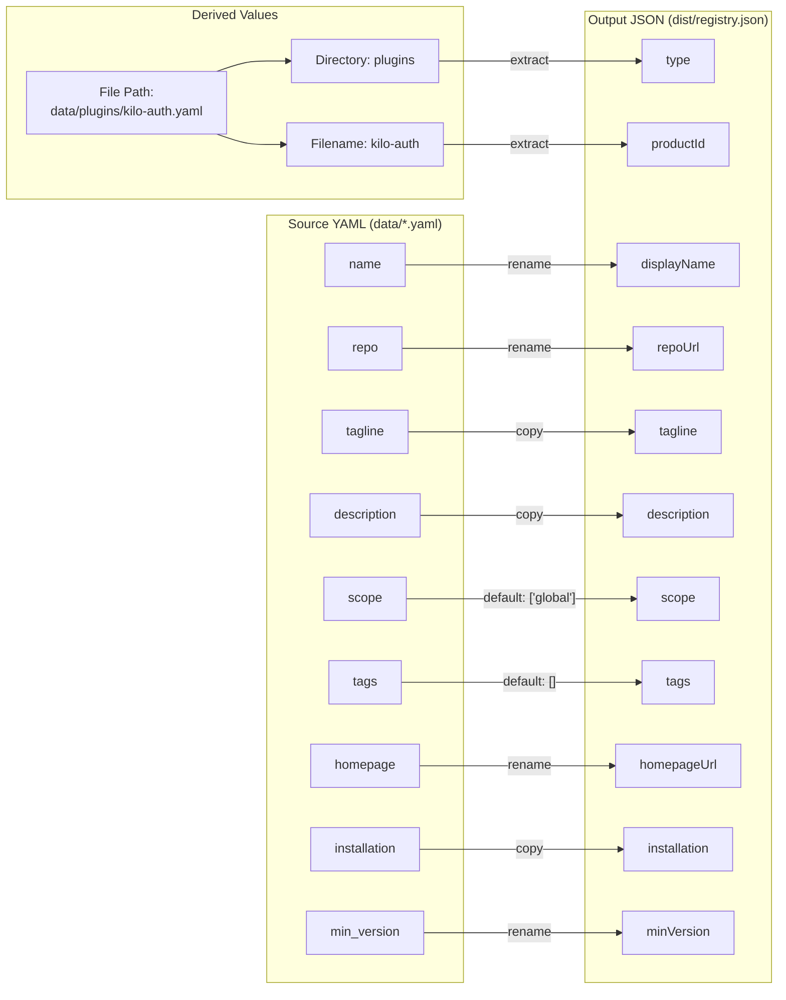

### Transformation Table

| YAML Field | JSON Field | Transformation |
|------------|------------|----------------|
| `name` | `displayName` | Rename |
| `repo` | `repoUrl` | Rename |
| (directory) | `type` | Derive |
| (filename) | `productId` | Derive |
| `homepage` | `homepageUrl` | Rename |
| `min_version` | `minVersion` | Rename |

Sources: [docs/schema-design.md:17](), [data/schema.json:1-63]()

---

## Example Files

Complete example files demonstrating all fields are maintained in the `data/examples/` directory. These serve as the primary reference for contributors.

| Entry Type | Example File Path |
|------------|-------------------|
| Plugin | `data/examples/plugin.yaml` |
| Theme | `data/examples/theme.yaml` |
| Agent | `data/examples/agent.yaml` |
| Project | `data/examples/project.yaml` |
| Resource | `data/examples/resource.yaml` |
| Fork | `data/examples/fork.yaml` |

Sources: [docs/schema-design.md:19-40]()

---

# Page: Schema System

# Schema System

<details>
<summary>Relevant source files</summary>

The following files were used as context for generating this wiki page:

- [.github/PULL_REQUEST_TEMPLATE.md](.github/PULL_REQUEST_TEMPLATE.md)
- [contributing.md](contributing.md)
- [data/schema.json](data/schema.json)
- [docs/schema-design.md](docs/schema-design.md)

</details>


This document describes the JSON Schema validation system used to ensure data integrity across all YAML entries in the awesome-opencode registry. The schema defines required and optional fields, data type constraints, validation rules, and default values.

## Overview

The schema system enforces data quality through a centralized JSON Schema specification located at [data/schema.json:1-64](). This schema validates all YAML entries during both contribution submission (via GitHub Actions) and artifact generation. The validation system operates on a strict required-field policy with extensible optional fields.

**Sources:** [docs/schema-design.md:7-18](), [data/schema.json:1-7]()

## Schema Architecture

The schema system follows a convention-over-configuration design where type information is derived from file location rather than stored in YAML files.

### Schema Definition Structure

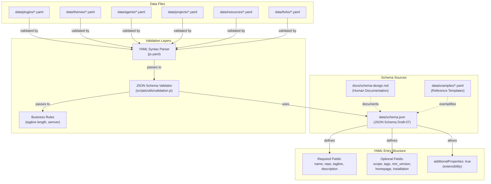

**Sources:** [data/schema.json:1-7](), [docs/schema-design.md:19-40](), [docs/schema-design.md:195-230]()

### Schema Specification Details

The schema uses JSON Schema Draft-07 specification with the following metadata:

| Property | Value |
|----------|-------|
| `$schema` | `http://json-schema.org/draft-07/schema#` |
| `$id` | `https://github.com/awesome-opencode/awesome-opencode/data/schema.json` |
| `title` | "Awesome Opencode Entry" |
| `type` | `object` |
| `additionalProperties` | `true` (allows extension fields) |

The `additionalProperties: true` setting enables forward compatibility by allowing unrecognized fields to pass validation, supporting future schema enhancements without breaking existing entries [data/schema.json:62]().

**Sources:** [data/schema.json:1-7](), [data/schema.json:62]()

## Required Fields

The schema enforces exactly four required fields. All YAML entries must contain these fields to pass validation.

### Required Field Definitions

| Field | Type | Constraint | Description |
|-------|------|------------|-------------|
| `name` | `string` | `minLength: 1` | Display name shown in UI and documentation |
| `repo` | `string` | `format: uri` | Repository URL (must be valid URI) |
| `tagline` | `string` | `minLength: 1`<br/>`maxLength: 120` | Punchy summary for collapsed views |
| `description` | `string` | `minLength: 1` | Full description (may be multi-line) |

**Sources:** [data/schema.json:7-28](), [data/schema.json:61](), [docs/schema-design.md:199-206]()

### Minimal Valid Entry

The smallest valid YAML entry contains only the four required fields:

```yaml
name: My Extension
repo: https://github.com/user/my-extension
tagline: A brief description of what this does
description: A longer explanation of the extension.
```

**Sources:** [docs/schema-design.md:231-238](), [contributing.md:27-32]()

## Optional Fields

The schema defines five optional fields that provide enhanced metadata for discoverability and installation guidance.

### Optional Field Definitions

| Field | Type | Constraints | Default | Description |
|-------|------|-------------|---------|-------------|
| `scope` | `array` of `string` | `enum: ["global", "project"]`<br/>`minItems: 1`<br/>`uniqueItems: true` | `["global"]` | Installation locations |
| `tags` | `array` of `string` | No constraints | `[]` | Categorization tags |
| `min_version` | `string` | `pattern: "^[0-9]+\\.[0-9]+\\.[0-9]+"` | Not set | Minimum OpenCode version (semver) |
| `homepage` | `string` | `format: uri` | Not set | Documentation URL |
| `installation` | `string` | No constraints | Not set | Installation instructions (markdown) |

**Sources:** [data/schema.json:29-59](), [docs/schema-design.md:208-216]()

### Scope Field Enumeration

The `scope` field uses an enumerated type with two possible values: `global` and `project` [data/schema.json:33-33](). These correspond to different configuration directories in the OpenCode environment, such as `~/.config/opencode/` for global and `.opencode/` for project-level [docs/schema-design.md:130-157]().

The schema enforces `uniqueItems: true`, preventing duplicate scope values like `["global", "global"]` [data/schema.json:36-36]().

**Sources:** [data/schema.json:29-38](), [docs/schema-design.md:126-192]()

### Version Pattern Validation

The `min_version` field enforces semantic versioning format through a regular expression pattern: `^[0-9]+\\.[0-9]+\\.[0-9]+` [data/schema.json:48-48]().

**Sources:** [data/schema.json:46-50]()

## Data Type Constraints

The schema enforces strict type checking for all fields. JSON Schema Draft-07 primitive types are used throughout.

### String Length Constraints

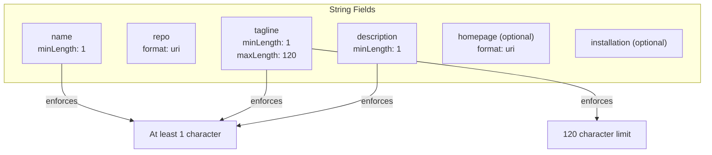

The 120-character limit on `tagline` is critical: it ensures taglines display properly in collapsed table views and one-line summaries [data/schema.json:21-21]().

**Sources:** [data/schema.json:8-11](), [data/schema.json:18-23](), [data/schema.json:24-28]()

## Validation Process

The validation system operates in three sequential layers, each with distinct responsibilities.

### Three-Tier Validation Flow

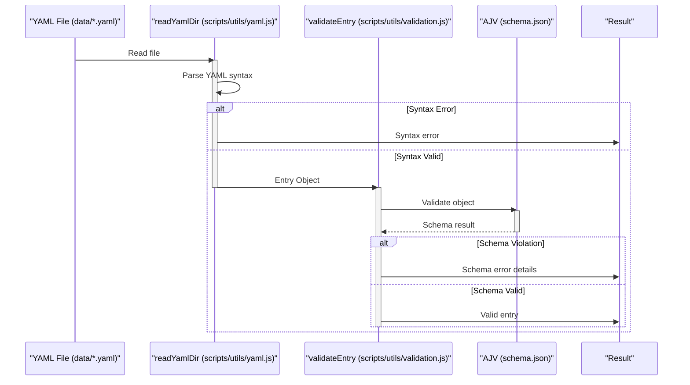

**Sources:** [docs/schema-design.md:195-230](), [contributing.md:53-59]()

### Validation Enforcement Pipeline

Validation is enforced through several entry points:

1.  **Local Development**: Contributors can run validation scripts manually.
2.  **CI (validate-pr.yml)**: Every pull request targeting the `data/` directory triggers a validation run to ensure only valid entries are merged [contributing.md:55-55]().
3.  **Build (generate-readme.yml)**: The build pipeline validates all entries before generating `README.md` and `dist/registry.json`.

**Sources:** [contributing.md:53-59](), [.github/PULL_REQUEST_TEMPLATE.md:15-23]()

## Data Flow and Transformation

During the export process, scripts transform the source YAML into the machine-readable `dist/registry.json`.

### ProductId and Type Derivation

The system derives key fields during export rather than requiring them in source YAML:

*   **productId**: Derived from the YAML filename (kebab-case) [contributing.md:23-23]().
*   **type**: Derived from the parent directory name (e.g., `plugins`, `themes`, `agents`) [docs/schema-design.md:17-17](), [docs/schema-design.md:19-40]().

### Default Value Application

Several fields have implicit default values applied if omitted:

| Field | Default When Omitted | Logic |
|-------|---------------------|-------|
| `scope` | `["global"]` | Default specified in schema [data/schema.json:37-37]() |
| `tags` | `[]` | Empty array if not provided |

**Sources:** [data/schema.json:29-45](), [docs/schema-design.md:17-17]()

## Schema Extensibility

The schema uses `additionalProperties: true` to support forward compatibility and custom fields [data/schema.json:62](). This design allows contributors to include experimental or platform-specific fields without schema modifications. The validation system will not reject entries with unrecognized fields, supporting the principle of being "Downstream Ready" [docs/schema-design.md:14-16]().

**Sources:** [data/schema.json:62](), [docs/schema-design.md:11-18]()

---

# Page: Common Fields

# Common Fields

<details>
<summary>Relevant source files</summary>

The following files were used as context for generating this wiki page:

- [data/examples/plugin.yaml](data/examples/plugin.yaml)
- [data/schema.json](data/schema.json)
- [docs/schema-design.md](docs/schema-design.md)

</details>


This document defines the YAML fields that are shared across all entry types in the awesome-opencode registry. Every entry, regardless of whether it is a plugin, theme, agent, project, resource, or fork, uses the same base schema with four required fields and five optional fields. For information about how entry type is determined from directory location, see [Type Derivation](#3.3). For the underlying JSON Schema validation system, see [Schema System](#3.1).

---

## Required Fields

All entries in the registry must define four required fields. These fields provide the minimum metadata necessary for catalog display and downstream consumption.

| Field | Type | Constraint | Purpose |
|-------|------|------------|---------|
| `name` | string | minLength: 1 | Display name shown in README and downstream platforms |
| `repo` | string | URI format | HTTPS repository URL (typically GitHub) |
| `tagline` | string | 1-120 chars | Short summary shown in collapsed view |
| `description` | string | minLength: 1 | Full description shown when expanded |

### Field: `name`

The display name for the extension. This is the human-readable identifier shown in all UI contexts.

**Schema Definition:** [data/schema.json:8-12]()

**Example:**
```yaml
name: Example Plugin
```

**Validation:**
- Must be non-empty string [data/schema.json:10]()
- No maximum length enforced
- May contain any Unicode characters

**Usage:**
- Mapped to `displayName` field in `registry.json` export
- Displayed as heading in `README.md` sections
- Used in search and discovery interfaces

### Field: `repo`

The HTTPS URL to the extension's source repository.

**Schema Definition:** [data/schema.json:13-17]()

**Example:**
```yaml
repo: https://github.com/example/opencode-example-plugin
```

**Validation:**
- Must be valid URI format [data/schema.json:15]()
- Should use HTTPS protocol
- Typically points to GitHub, GitLab, or similar platforms

**Usage:**
- Mapped to `repoUrl` field in `registry.json` export
- Linked from `README.md` for source code access
- Used by validation scripts to verify repository accessibility

### Field: `tagline`

A short, punchy summary limited to 120 characters. This field is displayed in collapsed views and list contexts where space is limited.

**Schema Definition:** [data/schema.json:18-23]()

**Example:**
```yaml
tagline: A brief description of what this plugin does (max 120 chars)
```

**Validation:**
- Minimum length: 1 character [data/schema.json:20]()
- Maximum length: 120 characters [data/schema.json:21]()
- Enforced by JSON Schema `maxLength` in [data/schema.json:21]()

**Usage:**
- Displayed in collapsed README sections
- Shown in search result previews
- Preserved as `tagline` field in `registry.json`

### Field: `description`

The full description of the extension. May be multi-line and contain detailed information about features, use cases, and benefits.

**Schema Definition:** [data/schema.json:24-28]()

**Example:**
```yaml
description: A longer description explaining the plugin in detail.
  - Can be multiple lines and include
  - Feature highlights
  - Use cases
  - Key benefits
```

**Validation:**
- Minimum length: 1 character [data/schema.json:26]()
- No maximum length
- Supports YAML multi-line syntax

**Usage:**
- Displayed in expanded README sections
- Preserved as `description` field in `registry.json`
- May contain Markdown formatting

**Sources:** [docs/schema-design.md:199-207](), [data/schema.json:8-28](), [data/examples/plugin.yaml:9-16]()

---

## Optional Fields

Five optional fields provide enhanced metadata for filtering, version requirements, and installation guidance. All optional fields have sensible defaults when omitted.

| Field | Type | Default | Purpose |
|-------|------|---------|---------|
| `scope` | array[string] | `["global"]` | Installation location(s): global, project, or both |
| `tags` | array[string] | `[]` | Keywords for filtering and discovery |
| `min_version` | string | undefined | Minimum OpenCode version (semver format) |
| `homepage` | string | undefined | Documentation URL if different from repo |
| `installation` | string | undefined | Detailed installation instructions (Markdown) |

### Field: `scope`

Defines where the extension can be installed: globally (`~/.config/opencode/`), project-level (`.opencode/`), or both.

**Schema Definition:** [data/schema.json:29-38]()

**Example:**
```yaml
scope:
  - global
  - project
```

**Validation:**
- Must be array of strings [data/schema.json:30]()
- Valid values: `"global"`, `"project"` (enum enforced at [data/schema.json:33]())
- Minimum 1 item, unique items required [data/schema.json:35-36]()
- Defaults to `["global"]` when omitted [data/schema.json:37]()

**Installation Paths:**

| Scope Value | Installation Path |
|-------------|-------------------|
| `global` | `~/.config/opencode/` (user-wide) [docs/schema-design.md:132-142]() |
| `project` | `.opencode/` (repository-specific) [docs/schema-design.md:146-156]() |

### Field: `tags`

Array of keyword strings for filtering and categorization. Used by discovery platforms and search interfaces.

**Schema Definition:** [data/schema.json:39-45]()

**Example:**
```yaml
tags:
  - productivity
  - ai
  - authentication
```

**Validation:**
- Must be array of strings [data/schema.json:40-42]()
- Defaults to `[]` when omitted

**Usage:**
- Enables tag-based filtering in discovery platforms
- Preserved as `tags` array in `registry.json`
- Displayed as badges in `README.md`

### Field: `min_version`

Specifies the minimum OpenCode version required to use the extension. Must follow semantic versioning format.

**Schema Definition:** [data/schema.json:46-50]()

**Example:**
```yaml
min_version: "1.0.0"
```

**Validation:**
- Must match semver pattern: `^[0-9]+\.[0-9]+\.[0-9]+` [data/schema.json:48]()
- Enforced by JSON Schema regex at [data/schema.json:48]()

**Usage:**
- Displayed as version requirement in `README.md`
- Used by package managers to check compatibility

### Field: `homepage`

URL to documentation or landing page if different from the repository URL.

**Schema Definition:** [data/schema.json:51-55]()

**Example:**
```yaml
homepage: https://example.com/docs/opencode-dashboard
```

**Validation:**
- Must be valid URI format [data/schema.json:53]()

**Usage:**
- Linked as "Documentation" in `README.md`
- Mapped to `homepageUrl` field in `registry.json`

### Field: `installation`

Detailed installation instructions in Markdown format. Supports multi-line YAML strings.

**Schema Definition:** [data/schema.json:56-59]()

**Example:**
```yaml
installation: |
  ## Prerequisites
  - OpenCode 1.0.0 or later
  - Node.js 18+

  ## Installation
  ```bash
  npm install
  ```
```

**Usage:**
- Displayed in expanded README sections
- Preserved as `installation` field in `registry.json`

**Sources:** [docs/schema-design.md:209-217](), [data/schema.json:29-59](), [data/examples/plugin.yaml:22-81]()

---

## Field Validation Pipeline

The following diagram shows how fields are validated through multiple layers before being accepted into the registry.

**Diagram: Field Validation Flow**

```mermaid
graph TD
    YAML["YAML File<br/>data/{category}/entry.yaml"]
    PARSE["YAML Parser<br/>js-yaml"]
    SCHEMA["JSON Schema Validator<br/>data/schema.json"]
    RULES["Business Rules Validator<br/>scripts/utils/validation.js"]
    
    YAML -->|"Read file"| PARSE
    PARSE -->|"Parse YAML"| SCHEMA
    SCHEMA -->|"Validate structure"| RULES
    
    PARSE -->|"Syntax Error"| FAIL1["Reject: Invalid YAML"]
    SCHEMA -->|"Schema Error"| FAIL2["Reject: Missing required fields<br/>Invalid field types<br/>Constraint violations"]
    RULES -->|"Rule Error"| FAIL3["Reject: Tagline > 120 chars<br/>Invalid min_version format"]
    
    RULES -->|"Valid"| SUCCESS["Accept Entry<br/>Include in build"]
    
    subgraph "Schema Checks"
        SCHEMA
        REQ["Required: name, repo,<br/>tagline, description"]
        OPT["Optional: scope, tags,<br/>min_version, homepage,<br/>installation"]
        SCHEMA --> REQ
        SCHEMA --> OPT
    end
```

**Sources:** [docs/schema-design.md:195-217](), [data/schema.json:1-63]()

---

## Field Processing in Build System

This diagram shows how common fields flow from YAML sources through the build pipeline to generate `README.md` and `registry.json` outputs.

**Diagram: Field Processing Flow**

```mermaid
graph LR
    subgraph "Data Layer"
        YAML["YAML Files<br/>data/plugins/*.yaml<br/>data/themes/*.yaml<br/>etc."]
    end
    
    subgraph "Build Scripts"
        GEN_README["generate-readme.js"]
        EXPORT_JSON["export-json.js"]
        UTILS["Validation Utils<br/>scripts/utils/validation.js"]
    end
    
    subgraph "Field Mapping"
        MAP_README["README Mapping:<br/>name → Header<br/>tagline → Summary<br/>description → Details"]
        MAP_JSON["JSON Mapping:<br/>name → displayName<br/>repo → repoUrl<br/>scope → scope (default global)"]
    end
    
    subgraph "Output Artifacts"
        README["README.md"]
        REGISTRY["dist/registry.json"]
    end
    
    YAML -->|"Read & Validate"| UTILS
    UTILS -->|"Valid entries"| GEN_README
    UTILS -->|"Valid entries"| EXPORT_JSON
    
    GEN_README --> MAP_README
    EXPORT_JSON --> MAP_JSON
    
    MAP_README --> README
    MAP_JSON --> REGISTRY
```

**Sources:** [docs/schema-design.md:195-217](), [data/schema.json:1-63]()

---

## Field Defaults and Derived Values

Some fields have default values when omitted, while others are derived from file location during the build process.

| Field | Default Value | Derivation Logic |
|-------|---------------|------------------|
| `scope` | `["global"]` | If omitted, defaults to global scope only [data/schema.json:37]() |
| `tags` | `[]` | If omitted, empty array |
| `type` | (derived) | Derived from directory path [docs/schema-design.md:17]() |
| `productId` | (derived) | Derived from filename (without extension) |

### Type Derivation

The `type` field is **not** stored in YAML files. It is derived from the directory path during the build process.

**Mapping:**

| Directory Path | Derived Type |
|----------------|--------------|
| `data/plugins/` | `plugin` |
| `data/themes/` | `theme` |
| `data/agents/` | `agent` |
| `data/projects/` | `project` |
| `data/resources/` | `resource` |
| `data/forks/` | `fork` |

**Sources:** [docs/schema-design.md:17-37](), [docs/schema-design.md:19-40]()

---

## Complete Field Reference

| Field | Required | Type | Constraints | Default | Schema Location |
|-------|----------|------|-------------|---------|-----------------|
| `name` | Yes | string | minLength: 1 | N/A | [data/schema.json:8-12]() |
| `repo` | Yes | string | URI format | N/A | [data/schema.json:13-17]() |
| `tagline` | Yes | string | 1-120 chars | N/A | [data/schema.json:18-23]() |
| `description` | Yes | string | minLength: 1 | N/A | [data/schema.json:24-28]() |
| `scope` | No | array[string] | enum: ["global", "project"] | `["global"]` | [data/schema.json:29-38]() |
| `tags` | No | array[string] | none | `[]` | [data/schema.json:39-45]() |
| `min_version` | No | string | semver pattern | undefined | [data/schema.json:46-50]() |
| `homepage` | No | string | URI format | undefined | [data/schema.json:51-55]() |
| `installation` | No | string | none | undefined | [data/schema.json:56-59]() |

**Sources:** [docs/schema-design.md:195-217](), [data/schema.json:1-63](), [data/examples/plugin.yaml:1-81]()

---

# Page: Type Derivation

# Type Derivation

<details>
<summary>Relevant source files</summary>

The following files were used as context for generating this wiki page:

- [data/schema.json](data/schema.json)
- [dist/registry.json](dist/registry.json)
- [docs/schema-design.md](docs/schema-design.md)
- [scripts/export-json.js](scripts/export-json.js)

</details>


This document explains how the awesome-opencode repository derives the `type` field for registry entries from their directory location rather than storing it explicitly in YAML files. This convention-over-configuration approach ensures consistency and reduces duplication.

For information about the common fields stored within YAML files, see [Common Fields](#3.2). For details on how the schema validation system works, see [Schema System](#3.1).

---

## Purpose and Scope

The awesome-opencode repository uses a **directory-based type system** where the category of an extension (plugin, theme, agent, project, resource, or fork) is determined by which directory its YAML file resides in, not by a field within the file itself. This document covers:

- The directory-to-type mapping conventions
- How type derivation is implemented in build scripts
- The relationship between type derivation and `productId` generation
- How derived types are exposed to downstream consumers

This approach enforces a clear organizational structure and prevents inconsistencies between directory location and declared type.

**Sources:** [docs/schema-design.md:17-18](), [docs/schema-design.md:218-230]()

---

## Convention Over Configuration

The repository follows the principle that **location defines type**. Contributors cannot specify a `type` field in their YAML entries—the system derives it automatically from the file path.

### Design Rationale

| Benefit | Description |
|---------|-------------|
| **Single Source of Truth** | Directory structure is the authoritative type indicator |
| **Prevents Mismatches** | No risk of YAML declaring `type: plugin` while living in `data/themes/` |
| **Simpler Contributions** | Contributors don't need to remember to set a type field |
| **Clearer Organization** | File system structure visually represents the catalog structure |
| **Enforced Consistency** | Build scripts can validate that entries are in the correct category |

### Type System Diagram

```mermaid
graph TB
    YAML["YAML Entry File<br/>(no type field)"]
    DIR["Directory Location<br/>(data/&lt;category&gt;/)"]
    BUILD["Build System<br/>(export-json.js)"]
    TYPE["Derived Type Field<br/>(in registry.json)"]
    
    YAML -->|"located in"| DIR
    DIR -->|"read by"| BUILD
    BUILD -->|"generates"| TYPE
    
    subgraph "Directory Structure"
        D1["data/plugins/"]
        D2["data/themes/"]
        D3["data/agents/"]
        D4["data/projects/"]
        D5["data/resources/"]
    end
    
    subgraph "Derived Types"
        T1["type: 'plugins'"]
        T2["type: 'themes'"]
        T3["type: 'agents'"]
        T4["type: 'projects'"]
        T5["type: 'resources'"]
    end
    
    D1 -.->|"maps to"| T1
    D2 -.->|"maps to"| T2
    D3 -.->|"maps to"| T3
    D4 -.->|"maps to"| T4
    D5 -.->|"maps to"| T5
```

**Sources:** [docs/schema-design.md:15-18](), [docs/schema-design.md:218-230]()

---

## Directory-to-Type Mapping

The build system uses a fixed mapping between directory names and type values. This mapping is hardcoded in the build scripts and documented in the schema design.

### Canonical Mapping Table

| Directory Path | Derived Type | Entry Category |
|----------------|--------------|----------------|
| `data/plugins/` | `plugins` | JavaScript/TypeScript modules extending OpenCode |
| `data/themes/` | `themes` | JSON configurations for visual customization |
| `data/agents/` | `agents` | AI agent configurations and SKILL.md files |
| `data/projects/` | `projects` | Standalone applications and tools |
| `data/resources/` | `resources` | MCP servers, guides, configs, and commands |
| `data/forks/` | `forks` | Modified builds of OpenCode itself |

### Examples

| File Path | Derived Type |
|-----------|--------------|
| `data/plugins/envsitter-guard.yaml` | `plugins` |
| `data/themes/ayu-dark.yaml` | `themes` |
| `data/agents/opencode-redstone.yaml` | `agents` |
| `data/projects/open-agent.yaml` | `projects` |
| `data/resources/debug-log-to-text-file.yaml` | `resources` |

**Sources:** [docs/schema-design.md:218-230](), [scripts/export-json.js:14]()

---

## Implementation in Build System

The type derivation logic is implemented in the `export-json.js` script, which processes YAML files and generates the `dist/registry.json` output.

### Build Process Flow

```mermaid
sequenceDiagram
    participant Script as "export-json.js"
    participant CATEGORIES as "CATEGORIES array"
    participant FS as "File System"
    participant Loader as "readYamlDir()"
    participant Mapper as "mapEntry()"
    participant Output as "registry.json"
    
    Script->>CATEGORIES: "Iterate categories"
    Note over CATEGORIES: "['plugins', 'themes',<br/>'agents', 'projects',<br/>'resources']"
    
    loop "For each category"
        CATEGORIES->>FS: "Build path<br/>data/{category}"
        FS->>Loader: "Load YAML files"
        Loader->>Script: "Return entries[]"
        
        loop "For each entry"
            Script->>Mapper: "mapEntry(entry, category)"
            Note over Mapper: "type = category"
            Mapper->>Script: "Return mapped object"
        end
    end
    
    Script->>Output: "Write JSON array<br/>with type field"
```

### Code Implementation

The `CATEGORIES` constant defines the recognized directory names:

[scripts/export-json.js:14]()

The main loop in `loadEntries()` iterates through each category directory using `readYamlDir`:

[scripts/export-json.js:79-104]()

The `mapEntry()` function receives the category as a parameter and assigns it as the `type` field in the generated object:

[scripts/export-json.js:42-63]()

**Sources:** [scripts/export-json.js:14](), [scripts/export-json.js:42-63](), [scripts/export-json.js:79-104]()

---

## ProductId Derivation

In addition to type derivation, the build system also derives a `productId` field from the filename. This is a related concept that follows the same convention-over-configuration philosophy.

### Filename-to-ProductId Mapping

The `productId` is generated by taking the filename (without the `.yaml` extension) and using it directly as the identifier. If the filename is missing, the system falls back to slugifying the entry name.

### BuildProductId Function Flow

```mermaid
graph TD
    Start["buildProductId(entry)"]
    CheckFileName{"entry._fileName<br/>exists?"}
    UseFileName["return entry._fileName"]
    CheckName{"entry.name<br/>exists?"}
    Slugify["return slugify(entry.name)"]
    ReturnEmpty["return ''"]
    
    Start --> CheckFileName
    CheckFileName -->|Yes| UseFileName
    CheckFileName -->|No| CheckName
    CheckName -->|Yes| Slugify
    CheckName -->|No| ReturnEmpty
```

The implementation in `export-json.js`:

[scripts/export-json.js:25-33]()

### Example Derivations

| File Path | `_fileName` | Entry Name | Derived `productId` |
|-----------|-------------|------------|---------------------|
| `data/plugins/envsitter-guard.yaml` | `envsitter-guard` | Envsitter Guard | `envsitter-guard` |
| `data/agents/opencode-redstone.yaml` | `opencode-redstone` | Redstone | `opencode-redstone` |
| `data/themes/ayu-dark.yaml` | `ayu-dark` | Ayu Dark | `ayu-dark` |

The `_fileName` metadata is populated by the `readYamlDir` utility (imported from `scripts/utils/yaml`) when reading files from disk.

**Sources:** [scripts/export-json.js:25-33](), [scripts/export-json.js:43-44](), [scripts/export-json.js:11-11]()

---

## Generated Output Structure

The combination of type derivation and `productId` generation creates the final registry entry structure that downstream consumers receive in `dist/registry.json`.

### Field Source Mapping

| Field | Source | Derivation Method |
|-------|--------|-------------------|
| `productId` | Filename | Direct use of filename without extension via `buildProductId` |
| `type` | Directory path | Category name passed to `mapEntry` |
| `displayName` | YAML `name` | Direct mapping from `entry.name` |
| `repoUrl` | YAML `repo` | Direct mapping from `entry.repo` |
| `tagline` | YAML `tagline` | Direct mapping from `entry.tagline` |
| `description` | YAML `description` | Direct mapping from `entry.description` |
| `scope` | YAML `scope` | Default to `["global"]` if missing via `sanitizeArray` |
| `tags` | YAML `tags` | Default to `[]` if missing via `sanitizeArray` |

### Real-World Examples from Registry

From [dist/registry.json:195-205]():
The `envsitter-guard` entry has `type: "plugins"` derived from `data/plugins/`.

From [dist/registry.json:1129-1139]():
The `ayu-dark` entry has `type: "themes"` derived from `data/themes/`.

**Sources:** [dist/registry.json:195-205](), [dist/registry.json:1129-1139](), [scripts/export-json.js:48-62]()

---

## Downstream Consumption

The derived `type` and `productId` fields are critical for downstream platforms like opencode.cafe that consume the registry data.

### Field Usage in Downstream Systems

| System | Uses `type` For | Uses `productId` For |
|--------|----------------|---------------------|
| **opencode.cafe** | Category filtering, UI grouping | Unique identifier, URL routing |
| **CLI Tools** | Installation target detection | Package identification |
| **Search Engines** | Faceted search categories | Unique document IDs |

### Type-Based Routing Example

```mermaid
graph LR
    Registry["dist/registry.json"]
    Parser["JSON Parser"]
    
    subgraph "Type-Based Routing"
        TypeFilter["Filter by type field"]
        Plugins["type: 'plugins'"]
        Themes["type: 'themes'"]
        Agents["type: 'agents'"]
        Projects["type: 'projects'"]
    end
    
    subgraph "UI Rendering"
        PluginUI["Plugins Page"]
        ThemeUI["Themes Gallery"]
        AgentUI["Agents Catalog"]
        ProjectUI["Projects List"]
    end
    
    Registry --> Parser
    Parser --> TypeFilter
    TypeFilter --> Plugins
    TypeFilter --> Themes
    TypeFilter --> Agents
    TypeFilter --> Projects
    
    Plugins --> PluginUI
    Themes --> ThemeUI
    Agents --> AgentUI
    Projects --> ProjectUI
```

**Sources:** [docs/schema-design.md:336-378](), [dist/registry.json:1-1152]()

---

## Validation and Error Handling

While type is not stored in YAML files, the build system validates that entries are properly categorized by verifying they are in recognized category directories.

### Category Validation

The build script only processes directories listed in the `CATEGORIES` constant. If a YAML file exists in an unrecognized directory, it is ignored during the loop in `loadEntries()`.

[scripts/export-json.js:79-90]()

### ProductId Validation

The `mapEntry()` function verifies that a valid `productId` can be generated. If the `productId` is empty, the entry is excluded from the output to ensure registry integrity:

[scripts/export-json.js:42-46]()

### Error Reporting

Invalid entries (those failing schema validation via `validateEntry`) are collected and reported during the build process:

[scripts/export-json.js:130-135]()

**Sources:** [scripts/export-json.js:42-46](), [scripts/export-json.js:79-90](), [scripts/export-json.js:130-135]()

---

# Page: Entry Types

# Entry Types

<details>
<summary>Relevant source files</summary>

The following files were used as context for generating this wiki page:

- [README.md](README.md)
- [data/agents/gem-team.yaml](data/agents/gem-team.yaml)
- [data/plugins/opencode-mystatus.yaml](data/plugins/opencode-mystatus.yaml)
- [data/resources/akephalos.yaml](data/resources/akephalos.yaml)
- [dist/registry.json](dist/registry.json)
- [scripts/export-json.js](scripts/export-json.js)

</details>


This document provides an overview of the six entry types in the awesome-opencode registry and explains how they are categorized within the OpenCode ecosystem. Each entry type serves a distinct purpose in extending, customizing, or enhancing OpenCode.

For detailed information about the data model and schema validation for these entry types, see [Data Model](#3). For specifics on how each type is structured and validated, see the individual child pages: [Plugins](#4.1), [Themes](#4.2), [Agents](#4.3), [Projects](#4.4), [Resources](#4.5), and [Forks](#4.6).

## Overview

The awesome-opencode registry categorizes extensions into six distinct types based on their function and installation method. Unlike traditional schema-based systems, the **type is not stored in YAML files** but is instead **derived from the directory location** where the entry is stored. This convention-over-configuration approach ensures consistency and reduces redundancy.

**Type Derivation by Directory**

```mermaid
graph LR
    subgraph "data/ Directory Structure"
        DATA["data/"]
        PLUGINS["plugins/"]
        THEMES["themes/"]
        AGENTS["agents/"]
        PROJECTS["projects/"]
        RESOURCES["resources/"]
        FORKS["forks/"]
        
        DATA --> PLUGINS
        DATA --> THEMES
        DATA --> AGENTS
        DATA --> PROJECTS
        DATA --> RESOURCES
        DATA --> FORKS
    end
    
    subgraph "Derived Type Values"
        T_PLUGIN["type: 'plugins'"]
        T_THEME["type: 'themes'"]
        T_AGENT["type: 'agents'"]
        T_PROJECT["type: 'projects'"]
        T_RESOURCE["type: 'resources'"]
        T_FORK["type: 'forks'"]
    end
    
    PLUGINS -.->|"*.yaml files inherit"| T_PLUGIN
    THEMES -.->|"*.yaml files inherit"| T_THEME
    AGENTS -.->|"*.yaml files inherit"| T_AGENT
    PROJECTS -.->|"*.yaml files inherit"| T_PROJECT
    RESOURCES -.->|"*.yaml files inherit"| T_RESOURCE
    FORKS -.->|"*.yaml files inherit"| T_FORK
```

Sources: [scripts/export-json.js:14-14](), [scripts/export-json.js:42-50]()

## Entry Type Categories

### 1. Plugins
JavaScript or TypeScript modules that extend OpenCode's core functionality through the plugin system. Plugins are installed via npm packages or as local `.js`/`.ts` files in the plugin directory.

**Key Characteristics:**
- **Directory:** `data/plugins/`
- **Purpose:** Add new commands, tools, authentication providers, or UI components.
- **Example:** `opencode-mystatus` provides subscription quota checking [data/plugins/opencode-mystatus.yaml:1-5]().

For details, see [Plugins](#4.1).

### 2. Themes
JSON configuration files that customize the visual appearance of the OpenCode terminal interface, including color schemes and syntax highlighting.

**Key Characteristics:**
- **Directory:** `data/themes/`
- **Current Catalog:** Includes `ayu-dark`, `lavi`, `moonlight`, `poimandres`, `charcoal`, `opencode-light-themes`, and `opencode-vscode-themes`.

For details, see [Themes](#4.2).

### 3. Agents
AI agent configurations and reusable skill instruction sets that define specialized agent behavior, available tools, and task-specific instructions.

**Key Characteristics:**
- **Directory:** `data/agents/`
- **Purpose:** Specialized coding assistants, security reviewers, or documentation generators.
- **Example:** `gem-team` is a self-learning multi-agent orchestration harness [data/agents/gem-team.yaml:1-5]().

For details, see [Agents](#4.3).

### 4. Projects
Standalone applications, utilities, and tools built for or with OpenCode. These are complete software projects rather than extensions to the OpenCode binary itself.

**Key Characteristics:**
- **Directory:** `data/projects/`
- **Examples:** Web interfaces, session management tools, and proxy servers.

For details, see [Projects](#4.4).

### 5. Resources
Guides, configurations, MCP (Model Context Protocol) servers, and tools that enhance OpenCode without being installable plugins.

**Key Characteristics:**
- **Directory:** `data/resources/`
- **Example:** `Akephalos` provides a local-first markdown passport for portable context [data/resources/akephalos.yaml:1-15]().

For details, see [Resources](#4.5).

### 6. Forks
Modified builds of the OpenCode binary itself, featuring custom patches or enterprise features while maintaining core compatibility.

**Key Characteristics:**
- **Directory:** `data/forks/`
- **Difference:** Unlike plugins, forks replace the entire OpenCode installation.

For details, see [Forks](#4.6).

## Type System Implementation

The type derivation mechanism is implemented in the build scripts that process YAML files into generated artifacts.

**Entry Processing Flow**

```mermaid
graph TD
    YAML["YAML Entry File<br/>e.g., opencode-mystatus.yaml"]
    PATH["File Path<br/>data/plugins/opencode-mystatus.yaml"]
    PARSE["loadEntries() logic"]
    DERIVE["mapEntry(entry, category)"]
    FILENAME["buildProductId(entry)"]
    PRODUCT["Set productId: 'opencode-mystatus'"]
    OUTPUT["dist/registry.json Entry"]
    
    YAML --> PATH
    PATH --> PARSE
    PARSE --> DERIVE
    PARSE --> FILENAME
    FILENAME --> PRODUCT
    DERIVE --> OUTPUT
    PRODUCT --> OUTPUT
```

Sources: [scripts/export-json.js:25-33](), [scripts/export-json.js:42-63](), [scripts/export-json.js:75-107]()

The script `scripts/export-json.js` iterates through categories defined in the `CATEGORIES` array [scripts/export-json.js:14-14](). It calls `mapEntry` which assigns the `type` field based on the directory name being processed [scripts/export-json.js:42-50](). The `productId` is derived from the filename via `buildProductId` [scripts/export-json.js:25-33]().

## Entry Type Comparison

The following table summarizes the key differences between entry types as represented in the registry:

| Type | Directory | `productId` Source | `type` Value in Registry |
|------|-----------|--------------------|-------------------------|
| `plugin` | `data/plugins/` | Filename | `plugins` |
| `theme` | `data/themes/` | Filename | `themes` |
| `agent` | `data/agents/` | Filename | `agents` |
| `project` | `data/projects/` | Filename | `projects` |
| `resource` | `data/resources/` | Filename | `resources` |

Sources: [scripts/export-json.js:14-14](), [scripts/export-json.js:42-63]()

## Scope Attribute

While `type` is derived from directory location, the `scope` field in YAML files indicates where an entry can be installed. If not provided, it is sanitized to default to `['global']` during export [scripts/export-json.js:55-55]().

- **`global`**: System-wide installation.
- **`project`**: Local project-specific installation.

## Registry Representation

When YAML entries are processed into the machine-readable registry format (`dist/registry.json`), the `type` and `productId` fields are added based on file location.

**Example Transformation:**

Input file: `data/plugins/opencode-mystatus.yaml` [data/plugins/opencode-mystatus.yaml:1-5]()
```yaml
name: opencode-mystatus
repo: https://github.com/vbgate/opencode-mystatus
tagline: Check AI subscription quotas
description: Check all your AI subscription quotas in one command...
```

Output in `dist/registry.json`:
```json
{
  "productId": "opencode-mystatus",
  "type": "plugins",
  "displayName": "opencode-mystatus",
  "repoUrl": "https://github.com/vbgate/opencode-mystatus",
  "tagline": "Check AI subscription quotas",
  "description": "Check all your AI subscription quotas in one command...",
  "scope": ["global"],
  "tags": []
}
```

Sources: [scripts/export-json.js:42-63](), [dist/registry.json:174-187]()

---

# Page: Plugins

# Plugins

<details>
<summary>Relevant source files</summary>

The following files were used as context for generating this wiki page:

- [data/plugins/ejentum-mcp.yaml](data/plugins/ejentum-mcp.yaml)
- [data/plugins/envsitter-guard.yaml](data/plugins/envsitter-guard.yaml)
- [data/plugins/flowdeck.yaml](data/plugins/flowdeck.yaml)
- [data/plugins/hiai-opencode.yaml](data/plugins/hiai-opencode.yaml)
- [data/plugins/opencode-plugin-otel.yaml](data/plugins/opencode-plugin-otel.yaml)
- [data/plugins/orgx-opencode-plugin.yaml](data/plugins/orgx-opencode-plugin.yaml)
- [data/plugins/pocket-universe.yaml](data/plugins/pocket-universe.yaml)
- [data/projects/open-agent.yaml](data/projects/open-agent.yaml)

</details>


## Purpose and Scope

This document defines plugin entries within the `awesome-opencode` registry. Plugins are JavaScript or TypeScript modules that extend OpenCode's core functionality through installable packages or local files. This page covers the plugin YAML schema, installation locations, type derivation, and showcases representative examples from the catalog.

For information about other extension types (themes, agents, projects, resources, forks), see [Entry Types](#4). For the overall data model and validation rules, see [Data Model](#3).

**Sources:** [data/plugins/pocket-universe.yaml:1-4](), [data/plugins/envsitter-guard.yaml:1-4]()

---

## What Constitutes a Plugin

Plugins are distinguished from other entry types by their technical implementation and installation method. A plugin must be:

1. **Executable code**: JavaScript (`.js`) or TypeScript (`.ts`) module.
2. **Extends core functionality**: Hooks into OpenCode's system (e.g., adding providers, intercepting plans, or managing telemetry).
3. **Installable**: Via npm package, `curl` scripts, or local file reference.
4. **Not a standalone application**: Unlike projects, plugins are dependencies that run within the OpenCode environment.

### Plugin vs. Other Types

| Type | Implementation | Installation | Examples |
|------|---------------|--------------|----------|
| `plugin` | JS/TS module | npm, curl, or local file | `envsitter-guard`, `flowdeck` |
| `theme` | JSON configuration | JSON file in themes directory | `ayu-dark`, `lavi` |
| `agent` | Configuration + SKILL.md | Directory with agent files | `gem-team`, `nerv` |
| `project` | Standalone application | Independent installation | `open-agent`, `universal-llm-proxy` |

**Sources:** [data/plugins/envsitter-guard.yaml:1-4](), [data/plugins/flowdeck.yaml:32-41](), [data/projects/open-agent.yaml:1-4]()

---

## Plugin Entry Schema

### Schema Overview

```mermaid
graph TB
    ["YAML Plugin File (data/plugins/*.yaml)"] --> ["Required Fields"]
    ["YAML Plugin File (data/plugins/*.yaml)"] -.-> ["Optional Fields"]
    
    subgraph "Required Fields"
        ["name (string)"]
        ["repo (string, HTTPS URL)"]
        ["tagline (string, max 120 chars)"]
        ["description (string, multi-line)"]
    end
    
    subgraph "Optional Fields"
        ["scope (array, default: [global])"]
        ["tags (array of strings)"]
        ["min_version (string, semver)"]
        ["homepage (string, URL)"]
        ["installation (string, markdown)"]
    end
```

**Sources:** [data/plugins/orgx-opencode-plugin.yaml:1-13](), [data/plugins/flowdeck.yaml:1-31]()

### Required Fields

All plugin entries must include these four fields:

| Field | Type | Constraints | Purpose |
|-------|------|-------------|---------|
| `name` | string | Human-readable | Display name in README.md and registry.json |
| `repo` | string | HTTPS URL format | Repository URL (GitHub/GitLab/etc) |
| `tagline` | string | Max 120 characters | Short summary for list views |
| `description` | string | Multi-line allowed | Detailed explanation of functionality |

**Example entry (`data/plugins/envsitter-guard.yaml`):**

```yaml
name: Envsitter Guard
repo: https://github.com/boxpositron/envsitter-guard
tagline: Prevent .env leaks
description: OpenCode plugin that prevents agents/tools from reading or editing sensitive .env* files...
```

**Sources:** [data/plugins/envsitter-guard.yaml:1-4]()

---

## Installation Scopes and Locations

The `scope` field determines where a plugin can be installed. This field is **optional** and defaults to `["global"]` if omitted.

### Installation Paths

| Scope | Path | Configuration File |
|-------|------|--------------------|
| **Global** | `~/.config/opencode/plugin/` | `~/.config/opencode/opencode.json` |
| **Project** | `<project>/.opencode/plugin/` | `<project>/opencode.json` |

**Sources:** [data/plugins/orgx-opencode-plugin.yaml:5-6](), [data/plugins/flowdeck.yaml:19-20]()

---

## Type Derivation and Registry Mapping

Plugin types and unique identifiers are derived from the file system structure rather than being explicitly defined in the YAML.

### Bridge: Natural Language to Code Entity Space

The following diagram shows how a physical file in the repository is mapped to a machine-readable entry in `dist/registry.json`.

```mermaid
graph LR
    subgraph "File System (Source)"
        ["data/plugins/flowdeck.yaml"]
        ["data/plugins/"]
    end

    subgraph "Code Entity (Registry Object)"
        ["Registry Entry Object"]
        ["productId: 'flowdeck'"]
        ["type: 'plugin'"]
        ["displayName: 'FlowDeck'"]
    end

    ["data/plugins/flowdeck.yaml"] -->|"Filename (minus .yaml)"| ["productId: 'flowdeck'"]
    ["data/plugins/"] -->|"Parent Directory Name"| ["type: 'plugin'"]
    ["data/plugins/flowdeck.yaml"] -->|"YAML 'name' field"| ["displayName: 'FlowDeck'"]
    ["productId: 'flowdeck'"] & ["type: 'plugin'"] & ["displayName: 'FlowDeck'"] --> ["Registry Entry Object"]
```

**Sources:** [data/plugins/flowdeck.yaml:1-1]()

---

## Notable Plugin Examples

The catalog contains numerous entries ranging from security to complex multi-agent orchestration.

### 1. Orchestration & Workflows
*   **FlowDeck**: A comprehensive multi-agent orchestration layer. It coordinates 25 specialist agents (architect, planner, risk-analyst, etc.) through a four-phase cycle: discuss, plan, execute, review. It features persistent state in `.planning/STATE.md` and AI safety layers. [data/plugins/flowdeck.yaml:1-18]()
*   **Pocket Universe**: Extends the native subagent paradigm to provide closed-loop, resilient, async agents that block main thread execution to prevent "fire and forget" orphans. [data/plugins/pocket-universe.yaml:1-4]()
*   **hiai-opencode**: A unified plugin shipping a canonical 12-agent model (Bob, Coder, Guard, etc.) with bundled skills and a multi-layer continuation system called `ralph-loop`. [data/plugins/hiai-opencode.yaml:1-4]()

### 2. Security & Safety
*   **Envsitter Guard**: Prevents agents/tools from reading or editing sensitive `.env*` files, allowing only safe inspection of keys via deterministic fingerprints without exposing values. [data/plugins/envsitter-guard.yaml:1-4]()

### 3. Monitoring & Control Planes
*   **opencode-plugin-otel**: Exports metrics, logs, and traces via OTLP/gRPC to OpenTelemetry-compatible backends (Datadog, Honeycomb, etc.), mirroring Claude Code monitoring signals. [data/plugins/opencode-plugin-otel.yaml:1-4]()
*   **OrgX OpenCode Plugin**: Connects sessions to the OrgX execution control plane for task dispatch, execution receipts, and audit-first reconciliation via Work Graph events. [data/plugins/orgx-opencode-plugin.yaml:1-4]()

### 4. Agent Tools (MCP)
*   **Ejentum**: An MCP server providing reasoning, code execution, anti-deception, and memory tools that agents ingest as structured prompts. [data/plugins/ejentum-mcp.yaml:1-4]()

---

## Data Flow: From YAML to Registry

The build system processes plugin files to generate the final registry used by consumers.

```mermaid
sequenceDiagram
    participant ["data/plugins/*.yaml"]
    participant ["scripts/utils/validation.js"]
    participant ["scripts/export-json.js"]
    participant ["dist/registry.json"]

    ["data/plugins/*.yaml"]->>["scripts/utils/validation.js"]: "Validate name, repo, tagline"
    ["scripts/utils/validation.js"]-->>["data/plugins/*.yaml"]: "Validation OK"
    ["data/plugins/*.yaml"]->>["scripts/export-json.js"]: "Read content"
    Note over ["scripts/export-json.js"]: "Derive type='plugin'<br/>Derive productId from filename"
    ["scripts/export-json.js"]->>["dist/registry.json"]: "Append to JSON array"
```

**Sources:** [data/plugins/flowdeck.yaml:1-31](), [data/plugins/envsitter-guard.yaml:1-4]()

---

# Page: Themes

# Themes

<details>
<summary>Relevant source files</summary>

The following files were used as context for generating this wiki page:

- [data/themes/charcoal.yaml](data/themes/charcoal.yaml)
- [data/themes/lavi.yaml](data/themes/lavi.yaml)
- [data/themes/moonlight.yaml](data/themes/moonlight.yaml)
- [data/themes/opencode-light-themes.yaml](data/themes/opencode-light-themes.yaml)

</details>


This document describes the **theme** entry type in the awesome-opencode registry. Themes are visual customization configurations that modify the appearance of the OpenCode editor through color schemes and styling rules. 

For information about other extension types, see:
- Plugins ([4.1]()) - JavaScript/TypeScript modules that extend functionality
- Agents ([4.3]()) - AI agent configurations with specialized skills
- Projects ([4.4]()) - Standalone applications and tools
- Resources ([4.5]()) - Guides, MCP servers, and configurations

---

## Theme Definition

Themes in the OpenCode ecosystem are **JSON configuration files** that define color schemes and visual styling for the editor interface. The awesome-opencode registry catalogs these themes as YAML entries stored in `data/themes/*.yaml`, which describe the theme metadata and installation instructions.

**Key Distinction**: The YAML file is not the theme itself—it is a registry entry that points to the actual theme JSON file. The YAML entry provides discoverability and installation guidance, while the JSON file contains the actual color definitions and styling rules.

**Sources**: [data/examples/theme.yaml:1-59]()

---

## Theme Entry Location and Type Derivation

### Theme Registry Data Flow

Title: Theme Entry Processing
```mermaid
graph TB
    subgraph "data/ Directory Structure"
        DATA["data/"]
        THEMES_DIR["themes/"]
        YAML1["charcoal.yaml"]
        YAML2["lavi.yaml"]
        YAML3["moonlight.yaml"]
        YAML4["opencode-light-themes.yaml"]
    end
    
    subgraph "Type Derivation System"
        LOCATION["File Location:<br/>data/themes/*.yaml"]
        TYPE["Derived Type:<br/>type='theme'"]
    end
    
    subgraph "Generated Artifacts"
        README_SECTION["README.md<br/>🎨 THEMES section"]
        REGISTRY_ENTRY["registry.json<br/>{type: 'theme'}"]
    end
    
    DATA --> THEMES_DIR
    THEMES_DIR --> YAML1
    THEMES_DIR --> YAML2
    THEMES_DIR --> YAML3
    THEMES_DIR --> YAML4
    
    THEMES_DIR --> LOCATION
    LOCATION --> TYPE
    
    TYPE --> README_SECTION
    TYPE --> REGISTRY_ENTRY
    
    YAML1 -.->|"Read by build scripts"| README_SECTION
    YAML2 -.->|"Read by build scripts"| REGISTRY_ENTRY
```

**Type Derivation**: The extension type `theme` is never stored in the YAML files themselves. Instead, it is automatically derived from the directory path `data/themes/` during the build process. This convention-over-configuration approach enforces consistency across the registry.

**Sources**: [data/examples/theme.yaml:3-3](), [data/themes/lavi.yaml:1-4](), [data/themes/moonlight.yaml:1-4](), [data/themes/charcoal.yaml:1-4]()

---

## YAML Schema for Theme Entries

Theme entries follow the common schema with four required fields and several optional fields for enhanced discoverability.

### Required Fields

| Field | Type | Constraints | Description |
|-------|------|-------------|-------------|
| `name` | string | - | Human-readable display name |
| `repo` | string | HTTPS format | Repository URL (e.g., `https://github.com/user/repo`) |
| `tagline` | string | Max 120 chars | Short punchy summary for list views |
| `description` | string | Multi-line allowed | Full description of the theme's appearance and features |

### Optional Fields

| Field | Type | Default | Theme-Specific Notes |
|-------|------|---------|---------------------|
| `scope` | array | `[global]` | Themes are typically **global-only** as they affect all projects |
| `tags` | array | `[]` | Example tags: `dark`, `light`, `grayscale`, `syntax-highlighting` |
| `min_version` | string | - | Minimum OpenCode version (semver format) |
| `homepage` | string | - | Documentation URL if different from repository |
| `installation` | string | - | Markdown installation instructions |

**Sources**: [data/examples/theme.yaml:6-34](), [data/themes/charcoal.yaml:1-7]()

---

## Theme Scope and Installation Paths

Title: Theme Application Architecture
```mermaid
graph LR
    subgraph "Scope Configuration"
        YAML_SCOPE["scope: [global]<br/>(in YAML)"]
    end
    
    subgraph "Global Installation"
        GLOBAL_DIR["~/.config/opencode/themes/"]
        THEME_JSON["charcoal.json"]
        CONFIG_JSON["~/.config/opencode/opencode.json"]
        CONFIG_CONTENT["{<br/>  'theme': 'charcoal'<br/>}"]
    end
    
    subgraph "Windows Alternative"
        WIN_DIR["%APPDATA%/opencode/themes/"]
    end
    
    subgraph "OpenCode Runtime"
        OC_PROCESS["OpenCode Editor Process"]
        THEME_LOAD["Theme Loader"]
        UI_RENDER["UI Rendering with Theme"]
    end
    
    YAML_SCOPE -->|"Specifies"| GLOBAL_DIR
    GLOBAL_DIR --> THEME_JSON
    CONFIG_JSON --> CONFIG_CONTENT
    CONFIG_CONTENT -->|"References"| THEME_JSON
    
    THEME_JSON -->|"Loaded by"| THEME_LOAD
    CONFIG_CONTENT -->|"Read by"| OC_PROCESS
    OC_PROCESS --> THEME_LOAD
    THEME_LOAD --> UI_RENDER
    
    YAML_SCOPE -.->|"Windows path"| WIN_DIR
```

**Global Scope**: Themes are almost exclusively installed with `scope: [global]` because they affect the visual appearance of the editor across all projects. The global scope maps to:
- **Unix/Linux/macOS**: `~/.config/opencode/themes/`
- **Windows**: `%APPDATA%/opencode/themes/`

**Configuration Reference**: After installing the theme JSON file, users must update their `opencode.json` configuration to reference the theme by name (filename without `.json` extension).

**Sources**: [data/examples/theme.yaml:20-58](), [data/themes/charcoal.yaml:5-7]()

---

## Notable Theme Examples

### Grayscale Aesthetic: Charcoal
`Charcoal` is a specialized pure grayscale theme. It uses a near-black background (`#0d0d0d`) and 56 specific color keys to ensure no hues are present in the UI.

**Sources**: [data/themes/charcoal.yaml:1-10]()

### Collection: OpenCode Light Themes
This entry represents a curated collection rather than a single theme. It includes 21 light themes converted from popular VS Code equivalents, including:
- Atom One Light (scaefy-light)
- Solarized Light
- GitHub Light
- Milkshake variants

**Sources**: [data/themes/opencode-light-themes.yaml:1-5]()

### Soft Dark: Lavi
`Lavi` provides a soft dark aesthetic with rich purple tones. It is part of a larger cross-platform colorscheme family supporting tools like Neovim and various terminal emulators.

**Sources**: [data/themes/lavi.yaml:1-5]()

---

## Registry Catalog Summary

The registry provides a diverse range of visual options:

| Name | Repository | Tagline |
|------|------------|---------|
| **Charcoal** | `VyomJain6904/charcoal-theme` | Deep-black grayscale theme for OpenCode — no hues, all shades of gray |
| **Lavi** | `b0o/lavi/tree/main/contrib/opencode` | A soft and sweet colorscheme for Opencode and 15+ other apps |
| **Moonlight** | `brunogabriel/opencode-moonlight-theme` | A moonlight color theme for OpenCode based on the popular moonlight-vscode-theme. |
| **OpenCode Light Themes** | `fatihtoprakk/opencode-light-themes` | A curated collection of 21 light color themes for OpenCode |

**Sources**: [data/themes/charcoal.yaml:1-3](), [data/themes/lavi.yaml:1-3](), [data/themes/moonlight.yaml:1-3](), [data/themes/opencode-light-themes.yaml:1-3]()

---

## Downstream Consumption

Title: Data Transformation Pipeline
```mermaid
graph TB
    subgraph "awesome-opencode Repository"
        YAML["data/themes/charcoal.yaml<br/>{name, repo, tagline, description}"]
        README_OUT["README.md<br/>Human-readable catalog"]
        REGISTRY_OUT["dist/registry.json<br/>Machine-readable catalog"]
    end
    
    subgraph "Build Scripts"
        GEN["generate-readme.js"]
        EXP["export-json.js"]
    end
    
    subgraph "Downstream Platforms"
        CAFE["opencode.cafe<br/>Discovery platform"]
        CLI["CLI tools"]
    end
    
    YAML --> GEN
    YAML --> EXP
    
    GEN --> README_OUT
    EXP --> REGISTRY_OUT
    
    README_OUT -->|"Human browsing"| CAFE
    REGISTRY_OUT -->|"Programmatic access"| CAFE
    REGISTRY_OUT -->|"Automation"| CLI
```

### Field Mapping for Themes

| awesome-opencode YAML | registry.json | Notes |
|-----------------------|---------------|-------|
| `name` | `displayName` | Display name for UI |
| `repo` | `repoUrl` | Repository URL |
| `tagline` | `tagline` | Short summary (max 120 chars) |
| (directory: `themes/`) | `type` | Always `"theme"` (derived) |
| (filename: `charcoal.yaml`) | `productId` | Always `"charcoal"` (derived) |

**Sources**: [data/examples/theme.yaml:1-15](), [data/themes/charcoal.yaml:1-3]()

---

## Contributing a Theme Entry

To add a new theme to the registry:

1. **Fork** the awesome-opencode repository.
2. **Create** a new YAML file in `data/themes/your-theme-name.yaml`.
3. **Use** the template from `data/examples/theme.yaml` as a starting point.
4. **Ensure** the filename is kebab-case (e.g., `opencode-light-themes.yaml`).
5. **Submit** a pull request.

**Sources**: [data/examples/theme.yaml:1-59](), [data/themes/opencode-light-themes.yaml:1-1]()

---

# Page: Agents

# Agents

<details>
<summary>Relevant source files</summary>

The following files were used as context for generating this wiki page:

- [README.md](README.md)
- [data/agents/deliberation.yaml](data/agents/deliberation.yaml)
- [data/agents/gem-team.yaml](data/agents/gem-team.yaml)
- [data/agents/nerv.yaml](data/agents/nerv.yaml)
- [data/agents/python-agent.yaml](data/agents/python-agent.yaml)
- [data/agents/server-manager.yaml](data/agents/server-manager.yaml)
- [data/plugins/opencode-arise.yaml](data/plugins/opencode-arise.yaml)
- [data/plugins/opencode-mystatus.yaml](data/plugins/opencode-mystatus.yaml)
- [data/resources/akephalos.yaml](data/resources/akephalos.yaml)

</details>


This document defines agent entries in the awesome-opencode registry: custom AI agent configurations and reusable skill instruction sets that extend OpenCode's capabilities for specialized tasks. Agents differ from plugins in that they define AI behavior and instructions rather than executable code modules.

---

## Agent Extension Types

The `agent` category encompasses artifacts that enhance AI agent behavior in OpenCode:

1.  **Agent Configurations**: JSON files defining agent behavior, system prompts, available tools, and task-specific instructions. These configure how an AI agent approaches particular problem domains [data/examples/agent.yaml:13-17]().
2.  **Skills**: Reusable instruction sets distributed as `SKILL.md` markdown files. Skills define specific capabilities that agents can invoke, similar to function definitions in code [data/examples/agent.yaml:61-68]().
3.  **Orchestration Harnesses**: Specialized agents that manage subagents for complex workflows like Spec-Driven Development (SDD) or automated verification [data/agents/gem-team.yaml:3-4]().

### Agent Architecture and Data Flow

The following diagram bridges the Natural Language Space (YAML definitions) to the Code Entity Space (filesystem paths and configuration keys used by the OpenCode runtime).

**Title: Agent Configuration and Skill Resolution**
```mermaid
graph TB
    subgraph "Natural Language Space (Registry)"
        YAML["data/agents/server-manager.yaml"]
        YAML_TAGS["tags: ['server', 'devops']"]
    end

    subgraph "Code Entity Space (Filesystem & Runtime)"
        subgraph "Global Configuration"
            GLOBAL_AGENT["~/.config/opencode/skills/server-manager/"]
            GLOBAL_SKILL["~/.config/opencode/skills/server-manager/SKILL.md"]
        end

        subgraph "Project Configuration"
            PROJECT_AGENT[".opencode/skills/server-manager/"]
            PROJECT_SKILL[".opencode/skills/server-manager/SKILL.md"]
        end

        subgraph "OpenCode Runtime"
            DISCOVERY["Agent Skills Loader"]
            CONFIG_KEY["'agents': { 'server-manager': { 'enabled': true } }"]
        end
    end

    YAML -.->|"Defines Metadata"| GLOBAL_AGENT
    YAML -.->|"Defines Metadata"| GLOBAL_SKILL
    PROJECT_AGENT -- "Overrides" --> GLOBAL_AGENT
    PROJECT_SKILL -- "Overrides" --> GLOBAL_SKILL
    DISCOVERY -- "Scans" --> PROJECT_AGENT
    CONFIG_KEY -- "Activates" --> DISCOVERY
```
**Sources:** [data/examples/agent.yaml:45-85](), [data/agents/server-manager.yaml:14-18]()

---

## Installation Locations and Scope

Agents support both global and project-level installation. The `scope` field in agent YAML entries indicates supported installation patterns [data/agents/server-manager.yaml:5-7]().

| Location | Path | Scope | Purpose |
|----------|------|-------|---------|
| Global agent | `~/.config/opencode/skills/<name>/` | `global` | User-wide agent configurations [data/agents/server-manager.yaml:16]() |
| Project agent | `.opencode/skills/<name>/` | `project` | Repository-specific agents [data/agents/server-manager.yaml:18]() |
| Global skill | `~/.config/opencode/skill/<name>/SKILL.md` | `global` | Reusable skills across projects [data/examples/agent.yaml:61-68]() |

---

## Data Model

Agent entries follow the common YAML schema. The `type` field is derived from the directory location (`data/agents/`) during the build process.

### Required Fields
| Field | Type | Description |
|-------|------|-------------|
| `name` | string | Human-readable display name [data/agents/server-manager.yaml:1]() |
| `repo` | string | Repository containing agent configuration [data/agents/server-manager.yaml:2]() |
| `tagline` | string | Brief summary for discovery [data/agents/server-manager.yaml:3]() |
| `description` | string | Detailed explanation of capabilities [data/agents/server-manager.yaml:4]() |

**Sources:** [data/agents/server-manager.yaml:1-4]()

---

## Featured Agents in the Catalog

The following agents represent the diversity of specialized AI configurations available:

### Orchestration and Infrastructure
*   **NERV**: Invisible engineering infrastructure providing Spec-Driven Development pipelines, A2A task delegation, and persistent semantic memory (MAGI) [data/agents/nerv.yaml:1-4]().
*   **Gem Team**: A self-learning multi-agent orchestration harness focused on automated verification and spec-driven development [data/agents/gem-team.yaml:1-4]().
*   **Deliberation**: A multi-model expert system that uses MCP to get second opinions or fixes from GPT, Gemini, Grok, or OpenRouter via specialized subagents like "Architect" and "Security Analyst" [data/agents/deliberation.yaml:1-10]().

### Specialized Toolkits
*   **Server Manager**: Provides non-blocking background management for local dev servers (Node.js, Python, Go, etc.) with JSON state persistence and HTTP health checks [data/agents/server-manager.yaml:1-4]().
*   **Python Expert Agent**: A toolkit featuring a primary custom agent with intelligent skill loading and specialized subagents for code review, testing, and exploration [data/agents/python-agent.yaml:1-4]().

**Title: Registry to Registry.json Transformation**
```mermaid
graph LR
    subgraph "Input: data/agents/nerv.yaml"
        IN_NAME["name: NERV"]
        IN_REPO["repo: https://github.com/juanmanueldaza/nerv"]
    end

    subgraph "Build Script: export-json.js"
        DIR_LOGIC["Path: data/agents/ -> type: 'agent'"]
        FILE_LOGIC["Filename: nerv.yaml -> productId: 'nerv'"]
    end

    subgraph "Output: dist/registry.json"
        OUT_OBJ["{
            'productId': 'nerv',
            'type': 'agent',
            'displayName': 'NERV',
            'repoUrl': 'https://github.com/juanmanueldaza/nerv'
        }"]
    end

    IN_NAME --> DIR_LOGIC
    IN_REPO --> FILE_LOGIC
    DIR_LOGIC --> OUT_OBJ
    FILE_LOGIC --> OUT_OBJ
```
**Sources:** [data/agents/nerv.yaml:1-2]()

---

## Agent Configuration and Skills Format

### Agent Configuration (`agent.json`)
The runtime behavior is defined in a JSON file. While the registry tracks metadata, the OpenCode environment uses the following structure to manage agent identity and tool access:

```json
{
  "agents": {
    "python-expert": {
      "enabled": true,
      "systemPrompt": "You are a senior Python engineer...",
      "availableTools": ["python_repl", "pylint"]
    }
  }
}
```
**Sources:** [data/examples/agent.yaml:71-80](), [data/agents/python-agent.yaml:4]()

### Skills Format (`SKILL.md`)
Skills are markdown files containing structured instructions that allow agents to perform complex tasks. These are discovered dynamically by the agent runtime from the project or user directories [data/agents/server-manager.yaml:14-18]().

**Sources:** [data/agents/nerv.yaml:1-5](), [data/agents/gem-team.yaml:1-5](), [data/agents/deliberation.yaml:1-10](), [data/agents/python-agent.yaml:1-4](), [data/agents/server-manager.yaml:1-20]()

---

# Page: Projects

# Projects

<details>
<summary>Relevant source files</summary>

The following files were used as context for generating this wiki page:

- [data/plugins/envsitter-guard.yaml](data/plugins/envsitter-guard.yaml)
- [data/projects/agent-harness.yaml](data/projects/agent-harness.yaml)
- [data/projects/brood-box.yaml](data/projects/brood-box.yaml)
- [data/projects/jailoc.yaml](data/projects/jailoc.yaml)
- [data/projects/open-agent.yaml](data/projects/open-agent.yaml)
- [data/projects/opencode-a2a.yaml](data/projects/opencode-a2a.yaml)
- [data/projects/universal-llm-proxy.yaml](data/projects/universal-llm-proxy.yaml)

</details>


This document defines the **Projects** entry type within the awesome-opencode registry. Projects are standalone applications and utilities built for or with OpenCode, distinguishing them from extensions that integrate into OpenCode's runtime. For information about extensions that run inside OpenCode, see [Plugins](#4.1). For supplementary materials like guides and MCP servers, see [Resources](#4.5).

**Sources:** [data/examples/project.yaml:1-72]()

---

## Definition and Characteristics

Projects are complete, standalone applications that interact with OpenCode or serve the OpenCode ecosystem. They are **not** extensions that load into OpenCode's runtime, but independent programs that run as separate processes.

### Core Characteristics

| Characteristic | Description |
|---------------|-------------|
| **Independence** | Run as separate processes, not loaded into OpenCode runtime |
| **Completeness** | Fully functional applications with their own installation and deployment |
| **Integration** | May interact with OpenCode via API, filesystem, or process communication |
| **Distribution** | Often distributed as npm packages, Docker images, or standalone binaries |

Projects differ from other entry types:
- **vs. Plugins**: Plugins extend OpenCode's internal functionality; projects are external applications.
- **vs. Resources**: Resources are configurations or guides; projects are executable applications.
- **vs. Forks**: Forks modify OpenCode itself; projects complement OpenCode.

**Sources:** [data/examples/project.yaml:1-5]()

---

## Schema Structure

Project entries follow the common YAML schema with four required fields and optional metadata. The `type` field is derived from directory location (`data/projects/`) rather than stored in the YAML.

### Required Fields

[data/examples/project.yaml:10-20]() defines the mandatory fields for every project entry:

```yaml
name: Example OpenCode Dashboard
repo: https://github.com/example/opencode-dashboard
tagline: Web-based dashboard for monitoring OpenCode sessions
description: A standalone web application for monitoring and managing
  OpenCode sessions across multiple projects.
```

### Optional Fields

Additional metadata can be provided to assist with discovery and installation [data/examples/project.yaml:28-71]():

```yaml
# Scope is often not applicable for standalone projects
# Include only if the project has global vs project-specific installation modes

tags:
  - dashboard
  - monitoring
  - web-ui
  - analytics

min_version: "1.0.0"

homepage: https://example.com/opencode-dashboard

installation: |
  ## Prerequisites
  - Node.js 18+
  - OpenCode 1.0.0 or later

  ## Installation
  ```bash
  git clone https://github.com/example/opencode-dashboard
  cd opencode-dashboard
  npm install
  npm start
  ```
```

**Sources:** [data/examples/project.yaml:10-71]()

---

## YAML to Filesystem Mapping

```mermaid
graph LR
    subgraph "Data_Layer"
        YAML["data/projects/universal-llm-proxy.yaml"]
    end
    
    subgraph "YAML_Content"
        NAME["name: Universal LLM API Proxy"]
        REPO["repo: github.com/Mirrowel/LLM-API-Key-Proxy"]
        TAG["tagline: Universal multi-model proxy..."]
        DESC["description: Universal LLM Gateway..."]
    end
    
    subgraph "Derived_Fields"
        TYPE["type: project<br/>(from directory data/projects/)"]
        PID["productId: universal-llm-proxy<br/>(from filename)"]
    end
    
    subgraph "Output_Artifacts"
        README["README.md<br/>Human documentation"]
        REGISTRY["dist/registry.json<br/>Machine catalog"]
    end
    
    YAML --> NAME
    YAML --> REPO
    YAML --> TAG
    YAML --> DESC
    
    YAML -.->|directory_path| TYPE
    YAML -.->|filename| PID
    
    NAME --> README
    REPO --> README
    TAG --> README
    DESC --> README
    
    NAME --> REGISTRY
    REPO --> REGISTRY
    TYPE --> REGISTRY
    PID --> REGISTRY
```

**Diagram: YAML Entry to Generated Artifacts**

This diagram shows how a project entry in `data/projects/*.yaml` is processed. The `type` and `productId` fields are derived from the filesystem location.

**Sources:** [data/examples/project.yaml:1-72](), [data/projects/universal-llm-proxy.yaml:1-4]()

---

## Project Categories

The catalog contains projects spanning multiple functional categories. Each category serves distinct use cases in the OpenCode ecosystem.

```mermaid
graph TB
    subgraph "User_Interfaces"
        UI_WORK["OpenWork<br/>different-ai/openwork"]
        UI_AGENT["Open Agent<br/>Th0rgal/openagent"]
        UI_TG["Opencode Telegram Bot<br/>grinev/opencode-telegram-bot"]
    end
    
    subgraph "Infrastructure_&_Isolation"
        ISO_JAIL["jailoc<br/>seznam/jailoc"]
        ISO_BROOD["brood-box<br/>stacklok/brood-box"]
        ISO_HARNESS["agent-harness<br/>ar27111994/agent-harness"]
    end
    
    subgraph "Proxy_&_Protocols"
        PROXY_UNI["Universal LLM API Proxy<br/>Mirrowel/LLM-API-Key-Proxy"]
        PROTO_A2A["Opencode A2A<br/>Intelligent-Internet/opencode-a2a"]
    end
```

**Diagram: Project Categories in the Catalog**

This diagram organizes projects by functional category, using repository names as identifiers to bridge natural language descriptions to actual code repositories.

**Sources:** [data/projects/universal-llm-proxy.yaml:1-13](), [data/projects/open-agent.yaml:1-4](), [data/projects/jailoc.yaml:1-8](), [data/projects/brood-box.yaml:1-4](), [data/projects/agent-harness.yaml:1-11](), [data/projects/opencode-a2a.yaml:1-4]()

---

## Featured Projects

### Infrastructure and Sandboxing

Projects that provide secure, isolated environments for running OpenCode agents.

| Project | Repository | Purpose |
|---------|-----------|---------|
| **jailoc** | [seznam/jailoc]() | CLI tool wrapping agents in Docker Compose with bind-mount isolation and host allowlisting [data/projects/jailoc.yaml:1-8](). |
| **brood-box** | [stacklok/brood-box]() | Runs agents inside hardware-isolated microVMs with snapshot isolation and egress control [data/projects/brood-box.yaml:1-4](). |
| **Open Agent** | [Th0rgal/openagent]() | Self-hosted control plane using `systemd-nspawn` workspaces and multi-platform dashboards [data/projects/open-agent.yaml:1-4](). |

### Protocols and Interoperability

Projects that extend how OpenCode communicates with other systems or agents.

| Project | Repository | Purpose |
|---------|-----------|---------|
| **Opencode A2A** | [Intelligent-Internet/opencode-a2a]() | Full A2A Protocol implementation exposing OpenCode as a standardized Agent-to-Agent service [data/projects/opencode-a2a.yaml:1-4](). |
| **Universal LLM API Proxy** | [Mirrowel/LLM-API-Key-Proxy]() | Gateway providing OpenAI/Anthropic-compatible endpoints with intelligent load-balancing [data/projects/universal-llm-proxy.yaml:1-4](). |
| **agent-harness** | [ar27111994/agent-harness]() | Node.js CLI for staging and activating reusable AI-agent assets into developer workspaces [data/projects/agent-harness.yaml:1-11](). |

**Sources:** [data/projects/universal-llm-proxy.yaml:1-4](), [data/projects/open-agent.yaml:1-4](), [data/projects/jailoc.yaml:1-8](), [data/projects/brood-box.yaml:1-4](), [data/projects/agent-harness.yaml:1-11](), [data/projects/opencode-a2a.yaml:1-4]()

---

## Installation Patterns

Projects exhibit diverse installation patterns compared to plugins. The `installation` field provides detailed setup instructions [data/examples/project.yaml:38-71]().

```mermaid
graph TD
    subgraph "Distribution_Methods"
        NPM["npm install -g<br/>Global CLI tools"]
        CLONE["git clone<br/>Source installation"]
        DOCKER["docker run / compose<br/>Containerized deployment"]
        BINARY["Binary Download<br/>Direct execution"]
    end
    
    subgraph "Configuration"
        ENV["Environment variables<br/>API keys, Port settings"]
        MOUNT["Volume Mounts<br/>Workspace isolation"]
    end
    
    CLONE --> NPM
    DOCKER --> MOUNT
    BINARY --> ENV
```

**Diagram: Project Installation Patterns**

**Sources:** [data/examples/project.yaml:38-71](), [data/projects/jailoc.yaml:5-8](), [data/projects/agent-harness.yaml:11]()

---

## Integration with OpenCode Ecosystem

```mermaid
graph TB
    subgraph "OpenCode_Core"
        OC_BINARY["opencode binary"]
        OC_WORKSPACE["Workspace Files<br/>.env, source code"]
    end
    
    subgraph "Projects_-_Integration"
        P_JAIL["jailoc / brood-box<br/>Environment isolation"]
        P_PROXY["LLM-API-Key-Proxy<br/>API gateway"]
        P_A2A["Opencode A2A<br/>Protocol service"]
        P_GUARD["Envsitter Guard<br/>Plugin-level security"]
    end
    
    P_JAIL -.->|wraps| OC_BINARY
    P_JAIL -.->|binds| OC_WORKSPACE
    OC_BINARY -.->|requests via| P_PROXY
    P_A2A -.->|exposes| OC_BINARY
    P_GUARD -.->|protects| OC_WORKSPACE
```

**Diagram: Project Integration Points with OpenCode**

Projects integrate with OpenCode through various mechanisms: environment wrapping (isolation), network proxying (gateways), or protocol exposure (A2A). Note that while `Envsitter Guard` is a plugin, it is often used alongside projects like `jailoc` to provide defense-in-depth.

**Sources:** [data/projects/universal-llm-proxy.yaml:1-4](), [data/projects/jailoc.yaml:1-8](), [data/projects/opencode-a2a.yaml:1-4](), [data/plugins/envsitter-guard.yaml:1-4]()

---

## Entry Creation Guidelines

When creating a project entry in `data/projects/`:

1. **File Naming**: Use kebab-case matching the project name (e.g., `universal-llm-proxy.yaml`).
2. **Repository URL**: Use HTTPS format [data/examples/project.yaml:11]().
3. **Tagline**: Provide a concise summary [data/examples/project.yaml:12]().
4. **Description**: Use multi-line strings for features and context [data/examples/project.yaml:13-20]().
5. **Scope**: Often not relevant for standalone projects; include only if the project can be installed globally vs per-project [data/examples/project.yaml:25-26]().

**Sources:** [data/examples/project.yaml:1-72]()

---

# Page: Resources

# Resources

<details>
<summary>Relevant source files</summary>

The following files were used as context for generating this wiki page:

- [README.md](README.md)
- [data/agents/gem-team.yaml](data/agents/gem-team.yaml)
- [data/plugins/opencode-mystatus.yaml](data/plugins/opencode-mystatus.yaml)
- [data/resources/akephalos.yaml](data/resources/akephalos.yaml)
- [data/resources/coding-agent-orchestration.yaml](data/resources/coding-agent-orchestration.yaml)

</details>


Resources are guides, configurations, MCP servers, tools, and commands that enhance the OpenCode experience without being installable plugins. Unlike plugins which are JavaScript/TypeScript modules, or projects which are standalone applications, resources serve as supporting materials, server implementations, and configuration templates that integrate with OpenCode through various mechanisms.

**Sources:** [data/resources/akephalos.yaml:1-5](), [data/resources/coding-agent-orchestration.yaml:1-4]()

---

## Resource Categories

Resources in the `awesome-opencode` catalog fall into distinct categories, each with different integration patterns and use cases:

| Category | Description | Integration Method | Example |
|----------|-------------|-------------------|---------|
| **MCP Servers** | Model Context Protocol servers providing external capabilities | Added to `mcpServers` config block | [data/resources/akephalos.yaml:11-13]() |
| **Orchestration Guides** | Methodologies for managing multi-agent workflows | Reference documentation | [data/resources/coding-agent-orchestration.yaml:3-4]() |
| **Context Management** | Tools for carrying agent state and memory across sessions | File-based protocols | [data/resources/akephalos.yaml:4-7]() |

**Sources:** [data/resources/akephalos.yaml:1-15](), [data/resources/coding-agent-orchestration.yaml:1-4]()

---

## Directory Structure and Type Derivation

Resources are stored in the `data/resources/` directory. Like all entry types in this repository, the `type` is derived from the directory location rather than being explicitly defined in the YAML file.

```mermaid
graph TB
    subgraph "Data Layer (Natural Language Space)"
        resources_dir["data/resources/"]
        akephalos_file["akephalos.yaml"]
        orchestration_file["coding-agent-orchestration.yaml"]
        
        resources_dir --> akephalos_file
        resources_dir --> orchestration_file
    end
    
    subgraph "Build System (Code Entity Space)"
        export_script["export-json.js"]
        readme_script["generate-readme.js"]
    end
    
    subgraph "Generated Artifacts"
        registry_json["dist/registry.json"]
        readme_md["README.md"]
    end
    
    akephalos_file -.->|"Read by"| export_script
    resources_dir -.->|"Identified as"| export_script
    
    export_script -->|"type: 'resource'"| registry_json
    export_script -->|"productId: 'akephalos'"| registry_json
    
    readme_script -->|"Renders Resource Section"| readme_md
```

**Diagram: Mapping Resource YAML Files to Code-Generated Metadata**

The `productId` is automatically derived from the filename (e.g., `akephalos.yaml` becomes `akephalos`).

**Sources:** [data/resources/akephalos.yaml:1-3](), [data/resources/coding-agent-orchestration.yaml:1-3]()

---

## YAML Schema for Resources

Resources use a standardized schema structure. The following fields are commonly utilized for resource entries:

### Required Fields

| Field | Type | Description |
|-------|------|-------------|
| `name` | string | Human-readable display name |
| `repo` | string | Repository or source URL |
| `tagline` | string | Short summary (max 120 chars) |
| `description` | string | Detailed explanation of the resource |

### Optional Fields

| Field | Type | Purpose |
|-------|------|---------|
| `scope` | array | Where it can be installed (`global` or `project`) |
| `tags` | array | Keywords for filtering (e.g., `mcp-server`, `memory`, `context`) |

**Sources:** [data/resources/akephalos.yaml:1-15](), [data/resources/coding-agent-orchestration.yaml:1-4]()

---

## Configuration Integration Patterns

Resources integrate with OpenCode through various configuration mechanisms. The diagram below illustrates how different resource types map to system configuration files.

```mermaid
graph LR
    subgraph "Resource Types"
        mcp_server["MCP Server (e.g. Akephalos)"]
        orchestration["Orchestration Guide"]
        context_tool["Context/Memory Tool"]
    end
    
    subgraph "OpenCode System Files"
        opencode_json["opencode.json<br/>(mcpServers block)"]
        skill_md["SKILL.md / .akephalos"]
        docs["External Documentation"]
    end
    
    mcp_server -->|"Configured in"| opencode_json
    context_tool -->|"Interacts with"| skill_md
    orchestration -->|"Links to"| docs
```

**Diagram: Resource Integration with OpenCode Configuration**

**Sources:** [data/resources/akephalos.yaml:4-13](), [data/resources/coding-agent-orchestration.yaml:4-4]()

---

## Current Resource Catalog

The repository documents the following notable resources:

### 1. Akephalos
A local-first, markdown-based passport for portable agent context and memory. It enables MCP-capable coding-agent workflows to inspect and carry context across tools and machines without hosted sync.
- **Scope:** Project
- **Tags:** `mcp-server`, `memory`, `context`, `local-first`, `markdown`
- **Source:** [data/resources/akephalos.yaml:1-15]()

### 2. Coding Agent Orchestration
An opinionated handbook arguing for treating AI coding tools as a composable, multi-agent system. It provides practical setup guides for implementing this mindset using OpenCode's CLI and configuration system.
- **Tagline:** OpenCode Setup Guide / Orchestration
- **Source:** [data/resources/coding-agent-orchestration.yaml:1-4]()

### 3. Kickstart OpenCode
*(Referenced in catalog)* A tool for bootstrapping OpenCode environments with pre-configured settings and plugins.

---

## Scope Behavior

The `scope` field determines the applicability of a resource. For instance, **Akephalos** is scoped specifically to `project` [data/resources/akephalos.yaml:9](), meaning it is intended to be used within the context of a specific repository or workspace rather than as a global system-wide utility.

**Sources:** [data/resources/akephalos.yaml:8-9]()

---

# Page: Forks

# Forks

<details>
<summary>Relevant source files</summary>

The following files were used as context for generating this wiki page:

- [data/examples/fork.yaml](data/examples/fork.yaml)
- [data/schema.json](data/schema.json)
- [docs/schema-design.md](docs/schema-design.md)

</details>


## Purpose and Scope

This document defines **fork entries** in the awesome-opencode registry. Forks are modified builds of OpenCode itself that include custom features, enterprise patches, or experimental functionality while maintaining core compatibility. Unlike plugins or themes that extend OpenCode, forks replace the entire OpenCode binary.

For information about other entry types that extend rather than replace OpenCode, see:
- Plugins ([4.1]()) - JavaScript/TypeScript modules that extend functionality
- Themes ([4.2]()) - Visual customization configurations
- Projects ([4.4]()) - Standalone applications built for or with OpenCode

---

## Definition

Forks are complete replacements of the OpenCode executable with modified source code. They are distributed as:

- **Source repositories** requiring compilation from a modified OpenCode codebase [data/examples/fork.yaml:41-52]()
- **Pre-built binaries** packaged for specific platforms [data/examples/fork.yaml:81-81]()
- **Container images** for Docker-based deployments [data/examples/fork.yaml:54-61]()

Forks maintain compatibility with the OpenCode plugin ecosystem and configuration format while adding or modifying core functionality.

**Sources:** [docs/schema-design.md:115-123](), [data/examples/fork.yaml:1-89]()

---

## Entry Types Comparison

The following diagram illustrates how forks differ from other entry types in terms of installation scope and system impact:

**Diagram: Entry Type System Impact**
```mermaid
graph TB
    subgraph EntryTypes["Entry Type Installation Patterns"]
        Plugin["plugin<br/>Extends OpenCode<br/>~/.config/opencode/plugin/"]
        Theme["theme<br/>Customizes UI<br/>~/.config/opencode/themes/"]
        Agent["agent<br/>Adds AI behaviors<br/>~/.config/opencode/agent/"]
        Fork["fork<br/>Replaces binary<br/>/usr/local/bin/opencode"]
        Project["project<br/>Standalone app<br/>Independent installation"]
        Resource["resource<br/>Guides/configs<br/>Various locations"]
    end
    
    subgraph InstallScope["Installation Scope"]
        Config["Configuration Files"]
        Binary["Core Binary"]
        External["External Systems"]
    end
    
    Plugin --> Config
    Theme --> Config
    Agent --> Config
    Fork --> Binary
    Project --> External
    Resource --> Config
    Resource --> External
```

**Sources:** [docs/schema-design.md:44-123](), [data/examples/fork.yaml:1-89]()

---

## Data Model

Fork entries are stored as YAML files in the `data/forks/` directory [docs/schema-design.md:34-35](). The type `fork` is derived from the directory location rather than being explicitly stored in the YAML [docs/schema-design.md:17-17]().

### Required Fields

| Field | Type | Description | Constraints |
|-------|------|-------------|-------------|
| `name` | string | Display name of the fork | [data/schema.json:8-12]() |
| `repo` | string | Repository URL | [data/schema.json:13-17]() |
| `tagline` | string | Brief description | Max 120 chars [data/schema.json:18-23]() |
| `description` | string | Full description | [data/schema.json:24-28]() |

### Optional Fields

| Field | Type | Description |
|-------|------|-------------|
| `tags` | array | Keywords for discoverability [data/schema.json:39-45]() |
| `min_version` | string | Min OpenCode version (semver) [data/schema.json:46-50]() |
| `homepage` | string | Documentation URL [data/schema.json:51-55]() |
| `installation` | string | Markdown instructions [data/schema.json:56-59]() |

### Excluded Fields

The `scope` field is **not used** for forks because they replace the entire OpenCode installation rather than being installed at project or global scope [data/examples/fork.yaml:24-24]().

**Sources:** [docs/schema-design.md:196-230](), [data/examples/fork.yaml:6-23](), [data/schema.json:1-64]()

---

## YAML Structure Diagram

This diagram shows how fork YAML files map to the data model and registry output:

**Diagram: Fork Data Flow**
```mermaid
graph LR
    subgraph YAMLFile["data/forks/opencode-enterprise.yaml"]
        name["name: Example Enterprise Fork"]
        repo["repo: https://github.com/example/..."]
        tagline["tagline: OpenCode fork with..."]
        description["description: A fork of..."]
        tags["tags: [enterprise, fork, ...]"]
        min_version["min_version: 1.0.0"]
        homepage["homepage: https://example.com/..."]
        installation["installation: |<br/>  ## Prerequisites..."]
    end
    
    subgraph Registry["dist/registry.json"]
        type["type: fork (derived)"]
        productId["productId: opencode-enterprise (derived)"]
        displayName["displayName: Example Enterprise Fork"]
        repoUrl["repoUrl: https://github.com/..."]
    end
    
    subgraph README["README.md"]
        details["Fork entry with description"]
    end
    
    name --> displayName
    repo --> repoUrl
    tagline --> details
    description --> details
    
    YAMLFile -.->|generate-readme.js| README
    YAMLFile -.->|export-json.js| Registry
    
    note1["Directory location<br/>determines type"] -.-> type
    note2["Filename without .yaml<br/>becomes productId"] -.-> productId
```

**Sources:** [docs/schema-design.md:220-230](), [docs/schema-design.md:17-17]()

---

## Installation Characteristics

### Binary Replacement Model

Forks operate fundamentally differently from other extension types. The following diagram illustrates the installation replacement model:

**Diagram: Fork Replacement Lifecycle**
```mermaid
graph TB
    subgraph Before["Standard OpenCode Installation"]
        StandardBin["/usr/local/bin/opencode<br/>(official binary)"]
        Config1["~/.config/opencode/<br/>(configuration)"]
    end
    
    subgraph ForkInstall["Fork Installation Process"]
        Clone["git clone fork-repo"]
        Build["go build -o opencode-fork"]
        Replace["mv opencode-fork /usr/local/bin/opencode"]
    end
    
    subgraph After["Fork Installation"]
        ForkBin["/usr/local/bin/opencode<br/>(fork binary)"]
        Config2["~/.config/opencode/<br/>(same configuration)"]
        EnterpriseFeatures["Enterprise Features:<br/>- SAML/SSO<br/>- Audit logging<br/>- Custom routing"]
    end
    
    StandardBin -.->|replaced by| ForkBin
    Config1 -->|preserved| Config2
    
    Clone --> Build
    Build --> Replace
    Replace --> ForkBin
    
    ForkBin --> EnterpriseFeatures
```

### Key Characteristics

1. **Complete Replacement**: Forks replace the standard binary (e.g., `/usr/local/bin/opencode`) [data/examples/fork.yaml:51-51]().
2. **Configuration Compatibility**: Forks typically maintain compatibility with `~/.config/opencode/opencode.json` [data/examples/fork.yaml:63-78]().
3. **Plugin Compatibility**: Most forks preserve the ability to use standard plugins.
4. **No Scope Field**: The `scope` field is explicitly omitted in fork definitions [data/examples/fork.yaml:24-24]().

**Sources:** [data/examples/fork.yaml:24-25](), [data/examples/fork.yaml:36-88]()

---

## Example Use Cases

### Enterprise Deployments
Forks commonly add enterprise-specific features:
- **SAML/SSO Authentication**: Integration with corporate identity providers [data/examples/fork.yaml:15-15]().
- **Audit Logging**: Compliance tracking for regulated industries [data/examples/fork.yaml:16-16]().
- **Air-gapped Support**: Operation without internet connectivity [data/examples/fork.yaml:18-18]().
- **Custom Model Routing**: Internal model endpoints [data/examples/fork.yaml:17-17]().

### Experimental Features
- **Bleeding-edge Features**: Unreleased functionality from upstream.
- **Performance Optimizations**: Experimental speedups.
- **Alternative Architectures**: Different implementation approaches.

**Sources:** [docs/schema-design.md:115-123](), [data/examples/fork.yaml:9-18]()

---

## Installation Template Structure

Fork entries should include detailed installation instructions in the `installation` field [data/examples/fork.yaml:36-88]().

### Standard Sections

```markdown
## Prerequisites
- Build tools (e.g., Go 1.21+)
- Deployment environments (e.g., Docker)

## Installation from Source
Steps for cloning, building, and moving the binary.

## Docker Installation
Pulling images and setting up aliases.

## Configuration
Example JSON blocks for `opencode.json`.

## Files Modified
List of system paths affected.

## Reverting to Standard OpenCode
Instructions to restore the official build.
```

**Sources:** [data/examples/fork.yaml:36-88]()

---

## File Organization

Fork entries follow the standard directory structure:

```
awesome-opencode/
├── data/
│   └── forks/
│       ├── opencode-enterprise.yaml
│       └── *.yaml
└── data/examples/
    └── fork.yaml
```

### Naming Conventions

- **Directory**: All fork entries must be placed in `data/forks/` [docs/schema-design.md:34-35]().
- **Filename**: Kebab-case YAML files (e.g., `opencode-enterprise.yaml`).
- **Product ID**: Derived from filename without `.yaml` extension.
- **Type Derivation**: The `type: fork` is automatically derived from the directory location [docs/schema-design.md:17-17]().

**Sources:** [docs/schema-design.md:19-41](), [docs/schema-design.md:220-230]()

---

## Validation Rules

Fork entries must satisfy the following validation rules:

### Schema Validation

| Rule | Requirement | Source |
|------|-------------|--------|
| **Required Fields** | `name`, `repo`, `tagline`, `description` | [data/schema.json:61-61]() |
| **Tagline Length** | Maximum 120 characters | [data/schema.json:21-21]() |
| **Repository URL** | Must be valid URI format | [data/schema.json:15-15]() |
| **Semver Format** | `min_version` pattern `^[0-9]+\.[0-9]+\.[0-9]+` | [data/schema.json:48-48]() |
| **No Scope Field** | `scope` field should be avoided for forks | [data/examples/fork.yaml:24-24]() |

**Sources:** [data/schema.json:1-64](), [data/examples/fork.yaml:24-24]()

---

# Page: Build System

# Build System

<details>
<summary>Relevant source files</summary>

The following files were used as context for generating this wiki page:

- [.github/workflows/generate-readme.yml](.github/workflows/generate-readme.yml)
- [dist/registry.json](dist/registry.json)
- [scripts/export-json.js](scripts/export-json.js)
- [scripts/generate-readme.js](scripts/generate-readme.js)
- [scripts/utils/template.js](scripts/utils/template.js)

</details>


The Build System is an automated pipeline that transforms YAML data files from the `data/` directory into two generated artifacts: `README.md` (human-readable documentation) and `dist/registry.json` (machine-readable catalog). This system ensures that all documentation remains synchronized with source data through validation, template processing, and automatic regeneration via GitHub Actions. For details on the data model that the build system processes, see [Data Model](#3). For information on specific validation rules, see [Validation System](#5.3).

---

## Architecture Overview

The build system consists of two parallel generation pipelines that share common validation and YAML parsing utilities. Both pipelines are triggered automatically when changes to `data/**` are pushed to the main branch.

**Build System Component Architecture**

```mermaid
graph TB
    subgraph "Entry Point"
        GH_WORKFLOW[".github/workflows/generate-readme.yml"]
    end
    
    subgraph "Generation Scripts"
        GEN_README["scripts/generate-readme.js"]
        EXPORT_JSON["scripts/export-json.js"]
    end
    
    subgraph "Shared Utilities"
        YAML_UTIL["utils/yaml.js<br/>readYamlDir()<br/>slugify()"]
        VALIDATION["utils/validation.js<br/>validateEntry()<br/>formatValidationErrors()"]
        TEMPLATE["utils/template.js<br/>readTemplate()<br/>replacePlaceholder()<br/>generateEntryHtml()"]
    end
    
    subgraph "Input Files"
        DATA_YAML["data/plugins/*.yaml<br/>data/themes/*.yaml<br/>data/agents/*.yaml<br/>data/projects/*.yaml<br/>data/resources/*.yaml"]
        TEMPLATE_FILE["templates/README.template.md"]
    end
    
    subgraph "Output Artifacts"
        README["README.md"]
        REGISTRY["dist/registry.json"]
    end
    
    GH_WORKFLOW -->|"node scripts/generate-readme.js"| GEN_README
    GH_WORKFLOW -->|"node scripts/export-json.js"| EXPORT_JSON
    
    GEN_README --> YAML_UTIL
    GEN_README --> VALIDATION
    GEN_README --> TEMPLATE
    
    EXPORT_JSON --> YAML_UTIL
    EXPORT_JSON --> VALIDATION
    
    YAML_UTIL -->|reads| DATA_YAML
    TEMPLATE -->|reads| TEMPLATE_FILE
    
    GEN_README -->|writes| README
    EXPORT_JSON -->|writes| REGISTRY
```

**Sources:** [.github/workflows/generate-readme.yml:1-70](), [scripts/generate-readme.js:1-155](), [scripts/export-json.js:1-159](), [scripts/utils/template.js:1-86]()

---

## README Generation Pipeline

The `generate-readme.js` script processes YAML files through a template-based rendering system to produce `README.md`. For details, see [README Generation](#5.1).

### Processing Flow

The script defines a fixed category order and placeholder mapping:

```javascript
const CATEGORIES = ['plugins', 'themes', 'agents', 'projects', 'resources'];

const CATEGORY_PLACEHOLDERS = {
  plugins: 'PLUGINS',
  themes: 'THEMES',
  agents: 'AGENTS',
  projects: 'PROJECTS',
  resources: 'RESOURCES'
};
```

For each category, the `generateCategorySection()` function [scripts/generate-readme.js:32-77]():

1. Reads all YAML files from `data/{category}/`
2. Validates each entry via `validateEntry()`
3. Sorts valid entries alphabetically by `name` field
4. Generates HTML using `generateEntryHtml()`
5. Returns concatenated HTML string

### HTML Generation

The `generateEntryHtml()` function [scripts/utils/template.js:34-69]() produces collapsible `<details>` elements with dynamic content:

| Component | Logic |
|-----------|-------|
| **Link Text** | "View Repository" for standard repos, "View Gist" for `gist.github.com`, "View Discussion" for `/discussions/` paths |
| **Star Badge** | GitHub star badge generated for non-gist, non-discussion repos using regex: `/github\.com\/(?!gist\.)([^\/]+)\/([^\/]+)/` |
| **Summary Line** | `<b>{name}</b>  - <i>{tagline}</i>` |
| **Description** | Full description text with repository link |

### Template Replacement

The `replacePlaceholder()` function [scripts/utils/template.js:24-27]() uses regex to substitute category content:

```javascript
function replacePlaceholder(template, placeholder, content) {
  const pattern = new RegExp(`\\{\\{${placeholder}\\}\\}`, 'g');
  return template.replace(pattern, content);
}
```

Each `{{PLUGINS}}`, `{{THEMES}}`, etc. placeholder in `templates/README.template.md` is replaced with the generated HTML for that category.

**Sources:** [scripts/generate-readme.js:1-155](), [scripts/utils/template.js:1-86]()

---

## Registry Export Pipeline

The `export-json.js` script produces a flat JSON array with derived fields for machine consumption. For details, see [Registry Export](#5.2).

### Data Transformation

**Field Mapping**

| YAML Field | JSON Field | Transformation |
|------------|------------|----------------|
| `name` | `displayName` | Direct copy |
| `repo` | `repoUrl` | Direct copy |
| `tagline` | `tagline` | Direct copy |
| `description` | `description` | Direct copy |
| `scope` | `scope` | Array, defaults to `["global"]` if missing |
| `tags` | `tags` | Array, defaults to `[]` if missing |
| `homepage` | `homepageUrl` | Optional field |
| `installation` | `installation` | Optional field |
| `min_version` | `minVersion` | Optional field |

**Derived Fields**

The `mapEntry()` function [scripts/export-json.js:42-63]() adds two computed fields:

1. **`type`**: Category name (`plugins`, `themes`, `agents`, `projects`, `resources`)
2. **`productId`**: Generated by `buildProductId()` [scripts/export-json.js:25-33]():
   - Uses `entry._fileName` if available (filename without extension)
   - Falls back to `slugify(entry.name)`
   - Empty string if neither exists

### Sorting and Output

Entries are sorted by [scripts/export-json.js:122-128]():

```javascript
results.sort((a, b) => {
  const typeCompare = a.type.localeCompare(b.type);
  if (typeCompare !== 0) {
    return typeCompare;
  }
  return a.productId.localeCompare(b.productId);
});
```

This produces a deterministic order: agents, plugins, projects, resources, themes (alphabetically), with entries within each type sorted by `productId`.

The `--pretty` flag enables formatted JSON output with 2-space indentation [scripts/export-json.js:137]().

**Sources:** [scripts/export-json.js:1-159]()

---

## Validation System

Both generation pipelines use shared validation logic from `utils/validation.js`. For detailed validation rules and business logic, see [Validation System](#5.3).

### Validation Interface

The `validateEntry()` function returns a structured result:

```javascript
{
  valid: boolean,
  errors: string[],
  filePath: string
}
```

Invalid entries are:
- Logged to console via `formatValidationErrors()` [scripts/generate-readme.js:57-59]()
- Excluded from output artifacts [scripts/generate-readme.js:54-61]()
- Cause non-zero exit code [scripts/generate-readme.js:149]()

### Error Handling

Both scripts track validation errors separately:

| Script | Error Tracking | Exit Behavior |
|--------|---------------|---------------|
| `generate-readme.js` | Collects errors per category, concatenates to `allErrors[]` | Exit code 1 if any errors exist |
| `export-json.js` | Accumulates errors in `errors[]` array | Exit code 1 if any errors exist |

**Sources:** [scripts/generate-readme.js:50-61](), [scripts/export-json.js:92-96](), [scripts/export-json.js:150-152]()

---

## GitHub Actions Workflows

The repository uses GitHub Actions to automate validation and regeneration. For details, see [GitHub Actions Workflows](#5.4).

### Regeneration Workflow

The `.github/workflows/generate-readme.yml` workflow automates the build process on pushes to the main branch.

**Trigger Configuration**

```yaml
on:
  push:
    branches:
      - main
    paths:
      - 'data/**'
  workflow_dispatch:
```

The workflow triggers on:
1. Push to `main` branch with changes in `data/**` paths
2. Manual dispatch via GitHub UI

**Build Steps**

```mermaid
sequenceDiagram
    participant GH as "GitHub Actions"
    participant Checkout as "actions/checkout@v4"
    participant Node as "Node.js 20"
    participant NPM as "npm ci"
    participant GenScript as "generate-readme.js"
    participant ExpScript as "export-json.js"
    participant Git as "Git CLI"
    
    GH->>Checkout: "Checkout code"
    Checkout-->>GH: "Repository files"
    
    GH->>Node: "Setup Node.js 20"
    Node-->>GH: "Runtime ready"
    
    GH->>NPM: "Install dependencies"
    NPM-->>GH: "node_modules/ created"
    
    GH->>GenScript: "node scripts/generate-readme.js"
    GenScript-->>GH: "README.md written"
    
    GH->>ExpScript: "node scripts/export-json.js --pretty --output dist/registry.json"
    ExpScript-->>GH: "dist/registry.json written"
    
    GH->>Git: "git add/commit/push"
    Note over Git: "Loop with 5 attempts for race conditions"
    Git-->>GH: "Changes pushed to main"
```

**Commit Configuration**

The workflow uses a custom shell loop [.github/workflows/generate-readme.yml:44-66]() to handle potential race conditions when pushing regenerated artifacts back to `main`:

- **Files committed**: `README.md dist/registry.json`
- **Commit message**: `"docs: auto-regenerate README and registry data"`
- **Author**: `github-actions[bot]`

**Sources:** [.github/workflows/generate-readme.yml:1-70]()

---

## Build Process Flow

**Complete Build Pipeline**

```mermaid
sequenceDiagram
    participant Dev as "Developer"
    participant Git as "Git Push"
    participant GHA as "GitHub Actions"
    participant DataFiles as "data/**/*.yaml"
    participant Template as "README.template.md"
    participant Validation as "validation.js"
    participant GenReadme as "generate-readme.js"
    participant ExportJson as "export-json.js"
    participant Outputs as "Generated Files"
    
    Dev->>Git: "Push to main (data/** changed)"
    Git->>GHA: "Trigger workflow"
    
    activate GHA
    GHA->>GHA: "Setup Node.js, npm ci"
    
    par README Generation
        GHA->>GenReadme: "Execute"
        activate GenReadme
        
        GenReadme->>DataFiles: "readYamlDir() for each category"
        DataFiles-->>GenReadme: "entries[] with _fileName, _filePath"
        
        loop "For each entry"
            GenReadme->>Validation: "validateEntry(entry, filePath)"
            Validation-->>GenReadme: "{valid, errors, filePath}"
        end
        
        GenReadme->>GenReadme: "Sort by name.toLowerCase()"
        GenReadme->>Template: "readTemplate()"
        Template-->>GenReadme: "template string with {{PLACEHOLDERS}}"
        
        GenReadme->>GenReadme: "generateEntryHtml() for each valid entry"
        GenReadme->>GenReadme: "replacePlaceholder() for each category"
        GenReadme->>Outputs: "writeReadme(content)"
        
        deactivate GenReadme
    and JSON Export
        GHA->>ExportJson: "Execute with --pretty --output dist/registry.json"
        activate ExportJson
        
        ExportJson->>DataFiles: "readYamlDir() for each category"
        DataFiles-->>ExportJson: "entries[]"
        
        loop "For each entry"
            ExportJson->>Validation: "validateEntry(entry, filePath)"
            Validation-->>ExportJson: "{valid, errors, filePath}"
            
            ExportJson->>ExportJson: "mapEntry(entry, category)"
            Note over ExportJson: "Adds productId, type<br/>Transforms to JSON schema"
        end
        
        ExportJson->>ExportJson: "Sort by type, then productId"
        ExportJson->>ExportJson: "stripUndefined(mapped)"
        ExportJson->>Outputs: "fs.writeFileSync(outputPath, json)"
        
        deactivate ExportJson
    end
    
    Outputs-->>GHA: "README.md, dist/registry.json"
    GHA->>Git: "Auto-commit with retry loop"
    Git-->>Dev: "Committed to main"
    
    deactivate GHA
```

**Sources:** [.github/workflows/generate-readme.yml:1-70](), [scripts/generate-readme.js:82-144](), [scripts/export-json.js:109-153]()

---

# Page: README Generation

# README Generation

<details>
<summary>Relevant source files</summary>

The following files were used as context for generating this wiki page:

- [.github/workflows/generate-readme.yml](.github/workflows/generate-readme.yml)
- [data/plugins/smart-voice-notify.yaml](data/plugins/smart-voice-notify.yaml)
- [scripts/generate-readme.js](scripts/generate-readme.js)
- [scripts/utils/template.js](scripts/utils/template.js)
- [templates/README.template.md](templates/README.template.md)

</details>


This document describes the automated README.md generation system that processes YAML data files and template files to produce the repository's main documentation artifact. For information about registry.json generation, see [Registry Export](#5.2). For validation rules applied during generation, see [Validation System](#5.3).

## Purpose and Scope

The README generation system transforms structured YAML data from `data/` directories into a human-readable markdown document with collapsible sections, GitHub star badges, and formatted entries. The script [scripts/generate-readme.js:1-155]() orchestrates the entire generation process, reading entries from five categories, validating them, sorting alphabetically, generating HTML snippets, and injecting them into a template file.

The generated README.md serves as the primary human interface for discovering OpenCode extensions and is optimized for browsing on GitHub with visual elements like star badges and collapsible `<details>` sections.

---

## Generation Pipeline

The README generation process follows a sequential pipeline that reads YAML data, validates entries, generates HTML, and writes the final output.

### Pipeline Flow: From Data to Document

```mermaid
flowchart TD
    Start["main()"] --> LoadTemplate["readTemplate()"]
    LoadTemplate --> LoopCategories["Iterate CATEGORIES array"]
    
    LoopCategories --> ProcessCategory["generateCategorySection(categoryName)"]
    ProcessCategory --> ReadYAML["readYamlDir(categoryPath)"]
    ReadYAML --> Validate["validateEntry() for each entry"]
    
    Validate --> FilterValid["Filter valid entries"]
    FilterValid --> Sort["Sort alphabetically by name"]
    Sort --> GenHTML["generateEntryHtml() for each"]
    GenHTML --> JoinHTML["Join with double newlines"]
    
    JoinHTML --> StoreResult["Store in results object"]
    StoreResult --> MoreCategories{"More categories?"}
    MoreCategories -->|Yes| ProcessCategory
    MoreCategories -->|No| ReplacePlaceholders["replacePlaceholder() for each category"]
    
    ReplacePlaceholders --> WriteOutput["writeReadme(content)"]
    WriteOutput --> LogSummary["Log summary statistics"]
    LogSummary --> Exit["Exit with status code"]
```

**Sources:** [scripts/generate-readme.js:82-144]()

---

## Category Processing

The generation system processes five categories in a defined order, mapping each to a template placeholder.

### Category Configuration

The script defines two key constants that control category processing:

| Category | Placeholder | Directory Path | Description |
|----------|-------------|----------------|-------------|
| `plugins` | `{{PLUGINS}}` | `data/plugins/` | JavaScript/TypeScript extensions |
| `themes` | `{{THEMES}}` | `data/themes/` | Visual customization configs |
| `agents` | `{{AGENTS}}` | `data/agents/` | AI agent configurations |
| `projects` | `{{PROJECTS}}` | `data/projects/` | Standalone tools and applications |
| `resources` | `{{RESOURCES}}` | `data/resources/` | Guides, MCP servers, configs |

**Sources:** [scripts/generate-readme.js:16-25]()

### Processing Flow per Category

Each category undergoes identical processing steps within the `generateCategorySection()` function:

```mermaid
flowchart LR
    ReadDir["readYamlDir(categoryPath)"] --> ValidateLoop["For each entry:<br/>validateEntry()"]
    ValidateLoop --> FilterPass["Keep valid entries<br/>Log errors"]
    FilterPass --> Sort["sort() by name<br/>(case-insensitive)"]
    Sort --> MapHTML["map() to<br/>generateEntryHtml()"]
    MapHTML --> Join["join('\\n\\n')"]
    Join --> Return["Return {html, count, errors}"]
```

The function returns an object containing:
- `html`: Generated HTML string for all valid entries.
- `count`: Number of valid entries processed.
- `errors`: Array of validation error messages.

**Sources:** [scripts/generate-readme.js:32-77]()

---

## Template System

The template system uses a simple placeholder replacement mechanism to inject generated content into a predefined structure.

### Template Structure

The template file [templates/README.template.md:1-126]() contains:
- Fixed header with logo, title, and badges.
- Navigation links to category sections.
- Official repositories table.
- Category sections with placeholder markers (e.g., `{{PLUGINS}}`).
- Footer with contribution instructions.

**Sources:** [templates/README.template.md:51-59]()

### Placeholder Replacement Mechanism

The `replacePlaceholder()` function performs string replacement using regular expressions:

```mermaid
flowchart LR
    Input["template string<br/>placeholder name<br/>content"] --> CreatePattern["new RegExp(<br/>'\\{\\{' + placeholder + '\\}\\}',<br/>'g')"]
    CreatePattern --> Replace["template.replace(<br/>pattern,<br/>content)"]
    Replace --> Output["Updated template string"]
```

The function constructs a regex pattern `\{\{PLACEHOLDER\}\}` with the global flag to replace all occurrences of the placeholder with the generated HTML content.

**Sources:** [scripts/utils/template.js:24-27]()

---

## Entry HTML Generation

Each YAML entry is converted to an HTML `<details>` element. For example, a file like [data/plugins/smart-voice-notify.yaml:1-5]() is parsed into an object and passed to `generateEntryHtml()`.

### HTML Structure

The `generateEntryHtml()` function produces the following structure for each entry:

```html
<details>
  <summary><b>Entry Name</b>  - <i>Tagline</i></summary>
  <blockquote>
    Description text
    <br><br>
    <a href="repo-url">🔗 <b>Link Text</b></a>
  </blockquote>
</details>
```

**Sources:** [scripts/utils/template.js:34-69]()

### Repository Link and Badge Logic

The system dynamically adjusts the link text and adds metadata badges based on the `repo` URL field.

```mermaid
flowchart TD
    "Entry YAML" --> "generateEntryHtml(entry)"
    "generateEntryHtml(entry)" --> "linkText Logic"
    "generateEntryHtml(entry)" --> "starBadge Logic"

    subgraph "linkText Logic"
    "repo.includes('gist.github.com')" -->|"Yes"| "View Gist"
    "repo.includes('/discussions/')" -->|"Yes"| "View Discussion"
    "Other" -->|"Default"| "View Repository"
    end

    subgraph "starBadge Logic"
    "repoMatch && !isGist && !isDiscussion" -->|"Match"| "Badgen GitHub Star URL"
    "Else" -->|"Skip"| "No Badge"
    end
```

**Sources:** [scripts/utils/template.js:35-57]()

### Star Badge Generation

For standard GitHub repositories (not gists or discussions), the function extracts the owner and repository name to construct a Badgen badge URL:

```javascript
const repoMatch = entry.repo.match(/github\.com\/(?!gist\.)([^\/]+)\/([^\/]+)/);
if (repoMatch && !isGist && !isDiscussion) {
  const owner = repoMatch[1];
  const repo = repoMatch[2].replace(/\.git$/, '').replace(/\/$/, '');
  const starBadge = `https://badgen.net/github/stars/${owner}/${repo}`;
  summaryContent += ` `;
}
```

**Sources:** [scripts/utils/template.js:46-57]()

---

## Validation and Filtering

The generation process integrates with the validation system to ensure only valid entries appear in the final README.

### Validation Integration

For each entry in a category, the script calls `validateEntry()` and filters based on the result:

```mermaid
flowchart TD
    "YAML Entry" --> "validateEntry(entry, path)"
    "validateEntry(entry, path)" --> "result.valid"
    "result.valid" -->|"true"| "validEntries.push(entry)"
    "result.valid" -->|"false"| "formatValidationErrors(result)"
    "formatValidationErrors(result)" --> "console.error(errorMsg)"
```

Invalid entries are logged but do not appear in the generated README. The error messages are accumulated and reported in the final summary.

**Sources:** [scripts/generate-readme.js:50-61]()

---

## File I/O Operations

The generation system reads from and writes to specific file paths in the repository.

### Execution Context

```mermaid
flowchart LR
    "YAML Data" -->|"readYamlDir()"| "scripts/generate-readme.js"
    "templates/README.template.md" -->|"readTemplate()"| "scripts/generate-readme.js"
    "scripts/generate-readme.js" -->|"writeReadme()"| "README.md (Root)"
```

**Sources:** [scripts/utils/template.js:12-15](), [scripts/utils/template.js:75-78](), [scripts/generate-readme.js:39]()

### Main Execution and Error Handling

The main function orchestrates the entire generation process with comprehensive error handling and status reporting. The exit code reflects validation errors:
- Exit code `0`: Success with no validation errors.
- Exit code `1`: Success with validation errors (to fail CI), or a fatal error (e.g., template missing).

**Sources:** [scripts/generate-readme.js:147-154]()

### Summary Statistics

After successful generation, the script logs a summary of the generation process, including the total count of valid entries and any skipped entries due to validation failures.

**Sources:** [scripts/generate-readme.js:135-141]()

---

## Automation via GitHub Actions

The README is automatically regenerated whenever changes are pushed to the `data/` directory on the `main` branch.

### Workflow Configuration

The workflow [ .github/workflows/generate-readme.yml:1-70]() ensures the README.md and registry.json remain in sync with the source YAML files.

| Step | Command | Description |
|------|---------|-------------|
| Generate README | `node scripts/generate-readme.js` | Updates the main markdown file |
| Generate Registry | `node scripts/export-json.js --pretty --output dist/registry.json` | Updates machine-readable data |
| Commit & Push | `git push origin HEAD:main` | Persists changes to the repository |

**Sources:** [.github/workflows/generate-readme.yml:49-60]()

---

# Page: Registry Export

# Registry Export

<details>
<summary>Relevant source files</summary>

The following files were used as context for generating this wiki page:

- [dist/registry.json](dist/registry.json)
- [scripts/export-json.js](scripts/export-json.js)

</details>


This document describes the registry export system, which transforms YAML data files into a machine-readable JSON catalog. The export process generates `dist/registry.json`, a structured artifact consumed by downstream platforms like opencode.cafe and automated tooling.

For information about README generation, see [README Generation](#5.1). For validation rules applied during export, see [Validation System](#5.3). For the automated workflow that triggers this process, see [GitHub Actions Workflows](#5.4).

---

## Overview

The registry export system is implemented in [scripts/export-json.js:1-159](). It reads all YAML files from category directories defined in the `CATEGORIES` constant [scripts/export-json.js:14](), validates each entry, transforms field names to match downstream platform conventions, and outputs a sorted JSON array. Two critical fields—`type` and `productId`—are derived during export rather than stored in YAML files.

The export process enforces the principle that YAML files are the source of truth, while JSON artifacts are generated outputs that should never be manually edited.

**Sources:** [scripts/export-json.js:1-14](), [scripts/export-json.js:155-158]()

---

## Export Process Flow

The following diagram illustrates the complete export pipeline, showing how YAML files are processed through validation, transformation, and serialization stages:

**Export Pipeline with Function Calls**

```mermaid
flowchart TD
    Start["main()"] --> ParseArgs["parseArgs(process.argv)<br/>Extract --output, --pretty flags"]
    ParseArgs --> LoadEntries["loadEntries()<br/>Read all category directories"]
    
    LoadEntries --> ReadCategories["Loop: CATEGORIES array<br/>[plugins, themes, agents, projects, resources]"]
    ReadCategories --> ReadYaml["readYamlDir(categoryPath)<br/>Parse all *.yaml files"]
    
    ReadYaml --> ValidateLoop["For each entry"]
    ValidateLoop --> Validate["validateEntry(entry, filePath)<br/>Check required fields"]
    
    Validate --> IsValid{result.valid?}
    IsValid -->|No| CollectError["formatValidationErrors(result)<br/>Add to errors array"]
    IsValid -->|Yes| MapEntry["mapEntry(entry, category)<br/>Transform fields"]
    
    MapEntry --> BuildProductId["buildProductId(entry)<br/>Derive from _fileName or name"]
    BuildProductId --> StripUndef["stripUndefined(mapped)<br/>Remove undefined values"]
    StripUndef --> AddToResults["Push to results array"]
    
    CollectError --> NextEntry["Next entry"]
    AddToResults --> NextEntry
    NextEntry --> ValidateLoop
    
    ValidateLoop --> SortResults["results.sort()<br/>By type, then productId"]
    SortResults --> Stringify["JSON.stringify(results, null, pretty ? 2 : 0)"]
    
    Stringify --> OutputPath{outputPath?}
    OutputPath -->|Yes| WriteFile["fs.writeFileSync(outputPath, json)<br/>Write to dist/registry.json"]
    OutputPath -->|No| WriteStdout["process.stdout.write(json)<br/>Pipe to stdout"]
    
    WriteFile --> CheckErrors{errors.length > 0?}
    WriteStdout --> CheckErrors
    CheckErrors -->|Yes| Exit1["process.exit(1)"]
    CheckErrors -->|No| Exit0["process.exit(0)"]
```

**Sources:** [scripts/export-json.js:109-158](), [scripts/export-json.js:75-107]()

---

## Field Transformation

The export process performs two types of field transformations: **field renaming** (mapping YAML keys to JSON keys) and **field derivation** (computing new fields from context).

### Field Mapping Table

| YAML Field | JSON Field | Transformation | Default |
|------------|------------|----------------|---------|
| `name` | `displayName` | Direct copy | (required) |
| `repo` | `repoUrl` | Direct copy | (required) |
| `tagline` | `tagline` | Direct copy | (required) |
| `description` | `description` | Direct copy | (required) |
| (directory) | `type` | Derived from category path | N/A |
| `_fileName` | `productId` | Derived from filename (kebab-case) | N/A |
| `scope` | `scope` | Array sanitization | `['global']` |
| `tags` | `tags` | Array sanitization | `[]` |
| `homepage` | `homepageUrl` | Direct copy | undefined |
| `installation` | `installation` | Direct copy | undefined |
| `min_version` | `minVersion` | Direct copy | undefined |

**Sources:** [scripts/export-json.js:42-63]()

### Derived Fields

The following diagram shows how `type` and `productId` are derived from filesystem metadata rather than YAML content:

**Field Derivation Logic**

```mermaid
flowchart LR
    subgraph Filesystem["Filesystem Metadata"]
        DirPath["Directory Path<br/>e.g., data/plugins/"]
        FileName["Filename<br/>e.g., envsitter-guard.yaml"]
    end
    
    subgraph Derivation["Derivation Functions"]
        ExtractCategory["Extract category from path<br/>data/plugins/ → 'plugins'"]
        ExtractSlug["Remove .yaml extension<br/>envsitter-guard.yaml → 'envsitter-guard'"]
    end
    
    subgraph Output["JSON Fields"]
        TypeField["type: 'plugins'"]
        ProductIdField["productId: 'envsitter-guard'"]
    end
    
    DirPath --> ExtractCategory
    FileName --> ExtractSlug
    ExtractCategory --> TypeField
    ExtractSlug --> ProductIdField
```

The `buildProductId()` function implements this derivation, prioritizing the `_fileName` metadata injected during YAML reading [scripts/export-json.js:25-33](). If `_fileName` is missing, it falls back to `slugify(entry.name)` [scripts/export-json.js:29-31]().

**Sources:** [scripts/export-json.js:25-33](), [scripts/export-json.js:43-50]()

---

## Data Flow Architecture

This diagram bridges natural language concepts to actual code entities, showing how data flows through the export pipeline:

**Entry Processing Data Flow**

```mermaid
flowchart TD
    subgraph Input["Input Layer"]
        YamlFiles["data/{category}/*.yaml<br/>e.g., data/plugins/envsitter-guard.yaml"]
        CategoryConst["CATEGORIES constant<br/>['plugins', 'themes', 'agents', 'projects', 'resources']"]
    end
    
    subgraph ReadLayer["Read Layer"]
        ReadYamlDir["readYamlDir(categoryPath)<br/>Returns: entry[]"]
        EntryObject["entry object with _fileName, _filePath"]
    end
    
    subgraph ValidationLayer["Validation Layer"]
        ValidateEntry["validateEntry(entry, filePath)<br/>Returns: {valid, errors}"]
        FormatErrors["formatValidationErrors(result)<br/>Returns: formatted string"]
    end
    
    subgraph TransformLayer["Transform Layer"]
        MapEntry["mapEntry(entry, category)<br/>Returns: output object"]
        SanitizeArray["sanitizeArray(value, fallback)<br/>Ensures array or default"]
        StripUndefined["stripUndefined(data)<br/>Removes undefined keys"]
    end
    
    subgraph OutputLayer["Output Layer"]
        ResultsArray["results: mapped entry[]"]
        ErrorsArray["errors: string[]"]
        SortedResults["Sorted by type, productId"]
        JsonString["JSON.stringify(results, null, pretty ? 2 : 0)"]
        DistRegistry["dist/registry.json"]
    end
    
    YamlFiles --> ReadYamlDir
    CategoryConst --> ReadYamlDir
    ReadYamlDir --> EntryObject
    
    EntryObject --> ValidateEntry
    ValidateEntry --> |valid| MapEntry
    ValidateEntry --> |invalid| FormatErrors
    FormatErrors --> ErrorsArray
    
    MapEntry --> SanitizeArray
    SanitizeArray --> StripUndefined
    StripUndefined --> ResultsArray
    
    ResultsArray --> SortedResults
    SortedResults --> JsonString
    JsonString --> DistRegistry
```

**Sources:** [scripts/export-json.js:75-107](), [scripts/export-json.js:42-73]()

---

## Array Sanitization

The `sanitizeArray()` function ensures that array fields always have valid defaults. This prevents downstream consumers from encountering undefined arrays [scripts/export-json.js:35-40]().

**Application:**
- `scope`: defaults to `['global']` if undefined or empty [scripts/export-json.js:55]()
- `tags`: defaults to `[]` if undefined or empty [scripts/export-json.js:56]()

**Sources:** [scripts/export-json.js:35-40](), [scripts/export-json.js:55-56]()

---

## Validation Integration

The export process integrates with the validation system to ensure only valid entries are exported. Invalid entries are logged as errors but do not block the export of valid entries [scripts/export-json.js:92-103]().

If any errors occur during processing, the script logs them using the `log` helper and exits with status code 1 after writing the output [scripts/export-json.js:130-152](), ensuring CI/CD pipelines can detect validation failures.

**Sources:** [scripts/export-json.js:92-103](), [scripts/export-json.js:130-135](), [scripts/export-json.js:150-152]()

---

## Output Sorting

Entries in `dist/registry.json` are sorted to ensure deterministic output and improve downstream consumption [scripts/export-json.js:122-128]().

**Sort Order:**
1. Primary: `type` field (alphabetically: agents, plugins, projects, resources, themes) [scripts/export-json.js:123-126]()
2. Secondary: `productId` field (alphabetically within each type) [scripts/export-json.js:127]()

This ensures that entries in [dist/registry.json:1-121]() appear in a predictable order, making diffs meaningful and searches efficient.

**Sources:** [scripts/export-json.js:122-128]()

---

## CLI Usage

The export script accepts command-line arguments for controlling output format and destination [scripts/export-json.js:16-23]().

### Command-Line Arguments

| Argument | Description | Example |
|----------|-------------|---------|
| `--output <path>` | Write JSON to file instead of stdout | `--output dist/registry.json` |
| `--pretty` | Format JSON with 2-space indentation | `--pretty` |

### Usage Examples

```bash
# Write formatted JSON to file
node scripts/export-json.js --pretty --output dist/registry.json

# Pipe to stdout (unformatted)
node scripts/export-json.js > output.json
```

The `parseArgs()` function extracts these flags from `process.argv` [scripts/export-json.js:16-23]().

**Sources:** [scripts/export-json.js:16-23](), [scripts/export-json.js:1-7]()

---

## Undefined Field Removal

The `stripUndefined()` function removes keys with undefined values from the output object [scripts/export-json.js:65-73](). This keeps the JSON clean and prevents downstream consumers from receiving explicit `null` or `undefined` values.

**Sources:** [scripts/export-json.js:65-73](), [scripts/export-json.js:101]()

---

## Output Structure

The final `dist/registry.json` file is a flat array of entry objects. Each object represents one extension with all fields flattened at the top level [dist/registry.json:1-13]():

```json
[
  {
    "productId": "agentic",
    "type": "agents",
    "displayName": "Agentic",
    "repoUrl": "https://github.com/Cluster444/agentic",
    "tagline": "Modular AI agents",
    "description": "Modular AI agents and commands for structured software development with opencode.",
    "scope": [
      "global"
    ],
    "tags": []
  }
]
```

Optional fields (`homepageUrl`, `installation`, `minVersion`) are omitted when undefined [scripts/export-json.js:65-73]().

**Sources:** [dist/registry.json:1-13](), [scripts/export-json.js:48-60]()

---

# Page: Validation System

# Validation System

<details>
<summary>Relevant source files</summary>

The following files were used as context for generating this wiki page:

- [.github/PULL_REQUEST_TEMPLATE.md](.github/PULL_REQUEST_TEMPLATE.md)
- [contributing.md](contributing.md)
- [data/schema.json](data/schema.json)
- [docs/schema-design.md](docs/schema-design.md)

</details>


The validation system ensures data quality across all YAML entry files through a three-tier validation architecture. This system runs both during local development and in the automated build pipeline, preventing invalid or low-quality entries from being processed into the final `README.md` and `registry.json` artifacts.

---

## Three-Tier Validation Architecture

The validation system implements three sequential validation layers, each checking progressively more complex constraints. All three tiers must pass for an entry to be considered valid.

### Validation Flow Logic

The diagram below illustrates how a single YAML file transitions from a raw text file to a validated code entity ready for the registry.

**Diagram: Validation Tier Logic**

```mermaid
graph TB
    subgraph "Natural Language / File Space"
        File["entry.yaml"]
    end

    subgraph "Code Entity Space"
        Parser["js-yaml.load()"]
        Validator["validateEntry()"]
        Schema["data/schema.json"]
        Rules["Business Rules Logic"]
    end

    File -->|"Tier 1: Syntax"| Parser
    Parser -->|"Parsed Object"| Validator
    Validator -->|"Tier 2: Structure"| Schema
    Schema -->|"Structural Pass"| Rules
    Rules -->|"Tier 3: Rules"| Result{"Is Valid?"}
    
    Result -->|"Yes"| Accept["✅ Include in validEntries"]
    Result -->|"No"| Reject["❌ formatValidationErrors()"]
    
    Reject --> Exit["process.exit(1)"]
```

**Sources:** [scripts/generate-readme.js:49-61](), [scripts/export-json.js:92-97](), [scripts/utils/validation.js:1-12]()

---

## Tier 1: YAML Syntax Validation

The first validation tier checks whether the file can be successfully parsed as valid YAML. This tier uses the `js-yaml` library (via the `readYamlDir` utility) to parse files and catches syntax errors such as invalid indentation or malformed structures.

### Parse Check Process

The YAML parsing occurs in the `readYamlDir` utility function, which reads all `.yaml` and `.yml` files from a category directory. Parse failures immediately reject the entry before any further validation occurs.

**Diagram: YAML Parsing Flow**

```mermaid
graph LR
    File["entry.yaml"] --> Read["readYamlDir()"]
    Read --> Parse["js-yaml.load()"]
    Parse -->|"SyntaxError"| Fail["Parse Failure"]
    Parse -->|"Success"| Object["JavaScript Object"]
    Object --> Metadata["Add _filePath, _fileName"]
    Metadata --> Tier2["→ Tier 2"]
    Fail --> Skip["Skip Entry"]
```

**Sources:** [scripts/utils/yaml.js:11-11](), [scripts/generate-readme.js:39-39](), [scripts/export-json.js:84-84]()

---

## Tier 2: Schema Structure Validation

The second tier validates that the parsed YAML object conforms to the JSON Schema specification defined in `data/schema.json`. This validation ensures all required fields are present, field types are correct, and optional fields follow the expected structure.

### Required Field Validation

Each entry must include these mandatory fields defined in the schema's `required` array [data/schema.json:61-61]():

| Field | Type | Constraint |
|-------|------|------------|
| `name` | string | Must be non-empty [data/schema.json:8-12]() |
| `repo` | string | Must be a valid URI [data/schema.json:13-17]() |
| `tagline` | string | Must be 1-120 characters [data/schema.json:18-23]() |
| `description` | string | Must be non-empty [data/schema.json:24-28]() |

### Optional Field Validation

Optional fields are validated if present:

| Field | Type | Constraint |
|-------|------|------------|
| `scope` | array | Elements must be "global" or "project" [data/schema.json:29-38]() |
| `tags` | array | Array of strings [data/schema.json:39-45]() |
| `min_version` | string | Must follow semantic version pattern `^[0-9]+\.[0-9]+\.[0-9]+` [data/schema.json:46-50]() |
| `homepage` | string | Must be a valid URI [data/schema.json:51-55]() |
| `installation` | string | Markdown string for instructions [data/schema.json:56-59]() |

### Validation Implementation

The `validateEntry` function in `scripts/utils/validation.js` implements schema validation. It is imported by both the README generator [scripts/generate-readme.js:12-12]() and the JSON exporter [scripts/export-json.js:12-12]().

**Sources:** [data/schema.json:1-63](), [scripts/utils/validation.js:12-12]()

---

## Tier 3: Business Rules Validation

The third tier enforces content quality and consistency rules that go beyond structural validation. These rules ensure entries meet quality standards and follow repository conventions.

### Business Rule Enforcement

**Diagram: Business Rules and Data Mapping**

```mermaid
graph TB
    subgraph "Validation Rules"
        TagLen["Tagline <= 120 chars"]
        SemVer["min_version Regex"]
        Maint["Active Maintenance (6mo)"]
    end

    subgraph "Code Implementation"
        SchemaDef["data/schema.json"]
        ExportMap["mapEntry()"]
        Checklist["contributing.md Requirements"]
    end

    TagLen --- SchemaDef
    SemVer --- SchemaDef
    Maint --- Checklist
    ExportMap -->|"Derive productId"| ID["kebab-case Filename"]
```

### Rule Details

**1. Tagline Length Constraint**
- Maximum: 120 characters.
- Enforcement: Defined in the JSON schema [data/schema.json:21-21]() and requested in the PR template [ .github/PULL_REQUEST_TEMPLATE.md:31-31]().

**2. Semantic Version Format**
- Pattern: `^[0-9]+\.[0-9]+\.[0-9]+`.
- Enforcement: Defined in the JSON schema for `min_version` [data/schema.json:48-48]().

**3. Filename and ID Convention**
- The system derives `productId` from the filename [scripts/export-json.js:26-28]().
- Filenames must be kebab-case (e.g., `my-plugin.yaml`) [contributing.md:23-23]().

**4. Maintenance and Relevance**
- High-level design principles require entries to be discoverable and "Downstream Ready" [docs/schema-design.md:12-17]().
- Entries must have active commits within the last 6 months [contributing.md:49-49]().

**Sources:** [data/schema.json:21-48](), [scripts/export-json.js:25-33](), [docs/schema-design.md:11-18](), [contributing.md:45-52]()

---

## Validation Entry Points

The validation logic is integrated into the two primary data processing scripts.

### Entry Point 1: README Generation

The README generation script validates each entry before adding it to the `validEntries` collection [scripts/generate-readme.js:52-60]().

```javascript
const result = validateEntry(entry, entry._filePath || path.join(categoryPath, `${entry.name || 'unknown'}.yaml`));

if (result.valid) {
  validEntries.push(entry);
} else {
  const errorMsg = formatValidationErrors(result);
  errors.push(errorMsg);
  console.error(errorMsg);
}
```

### Entry Point 2: Registry Export

The `export-json.js` script validates entries during the loading phase [scripts/export-json.js:93-97]().

```javascript
const result = validateEntry(entry, entry._filePath || categoryPath);
if (!result.valid) {
  errors.push(formatValidationErrors(result));
  continue;
}

const mapped = mapEntry(entry, category);
```

**Sources:** [scripts/generate-readme.js:52-60](), [scripts/export-json.js:93-97]()

---

## Error Handling and Reporting

The validation system provides structured error reporting that identifies the file, field, and specific validation failure.

### Exit Code Behavior

Both scripts exit with a non-zero status code when validation errors occur to signal failure to the CI/CD environment:

- **README Generation:** Exits with `1` if `errorCount > 0` [scripts/generate-readme.js:149-149]().
- **Registry Export:** Exits with `1` if `errors.length > 0` [scripts/export-json.js:151-152]().

**Sources:** [scripts/generate-readme.js:149-149](), [scripts/export-json.js:150-153]()

---

## Validation in CI/CD Pipeline

The validation system is enforced by GitHub Actions to prevent regressions.

1. **Pull Request Validation:** The `validate-pr.yml` (referenced in [contributing.md:55-55]()) runs on every PR targeting `data/`.
2. **Post-Merge Validation:** The `generate-readme.yml` workflow executes validation on every push to `main` [ .github/workflows/generate-readme.yml:4-8]().
3. **Execution:** Runs `node scripts/generate-readme.js` [ .github/workflows/generate-readme.yml:34-34]() and `node scripts/export-json.js` [ .github/workflows/generate-readme.yml:37-37]().
4. **Enforcement:** If either script fails validation and exits with code 1, the workflow terminates [ .github/workflows/generate-readme.yml:39-45]().

**Sources:** [.github/workflows/generate-readme.yml:1-46](), [contributing.md:53-59]()

---

# Page: GitHub Actions Workflows

# GitHub Actions Workflows

<details>
<summary>Relevant source files</summary>

The following files were used as context for generating this wiki page:

- [.github/workflows/generate-readme.yml](.github/workflows/generate-readme.yml)
- [scripts/generate-readme.js](scripts/generate-readme.js)
- [scripts/utils/template.js](scripts/utils/template.js)

</details>


This document describes the CI/CD automation pipelines that maintain the integrity and presentation of the `awesome-opencode` registry. The repository utilizes two primary GitHub Actions workflows to validate contributions and synchronize generated artifacts with source YAML data.

---

## 1. Pull Request Validation (`validate-pr.yml`)

The validation workflow ensures that every contribution adheres to the repository's schema and business rules before it can be merged.

### Workflow Configuration
This workflow executes on every pull request targeting the `main` branch that modifies files within the `data/` directory.

**Key Characteristics:**
- **Trigger:** `pull_request` on paths `data/**`.
- **Purpose:** Prevents invalid YAML or schema-breaking changes from entering the codebase.
- **Validation Logic:** Uses `scripts/utils/validation.js` to verify fields against `data/schema.json`.

### Validation Pipeline
When a contributor submits a PR, the following sequence occurs:
1. **Linting:** Checks YAML syntax using `js-yaml`.
2. **Schema Validation:** Ensures required fields like `name`, `repo`, and `tagline` are present via `validateEntry()` [scripts/generate-readme.js:51-54]().
3. **Constraint Checks:** Validates business rules, such as ensuring the `tagline` is descriptive and concise.
4. **Naming Conventions:** Verifies the filename uses `kebab-case`.

**Sources:** [scripts/generate-readme.js:51-61](), [scripts/utils/validation.js:1-40]()

---

## 2. Artifact Regeneration (`generate-readme.yml`)

The regeneration workflow is a CD (Continuous Deployment) pipeline that updates the human-readable `README.md` and the machine-readable `dist/registry.json` whenever the source of truth changes.

### Workflow Configuration
Defined in [.github/workflows/generate-readme.yml:1-70](), this workflow executes automatically on every push to `main` that modifies `data/` or via manual trigger [.github/workflows/generate-readme.yml:4-9]().

| Trigger Type | Configuration | Purpose |
|--------------|---------------|---------|
| `push` | `branches: [main]`, `paths: ['data/**']` | Auto-sync artifacts on merge |
| `workflow_dispatch` | N/A | Manual rebuild of registry |

The workflow requires `contents: write` permissions to commit updates back to the branch [.github/workflows/generate-readme.yml:11-12]().

**Sources:** [.github/workflows/generate-readme.yml:1-12]()

---

## 3. Workflow Architecture

The following diagram maps the GitHub Action execution steps to the specific script entities and file outputs.

### Code Entity Mapping
```mermaid
graph TB
    subgraph Triggers["Trigger Events"]
        PUSH["Push to main<br/>(data/** changes)"]
        MANUAL["workflow_dispatch"]
    end
    
    subgraph Workflow["generate-readme.yml"]
        direction TB
        CHECKOUT["actions/checkout@v4"]
        NODE["actions/setup-node@v4"]
        NPM["npm ci"]
        
        subgraph Scripts["Build Scripts"]
            GEN_README["node scripts/generate-readme.js"]
            EXPORT_JSON["node scripts/export-json.js"]
        end
        
        PUSH_BOT["Git Push Bot Logic"]
    end
    
    subgraph Filesystem["File System"]
        DATA["data/**/*.yaml"]
        TEMPLATE["templates/README.template.md"]
        README["README.md"]
        REGISTRY["dist/registry.json"]
    end
    
    PUSH --> CHECKOUT
    MANUAL --> CHECKOUT
    CHECKOUT --> NODE --> NPM --> Scripts
    
    DATA --> GEN_README
    TEMPLATE --> GEN_README
    GEN_README --> README
    
    DATA --> EXPORT_JSON
    EXPORT_JSON --> REGISTRY
    
    Scripts --> PUSH_BOT
    PUSH_BOT -- "git push" --> README
    PUSH_BOT -- "git push" --> REGISTRY
```

**Sources:** [.github/workflows/generate-readme.yml:18-70](), [scripts/generate-readme.js:82-144]()

---

## 4. Execution Steps

### Environment Setup
The runner uses `ubuntu-latest` [.github/workflows/generate-readme.yml:20]() and configures Node.js 20 [.github/workflows/generate-readme.yml:32](). It performs a clean install using `npm ci` [.github/workflows/generate-readme.yml:35]() to ensure a deterministic build environment.

### Generation Logic
The workflow invokes two critical scripts within a retry loop to handle potential race conditions [.github/workflows/generate-readme.yml:44-66]():

1.  **`scripts/generate-readme.js`**: Orchestrates the reading of `CATEGORIES` (plugins, themes, agents, projects, resources) [scripts/generate-readme.js:16-25](), validates entries, and uses `replacePlaceholder()` to inject HTML into the template [.scripts/generate-readme.js:120-124]().
2.  **`scripts/export-json.js`**: Generates the machine-readable registry [.github/workflows/generate-readme.yml:50]().

### Template Rendering (`utils/template.js`)
The `generate-readme.js` script relies on `utils/template.js` for formatting [scripts/generate-readme.js:13]():

| Function | Code Entity | Logic |
| :--- | :--- | :--- |
| **Read Template** | `readTemplate()` | Loads `templates/README.template.md` [scripts/utils/template.js:12-15](). |
| **HTML Generation** | `generateEntryHtml()` | Creates `<details>` blocks with GitHub star badges [scripts/utils/template.js:34-69](). |
| **Placeholder Logic** | `replacePlaceholder()` | Uses Regex to swap `{{PLUGINS}}`, `{{THEMES}}`, etc. [scripts/utils/template.js:24-27](). |
| **File Writing** | `writeReadme()` | Persists the final string to `README.md` [scripts/utils/template.js:75-78](). |

**Sources:** [scripts/utils/template.js:1-85](), [scripts/generate-readme.js:32-77]()

---

## 5. Data Flow and Persistence

The workflow utilizes a robust retry mechanism to ensure that automated updates are pushed to `main` even if other commits occur simultaneously.

### Persistence Sequence
```mermaid
sequenceDiagram
    participant GHA as GitHub Action Runner
    participant JS as scripts/generate-readme.js
    participant Git as Git Bot (github-actions)
    participant Repo as origin/main

    GHA->>Git: git fetch & reset --hard
    GHA->>JS: main()
    activate JS
    JS->>JS: generateCategorySection()
    JS->>JS: validateEntry()
    JS->>JS: writeReadme()
    JS-->>GHA: README.md updated
    deactivate JS
    
    GHA->>GHA: Check for changes (git diff)
    GHA->>Git: git commit -m "docs: auto-regenerate..."
    GHA->>Repo: git push origin HEAD:main
    Note over GHA, Repo: Retry up to 5 times on push failure
```

### Git Identity and Concurrency
The workflow is configured with a specific bot identity to separate automated changes from human contributions [.github/workflows/generate-readme.yml:41-42]():
- **User:** `github-actions[bot]`
- **Email:** `41898282+github-actions[bot]@users.noreply.github.com`
- **Concurrency:** The workflow uses a concurrency group `auto-generate-readme-main` with `cancel-in-progress: false` to ensure sequential updates and avoid write conflicts [.github/workflows/generate-readme.yml:14-16]().

**Sources:** [.github/workflows/generate-readme.yml:14-66](), [scripts/generate-readme.js:127-132]()

---

## 6. Error Handling

If any entry fails validation during the workflow execution, the scripts behave as follows:
1.  **Logging:** Errors are formatted via `formatValidationErrors()` and printed to the console [scripts/generate-readme.js:57-60]().
2.  **Skipping:** Invalid entries are excluded from the `validEntries` array to prevent corrupting the README [scripts/generate-readme.js:50-55]().
3.  **Exit Code:** The script exits with code `1` if the `errorCount` is greater than zero [scripts/generate-readme.js:148-150]().
4.  **Workflow Failure:** A non-zero exit code stops the GitHub Action [.github/workflows/generate-readme.yml:39](), preventing the push of incomplete documentation.

**Sources:** [scripts/generate-readme.js:135-154](), [.github/workflows/generate-readme.yml:37-40]()

---

# Page: Contributing

# Contributing

<details>
<summary>Relevant source files</summary>

The following files were used as context for generating this wiki page:

- [.github/PULL_REQUEST_TEMPLATE.md](.github/PULL_REQUEST_TEMPLATE.md)
- [contributing.md](contributing.md)

</details>


This document describes the process for contributing new entries to the `awesome-opencode` catalog. Contributors add entries by creating YAML files in the `data/` directory rather than editing the generated `README.md` directly [[contributing.md:3-3]]().

For information about how the build system processes these YAML files into generated artifacts, see [Build System](#5). For details on the schema and validation rules applied to entries, see [Data Model](#3).

## Contribution Architecture

The contribution system follows a data-driven workflow where YAML files serve as the single source of truth. All documentation artifacts are generated from these files through automated build processes [[contributing.md:58-60]]().

### Submission Pipeline

The following diagram illustrates the path from a contributor's local environment to the final published artifacts.

```mermaid
graph TB
    ["Fork Repository"] --> ["Create YAML File"]
    ["Create YAML File"] --> DIR_SELECT{{"Select Directory"}}
    
    DIR_SELECT -->|"data/plugins/"| P_YAML["my-plugin.yaml"]
    DIR_SELECT -->|"data/themes/"| T_YAML["my-theme.yaml"]
    DIR_SELECT -->|"data/agents/"| A_YAML["my-agent.yaml"]
    DIR_SELECT -->|"data/projects/"| PR_YAML["my-project.yaml"]
    DIR_SELECT -->|"data/resources/"| R_YAML["my-resource.yaml"]
    
    P_YAML --> COMMIT["git commit & push"]
    T_YAML --> COMMIT
    A_YAML --> COMMIT
    PR_YAML --> COMMIT
    R_YAML --> COMMIT
    
    COMMIT --> PR["Open Pull Request"]
    
    PR --> VALIDATION{{"validate-pr.yml"}}
    VALIDATION -->|"Syntax Check"| JS_YAML["js-yaml.load()"]
    VALIDATION -->|"Schema Check"| SCHEMA["data/schema.json"]
    VALIDATION -->|"Business Rules"| RULES["tagline <= 120 chars"]
    
    JS_YAML -->|"Pass"| REVIEW{{"Maintainer Review"}}
    SCHEMA -->|"Pass"| REVIEW
    RULES -->|"Pass"| REVIEW
    
    REVIEW -->|"Approve"| MERGE["Merge to main"]
    
    MERGE --> GHA_BUILD[".github/workflows/generate-readme.yml"]
    GHA_BUILD --> GENSCRIPT["scripts/generate-readme.js"]
    GHA_BUILD --> EXPSCRIPT["scripts/export-json.js"]
    
    GENSCRIPT --> README["README.md"]
    EXPSCRIPT --> REGISTRY["dist/registry.json"]
```

**Contribution Flow from Fork to Publication**

The contribution process enforces data quality through automated validation layers before human review. Once merged, GitHub Actions automatically regenerate both human-readable and machine-readable artifacts [[contributing.md:53-58]]().

Sources: [contributing.md:1-61](), [.github/workflows/validate-pr.yml:1-25]()

## Quick Start

The contribution process is designed to be straightforward: fork the repository, add a single YAML file, and submit a PR.

1.  **Fork & Clone**: Create a local copy of the repository [[contributing.md:7-12]]().
2.  **Create YAML**: Add a file to the appropriate `data/{category}/` directory [[contributing.md:14-21]]().
3.  **Submit PR**: Push your changes and open a Pull Request on GitHub [[contributing.md:34-43]]().

For a step-by-step guide with command examples, see [Quick Start](#6.1).

Sources: [contributing.md:5-43]()

## Entry Requirements

To maintain catalog quality, every submission must meet specific standards:

*   **Relevance**: Must be directly related to the OpenCode ecosystem [[contributing.md:47-47]]().
*   **Accessibility**: The repository or homepage must be public [[contributing.md:48-48]]().
*   **Maintenance**: Active commits or updates within the last 6 months [[contributing.md:49-49]]().
*   **Completeness**: All required fields (`name`, `repo`, `tagline`, `description`) must be present [[contributing.md:27-32]]().

For a full list of quality standards and field constraints, see [Entry Requirements](#6.2).

Sources: [contributing.md:45-51](), [.github/PULL_REQUEST_TEMPLATE.md:15-22]()

## Pull Request Process

Every Pull Request triggers the `validate-pr.yml` workflow, which ensures the submission adheres to the project's technical requirements.

### Validation Workflow

```mermaid
sequenceDiagram
    participant C as Contributor
    participant GH as GitHub Actions
    participant M as Maintainer
    
    C->>GH: Submit PR with YAML
    activate GH
    Note over GH: scripts/validate.js runs
    GH->>GH: Validate YAML Syntax
    GH->>GH: Validate vs data/schema.json
    GH->>GH: Check kebab-case filename
    deactivate GH
    
    alt Validation Fails
        GH-->>C: Post failure logs
    else Validation Passes
        GH-->>M: Ready for review
        M->>M: Manual quality check
        M->>GH: Merge PR
    end
    
    Note over GH: generate-readme.yml triggers
    GH->>GH: Update README.md & registry.json
```

**Pull Request Lifecycle**

Maintainers review the content for relevance and quality after automated checks pass. Once merged, the README and JSON registry are updated automatically—contributors should never edit these files manually [[contributing.md:53-60]]().

For details on the review workflow and automated triggers, see [Pull Request Process](#6.3).

Sources: [contributing.md:53-60](), [.github/workflows/validate-pr.yml:1-25]()

## File Naming Conventions

The repository uses a strict "one-file-per-entry" approach to avoid merge conflicts and simplify management.

*   **Format**: Filenames must be `kebab-case` (e.g., `my-cool-plugin.yaml`) [[contributing.md:23-23]]().
*   **Structure**: Files must be placed in the directory corresponding to their type (e.g., `data/plugins/`) [[contributing.md:16-21]]().
*   **Identification**: The `productId` used in the generated `registry.json` is derived directly from the filename [[.github/PULL_REQUEST_TEMPLATE.md:22-22]]().

For documentation on naming requirements and directory organization, see [File Naming Conventions](#6.4).

Sources: [contributing.md:14-23](), [.github/PULL_REQUEST_TEMPLATE.md:21-22]()

---

# Page: Quick Start

# Quick Start

<details>
<summary>Relevant source files</summary>

The following files were used as context for generating this wiki page:

- [.github/PULL_REQUEST_TEMPLATE.md](.github/PULL_REQUEST_TEMPLATE.md)
- [contributing.md](contributing.md)
- [data/examples/plugin.yaml](data/examples/plugin.yaml)

</details>


This page provides a step-by-step guide for contributors to add new entries to the `awesome-opencode` repository. By following these steps, you will fork the repository, create a YAML file in the appropriate category directory using provided examples as a reference, and submit a pull request. The automated build system then handles the generation of `README.md` and `registry.json`.

---

## Overview of the Contribution Workflow

The contribution process is designed to be simple and requires no manual editing of the main documentation. All data is stored as individual YAML files in the `data/` directory, organized by category.

**Contribution Workflow Diagram**

```mermaid
flowchart TD
    Start["Start: Want to contribute"] --> Fork["Fork repository<br/>github.com/awesome-opencode/awesome-opencode"]
    Fork --> Clone["Clone your fork<br/>git clone https://github.com/YOUR-USERNAME/awesome-opencode.git"]
    Clone --> Category{"Choose category"}
    
    Category -->|"Plugins"| PluginDir["data/plugins/"]
    Category -->|"Themes"| ThemeDir["data/themes/"]
    Category -->|"Agents"| AgentDir["data/agents/"]
    Category -->|"Projects"| ProjectDir["data/projects/"]
    Category -->|"Resources"| ResourceDir["data/resources/"]
    
    PluginDir --> CreateYAML["Create YAML file<br/>kebab-case.yaml"]
    ThemeDir --> CreateYAML
    AgentDir --> CreateYAML
    ProjectDir --> CreateYAML
    ResourceDir --> CreateYAML
    
    CreateYAML --> AddFields["Add required fields:<br/>name, repo, tagline, description"]
    AddFields --> Branch["Create branch<br/>git checkout -b add-your-entry"]
    Branch --> Commit["Commit changes<br/>git add data/category/your-file.yaml<br/>git commit -m 'docs: add your entry'"]
    Commit --> Push["Push to fork<br/>git push origin add-your-entry"]
    Push --> PR["Submit Pull Request<br/>on GitHub"]
    PR --> Validation["Automated validation runs"]
    Validation --> Review["Maintainer review"]
    Review --> Merge["Merge to main"]
    Merge --> AutoGen["GitHub Actions triggers<br/>generate-readme.yml"]
    AutoGen --> Complete["README.md and registry.json<br/>auto-updated"]
```

Sources: [contributing.md:1-61]()

---

## Step 1: Fork and Clone the Repository

Begin by forking the repository to your GitHub account, then clone it locally.

```bash
# Fork via GitHub UI at https://github.com/awesome-opencode/awesome-opencode
# Then clone your fork
git clone https://github.com/YOUR-USERNAME/awesome-opencode.git
cd awesome-opencode
```

Replace `YOUR-USERNAME` with your actual GitHub username.

Sources: [contributing.md:7-12]()

---

## Step 2: Choose the Appropriate Category Directory

The `data/` directory contains subdirectories for each entry type. Select the directory that matches your contribution:

| Category | Directory | Purpose | Reference Example |
|----------|-----------|---------|-------------------|
| Plugins | `data/plugins/` | JavaScript/TypeScript modules extending OpenCode | `data/examples/plugin.yaml` |
| Themes | `data/themes/` | JSON configurations for visual customization | N/A |
| Agents | `data/agents/` | AI agent configurations and SKILL.md files | N/A |
| Projects | `data/projects/` | Standalone applications, tools, and utilities | N/A |
| Resources | `data/resources/` | Guides, templates, and MCP server configs | N/A |

The directory location determines the entry's `type` field in the generated `registry.json`. No `type` field is needed in the YAML itself as it is inferred from the folder.

Sources: [contributing.md:14-22](), [data/examples/plugin.yaml:1-3]()

---

## Step 3: Create Your YAML File

Create a new file in the selected category directory. The filename must be in kebab-case format (lowercase with hyphens).

### File Naming Convention

```
data/plugins/my-plugin-name.yaml     ✓ Correct
data/plugins/MyPluginName.yaml       ✗ Wrong (not kebab-case)
data/plugins/my_plugin_name.yaml     ✗ Wrong (underscores)
```

Sources: [contributing.md:23-23](), [.github/PULL_REQUEST_TEMPLATE.md:21-22]()

---

## Step 4: Add YAML Content using Examples

Every entry must include four required fields: `name`, `repo`, `tagline`, and `description`. Use `data/examples/plugin.yaml` as a reference for the full schema.

### Required vs Optional Fields

| Field | Type | Description | Required? |
|-------|------|-------------|-----------|
| `name` | String | Display name of the entry | Yes |
| `repo` | URL | GitHub repository URL | Yes |
| `tagline` | String | Short summary (max 120 chars) | Yes |
| `description` | String | Full description (can be multi-line) | Yes |
| `scope` | Array | Installation scope: `global`, `project` | No |
| `tags` | Array | Strings for filtering | No |
| `min_version` | String | Minimum OpenCode version (semver) | No |
| `homepage` | URL | Documentation URL if different from repo | No |
| `installation` | Markdown | Custom installation instructions | No |

### Minimal Example

```yaml
name: Your Entry Name
repo: https://github.com/owner/repo
tagline: Short punchy summary (shown in collapsed view)
description: Longer description explaining what it does.
```

Sources: [contributing.md:27-32](), [data/examples/plugin.yaml:5-42](), [.github/PULL_REQUEST_TEMPLATE.md:28-33]()

---

## Step 5: Commit and Submit PR

Create a new branch, commit your YAML file, and push to your fork.

```bash
git checkout -b add-my-plugin
git add data/plugins/my-plugin.yaml
git commit -m "docs: add my-plugin to plugins"
git push origin add-my-plugin
```

When opening the Pull Request on GitHub, fill out the `PULL_REQUEST_TEMPLATE.md` which includes a checklist for relevance, public access, and maintenance status.

**PR Submission Flow**

```mermaid
sequenceDiagram
    participant Dev as "Developer"
    participant Fork as "GitHub Fork"
    participant Upstream as "awesome-opencode (Main)"
    participant CI as "validate-pr.yml"

    Dev->>Fork: "git push origin add-my-plugin"
    Dev->>Upstream: "Open Pull Request"
    Note over Upstream: "Uses PULL_REQUEST_TEMPLATE.md"
    Upstream->>CI: "Trigger Validation"
    CI-->>Upstream: "Check YAML syntax & schema"
    Note over Upstream: "Maintainer Review"
    Upstream->>Upstream: "Merge PR"
    Note over Upstream: "generate-readme.yml runs on main"
```

Sources: [contributing.md:34-43](), [.github/PULL_REQUEST_TEMPLATE.md:1-22]()

---

## Step 6: Automated Validation and Merge

Once the PR is submitted, the following automated process begins:

1.  **Validation runs**: Automated checks verify the YAML format and schema.
2.  **Maintainer review**: A maintainer verifies the content for relevance and quality standards (e.g., active commits within the last 6 months).
3.  **Merge**: Once approved, the PR is merged into the `main` branch.
4.  **Auto-regeneration**: The system automatically regenerates `README.md` and `dist/registry.json`.

**Do not edit README.md directly.** It is derived from the YAML files in `data/`.

Sources: [contributing.md:45-60]()

---

# Page: Entry Requirements

# Entry Requirements

<details>
<summary>Relevant source files</summary>

The following files were used as context for generating this wiki page:

- [.github/PULL_REQUEST_TEMPLATE.md](.github/PULL_REQUEST_TEMPLATE.md)
- [contributing.md](contributing.md)
- [data/schema.json](data/schema.json)
- [docs/schema-design.md](docs/schema-design.md)

</details>


## Purpose and Scope

This document defines the quality standards and acceptance criteria that all entries must meet to be included in the awesome-opencode registry. These requirements ensure that the catalog maintains high quality, relevance, and usability for both human users reading the README and machine consumers using the JSON registry.

For information about the submission process and workflow, see [Pull Request Process](#6.3). For technical details about required YAML fields and schema validation, see [Schema System](#3.1).

---

## Overview of Requirements

All entries submitted to the awesome-opencode registry must satisfy five core requirements. These requirements are checked during both automated validation and manual review stages of the pull request process.

| Requirement | Description | Enforcement Stage |
|-------------|-------------|-------------------|
| **Relevant** | Directly related to OpenCode ecosystem | Manual review |
| **Public** | Repository is publicly accessible | Automated + Manual |
| **Maintained** | Active commits within last 6 months | Manual review |
| **Unique** | Not a duplicate of existing entry | Manual review |
| **Complete** | All required YAML fields included | Automated validation |

Sources: [contributing.md:45-51](), [.github/PULL_REQUEST_TEMPLATE.md:16-22]()

---

## Requirement 1: Relevance to OpenCode

### Definition

Entries must be **directly related to the OpenCode ecosystem**. This means the entry must serve one of the purposes defined by the directory structure in `data/`:

- **Plugin**: JavaScript/TypeScript modules extending core functionality [docs/schema-design.md:48-50]().
- **Theme**: JSON configurations for visual customization [docs/schema-design.md:61-63]().
- **Agent**: AI agent configurations and `SKILL.md` instruction sets [docs/schema-design.md:74-77]().
- **Project**: Standalone tools, GUIs, or integrations built for OpenCode [docs/schema-design.md:88-90]().
- **Resource**: Guides, MCP servers, or configuration templates [docs/schema-design.md:98-102]().
- **Fork**: Modified builds of OpenCode with custom features [docs/schema-design.md:115-117]().

### Validation Method

This requirement is primarily enforced through **manual review** by maintainers. The automated validation system verifies the file location but does not assess the semantic relevance of the content.

### Rejection Criteria

Entries will be rejected if they:
- Are generic tools with no OpenCode-specific integration.
- Are unrelated to coding, AI agents, or developer tools.
- Duplicate functionality of the core OpenCode product without differentiation.

Sources: [contributing.md:47](), [.github/PULL_REQUEST_TEMPLATE.md:17](), [docs/schema-design.md:44-123]()

---

## Requirement 2: Public Accessibility

### Definition

The entry's repository must be **publicly accessible** without authentication requirements. This ensures that:
- Users can freely discover and install the entry.
- The repository URL in the `repo` field can be validated.
- The community can assess quality and maintenance status.

### Technical Implementation

The `repo` field in YAML must be a valid URI pointing to a public repository [data/schema.json:13-17]().

```yaml
repo: https://github.com/owner/repository-name
```

### Validation Method

1. **Automated**: The `validate.js` script (via `schema.json`) checks that the `repo` field is a valid URI format [data/schema.json:15]().
2. **Manual**: Maintainers verify the link is reachable and contains the source code described.

Sources: [contributing.md:48](), [.github/PULL_REQUEST_TEMPLATE.md:18](), [data/schema.json:13-17]()

---

## Requirement 3: Active Maintenance

### Definition

Entries must demonstrate **active maintenance** with commits or releases within the **last 6 months** [contributing.md:49](). This requirement ensures:
- Entries remain compatible with current OpenCode versions.
- Security vulnerabilities are addressed.
- The catalog doesn't accumulate abandoned projects.

### Validation Method

**Manual review** by maintainers who check the repository's commit history and issue activity.

### Grace Period

Projects may be retained if:
- They are feature-complete and stable (no active bugs).
- Maintainers explicitly mark them as "complete" rather than abandoned.
- They have recent community activity (forks, PRs from others).

Sources: [contributing.md:49](), [.github/PULL_REQUEST_TEMPLATE.md:19]()

---

## Requirement 4: Uniqueness

### Definition

Entries must **not duplicate existing catalog entries** [contributing.md:50](). The catalog avoids:
- Multiple listings for the same repository.
- Near-identical functionality with minimal differentiation.
- Forks without substantial new features.

### Validation Method

**Manual review** by maintainers who search existing YAML files in `data/` for matching repository URLs or names.

Sources: [contributing.md:50](), [.github/PULL_REQUEST_TEMPLATE.md:20]()

---

## Requirement 5: Completeness

### Definition

Entries must include **all required YAML fields** as defined in the JSON schema [data/schema.json:61]().

| Field | Type | Constraint | Purpose |
|-------|------|------------|---------|
| `name` | string | minLength: 1 | Display name of the project [data/schema.json:8-12]() |
| `repo` | string | format: uri | Public repository URL [data/schema.json:13-17]() |
| `tagline` | string | max 120 chars | Short summary for collapsed views [data/schema.json:18-23]() |
| `description` | string | minLength: 1 | Full explanation of the project [data/schema.json:24-28]() |

### Validation Flow

The following diagram illustrates how the `validate.js` script and `schema.json` enforce completeness.

**Entry Validation Logic**
```mermaid
graph TB
    subgraph "Natural Language Space"
        REQ["Requirement: Complete Entry"]
        CONTRIB_GUIDE["contributing.md guidelines"]
    end

    subgraph "Code Entity Space"
        YAML_FILE["data/{category}/*.yaml"]
        SCHEMA["data/schema.json"]
        VAL_SCRIPT["scripts/validate.js"]
        PR_WORKFLOW[".github/workflows/validate-pr.yml"]
    end

    REQ -->|defines| CONTRIB_GUIDE
    CONTRIB_GUIDE -->|implemented by| SCHEMA
    YAML_FILE -->|input to| VAL_SCRIPT
    SCHEMA -->|rules for| VAL_SCRIPT
    VAL_SCRIPT -->|executed by| PR_WORKFLOW
    
    subgraph "Field Validation"
        VAL_SCRIPT -->|checks| NAME["name (required)"]
        VAL_SCRIPT -->|checks| REPO["repo (required/uri)"]
        VAL_SCRIPT -->|checks| TAG["tagline (required/max 120)"]
        VAL_SCRIPT -->|checks| DESC["description (required)"]
    end
```

Sources: [data/schema.json:61](), [contributing.md:51](), [contributing.md:27-32]()

---

## Requirements Enforcement Architecture

The enforcement of these standards is split between the contributor's self-check, automated CI pipelines, and manual human review.

**Enforcement Strategy Mapping**
```mermaid
graph TD
    subgraph "Enforcement Mechanisms"
        CHECKLIST[".github/PULL_REQUEST_TEMPLATE.md checklist"]
        SCHEMA_JSON["data/schema.json constraints"]
        CI_VALIDATE[".github/workflows/validate-pr.yml"]
        HUMAN_REVIEW["Maintainer Manual Audit"]
    end

    subgraph "Requirements Mapping"
        R1["Relevance"]
        R2["Public Access"]
        R3["Maintenance"]
        R4["Uniqueness"]
        R5["Completeness"]
    end

    CHECKLIST --> R1 & R2 & R3 & R4 & R5
    SCHEMA_JSON --> R5
    CI_VALIDATE --> R5
    HUMAN_REVIEW --> R1 & R2 & R3 & R4
```

### Business Rules Beyond Schema

In addition to the JSON schema, the repository enforces several technical conventions:
1. **File Naming**: YAML filename must be kebab-case (e.g., `my-plugin.yaml`) [contributing.md:23]().
2. **Directory Placement**: Entries must be in the correct subfolder of `data/` (e.g., `data/plugins/`) [contributing.md:16-21]().
3. **Derived Fields**: The `type` of an entry is derived from its parent directory, and `productId` is derived from the filename [docs/schema-design.md:17]().

Sources: [contributing.md:23](), [contributing.md:45-51](), [docs/schema-design.md:17](), [data/schema.json:1-63]()

---

## Validation Examples

### Valid Entry
```yaml
name: CC Safety Net
repo: https://github.com/opencode-ai/cc-safety-net
tagline: Prevents destructive commands in OpenCode
description: A security-focused plugin that intercepts shell commands.
```

### Invalid Entry (Too Long Tagline)
```yaml
name: Long Tagline Plugin
repo: https://github.com/user/repo
tagline: This tagline is way too long because it tries to explain every single feature of the plugin in more than one hundred and twenty characters which violates the schema.
description: Valid description.
```
**Result**: `scripts/validate.js` will report a schema violation because `tagline` exceeds `maxLength: 120` [data/schema.json:21]().

### Invalid Entry (Missing Required Field)
```yaml
name: Missing Description Plugin
repo: https://github.com/user/repo
tagline: A useful tool
```
**Result**: `scripts/validate.js` will fail because `description` is in the `required` array [data/schema.json:61]().

Sources: [data/schema.json:18-28](), [data/schema.json:61](), [contributing.md:27-32]()

---

# Page: Pull Request Process

# Pull Request Process

<details>
<summary>Relevant source files</summary>

The following files were used as context for generating this wiki page:

- [.github/PULL_REQUEST_TEMPLATE.md](.github/PULL_REQUEST_TEMPLATE.md)
- [.github/workflows/generate-readme.yml](.github/workflows/generate-readme.yml)
- [contributing.md](contributing.md)
- [scripts/generate-readme.js](scripts/generate-readme.js)
- [scripts/utils/template.js](scripts/utils/template.js)

</details>


## Purpose and Scope

This document explains the complete pull request (PR) review workflow from submission to merge and automated artifact regeneration. It covers automated validation, maintainer review criteria, and the CI/CD pipeline that regenerates `README.md` and `dist/registry.json` after merge.

For guidelines on creating YAML entries and requirements, see [6.2 Entry Requirements](). For step-by-step submission instructions, see [6.1 Quick Start]().

---

## Pull Request Lifecycle Overview

The PR process consists of three sequential phases: automated validation, manual review, and post-merge regeneration. Each phase must complete successfully before proceeding to the next.

### Workflow Sequence Diagram

```mermaid
sequenceDiagram
    participant Contributor
    participant GitHub as "GitHub PR"
    participant Validation as "Validation System"
    participant Maintainer
    participant GHA as "GitHub Actions"
    participant Scripts as "Generation Scripts"
    participant Repo as "Main Branch"
    
    Contributor->>GitHub: "Submit PR with YAML file"
    GitHub->>Validation: "Trigger automated checks"
    
    alt Validation Fails
        Validation-->>GitHub: "❌ Report errors"
        GitHub-->>Contributor: "Request changes"
        Contributor->>GitHub: "Push fixes"
        GitHub->>Validation: "Re-validate"
    end
    
    Validation-->>GitHub: "✅ All checks pass"
    GitHub->>Maintainer: "Request review"
    
    alt Manual Review Fails
        Maintainer-->>GitHub: "Request changes"
        GitHub-->>Contributor: "Feedback provided"
        Contributor->>GitHub: "Push updates"
    end
    
    Maintainer->>GitHub: "Approve PR"
    Maintainer->>Repo: "Merge to main"
    
    Repo->>GHA: "Trigger workflow (data/** change)"
    GHA->>Scripts: "Execute generate-readme.js"
    GHA->>Scripts: "Execute export-json.js"
    Scripts->>Scripts: "Validate entries"
    Scripts->>Scripts: "Generate artifacts"
    Scripts-->>GHA: "README.md + registry.json"
    GHA->>Repo: "Auto-commit generated files"
    
    Repo-->>Contributor: "PR complete, artifacts updated"
```

**Sources:** [.github/workflows/generate-readme.yml:1-12](), [contributing.md:53-60](), [.github/PULL_REQUEST_TEMPLATE.md:1-36]()

---

## Phase 1: Automated Validation

When a PR is submitted, the validation system performs checks to ensure data quality. These checks run automatically before any manual review begins.

### Three-Tier Validation Pipeline

| Tier | Check Type | Validates | Failure Example |
|------|-----------|-----------|-----------------|
| **1** | YAML Syntax | Valid YAML format | Malformed indentation, unclosed quotes |
| **2** | Schema Structure | Required fields, data types | Missing `repo` field, invalid URL format |
| **3** | Business Rules | Content quality standards | Tagline >120 chars, inactive repository |

### Validation Implementation

The validation logic is implemented in utility scripts and called during the generation phase to prevent invalid data from entering the registry.

```mermaid
graph TB
    YAML["YAML Entry File"]
    
    subgraph "Tier 1: Syntax"
        PARSE["readYamlDir()"]
        PARSE_FAIL["Syntax Error"]
    end
    
    subgraph "Tier 2: Schema"
        VALIDATE["validateEntry()"]
        SCHEMA["schema.json"]
        STRUCT_FAIL["Schema Violation"]
    end
    
    subgraph "Tier 3: Business Rules"
        TAGLINE["Check tagline length"]
        MAINT["Check maintenance"]
        UNIQUE["Check uniqueness"]
        RULE_FAIL["Rule Violation"]
    end
    
    VALID["✅ Valid Entry"]
    
    YAML --> PARSE
    PARSE -->|"Success"| VALIDATE
    PARSE -->|"Fail"| PARSE_FAIL
    
    VALIDATE --> SCHEMA
    SCHEMA -->|"Match"| TAGLINE
    SCHEMA -->|"Mismatch"| STRUCT_FAIL
    
    TAGLINE --> MAINT
    MAINT --> UNIQUE
    UNIQUE -->|"Pass"| VALID
    
    TAGLINE -->|"Fail"| RULE_FAIL
    MAINT -->|"Fail"| RULE_FAIL
    UNIQUE -->|"Fail"| RULE_FAIL
```

The validation process is integrated into the generation scripts:

- **Entry Validation:** Handled by `validateEntry()` and `formatValidationErrors()` [scripts/generate-readme.js:12-12]().
- **Error Handling:** Entries failing validation are logged and skipped during README generation [scripts/generate-readme.js:51-61]().
- **Process Exit:** The generation script exits with status `1` if any validation errors are found to block the CI pipeline [scripts/generate-readme.js:149-149]().

### Common Validation Failures

**Schema Violations:**
- Missing required fields: `name`, `repo`, `tagline`, `description` [contributing.md:27-32]().
- Malformed URLs in the `repo` field [contributing.md:29-29]().

**Business Rule Violations:**
- Tagline exceeds 120 characters [contributing.md:30-30]().
- Repository shows no commits in last 6 months (inactive maintenance) [contributing.md:49-49]().
- Duplicate entry exists in same category [contributing.md:50-50]().
- Filename not in kebab-case format [contributing.md:23-23]().

**Sources:** [scripts/generate-readme.js:49-77](), [contributing.md:45-51](), [.github/PULL_REQUEST_TEMPLATE.md:16-22]()

---

## Phase 2: Manual Review

After automated validation passes, a maintainer reviews the PR for content quality, relevance, and accuracy.

### Review Criteria

Maintainers verify the following criteria that cannot be fully automated:

| Criterion | Description | Rejection Examples |
|-----------|-------------|-------------------|
| **Relevance** | Directly related to OpenCode ecosystem | Generic dev tools, unrelated projects |
| **Accuracy** | Description matches actual functionality | Misleading claims, outdated information |
| **Quality** | Well-documented, production-ready | Experimental prototypes, broken repos |
| **Completeness** | Description provides sufficient context | Vague descriptions, missing key details |
| **Category** | Placed in correct `data/` subdirectory | Plugin categorized as project |

### Pull Request Template Checklist

Contributors use the PR template to self-verify requirements:

```yaml
## Checklist

- [ ] Relevant to OpenCode
- [ ] Repository is public and accessible
- [ ] Actively maintained
- [ ] Not a duplicate
- [ ] YAML file in correct folder (`data/{category}/`)
- [ ] Filename is kebab-case (e.g., `my-plugin.yaml`)
```

**Template Location:** [.github/PULL_REQUEST_TEMPLATE.md:15-23]()

### Review Decision Tree

```mermaid
graph TD
    START["Maintainer Reviews PR"]
    
    RELEVANT{"Is it relevant<br/>to OpenCode?"}
    ACCURATE{"Does description<br/>match reality?"}
    QUALITY{"Is repo well<br/>documented?"}
    CATEGORY{"Correct<br/>category?"}
    
    REQUEST["Request Changes"]
    APPROVE["Approve & Merge"]
    
    START --> RELEVANT
    RELEVANT -->|"No"| REQUEST
    RELEVANT -->|"Yes"| ACCURATE
    
    ACCURATE -->|"No"| REQUEST
    ACCURATE -->|"Yes"| QUALITY
    
    QUALITY -->|"No"| REQUEST
    QUALITY -->|"Yes"| CATEGORY
    
    CATEGORY -->|"No"| REQUEST
    CATEGORY -->|"Yes"| APPROVE
    
    REQUEST -.->|"Contributor updates"| START
```

**Sources:** [contributing.md:45-51](), [.github/PULL_REQUEST_TEMPLATE.md:16-22]()

---

## Phase 3: Post-Merge Regeneration

Upon merge to `main`, the `Auto-Generate README` workflow automatically regenerates all documentation artifacts. This ensures `README.md` and `dist/registry.json` remain synchronized with the YAML source files.

### GitHub Actions Workflow

The workflow is defined in `.github/workflows/generate-readme.yml` and triggers on:

1. **Push to main** with changes in `data/**` paths [.github/workflows/generate-readme.yml:4-8]().
2. **Manual trigger** via `workflow_dispatch` [.github/workflows/generate-readme.yml:9]().

```mermaid
graph TB
    subgraph "Trigger Conditions"
        PUSH["Push to main branch"]
        PATHS["data/** files changed"]
        MANUAL["workflow_dispatch"]
        
        PUSH --> PATHS
    end
    
    TRIGGER["Workflow Triggered"]
    
    subgraph "Build Steps"
        CHECKOUT["Checkout@v4"]
        NODE["Setup Node.js 20"]
        NPM["npm ci"]
        
        GEN_README["node scripts/generate-readme.js"]
        GEN_JSON["node scripts/export-json.js --pretty --output dist/registry.json"]
        
        GIT_PUSH["git push origin HEAD:main"]
    end
    
    OUTPUT["📄 README.md<br/>📋 registry.json"]
    
    PATHS --> TRIGGER
    MANUAL --> TRIGGER
    
    TRIGGER --> CHECKOUT
    CHECKOUT --> NODE
    NODE --> NPM
    
    NPM --> GEN_README
    NPM --> GEN_JSON
    
    GEN_README --> GIT_PUSH
    GEN_JSON --> GIT_PUSH
    
    GIT_PUSH --> OUTPUT
```

### Workflow Implementation Detail

The workflow uses a retry loop to handle race conditions where multiple PRs might be merged simultaneously [.github/workflows/generate-readme.yml:44-66]().

**Step 1: Environment Setup**
- Checkout repository with `persist-credentials: true` [.github/workflows/generate-readme.yml:23-27]().
- Setup Node.js 20 and install dependencies [.github/workflows/generate-readme.yml:29-35]().

**Step 2: Generation Logic**
- `generate-readme.js`: Reads `templates/README.template.md` using `readTemplate()` [scripts/utils/template.js:12-15](), processes each category in `CATEGORIES` [scripts/generate-readme.js:16](), and writes the final file via `writeReadme()` [scripts/utils/template.js:75-78]().
- `export-json.js`: Exports the machine-readable registry [.github/workflows/generate-readme.yml:50]().

**Step 3: Automated Commit**
- The bot configures its identity as `github-actions[bot]` [.github/workflows/generate-readme.yml:41-42]().
- If changes are detected in `README.md` or `dist/registry.json`, it commits with the message `"docs: auto-regenerate README and registry data"` [.github/workflows/generate-readme.yml:57-58]().

### README Generation Process

The `generate-readme.js` script performs the following transformations:

```mermaid
graph LR
    subgraph "Input"
        YAML_FILES["data/{category}/*.yaml"]
        TEMPLATE["templates/README.template.md"]
    end
    
    subgraph "Transformation Logic"
        GEN_CAT["generateCategorySection()"]
        HTML["generateEntryHtml()"]
        REPLACE["replacePlaceholder()"]
    end
    
    subgraph "Output"
        README["README.md"]
    end
    
    YAML_FILES --> GEN_CAT
    GEN_CAT --> HTML
    HTML --> REPLACE
    TEMPLATE --> REPLACE
    REPLACE --> README
```

**Key Features:**
- **HTML Generation:** Entries are rendered as `<details>` elements [scripts/utils/template.js:61-68]().
- **GitHub Badges:** Star badges are automatically added for standard GitHub repositories [scripts/utils/template.js:52-57]().
- **Sorting:** Entries are sorted alphabetically (case-insensitive) within their categories [scripts/generate-readme.js:64-68]().

**Sources:** [.github/workflows/generate-readme.yml:37-66](), [scripts/generate-readme.js:82-144](), [scripts/utils/template.js:34-69]()

---

## Expected Timeline and Feedback

### Timeline Estimates

| Phase | Duration | Notes |
|-------|----------|-------|
| Automated Validation | < 1 minute | Feedback on syntax and schema |
| Manual Review | 1-3 days | Depends on maintainer availability |
| Post-Merge Build | 1-2 minutes | Automatic regeneration of artifacts |

### Receiving Feedback

**Validation Errors:**
- Displayed in the PR logs.
- Errors are formatted via `formatValidationErrors()` [scripts/generate-readme.js:57]().
- Affected entries are skipped from generation until fixed [scripts/generate-readme.js:138]().

**Build Failures:**
- If the generation scripts fail (e.g., missing template), the workflow exits with status `1` [.github/workflows/generate-readme.yml:69]().
- The `Auto-Generate README` workflow uses a concurrency group `auto-generate-readme-main` to prevent overlapping runs [.github/workflows/generate-readme.yml:14-16]().

**Sources:** [contributing.md:53-60](), [.github/workflows/generate-readme.yml:1-17](), [scripts/generate-readme.js:147-155]()

---

# Page: File Naming Conventions

# File Naming Conventions

<details>
<summary>Relevant source files</summary>

The following files were used as context for generating this wiki page:

- [.github/PULL_REQUEST_TEMPLATE.md](.github/PULL_REQUEST_TEMPLATE.md)
- [contributing.md](contributing.md)
- [data/schema.json](data/schema.json)
- [docs/schema-design.md](docs/schema-design.md)

</details>


This document specifies the file naming requirements for YAML entries in the `awesome-opencode` repository. It covers the kebab-case naming requirement, directory structure conventions, and the one-file-per-entry approach that ensures a maintainable data layer.

---

## Overview

The `awesome-opencode` repository uses a file-based data system where each extension or tool is represented by a single YAML file. All entry files in the `data/` directory must follow strict naming conventions because the filename directly determines the `productId` field in the generated machine-readable `dist/registry.json`. This architecture ensures that the repository serves as a single source of truth for both human-readable documentation and machine-consumable registries.

**Sources:** [docs/schema-design.md:9-17](), [contributing.md:3-5](), [contributing.md:23]()

---

## Kebab-Case Requirement

All YAML filenames must use **kebab-case** (lowercase letters with hyphens separating words). This convention is enforced to ensure compatibility across different operating systems and to provide clean, URL-safe identifiers for downstream consumers.

### Kebab-Case Format

```text
[lowercase-words-separated-by-hyphens].yaml
```

**Valid examples:**
- `my-plugin.yaml` [contributing.md:23]()
- `ayu-dark.yaml`
- `universal-llm-proxy.yaml`

**Invalid examples:**
- `MyPlugin.yaml` (PascalCase)
- `my_plugin.yaml` (snake_case)
- `my.plugin.yaml` (dot-separated)
- `my-plugin.yml` (incorrect extension; must be `.yaml`) [.github/PULL_REQUEST_TEMPLATE.md:22]()

**Sources:** [contributing.md:23](), [.github/PULL_REQUEST_TEMPLATE.md:22]()

---

## Directory Structure and Type Derivation

The repository follows a strict directory structure where the folder location of a file determines its metadata type. A key design principle is that the `type` of an entry is **derived from its directory** rather than being stored as a field within the YAML content itself. This reduces data redundancy and prevents categorization errors within the YAML files.

### Directory Mapping Diagram

```mermaid
graph TD
    subgraph "Natural Language Space"
        UserChoice["Contributor chooses category"]
    end

    subgraph "Code Entity Space"
        Root["data/"]
        Plugins["plugins/"]
        Themes["themes/"]
        Agents["agents/"]
        Projects["projects/"]
        Resources["resources/"]
        Forks["forks/"]
        
        Root --> Plugins
        Root --> Themes
        Root --> Agents
        Root --> Projects
        Root --> Resources
        Root --> Forks

        File["my-cool-tool.yaml"]
        
        Plugins -.->|"maps to"| T1["type: plugin"]
        Themes -.->|"maps to"| T2["type: theme"]
        Agents -.->|"maps to"| T3["type: agent"]
        Projects -.->|"maps to"| T4["type: project"]
        Resources -.->|"maps to"| T5["type: resource"]
        Forks -.->|"maps to"| T6["type: fork"]
    end

    UserChoice --> Root
```

### Directory Roles

| Directory Path | Purpose | Entry Type |
| :--- | :--- | :--- |
| `data/plugins/` | JavaScript/TypeScript modules extending functionality | `plugin` |
| `data/themes/` | JSON color schemes and visual themes | `theme` |
| `data/agents/` | AI agent configurations and `SKILL.md` files | `agent` |
| `data/projects/` | Standalone applications and utilities | `project` |
| `data/resources/` | Guides, MCP servers, and configurations | `resource` |
| `data/forks/` | Modified builds of OpenCode | `fork` |

**Sources:** [docs/schema-design.md:19-35](), [docs/schema-design.md:44-123](), [contributing.md:16-21]()

---

## Filename to ProductId Transformation

The filename (excluding the `.yaml` extension) is transformed into a unique identifier called the `productId`. This identifier is used by the OpenCode ecosystem to track installations, manage dependencies, and resolve configuration precedence.

### Transformation Logic Diagram

```mermaid
graph LR
    subgraph "Input File"
        FilePath["data/plugins/my-custom-extension.yaml"]
    end

    subgraph "Build Process (scripts/)"
        DirExtract["Extract Directory"]
        NameExtract["Extract Filename"]
        StripExt["Strip .yaml extension"]
    end

    subgraph "Registry Entry (dist/registry.json)"
        PID["productId: 'my-custom-extension'"]
        TYPE["type: 'plugin'"]
    end

    FilePath --> DirExtract
    FilePath --> NameExtract
    NameExtract --> StripExt
    StripExt --> PID
    DirExtract --> TYPE
```

### Examples of Transformation

| Source File Path | Resulting ProductId | Resulting Type |
| :--- | :--- | :--- |
| `data/plugins/envsitter-guard.yaml` | `envsitter-guard` | `plugin` |
| `data/themes/lavi.yaml` | `lavi` | `theme` |
| `data/projects/hcom.yaml` | `hcom` | `project` |

**Sources:** [docs/schema-design.md:17](), [contributing.md:23]()

---

## One-File-Per-Entry Approach

The repository enforces a "one-file-per-entry" rule. This modular approach ensures that:
1. **Pull Requests are isolated**: Adding a new tool only involves creating one new file, reducing merge conflicts [.github/PULL_REQUEST_TEMPLATE.md:26]().
2. **Validation is granular**: The automated validation pipeline can check individual files for schema compliance using `data/schema.json` [contributing.md:55]().
3. **No manual README edits**: The `README.md` is automatically regenerated from these individual files, preventing formatting errors [contributing.md:58-60]().

### Required Fields for Every File

Regardless of the filename, every YAML file must contain these core fields as defined in the JSON schema:
- `name`: The human-readable display name [data/schema.json:8-12]().
- `repo`: The full repository URL in URI format [data/schema.json:13-17]().
- `tagline`: A short summary (max 120 characters) [data/schema.json:18-23]().
- `description`: A detailed explanation of the entry [data/schema.json:24-28]().

**Sources:** [data/schema.json:61](), [contributing.md:27-32](), [.github/PULL_REQUEST_TEMPLATE.md:28-33]()

---

## Validation and Enforcement

The naming conventions are enforced through a multi-stage process:

1. **Pull Request Checklist**: Contributors are required to verify that their filename is kebab-case before submission [.github/PULL_REQUEST_TEMPLATE.md:22]().
2. **Automated Validation**: The CI pipeline runs validation scripts that verify the YAML syntax against `data/schema.json` and ensure the file is in the correct category folder [contributing.md:55]().
3. **Maintainer Review**: During the PR process, maintainers verify that the entry is relevant, unique, and follows the organizational standards [contributing.md:45-51]().

**Sources:** [contributing.md:53-58](), [.github/PULL_REQUEST_TEMPLATE.md:21-22]()

---

# Page: Notable Examples

# Notable Examples

<details>
<summary>Relevant source files</summary>

The following files were used as context for generating this wiki page:

- [README.md](README.md)
- [data/agents/gem-team.yaml](data/agents/gem-team.yaml)
- [data/plugins/opencode-mystatus.yaml](data/plugins/opencode-mystatus.yaml)
- [data/resources/akephalos.yaml](data/resources/akephalos.yaml)
- [dist/registry.json](dist/registry.json)
- [scripts/export-json.js](scripts/export-json.js)

</details>


This page showcases significant entries from the Awesome OpenCode catalog that exemplify different categories, use cases, and architectural patterns. These examples illustrate how the ecosystem has evolved to address specific developer needs, from security and orchestration to memory management and multi-agent coordination.

For general information about entry types and their schemas, see [Entry Types](#4). For detailed deep-dives into specific featured items, see [Featured Plugins](#7.1) and [Featured Projects](#7.2).

---

## Overview of Notable Patterns

The catalog contains several distinct patterns that have emerged within the OpenCode ecosystem:

| Pattern | Purpose | Example Entries |
|---------|---------|-----------------|
| **Security & Safety** | Prevent unintended actions or data leaks | `envsitter-guard`, `claude-code-safety-net` |
| **Async Orchestration** | Coordinate parallel subagent execution | `pocket-universe`, `opencode-background-agents` |
| **Memory Systems** | Persistent context across sessions | `akephalos`, `opencode-agent-memory` |
| **Multi-Agent Frameworks** | Complete orchestration harnesses | `gem-team`, `micode`, `nerv` |
| **Control Planes** | External management interfaces | `open-agent`, `vibe-kanban` |
| **Infrastructure Tools** | Supporting utilities | `universal-llm-proxy`, `hcom` |

Sources: [README.md:49-1036](), [dist/registry.json:46-68]()

---

## Plugin Architecture Patterns

The following diagram illustrates how notable plugins integrate with OpenCode's core architecture by hooking into the agent process or extending the tool registry.

**OpenCode Plugin Integration Map**
```mermaid
graph TB
    subgraph "OpenCode Core"
        AGENT["opencode agent<br/>(main process)"]
        HOOKS["Hook System"]
        TOOLS["Tool Registry"]
        SESSION["Session Context"]
    end
    
    subgraph "Security Layer Plugins"
        ENVSITTER["envsitter-guard"]
        SAFETY["claude-code-safety-net"]
    end
    
    subgraph "Orchestration Plugins"
        POCKET["pocket-universe"]
        BG_AGENTS["opencode-background-agents"]
    end
    
    subgraph "Memory Plugins"
        AKEPHALOS["akephalos<br/>data/resources/akephalos.yaml"]
        AGENT_MEM["agent-memory<br/>dist/registry.json:127-137"]
    end
    
    subgraph "Framework Plugins"
        GEMTEAM["gem-team<br/>data/agents/gem-team.yaml"]
        MICODE["micode"]
    end
    
    AGENT --> HOOKS
    HOOKS --> ENVSITTER
    HOOKS --> SAFETY
    HOOKS --> POCKET
    
    AGENT --> TOOLS
    TOOLS --> BG_AGENTS
    TOOLS --> AGENT_MEM
    TOOLS --> GEMTEAM
    TOOLS --> MICODE
    
    AGENT --> SESSION
    
    ENVSITTER -.->|"Intercepts"| TOOLS
    POCKET -.->|"Blocks main<br/>thread"| AGENT
    AKEPHALOS -.->|"Markdown persistence"| SESSION
```

Sources: [README.md:83-89](), [dist/registry.json:127-137](), [data/resources/akephalos.yaml:1-7](), [data/agents/gem-team.yaml:1-5]()

---

## Featured Plugins

Detailed analysis of these plugins can be found in [Featured Plugins](#7.1).

### Security and Safety
*   **Envsitter Guard**: Prevents agents from reading sensitive `.env` values while allowing key inspection via deterministic fingerprints.
*   **CC Safety Net**: A "safety net" that catches destructive git and filesystem commands before execution [README.md:128-134]().

### Orchestration and Async Coordination
*   **Pocket Universe**: Solves the "fire and forget" problem by providing a closed-loop execution environment that blocks the main thread until subagents complete [README.md:425-431]().
*   **Micode**: An AST-aware multi-agent workflow that optimizes code understanding and modification tasks [README.md:214-220]().

### Observability
*   **OpenTelemetry Plugin**: Provides industry-standard observability for agent actions and tool executions [README.md:386-392]().

For more technical details on implementation, see [Featured Plugins](#7.1).

---

## Featured Projects

Detailed analysis of these projects can be found in [Featured Projects](#7.2).

### Control Planes and Management
*   **Open Agent**: A self-hosted control plane that uses `systemd-nspawn` for isolated Linux workspaces and features a multi-platform dashboard.
*   **Vibe Kanban**: A task management system specifically designed for agent-led development workflows [README.md:1020-1026]().

### Infrastructure and Tooling
*   **Universal LLM Proxy**: A gateway that translates OpenAI/Anthropic API calls to multiple providers, supporting intelligent load balancing.
*   **Hcom**: A messaging protocol and toolset for inter-agent communication, allowing disparate agents to collaborate [README.md:739-745]().

**Project Infrastructure Overview**
```mermaid
graph TB
    subgraph "Client Layer"
        DASH["Open Agent Dashboard"]
        CLI["Opencode CLI"]
    end
    
    subgraph "Proxy & Routing"
        PROXY["Universal LLM Proxy"]
        HCOM["Hcom Messaging"]
    end
    
    subgraph "Execution Layer"
        WS["Open Agent Workspaces<br/>(systemd-nspawn)"]
        LOCAL["Local Machine"]
    end
    
    DASH --> WS
    CLI --> PROXY
    PROXY -->|"Multi-provider API"| AI["LLM Providers"]
    WS --> HCOM
    LOCAL --> HCOM
```

Sources: [README.md:739-745](), [README.md:1020-1026]()

For more technical details on implementation, see [Featured Projects](#7.2).

---

## Ecosystem Integration Examples

### Quota Management
The `opencode-mystatus` plugin exemplifies how the ecosystem handles multi-provider infrastructure. It allows users to check subscription quotas for OpenAI, Zhipu AI, and Google Antigravity within a single command [data/plugins/opencode-mystatus.yaml:1-5]().

### Multi-Agent Framework Evolution
The ecosystem has evolved from simple tool additions to complex frameworks like **NERV**, which scaffolds 45+ files including SDD skills, slash commands, and persistent semantic memory (MAGI) via `nerv init` [dist/registry.json:58-68]().

Sources: [data/plugins/opencode-mystatus.yaml:1-5](), [dist/registry.json:58-68]()

---

# Page: Featured Plugins

# Featured Plugins

<details>
<summary>Relevant source files</summary>

The following files were used as context for generating this wiki page:

- [data/plugins/envsitter-guard.yaml](data/plugins/envsitter-guard.yaml)
- [data/plugins/flowdeck.yaml](data/plugins/flowdeck.yaml)
- [data/plugins/hiai-opencode.yaml](data/plugins/hiai-opencode.yaml)
- [data/plugins/opencode-plugin-otel.yaml](data/plugins/opencode-plugin-otel.yaml)
- [data/plugins/pocket-universe.yaml](data/plugins/pocket-universe.yaml)
- [data/projects/open-agent.yaml](data/projects/open-agent.yaml)

</details>


This document highlights significant plugins from the OpenCode ecosystem that demonstrate notable architectural patterns, solve critical problems, or provide exceptional functionality. These plugins serve as exemplars for understanding the breadth and depth of OpenCode's extensibility.

For information about the plugin data model and schema requirements, see [Plugins](#4.1). For the complete catalog of all available plugins, refer to the generated `README.md`.

---

## Selection Criteria

Featured plugins are selected based on:

- **Architectural Innovation**: Novel approaches to OpenCode extension patterns.
- **Problem Significance**: Solutions to critical security, performance, or workflow challenges.
- **Technical Complexity**: Sophisticated implementations that push plugin capabilities.
- **Ecosystem Impact**: Wide applicability or unique functionality.

---

## Security & Environment Protection

### Envsitter Guard
**Repository**: [envsitter-guard](https://github.com/boxpositron/envsitter-guard)  
**Category**: Security plugin preventing sensitive data leakage.

Envsitter Guard addresses a critical security concern in AI-assisted development: preventing LLM agents from inadvertently reading or exposing sensitive environment variables stored in `.env` files [data/plugins/envsitter-guard.yaml:4-4]().

**Diagram: Envsitter Guard Data Flow**
```mermaid
graph TB
    subgraph "OpenCode_Process"
        Agent["Agent/LLM"]
        ToolLayer["Tool Execution Layer"]
    end
    
    subgraph "Envsitter_Guard_Plugin"
        Interceptor["File Access Interceptor"]
        EnvSitter["EnvSitter Analyzer"]
        Policy["Security Policy Engine"]
    end
    
    subgraph "Protected_Files"
        EnvFiles[".env .env.local .env.* files"]
    end
    
    subgraph "Safe_Outputs"
        Keys["Environment Keys Only"]
        Fingerprints["Deterministic Fingerprints"]
    end
    
    Agent -->|"read .env file"| ToolLayer
    ToolLayer -->|"intercept"| Interceptor
    Interceptor -->|"check pattern"| Policy
    Policy -->|"block direct access"| EnvFiles
    Policy -->|"allow inspection"| EnvSitter
    EnvSitter -->|"extract keys"| Keys
    EnvSitter -->|"generate hash"| Fingerprints
    Keys --> Agent
    Fingerprints --> Agent
```

**Key Implementation Details**:
- **Access Pattern**: Intercepts file operations before they reach the OpenCode tool layer.
- **Inspection Mode**: Provides `EnvSitter` API returning key names and deterministic fingerprints (hashes) but never actual secret values [data/plugins/envsitter-guard.yaml:4-4]().
- **Pattern Matching**: Blocks reads/writes to files matching `.env*` glob patterns.
- **Zero-Knowledge Verification**: Agents can verify environment configuration exists without accessing secrets.

**Sources**: [data/plugins/envsitter-guard.yaml:1-5]()

---

## Async Agent Orchestration

### Pocket Universe
**Repository**: [pocket-universe](https://github.com/spoons-and-mirrors/pocket-universe)  
**Category**: Subagent orchestration and coordination.

Pocket Universe solves the "fire-and-forget" problem inherent in async agent delegation by extending OpenCode's native subagent paradigm with closed-loop, resilient coordination [data/plugins/pocket-universe.yaml:4-4]().

**Diagram: Pocket Universe Orchestration**
```mermaid
graph TB
    subgraph "Primary_Agent_Thread"
        MainAgent["Main Agent - Blocked"]
        MainContext["Main Context State"]
    end
    
    subgraph "Pocket_Universe_Plugin"
        Orchestrator["Orchestration Layer"]
        MessageBus["Inter-Agent Message Bus"]
        StateManager["Context Persistence"]
    end
    
    subgraph "Subagent_Pool"
        SubAgent1["Subagent 1"]
        SubAgent2["Subagent 2"]
    end
    
    subgraph "Coordination_Tools"
        Tool1["Tool: Delegate Task"]
        Tool2["Tool: Query Status"]
        Tool3["Tool: Collect Results"]
    end
    
    MainAgent -->|"blocks until complete"| Orchestrator
    MainContext -->|"persist"| StateManager
    Orchestrator -->|"spawn & monitor"| SubAgent1
    Orchestrator -->|"spawn & monitor"| SubAgent2
    
    SubAgent1 -->|"communicate"| MessageBus
    SubAgent2 -->|"communicate"| MessageBus
    
    MessageBus -->|"coordinate"| Orchestrator
    StateManager -->|"restore on completion"| MainAgent
    
    Orchestrator -.->|"provides"| Tool1
    Orchestrator -.->|"provides"| Tool2
    Orchestrator -.->|"provides"| Tool3
```

**Key Implementation Details**:
- **Blocking Paradigm**: Main agent execution blocks until all subagents complete, preventing context loss [data/plugins/pocket-universe.yaml:4-4]().
- **Three-Tool System**: Ships with three specific tools to create a robust system for parallel subagents to communicate and coordinate work [data/plugins/pocket-universe.yaml:4-4]().
- **Context Preservation**: Maintains full conversation context across async boundaries.

**Sources**: [data/plugins/pocket-universe.yaml:1-5]()

---

## Observability & Monitoring

### OpenTelemetry Plugin (opencode-plugin-otel)
**Repository**: [opencode-plugin-otel](https://github.com/DEVtheOPS/opencode-plugin-otel)  
**Category**: Telemetry and Observability.

This plugin exports metrics, logs, and traces from OpenCode sessions via OTLP/gRPC to any OpenTelemetry-compatible backend (Datadog, Honeycomb, Grafana, etc.) [data/plugins/opencode-plugin-otel.yaml:4-4]().

**Instrumentation Scope**:
- **Session Lifecycle**: Tracks session start/stop events.
- **Token Usage & Cost**: Mirrors Claude Code monitoring signals for resource consumption [data/plugins/opencode-plugin-otel.yaml:4-4]().
- **Tool Performance**: Measures durations of tool executions.
- **Git Integration**: Instruments git commits performed by agents.

**Sources**: [data/plugins/opencode-plugin-otel.yaml:1-5]()

---

## Advanced Multi-Agent Workflows

### FlowDeck
**Repository**: [FlowDeck](https://github.com/DVNghiem/FlowDeck)  
**Category**: Multi-agent orchestration and safety.

FlowDeck represents the most comprehensive orchestration plugin in the registry, coordinating 25 specialist agents through a structured four-phase lifecycle: discuss, plan, execute, and review [data/plugins/flowdeck.yaml:5-8]().

**Diagram: FlowDeck Orchestration Cycle**
```mermaid
graph TD
    subgraph "Workflow_Phases"
        D["/fd-discuss"] --> P["/fd-plan"]
        P --> E["/fd-new-feature"]
        E --> R["Review & Checkpoint"]
    end

    subgraph "State_Persistence"
        SM["STATE.md"]
        PM["PLAN.md"]
        DB["SQLite Memory"]
    end

    subgraph "Specialist_Agents"
        Architect["Architect"]
        Coder["Coder"]
        Reviewer["Reviewer"]
        Safety["AI Safety Layer"]
    end

    E -->|"Parallel Execution"| Coder
    Coder -->|"Verification"| Reviewer
    Reviewer -->|"Update"| SM
    Safety -->|"Patch Trust Scoring"| E
    DB -->|"Tool History"| Architect
```

**Key Features**:
- **Persistence**: Uses `.planning/STATE.md` to allow sessions to survive restarts [data/plugins/flowdeck.yaml:12-12]().
- **Safety Intelligence**: Implements patch trust scoring, edit gates, and failure replay [data/plugins/flowdeck.yaml:14-14]().
- **Parallelism**: Employs wave-based parallel execution for independent tasks [data/plugins/flowdeck.yaml:13-13]().
- **Ensemble Reasoning**: Uses `/fd-council` to synthesize consensus from multiple agents [data/plugins/flowdeck.yaml:17-17]().

**Sources**: [data/plugins/flowdeck.yaml:1-50]()

---

### hiai-opencode
**Repository**: [hiai-opencode](https://github.com/HiAi-gg/hiai-opencode)  
**Category**: Unified Agent Model.

A canonical 12-agent model (including Bob, Coder, Strategist, and Guard) that bundles comprehensive capabilities into a single installation [data/plugins/hiai-opencode.yaml:4-4]().

**Bundled Capabilities**:
- **Multi-Layer Continuation**: Features the `ralph-loop` and `ULTRAWORK` auto-start systems for sustained agent activity [data/plugins/hiai-opencode.yaml:4-4]().
- **Integrated Tooling**: Bundles MCP wiring for Playwright, Firecrawl, and RAG [data/plugins/hiai-opencode.yaml:4-4]().
- **Skill Materialization**: Includes hidden sub-skills and agent-specific specialized skills [data/plugins/hiai-opencode.yaml:4-4]().

**Sources**: [data/plugins/hiai-opencode.yaml:1-5]()

---

## Plugin Data Model Reference

All featured plugins are defined using the common schema in `data/plugins/*.yaml` with the following required fields:

| Field | Type | Purpose |
|-------|------|---------|
| `name` | string | Plugin display name |
| `repo` | string | GitHub repository URL |
| `tagline` | string | Brief description (≤120 chars) |
| `description` | string | Detailed explanation of functionality |

**Type Derivation**: Plugin entries are automatically classified as `type: "plugin"` based on their location in the `data/plugins/` directory, following the repository's convention-over-configuration architecture.

**Sources**: [data/plugins/envsitter-guard.yaml:1-5](), [data/plugins/pocket-universe.yaml:1-5](), [data/plugins/flowdeck.yaml:1-31]()

---

# Page: Featured Projects

# Featured Projects

<details>
<summary>Relevant source files</summary>

The following files were used as context for generating this wiki page:

- [data/plugins/envsitter-guard.yaml](data/plugins/envsitter-guard.yaml)
- [data/projects/agent-harness.yaml](data/projects/agent-harness.yaml)
- [data/projects/open-agent.yaml](data/projects/open-agent.yaml)
- [data/projects/opencode-a2a.yaml](data/projects/opencode-a2a.yaml)
- [data/projects/universal-llm-proxy.yaml](data/projects/universal-llm-proxy.yaml)

</details>


This page showcases notable standalone projects from the awesome-opencode catalog. Projects are distinct from plugins (see [Featured Plugins](#7.1)) in that they are independent applications, tools, or infrastructure components that integrate with or support the OpenCode ecosystem, rather than being installed as extensions within OpenCode itself.

For information about the general definition and schema of project entries, see [Projects](#4.4). For the complete list of all projects in the catalog, refer to the generated `README.md`.

## Project Categories Overview

Projects in the awesome-opencode catalog fall into several architectural categories based on their integration patterns with OpenCode:

```mermaid
graph TB
    subgraph "Standalone Applications"
        VIBE["Vibe Kanban<br/>(BloopAI/vibe-kanban)<br/>Task Orchestration"]
        HARNESS["agent-harness<br/>(ar27111994/agent-harness)<br/>Asset Lifecycle"]
    end
    
    subgraph "Infrastructure Services"
        PROXY["Universal LLM Proxy<br/>(Mirrowel/LLM-API-Key-Proxy)<br/>Multi-model Gateway"]
        CONTROL["Open Agent<br/>(Th0rgal/openagent)<br/>Control Plane"]
    end
    
    subgraph "Communication Layers"
        A2A["Opencode A2A<br/>(Intelligent-Internet/opencode-a2a)<br/>Agent Protocol"]
        HCOM["hcom<br/>(aannoo/hcom)<br/>Inter-agent Messaging"]
    end
    
    subgraph "OpenCode Core"
        OC["opencode<br/>(anomalyco/opencode)<br/>CLI Agent"]
    end
    
    PROXY -->|"Provides API endpoints"| OC
    CONTROL -->|"Orchestrates"| OC
    HCOM -->|"Syncs & Messages"| OC
    A2A -->|"Exposes Service"| OC
    HARNESS -->|"Wires Assets"| OC
```

**Sources:** [data/projects/universal-llm-proxy.yaml:1-13](), [data/projects/open-agent.yaml:1-5](), [data/projects/opencode-a2a.yaml:1-5](), [data/projects/agent-harness.yaml:1-11]()

## Universal LLM API Proxy

The Universal LLM API Proxy (`Mirrowel/LLM-API-Key-Proxy`) is a multi-provider gateway that translates between different LLM APIs, enabling OpenCode to use any LLM through standardized OpenAI or Anthropic-compatible endpoints.

### Architecture

```mermaid
graph LR
    subgraph "Client Applications"
        OC["opencode CLI"]
        CUSTOM["Custom Tools"]
    end
    
    subgraph "Universal-LLM-Proxy"
        ROUTER["Request Router"]
        OPENAI_COMPAT["OpenAI Endpoint Translator"]
        ANTHROPIC_COMPAT["Anthropic Endpoint Translator"]
        BALANCER["Intelligent Load Balancer"]
    end
    
    subgraph "Provider Backends"
        GEMINI["Google Antigravity/Gemini CLI"]
        OPENAI["OpenAI API"]
        ANTHROPIC["Anthropic API"]
    end
    
    OC -->|"Configure base_url"| ROUTER
    CUSTOM -->|"Standard API calls"| ROUTER
    
    ROUTER --> OPENAI_COMPAT
    ROUTER --> ANTHROPIC_COMPAT
    
    OPENAI_COMPAT --> BALANCER
    ANTHROPIC_COMPAT --> BALANCER
    
    BALANCER --> GEMINI
    BALANCER --> OPENAI
    BALANCER --> ANTHROPIC
```

**Sources:** [data/projects/universal-llm-proxy.yaml:1-4]()

### Key Features

The proxy provides several critical capabilities documented in [data/projects/universal-llm-proxy.yaml:4]():

| Feature | Description |
|---------|-------------|
| **API Translation** | Converts OpenAI/Anthropic requests to provider-specific formats |
| **Multi-Provider Support** | Best-in-class support for Antigravity/Gemini CLI |
| **Load Balancing** | Intelligent request distribution across multiple backends |
| **Zero-Code Integration** | Works with any tool supporting custom base URLs |

### Community Context

The Universal LLM Proxy emerged from community discussions in the OpenCode Discord, as documented in the [data/projects/universal-llm-proxy.yaml:4]() description referencing the `Opencode Discord discussion`. This collaborative origin is reflected in the `tags` field [data/projects/universal-llm-proxy.yaml:5-13](), which includes the `community` tag.

**Sources:** [data/projects/universal-llm-proxy.yaml:4-13]()

## Open Agent Control Plane

Open Agent (`Th0rgal/openagent`) is a self-hosted control plane for managing multiple OpenCode agent instances with isolated workspaces and centralized configuration.

### System Architecture

```mermaid
graph TB
    subgraph "Client Interfaces"
        WEB["Next.js Web Dashboard"]
        IOS["SwiftUI iOS App"]
    end
    
    subgraph "Control Plane Core"
        API["Control Plane API"]
        CONFIG["Git-backed Library Configuration"]
        ORCHESTRATOR["Agent Orchestrator"]
    end
    
    subgraph "Isolated Workspaces"
        WS1["systemd-nspawn Container 1<br/>opencode instance"]
        WS2["systemd-nspawn Container 2<br/>opencode instance"]
    end
    
    WEB --> API
    IOS --> API
    
    API --> CONFIG
    API --> ORCHESTRATOR
    
    ORCHESTRATOR -->|"Spawn/Manage"| WS1
    ORCHESTRATOR -->|"Spawn/Manage"| WS2
```

**Sources:** [data/projects/open-agent.yaml:1-5]()

### Isolation and Configuration

Open Agent uses `systemd-nspawn` for lightweight Linux container isolation [data/projects/open-agent.yaml:4](). It also implements a GitOps pattern for agent configuration via "git-backed Library configuration" [data/projects/open-agent.yaml:4]().

**Sources:** [data/projects/open-agent.yaml:4]()

## Opencode A2A

The `opencode-a2a` project (`Intelligent-Internet/opencode-a2a`) provides full A2A (Agent-to-Agent) Protocol support for OpenCode.

### Implementation Details

This project acts as a bridge that exposes OpenCode as a standardized Agent-to-Agent service [data/projects/opencode-a2a.yaml:4](). It is designed for production environments to enable:
- **Cross-agent collaboration**: Standardized communication between different agent architectures.
- **Automated workflows**: Enabling OpenCode to be triggered or consumed by other A2A-compliant services.

**Sources:** [data/projects/opencode-a2a.yaml:1-4]()

## Agent Harness

`agent-harness` (`ar27111994/agent-harness`) is a Node.js CLI tool focused on the lifecycle management of reusable AI-agent assets within developer workspaces.

### Asset Lifecycle Flow

```mermaid
graph LR
    subgraph "agent-harness CLI"
        DISCOVER["Discovery"]
        CURATE["Curation"]
        STAGE["Staging"]
        ACTIVATE["Activation"]
        WIRE["Wiring"]
    end
    
    subgraph "Developer Environment"
        WS["OpenCode Workspace"]
        ASSETS["AI-Agent Assets"]
    end
    
    ASSETS --> DISCOVER
    DISCOVER --> CURATE
    CURATE --> STAGE
    STAGE --> ACTIVATE
    ACTIVATE --> WIRE
    WIRE --> WS
```

**Sources:** [data/projects/agent-harness.yaml:1-11]()

### Capabilities

As defined in [data/projects/agent-harness.yaml:4](), the tool provides a structured way to:
- **Curate and Stage**: Organize AI-agent assets before deployment.
- **Activate and Wire**: Seamlessly integrate discovered assets into an active OpenCode workspace.

**Sources:** [data/projects/agent-harness.yaml:4-11]()

## Project Discovery

All projects are cataloged in the data-driven registry system and can be discovered through:

1. **README.md**: Human-readable catalog generated by `scripts/generate-readme.js`.
2. **registry.json**: Machine-readable format generated by `scripts/export-json.js` with derived `type: "project"` fields.

For contributing new projects to the catalog, see [Contributing](#6) and specifically [Entry Requirements](#6.2).

---

# Page: Community

# Community

<details>
<summary>Relevant source files</summary>

The following files were used as context for generating this wiki page:

- [.github/PULL_REQUEST_TEMPLATE.md](.github/PULL_REQUEST_TEMPLATE.md)
- [contributing.md](contributing.md)

</details>


This page documents the community guidelines, behavioral standards, and governance structure for the `awesome-opencode` repository. It covers the Code of Conduct, enforcement mechanisms, and community participation spaces. For information about the technical contribution process (forking, YAML files, and pull requests), see [Contributing](#6).

## Governance and Maintenance

The `awesome-opencode` repository operates under a maintainer-driven governance model. The project functions as a curated registry, meaning maintainers act as gatekeepers to ensure quality and relevance standards are met. Maintainers are responsible for reviewing submissions to ensure they meet the active maintenance requirements (e.g., commits within the last 6 months) and are relevant to the OpenCode ecosystem.

For details, see [Governance and Maintenance](#8.2).

### Maintainer Workflow

```mermaid
graph TB
    subgraph "Governance Structure"
        MAINTAINERS["Project Maintainers"]
        CONTRIBUTORS["Contributors"]
        COMMUNITY["Community Members"]
    end
    
    subgraph "Repository Spaces"
        ISSUES["GitHub Issues"]
        PRS["Pull Requests"]
        COMMITS["Commits & Comments"]
        DISCUSSIONS["Discussions"]
    end
    
    subgraph "Authority & Responsibilities"
        REVIEW["Review & Merge Rights"]
        ENFORCE["Enforcement Authority"]
        CLARIFY["Standards Clarification"]
        MODERATE["Moderation Powers"]
    end
    
    MAINTAINERS -->|"Have"| REVIEW
    MAINTAINERS -->|"Have"| ENFORCE
    MAINTAINERS -->|"Have"| CLARIFY
    MAINTAINERS -->|"Have"| MODERATE
    
    CONTRIBUTORS -->|"Submit"| PRS
    CONTRIBUTORS -->|"Open"| ISSUES
    CONTRIBUTORS -->|"Participate in"| DISCUSSIONS
    
    COMMUNITY -->|"Report issues to"| MAINTAINERS
    COMMUNITY -->|"Follow"| ENFORCE
    
    MAINTAINERS -.->|"Moderate"| ISSUES
    MAINTAINERS -.->|"Moderate"| PRS
    MAINTAINERS -.->|"Moderate"| COMMITS
    MAINTAINERS -.->|"Moderate"| DISCUSSIONS
```

**Governance Structure and Authority Distribution**

Sources: [contributing.md:53-57](), [.github/PULL_REQUEST_TEMPLATE.md:1-23]()

## Code of Conduct

The repository adopts standards to establish behavioral expectations for all participants. These standards apply to all project spaces including GitHub issues, pull requests, and comments. The goal is to provide a harassment-free experience for everyone, regardless of experience level or background.

For details, see [Code of Conduct](#8.1).

### Core Values and Behaviors

| Behavior | Description |
|----------|-------------|
| **Welcoming Language** | Using inclusive and accessible communication |
| **Respectful Discourse** | Being respectful of differing viewpoints and experiences |
| **Constructive Feedback** | Gracefully accepting constructive criticism |
| **Community Focus** | Focusing on what is best for the community |

### Unacceptable Behaviors

Prohibited behaviors include harassment, trolling, insulting/derogatory comments, and publishing others' private information without permission. Both public and private harassment are prohibited in all project-related communications.

## Scope of Application

The community guidelines apply in two primary contexts:

### 1. Project Spaces

All spaces within the GitHub repository where technical work and discussion occur:
- Pull request reviews (e.g., verifying `data/{category}/your-entry.yaml`)
- Issue discussions
- Commit messages and comments

```mermaid
graph LR
    subgraph "Project Spaces - Standards Apply"
        DATA["data/ Directory<br/>YAML Submissions"]
        PRS["Pull Requests<br/>PULL_REQUEST_TEMPLATE.md"]
        CONTRIB["contributing.md<br/>Guidelines"]
        README["README.md<br/>Auto-generated list"]
    end
    
    STANDARDS["Community Standards<br/>Enforced Behavior"]
    
    STANDARDS -.->|"Applies to"| DATA
    STANDARDS -.->|"Applies to"| PRS
    STANDARDS -.->|"Applies to"| CONTRIB
    STANDARDS -.->|"Applies to"| README
```

**Application of Standards to Repository Entities**

Sources: [contributing.md:3-4](), [contributing.md:14-22](), [.github/PULL_REQUEST_TEMPLATE.md:24-33]()

### 2. Public Representation

When individuals represent the project or community in public spaces, such as acting as an appointed representative at online or offline events.

## Enforcement Process

### Reporting and Investigation

Instances of unacceptable behavior may be reported to the project team. Maintainers are obligated to review and investigate all complaints and take appropriate corrective action.

### Enforcement Principles

1. **Review and Investigation**: All complaints are reviewed by maintainers.
2. **Appropriate Response**: Responses are tailored to the severity of the violation.
3. **Confidentiality**: Maintainers must maintain confidentiality regarding the reporter.
4. **Maintainer Accountability**: Maintainers who do not follow or enforce the standards in good faith may face repercussions.

## Maintainer Responsibilities

Maintainers have the authority to:
- Remove, edit, or reject contributions (YAML files in `data/`) that do not align with the project's quality or behavioral standards.
- Moderate discussions in Issues and Pull Requests.
- Verify that entries meet the **Entry Requirements** (Relevant, Public, Maintained, Unique, Complete).

Sources: [contributing.md:45-51](), [contributing.md:56-57]()

## Relationship to Contribution Process

The community standards are integrated into the technical workflow. For example, the `PULL_REQUEST_TEMPLATE.md` requires contributors to confirm their submission is relevant and public, while the `contributing.md` guide directs users to follow these standards when interacting with the repository.

- **Entry requirements**: See [Entry Requirements](#6.2)
- **YAML submission**: See [Quick Start](#6.1)
- **Review workflow**: See [Pull Request Process](#6.3)

Sources: [contributing.md:5-43](), [.github/PULL_REQUEST_TEMPLATE.md:15-23]()

---

# Page: Code of Conduct

# Code of Conduct

<details>
<summary>Relevant source files</summary>

The following files were used as context for generating this wiki page:

- [.github/PULL_REQUEST_TEMPLATE.md](.github/PULL_REQUEST_TEMPLATE.md)
- [contributing.md](contributing.md)

</details>


This page documents the behavioral standards and enforcement mechanisms that govern the `awesome-opencode` contributor community. The Code of Conduct defines expected behavior, unacceptable conduct, and the process for addressing violations.

For information about the technical contribution process, see [6. Contributing](). For pull request procedures, see [6.3. Pull Request Process]().

## Purpose and Scope

The `awesome-opencode` repository adopts the Contributor Covenant Code of Conduct (version 1.4) to ensure a harassment-free, inclusive environment for all participants. This document applies to all interactions within project spaces and when representing the project in public spaces.

The Code of Conduct establishes both the standards for participation and the enforcement procedures for violations. It ensures that the curated registry remains a professional space for both human and machine consumers.

**Sources:** [contributing.md:1-5](), [.github/PULL_REQUEST_TEMPLATE.md:1-35]()

## Document Location and Attribution

The Code of Conduct is typically stored as a standalone markdown file at the repository root. This ensures the repository follows a widely-adopted, community-vetted standard rather than creating custom policies.

| File | Purpose | Standard |
|------|---------|----------|
| `code-of-conduct.md` | Defines community behavioral standards | Contributor Covenant v1.4 |

**Sources:** [contributing.md:1-5]()

## Code of Conduct Integration in Repository Workflow

The following diagram illustrates how behavioral standards interface with the technical entities of the repository, specifically during the Pull Request lifecycle.

```mermaid
graph TB
    subgraph "Repository_Files"
        COC["code-of-conduct.md"]
        CONTRIB["contributing.md"]
        PR_TEMPLATE[".github/PULL_REQUEST_TEMPLATE.md"]
    end
    
    subgraph "Contributor_Actions"
        FORK["Fork_Repository"]
        CREATE_PR["Create_Pull_Request"]
        INTERACT["Issue_Comments_Discussions"]
    end
    
    subgraph "Maintainer_Actions"
        REVIEW["Review_Contributions"]
        MODERATE["Moderate_Discussions"]
        ENFORCE["Enforce_Standards"]
    end
    
    subgraph "Behavioral_Standards"
        PLEDGE["Harassment-free_experience_for_everyone"]
        POSITIVE["Welcoming_language_Respectful_discourse"]
        UNACCEPTABLE["No_trolling_No_harassment_No_doxxing"]
    end
    
    COC -->|"Defines"| PLEDGE
    COC -->|"Lists"| POSITIVE
    COC -->|"Prohibits"| UNACCEPTABLE
    
    FORK -.->|"Governed_by"| COC
    CREATE_PR -.->|"Governed_by"| COC
    INTERACT -.->|"Governed_by"| COC
    
    REVIEW -->|"Must_uphold"| COC
    MODERATE -->|"Must_uphold"| COC
    ENFORCE -->|"Authority_from"| COC
    
    CONTRIB -.->|"References"| COC
    PR_TEMPLATE -.->|"Implicitly_bound_by"| COC
```

**Diagram: Code of Conduct Integration in Repository Workflow**

This diagram shows how the Code of Conduct establishes behavioral standards that apply to all contributor actions (forking, submitting PRs, commenting) and grants maintainers authority to enforce these standards.

**Sources:** [contributing.md:1-5](), [.github/PULL_REQUEST_TEMPLATE.md:1-35]()

## Behavioral Standards

The community environment is built on positive contributions and the strict prohibition of unacceptable conduct.

### Positive Behaviors

These behaviors contribute to a welcoming environment:

| Behavior | Description |
|----------|-------------|
| Welcoming language | Use inclusive terminology that makes all participants feel valued |
| Respectful discourse | Honor differing viewpoints and experiences without dismissal |
| Graceful criticism | Accept and provide constructive feedback without defensiveness |
| Community focus | Prioritize collective benefit over individual preferences |
| Empathy | Show understanding and consideration for other members |

### Unacceptable Behaviors

These behaviors are prohibited:

| Behavior | Description |
|----------|-------------|
| Sexualized content | Language, imagery, or unwelcome sexual attention |
| Trolling | Deliberate provocation, insults, or derogatory comments |
| Personal attacks | Attacks based on identity, politics, or personal characteristics |
| Harassment | Public or private harassment of any kind |
| Doxxing | Publishing private information without explicit permission |
| Unprofessional conduct | Behavior inappropriate in a professional setting |

## Scope of Application

The Code of Conduct applies in two contexts:

### Within Project Spaces

All interactions within the repository boundaries are covered:
- Pull request comments and reviews (triggered by `.github/PULL_REQUEST_TEMPLATE.md`)
- Issue discussions and bug reports
- Wiki edits and documentation contributions
- Commit messages and code comments

### Public Representation

The Code of Conduct extends to public spaces when representing the project, such as official social media accounts or community meetups.

**Sources:** [contributing.md:43-45](), [.github/PULL_REQUEST_TEMPLATE.md:1-8]()

## Enforcement Mechanism

```mermaid
sequenceDiagram
    participant Reporter as "Reporter"
    participant Team as "Project_Team"
    participant Violator as "Contributor"
    participant Repo as "Repository_Actions"
    
    Reporter->>Team: "Report_violation_via_contact"
    
    activate Team
    Team->>Team: "Review_and_investigate_complaint"
    Note over Team: Maintain confidentiality
    
    Team->>Team: "Determine_appropriate_response"
    
    alt "Minor Violation"
        Team->>Violator: "Warning_or_guidance"
        Team->>Reporter: "Notify_of_action_taken"
    else "Moderate Violation"
        Team->>Repo: "Remove_edit_offending_content"
        Note over Repo: Comments, commits, issues
        Team->>Violator: "Formal_warning"
        Team->>Reporter: "Notify_of_action_taken"
    else "Severe Violation"
        Team->>Repo: "Ban_contributor_temporary_permanent"
        Team->>Reporter: "Notify_of_action_taken"
    end
    
    deactivate Team
```

**Diagram: Code of Conduct Enforcement Process**

This sequence diagram maps the enforcement workflow. The process begins with a reporter contacting the project team, proceeds through confidential investigation, and results in graduated responses based on violation severity.

## Maintainer Responsibilities

Project maintainers have specific duties to ensure the health of the community.

### Clarification Duty

Maintainers must clarify standards of acceptable behavior, providing guidance when contributors have questions regarding the appropriateness of an entry or comment.

### Corrective Action Authority

Maintainers have the right and responsibility to take corrective action, including:
- Removing comments violating the Code of Conduct.
- Rejecting Pull Requests that contain offensive material.
- Banning contributors who engage in threatening or harmful behavior.

**Sources:** [contributing.md:53-57]()

## Integration with Contribution Workflow

The contribution process explicitly requires adherence to standards. When a contributor opens a Pull Request using the `.github/PULL_REQUEST_TEMPLATE.md`, they are interacting with the project's governance.

```mermaid
graph LR
    subgraph "Contribution_Files"
        CONTRIB_FILE["contributing.md"]
        PR_TEMPLATE_FILE[".github/PULL_REQUEST_TEMPLATE.md"]
    end
    
    subgraph "Contributor_Journey"
        READ_CONTRIB["1._Read_contributing.md"]
        CREATE_YAML["2._Create_YAML_in_data/"]
        SUBMIT_PR["3._Submit_PR"]
        RESPOND_REVIEW["4._Respond_to_review"]
    end
    
    subgraph "CoC_Touch_Points"
        IMPLICIT_AGREEMENT["Implicit_agreement_to_standards"]
        PR_INTERACTION["Comments_must_be_respectful"]
        REVIEW_RESPONSE["Criticism_must_be_constructive"]
    end
    
    READ_CONTRIB -->|"Step 1"| CREATE_YAML
    CREATE_YAML -->|"Step 2"| SUBMIT_PR
    SUBMIT_PR -->|"Uses"| PR_TEMPLATE_FILE
    SUBMIT_PR -.->|"Bound_by"| PR_INTERACTION
    RESPOND_REVIEW -.->|"Must_follow"| REVIEW_RESPONSE
    
    PR_INTERACTION -->|"Enforced_by_Maintainers"| REVIEW_RESPONSE
```

**Diagram: Code of Conduct Touch Points in Contribution Workflow**

This diagram shows how the Code of Conduct implicitly governs every stage of the contribution workflow, from the initial fork to the final merge.

**Sources:** [contributing.md:7-43](), [.github/PULL_REQUEST_TEMPLATE.md:1-35]()

## Enforcement vs. Technical Validation

The Code of Conduct enforcement process operates independently from the repository's automated validation systems.

| System | Scope | Automation Level |
|--------|-------|------------------|
| **Code of Conduct** | Behavioral standards, community interaction | Manual (human review) |
| **Technical Validation** | YAML syntax, schema compliance | Automated (GitHub Actions) |
| **PR Review** | Entry quality, maintenance status | Mixed (automated + manual) |

Automated validation [contributing.md:55-56]() checks for file structure and required fields, but maintainer review [contributing.md:56-57]() encompasses both the technical relevance of the entry and the behavioral conduct of the contributor.

**Sources:** [contributing.md:53-58](), [.github/PULL_REQUEST_TEMPLATE.md:15-23]()

---

# Page: Governance and Maintenance

# Governance and Maintenance

<details>
<summary>Relevant source files</summary>

The following files were used as context for generating this wiki page:

- [.github/PULL_REQUEST_TEMPLATE.md](.github/PULL_REQUEST_TEMPLATE.md)
- [README.md](README.md)
- [contributing.md](contributing.md)
- [data/agents/gem-team.yaml](data/agents/gem-team.yaml)
- [data/plugins/opencode-mystatus.yaml](data/plugins/opencode-mystatus.yaml)
- [data/resources/akephalos.yaml](data/resources/akephalos.yaml)

</details>


The `awesome-opencode` repository is a curated registry designed to serve both human developers and automated systems within the OpenCode ecosystem. Maintenance is governed by a strict "Data-as-Code" philosophy where the repository's state is derived from individual YAML entries rather than manual document editing.

## Maintenance Model

The repository is maintained through a decoupled architecture that separates data entry from presentation. Maintainers do not edit the `README.md` [README.md:1-61]() or `dist/registry.json` files directly; instead, they manage the lifecycle of YAML files within the `data/` directory [contributing.md:16-21]().

### Decision Making Process

Decisions regarding the inclusion of new entries are governed by a set of quality standards enforced during the Pull Request (PR) review process [contributing.md:45-52]().

| Criterion | Requirement | Verification Method |
| :--- | :--- | :--- |
| **Relevance** | Must be directly related to OpenCode [contributing.md:47]() | Manual Maintainer Review |
| **Publicity** | Repository must be publicly accessible [contributing.md:48]() | Automated/Manual Check |
| **Maintenance** | Active commits within the last 6 months [contributing.md:49]() | Manual Maintainer Review |
| **Uniqueness** | Not a duplicate of an existing entry [contributing.md:50]() | Manual Maintainer Review |
| **Completeness** | All required fields (name, repo, tagline, description) [contributing.md:51]() | `scripts/validate.js` via Schema |

**Sources:** [contributing.md:45-61](), [.github/PULL_REQUEST_TEMPLATE.md:15-23]()

## Maintainer Workflow and Automation

The following diagram illustrates the lifecycle of a maintenance action, from contributor submission to automated artifact generation.

### Contribution and Maintenance Data Flow
```mermaid
graph TD
    subgraph "Natural Language Space (Contributor)"
        A["Contributor"] -- "Submits PR with YAML" --> B["data/{category}/{name}.yaml"]
    end

    subgraph "Code Entity Space (Automation & Governance)"
        B -- "Triggers" --> C["validate-pr.yml"]
        C -- "Calls" --> D["scripts/validate.js"]
        D -- "Validates against" --> E["data/schema.json"]
        
        F["Maintainer"] -- "Approves & Merges" --> G["Main Branch"]
        
        G -- "Triggers" --> H["generate-readme.yml"]
        H -- "Executes" --> I["scripts/generate-readme.js"]
        H -- "Executes" --> J["scripts/export-json.js"]
        
        I -- "Writes to" --> K["README.md"]
        J -- "Writes to" --> L["dist/registry.json"]
    end
```
**Sources:** [contributing.md:53-61](), [.github/PULL_REQUEST_TEMPLATE.md:1-36]()

## Submission Governance

Contributors are required to follow a specific protocol to ensure the registry remains machine-parsable and human-readable.

1.  **Categorization**: Entries must be placed in one of the five primary directories: `plugins/`, `themes/`, `agents/`, `projects/`, or `resources/` [contributing.md:16-21]().
2.  **Naming Convention**: Filenames must use `kebab-case` (e.g., `my-plugin.yaml`) [contributing.md:23]().
3.  **Required Metadata**: Every entry must include `name`, `repo`, `tagline`, and `description` [contributing.md:27-32]().

### Entry Lifecycle Diagram
This diagram bridges the conceptual entry types to the physical directory structure and the validation logic.

```mermaid
classDiagram
    class DataEntry {
        +String name
        +String repo
        +String tagline
        +String description
        +String[] tags
    }
    
    class DirectoryStructure {
        /data/plugins/
        /data/themes/
        /data/agents/
        /data/projects/
        /data/resources/
    }

    class ValidationLogic {
        validate()
        checkSchema()
        checkKebabCase()
    }

    DataEntry --|> DirectoryStructure : "Stored in"
    DirectoryStructure --* ValidationLogic : "Input to"
    ValidationLogic --* GitHubActions : "Executed by"
```
**Sources:** [contributing.md:14-41](), [.github/PULL_REQUEST_TEMPLATE.md:25-34]()

## Long-term Vision

The registry aims to be the authoritative source of truth for the OpenCode ecosystem. By providing both a human-readable `README.md` [README.md:1-61]() and a machine-readable `registry.json`, the project enables:
*   **Discovery**: Developers can find tools through GitHub or the official website.
*   **Integration**: OpenCode clients can programmatically fetch and install plugins or agents by parsing the exported registry artifacts.
*   **Stability**: Strict schema enforcement ensures that third-party tools consuming the registry data do not break due to malformed entries.

**Sources:** [contributing.md:1-4](), [README.md:22-27]()

---

# Page: Glossary

# Glossary

<details>
<summary>Relevant source files</summary>

The following files were used as context for generating this wiki page:

- [.github/workflows/generate-readme.yml](.github/workflows/generate-readme.yml)
- [README.md](README.md)
- [data/agents/gem-team.yaml](data/agents/gem-team.yaml)
- [data/plugins/opencode-mystatus.yaml](data/plugins/opencode-mystatus.yaml)
- [data/resources/akephalos.yaml](data/resources/akephalos.yaml)
- [data/schema.json](data/schema.json)
- [dist/registry.json](dist/registry.json)
- [docs/schema-design.md](docs/schema-design.md)
- [scripts/export-json.js](scripts/export-json.js)
- [scripts/generate-readme.js](scripts/generate-readme.js)
- [scripts/utils/template.js](scripts/utils/template.js)

</details>


This glossary provides definitions for codebase-specific terms, technical jargon, and domain concepts used within the `awesome-opencode` repository. It serves as a reference for onboarding engineers to understand how data is structured, processed, and transformed into user-facing artifacts.

## Core Concepts

### Agent
A custom AI configuration or "skill" that defines specific behaviors, tools, and instructions for specialized tasks within OpenCode [docs/schema-design.md:74-77](). Agents are defined by YAML files in `data/agents/` and often include `SKILL.md` instruction sets [docs/schema-design.md:80-81](). Examples include the `gem-team` orchestrator [data/agents/gem-team.yaml:1-5]().

### Category
A top-level classification of an entry based on its directory location within `data/`. The system recognizes six primary categories: `plugins`, `themes`, `agents`, `projects`, `resources`, and `forks` [docs/schema-design.md:23-35](). The build scripts specifically iterate through `plugins`, `themes`, `agents`, `projects`, and `resources` [scripts/export-json.js:14](), [scripts/generate-readme.js:16]().

### Entry
A single record representing an extension, tool, or resource. Each entry is stored as an individual YAML file within a category subdirectory [docs/schema-design.md:9-10]().

### Fork
Modified builds of OpenCode itself with custom features or patches, stored in `data/forks/` [docs/schema-design.md:115-117]().

### Plugin
A JavaScript or TypeScript module that extends OpenCode's core functionality [docs/schema-design.md:48-50](). Unlike projects, plugins are typically installed directly into OpenCode's internal plugin directories or via npm [docs/schema-design.md:52-54]().

### ProductId
A unique identifier for an entry, used primarily in the machine-readable `registry.json`. It is derived from the source YAML filename (e.g., `opencode-mystatus.yaml` becomes `opencode-mystatus`) [scripts/export-json.js:25-33]().

### Scope
Defines where an extension can be installed. The schema supports `global` (user-wide configuration in `~/.config/opencode/`) and `project` (scoped to a specific repository in `.opencode/`) [data/schema.json:29-38]().

## Technical Terms & Jargon

### Artifact Generation
The process of running scripts to transform YAML source data into output files. This includes generating `README.md` via `scripts/generate-readme.js` and `dist/registry.json` via `scripts/export-json.js` [.github/workflows/generate-readme.yml:49-50]().

### Kebab-Case
The naming convention for YAML files in the `data/` directory (e.g., `opencode-mystatus.yaml`). The `productId` is derived directly from this filename [scripts/export-json.js:26-28]().

### MCP (Model Context Protocol)
A protocol used by certain resources to provide external data or tools to AI models. MCP servers are categorized under `resources` [docs/schema-design.md:100-103](). An example is `akephalos`, which provides a local-first markdown passport [data/resources/akephalos.yaml:1-16]().

### Slugify
A utility function used during the export process to convert human-readable names into URL-friendly strings if a filename is unavailable [scripts/export-json.js:30-31]().

## System Data Flow

The following diagram illustrates how natural language data provided by contributors in YAML files flows through the build system to become code-ready JSON and human-readable Markdown.

**Data Transformation Pipeline**
```mermaid
graph TD
    subgraph "Natural_Language_Space_(Input)"
        ["data/{category}/*.yaml"] --> YAML
        ["templates/README.template.md"] --> README_TMPL
    end

    subgraph "Code_Entity_Space_(Processing)"
        YAML --> ["scripts/utils/validation.js"]
        ["scripts/utils/validation.js"] -- "If Valid" --> ["scripts/generate-readme.js"]
        ["scripts/utils/validation.js"] -- "If Valid" --> ["scripts/export-json.js"]
        README_TMPL --> ["scripts/generate-readme.js"]
    end

    subgraph "Artifact_Space_(Output)"
        ["scripts/generate-readme.js"] --> ["README.md"]
        ["scripts/export-json.js"] --> ["dist/registry.json"]
    end
```
Sources: [scripts/export-json.js:11-12](), [scripts/generate-readme.js:1-40](), [.github/workflows/generate-readme.yml:49-50]()

## Implementation Mapping

This diagram bridges the conceptual "Entry Types" to the specific code logic that handles them during the export and validation phases.

**Entity Logic Mapping**
```mermaid
graph LR
    subgraph "Conceptual_Type"
        ["Plugin"] --> P
        ["Agent"] --> A
        ["Resource"] --> R
    end

    subgraph "Code_Entity:_scripts/export-json.js"
        P & A & R --> ["mapEntry()"]
        ["mapEntry()"] --> ["buildProductId()"]
        ["mapEntry()"] --> ["sanitizeArray()"]
    end

    subgraph "Code_Entity:_data/schema.json"
        ["mapEntry()"] -- "Validates Against" --> ["required: [name, repo, tagline, description]"]
        ["sanitizeArray()"] -- "Defaults to" --> ["enum: [global, project]"]
    end
```
Sources: [scripts/export-json.js:25-63](), [data/schema.json:61-63](), [data/schema.json:33-34]()

## Key Field Definitions

| Field | Implementation Detail | Source |
| :--- | :--- | :--- |
| `name` | Human-readable display name. | [data/schema.json:8-12]() |
| `repo` | Must be a valid URI (usually GitHub). | [data/schema.json:13-17]() |
| `tagline` | Max 120 characters; used for collapsed views in README. | [data/schema.json:18-23]() |
| `min_version` | Validated via SemVer regex pattern `^[0-9]+\.[0-9]+\.[0-9]+`. | [data/schema.json:46-50]() |
| `type` | **Derived** from the directory name during export. | [scripts/export-json.js:50]() |
| `productId` | **Derived** from the filename (`_fileName`) during export. | [scripts/export-json.js:43-49]() |

Sources: [data/schema.json:1-64](), [scripts/export-json.js:42-63]()