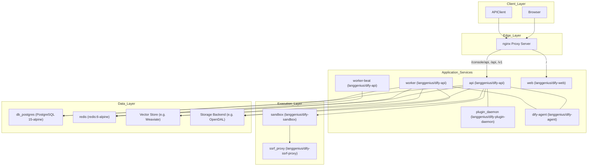
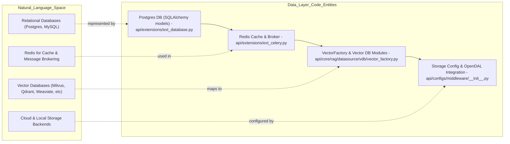
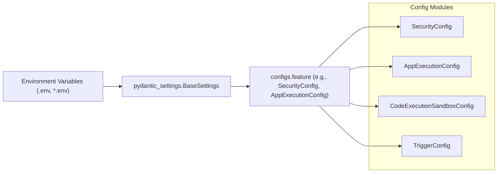

<!-- source: DeepWiki mcp.deepwiki.com · repo langgenius/dify · page 1 Introduction to Dify · fetched 2026-10-26 -->

# Introduction to Dify

<details>
<summary>Relevant source files</summary>

The following files were used as context for generating this wiki page:

- [README.md](README.md)
- [api/.env.example](api/.env.example)
- [api/configs/feature/__init__.py](api/configs/feature/__init__.py)
- [api/configs/middleware/__init__.py](api/configs/middleware/__init__.py)
- [api/configs/middleware/vdb/weaviate_config.py](api/configs/middleware/vdb/weaviate_config.py)
- [api/configs/packaging/__init__.py](api/configs/packaging/__init__.py)
- [api/core/rag/datasource/vdb/vector_factory.py](api/core/rag/datasource/vdb/vector_factory.py)
- [api/core/rag/datasource/vdb/vector_type.py](api/core/rag/datasource/vdb/vector_type.py)
- [api/extensions/ext_app_metrics.py](api/extensions/ext_app_metrics.py)
- [api/extensions/ext_celery.py](api/extensions/ext_celery.py)
- [api/extensions/ext_database.py](api/extensions/ext_database.py)
- [api/extensions/ext_import_modules.py](api/extensions/ext_import_modules.py)
- [api/extensions/ext_sentry.py](api/extensions/ext_sentry.py)
- [api/migrations/README](api/migrations/README)
- [api/providers/vdb/vdb-weaviate/tests/unit_tests/test_weaviate_integration_header.py](api/providers/vdb/vdb-weaviate/tests/unit_tests/test_weaviate_integration_header.py)
- [api/pyproject.toml](api/pyproject.toml)
- [api/schedule/queue_monitor_task.py](api/schedule/queue_monitor_task.py)
- [api/tests/integration_tests/.env.example](api/tests/integration_tests/.env.example)
- [api/tests/unit_tests/configs/test_dify_config.py](api/tests/unit_tests/configs/test_dify_config.py)
- [api/tests/unit_tests/core/rag/datasource/vdb/test_vector_factory.py](api/tests/unit_tests/core/rag/datasource/vdb/test_vector_factory.py)
- [api/tests/unit_tests/extensions/test_celery_ssl.py](api/tests/unit_tests/extensions/test_celery_ssl.py)
- [api/uv.lock](api/uv.lock)
- [docker/.env.example](docker/.env.example)
- [docker/docker-compose-template.yaml](docker/docker-compose-template.yaml)
- [docker/docker-compose.middleware.yaml](docker/docker-compose.middleware.yaml)
- [docker/docker-compose.yaml](docker/docker-compose.yaml)
- [docker/envs/core-services/shared.env.example](docker/envs/core-services/shared.env.example)
- [docker/envs/infrastructure/ssrf-proxy.env.example](docker/envs/infrastructure/ssrf-proxy.env.example)
- [docker/envs/middleware.env.example](docker/envs/middleware.env.example)
- [web/package.json](web/package.json)

</details>


## Purpose and Scope

This document provides a high-level introduction to the Dify platform, covering its purpose, key features, supported deployment options, and a map of the repository structure. It serves as the entry point for technical onboarding, mapping high-level concepts to key code entities and repository organization. For detailed technical architecture, see [System Architecture Overview]() and for repository insights, see [Repository Layout and Monorepo Packages](#1.1).

**Sources:** [README.md:1-172](), [docker/docker-compose.yaml:7-209]()

---

## What is Dify?

Dify is an open-source LLM (Large Language Model) application development platform that integrates:

- AI workflows with visual canvas design and execution.
- Retrieval-Augmented Generation (RAG) pipelines for knowledge integration.
- Agent capabilities allowing complex task automation.
- Model management supporting over 100 LLM models from numerous providers.
- Observability features integrated with tools like Opik, Langfuse, and Arize Phoenix.

It empowers developers and organizations to rapidly prototype, customize, and deploy AI-powered applications either in the cloud or self-hosted environments.

### Key Characteristics

- **Multi-Tenancy & RBAC:** Workspace and role-based access control enable secure shared environments.
- **Model-Agnostic:** Unified interface supports 100+ models from providers such as OpenAI, Anthropic, Azure, Google, and many more.
- **Extensible:** Offers a plugin and custom tool ecosystem for expanding functionality.
- **Production-Ready:** Includes quota management, telemetry, and robust background processing.

**Sources:** [README.md:63-114](), [api/pyproject.toml:1-51]()

---

## Edition Types

| Edition                    | Description                                   | Deployment Options               |
|----------------------------|---------------------------------------------|--------------------------------|
| **Dify Cloud (Hosted SaaS)**| Managed cloud service for instant use        | https://cloud.dify.ai           |
| **Self-Hosted (Community)** | Open-source edition for local or private cloud | Docker Compose, Kubernetes      |
| **Enterprise**              | Advanced features including SSO, branding    | Self-hosted or managed solutions|

**Sources:** [README.md:4-8]()

---

## High-Level Service Architecture

Dify follows a modular microservice architecture with separation into layers for client access, application services, execution environments, and data storage.



### Architecture Notes

- The single Docker image `langgenius/dify-api` runs different roles (API server, Worker, Beat) selected by environment variable `MODE`.
- Internal communication leverages Docker network, e.g., API service connects to `plugin_daemon` with secured keys.
- The `sandbox` and `ssrf_proxy` provide a secure isolated environment for code execution and controlled network access.
- The `dify-agent` runtime is a standalone agent runtime integrated for complex agent workflows.

**Sources:** [docker/docker-compose.yaml:7-209](), [docker/docker-compose.middleware.yaml:1-186](), [api/pyproject.toml:1-31]()

---

## Core Service Components

### API Service (`api`)

- The core Flask application serving RESTful APIs for console management and user apps.
- Uses modular Pydantic-based configuration (`configs.feature`) for extensible settings.
- Runs with Gunicorn using `gevent` workers by default.

### Worker Service (`worker`)

- Celery worker responsible for asynchronous background tasks like indexing, workflow execution, and document processing.
- Scalable with environment-configured worker count and autoscaling options.

### Web Service (`web`)

- Next.js and React-based frontend offering intuitive UI for building AI workflows, managing agents, and datasets.
- Uses state management libraries such as `zustand` and `jotai` to manage complex UI state and data fetching.

### Sandbox Service (`sandbox`)

- A secure isolated execution environment for running untrusted user code safely.
- Written in Go, it manages network restrictions and resource limits for code execution nodes in workflows.

**Sources:** [api/pyproject.toml:1-40](), [docker/docker-compose.middleware.yaml:100-140](), [web/package.json:1-140](), [api/configs/feature/__init__.py:21-194]()

---

## Data Layer Components

### Databases

- **PostgreSQL 15** is the primary production database for structured data.
- **MySQL 8.0** is also supported as an alternative.
  
### Redis

- Used as a caching layer and message broker for Celery.
- Configured with authentication and connection pooling.

### Vector Databases (Vector Stores)

- Supports 23+ vector database providers via a factory abstraction located under `api/providers/vdb/`.
- Includes popular options such as Milvus, Qdrant, PGVector, Weaviate, Elasticsearch, Chroma, and many others.
- Default often configured for Weaviate with endpoints settable in environment files.

### Storage Backends

- Implements file storage through Apache OpenDAL abstraction.
- Supports local filesystem and cloud providers like S3, Aliyun OSS, Azure Blob Storage, Google Storage, Tencent COS, Huawei OBS, Baidu OBS, Volcengine TOS, and Supabase.
- Files include document archives, uploaded assets, and application export bundles.



**Sources:** [api/configs/middleware/__init__.py:7-200](), [api/extensions/ext_celery.py:1-184](), [docker/.env.example:73-213](), [api/uv.lock:12-52]()

---

## Configuration System Overview

Dify uses a layered configuration setup driven by environment variables and managed with Pydantic models (`BaseSettings`). Configuration settings are grouped by domain for clarity and extensibility.



| Configuration Class            | Responsibility                              | File Path                              |
|-------------------------------|---------------------------------------------|--------------------------------------|
| `SecurityConfig`               | Secret keys, token expiry, rate limits      | [api/configs/feature/__init__.py:22-78]()  |
| `AppExecutionConfig`           | Max execution time, concurrency limits      | [api/configs/feature/__init__.py:79-113]() |
| `CodeExecutionSandboxConfig`   | Sandbox API endpoint and request limits     | [api/configs/feature/__init__.py:114-203]()|
| `TriggerConfig`                | Webhook request size limits                  | [api/configs/feature/__init__.py:195-204]()|

**Sources:** [api/configs/feature/__init__.py:1-221](), [docker/.env.example:1-214]()

---

## Supported Deployment Options

### Docker Compose (Recommended)

- Primary deployment method for self-hosting.
- Includes a pre-defined multi-service stack orchestrated via `docker/docker-compose.yaml`.
- Services include API server, workers, frontend, database, Redis, sandbox, and plugin daemon.
- Configuration managed through `.env` files containing environment variables for credentials, service URLs, and feature flags.
- Quick start commands:

```bash
cd docker
cp .env.example .env
docker compose up -d
```

### Local Development Setup

- **Backend** uses the `uv` Python workspace manager and Pydantic configuration layers for dependency isolation and settings management.
- **Frontend** uses `pnpm` with workspaces for JavaScript/TypeScript dependency management and build tooling.
- Helper scripts and `Makefile` targets facilitate local development and testing.

**Sources:** [README.md:74-81](), [docker/docker-compose.yaml:1-132](), [api/pyproject.toml:1-187](), [web/package.json:1-193](), [api/uv.lock:1-52]()

---

## Repository Structure Overview

Dify is organized as a monorepo integrating multiple interrelated packages and services, tied together by front-end `pnpm` workspaces and back-end `uv` workspaces.

| Folder               | Description                                               |
|----------------------|-----------------------------------------------------------|
| `api/`               | Backend API server and core Python services                |
| `web/`               | Next.js React web frontend UI                              |
| `cli/`               | CLI tool `difyctl` for managing deployments and devices    |
| `packages/`          | Shared TypeScript packages: contracts, UI libraries        |
| `dify-agent/`        | Python-based agent runtime package                         |
| `dify-agent-runtime/`| Go-based shellctl sandbox environment runtime             |
| `docker/`            | Docker Compose stack manifests and environment file templates |
| `e2e/`               | End-to-end tests using Cucumber and Playwright             |
| `sdks/`              | Client SDKs for Python, Node.js, and PHP                    |
| `docs/`              | Additional user and developer documentation                 |

For an indepth tour of repository layout and workspaces, see [Repository Layout and Monorepo Packages](#1.1).

---

## Next Steps & Links to Child Pages

- For an in-depth repository tour and package relationship: see [Repository Layout and Monorepo Packages](#1.1).
- To quickly get a local development environment running using Docker or raw source, see [Quick Start and Local Development](#1.2).
- For a detailed understanding of the internal system architecture, components, and runtime behavior, refer to [System Architecture Overview]().

---

## System Requirements Summary

| Component       | Minimum Requirement                    |
|-----------------|--------------------------------------|
| CPU             | 2 cores or more                      |
| Memory (RAM)    | 4 GiB or more                        |
| Operating System| Linux, macOS, Windows (via Docker)  |
| Python          | Version 3.13                        |
| Node.js         | Version 22 (for frontend build)      |

**Sources:** [README.md:67-70](), [api/pyproject.toml:4-11](), [api/uv.lock:3-10]()

---

This page serves as the gateway for newcomers to understand the Dify platform at a high level, outlining how the pieces fit together and pointing to detailed reference pages for each subsystem.

# End of "Introduction to Dify"

---

