<!-- source: DeepWiki mcp.deepwiki.com · repo langgenius/dify · page 1.1 Repository Layout and Monorepo Packages · fetched 2026-10-26 -->

# 1.1 Repository Layout and Monorepo Packages

<details>
<summary>Relevant source files</summary>

The following files were used as context for generating this wiki page:

- [.github/actions/setup-web/action.yml](.github/actions/setup-web/action.yml)
- [AGENTS.md](AGENTS.md)
- [Makefile](Makefile)
- [api/AGENTS.md](api/AGENTS.md)
- [api/controllers/API_SCHEMA_GUIDE.md](api/controllers/API_SCHEMA_GUIDE.md)
- [api/dev/lint_response_contracts.py](api/dev/lint_response_contracts.py)
- [api/tests/unit_tests/commands/test_check_no_new_base_model.py](api/tests/unit_tests/commands/test_check_no_new_base_model.py)
- [api/tests/unit_tests/commands/test_lint_response_contracts.py](api/tests/unit_tests/commands/test_lint_response_contracts.py)
- [cli/AGENTS.md](cli/AGENTS.md)
- [cli/ARD.md](cli/ARD.md)
- [cli/vite.config.ts](cli/vite.config.ts)
- [eslint.config.mjs](eslint.config.mjs)
- [lint.config.ts](lint.config.ts)
- [package.json](package.json)
- [packages/contracts/openapi-ts.api.config.ts](packages/contracts/openapi-ts.api.config.ts)
- [packages/contracts/package.json](packages/contracts/package.json)
- [packages/dify-ui/README.md](packages/dify-ui/README.md)
- [packages/dify-ui/package.json](packages/dify-ui/package.json)
- [packages/dify-ui/src/scroll-area/__tests__/index.spec.tsx](packages/dify-ui/src/scroll-area/__tests__/index.spec.tsx)
- [packages/dify-ui/src/scroll-area/index.stories.tsx](packages/dify-ui/src/scroll-area/index.stories.tsx)
- [packages/dify-ui/src/scroll-area/index.tsx](packages/dify-ui/src/scroll-area/index.tsx)
- [packages/dify-ui/tsconfig.json](packages/dify-ui/tsconfig.json)
- [packages/jotai-tanstack-form/package.json](packages/jotai-tanstack-form/package.json)
- [pnpm-lock.yaml](pnpm-lock.yaml)
- [pnpm-workspace.yaml](pnpm-workspace.yaml)
- [scripts/ast_grep_rules/no_new_base_model.yml](scripts/ast_grep_rules/no_new_base_model.yml)
- [scripts/check_no_new_base_model.py](scripts/check_no_new_base_model.py)
- [vite.config.ts](vite.config.ts)
- [web/docs/lint.md](web/docs/lint.md)
- [web/plugins/eslint/index.js](web/plugins/eslint/index.js)
- [web/plugins/eslint/rules/no-app-store-imports.js](web/plugins/eslint/rules/no-app-store-imports.js)
- [web/plugins/eslint/rules/no-app-store-imports.test.js](web/plugins/eslint/rules/no-app-store-imports.test.js)
- [web/vite.config.ts](web/vite.config.ts)

</details>


This page offers a comprehensive technical tour of the Dify monorepo layout and its package organization. It explicitly describes the primary directories, their roles and interactions, and how tools like **pnpm** workspaces and **uv** workspaces coordinate the development workflow.

---

## 1. Monorepo Overview

Dify is organized as a monorepo containing backend, frontend, tooling, development aids, and runtime components. This structure promotes modularity, efficient local development, and streamlined CI/CD pipelines.

The major directories and packages at the repository root are:

| Directory / Package        | Purpose                                                                                     |
|---------------------------|---------------------------------------------------------------------------------------------|
| `api/`                    | Backend service codebase implementing REST API services, database models, business logic.   |
| `web/`                    | Frontend application built with Next.js, including React components and routes.             |
| `cli/`                    | Command line interface utilities, including `difyctl` for workflows and auth.               |
| `packages/`                | Shared packages and libraries used by both backend and frontend, e.g., UI components.       |
| `dify-agent/`             | Standalone Python-based agent runtime backend service, leveraging `Agenton` framework.      |
| `dify-agent-runtime/`     | Go-based sandbox runtime for executing agent shell commands safely, includes Docker assets. |
| `docker/`                 | Deployment and infrastructure assets including Docker Compose files and environment configs.|
| `e2e/`                    | End-to-end Cucumber and Playwright test suites for full system integration testing.        |
| `sdks/`                   | Official client SDKs in multiple languages like Node.js and Python.                         |
| `docs/`                   | Markdown documentation and guides for contributors and users.                               |

The monorepo is managed using **pnpm workspaces** plus **uv** workspaces:

- **pnpm workspaces** organize JavaScript/TypeScript packages to share dependencies, allow cross-package linking, and optimize installs.
- **uv workspaces** handle unified invocation of Python backend tasks and scripts with isolated environment and concurrency control.

This combination allows the backend Python code, frontend TypeScript code, CLI tools, shared UI libs, and runtime agent services to coexist, build, and test cohesively.

---

## 2. Top-Level Directory Descriptions and Roles

### 2.1 `api/`

- **Role:** The backend API service implemented mainly in Python using Flask.
- **Contents:** Application startup/factory, ORM models, API controllers, Celery task queues, service providers, and configuration.
- **Key points:**  
  - Uses SQLAlchemy for database schema and persistence.
  - Implements core domain entities such as Account, Tenant, App, Workflow, Agent.
  - Exposes REST endpoints consumed by frontend and SDKs.
  - Integrates third-party services for storage, vector DB, tracing.
- **Development:** Run backend commands via `uv run --project api <command>` for consistent environment.
- **Testing:** Unit tests under `api/tests/unit_tests`, integration tests under `api/tests/integration_tests`.

### 2.2 `web/`

- **Role:** The frontend application implementing the user interface.
- **Tech stack:** Next.js, React, TypeScript, Tailwind CSS, and Vite+ (vinext dev server).
- **Contents:**  
  - React components and hooks under `web/app/`.
  - i18n and routing configurations.
  - Custom Vite plugins such as i18n hot module reload plugin and route namespace analysis.
  - Storybook for UI component development.
- **Development:**  
  - Development server started via `pnpm dev` from repo root (runs vinext + proxy).
  - Environment configs in `.env.local`.
- **Testing:** Uses Vitest for unit tests and Playwright for browser/integration tests.
- **Build:** Production build with `pnpm -C web run build`.

### 2.3 `cli/`

- **Role:** Command line tools including the primary CLI `difyctl`.
- **Tech stack:** TypeScript, Bun runtime.
- **Functionality:**  
  - Handles commands, authentication (device flow), HTTP requests to backend.
  - Output formatting and command orchestration framework.
- **Packaging:** A standalone package compiled via Bun.

### 2.4 `packages/`

- **Role:** Shared reusable libraries and component packages.
- **Notable package:** `@langgenius/dify-ui`, providing isolated UI primitives (buttons, inputs, dialogs) built on Headless UI, Tailwind, and base React components.
- **Layout:** Each package resides in a subfolder with its own `package.json`.
- **Usage:** Backend, frontend, and CLI consume selected packages for shared logic and UI consistency.

### 2.5 `dify-agent/`

- **Role:** Python-based standalone agent runtime backend leveraging the `Agenton` framework.
- **Core tech:** Provides FastAPI server to receive run requests for agent workflows.
- **Functionality:**  
  - Redis scheduler and run state store.
  - Adapter layer bridging agent runtime and Dify backend.

### 2.6 `dify-agent-runtime/`

- **Role:** Go-based shell sandbox runtime.
- **Purpose:** Secure, sandboxed execution of shell commands for agents with tmux-backed job lifecycle.
- **Assets:**  
  - Dockerfile for sandbox runtime image.
  - Implements Landlock sandboxing, exit persistence, pty filtering.

### 2.7 `docker/`

- **Role:** Deployment artifacts for Docker and Docker Compose.
- **Contents:**  
  - Core `docker-compose.middleware.yaml` to orchestrate middleware services.
  - Environment example files for middleware and other services.
  - Volume configuration for persistent storage.
- **Makefile integration:** Has targets to prepare Docker middleware, build web/api images, and run environment setup.

### 2.8 `e2e/`

- **Role:** End-to-end test suites for integration validation.
- **Technologies:** Cucumber BDD and Playwright for browser tests.
- **Usage:** Tests simulate real user workflows by running against deployed backend and frontend services.

### 2.9 `sdks/`

- **Role:** Official client SDK implementations.
- **Languages include:** Node.js, Python, PHP.
- **Purpose:** Provide idiomatic libraries to wrap backend APIs and simplify client integration.

### 2.10 `docs/`

- **Role:** Central repository for markdown documentation.
- **Content:** Guides, technical architecture, design documents, testing instructions, and contributor guidance.

---

## 3. How pnpm Workspaces and uv Workspaces Coordinate the Monorepo

### 3.1 pnpm Workspaces

The monorepo defines a `pnpm-workspace.yaml` file specifying packages and directories:

```yaml
packages:
  - web
  - e2e
  - sdks/nodejs-client
  - packages/*
  - cli
```

- This instructs `pnpm` to treat these folders as workspace packages.
- `pnpm` cross-links dependencies across packages (e.g., linking `@langgenius/dify-ui` from `packages` into `web`).
- Dependency versions are deduplicated and isolated per workspace package.
- The root `package.json` manages JavaScript/TypeScript-related scripts like linting, formatting, and development.
- Engine versions and dependency overrides ensure consistent dependency trees across all JS/TS packages.

### 3.2 uv Workspaces

- `uv` is a workspace and task runner for managing Python backend code.
- It defines isolated workspaces for projects like the `api/`, ensuring environment variables, virtual environments, and invocation contexts are properly configured.
- Backend commands (e.g., Flask app run, database migrations) are executed with `uv run --project api <command>`, guaranteeing consistent and reproducible execution environments.
- `uv sync` synchronizes Python dependencies and database migrations into the virtual environment.
- This manages complexities of Python dependency versioning within the polyglot monorepo environment, isolating Python-specific development lifecycle from Node-related tooling.

---

## 4. Package Interaction and Data Flow

### 4.1 Development Flow

- **Shared UI and logic libraries** are maintained mainly in `packages/dify-ui` (UI primitives) and consumed by the `web/` frontend and `cli/` tools.
- The **backend API** (`api/`) implements core RESTful services, domain models, and business logic.
- The **frontend** (`web/`) interfaces with the backend API, leveraging shared UI packages to maintain consistency.
- **CLI tools** (`cli/`) communicate with backend APIs to perform workflow control, authentication, and various utilities.
- The **agent runtime components**, split between `dify-agent/` (Python) and `dify-agent-runtime/` (Go sandbox), run as separate services but interface with the backend via well-defined APIs.
- The **end-to-end tests** (`e2e/`) orchestrate the entire stack (frontend, backend, agent runtimes) for integration and system-level validation.

---

## 5. Visual Diagrams

### Diagram 1: Monorepo Directory Map and Core Packages

```mermaid
graph TD
  RepoRoot["Dify Monorepo Root"]

  RepoRoot --> API["api/ (Python Backend API)"]
  RepoRoot --> Web["web/ (Next.js Frontend)"]
  RepoRoot --> CLI["cli/ (difyctl CLI Tools)"]
  RepoRoot --> Packages["packages/ (Shared Libraries)"]
  RepoRoot --> AgentPy["dify-agent/ (Python Agent Runtime)"]
  RepoRoot --> AgentGo["dify-agent-runtime/ (Go Sandbox Runtime)"]
  RepoRoot --> Docker["docker/ (Deployment & Docker Compose)"]
  RepoRoot --> E2E["e2e/ (End-to-End Tests)"]
  RepoRoot --> SDKs["sdks/ (Client SDKs)"]
  RepoRoot --> Docs["docs/ (Documentation)"]

  Packages --> DifyUI["@langgenius/dify-ui (UI primitives)"]
  SDKs --> NodeSDK["nodejs-client/"]
  SDKs --> PythonSDK["python-client/"]

  style RepoRoot stroke:#333,stroke-width:2px
  style API stroke:#333,stroke-width:1px
  style Web stroke:#333,stroke-width:1px
  style CLI stroke:#333,stroke-width:1px
  style Packages stroke:#333,stroke-width:1px
  style AgentPy stroke:#333,stroke-width:1px
  style AgentGo stroke:#333,stroke-width:1px
  style Docker stroke:#333,stroke-width:1px
  style E2E stroke:#333,stroke-width:1px
  style SDKs stroke:#333,stroke-width:1px
  style Docs stroke:#333,stroke-width:1px
```


*Diagram 1 shows the high-level directory structure of the Dify monorepo with key packages.*

---

### Diagram 2: Monorepo Package Workflow and Toolchain Integration

```mermaid
flowchart TD
  PNPM["pnpm Workspaces"]
  UV["uv Workspaces"]

  subgraph Frontend
    Web["web/ Next.js App"]
    Packages["packages/dify-ui UI Package"]
  end

  subgraph Backend
    API["api/ Flask REST API"]
    AgentPy["dify-agent/ Python Agent Runtime"]
    AgentGo["dify-agent-runtime/ Go Sandbox"]
  end

  subgraph CLI
    CLI["cli/ difyctl CLI"]
  end

  subgraph Tests
    E2E["e2e/ Cucumber & Playwright"]
  end

  PNPM --> Web
  PNPM --> CLI
  PNPM --> Packages

  UV --> API
  UV --> AgentPy

  Web -. HTTP API .-> API
  CLI -. HTTP API .-> API

  AgentPy -. AgentRun API .-> API

  AgentGo -. Sandboxed Runtime .-> AgentPy

  E2E -. Integration Tests .-> Web
  E2E -. Integration Tests .-> API
  E2E -. Integration Tests .-> AgentPy
```

*Diagram 2 illustrates the coordination between `pnpm` and `uv` workspace tools tying together the frontend, backend, CLI, agent runtimes, and test suites.*

---

## 6. Summary

The Dify repository is a carefully structured monorepo combining diverse technologies and languages to support a rich LLM application platform:

- Frontend React/TypeScript in `web/`
- Backend Python Flask API in `api/`
- Shared UI and utility libraries in `packages/`
- Python and Go agent runtime services in `dify-agent/` and `dify-agent-runtime/`
- CLI tools in `cli/`
- Deployment assets and configuration in `docker/`
- End-to-end testing suites in `e2e/`
- Official client SDKs in `sdks/`
- Documentation in `docs/`

**pnpm workspaces** enable tight integration and dependency sharing among JavaScript/TypeScript projects.

**uv workspaces** manage Python backend commands and environment isolation.

This layout supports modular full-stack development, comprehensive testing, and smooth CI/CD pipelines for scalable platform evolution.

---

## References and Sources

- `pnpm-workspace.yaml` (monorepo package configuration) [pnpm-workspace.yaml:1-65]()
- `Makefile` (dev setup, Docker build targets, uv commands) [Makefile:1-172]()
- `packages/dify-ui/package.json` (shared UI package structure and exports) [packages/dify-ui/package.json:1-220]()
- `web/vite.config.ts` (frontend build tooling with Vite+ and pnpm) [web/vite.config.ts:1-155]()
- `package.json` (root dependency and script management) [package.json:1-64]()
- `AGENTS.md` (monorepo overview notes) [AGENTS.md:1-9]()

---

