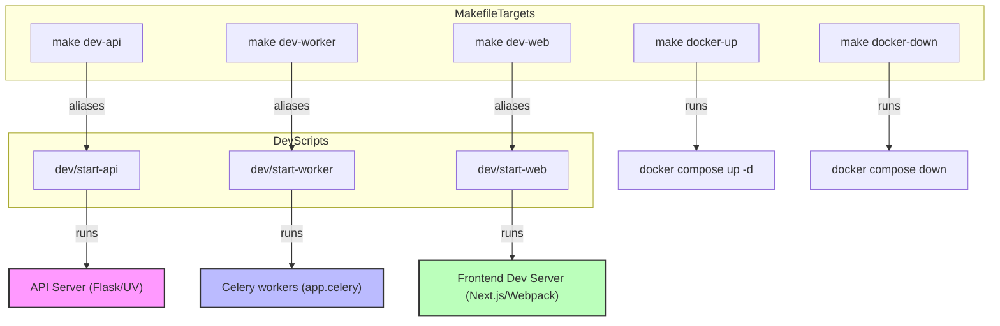

<!-- source: DeepWiki mcp.deepwiki.com · repo langgenius/dify · page 1.2 Quick Start and Local Development · fetched 2026-10-26 -->

# Quick Start and Local Development

<details>
<summary>Relevant source files</summary>

The following files were used as context for generating this wiki page:

- [.devcontainer/devcontainer.json](.devcontainer/devcontainer.json)
- [.devcontainer/post_create_command.sh](.devcontainer/post_create_command.sh)
- [.github/workflows/build-push.yml](.github/workflows/build-push.yml)
- [.github/workflows/docker-build.yml](.github/workflows/docker-build.yml)
- [.gitignore](.gitignore)
- [.vscode/launch.json.template](.vscode/launch.json.template)
- [Makefile](Makefile)
- [api/AGENTS.md](api/AGENTS.md)
- [api/Dockerfile](api/Dockerfile)
- [api/Dockerfile.dockerignore](api/Dockerfile.dockerignore)
- [api/README.md](api/README.md)
- [api/controllers/API_SCHEMA_GUIDE.md](api/controllers/API_SCHEMA_GUIDE.md)
- [api/dev/lint_response_contracts.py](api/dev/lint_response_contracts.py)
- [api/docker/entrypoint.sh](api/docker/entrypoint.sh)
- [api/providers/vdb/vdb-alibabacloud-mysql/src/dify_vdb_alibabacloud_mysql/alibabacloud_mysql_vector.py](api/providers/vdb/vdb-alibabacloud-mysql/src/dify_vdb_alibabacloud_mysql/alibabacloud_mysql_vector.py)
- [api/providers/vdb/vdb-hologres/src/dify_vdb_hologres/hologres_vector.py](api/providers/vdb/vdb-hologres/src/dify_vdb_hologres/hologres_vector.py)
- [api/providers/vdb/vdb-matrixone/src/dify_vdb_matrixone/matrixone_vector.py](api/providers/vdb/vdb-matrixone/src/dify_vdb_matrixone/matrixone_vector.py)
- [api/providers/vdb/vdb-matrixone/tests/unit_tests/test_matrixone_vector.py](api/providers/vdb/vdb-matrixone/tests/unit_tests/test_matrixone_vector.py)
- [api/providers/vdb/vdb-opengauss/src/dify_vdb_opengauss/opengauss.py](api/providers/vdb/vdb-opengauss/src/dify_vdb_opengauss/opengauss.py)
- [api/providers/vdb/vdb-oracle/src/dify_vdb_oracle/oraclevector.py](api/providers/vdb/vdb-oracle/src/dify_vdb_oracle/oraclevector.py)
- [api/tests/unit_tests/commands/test_check_no_new_base_model.py](api/tests/unit_tests/commands/test_check_no_new_base_model.py)
- [api/tests/unit_tests/commands/test_lint_response_contracts.py](api/tests/unit_tests/commands/test_lint_response_contracts.py)
- [dev/start-web](dev/start-web)
- [dev/start-worker](dev/start-worker)
- [packages/contracts/openapi-ts.api.config.ts](packages/contracts/openapi-ts.api.config.ts)
- [packages/contracts/package.json](packages/contracts/package.json)
- [packages/jotai-tanstack-form/package.json](packages/jotai-tanstack-form/package.json)
- [scripts/ast_grep_rules/no_new_base_model.yml](scripts/ast_grep_rules/no_new_base_model.yml)
- [scripts/check_no_new_base_model.py](scripts/check_no_new_base_model.py)
- [web/Dockerfile](web/Dockerfile)
- [web/Dockerfile.dockerignore](web/Dockerfile.dockerignore)

</details>


This page provides detailed instructions and explanations to get Dify running locally, including methods using Docker Compose and development scripts. It covers environment configuration, Makefile targets, and important helper scripts within the `dev/` directory essential for local development and testing.

---

## 1. Overview

Dify can be run locally either by orchestrating containerized services via Docker Compose or by running backend and frontend development servers through dedicated scripts. The backend API service, worker processes, database, Redis cache, vector stores, and other essential services are orchestrated through Docker Compose. For development, the codebase supports using scripts under `dev/` to start individual components with hot reload and debugging capabilities.

This page focuses on covering:

- Environment configuration and `.env` files  
- Docker Compose stack and custom environment layers  
- Development helper scripts in the `dev/` directory  
- Makefile targets aiding local build, run, and testing tasks  

---

## 2. Environment Configuration

### 2.1 `.env` Files

Configuration variables are primarily stored in `.env` files which Docker and application services load on startup.

- **`docker/.env.example`**: This file contains the essential environment variable defaults used for Docker Compose deployments. It's the source template to create your own `.env` file under `docker/` for local runs.  
  It contains core service URLs, runtime settings, logging configurations, database credentials, Redis and Celery broker information, storage backend options, vector database settings, sandbox execution parameters, and API keys.  
  Variables affecting logging and worker concurrency are also detailed here (e.g., `SERVER_WORKER_AMOUNT`, `CELERY_WORKER_AMOUNT`).  
  To run locally, users usually copy `.env.example` to `.env` and modify values as needed before starting the stack.  
  [docker/.env.example:1-214]()

- **`api/.env.example`**: Contains environment variables specific to the API backend service, such as Flask secret keys, API URLs, Redis config, Celery URLs, and database details. It offers a local configuration template matching the backend expectations during development or local execution.  
  Environment variables can often be overridden or merged from multiple sources for layered configurations.  
  [api/.env.example:1-202]()

- **Docker Compose Env Layers**: The Docker Compose files use multiple `.env` files organized under `docker/envs/` directories (e.g., `core-services/shared.env`, `databases/db-postgres.env`, `vectorstores/weaviate.env`) for segmented configuration. These env files are merged or layered in the service definitions using YAML anchors and extensions.  
  This modular approach facilitates more fine-grained control and optionally enables or disables some service-specific configs while sharing common configs across services.  
  [docker/docker-compose.yaml:7-201]()  
  [docker/docker-compose-template.yaml:2-198]()

---

## 3. Running Dify with Docker Compose

### 3.1 Docker Compose Stack

The Compose stack orchestrates essential backend and infrastructure components needed by Dify:

- **Primary Services**:  
  - `api`: The main backend API service, running Flask and SocketIO.  
  - `worker`: Celery worker process handling asynchronous background tasks.  
  - `worker-beat`: Celery Beat scheduler responsible for running periodic scheduled tasks.  
  - `db_postgres` or `db_mysql`: PostgreSQL or MySQL relational database for persistence.  
  - `redis`: Cache and message broker used by Celery and caching layers.  
  - `sandbox`: Code execution sandbox service for safe runtime execution of user code.  
  - Vector database services such as Weaviate, Qdrant, Chroma, etc., controlled through configuration.  
  - `plugin_daemon`: Manages plugin lifecycle operations and isolated environments.  

Each service consumes environment variables using shared env layers defined under `x-shared-api-worker-config` and corresponding worker and beat anchors to unify configuration scopes. Common environment files provide configuration inheritance, avoiding duplication.

The `restart: always` policy ensures resilience and continuous availability for local development or staging environments.

An example excerpt of the postgres service configuration illustrating environment variable usage and health checks:

```yaml
services:
  db_postgres:
    image: postgres:15-alpine
    restart: always
    env_file:
      - ./middleware.env
    environment:
      POSTGRES_PASSWORD: ${DB_PASSWORD:-difyai123456}
      POSTGRES_DB: ${DB_DATABASE:-dify}
    ports:
      - "${EXPOSE_POSTGRES_PORT:-5432}:5432"
    healthcheck:
      test: ["CMD", "pg_isready", "-h", "db_postgres"]
      interval: 1s
      timeout: 3s
      retries: 30
```

This health check ensures the database is ready before dependent services start.  
[docker/docker-compose.middleware.yaml:1-186]()

### 3.2 Starting the Stack

To launch the entire local stack via Docker Compose:

1. Copy `docker/.env.example` to `docker/.env` and customize as needed.
2. Run the following inside the `docker` directory or from the repository root with the proper docker-compose command:

```bash
docker compose up -d
```

This command will start all defined services asynchronously in detached mode.

### 3.3 Customizing Vector Stores and Extras

Vector database services such as Weaviate, Qdrant, or Chroma can be enabled, disabled, or customized by editing their specific environment files in `docker/envs/vectorstores/` or adjusting relevant variables inside the `.env`. This allows local developers to tailor which vector databases run in the local stack for testing or development purposes.

---

## 4. Development Scripts and Local Execution

Dify provides development scripts within the `dev/` directory to run backend API, worker, and web frontend without full Docker containerization, enabling a more dynamic local development experience with hot reload and debugging.

### 4.1 Backend and Worker Scripts

- **`dev/start-api`**: Starts the Python backend API service using UVicorn or Flask with options for hot reload and debug mode.

- **`dev/start-worker`**: Launches Celery worker processes to process asynchronous background tasks. Supports options for queue selection, concurrency, and pool type. The script parses args for these options and sources environment variables optionally from an `.env` file. If no queues are specified, it falls back to edition-specific defaults covering dataset, workflow, plugin, and other queues.

- **`dev/start-web`**: Runs the web frontend in a development server mode, often React or Next.js with hot reload.

These scripts encapsulate environment setup, dependency management, and server invocation to promote smooth iterative development without container orchestration overhead.

### 4.2 Makefile Targets

The root `Makefile` defines common targets to build Docker images, prepare environments, run tests, and start or stop the entire stack. Key targets for local development:

| Target            | Description                                         |
|-------------------|----------------------------------------------------|
| `make dev-setup`  | Prepares the entire dev environment (Docker, Web, API) by copying envs and installing dependencies. |
| `make dev-clean`  | Stops Docker containers and cleans up persisted volumes and storage directories.                |
| `make prepare-docker` | Copies middleware env and starts the Docker Compose middleware stack.                         |
| `make prepare-web`  | Prepares the web frontend environment (installs JS deps, copies .env).                        |
| `make prepare-api`  | Prepares the API backend environment (copies .env, syncs dependencies, runs DB migrations).   |
| `make build-web`    | Builds the web Docker image.                                                               |
| `make build-api`    | Builds the API Docker image.                                                               |
| `make build-sandbox-runtime` | Builds the sandbox runtime Docker image.                                           |
| `make push-web`     | Pushes the web Docker image to the registry.                                              |
| `make push-api`     | Pushes the API Docker image to the registry.                                              |

Additionally, the Makefile supports linting and type-check targets for the backend codebase.

These targets provide convenient shortcuts for local environment setup, build, and testing commands.  
[Makefile:1-181]()

---

## 5. Data Flow and Startup Interaction

Below diagrams illustrate the key relationships between natural language system components as described in the docs and their corresponding code entities and files relevant to local startup and development.

### 5.1 System Startup Flow with Docker Compose and Env Layers

```mermaid
flowchart TD
  subgraph Config
    E1[.env (docker/.env)]
    E2[docker/envs/*.env files]
  end

  subgraph DockerComposeStack
    S1[db_postgres service]
    S2[redis service]
    S3[sandbox service]
    S4[api service]
    S5[worker service]
    S6[plugin_daemon service]
  end

  E1 --> |merged env vars| S1
  E1 --> |merged env vars| S2
  E1 --> |merged env vars| S3
  E1 --> |merged env vars| S4
  E1 --> |merged env vars| S5
  E1 --> |merged env vars| S6

  S1 --> |PersistentStorage| PostgresDB[(Postgres DB)]
  S2 --> |Cache & Broker| Redis[(Redis Cache)]
  S3 --> |Exec Environment| Sandbox((Code Execution Service))
  S4 --> |API Server| APIApp["api/app.py (Flask/SocketIO)"]
  S5 --> |Celery Workers| CeleryWorker["celery worker process (app.celery)"]
  S6 --> |Plugin management| PluginDaemonApp["plugin daemon process"]

  style S4 fill:#f9f,stroke:#333,stroke-width:2px
  style S5 fill:#bbf,stroke:#333,stroke-width:2px
```

This flow visualizes merged environmental configuration feeding into the docker-compose services and their runtime roles.  
Sources: 
- `docker/docker-compose.yaml:1-202`  
- `docker/.env.example:1-214`  
- `docker/docker-compose.middleware.yaml:1-186`

### 5.2 Local Development Scripts and Makefile Targets Correlated



This diagram links dev scripts to their Makefile shorthand usage and the underlying processes they start and manage.  
Sources:
- `dev/start-api` (implied from usage)  
- `dev/start-worker` (lines 1-127)  
- `dev/start-web` (implied, straightforward)  
- `Makefile:1-181` (partial, includes dev-setup and docker commands)  
- `web/package.json` (dependency info, implied)

---

## 6. Additional Notes

- To debug or extend environment variables, check `.env` files under `docker/envs/` and `api/.env.example`. Configuration layering via Docker Compose YAML anchors unifies variables neatly.

- Container logs can be observed via `docker compose logs <service>` or by Makefile or script commands if defined.

- The backend API Dockerfile (`api/Dockerfile`) builds a Python environment with pinned dependencies using `uv` for package management, installs necessary system packages, sets locale and timezone, prepares non-root user `dify`, and sets entrypoint to `api/docker/entrypoint.sh` which handles modes such as API, worker, beat, or migration command execution.

- The entrypoint script (`api/docker/entrypoint.sh`) inspects the environment variable `MODE` to switch between:
  - Running Flask API server (with Gunicorn in production mode, or direct python module in debug mode)
  - Running Celery worker
  - Running Celery Beat for scheduled tasks
  - Running one-off Flask management commands in job mode (e.g., migrations or tenant setup)
  
  This facilitates running different container roles with a single image.  
  [api/Dockerfile:1-127]()  
  [api/docker/entrypoint.sh:1-135]()

- Development environment aliases (e.g., in `.devcontainer/post_create_command.sh`) facilitate quick command usage like `start-api`, `start-worker`, `start-web`, and Docker container management commands.

---

# Summary

| Aspect                     | Location / File / Command                         | Description                                       |
|----------------------------|-------------------------------------------------|-------------------------------------------------|
| Main Docker Compose stack   | `docker/docker-compose.yaml`                      | Defines services and env files for full stack   |
| Core Docker env example     | `docker/.env.example`                             | Template for environment variables               |
| Backend API Dockerfile      | `api/Dockerfile`                                 | Docker image build instructions for API         |
| Backend API entrypoint      | `api/docker/entrypoint.sh`                       | Container entrypoint handling modes and commands|
| Backend env example         | `api/.env.example`                               | API service environment variable defaults       |
| Dev start scripts           | `dev/start-api`, `dev/start-worker`, `dev/start-web` | Scripts for running services locally without Docker |
| Makefile development targets| `Makefile`                                      | Aliases for dev setup, docker-compose control, build, lint, and test commands |

This page equips developers with the necessary knowledge and configuration insights to run Dify locally, either containerized or in development mode, enabling iterative development and troubleshooting with ease.

---

Sources:  
- `docker/.env.example:1-214`  
- `docker/docker-compose.yaml:1-202`  
- `docker/docker-compose.middleware.yaml:1-186`  
- `docker/docker-compose-template.yaml:2-198`  
- `api/.env.example:1-202`  
- `api/Dockerfile:1-128`  
- `api/docker/entrypoint.sh:1-136`  
- `Makefile:1-181`  
- `dev/start-worker:1-127`  
- `web/Dockerfile:1-90` (to infer web environment setup)  
- `.devcontainer/post_create_command.sh:1-17`

---

