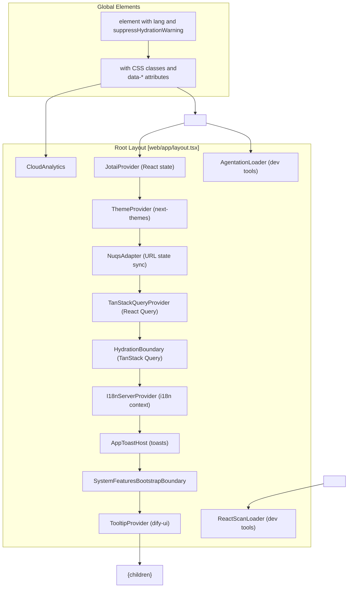
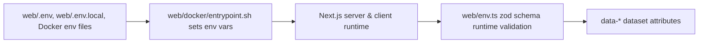

<!-- source: DeepWiki mcp.deepwiki.com · repo langgenius/dify · page 10 Web Frontend Architecture · fetched 2026-10-26 -->

# Web Frontend Architecture

<details>
<summary>Relevant source files</summary>

The following files were used as context for generating this wiki page:

- [docker/envs/core-services/web.env.example](docker/envs/core-services/web.env.example)
- [web/.env.example](web/.env.example)
- [web/__tests__/env.spec.ts](web/__tests__/env.spec.ts)
- [web/app/(commonLayout)/layout.tsx](web/app/(commonLayout)/layout.tsx)
- [web/app/(humanInputLayout)/form/[token]/page.tsx](web/app/(humanInputLayout)/form/[token]/page.tsx)
- [web/app/(shareLayout)/layout.tsx](web/app/(shareLayout)/layout.tsx)
- [web/app/account/(commonLayout)/layout.tsx](web/app/account/(commonLayout)/layout.tsx)
- [web/app/components/base/markdown-blocks/__tests__/form-default-name-characters.spec.tsx](web/app/components/base/markdown-blocks/__tests__/form-default-name-characters.spec.tsx)
- [web/app/components/base/markdown-blocks/__tests__/form-field-name-max-length.spec.tsx](web/app/components/base/markdown-blocks/__tests__/form-field-name-max-length.spec.tsx)
- [web/app/components/base/markdown-blocks/__tests__/form.spec.tsx](web/app/components/base/markdown-blocks/__tests__/form.spec.tsx)
- [web/app/components/base/markdown-blocks/form.tsx](web/app/components/base/markdown-blocks/form.tsx)
- [web/app/components/base/markdown/__tests__/streamdown-wrapper-form.spec.tsx](web/app/components/base/markdown/__tests__/streamdown-wrapper-form.spec.tsx)
- [web/app/components/base/markdown/streamdown-wrapper.tsx](web/app/components/base/markdown/streamdown-wrapper.tsx)
- [web/app/education/education-shell.tsx](web/app/education/education-shell.tsx)
- [web/app/layout.tsx](web/app/layout.tsx)
- [web/config/index.ts](web/config/index.ts)
- [web/docker/entrypoint.sh](web/docker/entrypoint.sh)
- [web/env.ts](web/env.ts)

</details>


## Purpose and Scope

This page provides a high-level overview of the Dify web frontend architecture, focusing on the frontend build system, UI components, and client-side runtime behavior. The web frontend is implemented using **Next.js** with **TypeScript** and **React**, serving as the key user interface layer for interacting with Dify’s advanced AI capabilities, agent orchestration, workflows, and deployments.

The frontend is developed within a monorepo, sharing components and utilities via the `dify-ui` package and utilizing modern build tools including **Vite**, **Vitest**, and **pnpm** workspaces to maintain consistency, rapid iteration, and quality assurance.

This page acts as a parent to more detailed child pages that cover areas such as build configuration, chat UI, workflow UI, internationalization, agent frontend, deployments, console UI, and frontend data layers.

---

## Build System and Configuration Overview

The frontend build system is structured around **Next.js**, extended with **Vinext** (a Vite-based dev server) and integrated tooling to improve hot module replacement (HMR) and fast incremental builds. This setup leverages **vite-plus** for additional build pipeline plugins and optimizations.

Key features include:

- Monorepo management via **pnpm workspaces**, coordinating `web/`, `packages/dify-ui`, and other packages for shared component usage.
- Use of `.env` files and environment variables defined in `web/.env.example` and set dynamically during Docker container startup via `web/docker/entrypoint.sh`.
- Environment configuration and feature flags are centralized in `web/config/index.ts` with fallbacks and runtime detection.
- Testing support via **Vitest** for unit/integration tests, and UI component development with **Storybook**.
- Static code analysis via **ESLint** alongside TypeScript for robust linting and type safety.

This structure provides a state-of-the-art developer experience and a build pipeline optimized for a large-scale React application.

```mermaid
graph TD
    subgraph "Package Management & Monorepo"
        A[pnpm workspace: web/, packages/dify-ui/, ...]
        B[pnpm-lock.yaml for dependency versions]
    end

    subgraph "Development & Build Tools"
        C[Next.js (SSR/SSG)]
        D[Vinext (Vite-based dev server)]
        E[vite-plus plugins & optimizations]
    end

    subgraph "Code Quality & Testing"
        F[ESLint + TypeScript type checking]
        G[Vitest (unit & integration tests)]
        H[Storybook (UI component dev)]
    end

    A --> B --> C
    C --> D --> E
    E --> F
    E --> G
    E --> H
```

Sources:
- [web/docker/entrypoint.sh:57-59]()
- [web/docker/entrypoint.sh:61]()
- [web/.env.example:1-133]()
- [web/config/index.ts:33-45]()

---

## Application Shell and Core Runtime Providers

The main layout component of the app (`web/app/layout.tsx`) orchestrates global providers and UI wrappers that comprise the runtime frontend shell. This includes key React context providers, theme management, state hydration, and analytics initialization.

Notable providers and components wired in the root layout include:

- **JotaiProvider**: React state management with atom-based stores for fine-grained UI state [web/app/layout.tsx:5]().
- **ThemeProvider** from `next-themes`: Manages light/dark mode by setting the `data-theme` attribute on the `<html>` element, enabling CSS theming [web/app/layout.tsx:6]().
- **TanStackQueryProvider**: Wraps TanStack Query hooks for fetching and caching server state [web/app/layout.tsx:24]().
- **I18nServerProvider**: Supplies internationalization context for localized content rendering [web/app/layout.tsx:23]().
- **NuqsAdapter**: Manages URL query-syncing state inside Next.js app router [web/app/layout.tsx:7]().
- **TooltipProvider** from `dify-ui`: Enriches UI with accessible tooltip interactions [web/app/layout.tsx:3]().
- **AppToastHost**: Renders global toast notifications with concurrency limits [web/app/layout.tsx:8]().
- **AgentationLoader** and **ReactScanLoader**: Developer tools and instrumentation loaders embedded in the layout [web/app/layout.tsx:21-22]().

This structure ensures the frontend has consistent global state, theming, data fetching, and context propagation.



Sources:
- [web/app/layout.tsx:1-100]()
- [web/app/(commonLayout)/layout.tsx:1-27]()
- [web/app/(accountLayout)/layout.tsx:1-23]()
- [web/app/(shareLayout)/layout.tsx:1-15]()

---

## Environment Variables and Runtime Configuration

The frontend depends heavily on environment variables for configurable API endpoints, feature flags, and client behavior. These variables are declared and validated in `web/env.ts` using `@t3-oss/env-nextjs` and `zod` schemas, enforcing types and providing default values at runtime [web/env.ts:1-178]().

Variables include:

- API base URLs: `NEXT_PUBLIC_API_PREFIX`, `NEXT_PUBLIC_PUBLIC_API_PREFIX` [web/config/index.ts:33-40]().
- WebSocket URL: `NEXT_PUBLIC_SOCKET_URL` [web/config/index.ts:113]().
- Feature toggles: `NEXT_PUBLIC_ENABLE_AGENT_V2`, `NEXT_PUBLIC_ENABLE_FEATURE_PREVIEW`, `NEXT_PUBLIC_ALLOW_INLINE_STYLES`, etc [web/env.ts:75-95]().
- Security settings: `NEXT_PUBLIC_CSP_WHITELIST`, `NEXT_PUBLIC_ALLOW_EMBED` [web/env.ts:66-68]().
- Client-side limits and timeouts: `NEXT_PUBLIC_TEXT_GENERATION_TIMEOUT_MS`, `NEXT_PUBLIC_WORKFLOW_GENERATION_TIMEOUT_MS` [web/env.ts:154-171]().
- Analytics keys: `NEXT_PUBLIC_AMPLITUDE_API_KEY`, `NEXT_PUBLIC_COOKIEYES_SITE_KEY`, and `NEXT_PUBLIC_TURNSTILE_SITE_KEY` [web/config/index.ts:47-49]().

These environment variables are loaded from `.env` files [web/.env.example:1-133](), injected at container start (`web/docker/entrypoint.sh`) [web/docker/entrypoint.sh:15-55](), and mapped into dataset attributes on `<body>` to allow both server and client runtime access, enabling features like the Agent V2 toggle to work both at SSR and hydration time [web/app/layout.tsx:53-75]().



Sources:
- [web/env.ts:1-179]()
- [web/.env.example:1-133]()
- [web/docker/entrypoint.sh:1-61]()
- [web/app/layout.tsx:53-75]()
- [web/__tests__/env.spec.ts:1-135]()
- [docker/envs/core-services/web.env.example:1-41]()

---

## Core Functional Subsystems

The web frontend is composed of specialized features organized into modules and feature directories, each responsible for distinct UI/UX and client behavior, often exposing custom hooks, component libraries, and domain logic.

1.  **Chat Interface and Message Interactions:**
    Handles chat UI components, streaming response rendering, markdown and mermaid diagram output, interactive message editing, feedback buttons, and audio playback of replies. This enables responsive conversational experiences and user interaction enhancements. The `MarkdownForm` component, for example, handles rendering and submission of interactive forms embedded within markdown messages, supporting various input types like text, numbers, dates, and checkboxes [web/app/components/base/markdown-blocks/form.tsx:185-191](). It also manages different submission formats, including plain text and JSON [web/app/components/base/markdown-blocks/form.tsx:98-102]().
    For implementation details, see child page [Chat Interface and Message Interactions](#10.2).

2.  **Workflow Canvas and Node UI Components:**
    Implements the workflow visual editor built on top of `reactflow`. Provides node panels, variable reference pickers, checklist validation, and collaboration features within the workflow canvas. This subsystem handles complex user input and configuration for automation nodes.
    For details, see [Workflow Canvas and Node UI Components](#10.3).

3.  **Internationalization (i18n) and Content Sync:**
    Provides locale loading, key parity checks, and CI-synced translation files using `i18next` and `vite-i18n-analysis` plugin. This subsystem ensures the frontend supports multi-language interfaces and consistent content sync.
    See [Internationalization (i18n) and Content Sync](#10.4).

4.  **Agent V2 Frontend — Roster, Composer, and Detail Views:**
    Offers UI for managing agent rosters and composing agents' "souls" with their configuration and prompts. Uses `jotai` atoms extensively for draft/published state management.
    See [Agent V2 Frontend — Roster, Composer, and Detail Views](#10.5).

5.  **Deployments Feature — Releases, Environments, and Access Control:**
    Manages app release versions, environment deployments (staging, production), access channels, and per-environment permission policies. Utilizes `jotai-tanstack-query` for reactive state management.
    See [Deployments Feature — Releases, Environments, and Access Control](#10.6).

6.  **App Console UI — Lists, Configuration, Logs and Navigation:**
    Contains app list and creation modals, DSL import workflow, app configuration editors (prompt, variables, datasets, tools), logs viewer, and global UI features like navigation and command palettes.
    See [App Console UI — Lists, Configuration, Logs and Navigation](#10.7).

7.  **Frontend Data Layer — Services, Fetching and Shared Hooks:**
    Exposes shared service wrappers around fetch API with SSE handling, TanStack Query hooks, authentication context, file uploader hooks, and embed scripts to enable modular and reusable data interaction.
    See [Frontend Data Layer — Services, Fetching and Shared Hooks](#10.8).

These subsystems interoperate under the root layout and are structured to facilitate scalable frontend development.

Sources:
- [web/app/components/base/markdown-blocks/form.tsx:1-207]()
- [web/app/components/base/markdown-blocks/__tests__/form.spec.tsx:1-205]()
- [web/app/components/base/markdown-blocks/__tests__/form-field-name-max-length.spec.tsx]()
- [web/app/components/base/markdown-blocks/__tests__/form-default-name-characters.spec.tsx]()
- [web/app/components/base/markdown/__tests__/streamdown-wrapper-form.spec.tsx]()
- [web/app/components/base/markdown/streamdown-wrapper.tsx]()
- [web/app/(humanInputLayout)/form/[token]/page.tsx]()

---

## Bridging Natural Language Features to Code Entities

This diagram links the natural language concepts of the frontend system to the concrete code artifacts and modules that implement them. This helps engineers quickly locate relevant code for a given feature area.

```mermaid
flowchart TD
    NL1["Frontend Build System & Configuration"]
    NL2["UI Components & Themes"]
    NL3["Chat UI & Message Interactions"]
    NL4["Workflow UI & Node Components"]
    NL5["Localization & i18n System"]
    NL6["Agent V2 Frontend"]
    NL7["Deployments Feature"]
    NL8["App Console UI"]
    NL9["Frontend Data Layer"]

    CE1["web/vite.config.ts\nweb/next.config.ts\nweb/docker/entrypoint.sh"]
    CE2["packages/dify-ui/\nweb/app/layout.tsx\nweb/styles/globals.css"]
    CE3["web/app/components/base/chat/\nweb/app/components/base/markdown/"]
    CE4["web/app/components/workflow/\nweb/app/components/workflow/nodes/"]
    CE5["web/i18n/\nweb/app/components/provider/i18n-server.tsx"]
    CE6["web/features/agent-v2/\nweb/features/agent-v2/components/"]
    CE7["web/features/deployments/\nweb/features/deployments/components/"]
    CE8["web/app/(commonLayout)/layout.tsx\nweb/app/components/app/"]
    CE9["web/service/\nweb/hooks/"]

    NL1 --> CE1
    NL2 --> CE2
    NL3 --> CE3
    NL4 --> CE4
    NL5 --> CE5
    NL6 --> CE6
    NL7 --> CE7
    NL8 --> CE8
    NL9 --> CE9

    subgraph "Natural Language Space"
      NL1; NL2; NL3; NL4; NL5; NL6; NL7; NL8; NL9
    end

    subgraph "Code Entity Space"
      CE1; CE2; CE3; CE4; CE5; CE6; CE7; CE8; CE9
    end
```



---

## Child Pages

For further technical details, please refer to the following child pages:

-   [Frontend Build System and Configuration](#10.1) — Next.js/Vite configuration, pnpm workspaces, Vitest setup, env variable mapping, lint pipeline, and the `dify-ui` shared component library
-   [Chat Interface and Message Interactions](#10.2) — Chat components, embedded chatbot & chat-with-history, input area, markdown/mermaid rendering, feedback and audio playback
-   [Workflow Canvas and Node UI Components](#10.3) — Workflow canvas interactions, node panels and useConfig hooks, variable reference pickers, checklist validation, and collaboration manager
-   [Internationalization (i18n) and Content Sync](#10.4) — How web/i18n locales are structured, key parity enforcement via the Vite i18n-analysis plugin, and CI automation that syncs translations.
-   [Agent V2 Frontend — Roster, Composer, and Detail Views](#10.5) — How web/features/agent-v2 implements the Agent Roster, AgentComposer, AgentDetail sections, and jotai atoms for draft/published state.
-   [Deployments Feature — Releases, Environments, and Access Control](#10.6) — How web/features/deployments manages app releases, environment deployments, access channels, and per-environment permission policies.
-   [App Console UI — Lists, Configuration, Logs and Navigation](#10.7) — App list/creation/DSL import modals, app configuration editor (prompt, variables, datasets, agent tools), logs viewer, main navigation and Goto-Anything command palette.
-   [Frontend Data Layer — Services, Fetching and Shared Hooks](#10.8) — web/service/ fetch wrapper and SSE handling, tanstack-query hooks, web-app context/auth, file uploader hooks, and embed scripts.

---

Sources:
- [web/app/layout.tsx:1-100]()
- [web/config/index.ts:1-230]()
- [web/.env.example:1-133]()
- [web/docker/entrypoint.sh:1-61]()
- [web/app/(commonLayout)/layout.tsx:1-27]()
- [web/app/(shareLayout)/layout.tsx:1-15]()
- [web/app/components/base/markdown-blocks/form.tsx:1-207]()
- [web/env.ts:1-179]()
- [web/app/account/(commonLayout)/layout.tsx:1-23]()
- [web/app/components/base/markdown-blocks/__tests__/form.spec.tsx:1-205]()
- [web/app/education/education-shell.tsx:1-48]()
- [docker/envs/core-services/web.env.example:1-41]()

---

