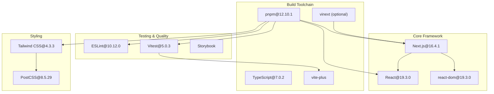
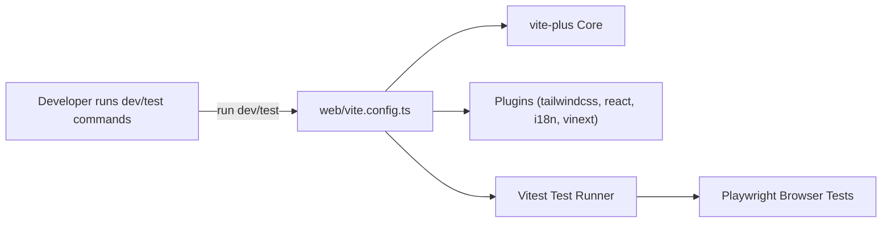
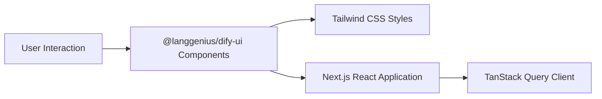

<!-- source: DeepWiki mcp.deepwiki.com · repo langgenius/dify · page 10.1 Frontend Build System and Configuration · fetched 2026-10-26 -->

# Frontend Build System and Configuration

<details>
<summary>Relevant source files</summary>

The following files were used as context for generating this wiki page:

- [.github/actions/setup-web/action.yml](.github/actions/setup-web/action.yml)
- [AGENTS.md](AGENTS.md)
- [cli/AGENTS.md](cli/AGENTS.md)
- [cli/ARD.md](cli/ARD.md)
- [cli/vite.config.ts](cli/vite.config.ts)
- [eslint.config.mjs](eslint.config.mjs)
- [lint.config.ts](lint.config.ts)
- [package.json](package.json)
- [packages/dify-ui/README.md](packages/dify-ui/README.md)
- [packages/dify-ui/docs/styling.md](packages/dify-ui/docs/styling.md)
- [packages/dify-ui/docs/testing.md](packages/dify-ui/docs/testing.md)
- [packages/dify-ui/package.json](packages/dify-ui/package.json)
- [packages/dify-ui/src/alert-dialog/index.tsx](packages/dify-ui/src/alert-dialog/index.tsx)
- [packages/dify-ui/src/autocomplete/index.tsx](packages/dify-ui/src/autocomplete/index.tsx)
- [packages/dify-ui/src/breadcrumb/__tests__/types.tsx](packages/dify-ui/src/breadcrumb/__tests__/types.tsx)
- [packages/dify-ui/src/breadcrumb/index.stories.tsx](packages/dify-ui/src/breadcrumb/index.stories.tsx)
- [packages/dify-ui/src/button/index.tsx](packages/dify-ui/src/button/index.tsx)
- [packages/dify-ui/src/combobox/index.tsx](packages/dify-ui/src/combobox/index.tsx)
- [packages/dify-ui/src/context-menu/__tests__/index.spec.tsx](packages/dify-ui/src/context-menu/__tests__/index.spec.tsx)
- [packages/dify-ui/src/context-menu/index.tsx](packages/dify-ui/src/context-menu/index.tsx)
- [packages/dify-ui/src/date-time/internal/picker-parts.tsx](packages/dify-ui/src/date-time/internal/picker-parts.tsx)
- [packages/dify-ui/src/dialog/index.tsx](packages/dify-ui/src/dialog/index.tsx)
- [packages/dify-ui/src/drawer/index.tsx](packages/dify-ui/src/drawer/index.tsx)
- [packages/dify-ui/src/dropdown-menu/index.tsx](packages/dify-ui/src/dropdown-menu/index.tsx)
- [packages/dify-ui/src/field/index.tsx](packages/dify-ui/src/field/index.tsx)
- [packages/dify-ui/src/fieldset/index.tsx](packages/dify-ui/src/fieldset/index.tsx)
- [packages/dify-ui/src/file-tree/index.tsx](packages/dify-ui/src/file-tree/index.tsx)
- [packages/dify-ui/src/icon-button/__tests__/index.spec.tsx](packages/dify-ui/src/icon-button/__tests__/index.spec.tsx)
- [packages/dify-ui/src/icon-button/index.stories.tsx](packages/dify-ui/src/icon-button/index.stories.tsx)
- [packages/dify-ui/src/icon-button/index.tsx](packages/dify-ui/src/icon-button/index.tsx)
- [packages/dify-ui/src/infotip/index.tsx](packages/dify-ui/src/infotip/index.tsx)
- [packages/dify-ui/src/input-group/index.tsx](packages/dify-ui/src/input-group/index.tsx)
- [packages/dify-ui/src/input/index.stories.tsx](packages/dify-ui/src/input/index.stories.tsx)
- [packages/dify-ui/src/input/index.tsx](packages/dify-ui/src/input/index.tsx)
- [packages/dify-ui/src/internal/menu.ts](packages/dify-ui/src/internal/menu.ts)
- [packages/dify-ui/src/internal/overlay.ts](packages/dify-ui/src/internal/overlay.ts)
- [packages/dify-ui/src/number-field/index.tsx](packages/dify-ui/src/number-field/index.tsx)
- [packages/dify-ui/src/popover/index.tsx](packages/dify-ui/src/popover/index.tsx)
- [packages/dify-ui/src/preview-card/index.tsx](packages/dify-ui/src/preview-card/index.tsx)
- [packages/dify-ui/src/radio-group/index.tsx](packages/dify-ui/src/radio-group/index.tsx)
- [packages/dify-ui/src/scroll-area/__tests__/index.spec.tsx](packages/dify-ui/src/scroll-area/__tests__/index.spec.tsx)
- [packages/dify-ui/src/scroll-area/index.stories.tsx](packages/dify-ui/src/scroll-area/index.stories.tsx)
- [packages/dify-ui/src/scroll-area/index.tsx](packages/dify-ui/src/scroll-area/index.tsx)
- [packages/dify-ui/src/select/index.tsx](packages/dify-ui/src/select/index.tsx)
- [packages/dify-ui/src/switch/index.tsx](packages/dify-ui/src/switch/index.tsx)
- [packages/dify-ui/src/tabs/index.tsx](packages/dify-ui/src/tabs/index.tsx)
- [packages/dify-ui/src/textarea/index.tsx](packages/dify-ui/src/textarea/index.tsx)
- [packages/dify-ui/src/toast/__tests__/index.spec.tsx](packages/dify-ui/src/toast/__tests__/index.spec.tsx)
- [packages/dify-ui/src/toast/index.stories.tsx](packages/dify-ui/src/toast/index.stories.tsx)
- [packages/dify-ui/src/toast/index.tsx](packages/dify-ui/src/toast/index.tsx)
- [packages/dify-ui/src/tooltip/index.tsx](packages/dify-ui/src/tooltip/index.tsx)
- [packages/dify-ui/tsconfig.json](packages/dify-ui/tsconfig.json)
- [pnpm-lock.yaml](pnpm-lock.yaml)
- [pnpm-workspace.yaml](pnpm-workspace.yaml)
- [vite.config.ts](vite.config.ts)
- [web/app/components/header/account-setting/members-page/invite-modal/email-recipients-field.tsx](web/app/components/header/account-setting/members-page/invite-modal/email-recipients-field.tsx)
- [web/app/components/plugins/install-plugin/hooks.ts](web/app/components/plugins/install-plugin/hooks.ts)
- [web/app/notifications/__tests__/toast.spec.tsx](web/app/notifications/__tests__/toast.spec.tsx)
- [web/app/notifications/host.tsx](web/app/notifications/host.tsx)
- [web/app/notifications/notifications.stories.tsx](web/app/notifications/notifications.stories.tsx)
- [web/docs/lint.md](web/docs/lint.md)
- [web/plugins/eslint/index.js](web/plugins/eslint/index.js)
- [web/plugins/eslint/rules/no-app-store-imports.js](web/plugins/eslint/rules/no-app-store-imports.js)
- [web/plugins/eslint/rules/no-app-store-imports.test.js](web/plugins/eslint/rules/no-app-store-imports.test.js)
- [web/vite.config.ts](web/vite.config.ts)

</details>


## Purpose and Scope

This page details the frontend build system and configuration of the Dify web application. It covers management of JavaScript dependencies through `pnpm` workspaces, the Next.js framework setup, advanced build processes using Vite and Vinext, Vitest testing setup, environment variable mapping, linting pipeline, and the shared `dify-ui` component library. It also explains how the Docker runtime environment initializes frontend settings.

The goal is to provide a comprehensive understanding of how the frontend is architected, built, configured, tested, and deployed, enabling developers to work efficiently on frontend development and customization.

Sources: [pnpm-workspace.yaml:1-40](), [pnpm-lock.yaml:1-160](), [web/vite.config.ts:1-155](), [packages/dify-ui/package.json:1-180]()

---

## Technology Stack Overview

Dify's frontend build and runtime stack is based on modern, efficient, and flexible tooling:

| Technology         | Version                | Role in System                                             |
|--------------------|------------------------|------------------------------------------------------------|
| **Next.js**        | 16.4.1                 | React framework for SSR, SSG, and hybrid rendering          |
| **React**          | 19.3.0                 | UI component library                                        |
| **pnpm**           | 12.10.1                | Workspace-enabled package manager                           |
| **TypeScript**     | 7.0.2 (native build)   | Typed superset of JavaScript for type safety               |
| **Tailwind CSS**   | 4.3.3                  | Utility-first CSS for styling                               |
| **Vite & vite-plus** | (via vite-plus)        | Next-gen front-end build tool with plugins and optimizations |
| **Vinext**         | (used optionally)      | Next.js Vite dev server alternative                         |
| **Vitest**         | 5.0.3                  | Testing framework for unit and browser tests               |
| **Jotai**          | 3.0.1                  | Atomic React state management                               |

This combination empowers Dify to deliver fast development cycles, flexible testing, dynamic environment management, and consistent styling with scalable UI components.

### Build System & Dependencies Diagram



Sources: [pnpm-lock.yaml:1-233](), [pnpm-workspace.yaml:1-238](), [package.json:1-64](), [web/vite.config.ts:1-155]()

---

## Package Management with pnpm Workspaces

### Workspace Structure

Dify employs `pnpm` workspaces for managing a monorepo architecture. The root `pnpm-workspace.yaml` defines the included packages and workspace-wide policies:

```yaml
packages:
  - web
  - e2e
  - sdks/nodejs-client
  - packages/*
  - cli
```

- **`web/`**: The main frontend Next.js application.
- **`e2e/`**: End-to-end testing packages.
- **`sdks/nodejs-client/`**: Node.js SDK for API interactions.
- **`packages/`**: Internal workspace packages like `dify-ui` (shared UI components).
- **`cli/`**: Command-line tooling (`difyctl`).

Other key workspace settings enforce strict version resolutions, prevent exotic subdependencies, and handle dependency overrides for consistent builds. For instance, `autoDedupe: true`, `catalogMode: strict`, and `saveExact: true` are used to maintain a controlled dependency graph [pnpm-workspace.yaml:8-29]().

### Dependency Version Catalog & Overrides

A literal catalog pins package versions centrally, enabling strict enforceability [pnpm-workspace.yaml:69-238](). Notable overrides include:

- Forcing `@lexical/code` to use a `no-prism` variant to avoid heavy dependencies [pnpm-workspace.yaml:46]().
- Ensuring compatible versions of `esbuild` and `vite` [pnpm-workspace.yaml:48,64]().
- Aligning `happy-dom` and `vitest` versions with the catalog to ensure consistent browser matcher types [pnpm-workspace.yaml:51,65]().

These constraints improve build reproducibility, security, and performance.

Sources: [pnpm-workspace.yaml:1-238](), [pnpm-lock.yaml:1-233]()

---

## Vite and Vitest Configuration

### Vite Configuration (via `web/vite.config.ts`)

Dify's frontend build is powered by a custom Vite config, built using `vite-plus` enhancing Vite with additional defaults and plugins [web/vite.config.ts:2]().

Key features:

- **Dynamic plugin loading** depending on mode (`test`, `storybook`, or dev) [web/vite.config.ts:25-75]().
- **React plugin integration** (`@vitejs/plugin-react`) for JSX and fast refresh [web/vite.config.ts:26,68]().
- **Tailwind CSS integration** via `@tailwindcss/vite` [web/vite.config.ts:34,67]().
- **Vinext plugin** for an alternative Next.js dev server based on Vite [web/vite.config.ts:35,69]().
- **Custom i18n plugins** (`i18nAnalysisPlugin`, `customI18nHmrPlugin`) for hot-module replacement and namespace analysis [web/vite.config.ts:47-64,70]().
- **Code inspector plugin** activates during dev server runs for enhanced debugging [web/vite.config.ts:36,39-43,66]().
- **Alias and path resolution** aligning with `tsconfig.json` settings [web/vite.config.ts:78-80]().

Example fragment configuring plugins lazily according to mode:

```ts
plugins: lazyPlugins(async () => {
  const { default: react } = await import('@vitejs/plugin-react')
  if (isTest) return [nextStaticImageTestPlugin({ projectRoot }), react()]
  if (isStorybook) return [react()]
  // Dev-only plugins: tailwindcss, vinext, inspector, i18n etc.
  ...
})
```

### Vitest Setup

The configuration includes an embedded Vitest setup optimized for unit and browser tests [web/vite.config.ts:94-153]():

- Uses the `happy-dom` environment for lightweight DOM API support in unit tests [web/vite.config.ts:109]().
- Runs tests in multiple projects: `unit` and `browser` [web/vite.config.ts:103,115]().
- Supports test coverage with the `v8` provider, generating JSON and text reports [web/vite.config.ts:99-101]().
- Includes playwright integration for browser tests with headless Chromium, capturing screenshots and traces on failure [web/vite.config.ts:139-148]().
- Conditional test exclusion patterns to avoid conflicts with storybook or browser tests [web/vite.config.ts:112]().

### Vite & Vitest Execution Flow Diagram



Sources: [web/vite.config.ts:1-155]()

---

## Environment Variable Mapping and Configuration

### Environment Declaration

Frontend environment variables are declared in `web/.env.example`. Key variables include:

| Variable                            | Purpose                                                      |
|-----------------------------------|--------------------------------------------------------------|
| `NEXT_PUBLIC_DEPLOY_ENV`           | Indicates deployment environment (e.g., DEVELOPMENT, PRODUCTION) |
| `NEXT_PUBLIC_API_PREFIX`            | Base URL for Console API endpoints                          |
| `NEXT_PUBLIC_PUBLIC_API_PREFIX`     | URL prefix for Web App API endpoints                        |
| `NEXT_PUBLIC_MARKETPLACE_API_PREFIX`| Marketplace API base path                                   |
| `NEXT_PUBLIC_SOCKET_URL`            | WebSocket server URL                                        |
| Feature flags                      | `NEXT_PUBLIC_ENABLE_AGENT_V2`, `NEXT_PUBLIC_ENABLE_FEATURE_PREVIEW`, `NEXT_PUBLIC_ENABLE_SINGLE_DOLLAR_LATEX` |
| Limits and concurrency            | `NEXT_PUBLIC_MAX_TOOLS_NUM`, `NEXT_PUBLIC_BATCH_CONCURRENCY`  |

### Central Configuration Access (`web/config/index.ts`)

This module acts as a typed wrapper around the environment variables with fallback defaults, providing convenient constants used across the frontend:

- Utility `getStringConfig` for fallback logic.
- Regexes and limits for variable names and UI controls.
- Typed configuration for prompt tones (`TONE_LIST`).
- Constants for API URLs and feature flags.
- Logical functions like `CSRF_COOKIE_NAME()` depending on the domain and protocol.

Example excerpt:

```ts
export const API_PREFIX = getStringConfig(env.NEXT_PUBLIC_API_PREFIX, 'http://localhost:5001/console/api')
export const IS_DEV = process.env.NODE_ENV === 'development'
export const TONE_LIST = [
  {id: 1, name: 'Creative', config: {...}},
  {id: 2, name: 'Balanced', config: {...}},
  ...
]
```

Sources: [web/.env.example:1-130](), [web/config/index.ts:1-262]()

---

## Lint and Code Quality Pipeline

The project integrates several layers of linting and quality checks orchestrated primarily through `vp` (custom scripts) and `eslint`:

- `eslint` runs with concurrency options [package.json:18-20]().
- Specialized ESLint plugins for React (`@eslint-react/eslint-plugin`), JSON (`eslint-plugin-jsonc`), Markdown (`@eslint/markdown`), Tailwind CSS (`eslint-plugin-better-tailwindcss`), and pnpm-specific linting (`eslint-plugin-pnpm`) are configured [package.json:23-47]().
- Tailwind CSS canonical class checking with autofix capabilities is performed via `TAILWIND_CANONICAL_CLASSES=true vp lint` [package.json:16-17]().
- Oxlint is used for fast linting with `vp lint` [package.json:13-15]().
- Commands like `vp check` and `vp run lint:eslint` are npm script shortcuts [package.json:6,18]().

This integration ensures code quality is maintained consistently during development and CI.

Sources: [package.json:6-20](), [pnpm-workspace.yaml:170-190]() (for lint-related packages)

---

## Shared Component Library: `@langgenius/dify-ui`

The `dify-ui` package is a private, workspace-scoped UI component library supplying reusable React primitives and design tokens consistent across Dify products [packages/dify-ui/README.md:1-3]().

- Components cover controls (buttons, toggles), inputs, navigation (breadcrumb, pagination, tabs), overlays (dialogs, tooltips), media (avatars), feedback (toast, spinner), and layout utilities [packages/dify-ui/README.md:37-48]().
- It leverages Tailwind CSS classes and the `cn()` utility function for conditional class management [packages/dify-ui/README.md:3,53]().
- Composes and wraps [Base UI](https://base-ui.com/react) headless components with accessible and opinionated patterns [packages/dify-ui/README.md:6]().
- The package exports subpaths rather than a root barrel for precise imports and better tree-shaking [packages/dify-ui/README.md:22](), as seen in `packages/dify-ui/package.json` exports [packages/dify-ui/package.json:6-211]().

Example usage snippet:

```tsx
import { Button } from '@langgenius/dify-ui/button'
import { Dialog, DialogContent, DialogTrigger } from '@langgenius/dify-ui/dialog'
import { Input } from '@langgenius/dify-ui/input'
import '@langgenius/dify-ui/styles.css'
```

### Component Dataflow Diagram



### Component Categories Overview (Excerpt)

| Category         | Components (Public Subpaths)                             |
|------------------|----------------------------------------------------------|
| Actions          | Button, IconButton, Toggle                               |
| Controls         | SegmentedControl                                         |
| Display          | Collapsible, Kbd                                        |
| Feedback         | Meter, Progress, Spinner, Toast, StatusDot              |
| Form             | Form, Field, Fieldset, Input, Textarea, Checkbox, Select|
| Overlay & Menu   | AlertDialog, Dialog, Drawer, DropdownMenu, Tooltip      |
| Navigation       | Breadcrumb, Tabs, Pagination                             |
| Media            | Avatar                                                  |

Sources: [packages/dify-ui/package.json:1-211](), [packages/dify-ui/README.md:1-101](), [packages/dify-ui/src/combobox/index.tsx:1-168](), [packages/dify-ui/src/select/index.tsx:1-178](), [packages/dify-ui/src/autocomplete/index.tsx:1-177]()

---

## Root Layout and Providers (`web/app/layout.tsx`)

The `RootLayout` component wraps all frontend pages, responsible for applying global providers and initializing state on both client and server sides:

- Wraps children in:
  - `JotaiProvider`: Atom-based React global state.
  - `ThemeProvider (next-themes)`: Dark/light/system theme support via `data-theme` attribute.
  - `NuqsAdapter`: For nextjs search params typed integration.
  - `TanStackQueryProvider`: React Query setup with hydration boundary.
  - `I18nServerProvider`: Internationalization support.
  - `TooltipProvider`: Design-system consistent tooltip delays and behaviors.
  - Analytics components and cookie handlers.
- Sets HTML language based on detected locale.
- Dynamically provides theming attributes and nonce for CSP compliance.
- Injects other global utilities and devtools loaders.

Sources: [web/app/layout.tsx:1-100]()

---

## Docker Entrypoint Environment Initialization

The frontend environment is dynamically configured at container startup in the Docker entrypoint script `web/docker/entrypoint.sh`:

- Maps environment variables from Docker runtime to `NEXT_PUBLIC_` prefixed variables used by Next.js.
- Supports configurable URLs for API, marketplace, sockets, CSP, telemetry, feature flags, and limits.
- Decides server startup between the default Next.js standalone server or the experimental Vinext server based on `EXPERIMENTAL_ENABLE_VINEXT`.

### Entrypoint Environment Flow

```mermaid
graph TD
    subgraph DockerEnvironment
        DEPLOY_ENV["DEPLOY_ENV"]
        CONSOLE_API_URL["CONSOLE_API_URL"]
        APP_API_URL["APP_API_URL"]
        MARKETPLACE_API_URL["MARKETPLACE_API_URL"]
        SENTRY_DSN["SENTRY_DSN"]
    end

    subgraph EntrypointMapping
        NEXT_PUBLIC_DEPLOY_ENV["NEXT_PUBLIC_DEPLOY_ENV = DEPLOY_ENV"]
        NEXT_PUBLIC_API_PREFIX["NEXT_PUBLIC_API_PREFIX = CONSOLE_API_URL + '/console/api'"]
        NEXT_PUBLIC_PUBLIC_API_PREFIX["NEXT_PUBLIC_PUBLIC_API_PREFIX = APP_API_URL + '/api'"]
        NEXT_PUBLIC_SENTRY_DSN["NEXT_PUBLIC_SENTRY_DSN = SENTRY_DSN"]
        // ... other env var mappings ...
    end

    subgraph Runtime
        NextServer["Next.js Standalone Server"]
        VinextServer["Vinext Server (optional)"]
    end

    DEPLOY_ENV --> NEXT_PUBLIC_DEPLOY_ENV
    CONSOLE_API_URL --> NEXT_PUBLIC_API_PREFIX
    APP_API_URL --> NEXT_PUBLIC_PUBLIC_API_PREFIX
    SENTRY_DSN --> NEXT_PUBLIC_SENTRY_DSN

    NEXT_PUBLIC_DEPLOY_ENV --> NextServer
    NEXT_PUBLIC_API_PREFIX --> NextServer
    NEXT_PUBLIC_PUBLIC_API_PREFIX --> NextServer
    NEXT_PUBLIC_SENTRY_DSN --> NextServer

    // Conditional exec for Vinext
```

Sources: [web/docker/entrypoint.sh:1-60]()

---

## Summary

This page explained the entire frontend build and configuration system in Dify:

- `pnpm` workspaces organize the monorepo and manage dependencies centrally with strict versioning and overrides.
- The core app uses Next.js for SSR alongside Vite-based tooling for fast builds and advanced testing with Vitest.
- Environment variables are injected via configuration files and the Docker entrypoint to unify runtime settings.
- The lint pipeline enforces coding standards integrating ESLint and Tailwind checks.
- The `dify-ui` package supplies a comprehensive shared component library with Tailwind CSS styling.
- The root layout orchestrates the React providers and global state management to bootstrap the frontend app.

This layered and modern build system supports fast local development, robust testing, modular component usage, and flexible deployment configurations.

Sources: [pnpm-workspace.yaml:1-238](), [pnpm-lock.yaml:1-233](), [web/vite.config.ts:1-155](), [web/docker/entrypoint.sh:1-60](), [packages/dify-ui/package.json:1-211](), [web/.env.example:1-130](), [web/config/index.ts:1-262](), [web/app/layout.tsx:1-100]()

---

