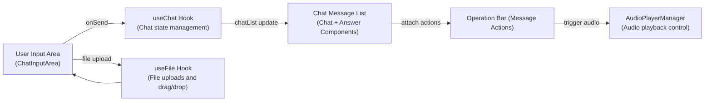
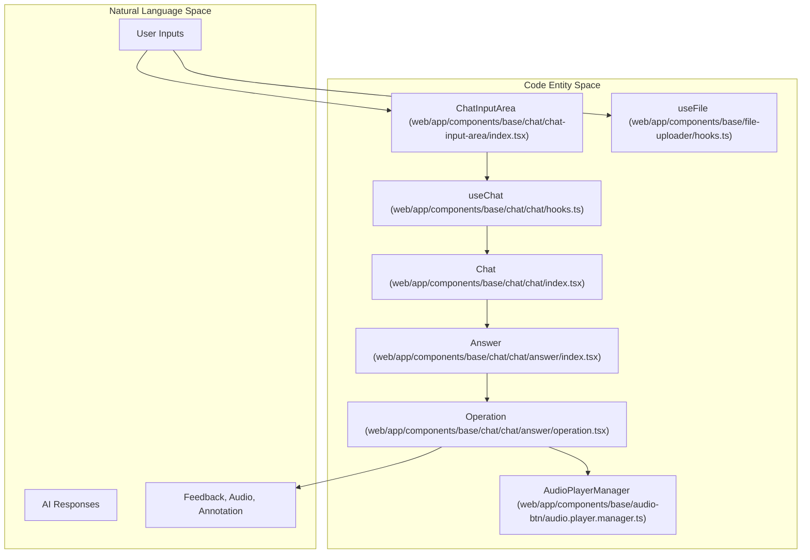
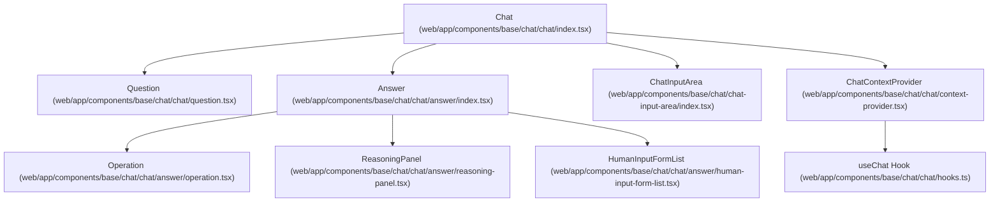

<!-- source: DeepWiki mcp.deepwiki.com · repo langgenius/dify · page 10.2 Chat Interface and Message Interactions · fetched 2026-10-26 -->

# Chat Interface and Message Interactions

Relevant source files

The following files were used as context for generating this wiki page:

- [api/core/helper/trace_id_helper.py](api/core/helper/trace_id_helper.py)
- [api/core/tools/utils/configuration.py](api/core/tools/utils/configuration.py)
- [api/core/tools/utils/encryption.py](api/core/tools/utils/encryption.py)
- [web/app/components/app/text-generate/item/__tests__/action-groups.spec.tsx](web/app/components/app/text-generate/item/__tests__/action-groups.spec.tsx)
- [web/app/components/app/text-generate/item/action-groups.tsx](web/app/components/app/text-generate/item/action-groups.tsx)
- [web/app/components/app/text-generate/item/index.tsx](web/app/components/app/text-generate/item/index.tsx)
- [web/app/components/base/block-input/index.tsx](web/app/components/base/block-input/index.tsx)
- [web/app/components/base/chat/chat-with-history/__tests__/chat-wrapper.spec.tsx](web/app/components/base/chat/chat-with-history/__tests__/chat-wrapper.spec.tsx)
- [web/app/components/base/chat/chat-with-history/__tests__/header-in-mobile.spec.tsx](web/app/components/base/chat/chat-with-history/__tests__/header-in-mobile.spec.tsx)
- [web/app/components/base/chat/chat-with-history/__tests__/hooks.spec.tsx](web/app/components/base/chat/chat-with-history/__tests__/hooks.spec.tsx)
- [web/app/components/base/chat/chat-with-history/chat-wrapper.tsx](web/app/components/base/chat/chat-with-history/chat-wrapper.tsx)
- [web/app/components/base/chat/chat-with-history/hooks.tsx](web/app/components/base/chat/chat-with-history/hooks.tsx)
- [web/app/components/base/chat/chat-with-history/index.tsx](web/app/components/base/chat/chat-with-history/index.tsx)
- [web/app/components/base/chat/chat-with-history/inputs-form/__tests__/content.spec.tsx](web/app/components/base/chat/chat-with-history/inputs-form/__tests__/content.spec.tsx)
- [web/app/components/base/chat/chat-with-history/inputs-form/content.tsx](web/app/components/base/chat/chat-with-history/inputs-form/content.tsx)
- [web/app/components/base/chat/chat-with-history/inputs-form/index.tsx](web/app/components/base/chat/chat-with-history/inputs-form/index.tsx)
- [web/app/components/base/chat/chat-with-history/sidebar/__tests__/operation.spec.tsx](web/app/components/base/chat/chat-with-history/sidebar/__tests__/operation.spec.tsx)
- [web/app/components/base/chat/chat-with-history/sidebar/operation.tsx](web/app/components/base/chat/chat-with-history/sidebar/operation.tsx)
- [web/app/components/base/chat/chat/__tests__/hooks.spec.tsx](web/app/components/base/chat/chat/__tests__/hooks.spec.tsx)
- [web/app/components/base/chat/chat/__tests__/index.spec.tsx](web/app/components/base/chat/chat/__tests__/index.spec.tsx)
- [web/app/components/base/chat/chat/__tests__/question.spec.tsx](web/app/components/base/chat/chat/__tests__/question.spec.tsx)
- [web/app/components/base/chat/chat/answer/__tests__/suggested-questions.spec.tsx](web/app/components/base/chat/chat/answer/__tests__/suggested-questions.spec.tsx)
- [web/app/components/base/chat/chat/answer/__tests__/workflow-process.spec.tsx](web/app/components/base/chat/chat/answer/__tests__/workflow-process.spec.tsx)
- [web/app/components/base/chat/chat/answer/human-input-content/content-item.tsx](web/app/components/base/chat/chat/answer/human-input-content/content-item.tsx)
- [web/app/components/base/chat/chat/answer/index.tsx](web/app/components/base/chat/chat/answer/index.tsx)
- [web/app/components/base/chat/chat/answer/more.tsx](web/app/components/base/chat/chat/answer/more.tsx)
- [web/app/components/base/chat/chat/answer/suggested-questions.tsx](web/app/components/base/chat/chat/answer/suggested-questions.tsx)
- [web/app/components/base/chat/chat/answer/workflow-process.tsx](web/app/components/base/chat/chat/answer/workflow-process.tsx)
- [web/app/components/base/chat/chat/chat-input-area/__tests__/index.spec.tsx](web/app/components/base/chat/chat/chat-input-area/__tests__/index.spec.tsx)
- [web/app/components/base/chat/chat/chat-input-area/index.tsx](web/app/components/base/chat/chat/chat-input-area/index.tsx)
- [web/app/components/base/chat/chat/chat-input-area/operation.tsx](web/app/components/base/chat/chat/chat-input-area/operation.tsx)
- [web/app/components/base/chat/chat/citation/__tests__/index.spec.tsx](web/app/components/base/chat/chat/citation/__tests__/index.spec.tsx)
- [web/app/components/base/chat/chat/citation/index.tsx](web/app/components/base/chat/chat/citation/index.tsx)
- [web/app/components/base/chat/chat/citation/popup.tsx](web/app/components/base/chat/chat/citation/popup.tsx)
- [web/app/components/base/chat/chat/hooks.ts](web/app/components/base/chat/chat/hooks.ts)
- [web/app/components/base/chat/chat/index.tsx](web/app/components/base/chat/chat/index.tsx)
- [web/app/components/base/chat/chat/question.tsx](web/app/components/base/chat/chat/question.tsx)
- [web/app/components/base/chat/chat/try-to-ask.tsx](web/app/components/base/chat/chat/try-to-ask.tsx)
- [web/app/components/base/chat/chat/type.ts](web/app/components/base/chat/chat/type.ts)
- [web/app/components/base/chat/embedded-chatbot/__tests__/chat-wrapper.spec.tsx](web/app/components/base/chat/embedded-chatbot/__tests__/chat-wrapper.spec.tsx)
- [web/app/components/base/chat/embedded-chatbot/__tests__/hooks.spec.tsx](web/app/components/base/chat/embedded-chatbot/__tests__/hooks.spec.tsx)
- [web/app/components/base/chat/embedded-chatbot/chat-wrapper.tsx](web/app/components/base/chat/embedded-chatbot/chat-wrapper.tsx)
- [web/app/components/base/chat/embedded-chatbot/hooks.tsx](web/app/components/base/chat/embedded-chatbot/hooks.tsx)
- [web/app/components/base/chat/embedded-chatbot/index.tsx](web/app/components/base/chat/embedded-chatbot/index.tsx)
- [web/app/components/base/chat/embedded-chatbot/inputs-form/__tests__/content.spec.tsx](web/app/components/base/chat/embedded-chatbot/inputs-form/__tests__/content.spec.tsx)
- [web/app/components/base/chat/embedded-chatbot/inputs-form/content.tsx](web/app/components/base/chat/embedded-chatbot/inputs-form/content.tsx)
- [web/app/components/base/chat/embedded-chatbot/inputs-form/index.tsx](web/app/components/base/chat/embedded-chatbot/inputs-form/index.tsx)
- [web/app/components/base/chat/types.ts](web/app/components/base/chat/types.ts)
- [web/app/components/base/copy-feedback/index.stories.tsx](web/app/components/base/copy-feedback/index.stories.tsx)
- [web/app/components/base/file-uploader/file-uploader-in-attachment/__tests__/index.spec.tsx](web/app/components/base/file-uploader/file-uploader-in-attachment/__tests__/index.spec.tsx)
- [web/app/components/base/image-uploader/image-link-input.tsx](web/app/components/base/image-uploader/image-link-input.tsx)
- [web/app/components/base/markdown-blocks/__tests__/code-block-load-error.spec.tsx](web/app/components/base/markdown-blocks/__tests__/code-block-load-error.spec.tsx)
- [web/app/components/base/markdown-blocks/__tests__/code-block-loading.spec.tsx](web/app/components/base/markdown-blocks/__tests__/code-block-loading.spec.tsx)
- [web/app/components/base/markdown-blocks/__tests__/think-block.spec.tsx](web/app/components/base/markdown-blocks/__tests__/think-block.spec.tsx)
- [web/app/components/base/markdown-blocks/code-block.stories.tsx](web/app/components/base/markdown-blocks/code-block.stories.tsx)
- [web/app/components/base/markdown-blocks/code-block.tsx](web/app/components/base/markdown-blocks/code-block.tsx)
- [web/app/components/base/markdown-blocks/think-block.tsx](web/app/components/base/markdown-blocks/think-block.tsx)
- [web/app/components/base/markdown/__tests__/index.spec.tsx](web/app/components/base/markdown/__tests__/index.spec.tsx)
- [web/app/components/base/markdown/index.tsx](web/app/components/base/markdown/index.tsx)
- [web/app/components/base/markdown/markdown-utils.ts](web/app/components/base/markdown/markdown-utils.ts)
- [web/app/components/base/mermaid/index.tsx](web/app/components/base/mermaid/index.tsx)
- [web/app/components/base/mermaid/utils.ts](web/app/components/base/mermaid/utils.ts)
- [web/app/components/base/new-audio-button/index.stories.tsx](web/app/components/base/new-audio-button/index.stories.tsx)
- [web/app/components/base/prompt-editor/utils.ts](web/app/components/base/prompt-editor/utils.ts)
- [web/app/components/workflow/nodes/code/use-config.ts](web/app/components/workflow/nodes/code/use-config.ts)
- [web/app/components/workflow/nodes/knowledge-retrieval/components/retrieval-config.tsx](web/app/components/workflow/nodes/knowledge-retrieval/components/retrieval-config.tsx)
- [web/app/components/workflow/nodes/knowledge-retrieval/utils.ts](web/app/components/workflow/nodes/knowledge-retrieval/utils.ts)
- [web/app/components/workflow/nodes/tool/panel.tsx](web/app/components/workflow/nodes/tool/panel.tsx)
- [web/app/components/workflow/nodes/trigger-schedule/default.ts](web/app/components/workflow/nodes/trigger-schedule/default.ts)
- [web/app/components/workflow/note-node/note-editor/utils.ts](web/app/components/workflow/note-node/note-editor/utils.ts)
- [web/app/components/workflow/panel/chat-record/__tests__/index.spec.tsx](web/app/components/workflow/panel/chat-record/__tests__/index.spec.tsx)
- [web/app/components/workflow/panel/chat-record/index.tsx](web/app/components/workflow/panel/chat-record/index.tsx)
- [web/app/components/workflow/panel/debug-and-preview/__tests__/chat-wrapper.spec.tsx](web/app/components/workflow/panel/debug-and-preview/__tests__/chat-wrapper.spec.tsx)
- [web/app/components/workflow/panel/debug-and-preview/__tests__/components.spec.tsx](web/app/components/workflow/panel/debug-and-preview/__tests__/components.spec.tsx)
- [web/app/components/workflow/panel/debug-and-preview/__tests__/hooks.spec.ts](web/app/components/workflow/panel/debug-and-preview/__tests__/hooks.spec.ts)
- [web/app/components/workflow/panel/debug-and-preview/__tests__/hooks/handle-resume.spec.ts](web/app/components/workflow/panel/debug-and-preview/__tests__/hooks/handle-resume.spec.ts)
- [web/app/components/workflow/panel/debug-and-preview/__tests__/hooks/handle-send.spec.ts](web/app/components/workflow/panel/debug-and-preview/__tests__/hooks/handle-send.spec.ts)
- [web/app/components/workflow/panel/debug-and-preview/__tests__/hooks/handle-stop-restart.spec.ts](web/app/components/workflow/panel/debug-and-preview/__tests__/hooks/handle-stop-restart.spec.ts)
- [web/app/components/workflow/panel/debug-and-preview/__tests__/hooks/misc.spec.ts](web/app/components/workflow/panel/debug-and-preview/__tests__/hooks/misc.spec.ts)
- [web/app/components/workflow/panel/debug-and-preview/__tests__/hooks/opening-statement.spec.ts](web/app/components/workflow/panel/debug-and-preview/__tests__/hooks/opening-statement.spec.ts)
- [web/app/components/workflow/panel/debug-and-preview/__tests__/hooks/sse-callbacks.spec.ts](web/app/components/workflow/panel/debug-and-preview/__tests__/hooks/sse-callbacks.spec.ts)
- [web/app/components/workflow/panel/debug-and-preview/chat-wrapper.tsx](web/app/components/workflow/panel/debug-and-preview/chat-wrapper.tsx)
- [web/app/components/workflow/panel/debug-and-preview/hooks.ts](web/app/components/workflow/panel/debug-and-preview/hooks.ts)
- [web/app/components/workflow/panel/global-variable-panel/__tests__/index.spec.tsx](web/app/components/workflow/panel/global-variable-panel/__tests__/index.spec.tsx)
- [web/app/components/workflow/panel/version-history-panel/filter/index.tsx](web/app/components/workflow/panel/version-history-panel/filter/index.tsx)
- [web/app/components/workflow/variable-inspect/value-content.tsx](web/app/components/workflow/variable-inspect/value-content.tsx)
- [web/hooks/use-format-time-from-now.spec.ts](web/hooks/use-format-time-from-now.spec.ts)

This document provides a comprehensive technical overview of the chat interface and message interaction components within the Dify web frontend. It covers key chat components—including the embedded chatbot, chat-with-history, input areas, markdown and mermaid rendering, feedback mechanisms, and audio playback—detailing implementation, data flow, and inter-component relationships.

---

## Overview and Scope

The chat interface is the primary user interaction layer for conversational AI experiences in Dify. It manages real-time messaging, message rendering with rich content (markdown, mermaid diagrams), user input (text, voice, file uploads), feedback collection, and audio playback of responses. The core components include:

- **Chat Components**: `Chat`, `ChatWithHistory`, and `EmbeddedChatbot`
- **Input Area**: `ChatInputArea`
- **Message Renderers**: Answer components with markdown and mermaid support
- **Feedback System**: User and admin feedback integration
- **Audio Playback**: Text-to-Speech output control

This page details these layers, their data flows, key hooks and context usage, and how message interactions are orchestrated.

---

## 1. Chat Components and Context Management

### Embedded Chatbot and Chat-With-History

- `useEmbeddedChatbot` hook manages state for embedded chatbot instances, fetching app info, conversations, messages, and syncing URL parameters for user/conversation IDs and locale settings. It prepares message data and integrates feedback and agent thoughts, handling both try-apps and web apps with scoped conversation IDs [web/app/components/base/chat/embedded-chatbot/hooks.tsx:35-163]().

- `useChatWithHistory` provides extended support for installed apps or web apps with conversation history, enriching chat messages with workflow, human input forms, and input forms data. It manages pinned and normal conversations, cached chat trees, and additional metadata like response latency [web/app/components/base/chat/chat-with-history/hooks.tsx:46-175]().

### Chat Wrapper Components

- `ChatWrapper` components for both embedded chatbot and chat-with-history adapt the state hooks and prepare chat configurations (`ChatConfig`), input forms, and inputs for rendering.

- Both wrappers resume paused workflows by performing a depth-first search through the conversation tree to locate the last human-input node needing workflow resumption, invoking `handleSwitchSibling` to continue workflow execution seamlessly [web/app/components/base/chat/chat-with-history/chat-wrapper.tsx:165-194](), [web/app/components/base/chat/embedded-chatbot/chat-wrapper.tsx:158-190]().

### Chat and Chat Context Provider

- The core `Chat` component renders the message list and input area, wiring feedback handlers, annotation callbacks, and regeneration controls [web/app/components/base/chat/chat/index.tsx:91-204]().

- `ChatContextProvider` supplies configuration, chat list, and interaction callbacks (`onSend`, `onRegenerate`, `onFeedback`) via React context to message components.

- `useChat` hook manages complex chat state, including message tree structure, streaming updates, and feedback integration (described in later sections) [web/app/components/base/chat/chat/hooks.ts:188-193]().

Sources:
- [web/app/components/base/chat/embedded-chatbot/hooks.tsx:35-163]()
- [web/app/components/base/chat/chat-with-history/hooks.tsx:46-175]()
- [web/app/components/base/chat/chat-with-history/chat-wrapper.tsx:165-194]()
- [web/app/components/base/chat/embedded-chatbot/chat-wrapper.tsx:158-190]()
- [web/app/components/base/chat/chat/index.tsx:91-204]()
- [web/app/components/base/chat/chat/hooks.ts:188-193]()

---

## 2. Chat Input Area and Message Submission

### ChatInputArea Component

- Implements the user text input box with optional voice recognition, file uploads, and feature bars [web/app/components/base/chat/chat/chat-input-area/index.tsx:64-90]().

- Supports controlling whether pressing Enter sends the message or inserts newline (`sendOnEnter` prop) to accommodate IME workflows for CJK languages [web/app/components/base/chat/chat/chat-input-area/index.tsx:184-194]().

- Uses `useFile` hook to handle drag-n-drop, paste, and file upload internal states [web/app/components/base/chat/chat/chat-input-area/index.tsx:107-114]().

- Handles send logic by validating inputs and file upload completion before calling the `onSend` prop callback [web/app/components/base/chat/chat/chat-input-area/index.tsx:140-167]().

- Resets input and uploads on successful send [web/app/components/base/chat/chat/chat-input-area/index.tsx:131-137]().

### Input Features

- Voice input is integrated via `VoiceInput` component supporting speech-to-text conversion [web/app/components/base/chat/chat/chat-input-area/index.tsx:18]().

- A feature bar optionally appears above the input for extra controls or status indicators [web/app/components/base/chat/chat/chat-input-area/index.tsx:14]().

- A file uploader sidebar and drag/paste handlers allow the attachment of files to messages [web/app/components/base/chat/chat/chat-input-area/index.tsx:15-17]().

Sources:
- [web/app/components/base/chat/chat/chat-input-area/index.tsx:64-90]()
- [web/app/components/base/chat/chat/chat-input-area/index.tsx:184-194]()
- [web/app/components/base/chat/chat/chat-input-area/index.tsx:107-114]()
- [web/app/components/base/chat/chat/chat-input-area/index.tsx:140-167]()
- [web/app/components/base/chat/chat/chat-input-area/index.tsx:131-137]()
- [web/app/components/base/chat/chat/chat-input-area/index.tsx:18]()
- [web/app/components/base/chat/chat/chat-input-area/index.tsx:14]()
- [web/app/components/base/chat/chat/chat-input-area/index.tsx:15-17]()

---

## 3. Message Rendering, Markdown, and Mermaid Diagram Support

### Markdown Rendering

- Chat answer content supports markdown rendering, including custom components for enhanced UX. The `Markdown` component is used for this purpose [web/app/components/base/markdown/index.tsx]().

- The `CodeBlock` component handles code highlighting using Shiki and also dynamically renders specialized blocks like Mermaid diagrams, ECharts, and SVG [web/app/components/base/markdown-blocks/code-block.tsx:152-169]().

### Mermaid Diagram Integration

- Mermaid diagrams are rendered client-side with the `Flowchart` component managing initialization, theming, caching, and error recovery [web/app/components/base/markdown-blocks/code-block.tsx:23]().

- The system initializes Mermaid with safe default configurations, ensuring consistent diagram rendering in light/dark themes [web/app/components/base/mermaid/index.tsx:68-100]().

- Errors in render trigger re-initialization and fallback UI with error messaging [web/app/components/base/mermaid/index.tsx:161-177]().

Sources:
- [web/app/components/base/markdown/index.tsx]()
- [web/app/components/base/markdown-blocks/code-block.tsx:152-169]()
- [web/app/components/base/markdown-blocks/code-block.tsx:23]()
- [web/app/components/base/mermaid/index.tsx:68-100]()
- [web/app/components/base/mermaid/index.tsx:161-177]()

---

## 4. Feedback System and Interaction Bar (Operation Component)

### Operation Component

- The `Operation` component is attached to each answer message. It manages feedback buttons, prompt log access, regeneration, audio playback, and annotation toggles [web/app/components/base/chat/chat/answer/operation.tsx:21-40]().

- It receives props for the message item, question text, UI state flags, max width for layout, and callback handlers.

- Internal state handles user/admin feedback toggling, modal visibility, and feedback content submission.

### Feedback Types

- Supports **User Feedback** and **Admin Feedback** collected from different UI sections.

- Feedback buttons toggle visual states and report feedback to backend via callbacks.

- Enables clearing and updating feedback without requiring page reloads.

Sources:
- [web/app/components/base/chat/chat/answer/operation.tsx:21-40]()

---

## 5. Audio Playback for Text-To-Speech Responses

- The audio playback is controlled by the `NewAudioButton` rendered inside the `Operation` component if `text_to_speech.enabled` is set.

- Playback is managed globally using the singleton `AudioPlayerManager`, ensuring one audio playback at a time and handling play/pause logic [web/app/components/base/chat/chat/hooks.ts:15]().

Sources:
- [web/app/components/base/chat/chat/hooks.ts:15]()

---

## 6. Chat State Data Flow and Message Interaction Sequence

### High-Level Data Flow

### Component Entity Bridge

### Component Relationship Diagram

---

## Summary

The chat interface in Dify is built with modular React components coordinated via hooks and context to handle real-time chat interactions, message rendering with rich content (markdown, mermaid), feedback collection, and TTS audio playback. The architecture enables seamless integration of file uploads, voice input, interaction feedback, and workflow resumption.

Key design aspects:

- Clear data separation into message tree structures allowing siblings and children.
- Input area highly customizable for platform and internationalization.
- Feedback and audio operations tightly integrated with chat messages.
- Mermaid diagram rendering supports technical responses with stable theming and error recovery.

This design provides a robust foundation for both simple chatbot embedding and advanced workflow-backed chat experiences in the Dify platform.

---

# References

Sources:

- [web/app/components/base/chat/embedded-chatbot/hooks.tsx:35-163]()
- [web/app/components/base/chat/chat-with-history/hooks.tsx:46-175]()
- [web/app/components/base/chat/chat-with-history/chat-wrapper.tsx:165-194]()
- [web/app/components/base/chat/embedded-chatbot/chat-wrapper.tsx:158-190]()
- [web/app/components/base/chat/chat/index.tsx:91-204]()
- [web/app/components/base/chat/chat/hooks.ts:15-121,188-193]()
- [web/app/components/base/chat/chat/chat-input-area/index.tsx:31-194]()
- [web/app/components/base/chat/chat/answer/operation.tsx:21-40]()
- [web/app/components/base/mermaid/index.tsx:20-198]()
- [web/app/components/base/markdown/index.tsx]()
- [web/app/components/base/markdown-blocks/code-block.tsx:23]()
- [web/app/components/base/markdown-blocks/code-block.tsx:152-169]()

---

