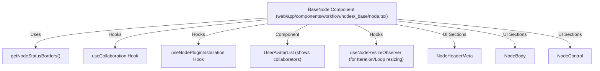
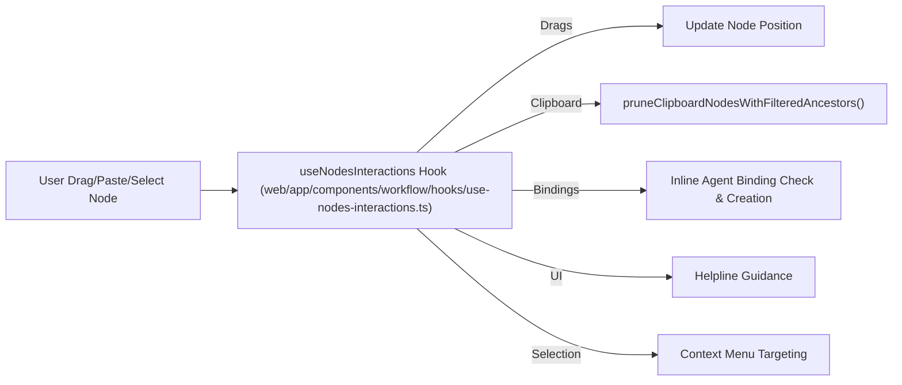
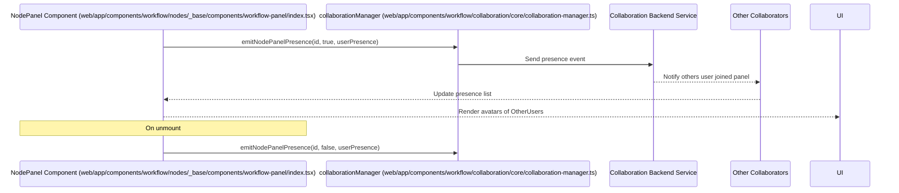
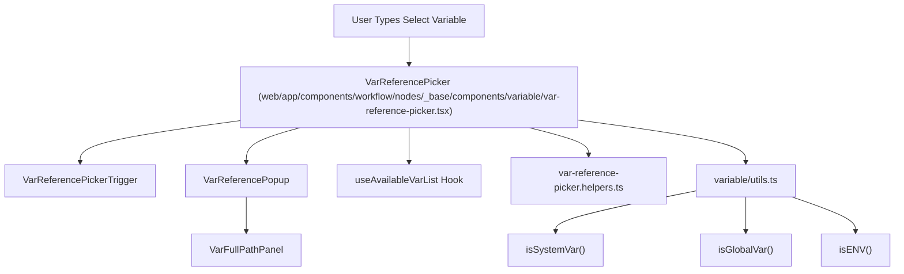
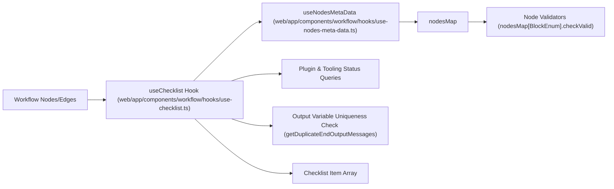
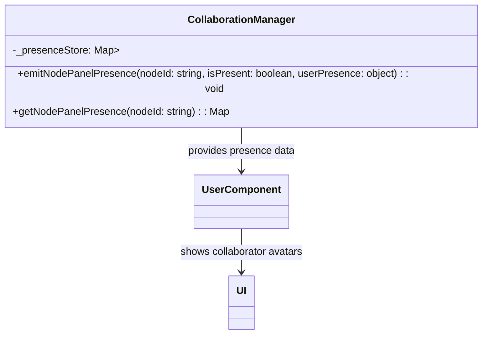
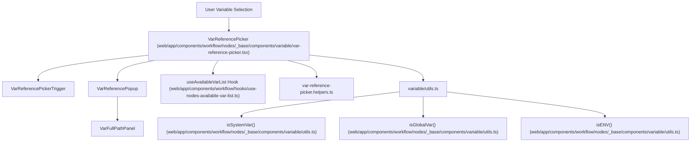
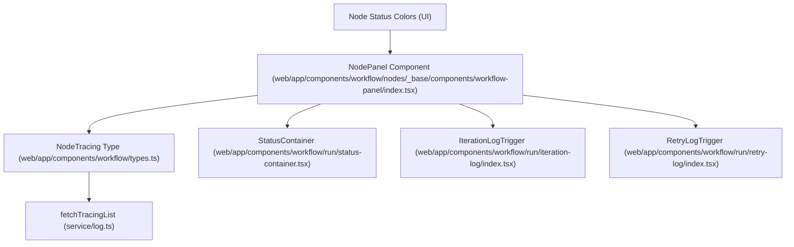

<!-- source: DeepWiki mcp.deepwiki.com · repo langgenius/dify · page 10.3 Workflow Canvas and Node UI Components · fetched 2026-10-26 -->

# Workflow Canvas and Node UI Components

Relevant source files

The following files were used as context for generating this wiki page:

- [web/app/components/base/chat/chat/loading-anim/index.tsx](web/app/components/base/chat/chat/loading-anim/index.tsx)
- [web/app/components/datasets/metadata/metadata-document/__tests__/document-information.spec.tsx](web/app/components/datasets/metadata/metadata-document/__tests__/document-information.spec.tsx)
- [web/app/components/rag-pipeline/components/__tests__/rag-pipeline-main.spec.tsx](web/app/components/rag-pipeline/components/__tests__/rag-pipeline-main.spec.tsx)
- [web/app/components/rag-pipeline/components/rag-pipeline-main.tsx](web/app/components/rag-pipeline/components/rag-pipeline-main.tsx)
- [web/app/components/snippets/components/__tests__/snippet-main.spec.tsx](web/app/components/snippets/components/__tests__/snippet-main.spec.tsx)
- [web/app/components/snippets/components/snippet-main.tsx](web/app/components/snippets/components/snippet-main.tsx)
- [web/app/components/workflow-app/components/__tests__/workflow-main.spec.tsx](web/app/components/workflow-app/components/__tests__/workflow-main.spec.tsx)
- [web/app/components/workflow-app/components/workflow-main.tsx](web/app/components/workflow-app/components/workflow-main.tsx)
- [web/app/components/workflow-app/hooks/__tests__/use-available-nodes-meta-data.spec.ts](web/app/components/workflow-app/hooks/__tests__/use-available-nodes-meta-data.spec.ts)
- [web/app/components/workflow-app/hooks/use-available-nodes-meta-data.ts](web/app/components/workflow-app/hooks/use-available-nodes-meta-data.ts)
- [web/app/components/workflow/__tests__/custom-edge.spec.tsx](web/app/components/workflow/__tests__/custom-edge.spec.tsx)
- [web/app/components/workflow/__tests__/edge-insert-focus.browser.spec.tsx](web/app/components/workflow/__tests__/edge-insert-focus.browser.spec.tsx)
- [web/app/components/workflow/__tests__/keyboard-node-movement.browser.spec.tsx](web/app/components/workflow/__tests__/keyboard-node-movement.browser.spec.tsx)
- [web/app/components/workflow/__tests__/panel-contextmenu.spec.tsx](web/app/components/workflow/__tests__/panel-contextmenu.spec.tsx)
- [web/app/components/workflow/__tests__/selection-contextmenu.spec.tsx](web/app/components/workflow/__tests__/selection-contextmenu.spec.tsx)
- [web/app/components/workflow/__tests__/workflow-edge-events.spec.tsx](web/app/components/workflow/__tests__/workflow-edge-events.spec.tsx)
- [web/app/components/workflow/block-selector/__tests__/index.spec.tsx](web/app/components/workflow/block-selector/__tests__/index.spec.tsx)
- [web/app/components/workflow/block-selector/marketplace-plugin/action.tsx](web/app/components/workflow/block-selector/marketplace-plugin/action.tsx)
- [web/app/components/workflow/constants.ts](web/app/components/workflow/constants.ts)
- [web/app/components/workflow/edge-contextmenu.tsx](web/app/components/workflow/edge-contextmenu.tsx)
- [web/app/components/workflow/header/chat-variable-button.tsx](web/app/components/workflow/header/chat-variable-button.tsx)
- [web/app/components/workflow/header/checklist/__tests__/index.spec.tsx](web/app/components/workflow/header/checklist/__tests__/index.spec.tsx)
- [web/app/components/workflow/header/checklist/__tests__/node-group.spec.tsx](web/app/components/workflow/header/checklist/__tests__/node-group.spec.tsx)
- [web/app/components/workflow/header/checklist/index.tsx](web/app/components/workflow/header/checklist/index.tsx)
- [web/app/components/workflow/header/checklist/node-group.tsx](web/app/components/workflow/header/checklist/node-group.tsx)
- [web/app/components/workflow/header/env-button.tsx](web/app/components/workflow/header/env-button.tsx)
- [web/app/components/workflow/header/global-variable-button.tsx](web/app/components/workflow/header/global-variable-button.tsx)
- [web/app/components/workflow/header/run-and-history.tsx](web/app/components/workflow/header/run-and-history.tsx)
- [web/app/components/workflow/hooks-store/store.ts](web/app/components/workflow/hooks-store/store.ts)
- [web/app/components/workflow/hooks/__tests__/use-available-blocks.spec.ts](web/app/components/workflow/hooks/__tests__/use-available-blocks.spec.ts)
- [web/app/components/workflow/hooks/__tests__/use-checklist.spec.ts](web/app/components/workflow/hooks/__tests__/use-checklist.spec.ts)
- [web/app/components/workflow/hooks/__tests__/use-edge-accessible-label.spec.tsx](web/app/components/workflow/hooks/__tests__/use-edge-accessible-label.spec.tsx)
- [web/app/components/workflow/hooks/__tests__/use-edges-interactions.spec.ts](web/app/components/workflow/hooks/__tests__/use-edges-interactions.spec.ts)
- [web/app/components/workflow/hooks/__tests__/use-node-keyboard-interactions.spec.tsx](web/app/components/workflow/hooks/__tests__/use-node-keyboard-interactions.spec.tsx)
- [web/app/components/workflow/hooks/__tests__/use-nodes-interactions.spec.ts](web/app/components/workflow/hooks/__tests__/use-nodes-interactions.spec.ts)
- [web/app/components/workflow/hooks/__tests__/use-panel-interactions.spec.ts](web/app/components/workflow/hooks/__tests__/use-panel-interactions.spec.ts)
- [web/app/components/workflow/hooks/__tests__/use-selection-interactions.spec.ts](web/app/components/workflow/hooks/__tests__/use-selection-interactions.spec.ts)
- [web/app/components/workflow/hooks/__tests__/use-workflow-panel-interactions.spec.tsx](web/app/components/workflow/hooks/__tests__/use-workflow-panel-interactions.spec.tsx)
- [web/app/components/workflow/hooks/__tests__/use-workflow.spec.ts](web/app/components/workflow/hooks/__tests__/use-workflow.spec.ts)
- [web/app/components/workflow/hooks/use-available-blocks.ts](web/app/components/workflow/hooks/use-available-blocks.ts)
- [web/app/components/workflow/hooks/use-checklist.ts](web/app/components/workflow/hooks/use-checklist.ts)
- [web/app/components/workflow/hooks/use-edge-accessible-label.ts](web/app/components/workflow/hooks/use-edge-accessible-label.ts)
- [web/app/components/workflow/hooks/use-edges-interactions.ts](web/app/components/workflow/hooks/use-edges-interactions.ts)
- [web/app/components/workflow/hooks/use-node-keyboard-interactions.ts](web/app/components/workflow/hooks/use-node-keyboard-interactions.ts)
- [web/app/components/workflow/hooks/use-nodes-available-var-list.ts](web/app/components/workflow/hooks/use-nodes-available-var-list.ts)
- [web/app/components/workflow/hooks/use-nodes-interactions.ts](web/app/components/workflow/hooks/use-nodes-interactions.ts)
- [web/app/components/workflow/hooks/use-panel-interactions.ts](web/app/components/workflow/hooks/use-panel-interactions.ts)
- [web/app/components/workflow/hooks/use-selection-interactions.ts](web/app/components/workflow/hooks/use-selection-interactions.ts)
- [web/app/components/workflow/hooks/use-workflow-control-scale.ts](web/app/components/workflow/hooks/use-workflow-control-scale.ts)
- [web/app/components/workflow/hooks/use-workflow-panel-interactions.ts](web/app/components/workflow/hooks/use-workflow-panel-interactions.ts)
- [web/app/components/workflow/hooks/use-workflow.ts](web/app/components/workflow/hooks/use-workflow.ts)
- [web/app/components/workflow/index.tsx](web/app/components/workflow/index.tsx)
- [web/app/components/workflow/node-contextmenu.tsx](web/app/components/workflow/node-contextmenu.tsx)
- [web/app/components/workflow/nodes/_base/__tests__/node.spec.tsx](web/app/components/workflow/nodes/_base/__tests__/node.spec.tsx)
- [web/app/components/workflow/nodes/_base/components/__tests__/node-control.spec.tsx](web/app/components/workflow/nodes/_base/components/__tests__/node-control.spec.tsx)
- [web/app/components/workflow/nodes/_base/components/__tests__/node-focus.browser.spec.tsx](web/app/components/workflow/nodes/_base/components/__tests__/node-focus.browser.spec.tsx)
- [web/app/components/workflow/nodes/_base/components/__tests__/node-handle.browser.spec.tsx](web/app/components/workflow/nodes/_base/components/__tests__/node-handle.browser.spec.tsx)
- [web/app/components/workflow/nodes/_base/components/__tests__/node-handle.spec.tsx](web/app/components/workflow/nodes/_base/components/__tests__/node-handle.spec.tsx)
- [web/app/components/workflow/nodes/_base/components/next-step/add.tsx](web/app/components/workflow/nodes/_base/components/next-step/add.tsx)
- [web/app/components/workflow/nodes/_base/components/node-control.tsx](web/app/components/workflow/nodes/_base/components/node-control.tsx)
- [web/app/components/workflow/nodes/_base/components/node-handle.tsx](web/app/components/workflow/nodes/_base/components/node-handle.tsx)
- [web/app/components/workflow/nodes/_base/components/title-description-input.tsx](web/app/components/workflow/nodes/_base/components/title-description-input.tsx)
- [web/app/components/workflow/nodes/_base/components/variable/utils.ts](web/app/components/workflow/nodes/_base/components/variable/utils.ts)
- [web/app/components/workflow/nodes/_base/components/workflow-panel/__tests__/index.spec.tsx](web/app/components/workflow/nodes/_base/components/workflow-panel/__tests__/index.spec.tsx)
- [web/app/components/workflow/nodes/_base/components/workflow-panel/index.tsx](web/app/components/workflow/nodes/_base/components/workflow-panel/index.tsx)
- [web/app/components/workflow/nodes/_base/node.tsx](web/app/components/workflow/nodes/_base/node.tsx)
- [web/app/components/workflow/nodes/agent-v2/__tests__/default.spec.ts](web/app/components/workflow/nodes/agent-v2/__tests__/default.spec.ts)
- [web/app/components/workflow/nodes/agent-v2/default.ts](web/app/components/workflow/nodes/agent-v2/default.ts)
- [web/app/components/workflow/nodes/if-else/__tests__/integration.spec.tsx](web/app/components/workflow/nodes/if-else/__tests__/integration.spec.tsx)
- [web/app/components/workflow/nodes/iteration-start/index.tsx](web/app/components/workflow/nodes/iteration-start/index.tsx)
- [web/app/components/workflow/nodes/iteration/add-block.tsx](web/app/components/workflow/nodes/iteration/add-block.tsx)
- [web/app/components/workflow/nodes/iteration/node.tsx](web/app/components/workflow/nodes/iteration/node.tsx)
- [web/app/components/workflow/nodes/iteration/use-interactions.ts](web/app/components/workflow/nodes/iteration/use-interactions.ts)
- [web/app/components/workflow/nodes/knowledge-retrieval/use-single-run-form-params.ts](web/app/components/workflow/nodes/knowledge-retrieval/use-single-run-form-params.ts)
- [web/app/components/workflow/nodes/llm/types.ts](web/app/components/workflow/nodes/llm/types.ts)
- [web/app/components/workflow/nodes/loop-start/index.tsx](web/app/components/workflow/nodes/loop-start/index.tsx)
- [web/app/components/workflow/nodes/loop/use-interactions.ts](web/app/components/workflow/nodes/loop/use-interactions.ts)
- [web/app/components/workflow/note-node/__tests__/hooks.spec.tsx](web/app/components/workflow/note-node/__tests__/hooks.spec.tsx)
- [web/app/components/workflow/note-node/constants.ts](web/app/components/workflow/note-node/constants.ts)
- [web/app/components/workflow/note-node/hooks.ts](web/app/components/workflow/note-node/hooks.ts)
- [web/app/components/workflow/note-node/note-editor/__tests__/editor.spec.tsx](web/app/components/workflow/note-node/note-editor/__tests__/editor.spec.tsx)
- [web/app/components/workflow/note-node/note-editor/plugins/link-editor-plugin/__tests__/component.spec.tsx](web/app/components/workflow/note-node/note-editor/plugins/link-editor-plugin/__tests__/component.spec.tsx)
- [web/app/components/workflow/note-node/note-editor/plugins/link-editor-plugin/__tests__/hooks.spec.tsx](web/app/components/workflow/note-node/note-editor/plugins/link-editor-plugin/__tests__/hooks.spec.tsx)
- [web/app/components/workflow/note-node/note-editor/plugins/link-editor-plugin/component.tsx](web/app/components/workflow/note-node/note-editor/plugins/link-editor-plugin/component.tsx)
- [web/app/components/workflow/note-node/note-editor/plugins/link-editor-plugin/hooks.ts](web/app/components/workflow/note-node/note-editor/plugins/link-editor-plugin/hooks.ts)
- [web/app/components/workflow/note-node/note-editor/store.ts](web/app/components/workflow/note-node/note-editor/store.ts)
- [web/app/components/workflow/note-node/note-editor/theme/theme.css](web/app/components/workflow/note-node/note-editor/theme/theme.css)
- [web/app/components/workflow/operator/hooks.ts](web/app/components/workflow/operator/hooks.ts)
- [web/app/components/workflow/panel-contextmenu.tsx](web/app/components/workflow/panel-contextmenu.tsx)
- [web/app/components/workflow/panel/debug-and-preview/__tests__/debug-and-preview.spec.tsx](web/app/components/workflow/panel/debug-and-preview/__tests__/debug-and-preview.spec.tsx)
- [web/app/components/workflow/panel/debug-and-preview/index.tsx](web/app/components/workflow/panel/debug-and-preview/index.tsx)
- [web/app/components/workflow/panel/debug-and-preview/user-input.tsx](web/app/components/workflow/panel/debug-and-preview/user-input.tsx)
- [web/app/components/workflow/selection-contextmenu.tsx](web/app/components/workflow/selection-contextmenu.tsx)
- [web/app/components/workflow/shortcuts/__tests__/workflow-canvas.browser.spec.tsx](web/app/components/workflow/shortcuts/__tests__/workflow-canvas.browser.spec.tsx)
- [web/app/components/workflow/store/__tests__/workflow-store.spec.ts](web/app/components/workflow/store/__tests__/workflow-store.spec.ts)
- [web/app/components/workflow/store/index.ts](web/app/components/workflow/store/index.ts)
- [web/app/components/workflow/store/workflow/chat-variable-slice.ts](web/app/components/workflow/store/workflow/chat-variable-slice.ts)
- [web/app/components/workflow/store/workflow/env-variable-slice.ts](web/app/components/workflow/store/workflow/env-variable-slice.ts)
- [web/app/components/workflow/store/workflow/form-slice.ts](web/app/components/workflow/store/workflow/form-slice.ts)
- [web/app/components/workflow/store/workflow/help-line-slice.ts](web/app/components/workflow/store/workflow/help-line-slice.ts)
- [web/app/components/workflow/store/workflow/history-slice.ts](web/app/components/workflow/store/workflow/history-slice.ts)
- [web/app/components/workflow/store/workflow/index.ts](web/app/components/workflow/store/workflow/index.ts)
- [web/app/components/workflow/store/workflow/node-slice.ts](web/app/components/workflow/store/workflow/node-slice.ts)
- [web/app/components/workflow/store/workflow/panel-slice.ts](web/app/components/workflow/store/workflow/panel-slice.ts)
- [web/app/components/workflow/store/workflow/tool-slice.ts](web/app/components/workflow/store/workflow/tool-slice.ts)
- [web/app/components/workflow/store/workflow/workflow-draft-slice.ts](web/app/components/workflow/store/workflow/workflow-draft-slice.ts)
- [web/app/components/workflow/store/workflow/workflow-slice.ts](web/app/components/workflow/store/workflow/workflow-slice.ts)
- [web/app/components/workflow/utils/gen-node-meta-data.ts](web/app/components/workflow/utils/gen-node-meta-data.ts)
- [web/context/i18n.spec.ts](web/context/i18n.spec.ts)
- [web/context/i18n.ts](web/context/i18n.ts)
- [web/features/agent-v2/agent-detail/configure/components/orchestrate/common/__tests__/tip-content.spec.tsx](web/features/agent-v2/agent-detail/configure/components/orchestrate/common/__tests__/tip-content.spec.tsx)
- [web/features/agent-v2/agent-detail/configure/components/orchestrate/common/tip-content.tsx](web/features/agent-v2/agent-detail/configure/components/orchestrate/common/tip-content.tsx)
- [web/hooks/use-api-access-url.ts](web/hooks/use-api-access-url.ts)
- [web/hooks/use-metadata.ts](web/hooks/use-metadata.ts)
- [web/scripts/gen-doc-paths.ts](web/scripts/gen-doc-paths.ts)
- [web/types/doc-paths.ts](web/types/doc-paths.ts)

This page provides an in-depth technical description of the workflow canvas interactions, node panels, configuration hooks, variable reference pickers, checklist validation, and collaboration management within the Dify web frontend architecture. It documents key components, hooks, data flows, and collaboration mechanisms that shape the interactive workflow editor experience.

---

## 1. Purpose and Scope

The workflow canvas and node UI components enable users to visually build, configure, and manage complex workflows with multiple node types representing various processing blocks (e.g., LLM, HTTP requests, Agents). This section details:

- Workflow node panel components and the base node wrapper
- State management hooks (`useConfig` and others) to handle node data
- Variable reference pickers allowing users to select or create variables in node configurations
- Checklist validation for workflow correctness and configuration integrity
- Collaboration features to track multi-user presence and editing status on node panels

All components are designed to be composable and extensible, facilitating a consistent user experience across different node types while supporting advanced features such as iteration, loops, and agent bindings.

---

## 2. Workflow Node UI Structure and Base Node Component

### 2.1. Node UI Organization

Each workflow node type encapsulates its own UI in:

- **`panel.tsx`**: Main React functional component rendering the node configuration UI panel.
- **`use-config.ts`**: A custom hook managing the state, user interactions, and effects specific to this node type.
- **UI Subcomponents**: Components for handling parts like variable inputs, error handling, and prompt editing.

Common shared components live under `nodes/_base/components`, including:

- `Field` components providing consistent form fields
- `VarReferencePicker` for variable selection UI
- `OutputVars` for output variable listing
- `NodeHandle` components for edge connection points on nodes

This modular design promotes consistency and reusability.

### 2.2. The `BaseNode` Component

The `BaseNode` component acts as a wrapper around all node types to provide unified visual and interaction features:

- **Execution Status Borders:** Uses `getNodeStatusBorders` to display node borders colored based on runtime statuses like running, success, failure, or exceptions.
- **Collaboration Avatars:** Uses the `useCollaboration` hook and `nodePanelPresence` state to show other users viewing the panel in real-time.
- **Interaction Modes:** Respects global workflow interaction modes (pointer, hand, comment) and read-only states.
- **Plugin Installation Checks:** Integrates with `useNodePluginInstallation` to lock interactions if required plugins are missing or installation is locked.
- **Resize Observation:** For container nodes such as Iteration or Loop nodes, `useNodeResizeObserver` tracks child resizing to adjust parent layouts accordingly.

`BaseNode` uses user profile data queried via `userProfileQueryOptions` to populate collaboration avatars and provides context menu and selection styling.

Sources:
[web/app/components/workflow/nodes/_base/node.tsx:51-174]()
[web/app/components/workflow/nodes/_base/node.helpers.ts:30-50]()

---

## 3. Workflow Canvas Interactions and State Hooks (`useNodesInteractions`)

The `useNodesInteractions` hook centralizes complex user interaction logic on the workflow canvas regarding nodes:

- **Drag and Drop:** Handles node dragging with position adjustments and snapping, including nested node dragging in container nodes like Iteration and Loop - delegating to `handleNodeIterationChildDrag` and `handleNodeLoopChildDrag`.
- **Clipboard Support:** Implements paste filtering with `pruneClipboardNodesWithFilteredAncestors` to remove nodes whose ancestors are filtered to maintain graph integrity when pasting.
- **Inline Agent Binding:** Checks and automates creation of inline agent bindings for `AgentV2` nodes requiring active bindings for their runtime [detects via `needsPendingInlineAgentBinding`].
- **Helpline Integration:** Manages UI guidance for node placement and connections.
- **Selection and Context Menu:** Handles node selection, deselection, and right-click context menus.

Sources:
[web/app/components/workflow/hooks/use-nodes-interactions.ts:161-200]()
[web/app/components/workflow/hooks/use-nodes-interactions.ts:70-150]()

---

## 4. Node Panel Components and useConfig Hooks

Each node type panel component in `panel.tsx` reacts to the node’s data and state, often using the `useConfig` hook for:

- Managing configuration form state and validation
- Synchronizing with the workflow store
- Handling default values and state updates
- Emitting events for node data changes

The base `BasePanel` component (used in panels) integrates key features:

- Shows collaboration presence with `collaborationManager.emitNodePanelPresence` to broadcast user viewing state.
- Reports panel width and syncs it with the canvas for responsive layout.
- Allows showing historical execution logs and run status info.

### Node Panel Collaboration and Presence

Presence data is managed by `collaborationManager` which emits panel presence events using user profile information extracted from a suspended query. The component Tracks presence of other viewers on the node panel and renders avatars for them.

Example lifecycle:

- On mount, `collaborationManager.emitNodePanelPresence(id, true, userPresence)` signals entering
- On unmount, it signals leaving presence
- Presence state listens for changes to update the UI

Sources:
[web/app/components/workflow/nodes/_base/components/workflow-panel/index.tsx:90-140]()
[web/app/components/workflow/collaboration/core/collaboration-manager.ts:10-60]()

---

## 5. Variable Reference Picker Component (`VarReferencePicker`)

`VarReferencePicker` is a critical UI component enabling users to select or input variable references in workflows. It supports:

- Browsing variables from upstream nodes, environment, system, conversation, and RAG variables.
- Filtering variables by type (e.g., optionally hiding file variables).
- Showing variable metadata and contextual tooltips.
- Switching between constant values and variables via the `VarKindType`.
- Search and dynamic fetching of options for dynamic selects.
- Handling scoped variables, including iteration and loop context-aware variables.

It integrates UI subcomponents:

- `VarReferencePickerTrigger`: Clickable trigger element to open the picker dropdown.
- `VarReferencePopup`: Dropdown panel with variable selection UI.
- `VarFullPathPanel`: Optional panel showing the full variable path for nested variables.

It relies heavily on helper functions for variable type resolution such as `isSystemVar`, `isGlobalVar`, and utility helpers for variable disambiguation and display naming.

Sources:
[web/app/components/workflow/nodes/_base/components/variable/var-reference-picker.tsx:30-200]()
[web/app/components/workflow/nodes/_base/components/variable/utils.ts:70-130]()

---

## 6. Checklist Validation Hook (`useChecklist`)

The `useChecklist` hook performs validation over the workflow graph focusing on:

- Connectivity of nodes (detecting unconnected nodes)
- Nodes’ configuration correctness via node-specific validators
- Plugin existence and installation status
- Output variable uniqueness (for `End` nodes)
- Overall tree structure and depth validity

The hook aggregates issues into a `ChecklistItem` array with metadata like error messages, ability to navigate, and flags for disabling or enabling UI cues.

It uses validators pulled dynamically from the node metadata, node types, and external tooling info, also integrating model and plugin status queries.

Sources:
[web/app/components/workflow/hooks/use-checklist.ts:165-174]()
[web/app/components/workflow/nodes/_base/components/variable/utils.ts:87-114]()

---

## 7. Collaboration Manager and Multi-User Editing Support

The `collaborationManager` singleton handles real-time collaborative editing interactions:

- Emits node panel presence updates for users opening/closing node panels.
- Tracks which users are currently viewing or editing workflow nodes or panels.
- Integrates with the collaboration backend (likely WebSocket or other pub/sub mechanism) to synchronize presence across clients.
- Allows UI components to subscribe and react to presence state changes.

Sources:
[web/app/components/workflow/collaboration/core/collaboration-manager.ts:10-80]()
[web/app/components/workflow/nodes/_base/components/workflow-panel/index.tsx:130-150]()

---

## 8. Bridging Natural Language Space and Code Entity Space

Two key mermaid diagrams illustrate how user interactions map to specific frontend code components and hooks, bridging the conceptual workflow and codebase.

### 8.1 Variable Selection Flow

Shows the chain from user variable selection in UI to resolution helpers and available variable list hooks.

Sources:
[web/app/components/workflow/nodes/_base/components/variable/var-reference-picker.tsx]()
[web/app/components/workflow/nodes/_base/components/variable/utils.ts]()
[web/app/components/workflow/hooks/use-nodes-available-var-list.ts]()

### 8.2 Node Execution Tracing Flow

Visualizes runtime execution feedback mapped to node run panels and trace data structures.

Sources:
[web/app/components/workflow/nodes/_base/components/workflow-panel/index.tsx]()
[web/app/components/workflow/types.ts]()
[web/app/components/workflow/run/status-container.tsx]()
[web/app/components/workflow/run/iteration-log/index.tsx]()
[web/app/components/workflow/run/retry-log/index.tsx]()

---

## 9. Summary of Key Constants

| Constant | Explanation | Source |
| -------- | ----------- | ------ |
| `NODE_WIDTH` | Default node width (240px) | [web/app/components/workflow/constants.ts:7]() |
| `NESTED_ELEMENT_Z_INDEX` | Z-index 1001 to ensure nested container nodes overlay their children | [web/app/components/workflow/constants.ts:13]() |
| `SUPPORT_OUTPUT_VARS_NODE` | List of node types that can export variables (LLM, Code, HTTP, etc.) | [web/app/components/workflow/constants.ts:103-124]() |
| `LLM_OUTPUT_STRUCT` | LLM output variables: `text`, `reasoning_content`, `usage` | [web/app/components/workflow/constants.ts:142-154]() |
| `HTTP_REQUEST_OUTPUT_STRUCT` | HTTP node output schema: `body`, `status_code`, `headers`, `files` | [web/app/components/workflow/constants.ts:186-202]() |

---

# References

- `BaseNode` wrapper structure and collaboration hooks:
  [web/app/components/workflow/nodes/_base/node.tsx:51-174]()

- Workflow canvas node interaction management:
  [web/app/components/workflow/hooks/use-nodes-interactions.ts:161-200]()

- Variable reference picker internals and helpers:
  [web/app/components/workflow/nodes/_base/components/variable/var-reference-picker.tsx:30-200]()
  [web/app/components/workflow/nodes/_base/components/variable/utils.ts:66-114]()

- Workflow checklist validation:
  [web/app/components/workflow/hooks/use-checklist.ts:165-174]()

- Collaboration manager and node panel presence:
  [web/app/components/workflow/collaboration/core/collaboration-manager.ts:10-60]()
  [web/app/components/workflow/nodes/_base/components/workflow-panel/index.tsx:130-150]()

- Constants and types:
  [web/app/components/workflow/constants.ts:1-297]()
  [web/app/components/workflow/types.ts:28-185]()

---

This comprehensive explanation covers the main integration points, data flows, and code entities for the workflow canvas and node UI system, illuminating how user interactions map to React components, hooks, and realtime collaboration mechanisms within the Dify frontend.

---

