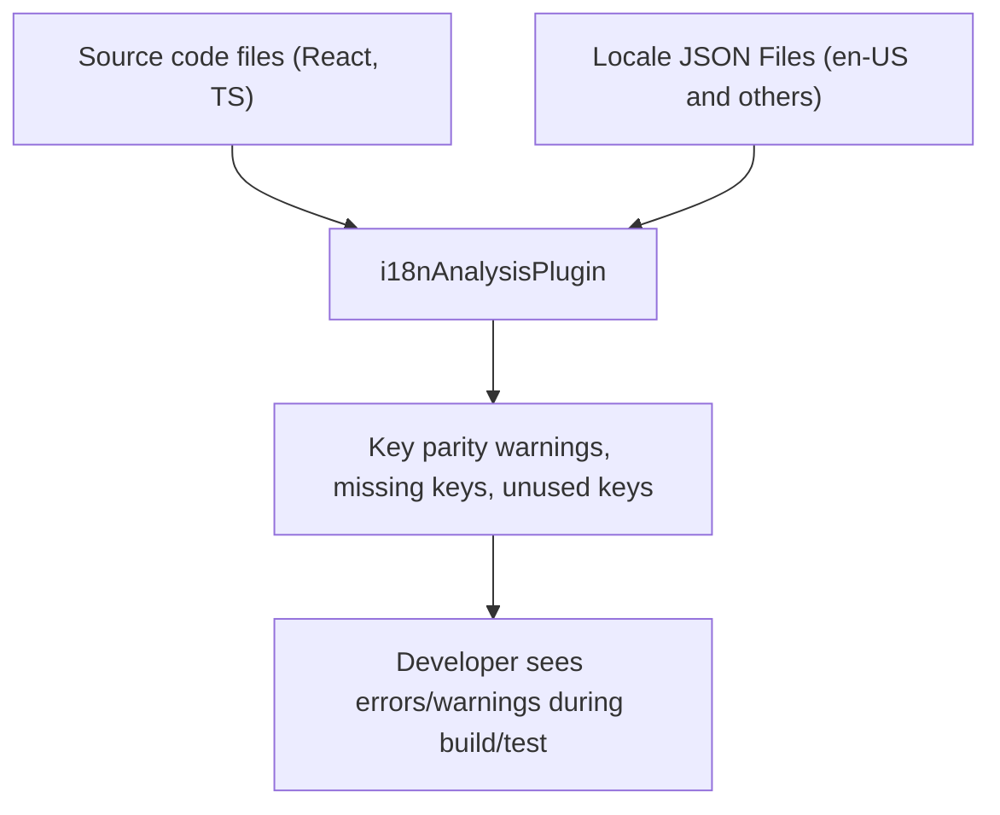
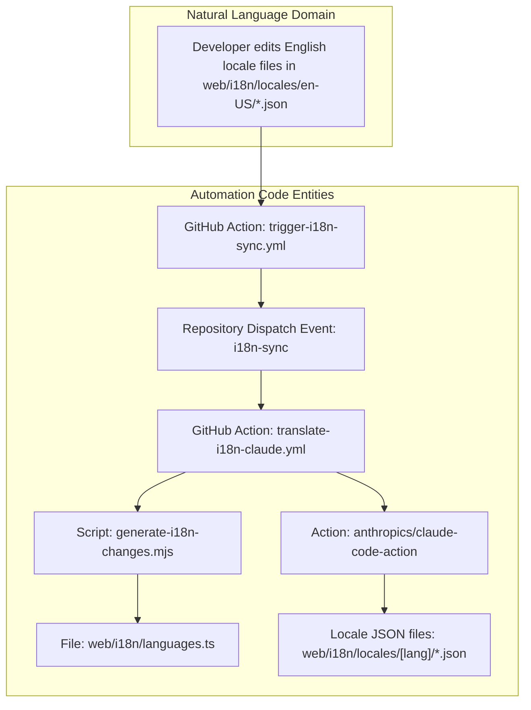
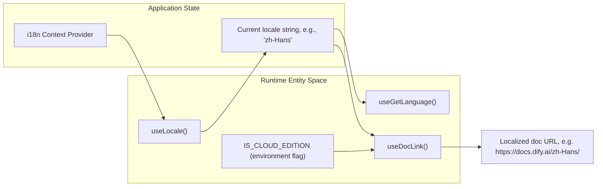
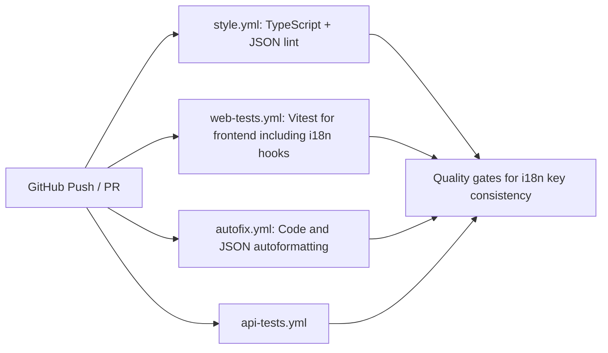

<!-- source: DeepWiki mcp.deepwiki.com · repo langgenius/dify · page 10.4 Internationalization (i18n) and Content Sync · fetched 2026-10-26 -->

# Internationalization (i18n) and Content Sync

<details>
<summary>Relevant source files</summary>

The following files were used as context for generating this wiki page:

- [.github/workflows/api-tests.yml](.github/workflows/api-tests.yml)
- [.github/workflows/autofix.yml](.github/workflows/autofix.yml)
- [.github/workflows/db-migration-test.yml](.github/workflows/db-migration-test.yml)
- [.github/workflows/main-ci.yml](.github/workflows/main-ci.yml)
- [.github/workflows/pyrefly-diff-comment.yml](.github/workflows/pyrefly-diff-comment.yml)
- [.github/workflows/pyrefly-diff.yml](.github/workflows/pyrefly-diff.yml)
- [.github/workflows/pyrefly-type-coverage-comment.yml](.github/workflows/pyrefly-type-coverage-comment.yml)
- [.github/workflows/pyrefly-type-coverage.yml](.github/workflows/pyrefly-type-coverage.yml)
- [.github/workflows/style.yml](.github/workflows/style.yml)
- [.github/workflows/tool-test-sdks.yaml](.github/workflows/tool-test-sdks.yaml)
- [.github/workflows/translate-i18n-claude.yml](.github/workflows/translate-i18n-claude.yml)
- [.github/workflows/trigger-i18n-sync.yml](.github/workflows/trigger-i18n-sync.yml)
- [.github/workflows/vdb-tests-full.yml](.github/workflows/vdb-tests-full.yml)
- [.github/workflows/vdb-tests.yml](.github/workflows/vdb-tests.yml)
- [.github/workflows/web-e2e.yml](.github/workflows/web-e2e.yml)
- [.github/workflows/web-tests.yml](.github/workflows/web-tests.yml)
- [web/app/components/workflow-app/hooks/__tests__/use-available-nodes-meta-data.spec.ts](web/app/components/workflow-app/hooks/__tests__/use-available-nodes-meta-data.spec.ts)
- [web/app/components/workflow-app/hooks/use-available-nodes-meta-data.ts](web/app/components/workflow-app/hooks/use-available-nodes-meta-data.ts)
- [web/app/components/workflow/__tests__/edge-insert-focus.browser.spec.tsx](web/app/components/workflow/__tests__/edge-insert-focus.browser.spec.tsx)
- [web/app/components/workflow/block-selector/marketplace-plugin/action.tsx](web/app/components/workflow/block-selector/marketplace-plugin/action.tsx)
- [web/app/components/workflow/header/chat-variable-button.tsx](web/app/components/workflow/header/chat-variable-button.tsx)
- [web/app/components/workflow/header/checklist/__tests__/index.spec.tsx](web/app/components/workflow/header/checklist/__tests__/index.spec.tsx)
- [web/app/components/workflow/header/checklist/__tests__/node-group.spec.tsx](web/app/components/workflow/header/checklist/__tests__/node-group.spec.tsx)
- [web/app/components/workflow/header/checklist/index.tsx](web/app/components/workflow/header/checklist/index.tsx)
- [web/app/components/workflow/header/checklist/node-group.tsx](web/app/components/workflow/header/checklist/node-group.tsx)
- [web/app/components/workflow/header/env-button.tsx](web/app/components/workflow/header/env-button.tsx)
- [web/app/components/workflow/header/global-variable-button.tsx](web/app/components/workflow/header/global-variable-button.tsx)
- [web/app/components/workflow/header/run-and-history.tsx](web/app/components/workflow/header/run-and-history.tsx)
- [web/app/components/workflow/hooks/__tests__/use-checklist.spec.ts](web/app/components/workflow/hooks/__tests__/use-checklist.spec.ts)
- [web/app/components/workflow/hooks/__tests__/use-edge-accessible-label.spec.tsx](web/app/components/workflow/hooks/__tests__/use-edge-accessible-label.spec.tsx)
- [web/app/components/workflow/hooks/use-checklist.ts](web/app/components/workflow/hooks/use-checklist.ts)
- [web/app/components/workflow/hooks/use-edge-accessible-label.ts](web/app/components/workflow/hooks/use-edge-accessible-label.ts)
- [web/app/components/workflow/hooks/use-nodes-available-var-list.ts](web/app/components/workflow/hooks/use-nodes-available-var-list.ts)
- [web/app/components/workflow/hooks/use-workflow-control-scale.ts](web/app/components/workflow/hooks/use-workflow-control-scale.ts)
- [web/app/components/workflow/nodes/_base/components/variable/utils.ts](web/app/components/workflow/nodes/_base/components/variable/utils.ts)
- [web/app/components/workflow/nodes/agent-v2/__tests__/default.spec.ts](web/app/components/workflow/nodes/agent-v2/__tests__/default.spec.ts)
- [web/app/components/workflow/nodes/agent-v2/default.ts](web/app/components/workflow/nodes/agent-v2/default.ts)
- [web/app/components/workflow/nodes/knowledge-retrieval/use-single-run-form-params.ts](web/app/components/workflow/nodes/knowledge-retrieval/use-single-run-form-params.ts)
- [web/app/components/workflow/nodes/llm/types.ts](web/app/components/workflow/nodes/llm/types.ts)
- [web/app/components/workflow/utils/gen-node-meta-data.ts](web/app/components/workflow/utils/gen-node-meta-data.ts)
- [web/context/i18n.spec.ts](web/context/i18n.spec.ts)
- [web/context/i18n.ts](web/context/i18n.ts)
- [web/features/agent-v2/agent-detail/configure/components/orchestrate/common/__tests__/tip-content.spec.tsx](web/features/agent-v2/agent-detail/configure/components/orchestrate/common/__tests__/tip-content.spec.tsx)
- [web/features/agent-v2/agent-detail/configure/components/orchestrate/common/tip-content.tsx](web/features/agent-v2/agent-detail/configure/components/orchestrate/common/tip-content.tsx)
- [web/hooks/use-api-access-url.ts](web/hooks/use-api-access-url.ts)
- [web/scripts/gen-doc-paths.ts](web/scripts/gen-doc-paths.ts)
- [web/types/doc-paths.ts](web/types/doc-paths.ts)

</details>


This page details Dify's internationalization (i18n) strategy, covering how locale files are structured, key parity enforcement via a custom Vite plugin, and continuous integration (CI) automation that keeps translations synchronized across the application. The goal is to provide a robust, maintainable, and scalable system for supporting multiple languages in the Dify web frontend.

---

## Locale File Structure

Dify's web frontend maintains translations using structured JSON files, where the English (`en-US`) locale files serve as the source of truth. Other language locales are translated variants following the same filenames and key structures.

- **Location:**  
  - English locale files reside under the directory:  
    ```
    web/i18n/locales/en-US/
    ```
  - Other languages (e.g., `ru-RU`, `fa-IR`, `de-DE`) have sibling directories with identical file names and structure for parity.  
    For example:  
    ```
    web/i18n/locales/ru-RU/
    web/i18n/locales/fa-IR/
    ```
    
- **File Granularity:**  
  Each JSON file represents a logical feature or UI segment. Examples include:  
  - `app.json`: App management-related strings  
  - `common.json`: Shared, generic UI strings

- **Supported Languages:**  
  Supported target languages (besides `en-US`) are explicitly declared with metadata such as display names and support flags in:  
  ```
  web/i18n/languages.ts
  ```
  Example supported locales are:  
  - `ru-RU` (Russian)  
  - `ro-RO` (Romanian)  
  - `fa-IR` (Persian)  
  - `de-DE` (German)  
  - `pt-BR` (Portuguese - Brazil)  
  - `ar-TN` (Arabic - Tunisia)  
  - `es-ES` (Spanish)  
  - `it-IT` (Italian)  
  - `fr-FR` (French)  
  - `pl-PL` (Polish)  

The system expects the key structure of translation JSON files for all locales to strictly match the English source files for consistent UI fallback and translation completeness.

Sources: [web/i18n/languages.ts:60-68](), [web/i18n/fa-IR/common.json:1-124]()

---

## Key Parity Enforcement via Vite Plugin

To enforce key parity and catch missing or unused translation keys statically, Dify integrates a Vite plugin named `i18nAnalysisPlugin`, implemented in the frontend build configuration.

### Implementation Highlights

- The plugin is registered in the `vite.config.ts` file within the `web/` directory, among other frontend plugins:

  ```ts
  import { i18nAnalysisPlugin } from './plugins/vite/i18n-analysis.ts'
  
  export default defineConfig(({ command, mode }) => {
    // ...
    plugins: [
      i18nAnalysisPlugin({
        adapters: [
          { module: 'i18n/lib.client.ts', exportName: 'useTranslation', namespaceArgument: 0 },
          {
            module: 'i18n/lib.server.ts',
            exportName: 'useTranslation',
            namespaceArgument: 0,
            implementationFunctions: ['getI18nConfig'],
          },
          { module: 'i18n/server.ts', exportName: 'getTranslation', namespaceArgument: 1 },
          {
            module: 'app/route-metadata.ts',
            exportName: 'getRouteMetadata',
            namespaceArgument: 0,
            selectorArgument: 1,
          },
        ],
        getDeclaredNamespaces: getDeclaredRouteNamespaces,
      }),
      // ... other plugins
    ]
  })
  ```
  
- The plugin scans source files for translation hook usage (`useTranslation` etc.) and extracts namespaces and keys for static analysis. It cross-references used translation keys with the locale JSON structures to ensure:
  - All keys used in code exist in the English source files
  - All English keys have corresponding keys in other locales

- It supports multiple adapter definitions specifying how translation functions are called and key namespaces are passed.

- The plugin thus serves as a static analysis layer during build and test, alerting developers to missing, deprecated, or unused translation keys.

### Data Flow



Sources: [web/vite.config.ts:44-63](), [web/plugins/vite/i18n-analysis.ts]()

---

## Automation and Translation Content Synchronization

Content synchronization of translated locale files is fully automated via GitHub Actions workflows. This ensures that translations are always kept up-to-date with English source updates, reducing manual synchronization overhead.

### Key Workflows

1. **`trigger-i18n-sync.yml`**  
   Watches for changes to English locale files (`web/i18n/locales/en-US/*.json`). When changes are detected, it triggers a repository dispatch event that activates the main translation sync workflow. This separation avoids redundant work and allows incremental syncing.
   Sources: [.github/workflows/trigger-i18n-sync.yml]()

2. **`translate-i18n-claude.yml`**  
   This workflow performs the translation sync using Claude LLM through the `anthropics/claude-code-action` GitHub Action. It:
   - Compares changed English keys vs previous commit (for incremental mode)
   - Translates only changed or specified keys into target languages
   - Commits updated translation JSON files back to the repo
   Sources: [.github/workflows/translate-i18n-claude.yml:1-366]()

### Synchronization Modes

| Mode         | Description                                                                                 | Trigger          |
|--------------|---------------------------------------------------------------------------------------------|------------------|
| Incremental  | Translates changed keys only, detected by diffing en-US files against previous commit.     | Automatic on patch or manual dispatch |
| Full         | Translates all keys in specified files to all target languages, ensuring full sync.         | Manual `workflow_dispatch`, requires files list |

### Preparation Steps in Workflow

- The workflow parses the supported language list from `web/i18n/languages.ts`, focusing on all except `en-US` [web/i18n/languages.ts:60-68]().
- Computes changed files and translation keys by running a Node.js script `generate-i18n-changes.mjs`, which produces a JSON object describing diffs between base and head commits [web/i18n/languages.ts:72-73]().
- Sets environment variables and CLI arguments for the Claude translation action, directing it to operate only on relevant files and keys [web/i18n/languages.ts:133-142]().

### Overall Data Flow Diagram: Translation Sync Automation


Sources: [.github/workflows/trigger-i18n-sync.yml](), [.github/workflows/translate-i18n-claude.yml:1-172](), [web/i18n/languages.ts:60-68]()

---

## Frontend I18n Hooks and Runtime Locale Resolution

Dify's React frontend accesses i18n translations via standard hooks and locale context, layered to provide locale granularity and product mode awareness.

### Main Hooks

- `useLocale()`: Returns the current active locale string (e.g. `"zh-Hans"`). It reflects user's language setting or browser preference.
- `useGetLanguage()`: Returns a language code derived from the locale string, typically the first part before region.
- `useDocLink()`: Creates localized documentation URLs depending on locale and product edition (Cloud or Self-host).

### Helper Function: `getProductAwarePath`

This internal function prefixes documentation paths with `/cloud` or `/self-host` base path, controlled by the app-level environment flag `IS_CLOUD_EDITION`.

### Runtime Resolution Diagram



Sources: [web/context/i18n.ts](), [web/hooks/use-api-access-url.ts]()

---

## CI Quality Assurance: Lint, Tests, and Style Enforcement

Ensuring translation consistency and i18n code health integrates tightly into Dify's CI pipeline.

### CI Jobs Related to i18n and Web Code

- **Style Checks (`style.yml`)**:
  - Runs TypeScript style linter (`vp run lint:tss`) on `web/` including i18n files [web/i18n/languages.ts:173]().
  - Executes `knip` dead code analysis to detect unused imports and declarations [web/i18n/languages.ts:176-181]().
  - These steps help maintain i18n JSON and TS code quality.
  Sources: [.github/workflows/style.yml:173-187]()

- **Web Tests (`web-tests.yml`)**:
  - Runs Vitest unit tests for the web frontend including tests validating i18n hooks and logic [web/app/components/workflow/hooks/__tests__/use-checklist.spec.ts](), [web/app/components/workflow-app/hooks/__tests__/use-available-nodes-meta-data.spec.ts](), [web/app/components/workflow/header/checklist/__tests__/index.spec.ts](), [web/app/components/workflow/header/checklist/__tests__/node-group.spec.ts](), [web/app/components/workflow/hooks/__tests__/use-edge-accessible-label.spec.ts]().
  - Supports sharding (splitting tests into parts) for faster runs [web/app/components/workflow/hooks/__tests__/use-checklist.spec.ts:19-20]().
  Sources: [.github/workflows/web-tests.yml:1-80]()

- **Autofix (`autofix.yml`)**:
  - Automatically applies code format fixes and lint autofixes in Python and web code, including i18n JSON files.
  - Runs formatters such as `ruff` for Python and `eslint` for TS/JS.
  Sources: [.github/workflows/autofix.yml:1-142]()

- **API Tests (`api-tests.yml`)**:
  - Runs backend tests that include checks on localization-related API behavior and environmental consistency.
  Sources: [.github/workflows/api-tests.yml:1-130]()

### Automation Summary Diagram: CI i18n Quality and Sync



Sources: [.github/workflows/style.yml:110-150](), [.github/workflows/web-tests.yml:1-80](), [.github/workflows/autofix.yml:1-142](), [.github/workflows/api-tests.yml:1-130]()

---

# Summary

Dify's internationalization and content sync system consists of:

- A structured locale file organization with English as source of truth.
- Key parity enforcement during build by a Vite plugin analyzing i18n usage.
- Automated synchronization of translations using CI workflows that leverage an LLM-powered translation action.
- Frontend React hooks layered on an i18n context supporting runtime locale switching and product mode awareness.
- Extensive testing and linting in the CI pipeline to maintain i18n key quality and code health.

This architecture enables scalable multi-lingual support with high confidence in translation accuracy, completeness, and developer productivity.

---

# References

- [Locale Structure and Supported Languages](web/i18n/languages.ts:60-68)  
- [Vite Config with i18n Analysis Plugin](web/vite.config.ts:44-63)  
- [Translation Sync Workflow with Claude](.github/workflows/translate-i18n-claude.yml:1-172)  
- [Trigger i18n Sync Workflow](.github/workflows/trigger-i18n-sync.yml)  
- [Style Linting Workflow](.github/workflows/style.yml:110-150)  
- [Web Tests Workflow](.github/workflows/web-tests.yml:1-80)  
- [Autofix Workflow](.github/workflows/autofix.yml:1-150)  
- [API Tests Workflow](.github/workflows/api-tests.yml:1-130)

---

