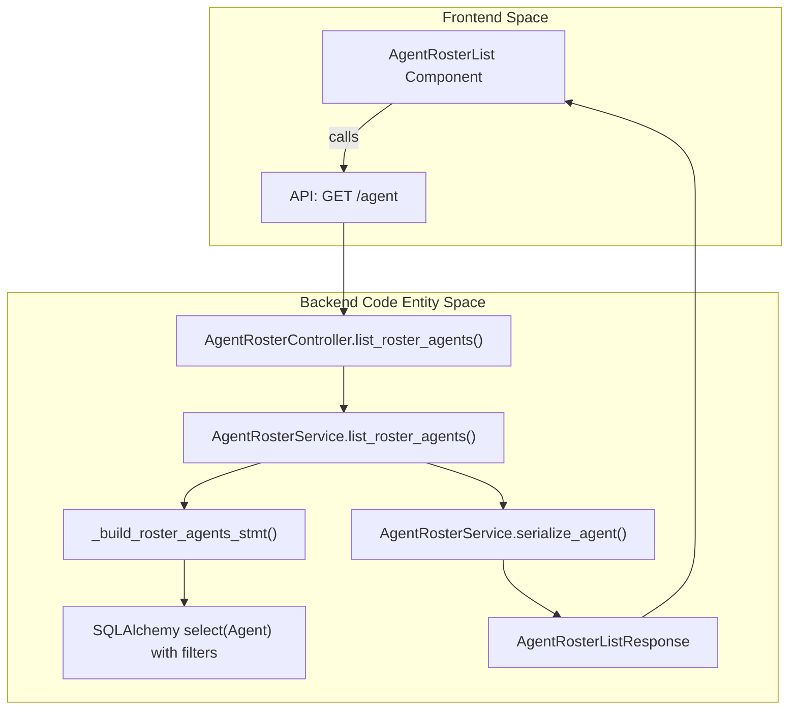
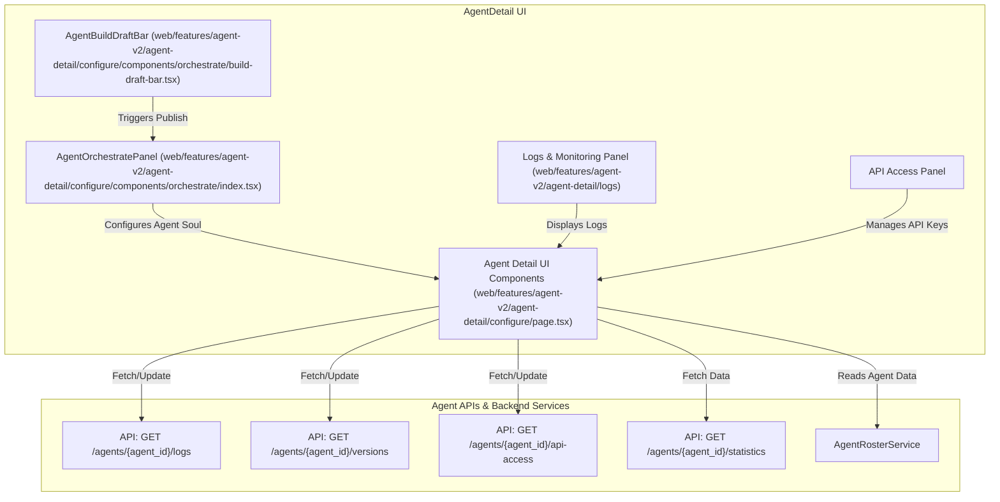

<!-- source: DeepWiki mcp.deepwiki.com · repo langgenius/dify · page 10.5 Agent V2 Frontend — Roster, Composer, and Detail Views · fetched 2026-10-26 -->

# Agent V2 Frontend — Roster, Composer, and Detail Views

<details>
<summary>Relevant source files</summary>

The following files were used as context for generating this wiki page:

- [packages/dify-ui/docs/selection.md](packages/dify-ui/docs/selection.md)
- [packages/dify-ui/src/combobox/index.stories.tsx](packages/dify-ui/src/combobox/index.stories.tsx)
- [packages/dify-ui/src/select/index.stories.tsx](packages/dify-ui/src/select/index.stories.tsx)
- [web/app/components/api-key/dataset-scope-dialog.tsx](web/app/components/api-key/dataset-scope-dialog.tsx)
- [web/app/components/apps/creators-filter.tsx](web/app/components/apps/creators-filter.tsx)
- [web/app/components/datasets/common/document-picker/document-list.tsx](web/app/components/datasets/common/document-picker/document-list.tsx)
- [web/app/components/datasets/common/document-picker/index.tsx](web/app/components/datasets/common/document-picker/index.tsx)
- [web/app/components/plugins/plugin-detail-panel/app-selector/__tests__/index.spec.tsx](web/app/components/plugins/plugin-detail-panel/app-selector/__tests__/index.spec.tsx)
- [web/app/components/plugins/plugin-detail-panel/app-selector/app-picker.tsx](web/app/components/plugins/plugin-detail-panel/app-selector/app-picker.tsx)
- [web/app/components/plugins/plugin-detail-panel/app-selector/index.tsx](web/app/components/plugins/plugin-detail-panel/app-selector/index.tsx)
- [web/app/components/workflow/nodes/agent-v2/__tests__/hooks.spec.tsx](web/app/components/workflow/nodes/agent-v2/__tests__/hooks.spec.tsx)
- [web/app/components/workflow/nodes/agent-v2/agent-soul-config.ts](web/app/components/workflow/nodes/agent-v2/agent-soul-config.ts)
- [web/app/components/workflow/nodes/agent-v2/components/__tests__/agent-orchestrate-panel-content.spec.tsx](web/app/components/workflow/nodes/agent-v2/components/__tests__/agent-orchestrate-panel-content.spec.tsx)
- [web/app/components/workflow/nodes/agent-v2/components/agent-orchestrate-panel-content.tsx](web/app/components/workflow/nodes/agent-v2/components/agent-orchestrate-panel-content.tsx)
- [web/app/components/workflow/nodes/agent-v2/hooks.ts](web/app/components/workflow/nodes/agent-v2/hooks.ts)
- [web/features/agent-v2/agent-composer/provider.tsx](web/features/agent-v2/agent-composer/provider.tsx)
- [web/features/agent-v2/agent-detail/configure/__tests__/page.spec.tsx](web/features/agent-v2/agent-detail/configure/__tests__/page.spec.tsx)
- [web/features/agent-v2/agent-detail/configure/__tests__/use-agent-configure-sync.spec.tsx](web/features/agent-v2/agent-detail/configure/__tests__/use-agent-configure-sync.spec.tsx)
- [web/features/agent-v2/agent-detail/configure/components/composer-session.tsx](web/features/agent-v2/agent-detail/configure/components/composer-session.tsx)
- [web/features/agent-v2/agent-detail/configure/components/orchestrate/index.tsx](web/features/agent-v2/agent-detail/configure/components/orchestrate/index.tsx)
- [web/features/agent-v2/agent-detail/configure/components/orchestrate/model-config/__tests__/field.spec.tsx](web/features/agent-v2/agent-detail/configure/components/orchestrate/model-config/__tests__/field.spec.tsx)
- [web/features/agent-v2/agent-detail/configure/components/orchestrate/model-config/field.tsx](web/features/agent-v2/agent-detail/configure/components/orchestrate/model-config/field.tsx)
- [web/features/agent-v2/agent-detail/configure/page.tsx](web/features/agent-v2/agent-detail/configure/page.tsx)
- [web/features/agent-v2/agent-detail/configure/use-agent-configure-build-draft.ts](web/features/agent-v2/agent-detail/configure/use-agent-configure-build-draft.ts)
- [web/features/agent-v2/agent-detail/configure/use-agent-configure-sync.ts](web/features/agent-v2/agent-detail/configure/use-agent-configure-sync.ts)
- [web/features/agent-v2/agent-detail/logs/components/source-picker.tsx](web/features/agent-v2/agent-detail/logs/components/source-picker.tsx)
- [web/features/agent-v2/analytics.ts](web/features/agent-v2/analytics.ts)
- [web/features/skills/detail/skill-metadata.tsx](web/features/skills/detail/skill-metadata.tsx)
- [web/features/tag-management/__tests__/tag-filter.spec.tsx](web/features/tag-management/__tests__/tag-filter.spec.tsx)
- [web/features/tag-management/__tests__/tag-item-editor.spec.tsx](web/features/tag-management/__tests__/tag-item-editor.spec.tsx)
- [web/features/tag-management/__tests__/tag-management-modal.spec.tsx](web/features/tag-management/__tests__/tag-management-modal.spec.tsx)
- [web/features/tag-management/__tests__/tag-search-content.spec.tsx](web/features/tag-management/__tests__/tag-search-content.spec.tsx)
- [web/features/tag-management/__tests__/tag-selector.spec.tsx](web/features/tag-management/__tests__/tag-selector.spec.tsx)
- [web/features/tag-management/components/app-card-tags.tsx](web/features/tag-management/components/app-card-tags.tsx)
- [web/features/tag-management/components/dataset-card-tags.tsx](web/features/tag-management/components/dataset-card-tags.tsx)
- [web/features/tag-management/components/tag-filter.tsx](web/features/tag-management/components/tag-filter.tsx)
- [web/features/tag-management/components/tag-item-editor.tsx](web/features/tag-management/components/tag-item-editor.tsx)
- [web/features/tag-management/components/tag-management-modal.tsx](web/features/tag-management/components/tag-management-modal.tsx)
- [web/features/tag-management/components/tag-search-content.tsx](web/features/tag-management/components/tag-search-content.tsx)
- [web/features/tag-management/components/tag-selector.tsx](web/features/tag-management/components/tag-selector.tsx)
- [web/features/tag-management/hooks/__tests__/use-tag-mutations.spec.tsx](web/features/tag-management/hooks/__tests__/use-tag-mutations.spec.tsx)
- [web/features/tag-management/hooks/use-tag-mutations.ts](web/features/tag-management/hooks/use-tag-mutations.ts)

</details>


This page details how the Agent V2 frontend features are implemented under `web/features/agent-v2`. It focuses on three main areas:

- The **Agent Roster** view: the UI listing all agents.
- The **Agent Composer** UI: the interface for creating and editing agent configurations (referred to as the "agent soul").
- The **Agent Detail** views: detailed configuration panels including versions, logs, monitoring, API access, and publishing UX.

Additionally, it explains how Jotai atoms and React hooks orchestrate managing the draft and published states of agent configurations, enabling smooth editing and version control.

---

## 1. Agent Roster View

The Agent Roster lists all agents in the current workspace, allowing users to browse, select, and manage agents.

### 1.1 Backend and Frontend Interaction

- The frontend calls the `GET /agent` API endpoint to retrieve the roster list.
- The backend's `AgentRosterService.list_roster_agents` method fetches agents scoped as ROSTER and ACTIVE for the tenant, allowing keyword filtering and ordering by last updated time.
- Agents are serialized with comprehensive metadata, including active config snapshot info and publish status.

### 1.2 Frontend Component

- The roster list is rendered by a React component (not shown fully here) consuming the backend API data.
- Agents show key fields such as name, description, role, icon, status, scope, and relevant snapshots.

### 1.3 Data Flow Diagram



Sources:
- [api/controllers/console/agent/roster.py:218-243]()
- [api/services/agent/roster_service.py:171-210]()
- [api/fields/agent_fields.py:114-120]()

---

## 2. Agent Composer (Soul Config Editor)

The Agent Composer UI is the core tool for configuring an agent’s "soul," which includes the model, prompts, tools, knowledge sources, and memory settings.

### 2.1 Backend Composer Services and Save Strategies

- Editing may happen in two modes: `agent_app` (roster agent) or `workflow` (inline agent in a workflow node).
- Backend's `AgentComposerService` provides:
  - Loading drafts and versions.
  - Saving with different strategies:
    - `node_job_only`: Save only the node job config.
    - `save_to_roster`: Promote inline agent to roster.
    - `save_as_new_version`: Publish a new version.
    - `save_to_current_version`: Update current roster version.

These orchestrate the persistence and promotion of agent configurations.

### 2.2 Frontend State Management with Jotai and React

- The frontend represents agent configs as `AgentSoulConfigFormState` atoms.
- Key states include:
  - **Draft atom**: editable live draft, managed by `agentComposerDraftAtom` [web/features/agent-v2/agent-composer/store/index.ts]().
  - **Saved Draft atom**: the last successfully saved draft, managed by `agentComposerSavedDraftAtom` [web/features/agent-v2/agent-composer/store/index.ts]().
  - **Save strategy atom**: controls save/publish semantics.
- `agentSoulConfigToFormState` converts backend soul config to UI form state [web/features/agent-v2/agent-composer/conversions.ts:17-20]().
- `useAgentConfigureSync` hook manages synchronization and autosave/draft publishing flows, enforcing permissions and validation [web/features/agent-v2/agent-detail/configure/use-agent-configure-sync.ts:45-51](). This hook uses `saveComposerDraft` [web/features/agent-v2/agent-detail/configure/use-agent-configure-sync.ts:105-111]() and `publishAgent` [web/features/agent-v2/agent-detail/configure/use-agent-configure-sync.ts:120-126]() mutations.

### 2.3 Composer UI Scope

- `AgentConfigureComposerScope` component in `agent-detail/configure/components/composer-session.tsx` encapsulates hydration, mutation, sync, and UI rendering [web/features/agent-v2/agent-detail/configure/components/composer-session.tsx:56-74]().
- It handles loading state, switching between build and preview modes, preview version selectors, and manages draft lifecycle.
- The `AgentComposerProvider` [web/features/agent-v2/agent-composer/provider.tsx:17-20]() initializes the Jotai store with the initial draft.

### 2.4 Diagram: Agent Composer State Management and Flow

```mermaid
graph TD
    subgraph FrontendState["Frontend (Jotai & React)"]
        DraftAtom["agentComposerDraftAtom (Editable Draft State)"]
        SavedDraftAtom["agentComposerSavedDraftAtom (Last Saved Draft)"]
        ComposerUI["AgentComposer UI Components"]
        SyncHooks["useAgentConfigureSync"]
        SessionController["useAgentConfigureSessionController"]
    end

    subgraph BackendService["Backend Service"]
        AgentComposerService["AgentComposerService.save_workflow_composer"]
        DraftAPI["API: PUT /agents/{agent_id}/composer"]
        PublishAPI["API: POST /agents/{agent_id}/publish"]
    end

    ComposerUI -->|Reads/Writes Draft State| DraftAtom
    ComposerUI -->|Reads Last Saved Draft| SavedDraftAtom
    SyncHooks -->|Monitors DraftAtom for changes| DraftAtom
    SyncHooks -->|Updates SavedDraftAtom on successful save| SavedDraftAtom
    SyncHooks -->|Calls DraftAPI to save draft| DraftAPI
    SyncHooks -->|Calls PublishAPI to publish| PublishAPI
    SessionController -->|Manages UI mode (build/preview)| ComposerUI
    DraftAPI --> AgentComposerService
    PublishAPI --> AgentComposerService
```

Sources:
- [api/services/agent/composer_service.py:74-148]()
- [packages/contracts/generated/api/console/agent/types.gen.ts:133-149]()
- [web/features/agent-v2/agent-detail/configure/components/composer-session.tsx:56-74]()
- [web/features/agent-v2/agent-detail/configure/use-agent-configure-sync.ts:45-51]()
- [web/features/agent-v2/agent-composer/store/index.ts]()
- [web/features/agent-v2/agent-composer/conversions.ts:17-20]()
- [web/features/agent-v2/agent-detail/configure/use-agent-configure-sync.ts:105-111]()
- [web/features/agent-v2/agent-detail/configure/use-agent-configure-sync.ts:120-126]()
- [web/features/agent-v2/agent-composer/provider.tsx:17-20]()

---

## 3. Agent Detail Views

Agent Detail presents a comprehensive control center for a specific agent, including editing, version history, logs, monitoring data, and API access management.

### 3.1 Configuration, Versions, and Publishing

- Versions are listed via `GET /agent/{agent_id}/versions`.
- Users can restore versions (`POST /agent/{agent_id}/versions/{version_id}/restore`).
- Publishing and draft state changes are managed via the `AgentConfigurePublishBar` component [web/features/agent-v2/agent-detail/configure/components/orchestrate/build-draft-bar.tsx]().
- Publish bar integrates with hotkeys and confirms publishing impact with workflow references checks.
- The `AgentOrchestratePanel` component wraps the main configuration UI including model selector, prompt editor, tools config, and advanced settings [web/features/agent-v2/agent-detail/configure/components/orchestrate/index.tsx]().

### 3.2 Logs and Monitoring

- Logs and conversations fetch via dedicated endpoints.
- Statistics are retrieved for dashboards.
- UI components display these details side-by-side with config editors. For example, `SourcePicker` [web/features/agent-v2/agent-detail/logs/components/source-picker.tsx]() is used for log filtering.

### 3.3 API Key and Access Management

- API enable/disable toggles, key creation, and listing are exposed in the UI.
- Backend contracts for API access are imported from generated types.

### 3.4 Checklist and Validation

- The `useChecklist` hook validates tool presence, model configuration, and inline agent bindings.
- Warnings/errors feed back into UI prompts during configuration.
- `validateKnowledgeRetrievals` [web/features/agent-v2/agent-detail/configure/use-agent-configure-sync.ts:23-24]() is used for knowledge validation.
- `getAgentToolPublishIssue` [web/features/agent-v2/agent-detail/configure/use-agent-configure-sync.ts:33-35]() checks for tool-related issues before publishing.

### 3.5 Data Flow Diagram: Detail Views Integration



Sources:
- [api/tests/unit_tests/controllers/console/agent/test_agent_controllers.py:28-57]()
- [packages/contracts/generated/api/console/agent/types.gen.ts:81-97]()
- [web/features/agent-v2/agent-detail/configure/components/orchestrate/index.tsx]()
- [web/features/agent-v2/agent-detail/configure/components/orchestrate/build-draft-bar.tsx]()
- [web/features/agent-v2/agent-detail/logs/components/source-picker.tsx]()
- [web/features/agent-v2/agent-detail/configure/use-agent-configure-sync.ts:23-24]()
- [web/features/agent-v2/agent-detail/configure/use-agent-configure-sync.ts:33-35]()

---

# Appendix: Mapping Natural Language to Code Entities

This section provides a conceptual bridge between domain concepts and corresponding code entities/components for easier navigation.

```mermaid
graph TD
    "Agent Roster UI" -->|calls| "API: GET /agent"
    "API: GET /agent" --> "AgentRosterController.list_roster_agents()"
    "AgentRosterController" --> "AgentRosterService.list_roster_agents()"
    "AgentRosterService" --> "Agent ORM Model"
    "Agent ORM Model" --> "AgentConfigSnapshot ORM Model"

    "Agent Composer UI" -->|loads/saves| "AgentComposerService"
    "AgentComposerService" -->|manages| "AgentConfigDraft", "AgentConfigSnapshot", "WorkflowAgentNodeBinding"
    "AgentComposer UI" -->|converts via| "agentSoulConfigToFormState (web/features/agent-v2/agent-composer/conversions.ts)"
```

```mermaid
graph TD
    "Agent Detail UI (web/features/agent-v2/agent-detail/configure/page.tsx)" -->|interacts with| "Agent API endpoints"
    "Agent API endpoints" --> "AgentLogsApi"
    "Agent API endpoints" --> "AgentRosterVersionsApi"
    "Agent API endpoints" --> "AgentApiAccessApi"
    "Agent API endpoints" --> "AgentStatisticsSummaryApi"
    "Agent API endpoints" --> "AgentRosterService"
```

---

# Summary

- The **Agent Roster** fetches, filters, and displays agents using backend roster services and API.
- The **Agent Composer** provides a reactive UI for configuring agent souls, maintaining draft and published states with Jotai atoms and React hooks, syncing edits to the backend with flexible save strategies.
- The **Agent Detail** views layer detailed configuration, version management, logs, API access, and publishing UX into a cohesive frontend, backed by dedicated API endpoints and service components.
- The architecture effectively bridges domain concepts to code entities, facilitating maintainability and feature evolution.

Sources:

- [api/controllers/console/agent/roster.py:218-243]()
- [api/services/agent/roster_service.py:171-210]()
- [api/services/agent/composer_service.py:74-148]()
- [packages/contracts/generated/api/console/agent/types.gen.ts:133-149]()
- [web/features/agent-v2/agent-detail/configure/components/composer-session.tsx]()
- [web/features/agent-v2/agent-detail/configure/use-agent-configure-sync.ts]()
- [web/features/agent-v2/agent-detail/configure/components/orchestrate/index.tsx]()
- [web/features/agent-v2/agent-detail/configure/components/orchestrate/build-draft-bar.tsx]()
- [api/tests/unit_tests/controllers/console/agent/test_agent_controllers.py:28-57]()
- [web/app/components/workflow/hooks/use-checklist.ts:35-65,150-180]()

---

