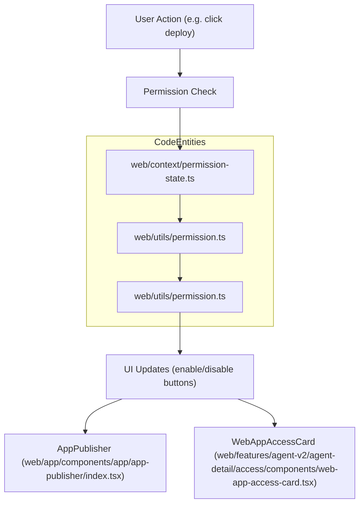
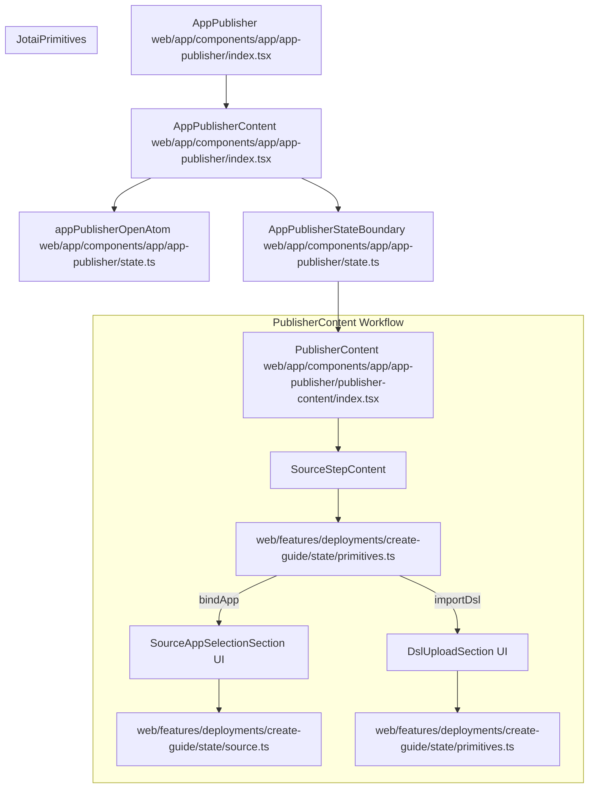

<!-- source: DeepWiki mcp.deepwiki.com · repo langgenius/dify · page 10.6 Deployments Feature — Releases, Environments, and Access Control · fetched 2026-10-26 -->

# Deployments Feature — Releases, Environments, and Access Control

Relevant source files

The following files were used as context for generating this wiki page:

- [web/app/components/app/__tests__/app-detail-loading.spec.tsx](web/app/components/app/__tests__/app-detail-loading.spec.tsx)
- [web/app/components/app/access-point/__tests__/built-in-access-points.spec.tsx](web/app/components/app/access-point/__tests__/built-in-access-points.spec.tsx)
- [web/app/components/app/access-point/__tests__/environment-access-point-cards.spec.tsx](web/app/components/app/access-point/__tests__/environment-access-point-cards.spec.tsx)
- [web/app/components/app/access-point/__tests__/use-access-point-actions.spec.ts](web/app/components/app/access-point/__tests__/use-access-point-actions.spec.ts)
- [web/app/components/app/access-point/__tests__/web-app-card.spec.tsx](web/app/components/app/access-point/__tests__/web-app-card.spec.tsx)
- [web/app/components/app/access-point/built-in-access-points/index.tsx](web/app/components/app/access-point/built-in-access-points/index.tsx)
- [web/app/components/app/access-point/built-in-access-points/web-app-card.tsx](web/app/components/app/access-point/built-in-access-points/web-app-card.tsx)
- [web/app/components/app/access-point/deployed-environment-access-points/environment-web-app-card.tsx](web/app/components/app/access-point/deployed-environment-access-points/environment-web-app-card.tsx)
- [web/app/components/app/access-point/shared/use-access-point-actions.ts](web/app/components/app/access-point/shared/use-access-point-actions.ts)
- [web/app/components/app/app-publisher/__tests__/features-wrapper.spec.tsx](web/app/components/app/app-publisher/__tests__/features-wrapper.spec.tsx)
- [web/app/components/app/app-publisher/__tests__/index.spec.tsx](web/app/components/app/app-publisher/__tests__/index.spec.tsx)
- [web/app/components/app/app-publisher/features-wrapper.tsx](web/app/components/app/app-publisher/features-wrapper.tsx)
- [web/app/components/app/app-publisher/index.tsx](web/app/components/app/app-publisher/index.tsx)
- [web/app/components/app/app-publisher/publisher-content/index.tsx](web/app/components/app/app-publisher/publisher-content/index.tsx)
- [web/app/components/app/app-publisher/publisher-content/use-publish-controller.ts](web/app/components/app/app-publisher/publisher-content/use-publish-controller.ts)
- [web/app/components/app/app-publisher/types.ts](web/app/components/app/app-publisher/types.ts)
- [web/app/components/app/overview/settings/__tests__/settings-dialog.browser.spec.tsx](web/app/components/app/overview/settings/__tests__/settings-dialog.browser.spec.tsx)
- [web/app/components/base/app-icon/__tests__/index.spec.tsx](web/app/components/base/app-icon/__tests__/index.spec.tsx)
- [web/app/components/base/app-icon/index.stories.tsx](web/app/components/base/app-icon/index.stories.tsx)
- [web/app/components/base/app-icon/index.tsx](web/app/components/base/app-icon/index.tsx)
- [web/app/components/datasets/create-from-pipeline/list/template-card/details/__tests__/index.spec.tsx](web/app/components/datasets/create-from-pipeline/list/template-card/details/__tests__/index.spec.tsx)
- [web/app/components/datasets/create-from-pipeline/list/template-card/details/index.tsx](web/app/components/datasets/create-from-pipeline/list/template-card/details/index.tsx)
- [web/app/components/datasets/create-from-pipeline/list/template-card/edit-pipeline-info.tsx](web/app/components/datasets/create-from-pipeline/list/template-card/edit-pipeline-info.tsx)
- [web/app/components/datasets/rename-modal/index.tsx](web/app/components/datasets/rename-modal/index.tsx)
- [web/app/components/plugins/card/base/card-icon.tsx](web/app/components/plugins/card/base/card-icon.tsx)
- [web/app/components/tools/mcp/__tests__/modal.spec.tsx](web/app/components/tools/mcp/__tests__/modal.spec.tsx)
- [web/app/components/tools/mcp/modal.tsx](web/app/components/tools/mcp/modal.tsx)
- [web/app/components/tools/workflow-tool/__tests__/index.spec.tsx](web/app/components/tools/workflow-tool/__tests__/index.spec.tsx)
- [web/app/components/tools/workflow-tool/__tests__/method-selector.spec.tsx](web/app/components/tools/workflow-tool/__tests__/method-selector.spec.tsx)
- [web/app/components/tools/workflow-tool/confirm-modal/__tests__/index.spec.tsx](web/app/components/tools/workflow-tool/confirm-modal/__tests__/index.spec.tsx)
- [web/app/components/tools/workflow-tool/confirm-modal/index.tsx](web/app/components/tools/workflow-tool/confirm-modal/index.tsx)
- [web/app/components/tools/workflow-tool/hooks/__tests__/use-configure-button.spec.ts](web/app/components/tools/workflow-tool/hooks/__tests__/use-configure-button.spec.ts)
- [web/app/components/tools/workflow-tool/hooks/use-configure-button.ts](web/app/components/tools/workflow-tool/hooks/use-configure-button.ts)
- [web/app/components/tools/workflow-tool/index.tsx](web/app/components/tools/workflow-tool/index.tsx)
- [web/app/components/tools/workflow-tool/method-selector.tsx](web/app/components/tools/workflow-tool/method-selector.tsx)
- [web/app/components/tools/workflow-tool/utils.ts](web/app/components/tools/workflow-tool/utils.ts)
- [web/app/components/workflow-app/components/workflow-header/__tests__/features-trigger.spec.tsx](web/app/components/workflow-app/components/workflow-header/__tests__/features-trigger.spec.tsx)
- [web/app/components/workflow-app/components/workflow-header/features-trigger.tsx](web/app/components/workflow-app/components/workflow-header/features-trigger.tsx)
- [web/app/signin/components/sso-auth.tsx](web/app/signin/components/sso-auth.tsx)
- [web/features/agent-v2/agent-detail/access/components/__tests__/access-surface-cards.spec.tsx](web/features/agent-v2/agent-detail/access/components/__tests__/access-surface-cards.spec.tsx)
- [web/features/agent-v2/agent-detail/access/components/web-app-access-card.tsx](web/features/agent-v2/agent-detail/access/components/web-app-access-card.tsx)
- [web/hooks/use-async-window-open.spec.ts](web/hooks/use-async-window-open.spec.ts)
- [web/hooks/use-async-window-open.ts](web/hooks/use-async-window-open.ts)

This page provides a comprehensive technical overview of the **Deployments** feature within the Dify web frontend (`web/features/deployments`). It explains how the system manages application releases, environment-specific deployments, access channels, and enforces fine-grained permission policies per environment. The feature integrates tightly with backend API contracts and leverages advanced state management in the frontend using `jotai` atoms combined with `tanstack-query`.

---

## Overview of Deployments Feature

The Deployments feature organizes the lifecycle and accessibility of applications in a multi-environment, multi-release context. It supports:

-   **Releases:** Immutable snapshots of an application's configuration (including DSL, workflow nodes, prompts, variables). Releases facilitate version history and deployment rollbacks.
-   **Environments:** Logical deployment targets (e.g., Production, Staging, Development) hosting distinct releases. Each environment allows tailored configuration and access control.
-   **Access Channels:** Interfaces like the Web App frontend and CLI (`difyctl`) through which users interact with deployed apps.
-   **Permission Policies:** Role-based access control (RBAC) at environment and app levels to govern who can deploy, view, or use apps.
-   **DSL Import/Export:** Tools for migrating application logic across environments or tenants by serializing app state in YAML format.

The frontend implementation uses `jotai` atoms for granular state management of complex deployment flows and integrates with `tanstack-query` for server data fetching with infinite scroll and real-time updates.

**Key Code Locations:**

| Aspect                | Location(s)                                                      |
|-----------------------|-----------------------------------------------------------------|
| AppPublisher entry UI | `web/app/components/app/app-publisher/index.tsx`                |
| SourceAppPicker UI    | `web/features/deployments/create-release/ui/source-app-picker.tsx` |
| DSL Import/Export     | `web/service/apps.ts`                                           |
| Access Control Models | `web/models/access-control.ts`                                  |

---

## Backend Release and Deployment Management

### App Releases

An **App Release** represents a stable, immutable snapshot of an app’s configuration at a point in time. Releases include all relevant DSL defining workflows, nodes, variables, and prompts.

-   Releases are created from app drafts, locking the current state for production deployment.
-   The `AppPublisher` component triggers release creation, optionally overriding model parameters or including workflow DSL snapshots. [web/app/components/app/app-publisher/index.tsx:15-65]()
-   Workflow and advanced chat modes have special handlers ensuring workflow graphs are correctly captured as part of releases. [web/app/components/app/app-publisher/index.tsx:47-50]()
-   Releases support export as DSL YAML files for portability or external versioning.

**Import Modes** for DSL include:

-   `YAML_CONTENT`: Direct content import inline.
-   `REMOTE_URL`: Import from an accessible remote YAML URL.

These modes allow flexible integration with external toolchains or CI/CD pipelines.

### Deployment Flow

A typical deployment involves:

1.  Creating a release from an app draft.
2.  Binding a release to an environment (e.g., “Production”).
3.  Configuring environment-specific parameters and access policies.
4.  Publishing the environment to make the release publicly available.

Key backend service functions (called from frontend or API) include:

| Function                        | Description                                               |
|--------------------------------|-----------------------------------------------------------|
| `fetchAppDetail(appId)`         | Fetch detailed app metadata including current release.    |
| `publishToCreatorsPlatform()`  | Publish app to external creator discovery platform.        |
| `updateAppModelConfig()`        | Customize model parameters within an app or environment.  |

These granular operations are orchestrated by frontend components like `AppPublisher`.

---

## Access Control and Permission Policies

### Access Modes

Deployment environments adopt different access levels defined by `AccessMode` (an enum), enabling flexible visibility:

-   **PUBLIC:** Anyone with a link can access the deployed app. [web/models/access-control:14-17]()
-   **ORGANIZATION:** Access restricted to workspace/tenant members. [web/models/access-control:14-17]()
-   **SPECIFIC_GROUPS_MEMBERS:** Only user-specified groups or members can access. [web/models/access-control:14-17]()
-   **EXTERNAL_MEMBERS:** External collaborators granted controlled access. [web/models/access-control:14-17]()

Access control state is managed via React context and React Query hooks, integrating with backend RBAC enforcement. The `ACCESS_MODE_ICON_MAP` and `ACCESS_MODE_LABEL_MAP` in `web/app/components/app/access-point/built-in-access-points/web-app-card.tsx` [web/app/components/app/access-point/built-in-access-points/web-app-card.tsx:48-60]() and `web/app/components/app/access-point/deployed-environment-access-points/environment-web-app-card.tsx` [web/app/components/app/access-point/deployed-environment-access-points/environment-web-app-card.tsx:33-38]() illustrate how these modes are represented in the UI.

### RBAC Enforcement on Frontend

Frontend package `web/context/permission-state.ts` exposes `workspacePermissionKeysAtom` to manage user permission keys. [web/context/permission-state:1-60]()

-   Hooks like `useGetUserCanAccessApp` query backend authorization. [web/app/components/app/access-point/built-in-access-points/web-app-card.tsx:138]()
-   The utility `getAppACLCapabilities` interprets permission keys, current user ID, and maintainer info to decide UI capabilities like deployment and access settings. [web/app/components/app/app-publisher/index.tsx:41-45]()
-   UI components including `WebAppAccessCard` [web/features/agent-v2/agent-detail/access/components/web-app-access-card.tsx:34-38]() and `AppPublisher` [web/app/components/app/app-publisher/index.tsx:15-65]() toggle visibility and enable/disable operations based on permission results.

**Frontend Authorization Flow Diagram**

Sources:
[web/app/components/app/app-publisher/index.tsx:41-45]()
[web/features/agent-v2/agent-detail/access/components/web-app-access-card.tsx:55]()
[web/app/components/app/access-point/built-in-access-points/web-app-card.tsx:138]()

---

## Frontend Architecture and State Management

### Jotai State Atoms

The deployments feature employs `jotai` to manage complex, shared UI states without heavy prop drilling.

-   `appPublisherOpenAtom` controls the open state of the `AppPublisher` dialog. [web/app/components/app/app-publisher/state.ts]()
-   `effectiveMethodAtom` controls the selection for release source method (`bindApp` or `importDsl`) during release creation.
-   `sourceAppsAtom` caches apps available for binding as existing sources.
-   `dslFileAtom` stores the DSL file to import in `importDsl` method.
-   Infinite scrolling of app lists is managed via `createReleaseSourceAppsFetchNextPageAtom`, coordinating batch fetching using `tanstack-query`.

### Release Creation Workflow

The release creation UI divides into multiple steps:

1.  **Source Step:** User selects either to bind an existing app or import DSL.
2.  **App Selection:** When binding, a combobox (`SourceAppPicker`) displays apps filtered by search text with infinite loading.
3.  **DSL Upload:** When importing, the DSL YAML file is provided and parsed.
4.  Additional steps handle environment and access policy configuration.

**Deployment UI State & Flow Diagram**

Sources:
[web/app/components/app/app-publisher/index.tsx:31-65]()
[web/app/components/app/app-publisher/state.ts]()

---

## Summary of Key Components

| Component                        | Role / Responsibility                                      | Source Location                                    |
|---------------------------------|------------------------------------------------------------|---------------------------------------------------|
| `AppPublisher`                  | Main UI for publishing releases, managing access control.  | `web/app/components/app/app-publisher/index.tsx` |
| `WebAppAccessCard`              | Displays and manages access for web apps, used in agent detail. | `web/features/agent-v2/agent-detail/access/components/web-app-access-card.tsx` |
| `WebAppAccessPointCard`         | Displays and manages access for web apps, used in built-in access points. | `web/app/components/app/access-point/built-in-access-points/web-app-card.tsx` |
| `EnvironmentWebAppCard`         | Displays and manages access for web apps in deployed environments. | `web/app/components/app/access-point/deployed-environment-access-points/environment-web-app-card.tsx` |
| `SourceAppPicker`              | Combobox and list filtering apps during release creation.  | `web/features/deployments/create-release/ui/source-app-picker.tsx` |
| `AppInfoModals`                | Dialogs for delete, duplicate, export confirmations.        | `web/app/components/app-sidebar/app-info/app-info-modals.tsx` |
| `WorkflowToolDrawer`           | Drawer for configuring workflow tools, including name, icon, and outputs. | `web/app/components/tools/workflow-tool/index.tsx` |
| `permissionKeysAtom`           | Jotai atom managing workspace permission keys state.        | `web/context/permission-state.ts`                  |
| `getAppACLCapabilities`        | Permission utility interpreting access rights.              | `web/utils/permission.ts`                           |
| `IconPicker`                   | Component for selecting icons (emoji or image) for apps, datasets, etc. | `web/app/components/base/icon-picker/index.tsx` |

Sources:
[web/app/components/app/app-publisher/index.tsx:15-65]()
[web/features/agent-v2/agent-detail/access/components/web-app-access-card.tsx:34-38]()
[web/app/components/app/access-point/built-in-access-points/web-app-card.tsx:74-84]()
[web/app/components/app/access-point/deployed-environment-access-points/environment-web-app-card.tsx:46-52]()
[web/app/components/tools/workflow-tool/index.tsx:71-84]()
[web/context/permission-state:1-60]()
[web/utils/permission.ts:1-50]()
[web/app/components/base/icon-picker/index.tsx]()
[web/app/components/datasets/rename-modal/index.tsx:19-46]()
[web/app/components/datasets/create-from-pipeline/list/template-card/edit-pipeline-info.tsx:26-38]()
[web/app/components/tools/mcp/modal.tsx:120-124]()

---

---

