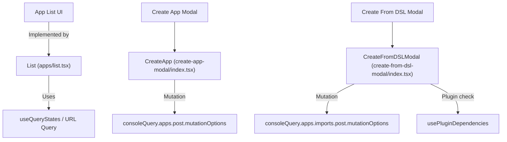
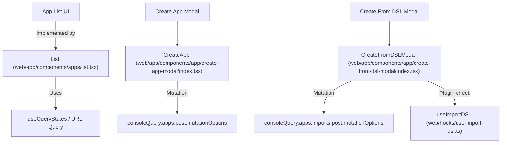
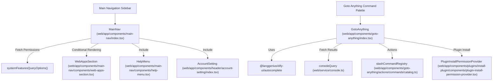

<!-- source: DeepWiki mcp.deepwiki.com · repo langgenius/dify · page 10.7 App Console UI — Lists, Configuration, Logs and Navigation · fetched 2026-10-26 -->

# 10.7 App Console UI — Lists, Configuration, Logs and Navigation

Relevant source files

The following files were used as context for generating this wiki page:

- [oxlint-suppressions.json](oxlint-suppressions.json)
- [packages/dify-ui/src/styles/components.css](packages/dify-ui/src/styles/components.css)
- [packages/dify-ui/src/styles/styles.css](packages/dify-ui/src/styles/styles.css)
- [web/app/components/app/configuration/dataset-config/params-config/weighted-score.tsx](web/app/components/app/configuration/dataset-config/params-config/weighted-score.tsx)
- [web/app/components/app/configuration/debug/__tests__/index.spec.tsx](web/app/components/app/configuration/debug/__tests__/index.spec.tsx)
- [web/app/components/app/configuration/debug/debug-with-multiple-model/__tests__/chat-item.spec.tsx](web/app/components/app/configuration/debug/debug-with-multiple-model/__tests__/chat-item.spec.tsx)
- [web/app/components/app/configuration/debug/debug-with-multiple-model/__tests__/text-generation-item.spec.tsx](web/app/components/app/configuration/debug/debug-with-multiple-model/__tests__/text-generation-item.spec.tsx)
- [web/app/components/app/configuration/debug/debug-with-multiple-model/text-generation-item.tsx](web/app/components/app/configuration/debug/debug-with-multiple-model/text-generation-item.tsx)
- [web/app/components/app/configuration/debug/index.tsx](web/app/components/app/configuration/debug/index.tsx)
- [web/app/components/app/configuration/index.tsx](web/app/components/app/configuration/index.tsx)
- [web/app/components/app/create-app-dialog/app-list/__tests__/index.spec.tsx](web/app/components/app/create-app-dialog/app-list/__tests__/index.spec.tsx)
- [web/app/components/app/create-app-dialog/app-list/index.tsx](web/app/components/app/create-app-dialog/app-list/index.tsx)
- [web/app/components/app/create-app-modal/__tests__/index.spec.tsx](web/app/components/app/create-app-modal/__tests__/index.spec.tsx)
- [web/app/components/app/create-app-modal/index.tsx](web/app/components/app/create-app-modal/index.tsx)
- [web/app/components/app/create-from-dsl-modal/__tests__/index.spec.tsx](web/app/components/app/create-from-dsl-modal/__tests__/index.spec.tsx)
- [web/app/components/app/create-from-dsl-modal/index.tsx](web/app/components/app/create-from-dsl-modal/index.tsx)
- [web/app/components/app/log/__tests__/list.spec.tsx](web/app/components/app/log/__tests__/list.spec.tsx)
- [web/app/components/app/log/list.tsx](web/app/components/app/log/list.tsx)
- [web/app/components/app/switch-app-modal/index.tsx](web/app/components/app/switch-app-modal/index.tsx)
- [web/app/components/apps/__tests__/index.spec.tsx](web/app/components/apps/__tests__/index.spec.tsx)
- [web/app/components/apps/__tests__/list.spec.tsx](web/app/components/apps/__tests__/list.spec.tsx)
- [web/app/components/apps/app-card-skeleton.tsx](web/app/components/apps/app-card-skeleton.tsx)
- [web/app/components/apps/app-list-header.tsx](web/app/components/apps/app-list-header.tsx)
- [web/app/components/apps/app-type-filter.tsx](web/app/components/apps/app-type-filter.tsx)
- [web/app/components/apps/index.tsx](web/app/components/apps/index.tsx)
- [web/app/components/apps/list.tsx](web/app/components/apps/list.tsx)
- [web/app/components/base/agent-log-modal/__tests__/detail.spec.tsx](web/app/components/base/agent-log-modal/__tests__/detail.spec.tsx)
- [web/app/components/base/agent-log-modal/__tests__/index.spec.tsx](web/app/components/base/agent-log-modal/__tests__/index.spec.tsx)
- [web/app/components/base/agent-log-modal/detail.tsx](web/app/components/base/agent-log-modal/detail.tsx)
- [web/app/components/base/agent-log-modal/index.stories.tsx](web/app/components/base/agent-log-modal/index.stories.tsx)
- [web/app/components/base/agent-log-modal/index.tsx](web/app/components/base/agent-log-modal/index.tsx)
- [web/app/components/base/chat/chat/answer/__tests__/feedback-focus.browser.spec.tsx](web/app/components/base/chat/chat/answer/__tests__/feedback-focus.browser.spec.tsx)
- [web/app/components/base/chat/chat/answer/__tests__/operation.spec.tsx](web/app/components/base/chat/chat/answer/__tests__/operation.spec.tsx)
- [web/app/components/base/chat/chat/answer/operation.tsx](web/app/components/base/chat/chat/answer/operation.tsx)
- [web/app/components/base/message-log-modal/__tests__/index.spec.tsx](web/app/components/base/message-log-modal/__tests__/index.spec.tsx)
- [web/app/components/base/message-log-modal/index.stories.tsx](web/app/components/base/message-log-modal/index.stories.tsx)
- [web/app/components/base/message-log-modal/index.tsx](web/app/components/base/message-log-modal/index.tsx)
- [web/app/components/base/search-input/__tests__/index.spec.tsx](web/app/components/base/search-input/__tests__/index.spec.tsx)
- [web/app/components/base/search-input/index.tsx](web/app/components/base/search-input/index.tsx)
- [web/app/components/base/search-input/use-search-input.ts](web/app/components/base/search-input/use-search-input.ts)
- [web/app/components/datasets/external-knowledge-base/create/ExternalApiSelect.tsx](web/app/components/datasets/external-knowledge-base/create/ExternalApiSelect.tsx)
- [web/app/components/datasets/external-knowledge-base/create/ExternalApiSelection.tsx](web/app/components/datasets/external-knowledge-base/create/ExternalApiSelection.tsx)
- [web/app/components/datasets/external-knowledge-base/create/__tests__/ExternalApiSelect.spec.tsx](web/app/components/datasets/external-knowledge-base/create/__tests__/ExternalApiSelect.spec.tsx)
- [web/app/components/datasets/external-knowledge-base/create/__tests__/ExternalApiSelection.spec.tsx](web/app/components/datasets/external-knowledge-base/create/__tests__/ExternalApiSelection.spec.tsx)
- [web/app/components/explore/create-app-modal/__tests__/index.spec.tsx](web/app/components/explore/create-app-modal/__tests__/index.spec.tsx)
- [web/app/components/explore/create-app-modal/index.tsx](web/app/components/explore/create-app-modal/index.tsx)
- [web/app/components/explore/installed-app-navigation/__tests__/app-nav-item.spec.tsx](web/app/components/explore/installed-app-navigation/__tests__/app-nav-item.spec.tsx)
- [web/app/components/explore/installed-app-navigation/app-nav-item.tsx](web/app/components/explore/installed-app-navigation/app-nav-item.tsx)
- [web/app/components/explore/installed-app-navigation/pagination-skeleton.tsx](web/app/components/explore/installed-app-navigation/pagination-skeleton.tsx)
- [web/app/components/goto-anything/README.md](web/app/components/goto-anything/README.md)
- [web/app/components/goto-anything/__tests__/index.spec.tsx](web/app/components/goto-anything/__tests__/index.spec.tsx)
- [web/app/components/goto-anything/actions/__tests__/app.spec.ts](web/app/components/goto-anything/actions/__tests__/app.spec.ts)
- [web/app/components/goto-anything/actions/__tests__/index.spec.ts](web/app/components/goto-anything/actions/__tests__/index.spec.ts)
- [web/app/components/goto-anything/actions/commands/__tests__/registry.spec.ts](web/app/components/goto-anything/actions/commands/__tests__/registry.spec.ts)
- [web/app/components/goto-anything/actions/commands/account.tsx](web/app/components/goto-anything/actions/commands/account.tsx)
- [web/app/components/goto-anything/actions/commands/docs.tsx](web/app/components/goto-anything/actions/commands/docs.tsx)
- [web/app/components/goto-anything/actions/commands/go.tsx](web/app/components/goto-anything/actions/commands/go.tsx)
- [web/app/components/goto-anything/actions/commands/language.tsx](web/app/components/goto-anything/actions/commands/language.tsx)
- [web/app/components/goto-anything/actions/commands/registry.ts](web/app/components/goto-anything/actions/commands/registry.ts)
- [web/app/components/goto-anything/actions/commands/slash.tsx](web/app/components/goto-anything/actions/commands/slash.tsx)
- [web/app/components/goto-anything/actions/commands/theme.tsx](web/app/components/goto-anything/actions/commands/theme.tsx)
- [web/app/components/goto-anything/actions/commands/types.ts](web/app/components/goto-anything/actions/commands/types.ts)
- [web/app/components/goto-anything/actions/index.ts](web/app/components/goto-anything/actions/index.ts)
- [web/app/components/goto-anything/actions/types.ts](web/app/components/goto-anything/actions/types.ts)
- [web/app/components/goto-anything/components/__tests__/footer.spec.tsx](web/app/components/goto-anything/components/__tests__/footer.spec.tsx)
- [web/app/components/goto-anything/components/empty-state.tsx](web/app/components/goto-anything/components/empty-state.tsx)
- [web/app/components/goto-anything/components/footer.tsx](web/app/components/goto-anything/components/footer.tsx)
- [web/app/components/goto-anything/index.tsx](web/app/components/goto-anything/index.tsx)
- [web/app/components/header/account-setting/__tests__/index.spec.tsx](web/app/components/header/account-setting/__tests__/index.spec.tsx)
- [web/app/components/header/account-setting/index.tsx](web/app/components/header/account-setting/index.tsx)
- [web/app/components/header/account-setting/menu-dialog.tsx](web/app/components/header/account-setting/menu-dialog.tsx)
- [web/app/components/integrations/modal.tsx](web/app/components/integrations/modal.tsx)
- [web/app/components/main-nav/__tests__/index.spec.tsx](web/app/components/main-nav/__tests__/index.spec.tsx)
- [web/app/components/main-nav/components/__tests__/support-menu.spec.tsx](web/app/components/main-nav/components/__tests__/support-menu.spec.tsx)
- [web/app/components/main-nav/components/__tests__/web-apps-section.browser.spec.tsx](web/app/components/main-nav/components/__tests__/web-apps-section.browser.spec.tsx)
- [web/app/components/main-nav/components/__tests__/web-apps-section.spec.tsx](web/app/components/main-nav/components/__tests__/web-apps-section.spec.tsx)
- [web/app/components/main-nav/components/help-menu.tsx](web/app/components/main-nav/components/help-menu.tsx)
- [web/app/components/main-nav/components/support-menu.tsx](web/app/components/main-nav/components/support-menu.tsx)
- [web/app/components/main-nav/components/web-apps-section.tsx](web/app/components/main-nav/components/web-apps-section.tsx)
- [web/app/components/main-nav/index.tsx](web/app/components/main-nav/index.tsx)
- [web/app/components/main-nav/routes.ts](web/app/components/main-nav/routes.ts)
- [web/app/components/plugins/marketplace/search-input.tsx](web/app/components/plugins/marketplace/search-input.tsx)
- [web/app/components/plugins/plugin-search-input/__tests__/index.spec.tsx](web/app/components/plugins/plugin-search-input/__tests__/index.spec.tsx)
- [web/app/components/plugins/plugin-search-input/index.tsx](web/app/components/plugins/plugin-search-input/index.tsx)
- [web/app/components/step-by-step-tour/__tests__/mount.spec.tsx](web/app/components/step-by-step-tour/__tests__/mount.spec.tsx)
- [web/app/components/step-by-step-tour/mount.tsx](web/app/components/step-by-step-tour/mount.tsx)
- [web/app/components/tools/mcp/hooks/__tests__/use-mcp-modal-form.spec.ts](web/app/components/tools/mcp/hooks/__tests__/use-mcp-modal-form.spec.ts)
- [web/app/components/tools/mcp/hooks/use-mcp-modal-form.ts](web/app/components/tools/mcp/hooks/use-mcp-modal-form.ts)
- [web/app/components/workflow-app/components/workflow-header/chat-variable-trigger.tsx](web/app/components/workflow-app/components/workflow-header/chat-variable-trigger.tsx)
- [web/app/components/workflow-app/components/workflow-panel.tsx](web/app/components/workflow-app/components/workflow-panel.tsx)
- [web/app/components/workflow-app/hooks/use-is-chat-mode.ts](web/app/components/workflow-app/hooks/use-is-chat-mode.ts)
- [web/app/components/workflow/datasets-detail-store/store.ts](web/app/components/workflow/datasets-detail-store/store.ts)
- [web/app/components/workflow/nodes/knowledge-retrieval/components/metadata/condition-list/condition-common-variable-selector.tsx](web/app/components/workflow/nodes/knowledge-retrieval/components/metadata/condition-list/condition-common-variable-selector.tsx)
- [web/app/components/workflow/nodes/knowledge-retrieval/components/metadata/condition-list/condition-number.tsx](web/app/components/workflow/nodes/knowledge-retrieval/components/metadata/condition-list/condition-number.tsx)
- [web/app/components/workflow/nodes/knowledge-retrieval/components/metadata/condition-list/condition-string.tsx](web/app/components/workflow/nodes/knowledge-retrieval/components/metadata/condition-list/condition-string.tsx)
- [web/app/components/workflow/nodes/llm/__tests__/utils.spec.ts](web/app/components/workflow/nodes/llm/__tests__/utils.spec.ts)
- [web/app/components/workflow/nodes/llm/components/json-schema-config-modal/error-message.tsx](web/app/components/workflow/nodes/llm/components/json-schema-config-modal/error-message.tsx)
- [web/app/components/workflow/nodes/llm/components/json-schema-config-modal/json-importer.tsx](web/app/components/workflow/nodes/llm/components/json-schema-config-modal/json-importer.tsx)
- [web/app/components/workflow/nodes/llm/components/json-schema-config-modal/visual-editor/context.tsx](web/app/components/workflow/nodes/llm/components/json-schema-config-modal/visual-editor/context.tsx)
- [web/app/components/workflow/nodes/llm/components/json-schema-config-modal/visual-editor/store.ts](web/app/components/workflow/nodes/llm/components/json-schema-config-modal/visual-editor/store.ts)
- [web/app/components/workflow/nodes/llm/panel.tsx](web/app/components/workflow/nodes/llm/panel.tsx)
- [web/app/components/workflow/nodes/llm/use-config.ts](web/app/components/workflow/nodes/llm/use-config.ts)
- [web/app/components/workflow/nodes/llm/utils.ts](web/app/components/workflow/nodes/llm/utils.ts)
- [web/app/components/workflow/nodes/parameter-extractor/panel.tsx](web/app/components/workflow/nodes/parameter-extractor/panel.tsx)
- [web/app/components/workflow/nodes/question-classifier/panel.tsx](web/app/components/workflow/nodes/question-classifier/panel.tsx)
- [web/app/components/workflow/note-node/note-editor/plugins/link-editor-plugin/__tests__/focus.browser.spec.tsx](web/app/components/workflow/note-node/note-editor/plugins/link-editor-plugin/__tests__/focus.browser.spec.tsx)
- [web/app/components/workflow/types.ts](web/app/components/workflow/types.ts)
- [web/features/home/continue-work/__tests__/item.spec.tsx](web/features/home/continue-work/__tests__/item.spec.tsx)
- [web/features/home/continue-work/item.tsx](web/features/home/continue-work/item.tsx)
- [web/features/skills/permissions.ts](web/features/skills/permissions.ts)
- [web/hooks/use-import-dsl.spec.tsx](web/hooks/use-import-dsl.spec.tsx)
- [web/hooks/use-import-dsl.ts](web/hooks/use-import-dsl.ts)
- [web/utils/completion-params.ts](web/utils/completion-params.ts)
- [web/utils/draft-07.json](web/utils/draft-07.json)
- [web/utils/index.ts](web/utils/index.ts)
- [web/utils/validators.ts](web/utils/validators.ts)

This page details the implementation and architecture of the App Console UI within Dify web frontend. It covers core UI areas including:

- App lists, creation modals, and DSL import workflows.
- App configuration editor panels for prompts, variables, datasets, and agent tools.
- Logs viewer components.
- Main navigation sidebar and Goto-Anything command palette.

The focus is on components, state flow, key hooks, and UI behavior relevant for engineers enhancing or maintaining the Dify console web interface.

---

## Overview and Scope

The App Console UI provides critical capabilities for users to manage their applications through:

- **App Lists and Creation:** Browsing existing apps, filtering, and creating new apps using blank templates, predefined templates, or importing DSL files.
- **App Configuration:** Comprehensive editing interfaces for app prompts, workflow variables, dataset connections, and agent tools.
- **Logs:** Viewing detailed logs of app conversations and completions with annotation and feedback capabilities.
- **Main Navigation:** Persistent sidebar navigation with workspaces, environment tags, user account, and help menus.
- **Goto-Anything:** A global fuzzy search and command palette that facilitates quick navigation and action execution across apps, workflows, plugins, and knowledge bases.

The UI is implemented using React functional components with heavy usage of data fetching hooks (`react-query`), state management (Jotai, Zustand), and typed contracts for API interactions.

---

## 1. App Lists, Creation and DSL Import Modals

### Components

- **App List (`web/app/components/apps/list.tsx`)**

  - Displays paginated and filterable list of user apps.
  - Supports keyword search, filtering by category, tags, creators, and sorting.
  - Integrates DSL file drag-and-drop import trigger.
  - Provides UI buttons to create blank apps, create from templates, or import DSL.
  - Uses internal hooks and state for query parameters, debounced search, and drag-drop detection.
  - Invokes creation modals conditionally based on user permission and app quota.
  - Passes control to `AppListCatalog` and displays tag management modal.
  Sources: [web/app/components/apps/list.tsx:1-178]()

- **Create App Modal (`web/app/components/app/create-app-modal/index.tsx`)**

  - Modal dialog for creating new apps from scratch.
  - Supports selecting app mode, app icon (emoji or image), name and description input.
  - Validates inputs against API schemas (`zod`) before submission [web/app/components/app/create-app-modal/index.tsx:5-5]().
  - Checks system deployment edition, user quotas, and permissions before allowing creations [web/app/components/app/create-app-modal/index.tsx:73-94]().
  - Submits app creation request with payload via React Query mutation [web/app/components/app/create-app-modal/index.tsx:95]().
  - Shows toast notifications on success or failure [web/app/components/app/create-app-modal/index.tsx:144-148]().
  - Supports hotkey (Mod+Enter) invocation [web/app/components/app/create-app-modal/index.tsx:45]().
  Sources: [web/app/components/app/create-app-modal/index.tsx:1-196]()

- **Create From DSL Modal (`web/app/components/app/create-from-dsl-modal/index.tsx`)**

  - Handles importing apps via DSL files or URLs.
  - Supports file uploads and URL inputs with tabs for source selection.
  - Differentiates between package (`.ifpkg`) imports and plain YAML imports.
  - Applies quota and permission checks similar to create modal.
  - Invokes import and import confirmation mutations to server API.
  - Shows import warnings or completion alerts with toast notifications.
  - Upon success, checks for plugin dependencies to install.
  - Supports hotkey (Mod+Enter) for submission.
  Sources: [web/app/components/app/create-from-dsl-modal/index.tsx]()

- **App List Creation Modals and Catalog**

  - `AppListCreationModals` aggregates create blank, template selection, and DSL import dialogs.
  - Sidebar and catalog browsing provide refined UX to select templates or filter by app categories.
  - Both blank and template creation flows notify analytics tracking on success.
  Sources: [web/app/components/apps/list.tsx:50-50]()

### Data Flow

1. **User Interaction**: User opens the app list page (`/apps`) and sees searchable/filterable apps.
2. **Filters & Search**: URL query params drive list query state and debounce keyword input for efficiency.
3. **Drag and Drop**: DSL files dropped on the list area trigger the DSL import modal [web/app/components/apps/list.tsx:68-72]().
4. **Create Actions**: User can open create blank, create from template, or import DSL modals [web/app/components/apps/list.tsx:111-118]().
5. **API Mutations**: Create and import operations use React Query mutations linked to console API contracts.
6. **Post-Creation Handling**: Successful creation redirects user to new app editor or specific environment, depending on type [web/app/components/app/create-app-modal/index.tsx:137-142]().
7. **Plugin Dependency Checks**: DSL import workflows invoke plugin dependency checks post-import.

### Diagram: App List and Creation Modals

Sources: [web/app/components/apps/list.tsx:1-178](), [web/app/components/app/create-app-modal/index.tsx:1-196](), [web/app/components/app/create-from-dsl-modal/index.tsx]()

---

## 2. App Configuration Editor

The app configuration interface provides granular editing of an app's core components: prompts, variables, datasets, and agent tools.

- **Configuration Wrapper (`web/app/components/app/configuration/index.tsx`)**

  - Core React component wrapping configuration logic and rendering `ConfigurationView`.
  - Utilizes the `useConfiguration` hook to encapsulate logic/state coupling [web/app/components/app/configuration/index.tsx:9]().
  - Displays toast messages for configuration changes/errors [web/app/components/app/configuration/index.tsx:6]().
  Sources: [web/app/components/app/configuration/index.tsx:1-18]()

- **Agent Tools Configuration (`web/app/components/app/configuration/config/agent/agent-tools/index.tsx`)**

  - Manages the list of tools enabled on the app's agent configuration.
  - Supports adding tools from multiple sources: built-in, custom, workflow tools, MCP tools.
  - Uses `immer` for immutable state updates of agent configuration.
  - Allows tool parameter edition via a nested modal (`SettingBuiltInTool`).
  - Tool authorization credentials can be updated with immediate dispatching of formatting changes.
  - Enforces a maximum tool number (`MAX_TOOLS_NUM`).
  Sources: [web/app/components/app/configuration/config/agent/agent-tools/index.tsx]()

- **Data Handling**

  - The configuration state is centered in `modelConfig`, held in React context (`ConfigContext`).
  - Modifications update this central state, propagating changes to the server and UI.
  - External hooks fetch all available tools and collections for selection (`useAllBuiltInTools`, etc.).
  - Authorization credential selections are managed and persisted within configuration updates.

---

## 3. Logs Viewer

Managing logs is vital for debugging and auditing app behavior.

- **Log List (`web/app/components/app/log/list.tsx`)**

  - Displays UI for conversation and completion logs linked to apps.
  - Supports pagination, detailed log inspection, and feedback input.
  - Uses React Query hooks and Zustand state management for current item tracking and modal visibility.
  - Provides UI components for annotation adding/editing/removal.
  - Includes modal dialogs for rich message log details and prompt logs.
  - Supports adaptive timezone formatting with the `dayjs` library extended for timezone/UTC handling [web/app/components/app/log/list.tsx:37-39]().
  Sources: [web/app/components/app/log/list.tsx:1-192]()

- **UI Elements**

  - Status indicators show success, partial success, failures, or paused states [web/app/components/app/log/list.tsx:122-155]().
  - Feedback buttons allow users to send thumbs up/down input [web/app/components/app/log/list.tsx:104-118]().
  - Modal dialogs (MessageLogModal, PromptLogModal, AgentLogModal) provide advanced message inspection features [web/app/components/app/log/list.tsx:47-51]().
  Sources: [web/app/components/app/log/list.tsx:104-155]()

---

## 4. Main Navigation Sidebar

- **Main Navigation (`web/app/components/main-nav/index.tsx`)**

  - Sidebar with app branding logo, workspace selector, environment tag display, main nav links, account and help menus.
  - Navigation items are dynamically constructed based on system feature flags, permissions, and enabled modules (agent-v2, skills, marketplace).
  - Uses React Query hooks (`useSuspenseQuery`) for permissions and environment info.
  - The nav links (e.g., `/apps`, `/datasets`, `/agents`) highlight based on current URL path.
  - Includes lazy-loaded web apps section only shown if user is permitted.
  - Environment badges for "TESTING" and "DEVELOPMENT" environments.
  - Integrates step-by-step tour components for onboarding help.
  Sources: [web/app/components/main-nav/index.tsx]()

---

## 5. Goto-Anything Command Palette

The Goto-Anything feature offers a productivity boost by allowing fuzzy search and quick commands anywhere.

- **Component (`web/app/components/goto-anything/index.tsx`)**

  - Implements a modal dialog with an auto-complete input supporting commands (starting with `/`) and scope searches (apps, plugins, knowledge bases, workflows) [web/app/components/goto-anything/index.tsx:8-12]().
  - Uses complex collections and groups inside autocomplete with filtering, debouncing, and prioritization.
  - Supports keyboard shortcuts globally to open (`GOTO_ANYTHING_HOTKEY`) [web/app/components/goto-anything/index.tsx:57]().
  - Supports distinct modes such as:
    - Commands mode (slash commands) with specific descriptions [web/app/components/goto-anything/index.tsx:83]().
    - Scope mode (searching app, plugin, knowledge, workflow nodes) [web/app/components/goto-anything/index.tsx:83-93]().
  - Incorporates permission and feature toggles to adjust search results dynamically [web/app/components/goto-anything/index.tsx:149-172]().
  - Uses React Query for fetching search results for various scopes [web/app/components/goto-anything/index.tsx:45-53]().
  - Integrates plugin install permission and marketplace install flows within search results [web/app/components/goto-anything/index.tsx:41-42]().
  Sources: [web/app/components/goto-anything/index.tsx:1-173]()
  
---

## Key Data Flow and Class/Function Summary

| Entity                         | Role/Responsibility                                    | File (Lines)                         |
|-------------------------------|-------------------------------------------------------|------------------------------------|
| `List`                        | Displays apps list with filtering and creation modals | `web/app/components/apps/list.tsx:1-178` |
| `CreateApp`                   | Modal for creating apps (blank, mode and icon picker) | `web/app/components/app/create-app-modal/index.tsx:1-196` |
| `CreateFromDSLModal`          | Modal for importing DSL apps from file/URL            | `web/app/components/app/create-from-dsl-modal/index.tsx` |
| `Configuration`               | Top-level app config wrapper rendering the editor     | `web/app/components/app/configuration/index.tsx:1-19` |
| `AgentTools`                  | Agent tools list and configuration                     | `web/app/components/app/configuration/config/agent/agent-tools/index.tsx` |
| `DetailPanel`                 | Logs list with annotations and feedback                | `web/app/components/app/log/list.tsx:158-192` |
| `MainNav`                    | Persistent sidebar navigation                          | `web/app/components/main-nav/index.tsx` |
| `GotoAnything`                | Command palette with autocomplete and search          | `web/app/components/goto-anything/index.tsx:1-173` |

---

## Mermaid Diagram: Natural Language to Code Entity Mapping for App List and Creation

Sources: [web/app/components/apps/list.tsx:1-178](), [web/app/components/app/create-app-modal/index.tsx:1-196](), [web/app/components/app/create-from-dsl-modal/index.tsx](), [web/hooks/use-import-dsl.ts]()

---

## Mermaid Diagram: Navigation and Goto Anything Mapping

Sources: [web/app/components/main-nav/index.tsx](), [web/app/components/main-nav/components/web-apps-section.tsx:1-175](), [web/app/components/main-nav/components/help-menu.tsx](), [web/app/components/header/account-setting/index.tsx](), [web/app/components/goto-anything/index.tsx:1-173](), [web/app/components/goto-anything/actions/commands/catalog.ts](), [web/app/components/plugins/install-plugin/components/plugin-install-permission-provider.tsx]()

---

## Additional Notes

- The code uses hooks like `react-query` for asynchronous data fetching with automatic caching and refetching.
- Permissions are centrally managed and checked against workspace permission keys (via Jotai atoms).
- UI interactions such as drag-drop imports and modals leverage custom hooks and state to maintain UX consistency.
- Toast message framework (`AppToastHost`, `toast`) handles user notifications globally.
- Complex UI components are split into smaller reusable subcomponents with strong typing for maintainability.
- Hotkeys are supported via `@tanstack/react-hotkeys` for menus and modal submissions.

---

# Summary

This page covered the comprehensive App Console UI system within Dify's frontend codebase. The key UI areas—app list and creation workflows, configuration editor panels, logs viewer, main navigation sidebar, and the universal Goto-Anything command palette—are integral to effective app lifecycle management and user navigation.

Understanding these modules, their interconnections via React components, hooks, API layers, and permission checks is essential for extending, debugging, or maintaining the Dify app console frontend.

---

## Sources

- `web/app/components/apps/list.tsx:1-178`
- `web/app/components/app/create-app-modal/index.tsx:1-196`
- `web/app/components/app/create-from-dsl-modal/index.tsx`
- `web/app/components/app/configuration/index.tsx:1-19`
- `web/app/components/app/configuration/config/agent/agent-tools/index.tsx`
- `web/app/components/app/log/list.tsx:1-192`
- `web/app/components/main-nav/index.tsx`
- `web/app/components/goto-anything/index.tsx:1-173`
- `web/app/components/main-nav/components/web-apps-section.tsx:1-175`
- `web/app/components/main-nav/components/help-menu.tsx`
- `web/app/components/header/account-setting/index.tsx`
- `web/app/components/goto-anything/actions/commands/catalog.ts`
- `web/app/components/plugins/install-plugin/components/plugin-install-permission-provider.tsx`
- `web/hooks/use-import-dsl.ts`

---

