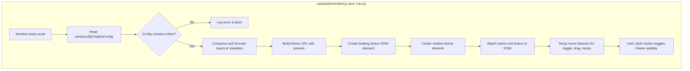
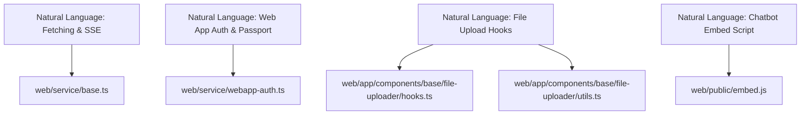
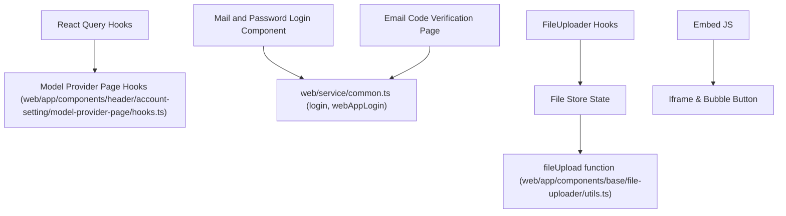

<!-- source: DeepWiki mcp.deepwiki.com · repo langgenius/dify · page 10.8 Frontend Data Layer — Services, Fetching and Shared Hooks · fetched 2026-10-26 -->

# Frontend Data Layer — Services, Fetching and Shared Hooks

<details>
<summary>Relevant source files</summary>

The following files were used as context for generating this wiki page:

- [api/controllers/web/wraps.py](api/controllers/web/wraps.py)
- [api/core/agent/cot_completion_agent_runner.py](api/core/agent/cot_completion_agent_runner.py)
- [api/core/logging/context.py](api/core/logging/context.py)
- [api/core/logging/filters.py](api/core/logging/filters.py)
- [api/tests/unit_tests/controllers/web/test_wraps.py](api/tests/unit_tests/controllers/web/test_wraps.py)
- [api/tests/unit_tests/core/logging/test_context.py](api/tests/unit_tests/core/logging/test_context.py)
- [api/tests/unit_tests/core/logging/test_filters.py](api/tests/unit_tests/core/logging/test_filters.py)
- [api/tests/unit_tests/core/logging/test_structured_formatter.py](api/tests/unit_tests/core/logging/test_structured_formatter.py)
- [api/tests/unit_tests/core/logging/test_trace_helpers.py](api/tests/unit_tests/core/logging/test_trace_helpers.py)
- [e2e/features/auth/redirect-security.feature](e2e/features/auth/redirect-security.feature)
- [web/__tests__/embed.spec.ts](web/__tests__/embed.spec.ts)
- [web/__tests__/embedded-user-id-auth.test.tsx](web/__tests__/embedded-user-id-auth.test.tsx)
- [web/__tests__/embedded-user-id-store.test.tsx](web/__tests__/embedded-user-id-store.test.tsx)
- [web/app/(shareLayout)/components/__tests__/splash.spec.tsx](web/app/(shareLayout)/components/__tests__/splash.spec.tsx)
- [web/app/(shareLayout)/components/splash.tsx](web/app/(shareLayout)/components/splash.tsx)
- [web/app/(shareLayout)/webapp-signin/__tests__/login-redirect.spec.ts](web/app/(shareLayout)/webapp-signin/__tests__/login-redirect.spec.ts)
- [web/app/(shareLayout)/webapp-signin/__tests__/page.spec.tsx](web/app/(shareLayout)/webapp-signin/__tests__/page.spec.tsx)
- [web/app/components/app/configuration/config-var/config-modal/index.tsx](web/app/components/app/configuration/config-var/config-modal/index.tsx)
- [web/app/components/app/configuration/config/agent/agent-setting/__tests__/index.spec.tsx](web/app/components/app/configuration/config/agent/agent-setting/__tests__/index.spec.tsx)
- [web/app/components/app/duplicate-modal/__tests__/index.spec.tsx](web/app/components/app/duplicate-modal/__tests__/index.spec.tsx)
- [web/app/components/app/duplicate-modal/index.tsx](web/app/components/app/duplicate-modal/index.tsx)
- [web/app/components/app/overview/__tests__/app-card-utils.spec.ts](web/app/components/app/overview/__tests__/app-card-utils.spec.ts)
- [web/app/components/app/overview/app-card-utils.ts](web/app/components/app/overview/app-card-utils.ts)
- [web/app/components/app/overview/customize/index.tsx](web/app/components/app/overview/customize/index.tsx)
- [web/app/components/app/overview/embedded/__tests__/embedded-dialog.browser.spec.tsx](web/app/components/app/overview/embedded/__tests__/embedded-dialog.browser.spec.tsx)
- [web/app/components/app/overview/embedded/__tests__/index.spec.tsx](web/app/components/app/overview/embedded/__tests__/index.spec.tsx)
- [web/app/components/app/overview/embedded/index.tsx](web/app/components/app/overview/embedded/index.tsx)
- [web/app/components/app/switch-app-modal/__tests__/index.spec.tsx](web/app/components/app/switch-app-modal/__tests__/index.spec.tsx)
- [web/app/components/base/chat/__tests__/utils.spec.ts](web/app/components/base/chat/__tests__/utils.spec.ts)
- [web/app/components/base/chat/utils.ts](web/app/components/base/chat/utils.ts)
- [web/app/components/base/features/new-feature-panel/__tests__/follow-up-setting-modal.spec.tsx](web/app/components/base/features/new-feature-panel/__tests__/follow-up-setting-modal.spec.tsx)
- [web/app/components/base/features/new-feature-panel/__tests__/follow-up.spec.tsx](web/app/components/base/features/new-feature-panel/__tests__/follow-up.spec.tsx)
- [web/app/components/base/features/new-feature-panel/follow-up-setting-modal.tsx](web/app/components/base/features/new-feature-panel/follow-up-setting-modal.tsx)
- [web/app/components/base/features/new-feature-panel/follow-up.tsx](web/app/components/base/features/new-feature-panel/follow-up.tsx)
- [web/app/components/base/form/components/base/base-field.tsx](web/app/components/base/form/components/base/base-field.tsx)
- [web/app/components/base/form/components/base/base-form.tsx](web/app/components/base/form/components/base/base-form.tsx)
- [web/app/components/base/form/form-scenarios/auth/index.tsx](web/app/components/base/form/form-scenarios/auth/index.tsx)
- [web/app/components/base/form/hooks/use-check-validated.ts](web/app/components/base/form/hooks/use-check-validated.ts)
- [web/app/components/base/form/hooks/use-get-form-values.ts](web/app/components/base/form/hooks/use-get-form-values.ts)
- [web/app/components/base/form/types.ts](web/app/components/base/form/types.ts)
- [web/app/components/base/radio-card/__tests__/index.spec.tsx](web/app/components/base/radio-card/__tests__/index.spec.tsx)
- [web/app/components/base/radio-card/index.tsx](web/app/components/base/radio-card/index.tsx)
- [web/app/components/datasets/common/retrieval-param-config/index.tsx](web/app/components/datasets/common/retrieval-param-config/index.tsx)
- [web/app/components/datasets/create/step-two/components/parent-child-options.tsx](web/app/components/datasets/create/step-two/components/parent-child-options.tsx)
- [web/app/components/datasets/rename-modal/__tests__/index.spec.tsx](web/app/components/datasets/rename-modal/__tests__/index.spec.tsx)
- [web/app/components/header/account-setting/model-provider-page/model-modal/Form.tsx](web/app/components/header/account-setting/model-provider-page/model-modal/Form.tsx)
- [web/app/components/header/account-setting/model-provider-page/model-parameter-modal/parameter-item.tsx](web/app/components/header/account-setting/model-provider-page/model-parameter-modal/parameter-item.tsx)
- [web/app/components/integrations/permission-quick-panel.tsx](web/app/components/integrations/permission-quick-panel.tsx)
- [web/app/components/plugins/plugin-detail-panel/app-selector/__tests__/app-inputs-form.spec.tsx](web/app/components/plugins/plugin-detail-panel/app-selector/__tests__/app-inputs-form.spec.tsx)
- [web/app/components/plugins/plugin-detail-panel/app-selector/app-inputs-form.tsx](web/app/components/plugins/plugin-detail-panel/app-selector/app-inputs-form.tsx)
- [web/app/components/share/text-generation/hooks/__tests__/use-text-generation-batch.spec.ts](web/app/components/share/text-generation/hooks/__tests__/use-text-generation-batch.spec.ts)
- [web/app/components/share/text-generation/hooks/use-text-generation-batch.ts](web/app/components/share/text-generation/hooks/use-text-generation-batch.ts)
- [web/app/components/share/text-generation/index.tsx](web/app/components/share/text-generation/index.tsx)
- [web/app/components/share/text-generation/result/__tests__/index.spec.tsx](web/app/components/share/text-generation/result/__tests__/index.spec.tsx)
- [web/app/components/share/text-generation/result/__tests__/result-request.spec.ts](web/app/components/share/text-generation/result/__tests__/result-request.spec.ts)
- [web/app/components/share/text-generation/result/__tests__/workflow-stream-handlers.spec.ts](web/app/components/share/text-generation/result/__tests__/workflow-stream-handlers.spec.ts)
- [web/app/components/share/text-generation/result/hooks/__tests__/use-result-run-state.spec.ts](web/app/components/share/text-generation/result/hooks/__tests__/use-result-run-state.spec.ts)
- [web/app/components/share/text-generation/result/hooks/__tests__/use-result-sender.spec.ts](web/app/components/share/text-generation/result/hooks/__tests__/use-result-sender.spec.ts)
- [web/app/components/share/text-generation/result/hooks/use-result-run-state.ts](web/app/components/share/text-generation/result/hooks/use-result-run-state.ts)
- [web/app/components/share/text-generation/result/hooks/use-result-sender.ts](web/app/components/share/text-generation/result/hooks/use-result-sender.ts)
- [web/app/components/share/text-generation/result/index.tsx](web/app/components/share/text-generation/result/index.tsx)
- [web/app/components/share/text-generation/result/result-request.ts](web/app/components/share/text-generation/result/result-request.ts)
- [web/app/components/share/text-generation/result/workflow-stream-handlers.ts](web/app/components/share/text-generation/result/workflow-stream-handlers.ts)
- [web/app/components/share/text-generation/run-once/__tests__/index.spec.tsx](web/app/components/share/text-generation/run-once/__tests__/index.spec.tsx)
- [web/app/components/share/text-generation/run-once/index.tsx](web/app/components/share/text-generation/run-once/index.tsx)
- [web/app/components/share/text-generation/types.ts](web/app/components/share/text-generation/types.ts)
- [web/app/components/tools/edit-custom-collection-modal/config-credentials.tsx](web/app/components/tools/edit-custom-collection-modal/config-credentials.tsx)
- [web/app/components/tools/edit-custom-collection-modal/index.tsx](web/app/components/tools/edit-custom-collection-modal/index.tsx)
- [web/app/components/tools/edit-custom-collection-modal/test-api.tsx](web/app/components/tools/edit-custom-collection-modal/test-api.tsx)
- [web/app/components/tools/setting/build-in/config-credentials.tsx](web/app/components/tools/setting/build-in/config-credentials.tsx)
- [web/app/components/workflow/nodes/_base/components/variable/object-child-tree-panel/show/field.tsx](web/app/components/workflow/nodes/_base/components/variable/object-child-tree-panel/show/field.tsx)
- [web/app/components/workflow/nodes/http/hooks/use-key-value-list.ts](web/app/components/workflow/nodes/http/hooks/use-key-value-list.ts)
- [web/app/components/workflow/nodes/knowledge-base/components/retrieval-setting/search-method-option.tsx](web/app/components/workflow/nodes/knowledge-base/components/retrieval-setting/search-method-option.tsx)
- [web/app/components/workflow/panel/inputs-panel.tsx](web/app/components/workflow/panel/inputs-panel.tsx)
- [web/context/web-app-context.tsx](web/context/web-app-context.tsx)
- [web/hooks/use-breakpoints.spec.ts](web/hooks/use-breakpoints.spec.ts)
- [web/hooks/use-document-title.spec.ts](web/hooks/use-document-title.spec.ts)
- [web/public/embed.js](web/public/embed.js)
- [web/public/embed.min.js](web/public/embed.min.js)
- [web/service/base.spec.ts](web/service/base.spec.ts)
- [web/service/base.ts](web/service/base.ts)
- [web/service/use-share.spec.tsx](web/service/use-share.spec.tsx)
- [web/service/use-share.ts](web/service/use-share.ts)
- [web/service/webapp-auth.ts](web/service/webapp-auth.ts)
- [web/utils/clipboard.spec.ts](web/utils/clipboard.spec.ts)
- [web/utils/clipboard.ts](web/utils/clipboard.ts)
- [web/utils/model-config.spec.ts](web/utils/model-config.spec.ts)
- [web/utils/model-config.ts](web/utils/model-config.ts)

</details>


This page documents the frontend data layer of the Dify web application, focusing on the architecture and implementation of service wrappers for data fetching, Server-Sent Events (SSE) handling, TanStack Query hooks, authentication and context management for the web application, file uploader hooks, and embed scripts. This layer represents the key bridge between UI components and backend APIs, managing data flow, caching, state synchronization, and real-time event interactions.

---

## 1. Purpose and Scope

The frontend data layer encapsulates:

- HTTP fetch wrappers abstracting REST API calls with integrated error handling, CSRF support, and token refresh mechanisms.
- SSE handling for real-time data streaming (e.g., workflow execution events).
- React Query (TanStack Query) hooks to provide caching, synchronization, and server state management.
- Shared React context for Web App authentication states and session recovery.
- File uploader hooks that manage file addition, validation, progress tracking, uploads, and error reporting.
- Embed scripts enabling chatbot integration in third-party websites via iframe and dynamic UI insertion.

This cohesive layer enables efficient, reliable, and user-friendly frontend interaction with complex backend resources and asynchronous event streams.

---

## 2. Web Service Fetch Wrapper and SSE Handling

### 2.1 Fetch Wrapper Architecture (`web/service/base.ts`)

The fetch wrapper in `web/service/base.ts` centralizes HTTP request handling with support for:

- Including authentication headers (e.g., CSRF tokens, passports) transparently.
- Public API path resolution for web apps.
- Error detection with automatic recovery for web app authorization errors.
- Timeout handling (default 100s).
- Special handling for abort errors and certain stream errors to avoid unnecessary notifications.
- Decoding streaming JSON responses and invoking callbacks for message chunks, thought events, file responses, and workflow-related SSE events.

Key functions and features include:

- `recoverEnvironmentWebAppAuthorization` [web/service/base.ts:60-83](): Handles authorization failure specific to the "environment" kind WebApp, triggering login flows or reloading.
- `handleWebAppAuthorizationError` [web/service/base.ts:85-97](): Detects web app-specific access denial errors and initiates login.
- SSE event handler typing [web/service/base.ts:108-196](): Defines function signatures for event callbacks for workflow nodes, iterations, text chunks, human input forms, agent logs, and error handling.
- `reportStreamResponseError` [web/service/base.ts:127-153]() and `handlePublicStreamResponseError` [web/service/base.ts:155-178]() uniformly parse and report API error responses.
- Use of the `toast` module to notify users on critical errors.

The module also imports and orchestrates calls to token refresh methods (`refreshAccessTokenOrReLogin` [web/service/base.ts:49]()), passport management (`webapp-auth.ts` [web/service/base.ts:52-56]()), and base fetch options (`fetch.ts` [web/service/base.ts:47]()).

### 2.2 Data Flow for Streaming and Fetching

The fetch wrapper provides interfaces to:

- Initiate API calls with base options, automatic token handling.
- Parse streaming responses.
- Function callbacks receive parsed SSE events (e.g., workflow node started/finished, text chunks).
- Errors trigger toast notifications or web app authorization recovery flows.

### Mermaid Diagram: Fetch Wrapper and SSE Handling Data Flow

```mermaid
flowchart TD
  subgraph Frontend_Fetch_Wrapper["web/service/base.ts"]
    A[HTTP Request] --> B[Apply Headers (CSRF, Passport)]
    B --> C[Send Request to API]
    C --> D{Response}
    D -- Success --> E[Return JSON or Stream]
    D -- Error --> F[Parse Error JSON]
    F --> G{WebApp Authorization Error?}
    G -- Yes --> H[Trigger Recover / Login]
    G -- No --> I[Show Toast Notification]
    E --> J{Is Stream?}
    J -- Yes --> K[Parse SSE Events]
    K --> L[Invoke Callbacks: OnData, OnThought, OnFile, OnWorkflowEvent]
  end

  classDef service fill:#f9f,stroke:#333,stroke-width:1px;
  class Frontend_Fetch_Wrapper service;
```

Sources: `web/service/base.ts:1-196` ()

---

## 3. TanStack Query Hooks for Data Fetching and Cache Management

While full details are in other modules, this layer integrates with TanStack Query to provide:

- Server state caching and invalidation for workspace info, models, and default model selections.
- `useQuery` hooks in the frontend React components utilize the fetch wrapper for data fetching.
- Mutation functions with refetch callbacks for updates.

For example, in `web/app/components/header/account-setting/model-provider-page/hooks.ts`, hooks like `useDefaultModel`, `useModelListAndDefaultModel`, and `useUpdateModelList` leverage `useQuery` and `useQueryClient` to manage model provider data reactively. The `useSuspenseQuery` hook is also used, for instance, in `web/app/components/app/overview/embedded/index.tsx` [web/app/components/app/overview/embedded/index.tsx:19]() to fetch user profile data.

Sources:
- `web/app/components/header/account-setting/model-provider-page/hooks.ts`
- `web/app/components/app/overview/embedded/index.tsx:19` ()

---

## 4. Web App Context and Authentication Management

### 4.1 WebApp Passport and Token Management

The web app context depends on passport tokens to authenticate API calls. The fetch wrapper imports utilities for:

- `getWebAppPassport` [web/service/base.ts:55]() and `clearWebAppPassport` [web/service/base.ts:54]() for session state.
- Logic to detect when login redirects or token refreshes are required.
- `requiredWebSSOLogin()` [web/service/base.ts:76]() triggers SSO login when unauthorized responses occur.

### 4.2 Login Flow Components

- `MailAndPasswordAuth` React component (`web/app/(shareLayout)/webapp-signin/components/mail-and-password-auth.tsx`) implements email-password login UI and calls `webAppLogin` API.
- `CheckCode` page for email code verification (`web/app/(shareLayout)/webapp-signin/check-code/page.tsx`) implements code entry and validation for passwordless login.

These components leverage `webAppLogin` and `webAppEmailLoginWithCode` service calls, token setting (`setWebAppAccessToken`), and passport management utilities.

Sources:
- `web/service/base.ts:49-56` ()
- `web/app/(shareLayout)/webapp-signin/components/mail-and-password-auth.tsx`
- `web/app/(shareLayout)/webapp-signin/check-code/page.tsx`

---

## 5. File Uploader Hooks and Utilities

### 5.1 File Size Limits and Validation (`web/app/components/base/file-uploader/hooks.ts`)

Provides `useFileSizeLimit` hook which returns file size limits configured dynamically from backend file upload config or fallback defaults.

### 5.2 File State Management and Callbacks

`useFile` hook manages:

- File state stored in a global `fileStore` (likely a Zustand store).
- Handlers to add, update, remove, and re-upload files with internal state synchronization and callbacks (e.g., progress updates, success, error).
- Size limit validation with user-friendly error toasts whenever uploaded files exceed configured thresholds per file type.
- Support for local and remote upload URLs through context.

### 5.3 Upload Utility (`web/app/components/base/file-uploader/utils.ts`)

Includes:

- `fileUpload` wrapper handling XMLHttpRequest uploads with progress and error callbacks.
- Helper functions to detect file MIME types, extensions, and map to internal file appearance types.
- Error message derivation for upload failure scenarios.

### Mermaid Diagram: File Uploader State and Flow

```mermaid
flowchart TD
  subgraph File_Uploader_Hooks["web/app/components/base/file-uploader/hooks.ts"]
    A[User selects file] --> B{validate file size & extension}
    B -- Valid --> C[Add file to fileStore (state)]
    C --> D[Upload file with progress callback]
    D --> E{Upload Complete?}
    E -- Success --> F[Update fileStore with uploadedId, progress=100]
    E -- Error --> G[Show Error Toast]
    B -- Invalid --> G
    F --> H[File available for further processing]
  end
```

Sources:
- `web/app/components/base/file-uploader/hooks.ts`
- `web/app/components/base/file-uploader/utils.ts`

---

## 6. Embed Scripts for Chatbot Integration (`web/public/embed.js`, `web/public/embed.min.js`)

The embed scripts allow external websites to incorporate Dify chatbot widgets dynamically with minimal installation effort.

### 6.1 Embedding Logic

- The embed scripts obtain configuration from a global window variable (`difyChatbotConfig` [web/public/embed.js:11]()) which includes chatbot token, input variables, system variables, user variables, base URL, and route segment.
- Input variables and system/user variables are gzip compressed and base64 encoded asynchronously using `compressAndEncodeBase64` [web/public/embed.js:83-90]().
- Constructs an iframe URL by appending compressed parameters [web/public/embed.js:125-126]().
- Dynamically creates a floating button and iframe with toggling open/close states.
- Aligns iframe position relative to the button for UI consistency.
- Event listeners and style transitions enable smooth user interaction.
- Supports responsive layout adjustments based on window size.
- Handles iframe injection with appropriate sandboxing and permission attributes.

### Mermaid Diagram: Chatbot Embed Script High-level Flow



Sources:
- `web/public/embed.js:1-126` ()
- `web/public/embed.min.js:1-42` ()
- `web/app/components/app/overview/embedded/index.tsx:86-95` ()

---

## 7. Natural Language Space to Code Entity Space: Major Mappings

### 7.1 Mapping Between System Names and Code Entities (1)



Sources: Combined sources as above.

### 7.2 Mapping Between Data Flow and UI Components (2)



Sources: Combined sources as above.

---

## 8. Summary Table of Key Modules and Responsibilities

| Module/File Path | Responsibilities |
|---|---|
| `web/service/base.ts` | HTTP fetch wrapper, SSE stream parsing, error and authorization recovery, toast/error handling |
| `web/service/common.ts` | API wrapper functions for login, setup, workspace updates, file uploads API interfaces |
| `web/app/components/base/file-uploader/hooks.ts` | React hooks for file state management, file addition/removal, size validation, re-upload handling |
| `web/app/components/base/file-uploader/utils.ts` | Utility functions for file uploads (XHR), error message parsing, file MIME/type and extension detection |
| `web/app/(shareLayout)/webapp-signin/components/mail-and-password-auth.tsx` | React component for user login by email and password, calls login service, manages local state and error display |
| `web/app/(shareLayout)/webapp-signin/check-code/page.tsx` | React page component for verifying email login codes, handles code input & submit, calls service functions |
| `web/public/embed.js` and `web/public/embed.min.js` | Embed chatbot logic, iframe/button creation, compression and encoding of input variables, UI interactions |
| `web/app/components/header/account-setting/model-provider-page/hooks.ts` | React Query hooks for model default selection, list fetching and updates |

---

This completes the detailed technical overview of the frontend data layer services, fetching, real-time event handling, authentication context, file uploading, and embed script mechanisms in Dify.

Sources:
- `web/service/base.ts:1-196` ()
- `web/app/components/base/file-uploader/hooks.ts`
- `web/app/components/base/file-uploader/utils.ts`
- `web/service/common.ts`
- `web/app/(shareLayout)/webapp-signin/components/mail-and-password-auth.tsx`
- `web/app/(shareLayout)/webapp-signin/check-code/page.tsx`
- `web/public/embed.js:1-126` ()
- `web/public/embed.min.js:1-42` ()
- `web/app/components/header/account-setting/model-provider-page/hooks.ts`
- `web/app/components/app/overview/embedded/index.tsx:19` ()
- `web/app/components/app/overview/embedded/index.tsx:86-95` ()

---

