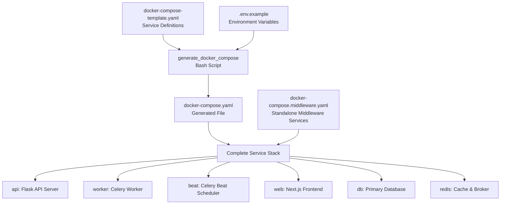
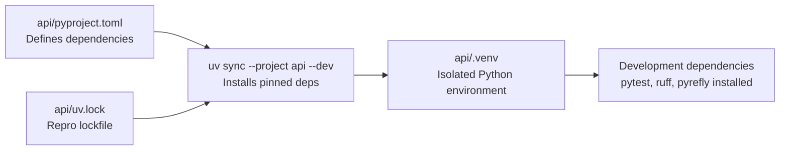
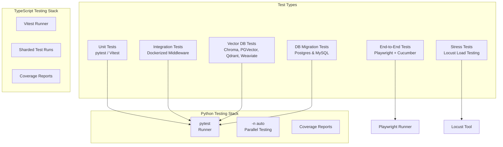
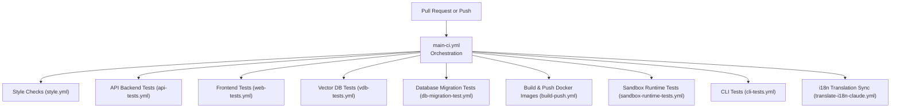

<!-- source: DeepWiki mcp.deepwiki.com · repo langgenius/dify · page 11 Development and CI/CD · fetched 2026-10-26 -->

# Development and CI/CD

<details>
<summary>Relevant source files</summary>

The following files were used as context for generating this wiki page:

- [.github/workflows/api-tests.yml](.github/workflows/api-tests.yml)
- [.github/workflows/autofix.yml](.github/workflows/autofix.yml)
- [.github/workflows/db-migration-test.yml](.github/workflows/db-migration-test.yml)
- [.github/workflows/main-ci.yml](.github/workflows/main-ci.yml)
- [.github/workflows/pyrefly-diff-comment.yml](.github/workflows/pyrefly-diff-comment.yml)
- [.github/workflows/pyrefly-diff.yml](.github/workflows/pyrefly-diff.yml)
- [.github/workflows/pyrefly-type-coverage-comment.yml](.github/workflows/pyrefly-type-coverage-comment.yml)
- [.github/workflows/pyrefly-type-coverage.yml](.github/workflows/pyrefly-type-coverage.yml)
- [.github/workflows/style.yml](.github/workflows/style.yml)
- [.github/workflows/tool-test-sdks.yaml](.github/workflows/tool-test-sdks.yaml)
- [.github/workflows/translate-i18n-claude.yml](.github/workflows/translate-i18n-claude.yml)
- [.github/workflows/trigger-i18n-sync.yml](.github/workflows/trigger-i18n-sync.yml)
- [.github/workflows/vdb-tests-full.yml](.github/workflows/vdb-tests-full.yml)
- [.github/workflows/vdb-tests.yml](.github/workflows/vdb-tests.yml)
- [.github/workflows/web-e2e.yml](.github/workflows/web-e2e.yml)
- [.github/workflows/web-tests.yml](.github/workflows/web-tests.yml)

</details>


This document covers the development workflow, local environment setup, testing infrastructure, and continuous integration/continuous deployment (CI/CD) pipelines for the Dify platform. It explains how to set up a local development environment, run tests, and understand the automated quality checks that run on every code change.

For information about deploying Dify to production environments, see [Deployment and Operations](#3). For details about the Docker build process and multi-stage images, see [Docker Build Process and Multi-Stage Images](#3.1).

---

## Development Environment Overview

Dify uses modern development tooling optimized for both Python (backend) and TypeScript (frontend) development:

- **Python**: The `uv` package manager replaces traditional tools like `poetry`, offering fast, reproducible dependency management with lockfiles and efficient development commands. This is configured per project with `uv lock` and `uv sync` commands that maintain the `uv.lock` file [.github/workflows/style.yml:69-70](), [api/README.md:7-10]().

- **Frontend**: `pnpm` manages Node.js dependencies and orchestrates workspace scripts in the monorepo, supporting fast installs and consistency across web and UI packages [web/Dockerfile:12-14](), [api/README.md:11-12]().

- **Database**: The backend supports PostgreSQL or MySQL as the primary persistent storage, which is configurable in environment files. Redis is used as both a cache for session management and the broker for Celery task queues [api/docker/entrypoint.sh:13-45]().

- **Containerization**: Local development and testing uses Docker Compose to orchestrate the middleware stack and app services in a well-defined, repeatable environment [api/README.md:25-29]().

- **CI/CD**: GitHub Actions drive the automated test and linting workflows, orchestrated by the main CI pipeline. Path filters enable running only necessary subsets of tests for changed files, and concurrency groups manage PR run efficiency [.github/workflows/main-ci.yml:1-21](), [.github/workflows/api-tests.yml:12-14]().

Developers can work either within containerized Docker environments or in native setups leveraging the same dependency management tooling, offering flexibility for different workflows.

**Sources:** [.github/workflows/style.yml:69-70](), [api/README.md:7-29](), [api/docker/entrypoint.sh:13-45](), [.github/workflows/main-ci.yml:1-21](), [.github/workflows/api-tests.yml:12-14]()

---

## Local Development Setup

### Docker Compose Development Stack

Local development orchestrates all backend, middleware, and frontend dependencies through Docker Compose. The compose file is dynamically generated by a script that merges environment templates and settings to produce a consistent and up-to-date configuration.



- The script `docker/generate_docker_compose` generates the main `docker-compose.yaml` by combining templates and environment variables dynamically [.github/workflows/autofix.yml:70-73]().
- `docker/docker-compose.middleware.yaml` defines independent middleware stacks (database, Redis) useful for isolated testing or minimal middleware setup [.github/workflows/main-ci.yml:83-84]().

For detailed developer guidance on local environment setup, including using `uv` and `pnpm`, configuring VS Code launch profiles, and utilizing helper scripts and Makefile targets, see [Development Environment Setup](#11.1).

**Sources:** [.github/workflows/autofix.yml:70-73](), [.github/workflows/main-ci.yml:83-84]()

### Environment Configuration

Environment variables are defined centrally and templated in `.env` files to maintain consistency and simplify environment switching:

| Configuration File                  | Scope                          | Key Variables & Notes                         |
|-----------------------------------|--------------------------------|----------------------------------------------|
| `docker/.env.example`              | Docker Compose environment     | Database type and host, Redis host           |
| `api/.env.example`                 | API service runtime            | Secret keys, API URLs, storage backend config|
| `docker/envs/middleware.env.example` | Middleware stack environment | Database credentials, Redis connection info  |

This setup ensures developers and CI systems use consistent configurations. Scripts and workflows often rely on these templates for environment initialization [.github/workflows/main-ci.yml:81-82]().

See [Development Environment Setup](#11.1) for specifics on environment variable initialization.

**Sources:** [api/README.md:23-24](), [.github/workflows/main-ci.yml:81-82]()

---

## Python Development with UV

### UV Package Manager and Workflow

Dify uses `uv`, a modern Python package manager emphasizing lockfile-based reproducibility and fast dependency management optimized for monorepo usage.



Common commands:

```bash
# Synchronize all dependencies including dev tools
uv sync --project api --dev

# Run tests
uv run --project api pytest
```

This tooling supports fast installs and consistent environments with automatic lockfile checks and integration with CI systems [api/README.md:7-10](), [api/README.md:86-88](), [.github/workflows/style.yml:69-70]().

**Sources:** [api/README.md:7-88](), [.github/workflows/style.yml:69-70]()

---

## Testing Infrastructure

### Overview of Test Types and Strategies

Dify maintains a comprehensive testing infrastructure covering unit, integration, migration, vector DB, frontend, and end-to-end tests.



- The API backend tests leverage `pytest` with parallel execution (`-n auto`) and coverage instrumentation [.github/workflows/api-tests.yml:116-127]().
- Vector database tests cover multiple backend implementations to ensure compatibility and correctness [.github/workflows/vdb-tests.yml:60-67]().
- Database migration tests simulate upgrades and downgrades on both PostgreSQL and MySQL stacks [.github/workflows/db-migration-test.yml:11-138]().
- Frontend tests use the `vitest` framework with sharding across multiple parallel jobs in CI to optimize run times [.github/workflows/web-tests.yml:16-20]().
- E2E tests use Playwright for browser automation combined with Cucumber features for behavioral end-to-end testing [.github/workflows/web-e2e.yml:91-195]().
- Stress tests use Locust loading workflows targeting key backend endpoints, validating system performance and resilience [scripts/stress-test README and gitignore]().

For comprehensive description of test fixtures, sharding, integration environments, and test suites, see [Testing Infrastructure and Strategies](#11.2).

**Sources:** [.github/workflows/api-tests.yml:116-127](), [.github/workflows/vdb-tests.yml:60-67](), [.github/workflows/db-migration-test.yml:11-138](), [.github/workflows/web-tests.yml:16-20](), [.github/workflows/web-e2e.yml:91-195]()

---

## CI/CD Pipeline Architecture

### GitHub Actions Workflow Composition

Dify’s primary continuous integration system centers on the `main-ci.yml` orchestrator, which invokes secondary workflows based on the code paths changed in pull requests or merges. This architecture ensures efficient use of resources by only running necessary checks.



### Pipeline Efficiency Mechanisms

- **Concurrency Control:** Cancel redundant runs when newer commits are pushed, avoiding wasted CI runtime [.github/workflows/api-tests.yml:12-14](), [.github/workflows/main-ci.yml:17-21]().
- **Path Filtering:** Uses the `dorny/paths-filter` GitHub Action to detect changed directories and files, dispatching only relevant test pipelines to save resource usage [.github/workflows/main-ci.yml:57-170]().
- **Test Sharding:** Frontend vitest tests shard jobs (e.g., 4 parallel shards) to accelerate test completion time [.github/workflows/web-tests.yml:16-20]().

For full detail on workflow structures, filters, concurrency, and artifact uploads, see [CI Pipeline Architecture](#11.3).

**Sources:** [.github/workflows/api-tests.yml:12-14](), [.github/workflows/main-ci.yml:17-170](), [.github/workflows/web-tests.yml:16-20]()

---

## Code Quality and Linting

### Backend Python Quality Tools

Dify enforces backend Python code standards with a layered lint and type-checking approach:

- **Ruff:** The primary linter with fast autofix support for syntax, style, and error detection [api/README.md:88](), [.github/workflows/autofix.yml:80-85]().
- **Pyrefly:** Static typing and type coverage checks, integrated into CI and run-diff workflows [.github/workflows/style.yml:115-119](), [api/README.md:88]().
- **Import Linter:** Architectural enforcement to prevent forbidden import cycles and keep code structure clean [.github/workflows/style.yml:77-79]().
- **Dotenv Linter:** Ensures `.env.example` files are consistent, well-formatted, and valid [.github/workflows/style.yml:129-131]().

### Frontend Quality and Static Analysis

The frontend uses a combination of established JavaScript/TypeScript linters and unused code detectors:

- **ESLint:** For JavaScript/TypeScript linting and autofixing.
- **tsslint:** TypeScript-specific linting tasks ensuring consistent types usage [.github/workflows/style.yml:173-176]().
- **Knip:** Detects unused files, dependencies, and declarations automatically in the web workspace [.github/workflows/style.yml:178-187]().
- **SuperLinter:** Meta linter managing multiple languages and filetypes like Bash, YAML, Dockerfiles [.github/workflows/style.yml:210-236]().

See [Code Quality and Linting](#11.4) for detailed descriptions of these tools and their integration.

**Sources:** [api/README.md:88](), [.github/workflows/style.yml:77-236](), [.github/workflows/autofix.yml:80-85]()

---

## Automated Fixes and Code Modernization

The `autofix.ci` GitHub Action runs on pull requests and merge events, performing a series of automated source transformations and formatting corrections:

- **Ruff Autofix:** Formats and fixes Python style automatically [.github/workflows/autofix.yml:80-85]().
- **AST-Grep Rewrites:** Applies mechanical source transformations such as:
  - Changing SQLAlchemy query `.filter()` calls to `.where()`.
  - Migrating `db.Column` declarations to `mapped_column`.
  - Converting `Optional[T]` type hints to `T | None` union syntax with cleanup of forward references.
 [.github/workflows/autofix.yml:97-126]()
- **Contract Generation:** Runs code generation for OpenAPI docs and frontend API contracts to keep interfaces in sync [.github/workflows/autofix.yml:131-140]().
- **ESLint Autofix:** Applies auto-fixes to frontend JavaScript and TypeScript source files.

This continuous modernization pipeline helps keep code quality high and technical debt low. Details are in [Automated Fixes and Code Modernization](#11.5).

**Sources:** [.github/workflows/autofix.yml:80-140]()

---

## AI Coding Agent Skills

Dify leverages AI-driven code maintenance workflows via specialized agents and GitHub Actions:

- The [translate-i18n-claude.yml] workflow uses Claude for AI-assisted translation synchronization, automatically updating locale files based on English source changes [.github/workflows/translate-i18n-claude.yml:1-170]().
- Agents with defined skillsets assist in backend and frontend code reviews, component refactoring, testing generation, and full e2e authoring processes.

These AI agents integrate closely with repository workflows to enhance developer productivity and maintain high code quality. See [AI Coding Agent Skills](#11.6) for detailed descriptions.

**Sources:** [.github/workflows/translate-i18n-claude.yml:1-170]()

---

## `difyctl` CLI Architecture and Workflows

The command-line interface `difyctl` located in the `cli/` directory is a Bun-compiled tool designed for interacting with the Dify backend platform APIs:

- Organized into modular commands with framework layers handling authentication, HTTP interactions, command outputting, and device code flow login.
- Authenticates securely using a device code flow, facilitating CLI sessions without exposing user credentials.
- Aligns closely with server OpenAPI contracts for consistent and reliable automation interactions.

For architecture details and usage workflows, see [difyctl CLI (cli/) Architecture and Workflows](#11.7).

**Sources:** [.github/workflows/main-ci.yml:88-99]()

---

## Performance and Stress Testing

Dify includes specialized stress and performance testing infrastructure to ensure system stability and responsiveness under load:

- **Locust** is used to script load tests targeting critical endpoints like workflow streaming and Celery task queues.
- Performance tests run in CI and can be reproduced locally for debugging regressions and load bottlenecks.
- Reports and test results are stored under `scripts/stress-test/reports/`.

See [Performance and Stress Testing](#11.8) for usage instructions and test suite descriptions.

**Sources:** [.gitignore:245-248]()

---

# Summary

The development and CI/CD ecosystem of Dify is a coordinated blend of modern tooling and automation covering local environment setup, test coverage, continuous integration with conditional execution, and automated code quality enforcement. This integrated workflow sustains rapid development velocity while preserving code correctness and maintainability.

For detailed instructions and in-depth technical guidance, please consult the linked child pages:

- [Development Environment Setup](#11.1)
- [Testing Infrastructure and Strategies](#11.2)
- [CI Pipeline Architecture](#11.3)
- [Code Quality and Linting](#11.4)
- [Automated Fixes and Code Modernization](#11.5)
- [AI Coding Agent Skills](#11.6)
- [difyctl CLI (cli/) Architecture and Workflows](#11.7)
- [Performance and Stress Testing](#11.8)

---

