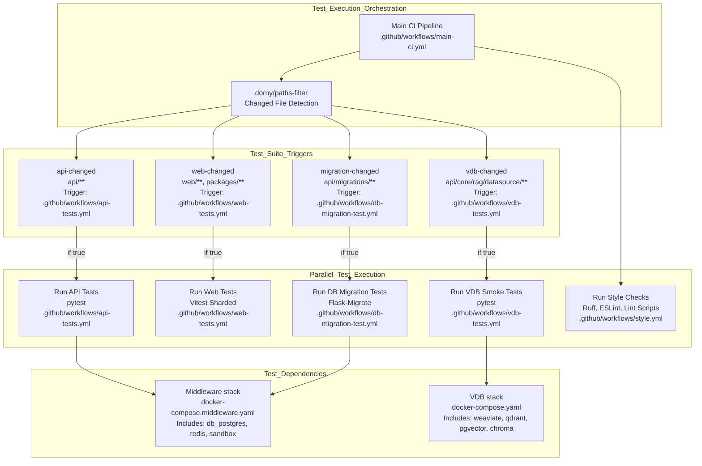
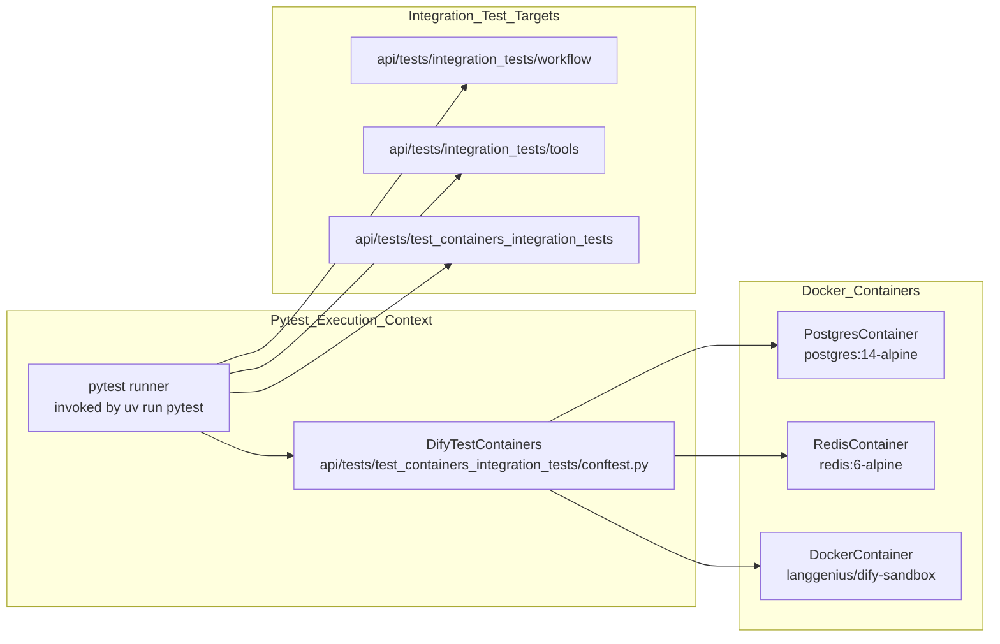
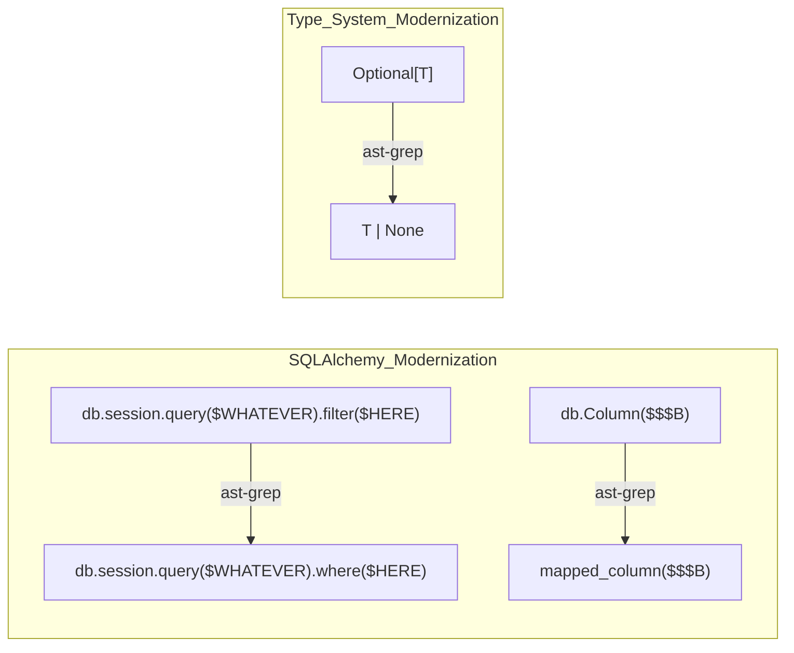

<!-- source: DeepWiki mcp.deepwiki.com · repo langgenius/dify · page 11.2 Testing Infrastructure and Strategies · fetched 2026-10-26 -->

# Testing Infrastructure and Strategies

Relevant source files

The following files were used as context for generating this wiki page:

- [.github/workflows/api-tests.yml](.github/workflows/api-tests.yml)
- [.github/workflows/autofix.yml](.github/workflows/autofix.yml)
- [.github/workflows/db-migration-test.yml](.github/workflows/db-migration-test.yml)
- [.github/workflows/main-ci.yml](.github/workflows/main-ci.yml)
- [.github/workflows/pyrefly-diff-comment.yml](.github/workflows/pyrefly-diff-comment.yml)
- [.github/workflows/pyrefly-diff.yml](.github/workflows/pyrefly-diff.yml)
- [.github/workflows/pyrefly-type-coverage-comment.yml](.github/workflows/pyrefly-type-coverage-comment.yml)
- [.github/workflows/pyrefly-type-coverage.yml](.github/workflows/pyrefly-type-coverage.yml)
- [.github/workflows/style.yml](.github/workflows/style.yml)
- [.github/workflows/tool-test-sdks.yaml](.github/workflows/tool-test-sdks.yaml)
- [.github/workflows/translate-i18n-claude.yml](.github/workflows/translate-i18n-claude.yml)
- [.github/workflows/trigger-i18n-sync.yml](.github/workflows/trigger-i18n-sync.yml)
- [.github/workflows/vdb-tests-full.yml](.github/workflows/vdb-tests-full.yml)
- [.github/workflows/vdb-tests.yml](.github/workflows/vdb-tests.yml)
- [.github/workflows/web-e2e.yml](.github/workflows/web-e2e.yml)
- [.github/workflows/web-tests.yml](.github/workflows/web-tests.yml)
- [api/controllers/console/explore/parameter.py](api/controllers/console/explore/parameter.py)
- [api/controllers/service_api/app/app.py](api/controllers/service_api/app/app.py)
- [api/controllers/web/app.py](api/controllers/web/app.py)
- [api/core/app/app_config/common/parameters_mapping/__init__.py](api/core/app/app_config/common/parameters_mapping/__init__.py)
- [api/core/app/llm/__init__.py](api/core/app/llm/__init__.py)
- [api/core/app/llm/quota.py](api/core/app/llm/quota.py)
- [api/core/app/task_pipeline/message_file_utils.py](api/core/app/task_pipeline/message_file_utils.py)
- [api/core/app/workflow/layers/__init__.py](api/core/app/workflow/layers/__init__.py)
- [api/core/workflow/human_input_policy.py](api/core/workflow/human_input_policy.py)
- [api/events/event_handlers/update_provider_when_message_created.py](api/events/event_handlers/update_provider_when_message_created.py)
- [api/libs/pyrefly_diagnostics.py](api/libs/pyrefly_diagnostics.py)
- [api/migrations/versions/2026_03_02_1805-0ec65df55790_add_indexes_for_human_input_forms.py](api/migrations/versions/2026_03_02_1805-0ec65df55790_add_indexes_for_human_input_forms.py)
- [api/models/human_input.py](api/models/human_input.py)
- [api/repositories/app_definition_query_repository.py](api/repositories/app_definition_query_repository.py)
- [api/repositories/webapp_access_query_repository.py](api/repositories/webapp_access_query_repository.py)
- [api/services/app_definition_query_service.py](api/services/app_definition_query_service.py)
- [api/services/attachment_service.py](api/services/attachment_service.py)
- [api/services/credit_pool_service.py](api/services/credit_pool_service.py)
- [api/services/plugin/plugin_parameter_service.py](api/services/plugin/plugin_parameter_service.py)
- [api/services/trigger/trigger_provider_service.py](api/services/trigger/trigger_provider_service.py)
- [api/services/trigger/trigger_subscription_builder_service.py](api/services/trigger/trigger_subscription_builder_service.py)
- [api/services/webapp_access_query_service.py](api/services/webapp_access_query_service.py)
- [api/tests/test_containers_integration_tests/.ruff.toml](api/tests/test_containers_integration_tests/.ruff.toml)
- [api/tests/test_containers_integration_tests/conftest.py](api/tests/test_containers_integration_tests/conftest.py)
- [api/tests/test_containers_integration_tests/models/test_account.py](api/tests/test_containers_integration_tests/models/test_account.py)
- [api/tests/test_containers_integration_tests/pyrefly.toml](api/tests/test_containers_integration_tests/pyrefly.toml)
- [api/tests/test_containers_integration_tests/services/plugin/test_plugin_permission_service.py](api/tests/test_containers_integration_tests/services/plugin/test_plugin_permission_service.py)
- [api/tests/test_containers_integration_tests/services/test_credit_pool_service.py](api/tests/test_containers_integration_tests/services/test_credit_pool_service.py)
- [api/tests/test_containers_integration_tests/services/test_trigger_provider_service.py](api/tests/test_containers_integration_tests/services/test_trigger_provider_service.py)
- [api/tests/test_containers_integration_tests/services/test_webapp_auth_service.py](api/tests/test_containers_integration_tests/services/test_webapp_auth_service.py)
- [api/tests/test_containers_integration_tests/tasks/test_delete_account_task.py](api/tests/test_containers_integration_tests/tasks/test_delete_account_task.py)
- [api/tests/test_containers_integration_tests/test_container_state_isolation.py](api/tests/test_containers_integration_tests/test_container_state_isolation.py)
- [api/tests/unit_tests/agent_runtime_fixtures.py](api/tests/unit_tests/agent_runtime_fixtures.py)
- [api/tests/unit_tests/conftest.py](api/tests/unit_tests/conftest.py)
- [api/tests/unit_tests/controllers/service_api/app/test_app.py](api/tests/unit_tests/controllers/service_api/app/test_app.py)
- [api/tests/unit_tests/controllers/web/test_app.py](api/tests/unit_tests/controllers/web/test_app.py)
- [api/tests/unit_tests/core/agent/test_cot_agent_runner.py](api/tests/unit_tests/core/agent/test_cot_agent_runner.py)
- [api/tests/unit_tests/core/agent/test_fc_agent_runner.py](api/tests/unit_tests/core/agent/test_fc_agent_runner.py)
- [api/tests/unit_tests/core/app/apps/agent_chat/test_agent_chat_app_config_manager.py](api/tests/unit_tests/core/app/apps/agent_chat/test_agent_chat_app_config_manager.py)
- [api/tests/unit_tests/core/app/apps/agent_chat/test_agent_chat_app_generator.py](api/tests/unit_tests/core/app/apps/agent_chat/test_agent_chat_app_generator.py)
- [api/tests/unit_tests/core/app/apps/agent_chat/test_agent_chat_app_runner.py](api/tests/unit_tests/core/app/apps/agent_chat/test_agent_chat_app_runner.py)
- [api/tests/unit_tests/core/app/apps/chat/test_app_generator_and_runner.py](api/tests/unit_tests/core/app/apps/chat/test_app_generator_and_runner.py)
- [api/tests/unit_tests/core/app/apps/completion/test_completion_app_config_manager.py](api/tests/unit_tests/core/app/apps/completion/test_completion_app_config_manager.py)
- [api/tests/unit_tests/core/app/apps/completion/test_completion_completion_app_generator.py](api/tests/unit_tests/core/app/apps/completion/test_completion_completion_app_generator.py)
- [api/tests/unit_tests/core/app/apps/workflow/test_generate_task_pipeline.py](api/tests/unit_tests/core/app/apps/workflow/test_generate_task_pipeline.py)
- [api/tests/unit_tests/core/app/task_pipeline/test_easy_ui_message_end_files.py](api/tests/unit_tests/core/app/task_pipeline/test_easy_ui_message_end_files.py)
- [api/tests/unit_tests/core/app/test_llm_quota.py](api/tests/unit_tests/core/app/test_llm_quota.py)
- [api/tests/unit_tests/core/workflow/test_enrich_pause_reasons.py](api/tests/unit_tests/core/workflow/test_enrich_pause_reasons.py)
- [api/tests/unit_tests/core/workflow/test_human_input_policy.py](api/tests/unit_tests/core/workflow/test_human_input_policy.py)
- [api/tests/unit_tests/enterprise/telemetry/test_event_handlers.py](api/tests/unit_tests/enterprise/telemetry/test_event_handlers.py)
- [api/tests/unit_tests/enterprise/telemetry/test_exporter.py](api/tests/unit_tests/enterprise/telemetry/test_exporter.py)
- [api/tests/unit_tests/events/test_update_provider_when_message_created.py](api/tests/unit_tests/events/test_update_provider_when_message_created.py)
- [api/tests/unit_tests/libs/test_pyrefly_diagnostics.py](api/tests/unit_tests/libs/test_pyrefly_diagnostics.py)
- [api/tests/unit_tests/models/test_account_models.py](api/tests/unit_tests/models/test_account_models.py)
- [api/tests/unit_tests/repositories/test_app_definition_query_repository.py](api/tests/unit_tests/repositories/test_app_definition_query_repository.py)
- [api/tests/unit_tests/repositories/test_webapp_access_query_repository.py](api/tests/unit_tests/repositories/test_webapp_access_query_repository.py)
- [api/tests/unit_tests/services/test_app_definition_query_service.py](api/tests/unit_tests/services/test_app_definition_query_service.py)
- [api/tests/unit_tests/services/test_credit_pool_service.py](api/tests/unit_tests/services/test_credit_pool_service.py)
- [api/tests/unit_tests/services/test_human_input_service.py](api/tests/unit_tests/services/test_human_input_service.py)
- [api/tests/unit_tests/services/test_trigger_provider_service.py](api/tests/unit_tests/services/test_trigger_provider_service.py)
- [api/tests/unit_tests/services/test_trigger_subscription_builder_service.py](api/tests/unit_tests/services/test_trigger_subscription_builder_service.py)
- [api/tests/unit_tests/services/test_webapp_access_query_service.py](api/tests/unit_tests/services/test_webapp_access_query_service.py)
- [api/tests/unit_tests/test_sqlite_fixtures.py](api/tests/unit_tests/test_sqlite_fixtures.py)
- [dev/pyrefly-check-local](dev/pyrefly-check-local)

This document describes Dify's comprehensive testing infrastructure, covering backend and frontend testing, integration with vector databases, database migration tests, container-based integration testing, style checking, automated code modernization, stress testing, and end-to-end testing strategies. These mechanisms ensure robust code quality, reliability, and maintainability throughout the Dify platform.

## Testing Infrastructure Overview

Dify organizes its testing into specialized suites tailored to different components and layers of the system. These suites leverage appropriate tools and frameworks and are efficiently orchestrated in CI pipelines.

### Test Suite Organization

| Test Suite            | Framework            | Target                              | Runtime Version | Key Dependencies                          |
|-----------------------|----------------------|-----------------------------------|-----------------|-----------------------------------------|
| API Tests             | pytest               | Python backend, workflows, tools  | Python 3.13     | Docker Compose, PostgreSQL, Redis, Sandbox |
| Web Tests             | Vitest               | TypeScript/React frontend         | Node 24         | pnpm, no external services               |
| VDB Tests             | pytest               | Vector database providers         | Python 3.13     | Docker Compose, multiple vector DBs      |
| DB Migration Tests    | Flask-Migrate (flask db CLI) | DB schema migrations             | Python 3.13     | PostgreSQL, MySQL, docker middleware stack |
| Style Checks          | Ruff, ESLint, Lint Scripts | Code formatting and linting       | Python 3.13 / Node 24 | UV, pnpm, SuperLinter                |
| Stress Testing        | Locust               | Performance and SSE load testing  | Python 3.13     | Workflow streaming, SSE clients          |
| End-to-End Testing    | Cucumber, Playwright | Full-stack user scenarios         | Node 24         | Web UI automation, Playwright             |

### Test Orchestration Flow

The primary continuous integration (CI) pipeline uses path-based filtering of changed files using the `dorny/paths-filter` action to selectively trigger corresponding test suites, hence reducing unnecessary test executions [[.github/workflows/main-ci.yml:51-170]]().

#### Diagram: Main CI Orchestration Logic

Sources: [.github/workflows/main-ci.yml:36-150](), [.github/workflows/api-tests.yml:1-129](), [.github/workflows/web-tests.yml:1-149](), [.github/workflows/vdb-tests.yml:1-67](), [.github/workflows/db-migration-test.yml:1-138]()

---

## API Testing with pytest

The API tests validate the Python backend thoroughly, including workflow processing, tool integrations, and core business logic. Testing runs in a Python 3.13 environment managed by the UV toolchain, which ensures dependency locking, parallelism, and caching.

### Test Execution Configuration

- **Python Version**: Managed by `astral-sh/setup-uv` at 3.13 with caching [[.github/workflows/api-tests.yml:25-46]]().
- **Lockfile Checking**: `uv lock --project api --check` validates the dependency lockfile prior to testing [[.github/workflows/api-tests.yml:95-96]]().
- **Dependencies**: Installed with `uv sync --project api --dev` [[.github/workflows/api-tests.yml:98-99]]().
- **Parallel Testing**: Utilizes pytest-xdist with `pytest -n auto` to run tests in parallel [[.github/workflows/api-tests.yml:116-120]]().
- **Sharding**: Tests are split across shards per a plan computed by `api/dev/pytest_sharding.py`, which assigns tests based on duration timings and file groupings [[.github/workflows/api-tests.yml:38-50]]().
- **Controller Tests**: Certain tests that register Flask routes on import run serially to avoid conflicts [[.github/workflows/api-tests.yml:155-187]]().

### Container-Based Integration Tests with TestContainers

Dify uses real containers orchestrated via the Python `TestContainers` library for integration tests requiring real services. The `DifyTestContainers` class manages lifecycle and configuration of these containers [[api/tests/test_containers_integration_tests/conftest.py:61-170]]().

- **PostgreSQL**: Runs `postgres:14-alpine` Docker container with the `uuid-ossp` extension installed for UUID support [[api/tests/test_containers_integration_tests/conftest.py:103-150]]().
- **Redis**: Runs `redis:6-alpine` container for cache and session backend [[api/tests/test_containers_integration_tests/conftest.py:156-161]]().
- **Sandbox**: Runs a custom `langgenius/dify-sandbox` container that provides a sandbox environment for secure code execution during tests [[api/tests/test_containers_integration_tests/conftest.py:165-170]]().

#### Diagram: API Integration Test Environment with Containers

Sources: [api/tests/test_containers_integration_tests/conftest.py:61-170](), [.github/workflows/api-tests.yml:20-130]()

---

## Web Testing with Vitest

Frontend testing targets React and TypeScript components using Vitest for unit and browser-based tests.

### Vitest Sharding

To optimize CI time, frontend tests run in **4 shards** concurrently, each executing a portion of the tests [[.github/workflows/web-tests.yml:19-20]]().

- Execute shard command:  
  `vp test run --project unit --reporter=minimal --shard=${{ matrix.shardIndex }}/${{ matrix.shardTotal }} --coverage`
- Blob coverage reports for each shard are uploaded separately and merged later [[.github/workflows/web-tests.yml:35-114]]().

### Additional Frontend Testing

- The shared component library `packages/dify-ui` has its own unit and Storybook tests executed in separate CI jobs [[.github/workflows/web-tests.yml:85-169]]().
- Browser tests use Playwright Chromium installation during CI for UI interaction validation [[.github/workflows/web-tests.yml:50-90]]().

Sources: [.github/workflows/web-tests.yml:13-157]()

---

## Vector Database Integration Testing

Tests verify the functionality and compatibility of vector database integrations using smoke tests.

### Vector Store Smoke Tests

- Tests cover vector DB providers: Chroma, PGVector, Qdrant, Weaviate.
- Run under pytest with a special `--start-vdb` flag controlling vector DB lifecycle [[.github/workflows/vdb-tests.yml:59-67]]().
- Corresponding containers for vector DBs are started by Docker Compose as a test environment prerequisite.

Sources: [.github/workflows/vdb-tests.yml:59-67]()

---

## Database Migration Testing

Migration tests ensure that schema upgrades and downgrades operate correctly on supported backends.

### Dual Backend Migration Approach

- **PostgreSQL**:
  - Offline SQL script generation with `flask db upgrade 'base:head' --sql` and `flask db downgrade 'head:base' --sql` [[.github/workflows/db-migration-test.yml:30-38]]().
  - Online migration execution with `flask upgrade-db` [[.github/workflows/db-migration-test.yml:56-59]]().
- **MySQL**:
  - Preparations include environment overrides to MySQL configuration (port 3306, user mysql) [[.github/workflows/db-migration-test.yml:87-111]]().
  - Wait loop polls MySQL readiness using `SELECT 1` query before migration [[.github/workflows/db-migration-test.yml:119-130]]().
- Middleware Docker Compose stack provides dependent services (`db_postgres`, `redis`) for migration environment [[.github/workflows/db-migration-test.yml:40-50]]().

Sources: [.github/workflows/db-migration-test.yml:11-138]()

---

## Style Checking and Linting

Dify enforces strict style and lint guidelines for both backend Python and frontend TypeScript codebases.

### Python Style Checks (`.github/workflows/style.yml`)

- **Import Linter**: Verifies import structure and rules (`uv run lint-imports`) [[.github/workflows/style.yml:75-78]]().
- **Response Contract Linter**: Validates API response contract adherence [[.github/workflows/style.yml:80-82]]().
- **No New Getattr Guard**: Prevents new dynamic attribute access patterns (`check_no_new_getattr.py`) [[.github/workflows/style.yml:84-86]]().
- **No New Controller SQLAlchemy Guard**: Blocks new direct DB queries in Flask controllers (`check_no_new_controller_sqlalchemy.py`) [[.github/workflows/style.yml:88-90]]().
- **Type Checking**: Performed via `make type-check-core` using tools like pyrefly, mypy, or Pyright [[.github/workflows/style.yml:92-96]]().

### Web Style Checks

- **TSSLint**: TypeScript style rules enforcement (`vp run lint:tss`) [[.github/workflows/style.yml:136-140]]().
- **Knip**: Detects dead or unused code in dev and production modes [[.github/workflows/style.yml:141-153]]().

Sources: [.github/workflows/style.yml:44-180](), [scripts/check_no_new_getattr.py](), [scripts/check_no_new_controller_sqlalchemy.py]()

---

## Automated Fixes and Code Modernization

Automated workflows perform large-scale code modernization using AST-based rewriting and lint fixers.

### AST-Grep Transformations

`ast-grep` tool automates refactoring across the Python codebase:

- Converts deprecated SQLAlchemy `.filter()` queries to `.where()` to conform to SQLAlchemy 2.0 style.
- Changes `db.Column()` usages to `mapped_column()` for improved typing and future-proofing.
- Translates type hints from `Optional[T]` to union syntax `T | None` following new Python typing conventions [[.github/workflows/autofix.yml:96-126]]().

#### Diagram: Code Modernization Flow with AST-Grep

### Frontend Contract Generation

- Swagger/OpenAPI specs are regenerated from backend Python source via `api/dev/generate_swagger_markdown_docs.py`.
- Frontend TypeScript OpenAPI type contracts are generated with pnpm scripts in `packages/contracts` [[.github/workflows/autofix.yml:130-140]]().

Sources: [.github/workflows/autofix.yml:30-140]()

---

## End-to-End Testing with Cucumber and Playwright

Dify maintains comprehensive full-stack end-to-end (E2E) tests using behavior-driven Cucumber and Playwright browser automation.

### Framework and Execution

- E2E scenarios define user workflows in Cucumber feature files.
- Playwright drives browser automation for Chromium and WebKit, supporting cross-browser smoke and parallel shard runs.
- Core E2E runs with the standard backend and web app build [[.github/workflows/web-e2e.yml:16-87]]().
- External runtime E2E targets specific integration scenarios with speech runtime and external agents [[.github/workflows/web-e2e.yml:91-160]]().
- After test execution, Cucumber reports and test logs are uploaded as artifacts for inspection [[.github/workflows/web-e2e.yml:140-160]]().

Sources: [.github/workflows/web-e2e.yml:1-193]()

---

# Summary

Dify's testing infrastructure employs a layered approach with:

- Unit and integration tests for backend Python code using `pytest`.
- Container-based integration testing with `TestContainers` for real service dependencies.
- Sharded frontend tests using Vitest for scalable, parallel coverage.
- Vector database provider smoke tests for multi-store compatibility.
- Database migration tests covering PostgreSQL and MySQL with readiness verification.
- Rigorous style and lint enforcement across backend and frontend codebases.
- Automated code refactoring via AST-based tools to keep code aligned with modern best practices.
- Full-stack behavioral testing with Cucumber and Playwright to ensure user-level correctness.

This strategy supports high reliability, maintainability, and code quality consistency throughout the Dify platform.

Sources:  
- [.github/workflows/main-ci.yml:36-150]()  
- [.github/workflows/api-tests.yml:1-129]()  
- [.github/workflows/web-tests.yml:1-157]()  
- [.github/workflows/vdb-tests.yml:1-67]()  
- [.github/workflows/db-migration-test.yml:1-138]()  
- [api/tests/test_containers_integration_tests/conftest.py:61-170]()  
- [.github/workflows/style.yml:16-182]()  
- [.github/workflows/autofix.yml:30-140]()  
- [.github/workflows/web-e2e.yml:1-193]()

---

