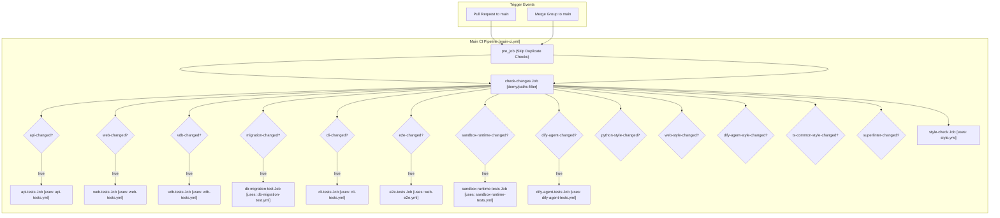
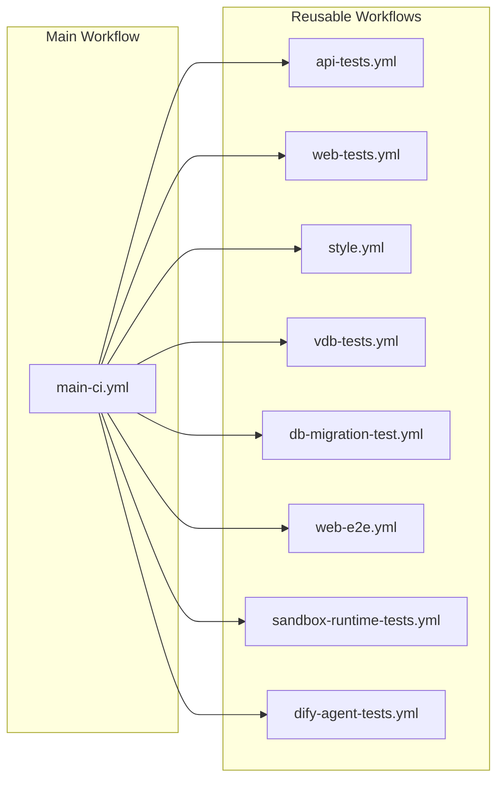
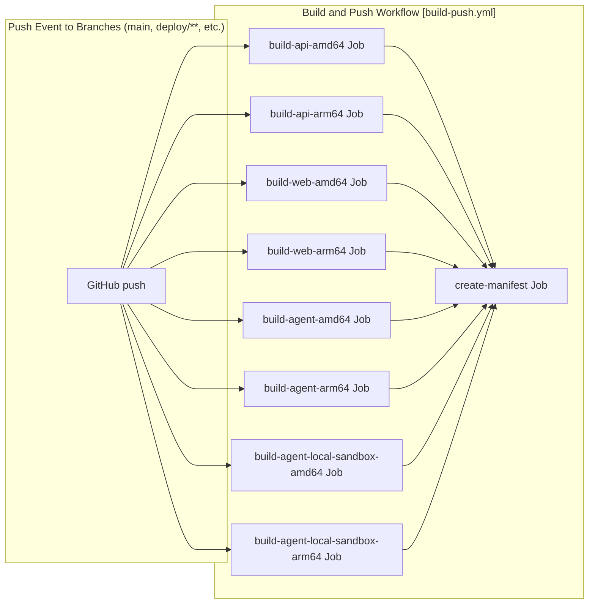
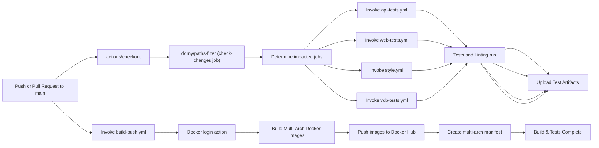

<!-- source: DeepWiki mcp.deepwiki.com · repo langgenius/dify · page 11.3 CI Pipeline Architecture · fetched 2026-10-26 -->

# CI Pipeline Architecture

<details>
<summary>Relevant source files</summary>

The following files were used as context for generating this wiki page:

- [.agents/skills/frontend-code-review/SKILL.md](.agents/skills/frontend-code-review/SKILL.md)
- [.agents/skills/frontend-code-review/references/accessibility-ui.md](.agents/skills/frontend-code-review/references/accessibility-ui.md)
- [.agents/skills/frontend-code-review/references/code-quality.md](.agents/skills/frontend-code-review/references/code-quality.md)
- [.agents/skills/frontend-code-review/references/component-architecture.md](.agents/skills/frontend-code-review/references/component-architecture.md)
- [.agents/skills/frontend-code-review/references/data-query-contracts.md](.agents/skills/frontend-code-review/references/data-query-contracts.md)
- [.agents/skills/frontend-code-review/references/dify-invariants.md](.agents/skills/frontend-code-review/references/dify-invariants.md)
- [.agents/skills/frontend-code-review/references/dify-ui.md](.agents/skills/frontend-code-review/references/dify-ui.md)
- [.agents/skills/frontend-code-review/references/performance.md](.agents/skills/frontend-code-review/references/performance.md)
- [.agents/skills/frontend-code-review/references/testing.md](.agents/skills/frontend-code-review/references/testing.md)
- [.agents/skills/frontend-testing/SKILL.md](.agents/skills/frontend-testing/SKILL.md)
- [.agents/skills/how-to-write-component/SKILL.md](.agents/skills/how-to-write-component/SKILL.md)
- [.agents/skills/how-to-write-component/references/data.md](.agents/skills/how-to-write-component/references/data.md)
- [.agents/skills/how-to-write-component/references/interactions.md](.agents/skills/how-to-write-component/references/interactions.md)
- [.agents/skills/how-to-write-component/references/ownership.md](.agents/skills/how-to-write-component/references/ownership.md)
- [.agents/skills/how-to-write-component/references/runtime.md](.agents/skills/how-to-write-component/references/runtime.md)
- [.agents/skills/how-to-write-component/references/state.md](.agents/skills/how-to-write-component/references/state.md)
- [.github/CODEOWNERS](.github/CODEOWNERS)
- [.github/dependabot.yml](.github/dependabot.yml)
- [.github/labeler.yml](.github/labeler.yml)
- [.github/linters/.yaml-lint.yml](.github/linters/.yaml-lint.yml)
- [.github/pull_request_template.md](.github/pull_request_template.md)
- [.github/workflows/api-tests.yml](.github/workflows/api-tests.yml)
- [.github/workflows/autofix.yml](.github/workflows/autofix.yml)
- [.github/workflows/db-migration-test.yml](.github/workflows/db-migration-test.yml)
- [.github/workflows/labeler.yml](.github/workflows/labeler.yml)
- [.github/workflows/main-ci.yml](.github/workflows/main-ci.yml)
- [.github/workflows/pyrefly-diff-comment.yml](.github/workflows/pyrefly-diff-comment.yml)
- [.github/workflows/pyrefly-diff.yml](.github/workflows/pyrefly-diff.yml)
- [.github/workflows/pyrefly-type-coverage-comment.yml](.github/workflows/pyrefly-type-coverage-comment.yml)
- [.github/workflows/pyrefly-type-coverage.yml](.github/workflows/pyrefly-type-coverage.yml)
- [.github/workflows/stale.yml](.github/workflows/stale.yml)
- [.github/workflows/style.yml](.github/workflows/style.yml)
- [.github/workflows/tool-test-sdks.yaml](.github/workflows/tool-test-sdks.yaml)
- [.github/workflows/translate-i18n-claude.yml](.github/workflows/translate-i18n-claude.yml)
- [.github/workflows/trigger-i18n-sync.yml](.github/workflows/trigger-i18n-sync.yml)
- [.github/workflows/vdb-tests-full.yml](.github/workflows/vdb-tests-full.yml)
- [.github/workflows/vdb-tests.yml](.github/workflows/vdb-tests.yml)
- [.github/workflows/web-e2e.yml](.github/workflows/web-e2e.yml)
- [.github/workflows/web-tests.yml](.github/workflows/web-tests.yml)
- [.vite-hooks/pre-commit](.vite-hooks/pre-commit)
- [CONTRIBUTING.md](CONTRIBUTING.md)
- [packages/dify-ui/AGENTS.md](packages/dify-ui/AGENTS.md)
- [packages/dify-ui/docs/forms.md](packages/dify-ui/docs/forms.md)
- [packages/dify-ui/docs/overlays.md](packages/dify-ui/docs/overlays.md)
- [packages/dify-ui/src/button/README.md](packages/dify-ui/src/button/README.md)
- [packages/dify-ui/src/icon-button/README.md](packages/dify-ui/src/icon-button/README.md)
- [web/AGENTS.md](web/AGENTS.md)
- [web/README.md](web/README.md)
- [web/app/components/app/text-generate/saved-items/__tests__/index.spec.tsx](web/app/components/app/text-generate/saved-items/__tests__/index.spec.tsx)
- [web/app/components/app/text-generate/saved-items/index.tsx](web/app/components/app/text-generate/saved-items/index.tsx)
- [web/docs/test.md](web/docs/test.md)

</details>


This document describes the GitHub Actions-based Continuous Integration (CI) and delivery pipeline implemented for the Dify platform. It provides an in-depth technical overview of the CI workflows, including subsystem path-based filtering, reusable workflow composition, test execution strategies, the multi-architecture Docker build and push pipeline, and code quality automations.

It focuses on how the system orchestrates workflow execution conditionally based on code changes, employs advanced build tooling with remote caching, performs automated linting and fixes, and integrates internationalization sync.

For complementary topics, see:
- [Development Environment Setup](11.1)
- [Testing Infrastructure and Strategies](11.2)
- [Code Quality and Linting](11.4)

---

## Main CI Pipeline Orchestration

The primary orchestrator of the CI pipeline is the GitHub Actions workflow declared in `.github/workflows/main-ci.yml` [1-169](). This workflow triggers on pull requests targeting the `main` branch and merge group events related to `main`.

### Key Concepts

- **Concurrency and Deduplication:** Using the `pre_job` job, it leverages the `fkirc/skip-duplicate-actions` action [22-34]() to avoid redundant CI runs by detecting identical code states and cancelling duplicates early.
- **Path-Based Filtering:** The core of conditional execution relies on the `dorny/paths-filter` action that analyzes the changed files in a pull request or push to create boolean flags indicating which subsystem(s) have been impacted [51-169]().
- **Conditional Job Execution:** Subsequent test jobs and workflows are triggered based on these flags, enabling efficient CI runs limited to relevant areas of the codebase.

### Workflow High-Level Diagram


Sources: [.github/workflows/main-ci.yml:1-169]()

### Path-Based Filtering Configuration

The path filters define which files trigger which subsystem tests or workflows. Notably, changes outside relevant paths will prevent running unrelated jobs, conserving CI resources.

| Output Variable        | Matching Paths                                                                                                                                                                   | Purpose                                    |
|-----------------------|---------------------------------------------------------------------------------------------------------------------------------------------------------------------------------|--------------------------------------------|
| `api-changed`          | `api/**`, `.github/workflows/api-tests.yml`, `docker/.env.example`, `scripts/ast_grep_guard.py`                                                                                 | Trigger API unit and integration tests     |
| `cli-changed`          | `cli/**`, `packages/contracts/**`, `package.json`, `pnpm-lock.yaml`                                                                                                             | Run CLI tests                              |
| `web-changed`          | `web/**`, `packages/**`, `package.json`, `pnpm-lock.yaml`                                                                                                                       | Run frontend web tests                     |
| `e2e-changed`          | `e2e/**`, `api/**`, `web/**`, `docker/docker-compose.middleware.yaml`                                                                                                          | Run end-to-end tests                       |
| `vdb-changed`          | `api/core/rag/datasource/**`, `api/providers/vdb/*/tests/**`, `docker/pgvector/**`                                                                                              | Vector database related tests              |
| `migration-changed`    | `api/migrations/**`, `api/.env.example`, `.github/workflows/db-migration-test.yml`                                                                                              | Database migration tests                    |
| `sandbox-runtime-changed` | `dify-agent-runtime/**`, `.github/workflows/sandbox-runtime-tests.yml`                                                                                                       | Sandbox runtime specific tests              |
| `dify-agent-changed`   | `dify-agent/**`, `.github/workflows/dify-agent-tests.yml`                                                                                                                      | Dify agent backend tests                    |
| Style and Lint Flags   | Separate paths configured specifically for Python styling, Dify agent style, Web style, TypeScript common styles, SuperLinter runs; configured similarly based on file paths       | Trigger style and lint checks               |

Sources: [.github/workflows/main-ci.yml:51-169]()

---

## Reusable Workflow Pattern

Dify adopts GitHub Actions reusable workflows extensively, organized as separate workflows that can be called from `main-ci.yml` via `workflow_call` triggers. This modularity ensures maintainability and reduces duplication in CI definitions.

The main reusable workflows include:
- `api-tests.yml`: Responsible for running backend tests.
- `web-tests.yml`: Responsible for running frontend tests including sharded Vitest runs.
- `vdb-tests.yml`: Runs vector database integration tests.
- `db-migration-test.yml`: Runs database migration validation.
- `web-e2e.yml`: Runs end-to-end tests with Playwright.
- `style.yml`: Performs multi-subsystem style and lint checks.

### Reusable Workflows Call Diagram



Sources: [.github/workflows/main-ci.yml](), [.github/workflows/api-tests.yml:4](), [.github/workflows/web-tests.yml:4](), [.github/workflows/style.yml:4](), [.github/workflows/vdb-tests.yml:4](), [.github/workflows/db-migration-test.yml:4](), [.github/workflows/web-e2e.yml:4]()

---

## Test Execution Workflows

### API Tests Workflow (`api-tests.yml`)

- Runs backend Python tests using `pytest` under the `uv` package manager environment.
- Implements test sharding for unit tests across two shards for parallelism [42-47]().
- Runs unit tests in folders like `api/tests/unit_tests`, `api/providers/vdb/*/tests/unit_tests`, and tracing provider tests [48-50]().
- Controller tests have separate jobs to avoid Flask app import collision issues [161-187]().
- Coverage data is collected and uploaded separately for unit and integration tests, then merged in a subsequent step for Codecov reports [146-160]().

Sources: [.github/workflows/api-tests.yml:17-187]()

### Web Tests Workflow (`web-tests.yml`)

- Uses Vitest for frontend testing with sharding over 4 shards to parallelize execution [19-20]().
- Installs Chromium for browser-based tests [68-70](), [103-105](), [151-153]().
- Includes unit and Storybook tests for `packages/dify-ui` [85-108](), [133-157]().
- Automatically uploads artifact reports for blob and coverage aggregation [75-83](), [110-121](), [158-169]().
- Merges reports post test to provide unified coverage stats for the frontend [38-49](), [122-131]().

Sources: [.github/workflows/web-tests.yml:13-168]()

### VDB Tests Workflow (`vdb-tests.yml`)

- Runs integration tests for various vector databases.
- Uses `pytest` with a `--start-vdb` flag to manage Docker Compose services for VDBs like Chroma, PGVector, Qdrant, and Weaviate [60-67]().
- Ensures necessary Python dependencies are installed via `uv sync --project api --dev` [45-46]().

Sources: [.github/workflows/vdb-tests.yml:14-67]()

---

## Build and Push Pipeline

The `.github/workflows/build-push.yml` workflow manages Docker image building and pushing, supporting multiple architectures and components:

### Architecture Support

- Builds for `linux/amd64` and `linux/arm64` for:
  - API backend (`api/Dockerfile`)
  - Web frontend (`web/Dockerfile`)
  - Dify Agent backend (`dify-agent/Dockerfile`)
  - Local sandbox runtime (`dify-agent-runtime` with `docker/Dockerfile`)

### Build and Push Process

- Uses the `depot/build-push-action` which supports remote caching and multi-platform builds [105-125]().
- Authentication with Docker Hub via secrets allows secure push.
- Metadata extraction (`docker/metadata-action`) generates labels and tagging.
- Digest artifacts are uploaded per build, enabling later manifest creation.
- A `create-manifest` job aggregates image digests into a multi-architecture Docker manifest for each service, allowing users to pull the image on any supported architecture seamlessly.

### Build-Push Pipeline Diagram



Sources: [.github/workflows/build-push.yml:26-216](), [api/Dockerfile:1-123](), [web/Dockerfile:1-89]()

---

## Code Owners and Labeling Strategy

The `.github/CODEOWNERS` file defines ownership by path, mapping parts of the repo to maintainers or teams responsible for the code quality and review. This automatically assigns reviewers on pull requests touching those paths.

### Codeowners Highlights

- Broad ownership by main maintainers for all files (`*` to @crazywoola and @laipz8200) [7]().
- Domain-specific ownership for Backend API, RAG services, plugins, triggers, billing, and enterprise subsystems mapped to focused individuals or teams (e.g., @JohnJyong for RAG [58-92](), @WH-2099 for plugin-related [93-99]())
- Distinct ownership for frontend codebase under `/web/` to @iamjoel [145]().
- Ownership for CLI scripts [26](), Dify Agent [30](), and E2E tests [33]() assigned accordingly.

This file ensures that PRs touching critical areas get appropriate attention automatically during review.

Sources: [.github/CODEOWNERS:1-182]()

---

## Code Quality and Automation Workflows

### Style Check Workflow (`style.yml`)

- Checks runtimes include:
  - Python style for `api` and `dify-agent` directories, running linting, architectural guards, type checking, and formatting fixes [45-132]().
  - Web style checks include TSSLint for TypeScript, dead code detection with `knip`, production build and code analysis [143-188]().
  - SuperLinter for various config and script files [226-269]().

Sources: [.github/workflows/style.yml:30-196]()

### Autofix Workflow (`autofix.yml`)

- Triggered on PRs to `main` or merge groups with checks requested [3-7]().
- Runs automatic formatting and code fixes via `ruff` for Python [75-95]() and `ast-grep` for SQLAlchemy and type modernization [97-125]().
- Regenerates API docs and frontend API contracts after fixes [131-139]().

Sources: [.github/workflows/autofix.yml:12-142]()

### Internationalization Sync (`translate-i18n-claude.yml`)

- Synchronizes translation files on trigger via repository dispatch or manual workflow dispatch [5-9]().
- Uses Claude Code bot integration for AI-assisted translation from English to supported target languages [160-169]().
- Detects incremental changes in `web/i18n/locales/en-US` JSON files on English source keys and propagates to others [107-113]().

Sources: [.github/workflows/translate-i18n-claude.yml:1-169]()

---

# Bridging Natural Language Space to Code Entity Space

## CI Pipeline Major Components and Corresponding Code Entities

```mermaid
graph TD
    NLS_CI["Natural Language System: CI Pipeline"]
    GHA["GitHub Actions Workflows"]
    MCI["Main CI Orchestrator"]
    PATHF["Path-Based Filter"]
    BUILDPUSH["Build and Push Pipeline"]
    CODEOWNERS["CODEOWNERS and Labeling"]

    # Relation edges
    NLS_CI --> GHA
    GHA --> MCI["main-ci.yml (.github/workflows/main-ci.yml)"]
    MCI --> PATHF["dorny/paths-filter action (main-ci.yml: check-changes job)"]
    MCI --> TESTS["Reusable workflows (api-tests.yml, web-tests.yml, style.yml, etc.)"]
    GHA --> BUILDPUSH["build-push.yml (.github/workflows/build-push.yml)"]
    GHA --> CODEOWNERS
    CODEOWNERS --> CODEOWNERS_FILE[".github/CODEOWNERS"]

    classDef fileStyle fill:none,stroke-width:0;
    class MCI,PATHF,BUILDPUSH,CODEOWNERS_FILE fileStyle;
```

Sources: [.github/workflows/main-ci.yml:1-169](), [.github/workflows/build-push.yml:1-216](), [.github/CODEOWNERS:1-182]()

---

## Detailed CI Pipeline Data Flow from Push/PR to Image Deployment



Sources: [.github/workflows/main-ci.yml](), [.github/workflows/build-push.yml]()

---

# Summary

The Dify CI pipeline architecture is a well-orchestrated GitHub Actions-based system that:

- Uses a single entrypoint interface via `main-ci.yml` with path-based filtering to optimize test execution.
- Implements a modular reusable workflow pattern allowing independent evolution of subsystem-level CI tasks.
- Supports multi-architecture Docker image builds and multi-stage push pipelines via build matrix strategies.
- Automates code style enforcement through dedicated workflows with conditional runs based on changed files.
- Utilizes code ownership and labeling to ensure code quality and streamlined review processes.
- Integrates internationalization translation sync as part of the CI workflow for localization consistency.

This architecture ensures efficient, scalable, and maintainable CI processes tailored to the monorepo layout and diverse Dify platform components.

Sources: Multiple files as detailed in each section.

---

