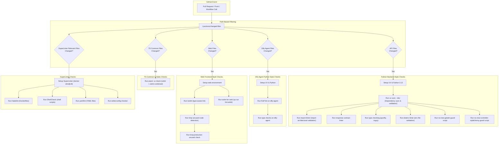
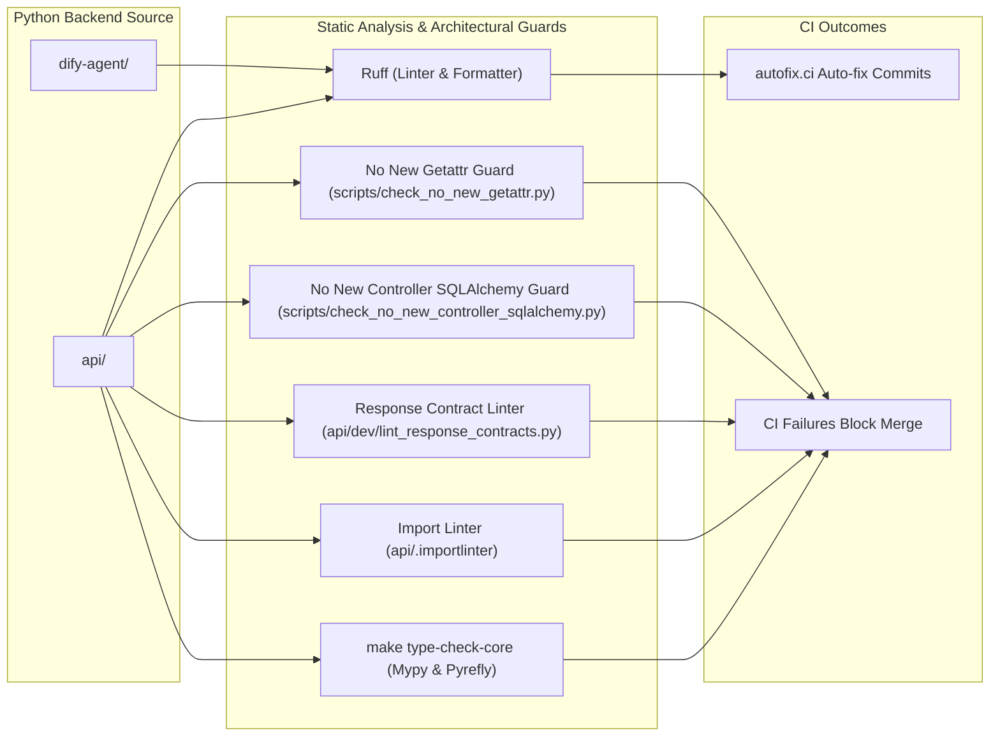
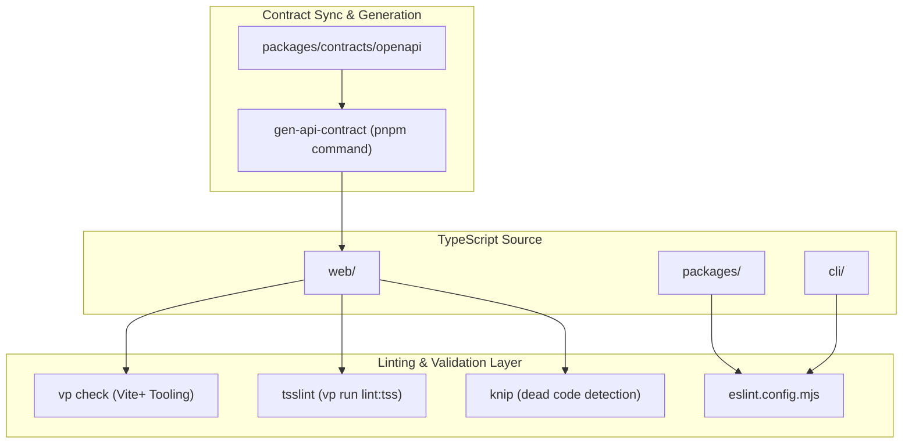

<!-- source: DeepWiki mcp.deepwiki.com · repo langgenius/dify · page 11.4 Code Quality and Linting · fetched 2026-10-26 -->

# Code Quality and Linting

Relevant source files

The following files were used as context for generating this wiki page:

- [.github/actions/setup-web/action.yml](.github/actions/setup-web/action.yml)
- [AGENTS.md](AGENTS.md)
- [api/.importlinter](api/.importlinter)
- [api/.ruff.toml](api/.ruff.toml)
- [api/controllers/console/app/wraps.py](api/controllers/console/app/wraps.py)
- [api/controllers/console/flask_admission.py](api/controllers/console/flask_admission.py)
- [api/controllers/console/wraps.py](api/controllers/console/wraps.py)
- [api/controllers/service_api/wraps.py](api/controllers/service_api/wraps.py)
- [api/core/entities/mcp_provider.py](api/core/entities/mcp_provider.py)
- [api/core/external_data_tool/api/api.py](api/core/external_data_tool/api/api.py)
- [api/core/model_manager.py](api/core/model_manager.py)
- [api/extensions/ext_application_services.py](api/extensions/ext_application_services.py)
- [api/libs/helper.py](api/libs/helper.py)
- [api/libs/login.py](api/libs/login.py)
- [api/machinery/__init__.py](api/machinery/__init__.py)
- [api/machinery/context.py](api/machinery/context.py)
- [api/machinery/errors.py](api/machinery/errors.py)
- [api/services/account_errors.py](api/services/account_errors.py)
- [api/services/account_ports.py](api/services/account_ports.py)
- [api/services/data_source/provider_service.py](api/services/data_source/provider_service.py)
- [api/services/entities/account_entities.py](api/services/entities/account_entities.py)
- [api/tasks/annotation/batch_import_annotations_task.py](api/tasks/annotation/batch_import_annotations_task.py)
- [api/tasks/annotation/disable_annotation_reply_task.py](api/tasks/annotation/disable_annotation_reply_task.py)
- [api/tasks/annotation/enable_annotation_reply_task.py](api/tasks/annotation/enable_annotation_reply_task.py)
- [api/tasks/clean_notion_document_task.py](api/tasks/clean_notion_document_task.py)
- [api/tasks/deal_dataset_index_update_task.py](api/tasks/deal_dataset_index_update_task.py)
- [api/tasks/document_indexing_update_task.py](api/tasks/document_indexing_update_task.py)
- [api/tasks/mail_account_deletion_task.py](api/tasks/mail_account_deletion_task.py)
- [api/tasks/recover_document_indexing_task.py](api/tasks/recover_document_indexing_task.py)
- [api/tasks/trigger_subscription_refresh_tasks.py](api/tasks/trigger_subscription_refresh_tasks.py)
- [api/tests/unit_tests/.ruff.toml](api/tests/unit_tests/.ruff.toml)
- [api/tests/unit_tests/controllers/console/app/test_app_apis.py](api/tests/unit_tests/controllers/console/app/test_app_apis.py)
- [api/tests/unit_tests/controllers/console/app/test_conversation_api.py](api/tests/unit_tests/controllers/console/app/test_conversation_api.py)
- [api/tests/unit_tests/controllers/console/app/test_wraps.py](api/tests/unit_tests/controllers/console/app/test_wraps.py)
- [api/tests/unit_tests/controllers/console/test_wraps.py](api/tests/unit_tests/controllers/console/test_wraps.py)
- [api/tests/unit_tests/core/mcp/client/test_session.py](api/tests/unit_tests/core/mcp/client/test_session.py)
- [api/tests/unit_tests/core/mcp/test_error.py](api/tests/unit_tests/core/mcp/test_error.py)
- [api/tests/unit_tests/core/prompt/test_agent_history_prompt_transform.py](api/tests/unit_tests/core/prompt/test_agent_history_prompt_transform.py)
- [api/tests/unit_tests/core/prompt/test_prompt_message.py](api/tests/unit_tests/core/prompt/test_prompt_message.py)
- [api/tests/unit_tests/core/prompt/test_prompt_transform.py](api/tests/unit_tests/core/prompt/test_prompt_transform.py)
- [api/tests/unit_tests/core/prompt/test_simple_prompt_transform.py](api/tests/unit_tests/core/prompt/test_simple_prompt_transform.py)
- [api/tests/unit_tests/core/test_model_manager.py](api/tests/unit_tests/core/test_model_manager.py)
- [api/tests/unit_tests/core/variables/test_segment.py](api/tests/unit_tests/core/variables/test_segment.py)
- [api/tests/unit_tests/core/variables/test_segment_type.py](api/tests/unit_tests/core/variables/test_segment_type.py)
- [api/tests/unit_tests/core/variables/test_variables.py](api/tests/unit_tests/core/variables/test_variables.py)
- [api/tests/unit_tests/core/workflow/graph_engine/test_table_runner.py](api/tests/unit_tests/core/workflow/graph_engine/test_table_runner.py)
- [api/tests/unit_tests/extensions/test_ext_application_services.py](api/tests/unit_tests/extensions/test_ext_application_services.py)
- [api/tests/unit_tests/libs/test_helper.py](api/tests/unit_tests/libs/test_helper.py)
- [api/tests/unit_tests/libs/test_login.py](api/tests/unit_tests/libs/test_login.py)
- [api/tests/unit_tests/pyrefly.toml](api/tests/unit_tests/pyrefly.toml)
- [api/tests/unit_tests/tasks/test_document_indexing_update_task.py](api/tests/unit_tests/tasks/test_document_indexing_update_task.py)
- [cli/AGENTS.md](cli/AGENTS.md)
- [cli/ARD.md](cli/ARD.md)
- [cli/vite.config.ts](cli/vite.config.ts)
- [eslint.config.mjs](eslint.config.mjs)
- [lint.config.ts](lint.config.ts)
- [package.json](package.json)
- [packages/dify-ui/README.md](packages/dify-ui/README.md)
- [packages/dify-ui/package.json](packages/dify-ui/package.json)
- [packages/dify-ui/src/scroll-area/__tests__/index.spec.tsx](packages/dify-ui/src/scroll-area/__tests__/index.spec.tsx)
- [packages/dify-ui/src/scroll-area/index.stories.tsx](packages/dify-ui/src/scroll-area/index.stories.tsx)
- [packages/dify-ui/src/scroll-area/index.tsx](packages/dify-ui/src/scroll-area/index.tsx)
- [packages/dify-ui/tsconfig.json](packages/dify-ui/tsconfig.json)
- [pnpm-lock.yaml](pnpm-lock.yaml)
- [pnpm-workspace.yaml](pnpm-workspace.yaml)
- [vite.config.ts](vite.config.ts)
- [web/docs/lint.md](web/docs/lint.md)
- [web/plugins/eslint/index.js](web/plugins/eslint/index.js)
- [web/plugins/eslint/rules/no-app-store-imports.js](web/plugins/eslint/rules/no-app-store-imports.js)
- [web/plugins/eslint/rules/no-app-store-imports.test.js](web/plugins/eslint/rules/no-app-store-imports.test.js)
- [web/vite.config.ts](web/vite.config.ts)

This document describes the code quality enforcement and linting infrastructure used across the Dify codebase. It covers the static analysis tools, formatters, type checkers, import architecture validation, response contract linting, and automated fix systems that maintain code consistency and catch errors before runtime.

For information about testing infrastructure and test execution, see [11.2 Testing Infrastructure and Strategies](). For CI pipeline architecture and workflow orchestration, see [11.3 CI Pipeline Architecture]().

---

## Overview and Tool Ecosystem

The Dify project employs a multi-layered code quality strategy with dedicated tools for Python backend, TypeScript/JavaScript frontend, shell scripts, YAML, Dockerfiles, and configuration files. All quality checks are integrated into GitHub Actions workflows that run on pull requests and commits to the main branch.

### Code Quality Tool Matrix

| Language/File Type     | Linter / Validator            | Formatter           | Type Checker          | Dead Code Detector | Import Validator   |
|-----------------------|------------------------------|---------------------|-----------------------|--------------------|-------------------|
| Python                | Ruff                         | Ruff                | mypy / pyrefly        | -                  | import-linter     |
| TypeScript/JavaScript | ESLint / oxlint              | ESLint (--fix)      | tsc                   | knip               | tsslint           |
| Shell Scripts         | ShellCheck                   | -                   | -                     | -                  | -                 |
| YAML                  | yamllint                     | -                   | -                     | -                  | -                 |
| Dockerfile            | Hadolint                     | -                   | -                     | -                  | -                 |
| Editorconfig          | editorconfig-checker         | -                   | -                     | -                  | -                 |
| Dotenv                | dotenv-linter                | -                   | -                     | -                  | -                 |

The comprehensive validation process includes style conformity, static error checking, import architectural boundary enforcement, and type checking.

**Sources:** [.github/workflows/style.yml:15-220](), [package.json:5-20](), [api/.importlinter:1-121]()

---

## CI/CD Integration Architecture

### Style Check Workflow Architecture

Code quality checks are centralized in the GitHub Actions workflow `.github/workflows/style.yml`. It uses path-based filtering (`tj-actions/changed-files`) to dynamically determine which linting or type checking tasks to run based on changed files. This optimizes resource usage while maintaining strict code quality enforcement.

This design ensures targeted style checks and type validation efficiently span the entire monorepo, including API backend, frontend, and agent runtimes.

**Sources:** [.github/workflows/style.yml:15-208](), [.github/workflows/main-ci.yml:50-150](), [package.json:5-20]()

---

## Python Code Quality Tools

### Ruff: Fast Python Linter and Formatter

Ruff handles linting and formatting for Python sources in `api/` and `dify-agent/`:

- **Linting and style enforcement:** Ruff analyses code for errors, code smells, and style issues using a configured set of rules including pyflakes, pycodestyle, bugbear, and security scanning. The configuration file is `api/.ruff.toml`.
- **Formatting:** Ruff can also be run in format mode to reformat code automatically.
- **CI auto-fixing:** In GitHub workflows, Ruff is run on PRs in autofix mode to patch many trivial issues automatically, improving developer experience.

Ruff configuration uses a selective rule set including security, simplification, naming conventions, import sorting, and disallowing unsafe constructs like `eval()` or `exec()`.

**Sources:** [api/.ruff.toml:1-78](), [.github/workflows/autofix.yml:75-95](), [.github/workflows/style.yml:46-90]()

---

### Import Linter: Enforcing Backend Layer Architecture

The backend is organized into distinct layers: `controllers` (transport), `services` (application logic), `core` (domain), and `libs` (shared utilities). Import rules are enforced strictly to prevent architectural violations. The import-linter tool verifies imports across these root packages against specified contracts.

- `api/.importlinter` defines the root packages.
- The contract `backend-layers` defines valid layering order: controllers → services → core → libs.
- Numerous exceptions are explicitly listed for legacy paths exempt from errors temporarily.
- Additional contracts enforce banning direct imports of sensitive modules (e.g. RSA key handling).

This setup ensures maintainable, modular backend code, catching accidental dependency cycles or mixing of layers early during lint.

**Sources:** [api/.importlinter:1-121]()

---

### Response Contract Linter

A custom linting script (`api/dev/lint_response_contracts.py`) verifies that backend API controllers return responses conforming exactly to the OpenAPI contracts.

- This ensures runtime API outputs strictly match defined schemas.
- Validates response shapes, field presence, and types.
- Integrated as a step in the backend style check workflow.

This boosts API contract adherence, preventing silent contract drift or incompatible API changes.

**Sources:** [.github/workflows/style.yml:75-83]()

---

### Specialized Python Guards

- **No New Getattr Guard:** Runs a script (`scripts/check_no_new_getattr.py`) to detect unreviewed dynamic attribute usage (`getattr`), a pattern discouraged to improve code robustness [scripts/check_no_new_getattr.py (implied)].
- **No New Controller SQLAlchemy Guard:** A script (`scripts/check_no_new_controller_sqlalchemy.py`) scans controllers to disallow new direct SQLAlchemy ORM usage. This enforces controller/service separation and improves testability [scripts/check_no_new_controller_sqlalchemy.py (implied)].

These additional guarded checks improve maintainability and safety beyond basic linting.

---

### Type Checking: Pyrefly and Mypy

Type checking combines:

- **Pyrefly:** A Rust-based fast Python type checker that is the default for new checks.
- **Mypy:** The legacy but comprehensive checker still used for some strict analysis.

`make type-check-core` runs both tools configured for strictness. Environment variable `PYREFLY_OUTPUT_FORMAT=github` formats output for GitHub annotations.

This step enforces type correctness, catching many bugs before runtime.

**Sources:** [.github/workflows/style.yml:91-96](), [api/tests/unit_tests/pyrefly.toml:1-24]()

---

## TypeScript / JavaScript Code Quality Tools

### ESLint and Oxlint

The frontend uses a dual approach for linting TypeScript/JavaScript code:

- **Oxlint:** A very fast linter suited to large frontend codebases, invoked via `vp lint`.
- **ESLint:** For React-specific rules, markdown, custom stylistic checks, and fixes (`eslint.config.mjs`).

Running `pnpm -w check` and commands like `vp run lint:eslint` ensure correctness, style, and catch common mistakes.

---

### Dead Code Detection with Knip

`knip` tool analyzes dependencies and source files in the `web` workspace to detect unused imports, files, or dead code.

- Two modes run: standard and production.
- Used to keep the frontend clean from unused declarations that bloat bundles.
- Invoked via npm scripts `knip` and `knip:production` defined in `package.json`.

---

### TSSlint: TypeScript-aware Linting

`tsslint` adds type-aware linting on top of ESLint/Oxlint for the `web` workspace, providing enhanced precision using TypeScript AST and type info.

It runs via command `vp lint:tss`.

**Sources:** [package.json:5-20](), [.github/workflows/style.yml:110-154]()

---

## SuperLinter and Auxiliary Checks

GitHub SuperLinter is employed as a general validator for miscellaneous file types and shell scripts:

- **Hadolint:** Lints Dockerfiles for best practices.
- **ShellCheck:** Detects shell scripting errors and warnings.
- **yamllint:** Validates YAML syntax and style.
- **editorconfig-checker:** Verifies editorconfig formatting requirements.
- **dotenv-linter:** Checks `.env` file correctness.

These run as separate jobs to safeguard infrastructure and config quality across the repo.

**Sources:** [.github/workflows/style.yml:185-208]()

---

## Automated Fix System

The autofix CI job automatically applies style and correctness fixes on pull requests:

1. **Ruff autofix:** Runs Ruff with `--fix` on Python sources in `api/` and `dify-agent/`.  
2. **AST-Grep rewrites:** Uses the `ast-grep` CLI with YAML rules to modernize Python code style:
   - Migrates `db.session.query(...).filter(...)` → `.where(...)`.
   - Converts `db.Column` to `mapped_column`.
   - Transforms `Optional[T]` annotations to `T | None`.
   - Fixes forward reference typing annotations.
3. **Regenerates API contracts:** Runs `pnpm --dir packages/contracts gen-api-contract` to update frontend contracts after backend changes.
4. **Internationalization Sync:** Synchronizes i18n translation JSONs with AI-generated translations via a GitHub action using Claude code agent.

This automation keeps the codebase modern and consistent without manual intervention.

**Sources:** [.github/workflows/autofix.yml:10-135](), [.github/workflows/autofix.yml:142](), [.github/workflows/translate-i18n-claude.yml:1-172]()

---

## Bridging Natural Language Space to Code Entities

The diagrams below illustrate how the code quality tooling relates to specific repository areas and code entities in the Dify platform. This mapping aids navigation and understanding of where enforcement happens in the codebase.

### Diagram 1: Python Backend Quality Pipeline

This diagram shows source directories feeding into linting and architectural validation steps, which trigger either autofix commits or enforce CI blocking failures if violations occur.

---

### Diagram 2: Web Frontend Quality Stack

This diagram illustrates how the frontend source trees feed into linting tools and how API contracts regenerate TypeScript typings consumed by the frontend.

---

## Summary of Key Quality Commands

| Context      | Command                                   | Description                                             |
|--------------|-------------------------------------------|---------------------------------------------------------|
| **Workspace**| `pnpm check`                              | Runs combined static checks (oxlint + eslint)           |
| **Workspace**| `pnpm knip`                               | Detect unused files and code                             |
| **Web**      | `vp lint`                                 | Run oxlint for fast linting                             |
| **Web**      | `vp test`                                 | Run Vitest tests with coverage                          |
| **API**      | `uv run ruff format .`                    | Format Python code with Ruff                            |
| **API**      | `make type-check-core`                    | Run strict type checking (mypy and pyrefly)            |
| **Contracts**| `pnpm --dir packages/contracts gen-api-contract` | Generate TypeScript API contracts from OpenAPI specs     |

---

# Key Takeaways

- Dify’s code quality tooling comprehensively covers Python backend, Dify Agent runtimes, TypeScript frontend, and infrastructure/configuration files.
- Ruff is the unified tool for Python lint and format, supported by strict import layering contracts and custom architectural guards.
- TypeScript uses a mixed approach with Oxlint for speed, ESLint for complexity, supplemented by dead code detection via knip.
- GitHub Actions orchestrate the entire toolset with granular path-based triggers and autofix workflows.
- Import-linter enforces strict module layering preventing dependency cycles or architectural erosion.
- Response contract linting ensures API outputs conform tightly to backend API schema specifications.
- Automated fixes using Ruff and ast-grep maintain a modern, consistent, and safe code base.

**Sources:**  
[.github/workflows/style.yml:1-208](),  
[.github/workflows/autofix.yml:1-140](),  
[api/.importlinter:1-121](),  
[package.json:5-20](),  
[.github/workflows/main-ci.yml:30-150]()

---

