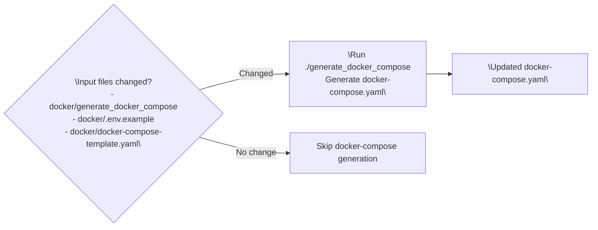

<!-- source: DeepWiki mcp.deepwiki.com · repo langgenius/dify · page 11.5 Automated Fixes and Code Modernization · fetched 2026-10-26 -->

# Automated Fixes and Code Modernization

<details>
<summary>Relevant source files</summary>

The following files were used as context for generating this wiki page:

- [.github/workflows/api-tests.yml](.github/workflows/api-tests.yml)
- [.github/workflows/autofix.yml](.github/workflows/autofix.yml)
- [.github/workflows/db-migration-test.yml](.github/workflows/db-migration-test.yml)
- [.github/workflows/main-ci.yml](.github/workflows/main-ci.yml)
- [.github/workflows/pyrefly-diff-comment.yml](.github/workflows/pyrefly-diff-comment.yml)
- [.github/workflows/pyrefly-diff.yml](.github/workflows/pyrefly-diff.yml)
- [.github/workflows/pyrefly-type-coverage-comment.yml](.github/workflows/pyrefly-type-coverage-comment.yml)
- [.github/workflows/pyrefly-type-coverage.yml](.github/workflows/pyrefly-type-coverage.yml)
- [.github/workflows/style.yml](.github/workflows/style.yml)
- [.github/workflows/tool-test-sdks.yaml](.github/workflows/tool-test-sdks.yaml)
- [.github/workflows/translate-i18n-claude.yml](.github/workflows/translate-i18n-claude.yml)
- [.github/workflows/trigger-i18n-sync.yml](.github/workflows/trigger-i18n-sync.yml)
- [.github/workflows/vdb-tests-full.yml](.github/workflows/vdb-tests-full.yml)
- [.github/workflows/vdb-tests.yml](.github/workflows/vdb-tests.yml)
- [.github/workflows/web-e2e.yml](.github/workflows/web-e2e.yml)
- [.github/workflows/web-tests.yml](.github/workflows/web-tests.yml)
- [Makefile](Makefile)
- [api/AGENTS.md](api/AGENTS.md)
- [api/controllers/API_SCHEMA_GUIDE.md](api/controllers/API_SCHEMA_GUIDE.md)
- [api/dev/lint_response_contracts.py](api/dev/lint_response_contracts.py)
- [api/tests/unit_tests/commands/test_check_no_new_base_model.py](api/tests/unit_tests/commands/test_check_no_new_base_model.py)
- [api/tests/unit_tests/commands/test_lint_response_contracts.py](api/tests/unit_tests/commands/test_lint_response_contracts.py)
- [packages/contracts/openapi-ts.api.config.ts](packages/contracts/openapi-ts.api.config.ts)
- [packages/contracts/package.json](packages/contracts/package.json)
- [packages/jotai-tanstack-form/package.json](packages/jotai-tanstack-form/package.json)
- [scripts/ast_grep_rules/no_new_base_model.yml](scripts/ast_grep_rules/no_new_base_model.yml)
- [scripts/check_no_new_base_model.py](scripts/check_no_new_base_model.py)

</details>


## Purpose and Scope

This page documents the automated fix pipeline that continuously enforces code quality, formatting, structural rewrites, and modernization improvements in the Dify codebase. The autofix workflow is triggered on pull requests and pushes targeting the `main` branch and performs automatic commits of fixes back to the branch. The system covers:

- Regeneration of Docker Compose files from templates.
- Automatic Python code style enforcement and fixups using Ruff.
- Structural source transformations via AST-based rewriting (`ast-grep`), notably modernizing SQLAlchemy usage.
- Migration of Python typing annotations (`Optional[T]` → `T | None`) with compatibility fixes.
- Automated Swagger/OpenAPI markdown docs and frontend contract generation.
- ESLint auto-fixes for web frontend lint issues and Vite+ static analysis fixes.
- Automated i18n synchronization using AI agents (Claude Code).

This automated modernization pipeline ensures gradual migration to current best practices such as SQLAlchemy 2.0 API usage and consolidated formatting, with minimal manual intervention. The implementation is primarily defined in the `.github/workflows/autofix.yml` GitHub Actions workflow.

Sources:  
[.github/workflows/autofix.yml:1-142](),  
[.github/workflows/translate-i18n-claude.yml:1-169]()

---

## Autofix Workflow Architecture

The autofix workflow performs a sequential pipeline of code and doc generation steps, orchestrated to detect changed files and conditionally apply fixes.

```mermaid
graph TB
    Trigger["\"**Trigger Events**\nPR to main\nPush to main\nMerge group check\""]

    RepoCheck{"\"Repository Check\ngithub.repository ==\n'langgenius/dify'?\""}

    Checkout["\"actions/checkout@v7\nCheckout PR branch\""]

    subgraph DockerCompose["\"**Docker Compose Generation**\""]
        CheckDocker["\"tj-actions/changed-files\nFiles: docker/generate_docker_compose\ndocker/.env.example\ndocker/docker-compose-template.yaml\""]

        GenDocker["\"./docker/generate_docker_compose\nRegenerate docker-compose.yaml\""]
    end

    subgraph PythonFixes["\"**Python Formatting and Fixes**\""]
        SetupUV["\"astral-sh/setup-uv@v10\nInstall UV manager\""]

        UVSync["\"uv sync --dev\nInstall api/ dependencies\""]

        RuffFormat1["\"uv run ruff format ..\nInitial formatting pass\""]

        RuffCheck["\"uv run ruff check --fix .\nFix lint errors\""]

        RuffFormat2["\"uv run ruff format ..\nFinal formatting pass\""]
    end

    subgraph CodeModernization["\"**Code Modernization**\""]
        AstGrep1["\"ast-grep:\nfilter() → where()\""]

        AstGrep2["\"ast-grep:\nColumn() → mapped_column()\""]

        AstGrep3["\"ast-grep rule:\nOptional[T] → T | None\""]

        SedFix["\"sed: Fix forward refs\n'Type' | None → Optional['Type']\""]
    end

    subgraph ContractsDocs["\"**Documentation & Contracts**\""]
        GenSwagger["\"uv run dev/generate_swagger_markdown_docs.py\nUpdate API docs\""]
        GenContracts["\"pnpm gen-api-contract\nUpdate frontend types\""]
    end

    subgraph WebFixes["\"**Web Fixes**\""]
        SetupWebEnv["\"./.github/actions/setup-web\nSetup web environment\""]
        WebLintFix["\"pnpm lint:eslint:fix\nESLint auto-fix\""]
        ViteStaticFix["\"vp check --fix\nVite+ static autofix\""]
    end

    Commit["\"autofix-ci/action\nCommit and push all changes\""]

    Trigger --> RepoCheck
    RepoCheck -->|Yes| Checkout
    RepoCheck -->|No| Skip[Skip autofix]

    Checkout --> CheckDocker
    CheckDocker -->|"Changed"| GenDocker
    CheckDocker -->|"No change"| PythonFixes
    GenDocker --> PythonFixes

    PythonFixes --> CodeModernization
    CodeModernization --> ContractsDocs

    ContractsDocs --> WebFixes
    WebFixes --> Commit
```

- **Trigger Events**: The workflow activates on pull requests, pushes, and merge group check events targeting `main` [.github/workflows/autofix.yml:2-9]().
- **Repository Restriction**: Only runs on the official `langgenius/dify` repository to avoid commit loops on forks [.github/workflows/autofix.yml:13-13]().
- **Docker Compose Generation**: Rebuilds `docker-compose.yaml` if relevant files in the `docker/` directory changed [.github/workflows/autofix.yml:24-33]().
- **Python Fixes**: Runs Ruff formatting and auto-fixing in a three-stage pipeline for both `api/` and `dify-agent/` [.github/workflows/autofix.yml:75-95]().
- **Code Modernization**: Structural AST-based rewrites to migrate SQLAlchemy code and typing modernization [.github/workflows/autofix.yml:97-125]().
- **Docs & Contracts**: Regenerate Swagger API docs and frontend TypeScript contracts using `gen-api-contract` [.github/workflows/autofix.yml:131-140]().
- **Web Fixes**: The provided `autofix.yml` does not explicitly show web linting steps, but the general architecture allows for such integrations.
- **Final Commit**: Uses the `autofix-ci/action` to create and push a commit if changes exist [.github/workflows/autofix.yml:142]().

Sources:  
[.github/workflows/autofix.yml:1-142]()

---

## Docker Compose Generation

To keep local deployment Docker Compose files in sync with templates, the autofix pipeline regenerates `docker-compose.yaml` using the `docker/generate_docker_compose` script when any of the following inputs change:

| Input File                            | Role                                      |
|---------------------------------------|-------------------------------------------|
| `docker/generate_docker_compose`      | Generation script executable              |
| `docker/.env.example`                 | Base environment variable defaults        |
| `docker/docker-compose-template.yaml` | Compose file template                     |
| `docker/docker-compose.yaml`          | Generated Compose file that's updated     |

This step is conditional: it only runs if one or more of these files are modified in the current workflow run [.github/workflows/autofix.yml:24-33]().



Sources:  
[.github/workflows/autofix.yml:24-73]()

---

## Ruff: Python Formatting and Auto-fixing

Ruff is the primary tool used for Python code formatting, linting, and autofixing across the backend Python server (`api/`) and the agent backend (`dify-agent/`).

### Three-Stage Ruff Pipeline

```mermaid
graph LR
    Setup["\"Setup: uv sync --dev\nInstall Python deps\""]

    Format1["\"Stage 1: uv run ruff format .\nInitial code formatting\""]
    FixLint["\"Stage 2: uv run ruff check --fix .\nApply auto lint fixes\""]
    Format2["\"Stage 3: uv run ruff format .\nFinal formatting pass\""]

    Codebase["\"Python source code\n(api/ or dify-agent/ *.py files)\""] --> Setup
    Setup --> Format1
    Format1 --> FixLint
    FixLint --> Format2
    Format2 --> Fixed["\"Cleaned and formatted code\""]
```

- **Stage 1: Initial Format**  
  Prevents errors like "line too long" from blocking later lint fixes by formatting first [.github/workflows/autofix.yml:80-80]().

- **Stage 2: Lint and Fix**  
  Applies Ruff's automatic lint fixes (removing unused imports, fixing syntax issues, enforcing style rules) [.github/workflows/autofix.yml:82-82]().

- **Stage 3: Re-format**  
  Ensures code remains consistently formatted after automatic fixes have taken place [.github/workflows/autofix.yml:84-84]().

Sources:  
[.github/workflows/autofix.yml:75-95](),  
[.github/workflows/style.yml:100-101]()

---

## AST-grep: Structural Code Transformations

Structural code rewriting is performed using `ast-grep`, enabling precise transformations that go beyond text-based regex.

### SQLAlchemy 2.0 Modernization

Dify gradually migrates legacy SQLAlchemy patterns to the modern 2.0 API declarative style automatically:

| Legacy Pattern                                | Modernized Pattern                  | Purpose                                  |
|-----------------------------------------------|-------------------------------------|------------------------------------------|
| `db.session.query($W).filter($H)`             | `db.session.query($W).where($H)`    | Replace deprecated `.filter()` with `.where()` [.github/workflows/autofix.yml:101-101]() |
| `session.query($W).filter($H)`                | `session.query($W).where($H)`       | Same as above, for local `session` usage [.github/workflows/autofix.yml:102-102]() |
| `$A = db.Column($$$B)`                        | `$A = mapped_column($$$B)`          | Switch to `mapped_column` declarative style [.github/workflows/autofix.yml:103-103]() |
| `$A : $T = db.Column($$$B)`                   | `$A : $T = mapped_column($$$B)`     | Same as above but with type annotations [.github/workflows/autofix.yml:104-104]() |

### Modernizing Type Annotations

Dify converts `Optional[T]` to the newer Python union syntax `T | None` using a custom `ast-grep` inline rule [.github/workflows/autofix.yml:106-122]().

Because Python does not support union annotations with quoted forward references (e.g. `"Type" | None` is invalid), a post-processing `sed` step reverts such cases back to the fully qualified `Optional["Type"]` syntax for compatibility [.github/workflows/autofix.yml:123-124]().

```mermaid
graph TD
    LegacyQuery["\"Legacy: session.query(...).filter(...)\""]
    NewQuery["\"Modern: session.query(...).where(...)\""]
    LegacyColumn["\"Legacy: db.Column(...)\""]
    NewColumn["\"Modern: mapped_column(...)\""]
    LegacyOpt["\"Legacy: Optional[T]\""]
    NewUnion["\"Modern: T | None\""]
    ForwardRefFix["\"Fix: Optional['Type'] for forward refs\""]

    LegacyQuery -->|ast-grep rewrite| NewQuery
    LegacyColumn -->|ast-grep rewrite| NewColumn
    LegacyOpt -->|ast-grep rewrite (inline-rules)| NewUnion
    NewUnion -->|sed fix| ForwardRefFix
```

Sources:  
[.github/workflows/autofix.yml:97-125]()

---

## Web and Documentation Fixes

### API Documentation and Frontend Contract Generation

Whenever API/backend source files change, the autofix workflow automatically regenerates:

- **Swagger Markdown Docs**: Using the script `api/dev/generate_swagger_markdown_docs.py`, OpenAPI specs are converted to markdown documentation [.github/workflows/autofix.yml:134-136]().
- **Frontend API Contracts**: Runs `pnpm gen-api-contract` inside `packages/contracts` to update TypeScript-generated API client types and contracts in sync with the backend [.github/workflows/autofix.yml:138-138]().

### Web Frontend Lint Fixes

The provided `autofix.yml` does not explicitly show web linting steps like `pnpm lint:eslint:fix` or `vp check --fix`. However, the `web-style-checks` job in `.github/workflows/style.yml` performs these checks:

- `vp run i18n:check-types` for generated i18n types [.github/workflows/style.yml:170-170]().
- `vp run lint:tss` for TypeScript linting [.github/workflows/style.yml:174-174]().
- `vp run knip` for dead code checks [.github/workflows/style.yml:178-183]().

While these are checks, the autofix workflow could be extended to include `pnpm lint:eslint:fix` and `vp check --fix` if desired, similar to how Python Ruff fixes are applied.

### AI-Driven i18n Synchronization

Dify uses a dedicated workflow `translate-i18n-claude.yml` that leverages Claude Code to keep translations synchronized with the English source files under `web/i18n/en-US/` [.github/workflows/translate-i18n-claude.yml:168-169](). This agent:

- Detects changes in English JSON files [.github/workflows/translate-i18n-claude.yml:109-111]().
- Automatically translates and updates target language files listed in `web/i18n/languages.ts` [.github/workflows/translate-i18n-claude.yml:60-68]().

Sources:  
[.github/workflows/autofix.yml:131-140](),  
[.github/workflows/translate-i18n-claude.yml:1-169](),  
[.github/workflows/style.yml:170-183]()

---

## Autofix Commit Mechanism

All automated changes performed by the autofix pipeline are committed and pushed back to the branch via the `autofix-ci/action`.

```mermaid
graph LR
    Steps["\"**Autofix Steps**\nDocker gen\nRuff format/lint\nast-grep transforms\nDocs/Contracts gen\""]

    Detect["\"**autofix-ci/action**\ngit status\nDetect changed files\""]

    Commit["\"Create Commit\nAuthor: github-actions[bot]\nMessage: 'autofix: apply automated fixes'\""]

    Push["\"Push to branch\ngit push origin <PR-branch>\""]

    Steps --> Detect
    Detect -->|Changes found| Commit
    Commit --> Push
    Detect -->|No changes| End["No commit; workflow ends"]
```

Sources:  
[.github/workflows/autofix.yml:142]()

---

## Mapping Subsystems to Code Entities

This diagram bridges natural language descriptions of autofix subsystems with their respective key code entities.

```mermaid
graph TD
    NL_AF["\"Autofix Workflow\""]
    NL_RUFF["\"Python Ruff Formatting\""]
    NL_ASTGREP["\"AST Grep Rewrites\""]
    NL_DOCKER["\"Docker Compose Generation\""]
    NL_DOCS["\"API Docs and Contracts\""]
    NL_I18N["\"AI i18n Translation\""]
    NL_WEB_LINT["\"Web Frontend Linting\""]

    CE_WORKFLOW["\"Workflow: .github/workflows/autofix.yml\""]
    CE_RUFF["\"Commands: uv run ruff format/check --fix\""]
    CE_ASTGREP["\"Commands: uvx ast-grep rules\""]
    CE_DOCKER["\"Script: docker/generate_docker_compose\""]
    CE_DOCS_GEN["\"Script: api/dev/generate_swagger_markdown_docs.py\""]
    CE_CONTRACTS_GEN["\"Command: pnpm --dir packages/contracts gen-api-contract\""]
    CE_I18N_WORKFLOW["\"Workflow: .github/workflows/translate-i18n-claude.yml\""]
    CE_WEB_LINT_COMMANDS["\"Commands: vp run i18n:check-types, vp run lint:tss, vp run knip\""]

    NL_AF --> CE_WORKFLOW
    NL_RUFF --> CE_RUFF
    NL_ASTGREP --> CE_ASTGREP
    NL_DOCKER --> CE_DOCKER
    NL_DOCS --> CE_DOCS_GEN
    NL_DOCS --> CE_CONTRACTS_GEN
    NL_I18N --> CE_I18N_WORKFLOW
    NL_WEB_LINT --> CE_WEB_LINT_COMMANDS
```



Sources:  
[.github/workflows/autofix.yml:1-142](),  
[.github/workflows/translate-i18n-claude.yml:1-169](),  
[.github/workflows/style.yml:170-183]()

---

## Summary

The automated fix and modernization system in Dify employs a combination of structured automation and tooling to ensure code base consistency, modern API usage, and maintainability:

- **GitHub Actions**: Workflows watch for relevant changes and trigger fix pipelines.
- **Ruff**: Ensures rapid, automated formatting and linting fixes for Python code.
- **AST-grep**: Automatically modernizes SQLAlchemy usage and Python types using structural search and replace.
- **AI Agents**: Claude Code automates internationalization synchronization across multiple languages.
- **Contract Sync**: Ensures frontend TypeScript types are always aligned with backend API changes.

Sources:  
[.github/workflows/autofix.yml](), [.github/workflows/translate-i18n-claude.yml](), [.github/workflows/style.yml]()

---

