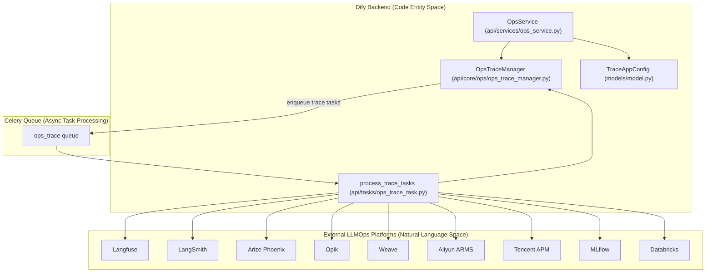
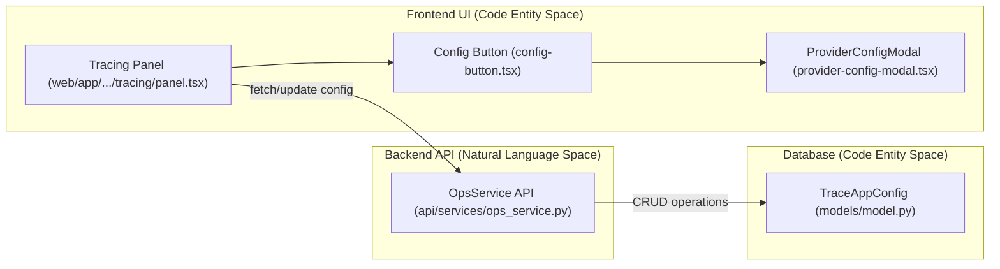

<!-- source: DeepWiki mcp.deepwiki.com · repo langgenius/dify · page 12 Observability and LLMOps · fetched 2026-10-26 -->

# Observability and LLMOps

Relevant source files

The following files were used as context for generating this wiki page:

- [api/core/ops/entities/config_entity.py](api/core/ops/entities/config_entity.py)
- [api/core/ops/ops_trace_manager.py](api/core/ops/ops_trace_manager.py)
- [api/core/ops/utils.py](api/core/ops/utils.py)
- [api/providers/trace/trace-langsmith/src/dify_trace_langsmith/config.py](api/providers/trace/trace-langsmith/src/dify_trace_langsmith/config.py)
- [api/providers/trace/trace-langsmith/tests/unit_tests/test_config_entity.py](api/providers/trace/trace-langsmith/tests/unit_tests/test_config_entity.py)
- [api/providers/trace/trace-weave/src/dify_trace_weave/config.py](api/providers/trace/trace-weave/src/dify_trace_weave/config.py)
- [api/providers/trace/trace-weave/tests/unit_tests/test_config_entity.py](api/providers/trace/trace-weave/tests/unit_tests/test_config_entity.py)
- [api/providers/trace/trace-weave/tests/unit_tests/weave_trace/test_weave_trace.py](api/providers/trace/trace-weave/tests/unit_tests/weave_trace/test_weave_trace.py)
- [api/tests/unit_tests/core/ops/test_config_entity.py](api/tests/unit_tests/core/ops/test_config_entity.py)
- [api/tests/unit_tests/core/ops/test_ops_trace_manager.py](api/tests/unit_tests/core/ops/test_ops_trace_manager.py)
- [api/tests/unit_tests/core/ops/test_trace_session_metadata.py](api/tests/unit_tests/core/ops/test_trace_session_metadata.py)
- [api/tests/unit_tests/core/ops/test_utils.py](api/tests/unit_tests/core/ops/test_utils.py)
- [web/app/(commonLayout)/app/(appDetailLayout)/[appId]/overview/tracing/config-popup.tsx](web/app/(commonLayout)/app/(appDetailLayout)/[appId]/overview/tracing/config-popup.tsx)
- [web/app/(commonLayout)/app/(appDetailLayout)/[appId]/overview/tracing/config.ts](web/app/(commonLayout)/app/(appDetailLayout)/[appId]/overview/tracing/config.ts)
- [web/app/(commonLayout)/app/(appDetailLayout)/[appId]/overview/tracing/provider-config-modal.tsx](web/app/(commonLayout)/app/(appDetailLayout)/[appId]/overview/tracing/provider-config-modal.tsx)
- [web/app/(commonLayout)/app/(appDetailLayout)/[appId]/overview/tracing/provider-panel.tsx](web/app/(commonLayout)/app/(appDetailLayout)/[appId]/overview/tracing/provider-panel.tsx)
- [web/app/(commonLayout)/app/(appDetailLayout)/[appId]/overview/tracing/type.ts](web/app/(commonLayout)/app/(appDetailLayout)/[appId]/overview/tracing/type.ts)

This page provides a high-level overview of Dify's observability capabilities and its integration with various LLMOps and operational monitoring tools. It outlines how Dify manages tracing of AI application workflows, runtime monitoring, and integrates with external platforms to offer enhanced insights and troubleshooting. Detailed implementation and integration specifics are covered in the linked child pages.

---

## Tracing Integrations

Dify centralizes observability around AI workflows, LLM usage, and tool interaction events, orchestrated primarily by the `OpsTraceManager` class located in `api/core/ops/ops_trace_manager.py` [api/core/ops/ops_trace_manager.py:57-400](). This manager handles trace data collection, secure credential management via encryption, caching, and asynchronous dispatch of trace events.

Tracing supports multiple external commercial and open platforms commonly used for LLMOps and application observability, including:

- Langfuse
- LangSmith
- Arize Phoenix
- Opik
- Weave
- Aliyun ARMS
- Tencent APM
- MLflow
- Databricks

Provider types are enumerated in the `TracingProviderEnum` defined in `api/core/ops/entities/config_entity.py` [api/core/ops/entities/config_entity.py:8-19](). To enrich trace data with detailed context, helper utilities perform credential lookups and metadata augmentation [api/core/ops/ops_trace_manager.py:280-350]().

### Architecture Overview: Trace System Components

- `OpsTraceManager` is the central orchestrator managing trace lifecycle, encryption, caching, and dispatching.
- Traces accumulate asynchronously via Celery tasks on the dedicated `ops_trace` queue.
- The Celery task `process_trace_tasks` batches and sends traces to external providers.
- `OpsService` backend APIs manage tracing configuration for apps and workspaces.
- `TraceAppConfig` entity stores per-app trace provider settings in the database.

### Trace Data Models

Dify uses typed Pydantic models for trace data, maintaining extensibility and consistency:

| Trace Entity              | Description                                                       | Code Location                              |
|---------------------------|-------------------------------------------------------------------|--------------------------------------------|
| `WorkflowTraceInfo`       | Metadata and lifecycle info for workflow executions              | [api/core/ops/entities/trace_entity.py:87-107]() |
| `MessageTraceInfo`        | LLM message details including tokens, timings, and pricing       | [api/core/ops/entities/trace_entity.py:109-121]() |
| `WorkflowNodeTraceInfo`   | Node execution details, errors, timing, and output tokens        | [api/core/ops/entities/trace_entity.py:197-236]() |
| `ModerationTraceInfo` and others | Specialized trace info for moderation, prompt generation, tools, suggestions | [api/core/ops/entities/trace_entity.py:123-195]() |

Traces utilize a parent trace context schema to support distributed tracing and event linkage enabling richer observability [api/core/ops/entities/trace_entity.py:53-79]().

### Frontend UI for Tracing Configuration

The Dify web frontend includes comprehensive UI components for managing tracing at the app level:

- The main `Panel` renders tracing enablement state and provider configurations.
- Users toggle tracing and modify provider settings via `ConfigButton` and `ProviderConfigModal`.
- These UI actions call APIs implemented by `OpsService` which interacts with the `TraceAppConfig` database entity.
- Diverse providers are managed, and their credential/configuration data is securely saved.

For full provider integration details (Langfuse, LangSmith, Arize Phoenix, Opik, Weave, Aliyun, Tencent, etc.) and trace workflow handling, see the child page: [Trace Manager and Provider Integrations](#12.1).

---

## Operational Monitoring

### OpenTelemetry, Logging and Sentry Integration

Dify's operational observability includes metrics, traces, and error tracking powered by OpenTelemetry and Sentry:

- The OpenTelemetry setup (`api/extensions/ext_otel.py`) configures important components including:
  - `TracerProvider` and `MeterProvider` for instrumentation and metric collection.
  - OTLP exporters emitting telemetry data to configured collectors or platforms.
  - Resource attributes such as service name, deployment environment, and host info enhance observability context [api/extensions/ext_otel.py:14-75, 78-140]().
- Logging is extended with OTEL trace/span IDs for seamless correlation between logs and traces [api/extensions/ext_logging.py:90-105]().
- Celery instrumentation via `CeleryInstrumentor` ensures background task spans are captured and propagate context correctly [api/extensions/otel/runtime.py:89-102]().
- Sentry error tracking is integrated with OpenTelemetry scopes to provide enriched fault signals aiding in rapid error detection and diagnostics.

This operational monitoring stack allows Dify to capture a comprehensive view of system behavior and fault conditions across complex AI workflows.

For detailed OpenTelemetry and Sentry implementation and configuration, refer to the child page: [OpenTelemetry, Logging and Sentry Integration](#12.2).

---

## Summary and Navigation

Dify's observability and LLMOps capabilities provide:

- **Rich distributed tracing:** Orchestrated by `OpsTraceManager` with support for a variety of external LLMOps platforms for detailed workflow, message, and node-level tracing.
- **Operational monitoring:** Extensive OpenTelemetry instrumentation combined with rich logging enhancements and Sentry integration for error tracking.
- **User-facing configuration UI:** Complete frontend components tied to backend APIs enabling workspace/app-level tracing provider management.
- **Extendable architecture:** New tracing providers or telemetry backends can be added with minimal disruption.

---

For deeper insights and implementation details, explore the child pages:

- [Trace Manager and Provider Integrations](#12.1) — Deep dive into `OpsTraceManager`, supported tracing providers, and trace data handling.
- [OpenTelemetry, Logging and Sentry Integration](#12.2) — Comprehensive view of OpenTelemetry instrumentation, logging correlation, Sentry, and metrics setup.

---

### Sources

- [api/core/ops/ops_trace_manager.py:57-400]()
- [api/core/ops/entities/config_entity.py:8-54]()
- [api/core/ops/entities/trace_entity.py:10-237]()
- [api/tasks/ops_trace_task.py:40-90]()
- [api/services/ops_service.py:11-137]()
- [web/app/(commonLayout)/app/(appDetailLayout)/[appId]/overview/tracing/panel.tsx:1-180]()
- [web/app/(commonLayout)/app/(appDetailLayout)/[appId]/overview/tracing/provider-config-modal.tsx:1-247]()
- [api/extensions/ext_otel.py:10-144]()
- [api/extensions/ext_logging.py:13-104]()
- [api/extensions/otel/runtime.py:22-112]()
- [api/core/ops/utils.py:71-155]()

---

