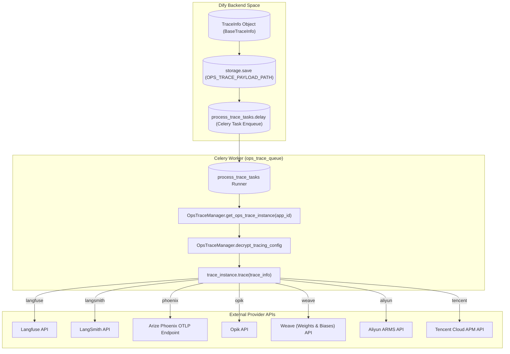
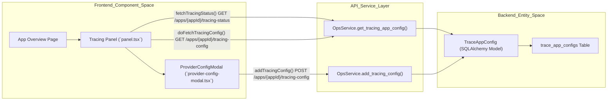

<!-- source: DeepWiki mcp.deepwiki.com · repo langgenius/dify · page 12.1 Trace Manager and Provider Integrations · fetched 2026-10-26 -->

# Trace Manager and Provider Integrations

Relevant source files

The following files were used as context for generating this wiki page:

- [api/core/ops/entities/config_entity.py](api/core/ops/entities/config_entity.py)
- [api/core/ops/ops_trace_manager.py](api/core/ops/ops_trace_manager.py)
- [api/core/ops/utils.py](api/core/ops/utils.py)
- [api/providers/trace/trace-langsmith/src/dify_trace_langsmith/config.py](api/providers/trace/trace-langsmith/src/dify_trace_langsmith/config.py)
- [api/providers/trace/trace-langsmith/tests/unit_tests/test_config_entity.py](api/providers/trace/trace-langsmith/tests/unit_tests/test_config_entity.py)
- [api/providers/trace/trace-weave/src/dify_trace_weave/config.py](api/providers/trace/trace-weave/src/dify_trace_weave/config.py)
- [api/providers/trace/trace-weave/tests/unit_tests/test_config_entity.py](api/providers/trace/trace-weave/tests/unit_tests/test_config_entity.py)
- [api/providers/trace/trace-weave/tests/unit_tests/weave_trace/test_weave_trace.py](api/providers/trace/trace-weave/tests/unit_tests/weave_trace/test_weave_trace.py)
- [api/tests/unit_tests/core/ops/test_config_entity.py](api/tests/unit_tests/core/ops/test_config_entity.py)
- [api/tests/unit_tests/core/ops/test_ops_trace_manager.py](api/tests/unit_tests/core/ops/test_ops_trace_manager.py)
- [api/tests/unit_tests/core/ops/test_trace_session_metadata.py](api/tests/unit_tests/core/ops/test_trace_session_metadata.py)
- [api/tests/unit_tests/core/ops/test_utils.py](api/tests/unit_tests/core/ops/test_utils.py)
- [web/app/(commonLayout)/app/(appDetailLayout)/[appId]/overview/tracing/config-popup.tsx](web/app/(commonLayout)/app/(appDetailLayout)/[appId]/overview/tracing/config-popup.tsx)
- [web/app/(commonLayout)/app/(appDetailLayout)/[appId]/overview/tracing/config.ts](web/app/(commonLayout)/app/(appDetailLayout)/[appId]/overview/tracing/config.ts)
- [web/app/(commonLayout)/app/(appDetailLayout)/[appId]/overview/tracing/provider-config-modal.tsx](web/app/(commonLayout)/app/(appDetailLayout)/[appId]/overview/tracing/provider-config-modal.tsx)
- [web/app/(commonLayout)/app/(appDetailLayout)/[appId]/overview/tracing/provider-panel.tsx](web/app/(commonLayout)/app/(appDetailLayout)/[appId]/overview/tracing/provider-panel.tsx)
- [web/app/(commonLayout)/app/(appDetailLayout)/[appId]/overview/tracing/type.ts](web/app/(commonLayout)/app/(appDetailLayout)/[appId]/overview/tracing/type.ts)

This page provides a detailed technical overview of Dify's tracing system architecture centered on the `OpsTraceManager` and its integration with multiple third-party tracing providers. It covers the internal implementation, data flow, key classes and functions involved, and the asynchronous processing model. The supported providers include Langfuse, LangSmith, Arize Phoenix, Opik, Weave (Weights & Biases), Aliyun, Tencent, MLflow, and Databricks.

---

## OpsTraceManager Architecture

The `OpsTraceManager` is the core component responsible for orchestrating the lifecycle of tracing events within the Dify backend. It manages the collection, serialization, queuing, and dispatching of trace data to configured external tracing platforms.

### Key Classes and Data Structures

- **`OpsTraceManager`**: Manages trace lifecycle including:
  - Provider instantiation and caching.
  - Decryption and obfuscation of credentials.
  - Serializing `TraceInfo` entities into storage.
  - Asynchronous dispatch via Celery tasks.
  - Retry logic on transient failures.
  
  It centralizes access to tracing instances keyed by app and caches decrypted configs for performance [api/core/ops/ops_trace_manager.py:200-400]().

- **`TracingProviderEnum`**: String enum listing supported tracing providers:
  - `LANGFUSE`, `LANGSMITH`, `ARIZE`, `PHOENIX`, `OPIK`, `WEAVE`, `ALIYUN`, `MLFLOW`, `DATABRICKS`, `TENCENT`.
  
  It allows configuration and instantiation per provider [api/core/ops/entities/config_entity.py:8-18]().

- **`TraceAppConfig`** (SQLAlchemy model): Persists per-app tracing configuration including encrypted keys, provider type, and enablement flags [api/models/model.py:45]().

- **Trace Info Entities**: Typed data classes capturing specific tracing domains:
  - `MessageTraceInfo`, `WorkflowTraceInfo`, `WorkflowNodeTraceInfo`, `ToolTraceInfo`, `DatasetRetrievalTraceInfo`, etc. These encapsulate message details, workflow run status, node execution data, tool invocations, and retrieval document traces [api/core/ops/entities/trace_entity.py:11-237]().

- **`ParentTraceContext`**: Entity managing parent span context metadata propagated through traces to link related spans for UI visualization and hierarchical insight [api/core/ops/entities/trace_entity.py:8-9](), [api/core/ops/ops_trace_manager.py:58-65]().

### Data Flow and Lifecycle

The asynchronous data flow for tracing proceeds as:

1. **Trace Event Generation**: Operational events in the system generate trace info objects, representing detailed contextual information pertinent to messages, workflows, nodes, or tools [api/core/ops/entities/trace_entity.py:10-237]().

2. **Serialization and Persistence**: The `OpsTraceManager` serializes trace info entities to JSON and persists them to storage paths defined by `OPS_TRACE_PAYLOAD_PATH`. This durable storage decouples trace generation from dispatching [api/tasks/ops_trace_task.py:56-57]().

3. **Task Enqueuing with Celery**: Upon saving trace data, a Celery task `process_trace_tasks` is asynchronously triggered to perform dispatch to external providers [api/tasks/ops_trace_task.py:41-47]().

4. **Task Execution and Dispatching**: Worker processes:
   - Load serialized trace data from storage.
   - Retrieve app tracing config via `OpsTraceManager.get_ops_trace_instance(app_id)`.
   - Decrypt credentials using cached configuration.
   - Instantiate the provider-specific trace instance.
   - Call the provider's `trace` method to export the data externally [api/tasks/ops_trace_task.py:61-92]().

5. **Automatic Retry**: If trace dispatch returns `RetryableTraceDispatchError`, the task automatically re-enqueues with a backoff delay configured by `OPS_TRACE_RETRYABLE_DISPATCH_DELAY_SECONDS`, ensuring reliable delivery on transient failures [api/tasks/ops_trace_task.py:95-122]().

---

### Diagram: OpsTraceManager Asynchronous Dispatch Pipeline

Sources:  
[api/core/ops/ops_trace_manager.py:200-400](), [api/tasks/ops_trace_task.py:41-122](), [api/core/ops/entities/trace_entity.py:11-237]()

---

## Provider Integrations in Detail

Dify supports a set of popular tracing and observability platforms, each integrated with custom credential management, configuration schemas, and dispatch logic implemented under `api/providers/trace/`. The following summarizes key providers:

---

### 1. Langfuse and LangSmith

- **Langfuse**:
  - Configuration requires `host`, `project_key`, `public_key`, `secret_key`.
  - The tracing project URL is constructed as `{host}/project/{project_key}`.
  - The provider integration sends trace events to Langfuse REST APIs [api/services/ops_service.py:59-72]().

- **LangSmith**:
  - Requires configuration: `api_key`, `project`, `endpoint`.
  - Supports hierarchical dotted ordering of span IDs for nested traces using `generate_dotted_order()` to reflect parent-child span relationships [api/core/ops/utils.py:57-68]().

---

### 2. Arize Phoenix

- An OpenTelemetry-based integration for Arize Phoenix.
- Requires `api_key`, `project`, and `endpoint`.
- Defaults project UI URLs to `https://app.arize.com/` and `https://app.phoenix.arize.com/projects/`.
- Provides fallback default project string `"default"` if empty to avoid config errors [api/tests/unit_tests/core/ops/test_config_entity.py:66-67]().

---

### 3. Opik and Weave (Weights & Biases)

- **Opik**:
  - Needs `api_key`, `project`, `url`, and `workspace`.
  - The default project string is `"Default Project"` if unset [web/app/(commonLayout)/app/(appDetailLayout)/[appId]/overview/tracing/provider-config-modal.tsx:99-104](), [api/tests/unit_tests/core/ops/test_config_entity.py:68]().

- **Weave (Weights & Biases)**:
  - Requires `api_key`, `entity`, `project`, `endpoint`, and `host`.
  - Provides a UI panel integration for configuring the W&B project [web/app/(commonLayout)/app/(appDetailLayout)/[appId]/overview/tracing/provider-config-modal.tsx:106-112]().

---

### 4. Aliyun and Tencent Cloud

- **Aliyun ARMS**:
  - Requires `license_key`, `endpoint`, and `app_name`.
  - Defaults `app_name` to `"dify_app"` to prevent empty names [api/tests/unit_tests/core/ops/test_config_entity.py:69]().

- **Tencent Cloud APM**:
  - Requires `token`, `endpoint`, and `service_name`.
  - UI homepage URL defaults to `https://console.cloud.tencent.com/apm` [api/services/ops_service.py:109-116]().

---

### 5. MLflow and Databricks

- Supports trace collection in MLflow and Databricks environments.
- MLflow `tracking_uri` falls back to `http://localhost:5000/` if unspecified [api/services/ops_service.py:118-125]().

---

### Table: Tracing Provider Configuration Summary

| Provider   | Required Configuration Fields                                        | Default Project / UI URL                         |
|------------|---------------------------------------------------------------------|-------------------------------------------------|
| Langfuse   | `host`, `project_key`, `public_key`, `secret_key`                   | `{host}/project/{project_key}`                   |
| LangSmith  | `api_key`, `project`, `endpoint`                                   | `https://smith.langchain.com/`                   |
| Arize Phoenix | `api_key`, `project`, `endpoint`                                  | `https://app.phoenix.arize.com/projects/`       |
| Opik       | `api_key`, `project`, `url`, `workspace`                           | `https://www.comet.com/opik/`                     |
| Weave      | `api_key`, `entity`, `project`, `endpoint`, `host`                 | `https://wandb.ai/`                              |
| Aliyun     | `license_key`, `endpoint`, `app_name`                              | `https://arms.console.aliyun.com/`               |
| Tencent    | `token`, `endpoint`, `service_name`                               | `https://console.cloud.tencent.com/apm`          |
| MLflow     | `tracking_uri`, `experiment_id`                                    | `http://localhost:5000/`                         |
| Databricks | `host`, `client_id`, `client_secret`, `personal_access_token`      | `https://www.databricks.com/`                     |

Sources:  
[api/core/ops/entities/config_entity.py:8-18](), [api/services/ops_service.py:20-137](), [web/app/(commonLayout)/app/(appDetailLayout)/[appId]/overview/tracing/provider-config-modal.tsx:74-211](), [api/tests/unit_tests/core/ops/test_config_entity.py:14-70]()

---

## Frontend Integration in the Dify Web App

The web frontend provides a fully integrated UI for managing tracing enablement, provider selection, and configuration editing. It interacts with backend services to fetch, update, and remove tracing settings securely.

### Key Frontend Components

- **`Panel`**: Displays tracing enablement status, latest trace reporting time, and allows provider selection or configuration edits within the app overview page [web/app/(commonLayout)/app/(appDetailLayout)/[appId]/overview/tracing/panel.tsx:54-138]().

- **`ProviderConfigModal`**: A configurable modal component that supports editing provider-specific credentials and settings securely, handling sensitive data like API keys with support for masked values and decryptions through backend APIs [web/app/(commonLayout)/app/(appDetailLayout)/[appId]/overview/tracing/provider-config-modal.tsx:141-211]().

- **`ConfigPopup`**: Manages multiple provider panels and config modification workflows, invoking callbacks to update state on config changes or removal [web/app/(commonLayout)/app/(appDetailLayout)/[appId]/overview/tracing/config-popup.tsx:65-134]().

### Interaction Flow

1. **Load Status and Config**: The panel component fetches tracing status and configuration for the app using RESTful API calls to endpoints like:
   - `GET /apps/{appId}/tracing-status`
   - `GET /apps/{appId}/tracing-config` [web/app/(commonLayout)/app/(appDetailLayout)/[appId]/overview/tracing/panel.tsx:44]()

2. **Change Enablement or Provider**: User toggles tracing enabled state or selects a different provider in the UI, resulting in POST requests (`updateTracingStatus`) dispatched to update backend trace config [web/app/(commonLayout)/app/(appDetailLayout)/[appId]/overview/tracing/panel.tsx:95-100]().

3. **Edit Credentials Securely**: In the config modal, sensitive credentials are stored encrypted on the backend. The frontend never sees raw keys, receiving only obfuscated masked tokens and sending updated encrypted values back to the backend. This encryption/decryption is facilitated by `OpsTraceManager.obfuscated_decrypt_token` on the backend [api/services/ops_service.py:36-39]().

---

### Diagram: Frontend to Backend Tracing Configuration Bridge

Sources:  
[web/app/(commonLayout)/app/(appDetailLayout)/[appId]/overview/tracing/panel.tsx:54-138](), [api/services/ops_service.py:11-190](), [api/models/model.py:45]()

---

# Summary

Dify's observability subsystem leverages the `OpsTraceManager` as the core orchestrator for trace data collection and asynchronous export to a broad ecosystem of tracing providers. The system employs encrypted credential management, dynamic provider instantiation, and robust retry on dispatch failure for reliable operation. On the frontend, the tightly integrated web UI allows users to manage tracing configurations securely, supporting provider selection, status toggling, and sensitive token editing with encrypted storage.

This architecture forms a flexible, performant LLMOps observability platform that enables rich tracing integration within the Dify ecosystem.

---

# References

- `api/core/ops/ops_trace_manager.py` (lines 200-400)  
- `api/tasks/ops_trace_task.py` (lines 41-122)  
- `api/services/ops_service.py` (lines 11-190)  
- `api/core/ops/entities/config_entity.py` (lines 8-18)  
- `api/core/ops/entities/trace_entity.py` (lines 11-237)  
- `web/app/(commonLayout)/app/(appDetailLayout)/[appId]/overview/tracing/panel.tsx` (lines 54-138)  
- `web/app/(commonLayout)/app/(appDetailLayout)/[appId]/overview/tracing/provider-config-modal.tsx` (lines 74-211)  
- `api/core/ops/utils.py` (lines 57-68)  
- `api/tests/unit_tests/core/ops/test_config_entity.py` (lines 14-70)

---

