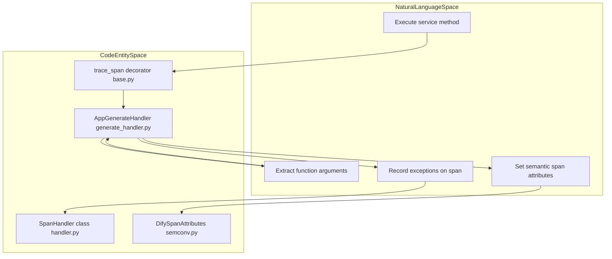

<!-- source: DeepWiki mcp.deepwiki.com · repo langgenius/dify · page 12.2 OpenTelemetry, Logging and Sentry Integration · fetched 2026-10-26 -->

# OpenTelemetry, Logging and Sentry Integration

Relevant source files

The following files were used as context for generating this wiki page:

- [api/.env.example](api/.env.example)
- [api/app.py](api/app.py)
- [api/app_factory.py](api/app_factory.py)
- [api/celery_entrypoint.py](api/celery_entrypoint.py)
- [api/configs/feature/__init__.py](api/configs/feature/__init__.py)
- [api/configs/middleware/__init__.py](api/configs/middleware/__init__.py)
- [api/configs/middleware/vdb/weaviate_config.py](api/configs/middleware/vdb/weaviate_config.py)
- [api/configs/observability/__init__.py](api/configs/observability/__init__.py)
- [api/configs/observability/otel/otel_config.py](api/configs/observability/otel/otel_config.py)
- [api/configs/packaging/__init__.py](api/configs/packaging/__init__.py)
- [api/controllers/web/wraps.py](api/controllers/web/wraps.py)
- [api/core/agent/cot_completion_agent_runner.py](api/core/agent/cot_completion_agent_runner.py)
- [api/core/logging/context.py](api/core/logging/context.py)
- [api/core/logging/filters.py](api/core/logging/filters.py)
- [api/core/rag/datasource/vdb/vector_factory.py](api/core/rag/datasource/vdb/vector_factory.py)
- [api/core/rag/datasource/vdb/vector_type.py](api/core/rag/datasource/vdb/vector_type.py)
- [api/core/schemas/registry.py](api/core/schemas/registry.py)
- [api/extensions/ext_app_metrics.py](api/extensions/ext_app_metrics.py)
- [api/extensions/ext_celery.py](api/extensions/ext_celery.py)
- [api/extensions/ext_database.py](api/extensions/ext_database.py)
- [api/extensions/ext_import_modules.py](api/extensions/ext_import_modules.py)
- [api/extensions/ext_otel.py](api/extensions/ext_otel.py)
- [api/extensions/ext_sentry.py](api/extensions/ext_sentry.py)
- [api/gunicorn.conf.py](api/gunicorn.conf.py)
- [api/migrations/README](api/migrations/README)
- [api/providers/vdb/vdb-weaviate/tests/unit_tests/test_weaviate_integration_header.py](api/providers/vdb/vdb-weaviate/tests/unit_tests/test_weaviate_integration_header.py)
- [api/pyproject.toml](api/pyproject.toml)
- [api/schedule/queue_monitor_task.py](api/schedule/queue_monitor_task.py)
- [api/tests/integration_tests/.env.example](api/tests/integration_tests/.env.example)
- [api/tests/unit_tests/configs/test_dify_config.py](api/tests/unit_tests/configs/test_dify_config.py)
- [api/tests/unit_tests/controllers/web/test_wraps.py](api/tests/unit_tests/controllers/web/test_wraps.py)
- [api/tests/unit_tests/core/logging/test_context.py](api/tests/unit_tests/core/logging/test_context.py)
- [api/tests/unit_tests/core/logging/test_filters.py](api/tests/unit_tests/core/logging/test_filters.py)
- [api/tests/unit_tests/core/logging/test_structured_formatter.py](api/tests/unit_tests/core/logging/test_structured_formatter.py)
- [api/tests/unit_tests/core/logging/test_trace_helpers.py](api/tests/unit_tests/core/logging/test_trace_helpers.py)
- [api/tests/unit_tests/core/rag/datasource/vdb/test_vector_factory.py](api/tests/unit_tests/core/rag/datasource/vdb/test_vector_factory.py)
- [api/tests/unit_tests/extensions/test_celery_ssl.py](api/tests/unit_tests/extensions/test_celery_ssl.py)
- [api/tests/unit_tests/services/test_feature_service_education.py](api/tests/unit_tests/services/test_feature_service_education.py)
- [api/tests/unit_tests/test_app_factory.py](api/tests/unit_tests/test_app_factory.py)
- [api/uv.lock](api/uv.lock)
- [docker/.env.example](docker/.env.example)
- [docker/docker-compose-template.yaml](docker/docker-compose-template.yaml)
- [docker/docker-compose.middleware.yaml](docker/docker-compose.middleware.yaml)
- [docker/docker-compose.yaml](docker/docker-compose.yaml)
- [docker/envs/core-services/shared.env.example](docker/envs/core-services/shared.env.example)
- [docker/envs/infrastructure/ssrf-proxy.env.example](docker/envs/infrastructure/ssrf-proxy.env.example)
- [docker/envs/middleware.env.example](docker/envs/middleware.env.example)
- [e2e/features/auth/redirect-security.feature](e2e/features/auth/redirect-security.feature)
- [web/__tests__/embedded-user-id-auth.test.tsx](web/__tests__/embedded-user-id-auth.test.tsx)
- [web/__tests__/embedded-user-id-store.test.tsx](web/__tests__/embedded-user-id-store.test.tsx)
- [web/app/(shareLayout)/components/__tests__/splash.spec.tsx](web/app/(shareLayout)/components/__tests__/splash.spec.tsx)
- [web/app/(shareLayout)/components/splash.tsx](web/app/(shareLayout)/components/splash.tsx)
- [web/app/(shareLayout)/webapp-signin/__tests__/login-redirect.spec.ts](web/app/(shareLayout)/webapp-signin/__tests__/login-redirect.spec.ts)
- [web/app/(shareLayout)/webapp-signin/__tests__/page.spec.tsx](web/app/(shareLayout)/webapp-signin/__tests__/page.spec.tsx)
- [web/context/web-app-context.tsx](web/context/web-app-context.tsx)
- [web/package.json](web/package.json)
- [web/service/base.spec.ts](web/service/base.spec.ts)
- [web/service/base.ts](web/service/base.ts)
- [web/service/use-share.spec.tsx](web/service/use-share.spec.tsx)
- [web/service/use-share.ts](web/service/use-share.ts)
- [web/service/webapp-auth.ts](web/service/webapp-auth.ts)

This page documents the technical details of how OpenTelemetry instrumentation, logging extensions, Sentry error tracking, and metrics endpoints are integrated into the Dify backend API service. It covers configuration, implementation, data flow, key functions and classes, as well as illustrative diagrams showing how natural language systems map to code entities.

---

## Overview and Purpose

Observability is critical in a distributed system like Dify, especially across APIs, worker processes, and background tasks. Dify integrates the following:

- OpenTelemetry (OTEL) for distributed tracing and metrics collection.
- An enhanced logging system that enriches logs with trace context and structured formats.
- Sentry as a production-grade error tracking and performance monitoring platform.
- Dedicated HTTP metrics endpoints exporting Prometheus-compatible metrics.

These integrations enable rich monitoring, diagnostics, and SLA adherence tracking across all components of Dify.

---

## 1. OpenTelemetry Integration

Dify uses OpenTelemetry to provide observability across request lifecycles, database operations, cache interaction, Celery tasks, and workflows.

### 1.1 Configuration with `OTelConfig`

OpenTelemetry settings are configured using the Pydantic-based `OTelConfig` class. This includes:

- Toggle to enable OTEL instrumentation (`ENABLE_OTEL`).
- Exporter type (default: OTLP with `grpc` or `http` protocol).
- OTLP base endpoint URL.
- Sampling rate (fraction of traces to sample).
- Authentication (e.g., bearer token with `OTLP_API_KEY`).
- Batch export interval and span queue sizes.

These configurations reside in the file `api/configs/observability/otel/otel_config.py` [api/configs/observability/otel/otel_config.py:1-59]().

Sources:
- [api/configs/observability/otel/otel_config.py:1-59]()

---

### 1.2 Initialization (`init_app` in `ext_otel.py`)

The core OTEL setup is performed in the function `init_app` (defined in `api/extensions/ext_otel.py`). The initialization steps are:

- **Context Propagation Setup:**  
  Setup of merged propagators (`CompositePropagator`) including W3C TraceContext and B3 multi-format, enabling cross-service trace context propagation [api/extensions/otel/runtime.py:22-30]().

- **Resource Attributes Definition:**  
  Creates a `Resource` object embedding metadata like service name, version with git SHA, OS type, host architecture. This resource is attached to all traces and metrics [api/extensions/ext_otel.py:57-71]().

- **Trace Sampling:**  
  Configures `ParentBasedTraceIdRatio` sampler with the configured sampling rate.

- **Tracer and Meter Providers:**  
  Creates and sets the global tracer provider (`TracerProvider`) and meter provider (`MeterProvider`).

- **Exporter Selection:**  
  Depending on configuration, uses gRPC or HTTP OTLP exporters for spans and metrics. Supports API key authentication.  
  - Spans: `GRPCSpanExporter` or `HTTPSpanExporter`  
  - Metrics: `GRPCMetricExporter` or `HTTPMetricExporter`  
  [api/extensions/ext_otel.py:79-117]()

- **Span Processor and Metric Reader:**  
  Registers `BatchSpanProcessor` for spans and `PeriodicExportingMetricReader` for metrics [api/extensions/ext_otel.py:122-135]().

- **Instrumentation Init:**  
  Auto-instrumentations are applied for Flask, SQLAlchemy, Redis, and Celery via `init_instruments(app)` [api/extensions/ext_otel.py:138]().

- **Shutdown Cleanup:**  
  Registers a shutdown hook to gracefully flush and shutdown the tracer provider on process termination [api/extensions/ext_otel.py:139-141]().

#### Diagram: OpenTelemetry Initialization and Code Mapping

```mermaid
graph TD
    subgraph "NaturalLanguageSpace"
        Init["Initialize Observability System"]
        Resource["Define Resource Attributes"]
        Tracing["Configure Tracer Provider & Sampling"]
        Exporter["Select Exporter GRPC or HTTP"]
        Processors["Register Span Processor & Metric Reader"]
        Instrumentation["Initialize Auto-Instrumentations"]
        Shutdown["Register Shutdown Hook"]
    end

    subgraph "CodeEntitySpace"
        _init_app["api/extensions/ext_otel.py:init_app()"]
        _res["opentelemetry.sdk.resources:Resource"]
        _tracer_provider["opentelemetry.sdk.trace:TracerProvider"]
        _meter_provider["opentelemetry.sdk.metrics:MeterProvider"]
        _span_processor["opentelemetry.sdk.trace.export:BatchSpanProcessor"]
        _metric_reader["opentelemetry.sdk.metrics.export:PeriodicExportingMetricReader"]
        _instruments["api/extensions/otel/instrumentation.py:init_instruments()"]
        _runtime["api/extensions/otel/runtime.py:setup_context_propagation()"]
    end

    Init --> _init_app
    Resource --> _res
    Tracing --> _tracer_provider
    Processors --> _span_processor
    Processors --> _metric_reader
    Exporter --> _init_app
    Instrumentation --> _instruments
    _init_app --> _runtime
    Shutdown --> _init_app
```

Sources:  
- [api/extensions/ext_otel.py:14-141]()  
- [api/extensions/otel/runtime.py:22-58]()  
- [api/extensions/otel/instrumentation.py:152-162]()

---

### 1.3 Auto-Instrumentation and Logging

- **Flask Instrumentation:**  
  Registers HTTP response hooks that enrich OTEL spans with HTTP status codes, HTTP route, and request method. It also increments Prometheus-style counters for response classification.  
  Implemented in `init_flask_instrumentor` [api/extensions/otel/instrumentation.py:101-136]().

- **SQLAlchemy Instrumentation:**  
  Applies instrumentation on SQLAlchemy engines with `enable_commenter=True` to enable the SQLCommenter feature (injecting metadata into SQL statements) [api/extensions/otel/instrumentation.py:138-141]().

- **Exception Logging Handler:**  
  A custom logging handler, `ExceptionLoggingHandler`, adds exception events directly to the current OTEL span without spawning extra spans. This preserves the trace context and debugging information [api/extensions/otel/instrumentation.py:55-98]().

- **Log Correlation Filter:**  
  `TraceContextFilter` attaches current OTEL trace/span IDs to application log records, enabling log and trace correlation [api/extensions/ext_logging.py:35-40]().

Sources:  
- [api/extensions/otel/instrumentation.py:55-162]()  
- [api/extensions/ext_logging.py:1-51]()

---

### 1.4 Celery Integration and SQLCommenter

- Celery workers are instrumented on worker start via `init_celery_worker`, hooking into the Celery `worker_init` signal to apply OTEL instrumentation for trace and metrics [api/extensions/otel/runtime.py:88-103]().

- SQLCommenter metadata injection for Celery tasks is done using pre-run and post-run signals. Metadata such as task name, retry count, and routing key are inserted in SQL comments for tracing [api/extensions/otel/celery_sqlcommenter.py:79-122]().

- When a user is loaded in a request context during Flask processing, `on_user_loaded` injects user and tenant IDs as OTEL span attributes for enhanced observability [api/extensions/otel/runtime.py:63-86]().

Sources:  
- [api/extensions/otel/runtime.py:59-103]()  
- [api/extensions/otel/celery_sqlcommenter.py:79-122]()

---

### 1.5 Custom OTEL Decorators and Span Handlers

While auto-instrumentation covers most cases, Dify defines a reusable decorator `trace_span` for explicit manual tracing in critical business logic functions [api/extensions/otel/decorators/base.py:21-44]().

- This decorator inherits from a `SpanHandler` base class controlling span lifecycle and attribute extraction [api/extensions/otel/decorators/handler.py:8-17]().  
- Example handler: `AppGenerateHandler` instruments `AppGenerateService.generate` calls. It extracts business-level attributes like `app_id`, `tenant_id`, `user_id`, and `workflow_id` from function args and attaches them as span attributes [api/extensions/otel/decorators/handlers/generate_handler.py:15-65]().  
- Another handler, `WorkflowAppRunnerHandler`, instruments `WorkflowAppRunner.run` calls, extracting attributes from the runner's internal state [api/extensions/otel/decorators/handlers/workflow_app_runner_handler.py:14-66]().

#### Diagram: Span Decorator and Handler Flow

Sources:  
- [api/extensions/otel/decorators/base.py:21-44]()  
- [api/extensions/otel/decorators/handler.py:62-95]()  
- [api/extensions/otel/decorators/handlers/generate_handler.py:15-65]()  
- [api/extensions/otel/decorators/handlers/workflow_app_runner_handler.py:14-66]()

---

## 2. Logging Extension and Log Stores

### 2.1 Trace Context in Logs

The logging extension enhances Python logging by injecting OTEL trace context into log records. The `TraceContextFilter` accesses the current OTEL span and adds `trace_id` and `span_id` to log entries. This enables correlation between logs and traces for debugging distributed flows [api/extensions/ext_logging.py:35-40]().

### 2.2 Structured JSON Logging

Dify uses a custom `StructuredJSONFormatter` to output logs in a structured JSON format which includes trace and span IDs alongside log level, timestamps, and message content. This is essential for log store ingestion and querying.

### 2.3 Log File Management

Logging configuration (e.g., log file paths, maximum size, retention count, date format, and timezone) are driven by environment variables and set during app startup. This manages log file rotation and archival efficiently.

Sources:  
- [api/extensions/ext_logging.py:1-51]()

---

## 3. Sentry Error Tracking Integration

Sentry provides error monitoring and alerting for Dify in production.

### 3.1 Configuration and Scope

- Sentry is configured using `SENTRY_DSN`, `API_SENTRY_DSN`, and related environment variables present in `.env` files [docker/.env.example:134-138]().
- Errors and exceptions inside Flask request handlers, Celery tasks, and other critical code paths are captured and sent to Sentry via `api/extensions/ext_sentry.py`.
- Integration ensures linkage with OTEL trace IDs, facilitating cross-referencing between Sentry events and distributed traces.

### 3.2 Treatment of Errors

- OTEL instrumentation captures exceptions as span events.
- The logging extension can route error-level logs to Sentry.
- Sentry automatically instruments Flask and Celery integrations for optimal error context.

Sources:  
- [api/extensions/ext_logging.py:93-104]()  
- [api/extensions/ext_sentry.py:1-50]()  
- [docker/.env.example:134-138]()

---

## 4. Metrics Endpoint for Monitoring

A metrics endpoint exposing Prometheus-compatible metrics is implemented via `api/extensions/ext_app_metrics.py`. Metrics include HTTP server request counts, response classification counters, and Celery task metrics.

OTEL metric exporters periodically push these metrics to configured backends or expose them via HTTP for Prometheus scraping.

Sources:  
- [api/extensions/ext_app_metrics.py:1-40]()

---

## Summary Table: Observability Components

| Component                         | Purpose                                        | File / Class                                        |
|----------------------------------|------------------------------------------------|----------------------------------------------------|
| **OTelConfig**                   | OTEL configuration via Pydantic settings      | `api/configs/observability/otel/otel_config.py`   |
| **OpenTelemetry Extension**      | OTEL setup and lifecycle management            | `api/extensions/ext_otel.py`                        |
| **Context Propagation Setup**    | Configures OTEL propagators                     | `api/extensions/otel/runtime.py`                    |
| **Instrumentation Hooks**        | Auto-instrument Flask, DB, Redis, Celery       | `api/extensions/otel/instrumentation.py`           |
| **Celery Worker Init**            | Start OTEL instrumentation in Celery workers   | `api/extensions/otel/runtime.py`                    |
| **SQLCommenter for Celery**      | Injects SQL metadata from Celery tasks          | `api/extensions/otel/celery_sqlcommenter.py`       |
| **Span Decorator**               | Manual instrumentation decorator and handlers  | `api/extensions/otel/decorators/base.py`            |
| **Logging Extension**            | Injects OTEL trace context into logs            | `api/extensions/ext_logging.py`                     |
| **Sentry Integration**           | Captures exceptions and correlates with OTEL   | `api/extensions/ext_sentry.py`                      |
| **Metrics Extension**            | Exposes Prometheus-compatible metrics endpoint | `api/extensions/ext_app_metrics.py`                 |

Sources:  
- [api/extensions/ext_otel.py:14-141]()  
- [api/extensions/otel/runtime.py:22-103]()  
- [api/extensions/otel/instrumentation.py:50-162]()  
- [api/extensions/otel/celery_sqlcommenter.py:79-122]()  
- [api/extensions/otel/decorators/base.py:21-44]()  
- [api/extensions/otel/decorators/handler.py:8-17,62-95]()  
- [api/extensions/otel/decorators/handlers/generate_handler.py:15-65]()  
- [api/extensions/otel/decorators/handlers/workflow_app_runner_handler.py:14-66]()  
- [api/extensions/ext_logging.py:1-51,93-104]()  
- [api/extensions/ext_sentry.py:1-50]()  
- [api/extensions/ext_app_metrics.py:1-40]()  
- [api/configs/observability/otel/otel_config.py:1-59]()  
- [docker/.env.example:134-138]()

# End of 12.2 OpenTelemetry, Logging and Sentry Integration

---

