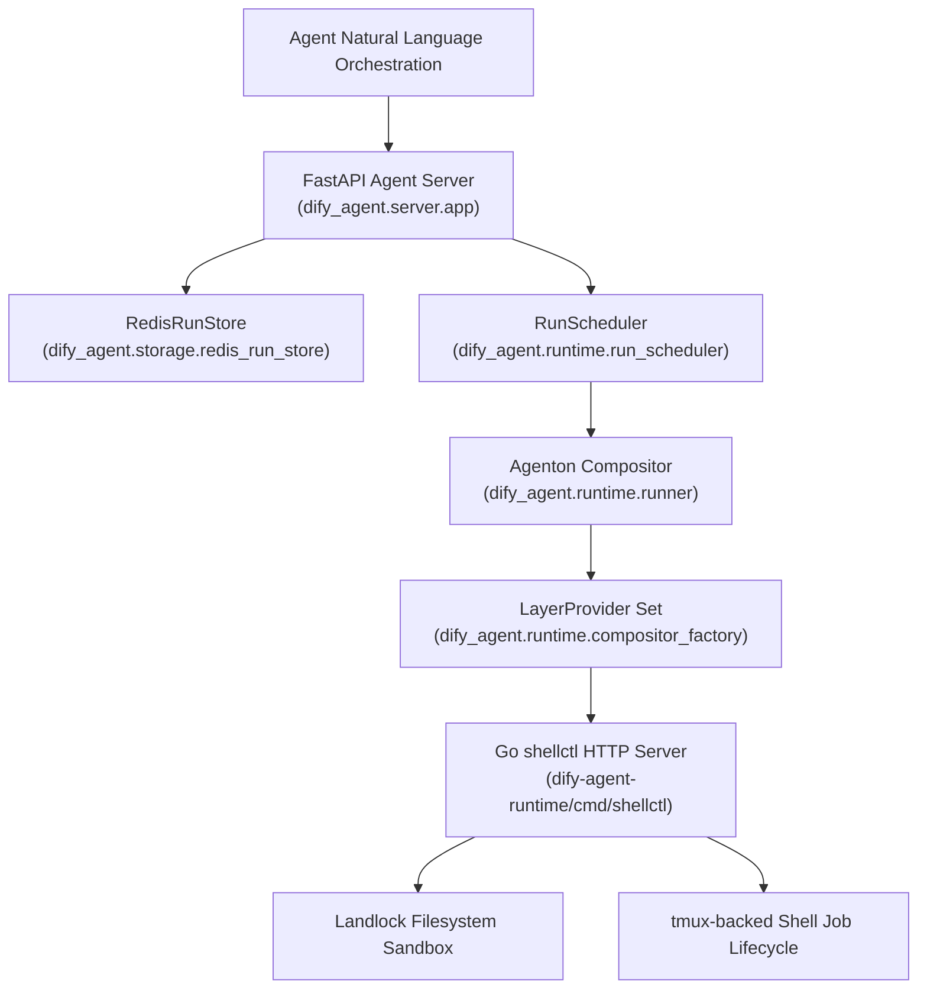
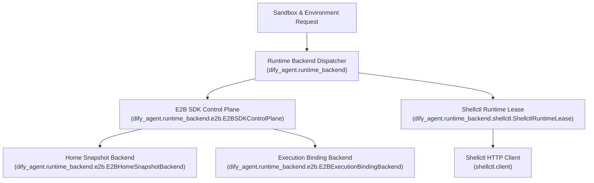

<!-- source: DeepWiki mcp.deepwiki.com · repo langgenius/dify · page 13 Dify Agent Runtime · fetched 2026-10-26 -->

# Dify Agent Runtime

<details>
<summary>Relevant source files</summary>

The following files were used as context for generating this wiki page:

- [.github/workflows/cli-e2e.yml](.github/workflows/cli-e2e.yml)
- [.github/workflows/cli-release.yml](.github/workflows/cli-release.yml)
- [.github/workflows/cli-tests.yml](.github/workflows/cli-tests.yml)
- [api/controllers/common/errors.py](api/controllers/common/errors.py)
- [cli/bin/dev.js](cli/bin/dev.js)
- [cli/package.json](cli/package.json)
- [cli/scripts/e2e-provision.ts](cli/scripts/e2e-provision.ts)
- [cli/scripts/install-local.sh](cli/scripts/install-local.sh)
- [cli/scripts/lib/resolve-buildinfo.ts](cli/scripts/lib/resolve-buildinfo.ts)
- [cli/scripts/release-build.sh](cli/scripts/release-build.sh)
- [cli/scripts/release-naming.mjs](cli/scripts/release-naming.mjs)
- [cli/scripts/release-naming.test.ts](cli/scripts/release-naming.test.ts)
- [cli/scripts/release-r2-edge.test.ts](cli/scripts/release-r2-edge.test.ts)
- [cli/scripts/release-write-checksums.sh](cli/scripts/release-write-checksums.sh)
- [cli/src/version/info.ts](cli/src/version/info.ts)
- [cli/test/fixtures/pkg-manifest.ts](cli/test/fixtures/pkg-manifest.ts)
- [codecov.yml](codecov.yml)
- [dify-agent/Makefile](dify-agent/Makefile)
- [dify-agent/pyproject.toml](dify-agent/pyproject.toml)
- [dify-agent/src/dify_agent/agent_stub/protocol/agent_stub.py](dify-agent/src/dify_agent/agent_stub/protocol/agent_stub.py)
- [dify-agent/src/dify_agent/layers/dify_plugin/configs.py](dify-agent/src/dify_agent/layers/dify_plugin/configs.py)
- [dify-agent/src/dify_agent/runtime_backend/e2b.py](dify-agent/src/dify_agent/runtime_backend/e2b.py)
- [dify-agent/tests/local/dify_agent/runtime_backend/test_e2b.py](dify-agent/tests/local/dify_agent/runtime_backend/test_e2b.py)
- [dify-agent/tests/local/dify_agent/runtime_backend/test_e2b_sdk.py](dify-agent/tests/local/dify_agent/runtime_backend/test_e2b_sdk.py)
- [dify-agent/tests/local/test_packaging.py](dify-agent/tests/local/test_packaging.py)
- [dify-agent/uv.lock](dify-agent/uv.lock)

</details>


The **Dify Agent Runtime** is a standalone runtime service that executes autonomous agents built on the **Agenton** framework, powered by FastAPI for HTTP API handling. It enables iterative, multi-step reasoning workflows for agents using layered composition of execution contexts, model invocations, tool integrations, and sandboxed shell commands. The runtime decouples agent execution from the main Dify API backend, focusing on asynchronous, high-concurrency Python execution of agent plans.

The runtime system encompasses two primary components operating as separate services:

- The **Python Agenton/FastAPI runtime**: Handles the HTTP API interface, Redis-backed run stores, streaming event sinks, and orchestrates Agenton based layered execution including prompt construction, tool invocation, and session snapshot management.
- The **Go shellctl sandbox runtime**: A dedicated sandbox HTTP server exposing shell command execution to the Python runtime via an HTTP protocol, backed by tmux sessions, Landlock filesystem sandboxing for security, and terminal output filtering.

This page provides a high-level overview of the runtime's architecture and the relationship of its main parts. Detailed design and implementation are documented on dedicated child pages.

---

## Architecture Overview

The Dify Agent Runtime acts as a modular bridge linking natural language based agent orchestration with system code execution and tool integration. It accomplishes this by leveraging layered execution **Agenton** providers that compose and manage the agent's execution state, environment, and external resource access.

The runtime's key architectural elements are:

- **Agenton Layered Execution Framework**: The foundational AI agent plan executor managing stateful layered nodes. It composes prompts, manages session state snapshots, controls tool invocation, and orchestrates multi-step agent workflows.
- **FastAPI Run Server**: Provides a RESTful HTTP API to receive agent run requests (`POST /run`), manages Redis-backed session state, handles streaming responses via Server-Sent Events (SSE), and maintains a local scheduler of asynchronous run jobs.
- **Runtime Backend Profile**: A configuration abstraction selecting the active sandbox backend environment for resource isolation and execution binding. This supports different deployment modes (Local, Enterprise, E2B, OpenShell).
- **Shell Layer backed by Go Runtime**: A dedicated service exposing shell execution capabilities (`shell_run`, `shell_wait`, `shell_input`, `shell_interrupt`) over HTTP, implemented in Go with `shellctl` and sandboxing tools.

The python runtime especially orchestrates the lifecycle of an agent execution by managing atomic snapshots, run persistence in Redis, and incremental event stream coalescing for efficient streaming to clients.

### Diagram: Runtime Execution Topology



This diagram demonstrates the layered progression from natural language orchestration through the Python Agenton runtime’s API server, Redis persistence, and run scheduling, then onto the Agenton composition framework invoking layered providers including the shell layer which connects down to the Go shellctl runtime's sandboxed shell jobs.

Sources:  
[dify-agent/src/dify_agent/runtime/runner.py:1-100](),  
[dify-agent/src/dify_agent/runtime/run_scheduler.py:1-80](),  
[dify-agent/src/dify_agent/runtime/compositor_factory.py:1-138](),  
[dify-agent/src/dify_agent/server/app.py:1-131](),  
[dify-agent/src/dify_agent/storage/redis_run_store.py:1-60]()

---

## Sandbox and Execution Binding Topology

The runtime relies on swappable execution backends to isolate agent code and shell environments. Whether using local processes, Enterprise isolation, or managed services like E2B, the Python runtime abstracts sandbox creation, snapshot preservation, and execution leasing through strict protocol boundaries.

### Diagram: Sandbox Backend and Lease Mapping



This entity-mapping diagram illustrates how high-level execution requirements are dispatched via `dify_agent.runtime_backend` into concrete infrastructure adapters such as `E2BSDKControlPlane`, `E2BHomeSnapshotBackend`, and `ShellctlRuntimeLease`.

Sources:  
[dify-agent/src/dify_agent/runtime_backend/e2b.py:1-124](),  
[dify-agent/src/dify_agent/runtime_backend/shellctl.py:1-60]()

---

## Python Agenton Runtime Overview

The Python Agenton runtime service provides:

- A FastAPI HTTP interface, defined in `dify_agent.server.app create_app` ([dify-agent/src/dify_agent/server/app.py:40-131]()), that initializes Redis stores, HTTP clients, and the run scheduler.
- A Redis based run store (`RedisRunStore`) that persists snapshots and event streams with automatic retention and replay.
- A `RunScheduler` that manages asynchronous execution of Agenton compositors and associated layered runs.
- The Agenton compositor graph executor configured with layered providers defining prompts, shell tools, plugins, core tools, execution context, and runtime backend layers ([dify-agent/src/dify_agent/runtime/compositor_factory.py:60-138]()).
- Integration with backend plugin daemons and Dify API inner calls through HTTP clients for model and tool invocation.
- Streaming SSE support to broadcast incremental text deltas and tool call results during agent execution.
- Configuration and environment management via `ServerSettings` parsing environment variables with `DIFY_AGENT_` prefixes ([dify-agent/src/dify_agent/server/settings.py:40-139]()).
- Detailed shell layer support exposing shell commands as first-class tools within Agenton ([dify-agent/src/dify_agent/layers/shell/layer.py:1-182]()).

The runtime model separates resource initialization and execution. Incoming `/run` requests (via `runs` router) spin up layered session snapshots that drive stateful, iterative plans on the Agenton graph. Tool calls, including shell commands, plugin tools, and knowledge queries, are orchestrated according to per-run config schemas.

Sources:  
[dify-agent/src/dify_agent/server/app.py:40-131](),  
[dify-agent/src/dify_agent/runtime/run_scheduler.py:1-80](),  
[dify-agent/src/dify_agent/runtime/compositor_factory.py:60-138](),  
[dify-agent/src/dify_agent/layers/shell/layer.py:1-182](),  
[dify-agent/src/dify_agent/server/settings.py:40-139]()

---

## Go Shellctl Sandbox Runtime Overview

To securely run arbitrary shell commands requested by agents, the Dify backend employs a dedicated Go-based shell runtime service known as `shellctl`:

- Provides an HTTP server interface for shell command lifecycle operations including start (`shell_run`), wait (`shell_wait`), input (`shell_input`), interrupt (`shell_interrupt`), and cleanup.
- Uses `tmux` sessions per shell job to maintain persistent interactive processes.
- Enforces filesystem sandboxing via Linux Landlock, limiting file system access and mitigating risks from arbitrary code execution.
- Sanitizes pseudo-terminal (PTY) output streams to remove sensitive information and control sequences.
- Maintains SQLite persistence for job exit statuses and output offsets to enable resuming and cleanup.
- Runs in a standalone containerized image (`dify-agent-runtime:latest`) built with required binaries and tools.

This Go runtime acts as a secure data plane that the Python Agenton shell layer calls via HTTP, isolating shell execution from the API server process and providing strong sandbox guarantees.

Sources:  
[dify-agent/pyproject.toml:1-40](),  
[dify-agent/src/dify_agent/layers/shell/layer.py:1-182]()

---

## Integration and Configuration

The Agent Runtime composes layered providers including:

- `DifyRuntimeLayer`: Controls backend runtime resource acquisition and execution context scoped to the run.
- `DifyShellLayer`: Exposes shell command tools operated through the Go shellctl runtime.
- Plugin-related layers providing LLM and tool integrations via internal API clients.
- Core prompt and output layers for user interface and structured data representation.

The runtime backend is configurable via environment variables with the prefix `DIFY_AGENT_`. For example, the runtime backend profile is selected from `"local"`, `"enterprise"`, `"e2b"`, or `"openshell"`, and respective endpoints and auth tokens are configured accordingly.

Local development typically requires:

- Redis running for state and event persistence.
- Launching the FastAPI server using uvicorn.
- Optionally, a running Go shellctl runtime at the configured endpoint.

The runtime’s layered architecture and configuration management enable extensible, composable agent execution integrating shell commands, plugin tools, knowledge access, and model inference seamlessly.

Example environment variable configuration snippet:

```env
DIFY_AGENT_RUNTIME_BACKEND=local
DIFY_AGENT_LOCAL_SANDBOX_ENDPOINT=http://localhost:5004
DIFY_AGENT_LOCAL_SANDBOX_AUTH_TOKEN=replace-with-token
DIFY_AGENT_REDIS_URL=redis://localhost:6379/0
DIFY_AGENT_PLUGIN_DAEMON_URL=http://localhost:5002
DIFY_AGENT_INNER_API_URL=http://localhost:5001
```

Sources:  
[dify-agent/src/dify_agent/server/settings.py:40-139](),  
[dify-agent/src/dify_agent/layers/shell/layer.py:1-182]()

---

## Child Pages

This page serves as a parent overview. For technical details, in-depth designs, and API specifications, consult the dedicated child pages:

- **[Agenton Framework and Layer Architecture](#13.1)**  
  Details on the Agenton compositor design, LayerNode and LayerProvider abstractions, graph-based plan composition, session snapshot mechanics, and per-run configuration merging.

- **[Dify Agent Server and Runtime API](#13.2)**  
  Covers the FastAPI server implementation, request and response schemas for run control, run scheduling logic, Redis run store management, and the adapter logic linking Agenton runtime to Dify backend services.

- **[Go Agent Runtime (dify-agent-runtime) — Shellctl and Sandbox](#13.3)**  
  Explains the Go-based standalone shellctl HTTP server, the tmux-backed command lifecycle, Landlock sandboxing details, SQLite-based persistence for shell jobs, PTY output sanitization strategy, Dockerfile, and container deployment.

---

Sources:  
[dify-agent/src/dify_agent/runtime/compositor_factory.py:1-138](),  
[dify-agent/src/dify_agent/server/app.py:40-131](),  
[dify-agent/src/dify_agent/layers/shell/layer.py:1-182]()

---

