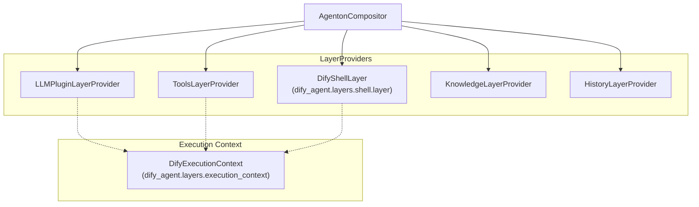
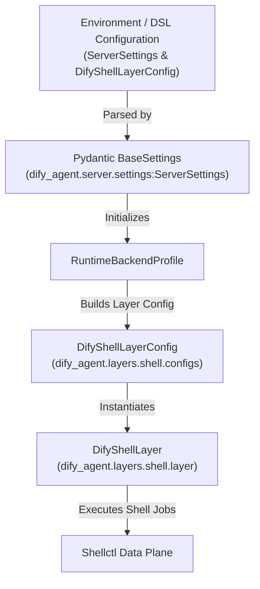
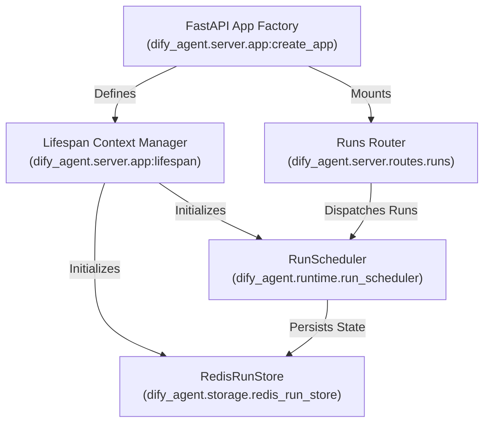

<!-- source: DeepWiki mcp.deepwiki.com · repo langgenius/dify · page 13.1 Agenton Framework and Layer Architecture · fetched 2026-10-26 -->

# Agenton Framework and Layer Architecture

<details>
<summary>Relevant source files</summary>

The following files were used as context for generating this wiki page:

- [dify-agent/.example.env](dify-agent/.example.env)
- [dify-agent/docs/dify-agent/guide/index.md](dify-agent/docs/dify-agent/guide/index.md)
- [dify-agent/docs/dify-agent/user-manual/shell-layer/index.md](dify-agent/docs/dify-agent/user-manual/shell-layer/index.md)
- [dify-agent/src/dify_agent/layers/shell/configs.py](dify-agent/src/dify_agent/layers/shell/configs.py)
- [dify-agent/src/dify_agent/layers/shell/layer.py](dify-agent/src/dify_agent/layers/shell/layer.py)
- [dify-agent/src/dify_agent/server/app.py](dify-agent/src/dify_agent/server/app.py)
- [dify-agent/src/dify_agent/server/settings.py](dify-agent/src/dify_agent/server/settings.py)
- [dify-agent/tests/local/dify_agent/layers/shell/test_configs.py](dify-agent/tests/local/dify_agent/layers/shell/test_configs.py)
- [dify-agent/tests/local/dify_agent/layers/shell/test_layer.py](dify-agent/tests/local/dify_agent/layers/shell/test_layer.py)
- [dify-agent/tests/local/dify_agent/server/test_app.py](dify-agent/tests/local/dify_agent/server/test_app.py)
- [dify-agent/tests/local/dify_agent/server/test_settings.py](dify-agent/tests/local/dify_agent/server/test_settings.py)
- [docker/envs/core-services/dify-agent.env.example](docker/envs/core-services/dify-agent.env.example)

</details>


The Agenton framework in Dify provides a robust and extensible architecture for building and executing AI agents and workflows. It is designed to bridge the gap between natural language instructions and code execution, enabling complex, multi-step AI applications. This page details the core components of the Agenton framework, including its compositor, `LayerNode` and `LayerProvider` abstractions, graph-based plan composition, session snapshots, and per-run configuration management.

## Purpose and Scope

The Agenton framework is a foundational component for Dify's agent capabilities, particularly for `AGENT_CHAT` and `WORKFLOW` application types. It enables the dynamic construction and execution of AI-driven processes that allow for sophisticated interactions and problem-solving. The framework's design emphasizes modularity, extensibility, and observability, facilitating the creation of complex AI applications that adapt to various scenarios and integrate with diverse tools and models.

In the Dify Agent Runtime, Agenton acts as the core engine that normalizes public Dify run compositions into an internal execution graph, facilitating consistent runtime behavior [dify-agent/docs/dify-agent/guide/index.md:3-8]().

Sources: [dify-agent/docs/dify-agent/guide/index.md:1-8]()

## Core Components

The Agenton framework is built around several key abstractions that enable its flexible and powerful execution model.

### Agenton Compositor

At the heart of the Agenton framework is the **Agenton Compositor**, which orchestrates the execution of layered agent logic. This component manages a layered stack of functionalities applied during an agent's run, maintaining isolation between concerns and allowing extensible behavior compositions.

The compositor is constructed through `build_pydantic_ai_compositor`, a factory function that assembles the standard set of **layer providers** for models, tools, and session history. This builder is invoked in the Agent runtime to create the execution environment for each run [dify-agent/src/dify_agent/server/app.py:1-17]() and [dify-agent/src/dify_agent/server/settings.py:1-12]().

### LayerNode and LayerProvider Abstractions

Agenton decomposes agent execution logic into modular **layers**. These layers are realized through two complementary abstractions:

- **LayerNode**: Represents an individual unit of agent logic or behavior within the execution graph. Examples include:
  - `DifyPluginLLMLayer`: Handles large language model invocations (LLMs) via plugins [dify-agent/src/dify_agent/layers/dify_plugin/llm_layer.py]() (implied via plugin daemon routing).
  - `DifyShellLayer`: Interfaces with shell execution environments for tooling (`dify_agent.layers.shell.layer`) [dify-agent/src/dify_agent/layers/shell/layer.py:1-13]().

- **LayerProvider**: Factory and manager for `LayerNode` instances. It handles initialization, lifecycle management, and dependency injection, creating layered structures that compose agent plans.

#### Agenton Layered Architecture Diagram



Sources: [dify-agent/src/dify_agent/layers/shell/layer.py:1-35](), [dify-agent/src/dify_agent/server/app.py:1-17]()

### Graph-based Plan Composition

Agenton models complex agent workflows as directed **graphs** of layered nodes, facilitating multi-step, interdependent agent logic.

- The **public interface** for defining run graphs is encapsulated via structured run configuration models loaded through `ServerSettings` [dify-agent/src/dify_agent/server/settings.py:48-72]().
- Run scheduling and execution tasks are coordinated via `RunScheduler` within the FastAPI lifespan context [dify-agent/src/dify_agent/server/app.py:93-128]().

#### Agent Runtime Execution Flow

```mermaid
graph TD
    Request["CreateRunRequest\n(dify_agent.server.routes.runs)"]
    Scheduler["RunScheduler\n(dify_agent.runtime.run_scheduler:RunScheduler)"]
    Runner["AgentRunRunner\n(dify_agent.runtime.runner)"]
    Compositor["AgentonCompositor"]
    Store["RedisRunStore\n(dify_agent.storage.redis_run_store:RedisRunStore)"]

    Request -->|POST /runs| Scheduler
    Scheduler -->|create_run()| Store
    Scheduler -->|spawn task| Runner
    Runner -->|normalize_composition()| Compositor
    Runner -->|execute| PydanticAI["Pydantic AI Agent"]
    PydanticAI -->|stream events| Runner
    Runner -->|append_event()| Store
```

Sources: [dify-agent/src/dify_agent/server/app.py:93-128](), [dify-agent/src/dify_agent/server/settings.py:48-72]()

### Session Snapshots

The Agenton framework supports **session snapshots**, which capture the complete lifecycle and runtime state of all layers at a point in time.

- Snapshots are emitted as part of terminal run events, encoding the final state accessible for run resumption or audit.
- State persistence is managed through Redis-backed event streams and run records configured via `ServerSettings` (`run_retention_seconds`, `run_event_stream_max_length`) [dify-agent/src/dify_agent/server/settings.py:56-61]().

Sources: [dify-agent/src/dify_agent/server/settings.py:56-61]()

### Per-Run Configuration Management

Per-run configuration is managed at the layer level:

- `DifyShellLayerConfig` defines public product behavior for sandbox-backed Dify Shell layers, including CLI tools, environment variables, secret references, and redaction patterns [dify-agent/src/dify_agent/layers/shell/configs.py:67-79]().
- Environment variables and secret references are validated against strict shell identifier rules using `DifyShellEnvVarConfig` and `DifyShellSecretRefConfig` [dify-agent/src/dify_agent/layers/shell/configs.py:19-49]().

Sources: [dify-agent/src/dify_agent/layers/shell/configs.py:1-86]()

## Node Implementation Details

### FastAPI Run Server and Lifecycle

The FastAPI application factory (`create_app`) wires core services and background infrastructure:

1. **Redis Store**: Initializes `RedisRunStore` for run state and per-run event streams [dify-agent/src/dify_agent/server/app.py:100-105]().
2. **Scheduler**: Sets up `RunScheduler` to handle background `asyncio` execution tasks independently of HTTP request handlers [dify-agent/src/dify_agent/server/app.py:106-126]().
3. **Clients**: Manages lifespan-scoped `httpx.AsyncClient` instances for plugin daemon and Dify API inner service calls [dify-agent/src/dify_agent/server/app.py:98-99]().

Sources: [dify-agent/src/dify_agent/server/app.py:46-132]()

## Key Data Structures Overview

| Class/Entity                   | Description                                   | Source Location                                      |
|-------------------------------|-----------------------------------------------|-----------------------------------------------------|
| `ServerSettings`               | Environment settings for scheduling, outbound HTTP, and runtime resources | [dify-agent/src/dify_agent/server/settings.py:48-72]() |
| `DifyShellLayerConfig`         | Public product behavior for the Dify Shell layer | [dify-agent/src/dify_agent/layers/shell/configs.py:67-79]() |
| `DifyShellEnvVarConfig`        | Shell environment variable configuration      | [dify-agent/src/dify_agent/layers/shell/configs.py:19-33]() |
| `RedisRunStore`                | Redis-based run and event stream storage      | [dify-agent/src/dify_agent/storage/redis_run_store.py]() |
| `RunScheduler`                 | In-process background task scheduler          | [dify-agent/src/dify_agent/runtime/run_scheduler.py]() |

Sources: [dify-agent/src/dify_agent/server/settings.py:48-72](), [dify-agent/src/dify_agent/layers/shell/configs.py:19-79]()

## Connecting Natural Language to Code Components

### Diagram: From Natural Language Config to Layer Execution



Sources: [dify-agent/src/dify_agent/server/settings.py:30-42](), [dify-agent/src/dify_agent/layers/shell/configs.py:67-79](), [dify-agent/src/dify_agent/layers/shell/layer.py:1-35]()

### Diagram: Runtime Server Architecture and App Factory



Sources: [dify-agent/src/dify_agent/server/app.py:46-132]()

## Observability and Configuration

- Configuration is managed via the `ServerSettings` model, which loads environment variables prefixed by `DIFY_AGENT_` and reads `.env` or `dify-agent/.env` [dify-agent/docs/dify-agent/guide/index.md:30-33]() and [dify-agent/src/dify_agent/server/settings.py:48-72]().
- Settings cover Redis connection parameters, timeout boundaries (`run_timeout_seconds`), plugin daemon integration, and runtime backends (`local`, `enterprise`, `e2b`, `openshell`) [dify-agent/src/dify_agent/server/settings.py:56-72]().
- Observability and tracing are configured via `configure_agent_observability` and `configure_server_observability` within the FastAPI app lifespan [dify-agent/src/dify_agent/server/app.py:33-95]().

Sources: [dify-agent/docs/dify-agent/guide/index.md:30-35](), [dify-agent/src/dify_agent/server/settings.py:48-72](), [dify-agent/src/dify_agent/server/app.py:33-95]()

## Summary

The Agenton framework's layered architecture and graph-based composition model provide a solid foundation for constructing versatile AI agents in Dify. By decoupling concerns across layer providers and nodes, supporting session snapshots for stateful execution, and managing run-specific configurations through Pydantic settings and DTOs, Agenton enables highly modular and maintainable agent runtimes that integrate seamlessly with Dify's broader stack.

---

### Sources

- [dify-agent/docs/dify-agent/guide/index.md:1-76]()
- [dify-agent/src/dify_agent/layers/shell/layer.py:1-183]()
- [dify-agent/src/dify_agent/server/settings.py:1-139]()
- [dify-agent/src/dify_agent/server/app.py:1-132]()
- [dify-agent/src/dify_agent/layers/shell/configs.py:1-86]()
- [dify-agent/docs/dify-agent/user-manual/shell-layer/index.md:1-14]()

---

