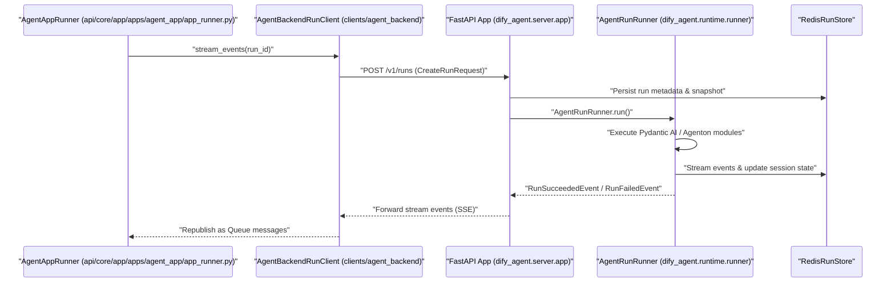
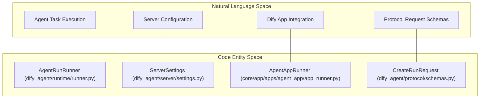

<!-- source: DeepWiki mcp.deepwiki.com · repo langgenius/dify · page 13.2 Dify Agent Server and Runtime API · fetched 2026-10-26 -->

# Dify Agent Server and Runtime API

Relevant source files

The following files were used as context for generating this wiki page:

- [api/core/app/apps/agent_app/app_generator.py](api/core/app/apps/agent_app/app_generator.py)
- [api/core/app/apps/agent_app/app_runner.py](api/core/app/apps/agent_app/app_runner.py)
- [api/core/app/apps/agent_app/runtime_request_builder.py](api/core/app/apps/agent_app/runtime_request_builder.py)
- [api/core/app/entities/app_invoke_entities.py](api/core/app/entities/app_invoke_entities.py)
- [api/tests/unit_tests/core/app/apps/agent_app/test_app_generator.py](api/tests/unit_tests/core/app/apps/agent_app/test_app_generator.py)
- [api/tests/unit_tests/core/app/apps/agent_app/test_app_runner.py](api/tests/unit_tests/core/app/apps/agent_app/test_app_runner.py)
- [api/tests/unit_tests/core/app/apps/agent_app/test_resolve_agent.py](api/tests/unit_tests/core/app/apps/agent_app/test_resolve_agent.py)
- [api/tests/unit_tests/core/app/apps/agent_app/test_runtime_request_builder.py](api/tests/unit_tests/core/app/apps/agent_app/test_runtime_request_builder.py)
- [dify-agent/.example.env](dify-agent/.example.env)
- [dify-agent/docs/dify-agent/guide/index.md](dify-agent/docs/dify-agent/guide/index.md)
- [dify-agent/docs/dify-agent/user-manual/shell-layer/index.md](dify-agent/docs/dify-agent/user-manual/shell-layer/index.md)
- [dify-agent/src/dify_agent/layers/shell/configs.py](dify-agent/src/dify_agent/layers/shell/configs.py)
- [dify-agent/src/dify_agent/layers/shell/layer.py](dify-agent/src/dify_agent/layers/shell/layer.py)
- [dify-agent/src/dify_agent/protocol/schemas.py](dify-agent/src/dify_agent/protocol/schemas.py)
- [dify-agent/src/dify_agent/runtime/event_sink.py](dify-agent/src/dify_agent/runtime/event_sink.py)
- [dify-agent/src/dify_agent/runtime/run_scheduler.py](dify-agent/src/dify_agent/runtime/run_scheduler.py)
- [dify-agent/src/dify_agent/runtime/runner.py](dify-agent/src/dify_agent/runtime/runner.py)
- [dify-agent/src/dify_agent/server/app.py](dify-agent/src/dify_agent/server/app.py)
- [dify-agent/src/dify_agent/server/settings.py](dify-agent/src/dify_agent/server/settings.py)
- [dify-agent/src/dify_agent/storage/redis_run_store.py](dify-agent/src/dify_agent/storage/redis_run_store.py)
- [dify-agent/tests/integration/dify_agent/storage/test_terminal_finalization.py](dify-agent/tests/integration/dify_agent/storage/test_terminal_finalization.py)
- [dify-agent/tests/local/dify_agent/layers/shell/test_configs.py](dify-agent/tests/local/dify_agent/layers/shell/test_configs.py)
- [dify-agent/tests/local/dify_agent/layers/shell/test_layer.py](dify-agent/tests/local/dify_agent/layers/shell/test_layer.py)
- [dify-agent/tests/local/dify_agent/protocol/test_protocol_schemas.py](dify-agent/tests/local/dify_agent/protocol/test_protocol_schemas.py)
- [dify-agent/tests/local/dify_agent/runtime/test_run_scheduler.py](dify-agent/tests/local/dify_agent/runtime/test_run_scheduler.py)
- [dify-agent/tests/local/dify_agent/runtime/test_runner.py](dify-agent/tests/local/dify_agent/runtime/test_runner.py)
- [dify-agent/tests/local/dify_agent/server/test_app.py](dify-agent/tests/local/dify_agent/server/test_app.py)
- [dify-agent/tests/local/dify_agent/server/test_settings.py](dify-agent/tests/local/dify_agent/server/test_settings.py)
- [dify-agent/tests/local/dify_agent/storage/test_redis_run_store.py](dify-agent/tests/local/dify_agent/storage/test_redis_run_store.py)
- [docker/envs/core-services/dify-agent.env.example](docker/envs/core-services/dify-agent.env.example)

This section describes the implementation and functionalities of the **Dify Agent Server and Runtime API**. It covers the FastAPI server entrypoint, the API request/event schemas for running AI agent workloads, the adapter layer that connects the internal Agenton framework to the Dify backend platform, and the setup for local development. This page is a detailed technical leaf node focused on agent runtime integration within the Dify platform.

---

## Overview

The **Dify Agent Server and Runtime API** provides a RESTful HTTP interface designed to run AI agent workloads. It acts as the entrypoint that accepts API requests describing the AI tasks, user context, and application data, and translates these requests into plans orchestrated by the Agenton framework.

This runtime service connects the Dify backend, including applications, models, user context, memory, and tools, with Agenton-based agent runners that manage AI model invocations, tool execution, multi-turn reasoning, and streaming of events.

Key components and responsibilities include:

- **FastAPI server** acting as the HTTP REST API entrypoint, typically running in the `dify-agent` member of the workspace monorepo [dify-agent/docs/dify-agent/guide/index.md:1-16]().

- **Run API request and event schemas** defined with Pydantic for strict validation and message passing between the Dify API and the Agent server [dify-agent/tests/local/dify_agent/runtime/test_runner.py:25-32]().

- **Run scheduler and Redis run store**, managing run lifecycle, persistence, and event streams for asynchronous agent execution [dify-agent/docs/dify-agent/guide/index.md:3-8](), [dify-agent/src/dify_agent/server/settings.py:56-60]().

- **Adapter layer bridging Agenton to Dify backend**, translating high-level Dify App and Agent configurations into Agenton runtime graph and session snapshots, and streaming results/events back to clients [dify-agent/src/dify_agent/runtime/runner.py:1-125](), [dify-agent/src/dify_agent/runtime/event_sink.py:45-55]().

- **Support for streaming and blocking response modes**, allowing efficient delivery of agent thoughts, partial tool results, and final outputs [dify-agent/src/dify_agent/runtime/runner.py:106-112]().

- **Configuration and local development setup** with environment-variable-driven settings (`ServerSettings`) and tightly controlled dependency management using `uv` [dify-agent/src/dify_agent/server/settings.py:1-50](), [dify-agent/.example.env:1-25]().

Sources: [dify-agent/docs/dify-agent/guide/index.md:1-28](), [dify-agent/src/dify_agent/server/settings.py:1-50](), [dify-agent/src/dify_agent/runtime/runner.py:1-125]()

---

## Components and Data Flow

### FastAPI Agent Server Entrypoint

The Agent Server is implemented with FastAPI exposing REST endpoints, primarily accepting agent run requests validated against `CreateRunRequest` schema [dify-agent/tests/local/dify_agent/runtime/test_runner.py:41-62]().

Upon receiving a run request, the server delegates execution to the underlying run manager and scheduler. The system enqueues and manages each run independently, performing initial persistence in Redis, ensuring idempotency, and then invoking the asynchronous Agent Runner that executes the actual AI model composition plan via Agenton [dify-agent/docs/dify-agent/guide/index.md:18-28]().

The server supports streaming run events (agent thoughts, tool calls, text deltas) incrementally to clients, enabling responsive UX that reflects live agent reasoning [dify-agent/src/dify_agent/runtime/runner.py:106-112]().

Sources: [dify-agent/docs/dify-agent/guide/index.md:18-28](), [dify-agent/src/dify_agent/runtime/runner.py:106-112]()

### Redis Run Store for State Persistence

Runs are persisted and managed using a Redis-backed store that records run metadata, execution snapshots, and event streams keyed by a run ID [dify-agent/docs/dify-agent/guide/index.md:3-8]().

This Redis store is pivotal for:
- Resuming interrupted executions.
- Retaining event history for replay and debugging.
- Coordinating concurrent or distributed execution workers.

The store supports capped-length Redis Streams (`DIFY_AGENT_RUN_EVENT_STREAM_MAX_LENGTH`) for event playback and incremental updates, adhering to configurable retention (`DIFY_AGENT_RUN_RETENTION_SECONDS`) and max length parameters [dify-agent/docs/dify-agent/guide/index.md:43-47]().

Sources: [dify-agent/docs/dify-agent/guide/index.md:3-47](), [dify-agent/src/dify_agent/server/settings.py:56-60]()

### Run API Schemas

The Agent Server uses Pydantic models in `dify_agent.protocol.schemas` for incoming request validation and outgoing event structuring:
- **`CreateRunRequest`**: Defines the payload to start a new run, carrying app config, inputs, user context, and optional snapshot to resume [dify-agent/tests/local/dify_agent/runtime/test_runner.py:41-62]().
- **`RunEvent`**: A discriminated union encapsulating various runtime events such as agent thoughts, tool calls, tool results, error notifications, and final outputs [dify-agent/tests/local/dify_agent/runtime/test_runner.py:25-32]().

Sources: [dify-agent/tests/local/dify_agent/runtime/test_runner.py:25-62]()

### Adapter Layer: Bridging Agenton and Dify Backend

The interface adapter core maps Dify high-level constructs (like `AppModel`, `AgentSoulConfig`, and user invocation context) into Agenton layers and session snapshots used in runtime execution:
- The adapter prepares run requests by composing required layer specifications and injecting config such as memory layers, plugin tools, shell execution layers, and knowledge base connections [dify-agent/tests/local/dify_agent/runtime/test_runner.py:40-62]().
- Agenton runs execute under the governance of these layers, generating events that the adapter collects and converts to protocol-compliant messages [dify-agent/src/dify_agent/runtime/runner.py:124-170]().
- On run termination (success or failure), final snapshot states and output are persisted and emitted [dify-agent/src/dify_agent/runtime/runner.py:115-170]().

Sources: [api/core/app/apps/agent_app/app_runner.py:1-45](), [dify-agent/src/dify_agent/runtime/runner.py:115-170](), [dify-agent/tests/local/dify_agent/runtime/test_runner.py:40-62]()

---

## Key Classes and Their Roles

| Class Name | Description | File Location |
| :--- | :--- | :--- |
| `AgentRunRunner` | Executes a single agent run plan with Agenton compositor; streams events for interactive clients. | [dify-agent/src/dify_agent/runtime/runner.py:124-170]() |
| `ServerSettings` | Configuration settings loaded from environment variables prefixed with `DIFY_AGENT_`. | [dify-agent/src/dify_agent/server/settings.py:48-139]() |
| `AgentAppRunner` | Dify backend runner bridging chat pipeline queues to the agent backend execution. | [api/core/app/apps/agent_app/app_runner.py:1-45]() |
| `CreateRunRequest` | Pydantic schema for inbound agent run requests. | [dify-agent/tests/local/dify_agent/runtime/test_runner.py:41-62]() |
| `SessionSnapshot` | Immutable state capture representing conversation/layer state across turns. | [dify-agent/tests/local/dify_agent/runtime/test_runner.py:33-33]() |
| `AgentSoulConfig` | Agent definition schema containing model configuration, prompts, and tools. | [models/agent_config_entities.py](), [api/core/app/apps/agent_app/app_runner.py:69-69]() |

Sources: [dify-agent/src/dify_agent/runtime/runner.py:124-170](), [dify-agent/src/dify_agent/server/settings.py:48-139](), [api/core/app/apps/agent_app/app_runner.py:1-45](), [dify-agent/tests/local/dify_agent/runtime/test_runner.py:33-62]()

---

## Agent Server Request Flow Diagram

Title: "Agent Server Request and Execution Flow"

Sources: [api/core/app/apps/agent_app/app_runner.py:20-50](), [dify-agent/src/dify_agent/runtime/runner.py:124-170](), [dify-agent/docs/dify-agent/guide/index.md:1-28]()

---

## Bridging Natural Language Space to Code Entity Space

Title: "Natural Language to Code Entities for Dify Agent Runtime"

Sources: [dify-agent/src/dify_agent/runtime/runner.py:124-170](), [dify-agent/src/dify_agent/server/settings.py:48-139](), [api/core/app/apps/agent_app/app_runner.py:1-45](), [dify-agent/tests/local/dify_agent/runtime/test_runner.py:41-62]()

---

## Local Development and Configuration

### Development Setup

- The Agent Server runs as a standalone FastAPI process, typically started with `uvicorn dify_agent.server.app:app` using `uv` to isolate dependencies [dify-agent/docs/dify-agent/guide/index.md:10-16]().
- Redis must be running locally to back run persistence and event streaming, configurable via `DIFY_AGENT_REDIS_URL` [dify-agent/docs/dify-agent/guide/index.md:43-43]().
- The FastAPI lifespan initializes Redis run stores, outbound HTTP client pools for plugin-daemon and Dify inner API calls, and selected runtime backend profiles [dify-agent/docs/dify-agent/guide/index.md:18-24]().

Sources: [dify-agent/docs/dify-agent/guide/index.md:10-28](), [dify-agent/.example.env:5-10]()

### Configuration Parameters

Key environment variables managed by `ServerSettings` [dify-agent/src/dify_agent/server/settings.py:48-139]() include:

| Environment Variable | Default | Description |
| :--- | :--- | :--- |
| `DIFY_AGENT_REDIS_URL` | `redis://localhost:6379/0` | Redis connection URL for run records and event streams [dify-agent/docs/dify-agent/guide/index.md:43-43]() |
| `DIFY_AGENT_REDIS_PREFIX` | `dify-agent` | Prefix for Redis record and event keys [dify-agent/docs/dify-agent/guide/index.md:44-44]() |
| `DIFY_AGENT_RUN_RETENTION_SECONDS` | `7200` | Retention duration for run records and event streams [dify-agent/docs/dify-agent/guide/index.md:46-46]() |
| `DIFY_AGENT_API_TOKEN` | empty | Bearer token required for private control-plane routes [dify-agent/docs/dify-agent/guide/index.md:53-53]() |
| `DIFY_AGENT_RUNTIME_BACKEND` | `local` | Runtime backend profile (`local`, `enterprise`, `e2b`, `openshell`) [dify-agent/docs/dify-agent/guide/index.md:58-58]() |
| `DIFY_AGENT_PLUGIN_DAEMON_URL` | `http://localhost:5002` | Base URL for the Dify plugin daemon [dify-agent/docs/dify-agent/guide/index.md:54-54]() |
| `DIFY_AGENT_INNER_API_URL` | `http://localhost:5001` | Dify API service root used for inner endpoints [dify-agent/docs/dify-agent/guide/index.md:56-56]() |

Sources: [dify-agent/docs/dify-agent/guide/index.md:41-76](), [dify-agent/src/dify_agent/server/settings.py:48-139]()

---

## Summary

The **Dify Agent Server and Runtime API** bridges the Dify backend platform and the Agenton/Pydantic AI runtime engine. It provides:
- An isolated FastAPI server for agent workload execution [dify-agent/docs/dify-agent/guide/index.md:1-16]().
- Strict validation via Pydantic schemas for run requests and events [dify-agent/tests/local/dify_agent/runtime/test_runner.py:25-62]().
- Persistent state and streaming management via Redis [dify-agent/docs/dify-agent/guide/index.md:3-8]().
- Adapter integration linking Dify apps (`AgentAppRunner`) to the execution engine [api/core/app/apps/agent_app/app_runner.py:1-45]().

Sources: [dify-agent/docs/dify-agent/guide/index.md:1-28](), [api/core/app/apps/agent_app/app_runner.py:1-45](), [dify-agent/src/dify_agent/server/settings.py:48-139]()

---

## Sources

- [dify-agent/docs/dify-agent/guide/index.md:1-76]()
- [dify-agent/src/dify_agent/server/settings.py:48-139]()
- [dify-agent/src/dify_agent/runtime/runner.py:1-170]()
- [api/core/app/apps/agent_app/app_runner.py:1-45]()
- [dify-agent/tests/local/dify_agent/runtime/test_runner.py:25-62]()
- [dify-agent/.example.env:1-110]()

---

