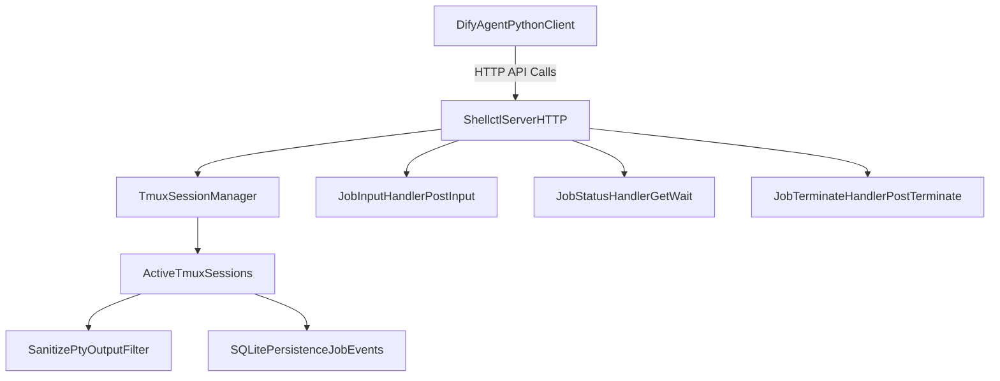
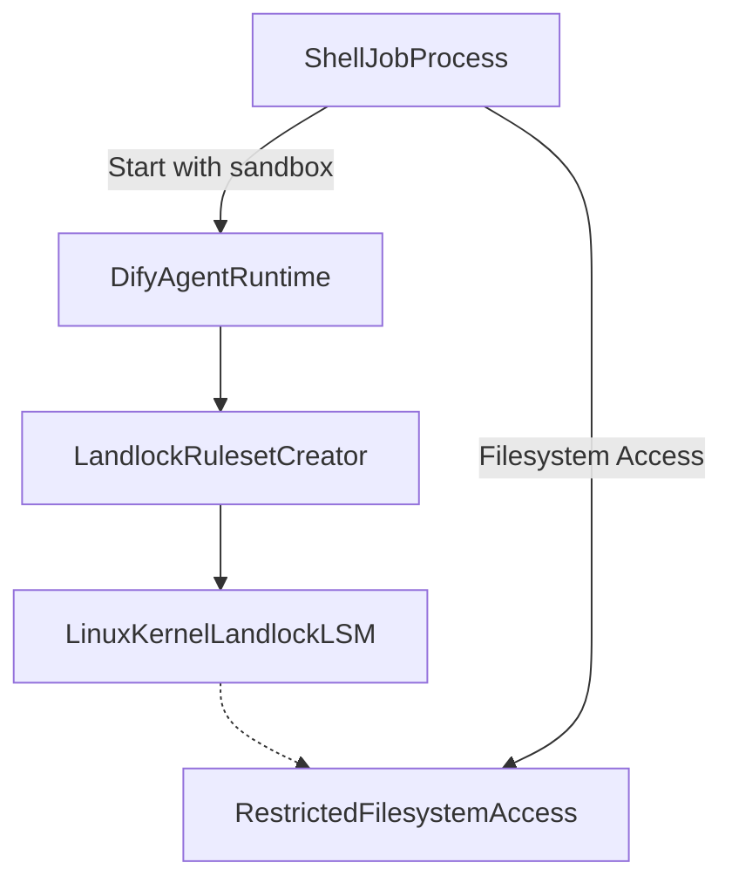
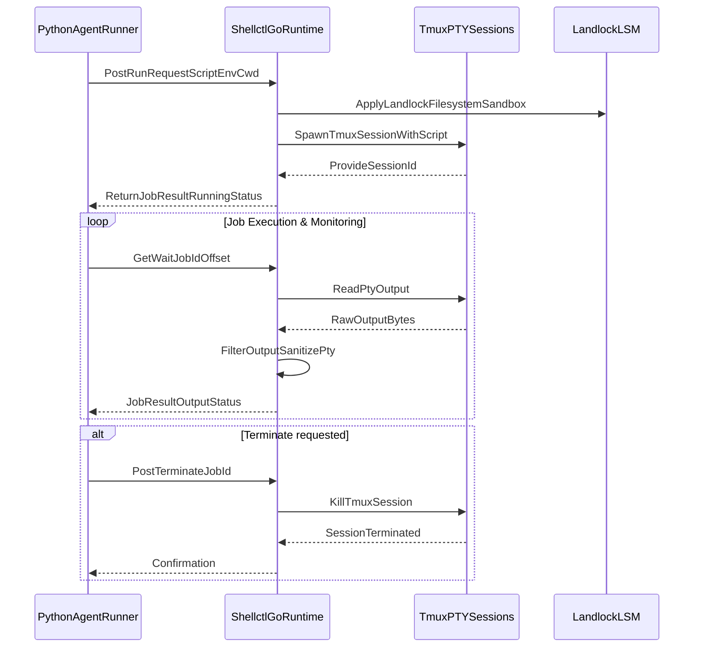
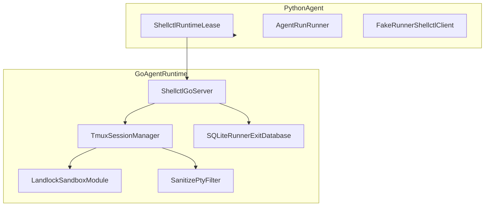

<!-- source: DeepWiki mcp.deepwiki.com · repo langgenius/dify · page 13.3 Go Agent Runtime (dify-agent-runtime) — Shellctl and Sandbox · fetched 2026-10-26 -->

# Go Agent Runtime (dify-agent-runtime) — Shellctl and Sandbox

Relevant source files

The following files were used as context for generating this wiki page:

- [.github/workflows/cli-e2e.yml](.github/workflows/cli-e2e.yml)
- [.github/workflows/cli-release.yml](.github/workflows/cli-release.yml)
- [.github/workflows/cli-tests.yml](.github/workflows/cli-tests.yml)
- [api/controllers/common/errors.py](api/controllers/common/errors.py)
- [cli/bin/dev.js](cli/bin/dev.js)
- [cli/package.json](cli/package.json)
- [cli/scripts/e2e-provision.ts](cli/scripts/e2e-provision.ts)
- [cli/scripts/install-local.sh](cli/scripts/install-local.sh)
- [cli/scripts/lib/resolve-buildinfo.ts](cli/scripts/lib/resolve-buildinfo.ts)
- [cli/scripts/release-build.sh](cli/scripts/release-build.sh)
- [cli/scripts/release-naming.mjs](cli/scripts/release-naming.mjs)
- [cli/scripts/release-naming.test.ts](cli/scripts/release-naming.test.ts)
- [cli/scripts/release-r2-edge.test.ts](cli/scripts/release-r2-edge.test.ts)
- [cli/scripts/release-write-checksums.sh](cli/scripts/release-write-checksums.sh)
- [cli/src/version/info.ts](cli/src/version/info.ts)
- [cli/test/fixtures/pkg-manifest.ts](cli/test/fixtures/pkg-manifest.ts)
- [codecov.yml](codecov.yml)
- [dify-agent/Makefile](dify-agent/Makefile)
- [dify-agent/pyproject.toml](dify-agent/pyproject.toml)
- [dify-agent/src/dify_agent/agent_stub/protocol/agent_stub.py](dify-agent/src/dify_agent/agent_stub/protocol/agent_stub.py)
- [dify-agent/src/dify_agent/layers/dify_plugin/configs.py](dify-agent/src/dify_agent/layers/dify_plugin/configs.py)
- [dify-agent/src/dify_agent/runtime_backend/e2b.py](dify-agent/src/dify_agent/runtime_backend/e2b.py)
- [dify-agent/tests/local/dify_agent/runtime_backend/test_e2b.py](dify-agent/tests/local/dify_agent/runtime_backend/test_e2b.py)
- [dify-agent/tests/local/dify_agent/runtime_backend/test_e2b_sdk.py](dify-agent/tests/local/dify_agent/runtime_backend/test_e2b_sdk.py)
- [dify-agent/tests/local/test_packaging.py](dify-agent/tests/local/test_packaging.py)
- [dify-agent/uv.lock](dify-agent/uv.lock)

This page provides a comprehensive technical overview of the Go-based **dify-agent-runtime** component. It explains how the runtime implements the **shellctl HTTP server**, manages **tmux-backed shell job lifecycles**, applies **Landlock filesystem sandboxing** for agent jobs, persists runner-exit events using **SQLite**, and integrates the **sanitize-pty** PTY filter. Additionally, it covers the build process, Docker image setup, and environment variable configuration critical to runtime operation.

---

## Purpose and Scope

The `dify-agent-runtime` is a standalone Go service within the Dify Agent ecosystem. Its primary responsibilities involve managing sandboxed shell command execution jobs on behalf of agents, providing HTTP APIs for job control, securely sandboxing filesystem access, recording execution logs/state persistently, and cleaning output streams for safe communication.

This page dives into:

- The internal architecture and key code entities supporting shell job lifecycle management.
- The Landlock filesystem sandboxing mechanism configured per job to restrict access.
- SQLite-based persistence layer used to log runtime events.
- The PTY filter mechanism that sanitizes interactive terminal output.
- Details on Docker image construction and environment variables that control runtime behavior.

Sources: [dify-agent/src/dify_agent/runtime_backend/shellctl.py:1-40](), [dify-agent/src/dify_agent/runtime_backend/e2b.py:1-40]()

---

## 1. Shellctl HTTP Server and Shell Job Lifecycle Management

The `dify-agent-runtime` implements an HTTP server framework named **shellctl**, which exposes RESTful endpoints to:

- Run shell commands in a sandboxed environment.
- Collect outputs interactively.
- Handle input into running shell jobs.
- Wait for completion and retrieve exit statuses.
- Terminate running shell jobs prematurely.

These shell jobs are implemented as **tmux** sessions, providing a multiplexed pseudo-terminal infrastructure supporting job lifecycle and output handling resilient to client disconnections.

### Key Components

- **shellctl HTTP Server**: Listens for REST API calls such as `/run`, `/wait`, `/input`, and `/terminate`.
- **Tmux Session Manager**: Creates, tracks, and controls individual tmux sessions corresponding to shell jobs.
- **Job Input Handler**: Supplies typed data into the shell PTY.
- **Job Status Handler**: Enables clients to wait for or poll job output and completion.
- **Job Termination Handler**: Allows external callers to kill jobs gracefully or forcibly.
- **PTY Output Filter (sanitize-pty)**: Processes terminal output streams to sanitize and normalize bytes before returning to clients.
- **SQLite Event Logger**: Persists job lifecycle events such as exit codes and timing for durability and recovery.

### Data Flow Overview

- **Client Request**: The external Python client components (e.g., `ShellctlRuntimeLease`) call shellctl's HTTP API.
- **Job Creation**: On `/run`, a new tmux session is spawned to execute the specified shell script.
- **Interaction**: Clients may post input with `/input` and poll output with `/wait`.
- **Lifecycle Management**: Jobs can be terminated via `/terminate`. On job exit, status and output metadata are stored in the SQLite persistence.
- **Output Sanitization**: Output passes through a filter to remove or redact undesirable control codes or potentially sensitive strings.

### Mermaid Diagram: Natural Language to Shellctl Code Entities

Sources: [dify-agent/src/dify_agent/runtime_backend/shellctl.py:1-149](), [dify-agent/tests/local/dify_agent/runtime/test_runner.py:94-149]()

---

## 2. Landlock Filesystem Sandboxing

To ensure security and containment of shell command executions, `dify-agent-runtime` leverages **Landlock**, a Linux Security Module providing fine-grained filesystem access restrictions.

### Design Principles

- Each shell job runs inside a Landlock sandbox enforcing a whitelist of accessible paths.
- The environment variables `DIFY_AGENT_LOCAL_SANDBOX_WORKSPACE_ROOT`, `DIFY_AGENT_LOCAL_SANDBOX_MATERIALIZED_HOME_ROOT`, and related settings define the root directories and permission boundaries.
- This sandboxing protects the host system by limiting file read/write access and preventing privilege escalation or data leaks.

### Implementation Details

- The runtime creates a Landlock ruleset for each shell job process before spawning the tmux session.
- Landlock rules explicitly allow access to:
  - User mutable workspace areas
  - Immutable "materialized homes"
  - Certain config or temp directories as needed
- Any filesystem access outside these rules causes an enforced denial by the Linux kernel.

### Mermaid Diagram: Landlock Sandboxing Setup Per Job

Sources: [dify-agent/docs/dify_agent/guide/index.md:42-47](), [dify-agent/src/dify_agent/runtime_backend/shellctl.py:50-85]()

---

## 3. SQLite Persistence for Runner-Exit Events

The runtime uses an embedded SQLite database as its persistent storage for job lifecycle:

- Stores information about each shell job such as exit code, timestamps, truncated output flags.
- Ensures shell job results survive runtime restarts or crashes.
- Supports efficient queries on completed and running jobs.
- Used by higher-level Python agent components to correlate job results.

This persistence layer supports recovery and auditing, essential for correctness in multi-agent deployments.

Sources: [dify-agent/tests/local/dify_agent/runtime/test_runner.py:113-122](), [dify-agent/src/dify_agent/runtime_backend/shellctl.py:149]()

---

## 4. Sanitize-Pty PTY Filter

Shell PTY output streams are filtered by the **sanitize-pty** module to enhance safety and usability:

- Strips undesired control characters and ANSI escape codes.
- Normalize all output to valid UTF-8 sequences.
- Redacts sensitive substrings using user-configurable regular expression patterns such as those from `DIFY_AGENT_SHELL_REDACT_PATTERNS`.
- Ensures shell output streaming to clients is safe for display or logging.

The filter operates in-process within the tmux session output handling pipeline.

Sources: [dify-agent/docs/dify_agent/guide/index.md:57-57](), [dify-agent/tests/local/dify_agent/runtime/test_runner.py:119-119]()

---

## 5. Environment Variable Configuration

The behavior of the Go agent runtime is customized through several environment variables primarily prefixed by `DIFY_AGENT_LOCAL_SANDBOX_` for local deployment convenience.

| Variable | Description | Default |
| -------- | ----------- | ------- |
| `DIFY_AGENT_LOCAL_SANDBOX_ENDPOINT` | URL endpoint for the shellctl HTTP server | (empty) |
| `DIFY_AGENT_LOCAL_SANDBOX_AUTH_TOKEN` | Bearer token for authenticating shellctl requests | (empty) |
| `DIFY_AGENT_LOCAL_SANDBOX_MATERIALIZED_HOME_ROOT` | Root path for immutable "materialized homes" directory | `/home/dify/.dify-agent-materialized-homes` |
| `DIFY_AGENT_LOCAL_SANDBOX_WORKSPACE_ROOT` | Root path for writable workspaces | `/home/dify/.dify-agent-workspaces` |
| `DIFY_AGENT_LOCAL_SANDBOX_HOME_SNAPSHOT_ROOT` | Root path for immutable home snapshots | `/home/dify/.dify-agent-home-snapshots` |

These variables enable flexible deployment and integration by specifying workspace locations, authentication tokens, and endpoint addresses.

Sources: [dify-agent/docs/dify_agent/guide/index.md:43-47]()

---

## 6. Sequence of Execution

The typical execution flow for a shell command through the runtime is:

### Actors

- **Python Agent Runner**: The client side in Python that requests commands to run.
- **Shellctl Go Runtime**: Receives and manages shell job lifecycles.
- **Tmux/PTYSessions**: Pseudo-terminal backend that executes commands.
- **Landlock LSM**: Kernel module enforcing sandbox policies.

### Flow Steps

1. The Python agent sends a `POST /run` request with the script, environment variables, and working directory.
2. The runtime applies Landlock sandbox rules tailored to the job.
3. It then creates a new tmux session to execute the script inside the sandbox.
4. The runtime returns a `JobResult` with job ID and RUNNING status.
5. The Python client polls `GET /wait` to receive incremental PTY output, which the runtime sanitizes on the fly.
6. Inputs can be sent via `POST /input`.
7. Upon job termination, the exit code and final output state are saved persistently.
8. The client can retrieve final status or terminate the job with `POST /terminate`.

### Mermaid Diagram: Shell Job Lifecycle Sequence

Sources: [dify-agent/src/dify_agent/runtime/runner.py:1-28](), [dify-agent/tests/local/dify_agent/runtime/test_runner.py:104-122]()

---

## 7. Build Process and Docker Image

The `dify-agent-runtime` is built and packaged as a lightweight Docker image (e.g., `langgenius/dify-agent-runtime`), designed for:

- Seamless inclusion in Dify Agent deployments.
- Running on Linux hosts with support for Landlock and tmux.
- Mounting volumes for persistent user home/materialized sandboxes.
- Configurable via environment variables per deployment requirements.

Docker Compose setups in Dify orchestrate this image alongside other services such as the API, sandbox, Redis, and backend components.

Typical environment variable injection and volume mounts are defined in `docker-compose.yaml` or similar files for runtime configuration.

Sources: [docker/docker-compose-template.yaml:107-156](), [docker/docker-compose.yaml:100-160]()

---

# Summary

The **dify-agent-runtime** Go service provides a robust, secure, and persistent shell job execution environment for agent commands within the Dify platform. Its core capabilities span:

- **Shellctl HTTP API** enabling remote command execution and management.
- **Tmux-backed shell sessions** providing terminal multiplexing and interactive job control.
- **Landlock sandboxing** for strict filesystem access control.
- **SQLite persistence** for durable job lifecycle tracking.
- **sanitize-pty output filtering** to clean and redact terminal output.
- Docker image packaging for containerized operational deployment.

This component plays a critical role in secure, scalable agent runtime orchestration by bridging abstract runtime requests into sandboxed shell command execution under strict observability and control.

Sources: [dify-agent/src/dify_agent/runtime_backend/shellctl.py:1-149]()

---

# Appendix: Key Code Entities and Mappings

Sources: [dify-agent/src/dify_agent/runtime_backend/shellctl.py:1-149](), [dify-agent/src/dify_agent/runtime/runner.py:150-180](), [dify-agent/tests/local/dify_agent/runtime/test_runner.py:94-149]()

---

# Sources

- dify-agent/src/dify_agent/runtime_backend/shellctl.py:1-200
- dify-agent/tests/local/dify_agent/runtime/test_runner.py:94-149
- dify-agent/docs/dify_agent/guide/index.md:42-57
- dify-agent/src/dify_agent/runtime/runner.py:1-28
- docker/docker-compose-template.yaml:107-156
- docker/docker-compose.yaml:100-160
- dify-agent/src/dify_agent/runtime_backend/e2b.py:1-40

---

