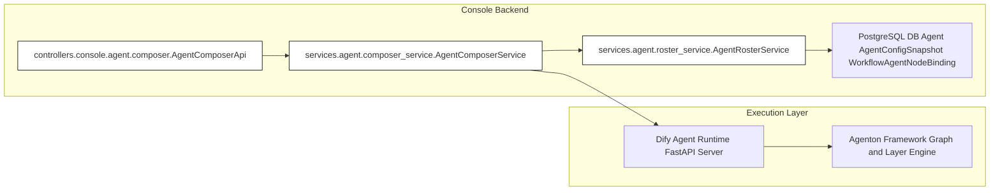

<!-- source: DeepWiki mcp.deepwiki.com · repo langgenius/dify · page 14 Agent Roster and Composer System · fetched 2026-10-26 -->

# Agent Roster and Composer System

Relevant source files

The following files were used as context for generating this wiki page:

- [api/controllers/console/agent/composer.py](api/controllers/console/agent/composer.py)
- [api/controllers/console/agent/roster.py](api/controllers/console/agent/roster.py)
- [api/fields/agent_fields.py](api/fields/agent_fields.py)
- [api/models/agent.py](api/models/agent.py)
- [api/openapi/markdown/console-openapi.md](api/openapi/markdown/console-openapi.md)
- [api/services/agent/composer_service.py](api/services/agent/composer_service.py)
- [api/services/agent/composer_validator.py](api/services/agent/composer_validator.py)
- [api/services/agent/roster_service.py](api/services/agent/roster_service.py)
- [api/services/agent/workflow_publish_service.py](api/services/agent/workflow_publish_service.py)
- [api/services/workflow_service.py](api/services/workflow_service.py)
- [api/tests/unit_tests/controllers/console/agent/test_agent_controllers.py](api/tests/unit_tests/controllers/console/agent/test_agent_controllers.py)
- [api/tests/unit_tests/services/agent/test_agent_composer_entities.py](api/tests/unit_tests/services/agent/test_agent_composer_entities.py)
- [api/tests/unit_tests/services/agent/test_agent_services.py](api/tests/unit_tests/services/agent/test_agent_services.py)
- [api/tests/unit_tests/services/agent/test_workflow_publish_service.py](api/tests/unit_tests/services/agent/test_workflow_publish_service.py)
- [api/tests/unit_tests/services/test_workflow_service.py](api/tests/unit_tests/services/test_workflow_service.py)
- [packages/contracts/generated/api/console/agent/orpc.gen.ts](packages/contracts/generated/api/console/agent/orpc.gen.ts)
- [packages/contracts/generated/api/console/agent/types.gen.ts](packages/contracts/generated/api/console/agent/types.gen.ts)
- [packages/contracts/generated/api/console/agent/zod.gen.ts](packages/contracts/generated/api/console/agent/zod.gen.ts)
- [packages/contracts/generated/api/console/apps/orpc.gen.ts](packages/contracts/generated/api/console/apps/orpc.gen.ts)
- [packages/contracts/generated/api/console/apps/types.gen.ts](packages/contracts/generated/api/console/apps/types.gen.ts)
- [packages/contracts/generated/api/console/apps/zod.gen.ts](packages/contracts/generated/api/console/apps/zod.gen.ts)

This page provides a comprehensive overview of the Agent V2 backend system in Dify. It covers the lifecycle management handled by `AgentRosterService`, the versioning system for `AgentSoulConfig` (Draft, Snapshot, Revision), the strategy patterns implemented by `AgentComposerService`, observability features, and how this system bridges Agent Apps, Workflow Agents, and the Dify Agent Runtime.

---

## Agent Roster Service and Lifecycle

The `AgentRosterService` manages the full lifecycle of Agents within the Dify platform. It performs CRUD operations and enforces business rules surrounding Agents' visibility and versioning [api/services/agent/roster_service.py:71-139](). 

Key concepts include:

- **AgentScope**: Differentiates between `ROSTER` agents that are shared and reusable within a tenant workspace, versus `WORKFLOW_ONLY` agents that exist temporarily tied to a specific workflow node and cannot be individually managed [api/models/agent.py:25-26]().

- **Backing Application**: Each Agent is backed by an `App` entity providing a chat interface or execution context, enabling uniform handling of Agents and apps [api/models/agent.py:93-103]().

- **Versioning System**: Agent configurations are recorded in versions:  
  - `AgentConfigDraft` tracks in-progress edits  
  - `AgentConfigSnapshot` represents published or stable configurations  
  - `AgentConfigRevision` stores a history of changes for auditing [api/models/agent.py:18-21]().

- **Reference Tracking**: The service gathers which workflows and nodes reference roster Agents to assess deployment impact when updates occur [api/services/agent/roster_service.py:120-125]().

For detailed technical information, consult [Agent Roster Service and Lifecycle](#14.1).

**Sources:**  
[api/services/agent/roster_service.py:71-139](), [api/models/agent.py:18-26](), [api/models/agent.py:93-103]()

---

## Agent Composer and Soul Configuration

The `AgentComposerService` handles the creation, editing, and saving of Agent configurations defined as an `AgentSoulConfig` structured data model [api/services/agent/composer_service.py:117-182](), [api/models/agent_config_entities.py:18-35]().

This service supports various **save strategies**, selected via the `ComposerSaveStrategy` enum, enabling flexible workflows:

- **NODE_JOB_ONLY**: Persist changes only to a workflow node's job config, leaving the roster Agent unchanged. Useful for inline agents in workflows [api/services/agent/composer_service.py:128-136]().

- **SAVE_AS_NEW_VERSION**: Create a new `AgentConfigSnapshot` to version an existing roster Agent [services/entities/agent_entities.py:63-64]().

- **SAVE_TO_ROSTER**: Promote a `WORKFLOW_ONLY` inline agent to become a reusable roster Agent visible across the tenant workspace [services/entities/agent_entities.py:63-64]().

The Agent's "soul", encapsulated in the `AgentSoulConfig` schema, includes:

- The underlying LLM model configuration
- Prompt templates and system instructions
- Tools (builtin, API-integrated, CLI tools)
- Attached knowledge bases and memory components

The system ensures configuration correctness through the `ComposerConfigValidator`, performing schema and semantic validation during saves [api/services/agent/composer_validator.py:106-112]().

For extensive details, see [Agent Composer and Soul Configuration](#14.2).

**Sources:**  
[api/services/agent/composer_service.py:117-182](), [api/models/agent_config_entities.py:18-35](), [api/services/agent/composer_validator.py:106-112]()

---

## Observability and Monitoring

The Agent Roster and Composer system integrates observability capabilities to monitor Agent usage and performance:

- **Agent Logs**: Powered by `AgentLogQueryParams`, the system tracks conversation and message logs including debugging sessions [api/controllers/console/agent/roster.py:100-105]().
  
- **Statistics and Metrics**: Summaries of agent interactions and request counts are aggregated via `AgentStatisticsQueryParams` for operational insights [api/controllers/console/agent/roster.py:100-105]().
  
- **Source Filtering**: Logs can be filtered by origin, such as `webapp` or specific workflow nodes, to aid diagnostics [api/controllers/console/agent/roster.py:116-124]().

These observability features enable continuous monitoring and troubleshooting of agent operation in production.

**Sources:**  
[api/controllers/console/agent/roster.py:100-124]()

---

## System Integration Bridge

The Agent Roster and Composer system serves as a central hub, bridging the user-facing console UI, the backend persistence and business logic, and the runtime execution environment.

### Diagram: Natural Language Concepts to Code Entities

This diagram maps high-level domain concepts to the primary code entities implementing them in the backend:

```mermaid
graph TD
    subgraph "Natural Language Space"
        Concept_Roster["Agent Roster"]
        Concept_Soul["Agent Personality Soul (AgentSoulConfig)"]
        Concept_Version["Agent Versioning Draft Snapshot Revision"]
        Concept_Node["Workflow Agent Node and Binding"]
    end

    subgraph "Code Entity Space"
        Model_Agent["models.agent.Agent"]
        Model_Soul["models.agent_config_entities.AgentSoulConfig"]
        Model_Snapshot["models.agent.AgentConfigSnapshot"]
        Model_Binding["models.agent.WorkflowAgentNodeBinding"]
        Service_Roster["services.agent.roster_service.AgentRosterService"]
        Service_Composer["services.agent.composer_service.AgentComposerService"]
        Service_WorkflowPublish["services.agent.workflow_publish_service.WorkflowAgentPublishService"]
    end

    Concept_Roster --> Service_Roster
    Service_Roster --> Model_Agent
    Concept_Soul --> Model_Soul
    Model_Soul --> Service_Composer
    Concept_Version --> Model_Snapshot
    Concept_Node --> Model_Binding
    Model_Binding --> Model_Agent

    Service_WorkflowPublish --> Model_Binding
    Service_WorkflowPublish --> Service_Composer

    classDef codeEntity fill:#ffffff,stroke:#000000,stroke-width:1px;
    class Model_Agent,Model_Soul,Model_Snapshot,Model_Binding,Service_Roster,Service_Composer,Service_WorkflowPublish codeEntity;
```

**Sources:**  
[api/models/agent.py:14-34](), [api/models/agent_config_entities.py:18-35](), [api/services/agent/roster_service.py:71-139](), [api/services/agent/composer_service.py:117-182](), [api/services/agent/workflow_publish_service.py:52-176]()

---

### Diagram: Agent Configuration Flow from Console to Runtime

This diagram illustrates the sequence from a user's configuration changes in the console UI to the deployment and execution within the Dify Agent Runtime.

**Sources:**  
[api/controllers/console/agent/composer.py:1-50](), [api/services/agent/composer_service.py:117-182](), [api/services/agent/roster_service.py:94-105]()

---

### Key Integration Points

- **Agent Apps**: Agents represented as apps with chat frontends; they have roster-wide visibility and version control through `Agent` and `App` models [api/models/agent.py:93-103](), [api/controllers/console/agent/roster.py:120-125]().

- **Workflow Agents**: Workflow graphs reference agents through the `WorkflowAgentNodeBinding`, which binds either inline or roster agents to specific workflow nodes [api/models/agent.py:28-34](), [api/services/agent/workflow_publish_service.py:52-176]().

- **Agent Runtime**: The serialized `AgentSoulConfig` is passed to the Dify Agent Runtime for LLM orchestration and execution [api/services/entities/agent_entities.py:60-68]().

**Sources:**  
[api/models/agent.py:28-34](), [api/controllers/console/agent/roster.py:120-125](), [api/services/agent/workflow_publish_service.py:52-176](), [api/services/entities/agent_entities.py:60-68]()

---

## Child Pages

For detailed documentation, explore the following child pages:

- [Agent Roster Service and Lifecycle](#14.1) — AgentRosterService CRUD, AgentScope (ROSTER vs WORKFLOW_ONLY), backing app creation, copy/publish flows, and the Snapshot/Draft/Revision versioning system
- [Agent Composer and Soul Configuration](#14.2) — AgentComposerService strategy dispatch, AgentSoulConfig schema (model/prompt/tools/knowledge/memory), ComposerConfigValidator, and debug build isolation per user
- [Agent DSL, Packages and Workflow Publishing](#14.3) — Agent DSL export/import, roster package importer, and WorkflowAgentPublishService binding validation/freezing during workflow publish.

---

# Summary

The Agent Roster and Composer system is a foundational component of the Dify platform, enabling the creation, versioning, and lifecycle management of AI Agents. It offers a clear boundary between reusable agents managed organization-wide (`ROSTER`) and ephemeral agents confined to workflows (`WORKFLOW_ONLY`). The composer service facilitates agent configuration editing with rich schema validation and flexible saving strategies, supporting agent reuse and promotion. Finally, it connects seamlessly with the Dify Agent Runtime powering AI executions.

**Sources:**  
- [api/services/agent/roster_service.py:71-139]()
- [api/models/agent.py:12-34]()
- [api/services/agent/composer_service.py:117-182]()
- [api/services/entities/agent_entities.py:60-68]()
- [api/controllers/console/agent/composer.py:1-50]()
- [api/services/agent/workflow_publish_service.py:52-176]()
- [api/models/agent_config_entities.py:18-35]()
- [api/controllers/console/agent/roster.py:100-125]()

---

