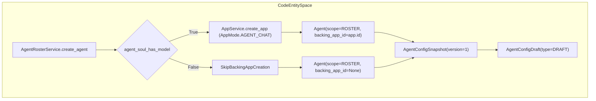
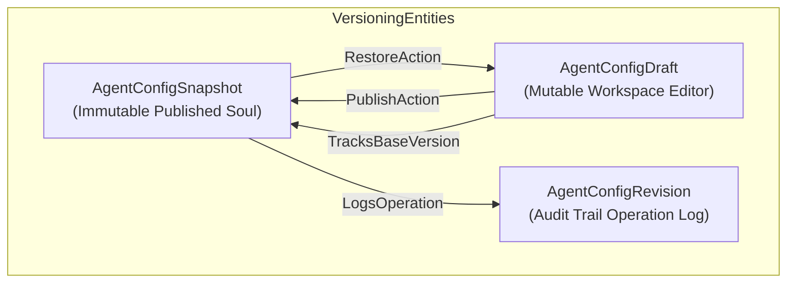

<!-- source: DeepWiki mcp.deepwiki.com · repo langgenius/dify · page 14.1 Agent Roster Service and Lifecycle · fetched 2026-10-26 -->

# Agent Roster Service and Lifecycle

Relevant source files

The following files were used as context for generating this wiki page:

- [api/controllers/console/agent/composer.py](api/controllers/console/agent/composer.py)
- [api/controllers/console/agent/roster.py](api/controllers/console/agent/roster.py)
- [api/controllers/console/app/app.py](api/controllers/console/app/app.py)
- [api/fields/agent_fields.py](api/fields/agent_fields.py)
- [api/models/agent.py](api/models/agent.py)
- [api/openapi/markdown/console-openapi.md](api/openapi/markdown/console-openapi.md)
- [api/services/agent/composer_service.py](api/services/agent/composer_service.py)
- [api/services/agent/composer_validator.py](api/services/agent/composer_validator.py)
- [api/services/agent/roster_service.py](api/services/agent/roster_service.py)
- [api/services/agent/workflow_publish_service.py](api/services/agent/workflow_publish_service.py)
- [api/services/app_service.py](api/services/app_service.py)
- [api/services/workflow_service.py](api/services/workflow_service.py)
- [api/tests/test_containers_integration_tests/services/test_agent_service.py](api/tests/test_containers_integration_tests/services/test_agent_service.py)
- [api/tests/test_containers_integration_tests/services/test_annotation_service.py](api/tests/test_containers_integration_tests/services/test_annotation_service.py)
- [api/tests/test_containers_integration_tests/services/test_app_generate_service.py](api/tests/test_containers_integration_tests/services/test_app_generate_service.py)
- [api/tests/test_containers_integration_tests/services/test_app_service.py](api/tests/test_containers_integration_tests/services/test_app_service.py)
- [api/tests/test_containers_integration_tests/services/test_message_service.py](api/tests/test_containers_integration_tests/services/test_message_service.py)
- [api/tests/test_containers_integration_tests/services/test_web_conversation_service.py](api/tests/test_containers_integration_tests/services/test_web_conversation_service.py)
- [api/tests/test_containers_integration_tests/services/test_workflow_app_service.py](api/tests/test_containers_integration_tests/services/test_workflow_app_service.py)
- [api/tests/test_containers_integration_tests/services/test_workflow_run_service.py](api/tests/test_containers_integration_tests/services/test_workflow_run_service.py)
- [api/tests/test_containers_integration_tests/services/tools/test_workflow_tools_manage_service.py](api/tests/test_containers_integration_tests/services/tools/test_workflow_tools_manage_service.py)
- [api/tests/unit_tests/controllers/console/agent/test_agent_controllers.py](api/tests/unit_tests/controllers/console/agent/test_agent_controllers.py)
- [api/tests/unit_tests/controllers/console/app/test_app_response_models.py](api/tests/unit_tests/controllers/console/app/test_app_response_models.py)
- [api/tests/unit_tests/services/agent/test_agent_composer_entities.py](api/tests/unit_tests/services/agent/test_agent_composer_entities.py)
- [api/tests/unit_tests/services/agent/test_agent_services.py](api/tests/unit_tests/services/agent/test_agent_services.py)
- [api/tests/unit_tests/services/agent/test_workflow_publish_service.py](api/tests/unit_tests/services/agent/test_workflow_publish_service.py)
- [api/tests/unit_tests/services/test_app_service.py](api/tests/unit_tests/services/test_app_service.py)
- [api/tests/unit_tests/services/test_workflow_service.py](api/tests/unit_tests/services/test_workflow_service.py)
- [packages/contracts/generated/api/console/agent/orpc.gen.ts](packages/contracts/generated/api/console/agent/orpc.gen.ts)
- [packages/contracts/generated/api/console/agent/types.gen.ts](packages/contracts/generated/api/console/agent/types.gen.ts)
- [packages/contracts/generated/api/console/agent/zod.gen.ts](packages/contracts/generated/api/console/agent/zod.gen.ts)
- [packages/contracts/generated/api/console/apps/orpc.gen.ts](packages/contracts/generated/api/console/apps/orpc.gen.ts)
- [packages/contracts/generated/api/console/apps/types.gen.ts](packages/contracts/generated/api/console/apps/types.gen.ts)
- [packages/contracts/generated/api/console/apps/zod.gen.ts](packages/contracts/generated/api/console/apps/zod.gen.ts)

This page provides full technical documentation for the `AgentRosterService` and its underlying versioning lifecycle within Dify. It covers domain models (`Agent`, `AgentConfigSnapshot`, `AgentConfigDraft`, `AgentConfigRevision`), execution scopes (`ROSTER` vs `WORKFLOW_ONLY`), backing application orchestration, copy and publish workflows, and console API integrations.

---

## Agent Entity, Scopes, and Status Models

The core entity managed by the agent system is the `Agent` database model, defined in `[api/models/agent.py]()`. It encapsulates metadata, scope boundaries, and pointers to configuration snapshots and backing applications.

### Agent Scopes (`AgentScope`)
- **`ROSTER`**: Workspace-wide reusable agents registered in the central agent roster. They can be inspected, edited, and bound across multiple workflows or agent applications within a tenant.
- **`WORKFLOW_ONLY`**: Local workflow-scoped agents bound to a specific workflow node (`WorkflowAgentNodeBinding`). They are hidden from global roster queries and lifecycle-managed alongside their parent workflow.

### Agent Sources (`AgentSource`)
- **`ROSTER`**: Created directly from the roster service interface `[api/services/agent/roster_service.py]()`.
- **`AGENT_APP`**: Instantiated via the Agent Application composer interface.
- **`WORKFLOW`**: Created via workflow node bindings.
- **`IMPORTED`**: Ingested via external archive imports.
- **`SYSTEM`**: Seeded by system bootstrap or built-in template providers.

### Agent Status (`AgentStatus`)
- **`ACTIVE`**: Fully operational agent available for runtime invocation, debugging, and composition.
- **`ARCHIVED`**: Soft-deleted agent hidden from roster listings while preserving historical execution logs and reference integrity.

Sources:
- `[api/models/agent.py:29-51]()`
- `[api/models/agent.py:65-71]()`
- `[api/models/agent.py:137-158]()`

---

## Agent Roster Service (`AgentRosterService`) Implementation

`AgentRosterService` (located in `[api/services/agent/roster_service.py]()`) acts as the primary orchestrator for agent CRUD operations, synchronization with backing apps, and configuration versioning.

### Core Lifecycle Methods

- **`list_roster_agents`**: Queries active `ROSTER`-scoped agents filtered by tenant ID and optional search keywords, returning serialized metadata combined with active snapshot references `[api/services/agent/roster_service.py:170-172]()`.
- **`create_agent`**: Validates uniqueness constraints (`AgentNameConflictError`), provisions a backing chat application (`AppMode.AGENT_CHAT`) if a model is configured, persists the `Agent` record, and initializes version 1 `AgentConfigSnapshot` and `AgentConfigDraft` records.
- **`update_agent`**: Modifies roster-level metadata (name, description, role, icon configurations) and propagates changes to the backing application instance if applicable.
- **`archive_agent`**: Transitions the agent state to `AgentStatus.ARCHIVED`.
- **`copy_agent`**: Clones an existing agent record, instantiates a new backing app, and deep-copies the `AgentSoulConfig` to new snapshot and draft entries.
- **`publish_agent`**: Validates the current draft using `ComposerConfigValidator`, freezes an immutable `AgentConfigSnapshot`, updates `Agent.active_config_snapshot_id`, and writes an `AgentConfigRevision` audit entry `[api/services/agent/roster_service.py:283-445]()`.
- **`restore_agent_version`**: Reverts the active snapshot pointer to a target historical version and synchronizes the active draft state.

Sources:
- `[api/services/agent/roster_service.py:57-172]()`
- `[api/services/agent/roster_service.py:283-445]()`

---

## Snapshot, Draft, and Revision Versioning System

Dify implements an immutable versioning store for agent configurations to support collaborative editing, rollback, and auditability.

### Key Versioning Models
- **`AgentConfigSnapshot`**: Immutable JSON schema capturing the agent's complete configuration soul (`AgentSoulConfig`) at a specific version index. Referenced by `Agent.active_config_snapshot_id` `[api/models/agent.py:300-317]()`.
- **`AgentConfigDraft`**: Mutable in-progress working copy supporting iterative edits before publishing. Includes types such as main workspace drafts and per-user isolated debug builds `[api/models/agent.py:260-277]()`.
- **`AgentConfigRevision`**: Audit log recording operations (e.g., publication, version restoration) executed against the agent configuration space `[api/models/agent.py:280-297]()`.

Sources:
- `[api/models/agent.py:260-317]()`
- `[api/services/agent/roster_service.py:283-445]()`

---

## Console API Endpoints and Client Contracts

Agent roster operations are exposed through Flask-RESTX controller routes under `[api/controllers/console/agent/roster.py]()`. Strongly-typed contracts are auto-generated into `packages/contracts/generated/api/console/agent/` via OpenAPI specifications.

### Roster Management Routes

| HTTP Method | Route Pattern | Controller Class | Description |
|---|---|---|---|
| `GET` | `/agents` | `AgentAppListApi` | List workspace `ROSTER` agents |
| `POST` | `/agent` | `AgentAppApi` | Create new roster agent |
| `PUT` | `/agent/<uuid:agent_id>` | `AgentAppApi` | Update agent metadata |
| `DELETE` | `/agent/<uuid:agent_id>` | `AgentAppApi` | Archive roster agent |
| `POST` | `/agent/<uuid:agent_id>/copy` | `AgentAppCopyApi` | Duplicate agent & backing app |
| `POST` | `/agent/<uuid:agent_id>/publish` | `AgentPublishApi` | Publish draft to snapshot |
| `GET` | `/agent/<uuid:agent_id>/versions` | `AgentRosterVersionsApi` | List configuration snapshots |
| `POST` | `/agent/<uuid:agent_id>/versions/<uuid:version_id>/restore` | `AgentRosterVersionRestoreApi` | Restore historical version |

Sources:
- `[api/controllers/console/agent/roster.py:1-120]()`
- `[packages/contracts/generated/api/console/agent/types.gen.ts:1-100]()`
- `[packages/contracts/generated/api/console/agent/zod.gen.ts:1-100]()`

---

