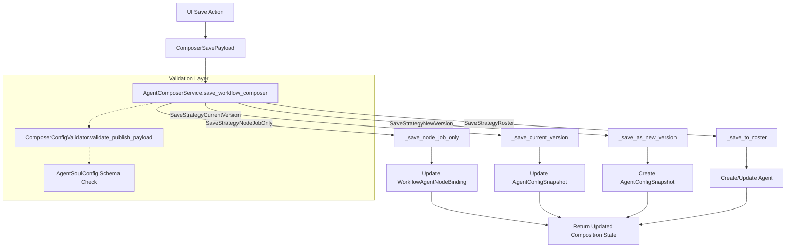
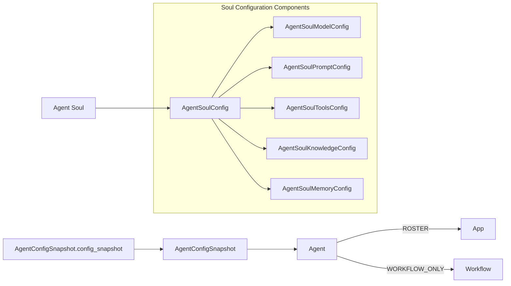
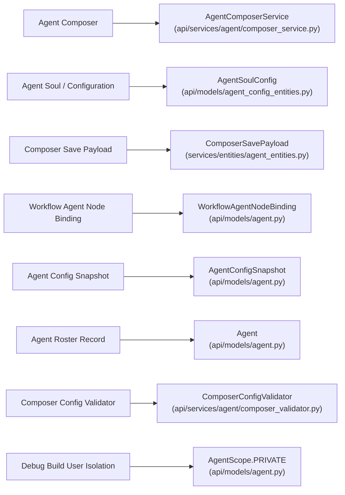

<!-- source: DeepWiki mcp.deepwiki.com · repo langgenius/dify · page 14.2 Agent Composer and Soul Configuration · fetched 2026-10-26 -->

# Agent Composer and Soul Configuration

<details>
<summary>Relevant source files</summary>

The following files were used as context for generating this wiki page:

- [api/clients/agent_backend/__init__.py](api/clients/agent_backend/__init__.py)
- [api/clients/agent_backend/client.py](api/clients/agent_backend/client.py)
- [api/clients/agent_backend/event_adapter.py](api/clients/agent_backend/event_adapter.py)
- [api/clients/agent_backend/fake_client.py](api/clients/agent_backend/fake_client.py)
- [api/clients/agent_backend/request_builder.py](api/clients/agent_backend/request_builder.py)
- [api/controllers/console/agent/composer.py](api/controllers/console/agent/composer.py)
- [api/controllers/console/agent/roster.py](api/controllers/console/agent/roster.py)
- [api/core/app/apps/agent_app/session_store.py](api/core/app/apps/agent_app/session_store.py)
- [api/core/workflow/nodes/agent_v2/agent_node.py](api/core/workflow/nodes/agent_v2/agent_node.py)
- [api/core/workflow/nodes/agent_v2/binding_resolver.py](api/core/workflow/nodes/agent_v2/binding_resolver.py)
- [api/core/workflow/nodes/agent_v2/file_tenant_validator.py](api/core/workflow/nodes/agent_v2/file_tenant_validator.py)
- [api/core/workflow/nodes/agent_v2/output_adapter.py](api/core/workflow/nodes/agent_v2/output_adapter.py)
- [api/core/workflow/nodes/agent_v2/output_type_checker.py](api/core/workflow/nodes/agent_v2/output_type_checker.py)
- [api/core/workflow/nodes/agent_v2/runtime_request_builder.py](api/core/workflow/nodes/agent_v2/runtime_request_builder.py)
- [api/core/workflow/nodes/agent_v2/session_store.py](api/core/workflow/nodes/agent_v2/session_store.py)
- [api/core/workflow/nodes/agent_v2/validators.py](api/core/workflow/nodes/agent_v2/validators.py)
- [api/fields/agent_fields.py](api/fields/agent_fields.py)
- [api/models/agent.py](api/models/agent.py)
- [api/models/agent_config_entities.py](api/models/agent_config_entities.py)
- [api/openapi/markdown/console-openapi.md](api/openapi/markdown/console-openapi.md)
- [api/services/agent/composer_service.py](api/services/agent/composer_service.py)
- [api/services/agent/composer_validator.py](api/services/agent/composer_validator.py)
- [api/services/agent/roster_service.py](api/services/agent/roster_service.py)
- [api/services/agent/workflow_publish_service.py](api/services/agent/workflow_publish_service.py)
- [api/services/workflow_service.py](api/services/workflow_service.py)
- [api/tests/unit_tests/clients/agent_backend/test_client.py](api/tests/unit_tests/clients/agent_backend/test_client.py)
- [api/tests/unit_tests/clients/agent_backend/test_event_adapter.py](api/tests/unit_tests/clients/agent_backend/test_event_adapter.py)
- [api/tests/unit_tests/clients/agent_backend/test_fake_client.py](api/tests/unit_tests/clients/agent_backend/test_fake_client.py)
- [api/tests/unit_tests/clients/agent_backend/test_request_builder.py](api/tests/unit_tests/clients/agent_backend/test_request_builder.py)
- [api/tests/unit_tests/controllers/console/agent/test_agent_controllers.py](api/tests/unit_tests/controllers/console/agent/test_agent_controllers.py)
- [api/tests/unit_tests/core/app/apps/agent_app/test_session_store.py](api/tests/unit_tests/core/app/apps/agent_app/test_session_store.py)
- [api/tests/unit_tests/core/workflow/nodes/agent_v2/test_agent_node.py](api/tests/unit_tests/core/workflow/nodes/agent_v2/test_agent_node.py)
- [api/tests/unit_tests/core/workflow/nodes/agent_v2/test_binding_resolver.py](api/tests/unit_tests/core/workflow/nodes/agent_v2/test_binding_resolver.py)
- [api/tests/unit_tests/core/workflow/nodes/agent_v2/test_file_tenant_validator.py](api/tests/unit_tests/core/workflow/nodes/agent_v2/test_file_tenant_validator.py)
- [api/tests/unit_tests/core/workflow/nodes/agent_v2/test_output_adapter.py](api/tests/unit_tests/core/workflow/nodes/agent_v2/test_output_adapter.py)
- [api/tests/unit_tests/core/workflow/nodes/agent_v2/test_output_failure_orchestrator.py](api/tests/unit_tests/core/workflow/nodes/agent_v2/test_output_failure_orchestrator.py)
- [api/tests/unit_tests/core/workflow/nodes/agent_v2/test_output_file_rebacker.py](api/tests/unit_tests/core/workflow/nodes/agent_v2/test_output_file_rebacker.py)
- [api/tests/unit_tests/core/workflow/nodes/agent_v2/test_output_type_checker.py](api/tests/unit_tests/core/workflow/nodes/agent_v2/test_output_type_checker.py)
- [api/tests/unit_tests/core/workflow/nodes/agent_v2/test_runtime_request_builder.py](api/tests/unit_tests/core/workflow/nodes/agent_v2/test_runtime_request_builder.py)
- [api/tests/unit_tests/core/workflow/nodes/agent_v2/test_session_store.py](api/tests/unit_tests/core/workflow/nodes/agent_v2/test_session_store.py)
- [api/tests/unit_tests/core/workflow/nodes/agent_v2/test_validators.py](api/tests/unit_tests/core/workflow/nodes/agent_v2/test_validators.py)
- [api/tests/unit_tests/services/agent/test_agent_composer_entities.py](api/tests/unit_tests/services/agent/test_agent_composer_entities.py)
- [api/tests/unit_tests/services/agent/test_agent_services.py](api/tests/unit_tests/services/agent/test_agent_services.py)
- [api/tests/unit_tests/services/agent/test_workflow_publish_service.py](api/tests/unit_tests/services/agent/test_workflow_publish_service.py)
- [api/tests/unit_tests/services/test_workflow_service.py](api/tests/unit_tests/services/test_workflow_service.py)
- [packages/contracts/generated/api/console/agent/orpc.gen.ts](packages/contracts/generated/api/console/agent/orpc.gen.ts)
- [packages/contracts/generated/api/console/agent/types.gen.ts](packages/contracts/generated/api/console/agent/types.gen.ts)
- [packages/contracts/generated/api/console/agent/zod.gen.ts](packages/contracts/generated/api/console/agent/zod.gen.ts)
- [packages/contracts/generated/api/console/apps/orpc.gen.ts](packages/contracts/generated/api/console/apps/orpc.gen.ts)
- [packages/contracts/generated/api/console/apps/types.gen.ts](packages/contracts/generated/api/console/apps/types.gen.ts)
- [packages/contracts/generated/api/console/apps/zod.gen.ts](packages/contracts/generated/api/console/apps/zod.gen.ts)

</details>


This page details the backend implementation of the Agent Composer system in Dify. It focuses on the management of agent configurations (called "Agent Souls"), including their schema, validation, saving strategies, and per-user debug build isolation. It covers key classes such as `AgentComposerService`, `AgentSoulConfig` schema, the `ComposerConfigValidator`, and illustrates the strategy dispatch for saving agent configurations.

---

## AgentComposerService

The `AgentComposerService` (`[api/services/agent/composer_service.py:117-182]`) is the central service managing agent configurations for both inline workflow agents and roster agents. It loads, saves, and version-controls agent configurations called "souls."

### Loading Agent Configurations

- `load_workflow_composer` is the main method to load an agent node's configuration within a workflow (`[api/services/agent/composer_service.py:117-148]`).  
- It:
  - Retrieves the draft workflow by tenant/app (`[api/services/agent/composer_service.py:129]()`).
  - Loads the related `WorkflowAgentNodeBinding` for the specific node (`[api/services/agent/composer_service.py:130-132]`).
  - If no binding found and a snapshot ID is requested, it throws an error (`[api/services/agent/composer_service.py:133-135]`).
  - Otherwise, if no binding found, it returns an empty state for the node (`[api/services/agent/composer_service.py:136]()`).
  - Otherwise, it loads the linked `Agent` (if any) and resolves the corresponding `AgentConfigSnapshot` version (`[api/services/agent/composer_service.py:138-145]`).
  - Finally, it serializes and returns the full composition state including the agent soul, version, and binding details (`[api/services/agent/composer_service.py:146-147]`).

```python
class AgentComposerService:
    @classmethod
    def load_workflow_composer(
        cls,
        *,
        session: Session,
        tenant_id: str,
        app_id: str,
        node_id: str,
        account_id: str | None = None,
        snapshot_id: str | None = None,
    ) -> dict[str, Any]:
        workflow = cls._get_draft_workflow(session=session, tenant_id=tenant_id, app_id=app_id)
        binding = cls._get_workflow_binding(
            session=session, tenant_id=tenant_id, workflow_id=workflow.id, node_id=node_id
        )
        if not binding:
            if snapshot_id:
                raise AgentVersionNotFoundError()
            return cls._empty_workflow_state(app_id=app_id, workflow_id=workflow.id, node_id=node_id)
        agent = cls._get_agent_if_present(session=session, tenant_id=tenant_id, agent_id=binding.agent_id)
        version = cls._workflow_composer_version(
            session=session, tenant_id=tenant_id, binding=binding, agent=agent, snapshot_id=snapshot_id
        )
        return cls._serialize_workflow_state(session=session, binding=binding, agent=agent, version=version, account_id=account_id)
```

Sources: `[api/services/agent/composer_service.py:117-182]()`

### Saving Agent Configurations with Strategy Dispatch

`save_workflow_composer` is the core method to persist configuration changes, controlled by the `save_strategy` parameter in `ComposerSavePayload` (`[packages/contracts/generated/api/console/agent/types.gen.ts:230-246]()`). Different strategies alter the saving approach:

- **NODE_JOB_ONLY**: Updates only the workflow node job config for locked souls (usually roster agents). Does not modify the agent soul.  
- **SAVE_TO_CURRENT_VERSION**: Updates the currently active version snapshot in place.  
- **SAVE_AS_NEW_VERSION**: Creates a new versioned snapshot with the updated soul config, preserving history.  
- **SAVE_TO_ROSTER**: Creates a new roster agent from a workflow-bound agent or updates an existing one.

Before save execution, the service performs detailed validation:

1. **Backfill CLI Tool IDs**: Assigns stable IDs to CLI tools missing them for backward compatibility (`[api/services/agent/composer_service.py:85-104]()`).
2. **Payload validation**: Uses `ComposerConfigValidator` to validate draft vs publish payloads (`[api/services/agent/composer_service.py:106-111]()`).
3. **Knowledge Datasets Validation**: Ensures tenant datasets referenced exist and are owned by the same tenant (`[api/services/agent/composer_service.py:52-55]()`).
4. **Model Configuration Checks**: Confirms an LLM model is configured before publishing.

Sources: `[api/services/agent/composer_service.py:85-111]`, `[packages/contracts/generated/api/console/agent/types.gen.ts:230-246]()`

### Debug Build Isolation per User

Debug builds use a scoped isolation by creating private agents scoped to the user (account) with `AgentScope.PRIVATE` and kind `AgentKind.DIFY_AGENT`. This avoids collisions and interference in concurrent debug sessions.

Sources: `[api/models/agent.py:12-30]()`

---

### Agent Composer Save Flow Diagram


Sources: `[api/services/agent/composer_service.py:85-111]`, `[api/services/agent/composer_validator.py:30-47]`, `[models/agent.py:12-29]()`

---

## Agent Soul Configuration Schema

`AgentSoulConfig` (`[api/models/agent_config_entities.py]`) is the Pydantic-based schema defining the agent's configuration "soul." This schema comprises multiple nested sections encapsulating various facets of agent behavior and capabilities.

### Key Components

| Component | Code Entity | Description |
|---|---|---|
| **Model** | `AgentSoulModelConfig` | Defines AI model provider and version (e.g., GPT-4o). Provides fields like `plugin_id`, `model_provider`, `model` (`[api/tests/unit_tests/services/agent/test_agent_services.py:72-81]()`). |
| **Prompt** | `AgentSoulPromptConfig` | Includes system instructions and personas controlling agent responses. |
| **Tools** | `AgentSoulToolsConfig` | Handles referenced Dify Plugins and CLI tools (see `_backfill_cli_tool_ids` for tool id management) (`[api/services/agent/composer_service.py:85-104]()`). |
| **Knowledge** | `AgentSoulKnowledgeConfig` | References tenant knowledge datasets for Retrieval-Augmented Generation (RAG). Ensures datasets belong to the tenant (`[api/services/agent/composer_service.py:52-55]()`). |
| **Memory** | `AgentSoulMemoryConfig` | Specifies memory types and persistence configuration for conversation history. |

`AgentSoulConfig` serializes to JSON and is persisted inside `AgentConfigSnapshot.config_snapshot` (`[api/models/agent.py]`). The relationship to `Agent` or the workflow binding governs how this data is used during execution.


Sources: `[api/models/agent_config_entities.py]`, `[api/services/agent/composer_service.py:85-104]`, `[api/models/agent.py]`, `[api/tests/unit_tests/services/agent/test_agent_services.py:72-81]()`

---

## ComposerConfigValidator

`ComposerConfigValidator` (`[api/services/agent/composer_validator.py]`) enforces structural correctness and business rules on agent composer payloads to ensure valid and consistent configuration states.

### Validation Modes

- **Draft Save Validation**: Lenient, allows incomplete states, used during composition.
- **Publish Save Validation**: Strict; ensures no critical fields are missing, limits are respected, and all needed references exist.

### Key Validation Checks for Publishing

- Ensures all `mentions` in prompt config are allowed and correctly typed (e.g., variables must be declared).
- Validates that all referenced knowledge datasets exist and belong to the current tenant, calling out missing references.
- Checks that a model is configured in the soul config before publishing, raising `AgentModelNotConfiguredError` if missing (`[api/services/agent/composer_service.py:41]()`).
- Enforces constraints on prompt lengths, tools uniqueness, and CLI tool ID integrity.

The validator is invoked by `AgentComposerService` prior to save dispatch to catch invalid configurations early.

Sources: `[api/services/agent/composer_validator.py]`, `[api/services/agent/composer_service.py:41]()`

---

## API Endpoints

Agent Composer and Soul Configuration are primarily accessed via the Console API under the `/agent/<agent_id>/composer` namespace (`[api/openapi/markdown/console-openapi.md:1-40]()`).

| HTTP Method | Endpoint | Description |
|---|---|---|
| `GET` | `/agent/<uuid:agent_id>/composer` | Load the composer state for a roster or inline agent. |
| `PUT` | `/agent/<uuid:agent_id>/composer` | Save changes to an agent's soul or node job config, using save strategy dispatch. |
| `POST` | `/agent/<uuid:agent_id>/composer/validate` | Validate an agent soul payload without saving. |
| `GET` | `/agent/<uuid:agent_id>/composer/candidates` | List candidate tools, knowledge datasets, and node job options suitable for the agent. |

These endpoints integrate with `AgentComposerService` and use Pydantic schemas `ComposerSavePayload` and response models to communicate state.

Sources: `[api/openapi/markdown/console-openapi.md:1-40]`, `[api/services/agent/composer_service.py:117-182]()`

---

# Glossary: Natural Language Terminology to Code Entities


Sources: `[api/services/agent/composer_service.py:117-182]`, `[api/models/agent_config_entities.py]`, `[api/models/agent.py]`, `[api/services/agent/composer_validator.py]()`

---

# Summary

- `AgentComposerService` is the core class handling workflow agent composer loading, version resolving, and saving with different strategies.
- `AgentSoulConfig` defines the schema ("soul") for full agent configuration including model, prompt, tools, knowledge, and memory.
- `ComposerConfigValidator` performs strict validation especially on publish saves to safeguard configuration integrity.
- The saving process supports multiple strategies for fine-grained control over versioning, roster integration, and workflow node-specific updates.
- Debug builds are segregated per user via private scoped agents to avoid collisions during editing.
- Console API endpoints expose this functionality for frontend integration.

This architecture enables rich, versioned, and multi-context agent configuration management within Dify.

Sources:  
`[api/services/agent/composer_service.py:117-182, 85-111]`  
`[api/models/agent_config_entities.py]`  
`[api/services/agent/composer_validator.py]`  
`[api/models/agent.py]`  
`[api/tests/unit_tests/services/agent/test_agent_services.py:72-81]`  
`[api/openapi/markdown/console-openapi.md:1-40]`

---

