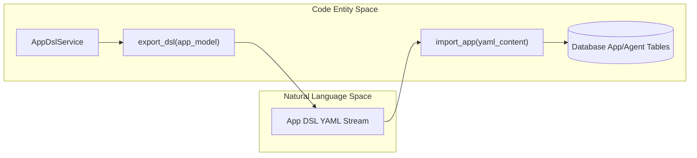
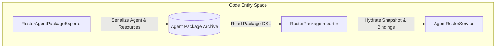
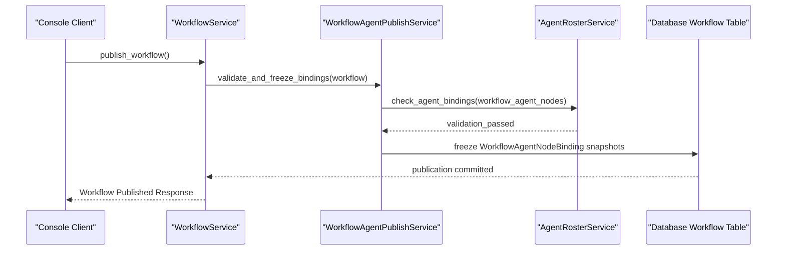
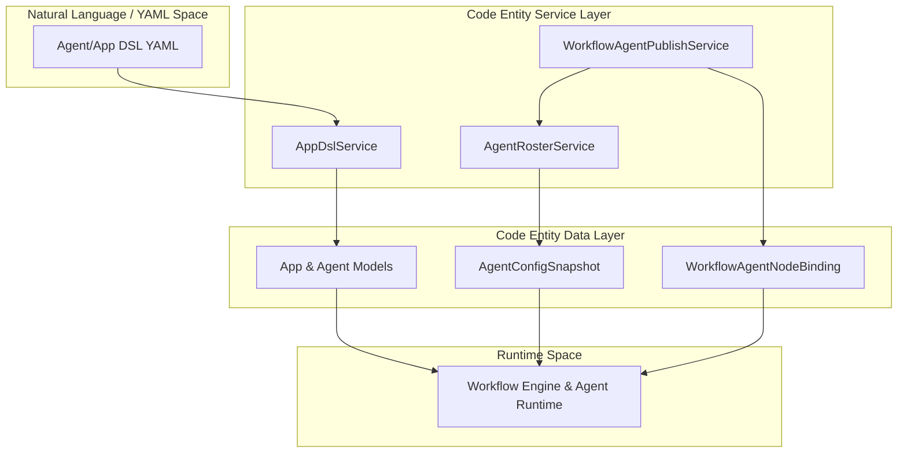
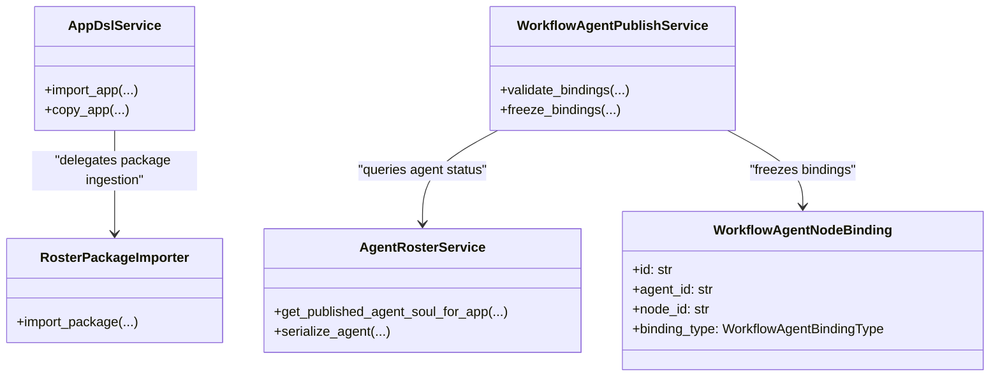

<!-- source: DeepWiki mcp.deepwiki.com · repo langgenius/dify · page 14.3 Agent DSL, Packages and Workflow Publishing · fetched 2026-10-26 -->

# Agent DSL, Packages and Workflow Publishing

Relevant source files

The following files were used as context for generating this wiki page:

- [api/controllers/console/agent/composer.py](api/controllers/console/agent/composer.py)
- [api/controllers/console/agent/roster.py](api/controllers/console/agent/roster.py)
- [api/controllers/console/app/app_import.py](api/controllers/console/app/app_import.py)
- [api/controllers/console/datasets/rag_pipeline/rag_pipeline_datasets.py](api/controllers/console/datasets/rag_pipeline/rag_pipeline_datasets.py)
- [api/controllers/console/datasets/rag_pipeline/rag_pipeline_import.py](api/controllers/console/datasets/rag_pipeline/rag_pipeline_import.py)
- [api/core/helper/creators.py](api/core/helper/creators.py)
- [api/fields/agent_fields.py](api/fields/agent_fields.py)
- [api/models/agent.py](api/models/agent.py)
- [api/openapi/markdown/console-openapi.md](api/openapi/markdown/console-openapi.md)
- [api/services/agent/composer_service.py](api/services/agent/composer_service.py)
- [api/services/agent/composer_validator.py](api/services/agent/composer_validator.py)
- [api/services/agent/roster_service.py](api/services/agent/roster_service.py)
- [api/services/agent/workflow_publish_service.py](api/services/agent/workflow_publish_service.py)
- [api/services/app/console_gateway.py](api/services/app/console_gateway.py)
- [api/services/app/console_service.py](api/services/app/console_service.py)
- [api/services/app/creators_platform_gateway.py](api/services/app/creators_platform_gateway.py)
- [api/services/app_dsl_service.py](api/services/app_dsl_service.py)
- [api/services/enterprise/rbac_service.py](api/services/enterprise/rbac_service.py)
- [api/services/entities/dsl_entities.py](api/services/entities/dsl_entities.py)
- [api/services/knowledge/dataset_service.py](api/services/knowledge/dataset_service.py)
- [api/services/rag_pipeline/rag_pipeline_dsl_service.py](api/services/rag_pipeline/rag_pipeline_dsl_service.py)
- [api/services/snippet_dsl_service.py](api/services/snippet_dsl_service.py)
- [api/services/workflow_service.py](api/services/workflow_service.py)
- [api/tests/test_containers_integration_tests/services/test_app_dsl_service.py](api/tests/test_containers_integration_tests/services/test_app_dsl_service.py)
- [api/tests/unit_tests/controllers/console/agent/test_agent_controllers.py](api/tests/unit_tests/controllers/console/agent/test_agent_controllers.py)
- [api/tests/unit_tests/controllers/console/app/test_app_import_api.py](api/tests/unit_tests/controllers/console/app/test_app_import_api.py)
- [api/tests/unit_tests/controllers/console/workspace/test_rbac.py](api/tests/unit_tests/controllers/console/workspace/test_rbac.py)
- [api/tests/unit_tests/core/helper/test_creators.py](api/tests/unit_tests/core/helper/test_creators.py)
- [api/tests/unit_tests/services/agent/test_agent_composer_entities.py](api/tests/unit_tests/services/agent/test_agent_composer_entities.py)
- [api/tests/unit_tests/services/agent/test_agent_services.py](api/tests/unit_tests/services/agent/test_agent_services.py)
- [api/tests/unit_tests/services/agent/test_workflow_publish_service.py](api/tests/unit_tests/services/agent/test_workflow_publish_service.py)
- [api/tests/unit_tests/services/app/test_console_gateway.py](api/tests/unit_tests/services/app/test_console_gateway.py)
- [api/tests/unit_tests/services/app/test_console_service.py](api/tests/unit_tests/services/app/test_console_service.py)
- [api/tests/unit_tests/services/app/test_creators_platform_gateway.py](api/tests/unit_tests/services/app/test_creators_platform_gateway.py)
- [api/tests/unit_tests/services/enterprise/test_rbac_service.py](api/tests/unit_tests/services/enterprise/test_rbac_service.py)
- [api/tests/unit_tests/services/rag_pipeline/test_rag_pipeline_dsl_service.py](api/tests/unit_tests/services/rag_pipeline/test_rag_pipeline_dsl_service.py)
- [api/tests/unit_tests/services/test_app_dsl_service.py](api/tests/unit_tests/services/test_app_dsl_service.py)
- [api/tests/unit_tests/services/test_snippet_dsl_service.py](api/tests/unit_tests/services/test_snippet_dsl_service.py)
- [api/tests/unit_tests/services/test_workflow_service.py](api/tests/unit_tests/services/test_workflow_service.py)
- [packages/contracts/generated/api/console/agent/orpc.gen.ts](packages/contracts/generated/api/console/agent/orpc.gen.ts)
- [packages/contracts/generated/api/console/agent/types.gen.ts](packages/contracts/generated/api/console/agent/types.gen.ts)
- [packages/contracts/generated/api/console/agent/zod.gen.ts](packages/contracts/generated/api/console/agent/zod.gen.ts)
- [packages/contracts/generated/api/console/apps/orpc.gen.ts](packages/contracts/generated/api/console/apps/orpc.gen.ts)
- [packages/contracts/generated/api/console/apps/types.gen.ts](packages/contracts/generated/api/console/apps/types.gen.ts)
- [packages/contracts/generated/api/console/apps/zod.gen.ts](packages/contracts/generated/api/console/apps/zod.gen.ts)

This page documents the detailed implementation of agent-specific DSL export/import, roster package importing/exporting, and workflow agent publishing within Dify's backend (`api/services/app_dsl_service.py` [api/services/app_dsl_service.py:151-179](), `api/services/agent/workflow_publish_service.py` [api/services/agent/workflow_publish_service.py:1-50](), and `api/services/agent/roster_service.py`). It focuses on how agent definitions (DSLs) are handled, how roster agent packages are imported/exported as reusable components, and the validation and freezing of agent bindings during workflow app publishing.

---

## 1. Purpose and Scope

The Agent DSL, Packages, and Workflow Publishing subsystem provides:

- Export and import mechanisms for agent Domain Specific Languages (DSLs) to enable sharing, copying, and restoring agent configurations across workspaces and environments.
- Roster agent package import/export for managing reusable agent packages containing configuration snapshots and resources.
- Workflow agent publishing service that validates and freezes agent bindings (`WorkflowAgentNodeBinding`) during the workflow app publishing lifecycle.

This subsystem bridges the natural language and yaml configuration space with runtime database models (`Agent`, `AgentConfigSnapshot`, `Workflow`) and execution engines.

Sources: `[api/services/app_dsl_service.py:1-179]()`, `[api/services/workflow_service.py:50-98]()`

---

## 2. Agent DSL Export and Import via `AppDslService`

The class `AppDslService` defined in `api/services/app_dsl_service.py` is the central orchestrator responsible for app DSL export and import operations, including embedded agent configurations.

- **Exporting DSL**: Serializes an `App` model into a structured YAML representation, incorporating app configurations, model configurations, and agent-specific properties.
- **Importing DSL**: Validates and parses imported YAML contents (from string uploads or URLs), creating or updating apps, workflows, and associated agent bindings.
- **Copying Apps (`copy_app`)**: Exports the source app DSL and imports it into a target tenant context within a transactional scope, rolling back on failure and syncing creator access policies upon completion.

Sources: `[api/services/app_dsl_service.py:151-179]()`

---

## 3. Roster Package Importing and Exporting

Roster agent packages represent portable, reusable agent configurations. The subsystem utilizes dedicated export and import handlers to pack agent definitions, souls, tools, and dependent resource schemas into archives.

- **`RosterPackageImporter`**: Reads agent packages, verifies dependency compatibility, resolves missing plugins, and instantiates the agent within the tenant's roster via `AgentRosterService`.
- **`RosterAgentPackageExporter`**: Serializes an active agent configuration snapshot and its associated assets into an exportable archive format.

Sources: `[api/services/agent/roster_service.py:71-179]()`, `[api/services/app_dsl_service.py:57-61]()`

---

## 4. WorkflowAgentPublishService: Validation and Freezing of Bindings During Workflow Publish

When publishing a workflow containing agent nodes (`WorkflowAgentNodeBinding`), the `WorkflowAgentPublishService` ensures referential integrity and immutability.

- **Binding Validation**: Iterates through all agent nodes in the workflow graph, validating that referenced agents exist, are published or have valid draft snapshots, and conform to schema validators (`WorkflowAgentNodeValidator`).
- **Freezing Bindings**: Once validation succeeds, dynamic references are locked or "frozen" into the published workflow snapshot (`Workflow`), preventing subsequent edits to the roster agent from silently altering active workflow executions.

Sources: `[api/services/agent/workflow_publish_service.py:1-50]`, `[api/services/workflow_service.py:50-98]()`

---

## 5. Data Flow and Component Relations

### Bridging Natural Language DSL to Runtime Entities

Sources: `[api/services/app_dsl_service.py:1-179]()`, `[api/services/workflow_service.py:50-98]()`

---

### Class Dependency Mapping

Sources: `[api/services/app_dsl_service.py:50-89]()`, `[api/services/workflow_service.py:80-90]()`

---

## 6. Key Classes and Functions

- **`AppDslService` (`api/services/app_dsl_service.py`)**: Manages import, export, and cloning (`copy_app`) of applications and their embedded agent configurations.
- **`WorkflowAgentPublishService` (`api/services/agent/workflow_publish_service.py`)**: Executes validation checks on agent node bindings and freezes references upon publishing.
- **`AgentRosterService` (`api/services/agent/roster_service.py`)**: Manages agent CRUD operations, snapshot creation, and serialization for console and API clients.

Sources: `[api/services/app_dsl_service.py:151-179]()`, `[api/services/workflow_service.py:50-98]()`

---

