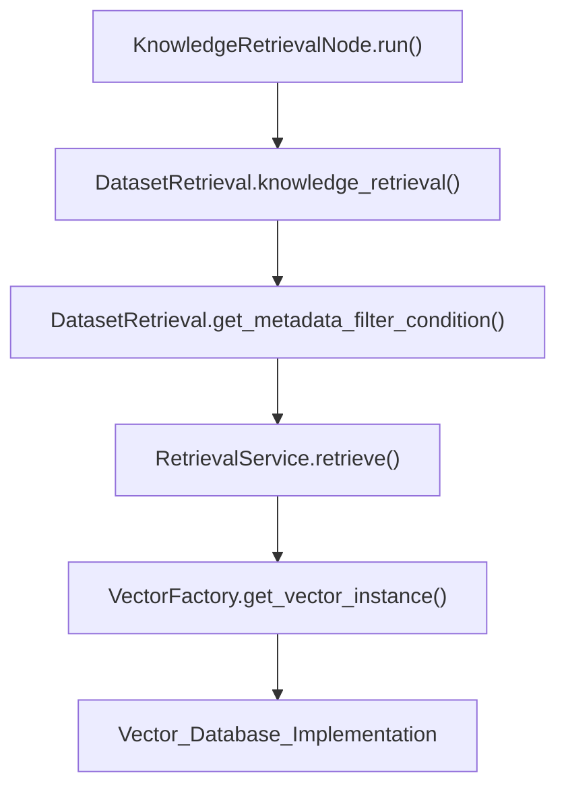
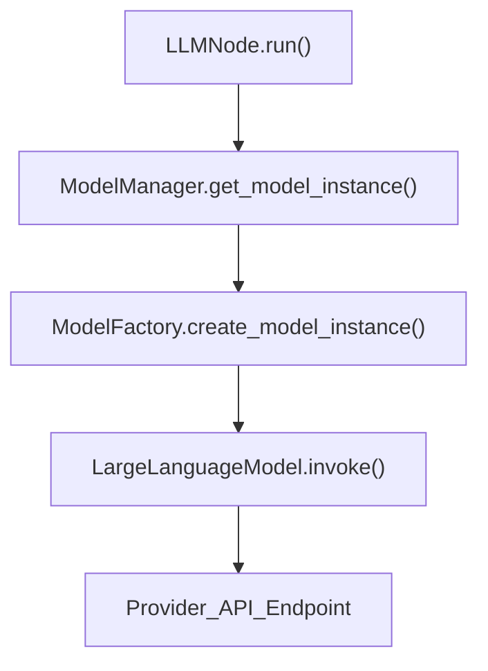
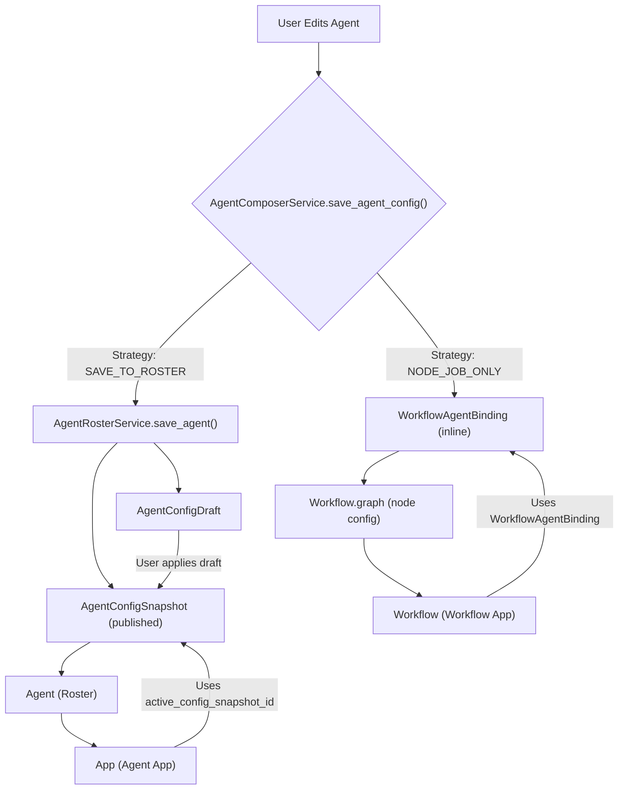

<!-- source: DeepWiki mcp.deepwiki.com · repo langgenius/dify · page 15 Glossary · fetched 2026-10-26 -->

# Glossary

Relevant source files

The following files were used as context for generating this wiki page:

- [api/.env.example](api/.env.example)
- [api/configs/feature/__init__.py](api/configs/feature/__init__.py)
- [api/configs/middleware/__init__.py](api/configs/middleware/__init__.py)
- [api/configs/middleware/vdb/weaviate_config.py](api/configs/middleware/vdb/weaviate_config.py)
- [api/configs/packaging/__init__.py](api/configs/packaging/__init__.py)
- [api/controllers/console/agent/composer.py](api/controllers/console/agent/composer.py)
- [api/controllers/console/agent/roster.py](api/controllers/console/agent/roster.py)
- [api/controllers/console/app/model_config_payload.py](api/controllers/console/app/model_config_payload.py)
- [api/core/rag/datasource/vdb/vector_factory.py](api/core/rag/datasource/vdb/vector_factory.py)
- [api/core/rag/datasource/vdb/vector_type.py](api/core/rag/datasource/vdb/vector_type.py)
- [api/extensions/ext_app_metrics.py](api/extensions/ext_app_metrics.py)
- [api/extensions/ext_celery.py](api/extensions/ext_celery.py)
- [api/extensions/ext_database.py](api/extensions/ext_database.py)
- [api/extensions/ext_import_modules.py](api/extensions/ext_import_modules.py)
- [api/extensions/ext_sentry.py](api/extensions/ext_sentry.py)
- [api/fields/agent_fields.py](api/fields/agent_fields.py)
- [api/migrations/README](api/migrations/README)
- [api/models/account.py](api/models/account.py)
- [api/models/agent.py](api/models/agent.py)
- [api/models/api_based_extension.py](api/models/api_based_extension.py)
- [api/models/dataset.py](api/models/dataset.py)
- [api/models/model.py](api/models/model.py)
- [api/models/provider.py](api/models/provider.py)
- [api/models/source.py](api/models/source.py)
- [api/models/task.py](api/models/task.py)
- [api/models/tools.py](api/models/tools.py)
- [api/models/trigger.py](api/models/trigger.py)
- [api/models/web.py](api/models/web.py)
- [api/models/workflow.py](api/models/workflow.py)
- [api/openapi/markdown/console-openapi.md](api/openapi/markdown/console-openapi.md)
- [api/providers/vdb/vdb-weaviate/tests/unit_tests/test_weaviate_integration_header.py](api/providers/vdb/vdb-weaviate/tests/unit_tests/test_weaviate_integration_header.py)
- [api/pyproject.toml](api/pyproject.toml)
- [api/repositories/recommended_app_catalog_repository.py](api/repositories/recommended_app_catalog_repository.py)
- [api/schedule/queue_monitor_task.py](api/schedule/queue_monitor_task.py)
- [api/services/agent/composer_service.py](api/services/agent/composer_service.py)
- [api/services/agent/composer_validator.py](api/services/agent/composer_validator.py)
- [api/services/agent/roster_service.py](api/services/agent/roster_service.py)
- [api/services/agent/workflow_publish_service.py](api/services/agent/workflow_publish_service.py)
- [api/services/workflow_service.py](api/services/workflow_service.py)
- [api/tests/integration_tests/.env.example](api/tests/integration_tests/.env.example)
- [api/tests/test_containers_integration_tests/models/test_conversation_status_count.py](api/tests/test_containers_integration_tests/models/test_conversation_status_count.py)
- [api/tests/test_containers_integration_tests/models/test_dataset_models.py](api/tests/test_containers_integration_tests/models/test_dataset_models.py)
- [api/tests/test_containers_integration_tests/repositories/test_recommended_app_catalog_repository.py](api/tests/test_containers_integration_tests/repositories/test_recommended_app_catalog_repository.py)
- [api/tests/unit_tests/configs/test_dify_config.py](api/tests/unit_tests/configs/test_dify_config.py)
- [api/tests/unit_tests/controllers/console/agent/test_agent_controllers.py](api/tests/unit_tests/controllers/console/agent/test_agent_controllers.py)
- [api/tests/unit_tests/controllers/console/app/test_model_config_api.py](api/tests/unit_tests/controllers/console/app/test_model_config_api.py)
- [api/tests/unit_tests/core/rag/datasource/vdb/test_vector_factory.py](api/tests/unit_tests/core/rag/datasource/vdb/test_vector_factory.py)
- [api/tests/unit_tests/extensions/test_celery_ssl.py](api/tests/unit_tests/extensions/test_celery_ssl.py)
- [api/tests/unit_tests/models/test_app_models.py](api/tests/unit_tests/models/test_app_models.py)
- [api/tests/unit_tests/models/test_dataset_models.py](api/tests/unit_tests/models/test_dataset_models.py)
- [api/tests/unit_tests/repositories/test_recommended_app_catalog_repository.py](api/tests/unit_tests/repositories/test_recommended_app_catalog_repository.py)
- [api/tests/unit_tests/services/agent/test_agent_composer_entities.py](api/tests/unit_tests/services/agent/test_agent_composer_entities.py)
- [api/tests/unit_tests/services/agent/test_agent_services.py](api/tests/unit_tests/services/agent/test_agent_services.py)
- [api/tests/unit_tests/services/agent/test_workflow_publish_service.py](api/tests/unit_tests/services/agent/test_workflow_publish_service.py)
- [api/tests/unit_tests/services/test_workflow_service.py](api/tests/unit_tests/services/test_workflow_service.py)
- [api/uv.lock](api/uv.lock)
- [docker/.env.example](docker/.env.example)
- [docker/docker-compose-template.yaml](docker/docker-compose-template.yaml)
- [docker/docker-compose.middleware.yaml](docker/docker-compose.middleware.yaml)
- [docker/docker-compose.yaml](docker/docker-compose.yaml)
- [docker/envs/core-services/shared.env.example](docker/envs/core-services/shared.env.example)
- [docker/envs/infrastructure/ssrf-proxy.env.example](docker/envs/infrastructure/ssrf-proxy.env.example)
- [docker/envs/middleware.env.example](docker/envs/middleware.env.example)
- [packages/contracts/app-model-config.test.ts](packages/contracts/app-model-config.test.ts)
- [packages/contracts/generated/api/console/agent/orpc.gen.ts](packages/contracts/generated/api/console/agent/orpc.gen.ts)
- [packages/contracts/generated/api/console/agent/types.gen.ts](packages/contracts/generated/api/console/agent/types.gen.ts)
- [packages/contracts/generated/api/console/agent/zod.gen.ts](packages/contracts/generated/api/console/agent/zod.gen.ts)
- [packages/contracts/generated/api/console/apps/orpc.gen.ts](packages/contracts/generated/api/console/apps/orpc.gen.ts)
- [packages/contracts/generated/api/console/apps/types.gen.ts](packages/contracts/generated/api/console/apps/types.gen.ts)
- [packages/contracts/generated/api/console/apps/zod.gen.ts](packages/contracts/generated/api/console/apps/zod.gen.ts)
- [web/package.json](web/package.json)

This page serves as a canonical glossary defining codebase-specific terms, jargon, abbreviations, and domain concepts across the Dify platform. It is tailored for onboarding engineers to quickly understand system architecture, data models, APIs, and operational workflows with precise code pointers.

---

## 1. Core Domain Concepts

### Tenant
A **Tenant** represents a workspace or organization within Dify. It acts as a logical isolation boundary for resources such as applications, datasets, and models. Each tenant maintains its own users, configurations, and data partitions to ensure strict multi-tenancy isolation.

**Implementation Highlights:**
- Defined as a SQLAlchemy model representing workspace entities.
- Used as a foreign key in major resources like `App`, `Dataset`, and `Workflow`.
- Multi-tenancy is enforced through `tenant_id` filtering in database queries.

**Code Pointers:**
- Model Definition: [api/models/account.py:1-32]()
- Referenced in models: [api/models/model.py:32-32](), [api/models/model.py:300-305]()

**Sources:** [api/models/account.py:1-32](), [api/models/model.py:32-32](), [api/models/model.py:300-305]()

---

### App
An **App** is a deployable AI application in Dify, such as a chatbot, text completion tool, workflow, or agent. Apps belong to tenants and support multiple execution types and modes (`Chat`, `Completion`, `Workflow`, `Agent-Chat`, `Agent`).

**Implementation Highlights:**
- Stores app metadata including status, type, and tenant ownership.
- Holds configuration for execution, versioning, and lifecycle management.

**Code Pointers:**
- Model Definition: [api/models/model.py:300-335]()
- App status enums: [api/models/model.py:38-38]()

**Sources:** [api/models/model.py:300-335](), [api/models/model.py:38-38]()

---

### Dataset
A **Dataset** is a collection of documents or knowledge sources used for Retrieval-Augmented Generation (RAG). Datasets are tenant-scoped and configurable with indexing techniques, retrieval models, and runtime parameters.

**Implementation Highlights:**
- SQLAlchemy model representing dataset metadata and state.
- Supports permissions, retrieval models, and indexing strategies.

**Code Pointers:**
- Model Definition: [api/models/dataset.py:150-190]()
- Dataset Permission Enum alias: [api/models/dataset.py:144-147]()

**Sources:** [api/models/dataset.py:144-190]()

---

### Document
A **Document** is an individual content item within a Dataset (e.g., a text file, web page, or Notion page). Documents are preprocessed, segmented, and indexed for retrieval.

**Implementation Highlights:**
- Tracks metadata, indexing status, and archival flags.
- Associates with uploaded files and datasets.

**Code Pointers:**
- Document TypedDict definition: [api/models/dataset.py:94-143]()
- Indexing status enum reference: [api/models/enums.py:56-56]()

**Sources:** [api/models/dataset.py:94-143](), [api/models/enums.py:56-56]()

---

### Workflow
A **Workflow** is a directed graph defining an AI execution process, composed of nodes such as LLM calls, HTTP requests, code execution, and knowledge retrieval.

**Implementation Highlights:**
- Stored as a graph JSON structure in the database.
- Supports multiple workflow types (`WORKFLOW`, `CHAT`, `RAG_PIPELINE`, `SNIPPET`).

**Code Pointers:**
- Workflow model and types: [api/models/workflow.py:178-210](), [api/models/workflow.py:117-138]()
- Workflow content dict: [api/models/workflow.py:101-107]()

**Sources:** [api/models/workflow.py:101-138](), [api/models/workflow.py:178-210]()

---

## 2. Retrieval-Augmented Generation (RAG) System Components

### DatasetRetrieval
`DatasetRetrieval` is the core class managing retrieval across multiple datasets in workflows or apps. It executes filtering, merging, and reranking of retrieval results with vector database backends.

**Implementation Highlights:**
- Uses metadata filters to refine results.
- Delegates vector search to the underlying retrieval service and vector factory.

**Sources:** [api/core/rag/retrieval/dataset_retrieval.py:100-160](), [api/core/workflow/nodes/knowledge_retrieval/knowledge_retrieval_node.py:1-50](), [api/core/rag/datasource/retrieval_service.py:1-50]()

---

### DocumentSegment
`DocumentSegment` represents a chunk of a document used in retrieval indexing. Segments are produced by document segmentation during ingestion and serve as retrieval units.

**Implementation Highlights:**
- Includes segment status and token count metadata.
- Linked closely with the indexing and RAG pipeline.

**Code Pointers:**
- Segment status enum: [api/models/enums.py:55-60]()

**Sources:** [api/models/enums.py:55-60]()

---

### KnowledgeFS
**KnowledgeFS** refers to the Next.js frontend module (`web/features/new-rag/`) that implements the RAG user interface. It backs the knowledge list, document management, chunk detail views, and processing task tracking.

**Code Pointers:**
- Module directory: [web/package.json:1-188]()

**Sources:** [web/package.json:1-188]()

---

### VDB (Vector Database Abstraction)
Dify supports over 23 vector database backends (Weaviate, Qdrant, Milvus, PGVector, etc.) integrated via the `VectorFactory` abstraction. This enables pluggable vector search backend selection.

**Code Pointers:**
- VectorFactory and vector type: [api/core/rag/datasource/vdb/vector_factory.py:1-60]()
- Vector DB packages/workspaces: [api/pyproject.toml:58-102]()

**Sources:** [api/core/rag/datasource/vdb/vector_factory.py:1-60](), [api/pyproject.toml:58-102]()

---

## 3. Model and Provider Management

### ModelManager
`ModelManager` is the centralized coordinator that fetches and manages LLM model instances based on configured providers and settings.

**Implementation Highlights:**
- Resolves provider configurations and caches model factory instances.
- Used by LLM node executions and RAG retrieval.

**Code Pointers:**
- ModelManager definition: [api/core/model_manager.py:28-35]()

**Sources:** [api/core/model_manager.py:28-35](), [api/core/model_runtime/model_providers/base/large_language_model.py:1-50]()

---

### ProviderManager
The `ProviderManager` manages the lifecycle and configuration of LLM providers. It handles credentials, endpoints, and runtime setup of LLM providers.

**Implementation Highlights:**
- Abstracts different provider implementations.
- Provider models stored as SQLAlchemy entities.

**Code Pointers:**
- Provider ORM model: [api/models/provider.py:1-50]()

**Sources:** [api/models/provider.py:1-50]()

---

## 4. Tool, Trigger and Plugin Ecosystem

### ToolManager
The `ToolManager` acts as a registry and central controller for tools integrated in Dify. It manages built-in tools, API tools, and plugin tools with credential and runtime contexts.

**Implementation Highlights:**
- Singleton service providing unified tool access.
- Differentiates tools by provider type and manages file signing.

**Code Pointers:**
- ToolManager class: [api/core/tools/tool_manager.py:1-50]()
- Tool ORM and config: [api/models/tools.py:1-50]()

**Sources:** [api/core/tools/tool_manager.py:1-50](), [api/models/tools.py:1-50]()

---

### ToolProviderController
Controller classes implement runtime behavior for different tool provider types (builtin, api, plugin daemon). They provide lifecycle and invocation logic.

**Implementation Highlights:**
- Abstract base with multiple concrete subclasses for tool execution.

**Code Pointers:**
- Controller implementations: [api/services/tools/builtin_tools_manage_service.py:1-50]()
- Tool file signing helpers: [api/core/tools/signature.py:20-40]()

**Sources:** [api/services/tools/builtin_tools_manage_service.py:1-50](), [api/core/tools/signature.py:20-40]()

---

### Trigger
A **Trigger** represents event-driven automation points invoking workflows or agents, including webhook endpoints, scheduled triggers, and OAuth subscription builders.

**Implementation Highlights:**
- Managed via `TriggerProviderService` and `TriggerSubscriptionBuilderService`.

**Code Pointers:**
- Trigger models: [api/models/trigger.py:1-50]()
- Security feature config: [api/configs/feature/__init__.py:190-211]()

**Sources:** [api/models/trigger.py:1-50](), [api/configs/feature/__init__.py:190-211]()

---

## 5. Agent V2 and Agent Systems

### Agent
An **Agent** is an AI entity capable of reasoning, planning, and executing tasks using tools, models, and knowledge bases.

**Code Pointers:**
- Agent mode config: [api/models/model.py:149-160]()

**Sources:** [api/models/model.py:149-160]()

---

### AgentSoulConfig
The core Pydantic model representing an Agent's configuration, containing the AI model, prompt templates, tool configurations, knowledge bases, and memory settings.

**Code Pointers:**
- Soul config model: [api/services/entities/agent_entities.py:100-113]()

**Sources:** [api/services/entities/agent_entities.py:100-113]()

---

### AgentConfigSnapshot
A snapshot version of an `AgentSoulConfig`, representing a published, immutable agent configuration.

**Code Pointers:**
- Snapshot model: [api/models/agent.py:100-130]()
- Used by roster service: [api/services/agent/roster_service.py:1-50]()

**Sources:** [api/models/agent.py:100-130](), [api/services/agent/roster_service.py:1-50]()

---

### AgentConfigDraft
A draft agent configuration for iterative editing. Drafts can be published to snapshots.

**Code Pointers:**
- Draft model: [api/models/agent.py:120-150]()
- Used in composer service: [api/services/agent/composer_service.py:1-50]()

**Sources:** [api/models/agent.py:120-150](), [api/services/agent/composer_service.py:1-50]()

---

### AgentComposerService
The service managing agent creation, editing, validation, and saving for both roster agents and inline workflow agents.

**Code Pointers:**
- Composer service: [api/services/agent/composer_service.py:1-50]()

**Sources:** [api/services/agent/composer_service.py:1-50]()

---

### AgentRosterService
Service managing CRUD lifecycle and publishing workflows of roster agents (standalone agent entities usable across apps and workflows).

**Code Pointers:**
- Roster service: [api/services/agent/roster_service.py:1-50]()

**Sources:** [api/services/agent/roster_service.py:1-50]()

---

### WorkflowAgentBinding
Represents how an agent config is referenced inside a workflow: either as a roster agent reference or inline direct agent config.

**Code Pointers:**
- Model and enums in agent.py: [api/models/agent.py:150-160]()

**Sources:** [api/models/agent.py:150-160](), [api/services/agent/composer_service.py:1-50](), [api/services/agent/roster_service.py:1-50]()

---

### Agenton Python Runtime
A standalone FastAPI-based runtime for executing AI agents modeled with Pydantic and layered graph nodes using the Agenton framework.

**Code Pointers:**
- Dependency mapping: [api/pyproject.toml:58-70]()
- Lock file entry: [api/uv.lock:12-25]()

**Sources:** [api/pyproject.toml:58-70](), [api/uv.lock:12-25]()

---

### Go Agent Runtime (`dify-agent-runtime`)
A lightweight Go shell-based agent runtime providing shell command execution with tmux-based job lifecycle, sandboxing (Landlock), and job persistence in SQLite.

**Code Pointers:**
- Go runtime workspace files and sandbox configuration.

**Sources:** [docker/docker-compose.yaml:1-202]()

---

## 6. Infrastructure and Deployment

### MODE Environment Variable
The `MODE` environment variable controls which runtime is executed within the API container:
- `api`: Runs the main HTTP API server.
- `worker`: Runs Celery background workers.
- `beat`: Runs the Celery Beat scheduler.
- `job`: Runs ad-hoc/one-off background jobs.

**Code Pointers:**
- Docker Compose worker configs: [docker/docker-compose.yaml:74-91](), [docker/docker-compose.yaml:140-160]()

**Sources:** [docker/docker-compose.yaml:74-160]()

---

### Deployments
Refers to app releases, environment deployments, access channels, and per-environment permission policies managed in the `web/features/deployments` module.

**Code Pointers:**
- Deployment feature module: [web/package.json:1-188]()

**Sources:** [web/package.json:1-188]()

---

## 7. Frontend Architecture Libraries

### jotai-tanstack-query
A combination of Jotai state management with TanStack Query for data fetching, used extensively across Dify's web frontend.

**Code Pointers:**
- Package dependencies: [web/package.json:60-66]()

**Sources:** [web/package.json:60-66]()

---

### dify-ui
Shared React component library across Dify's frontend projects.

**Code Pointers:**
- Package dependencies: [web/package.json:150-155]()

**Sources:** [web/package.json:150-155]()

---

Sources:
- [api/models/account.py:1-32]()
- [api/models/model.py:32-335]()
- [api/models/dataset.py:94-190]()
- [api/models/enums.py:55-60]()
- [api/models/workflow.py:101-210]()
- [api/core/rag/retrieval/dataset_retrieval.py:100-160]()
- [api/core/workflow/nodes/knowledge_retrieval/knowledge_retrieval_node.py:1-50]()
- [api/core/rag/datasource/retrieval_service.py:1-50]()
- [api/core/model_manager.py:28-35]()
- [api/core/model_runtime/model_providers/base/large_language_model.py:1-50]()
- [api/models/provider.py:1-50]()
- [api/core/tools/tool_manager.py:1-50]()
- [api/models/tools.py:1-50]()
- [api/services/tools/builtin_tools_manage_service.py:1-50]()
- [api/core/tools/signature.py:20-40]()
- [api/models/trigger.py:1-50]()
- [api/configs/feature/__init__.py:190-211]()
- [api/models/agent.py:100-160]()
- [api/services/entities/agent_entities.py:100-113]()
- [api/services/agent/composer_service.py:1-50]()
- [api/services/agent/roster_service.py:1-50]()
- [api/pyproject.toml:58-102]()
- [api/uv.lock:12-25]()
- [docker/docker-compose.yaml:74-160]()
- [web/package.json:1-188]()