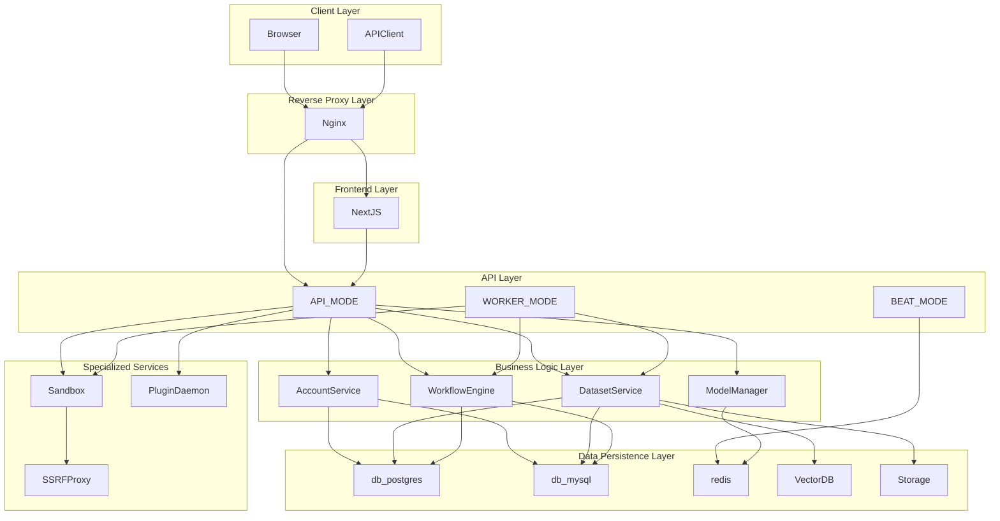
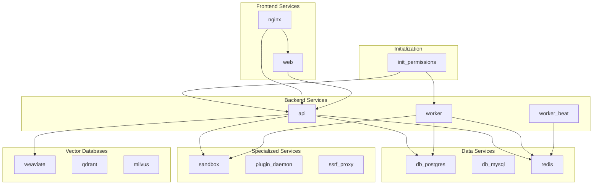
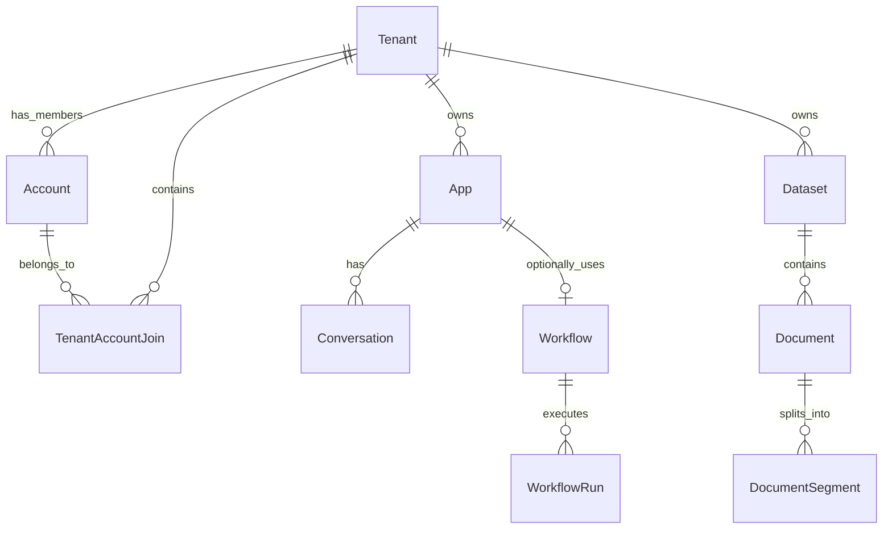
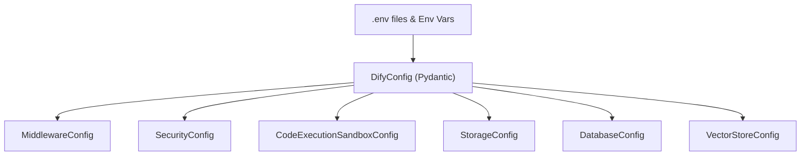
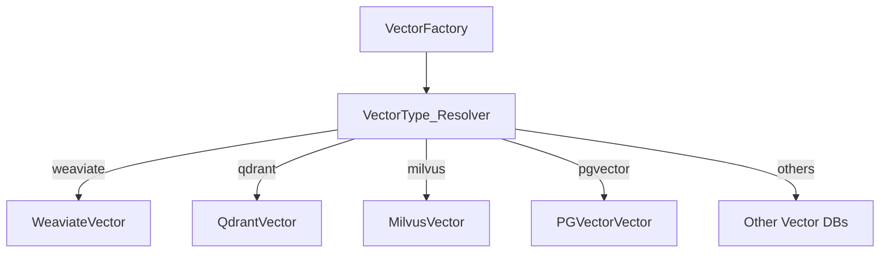

<!-- source: DeepWiki mcp.deepwiki.com · repo langgenius/dify · page 2 System Architecture Overview · fetched 2026-10-26 -->

# System Architecture Overview

Relevant source files

The following files were used as context for generating this wiki page:

- [api/.env.example](api/.env.example)
- [api/app.py](api/app.py)
- [api/app_factory.py](api/app_factory.py)
- [api/celery_entrypoint.py](api/celery_entrypoint.py)
- [api/configs/feature/__init__.py](api/configs/feature/__init__.py)
- [api/configs/middleware/__init__.py](api/configs/middleware/__init__.py)
- [api/configs/middleware/vdb/weaviate_config.py](api/configs/middleware/vdb/weaviate_config.py)
- [api/configs/observability/__init__.py](api/configs/observability/__init__.py)
- [api/configs/observability/otel/otel_config.py](api/configs/observability/otel/otel_config.py)
- [api/configs/packaging/__init__.py](api/configs/packaging/__init__.py)
- [api/core/rag/datasource/vdb/vector_factory.py](api/core/rag/datasource/vdb/vector_factory.py)
- [api/core/rag/datasource/vdb/vector_type.py](api/core/rag/datasource/vdb/vector_type.py)
- [api/core/schemas/registry.py](api/core/schemas/registry.py)
- [api/extensions/ext_app_metrics.py](api/extensions/ext_app_metrics.py)
- [api/extensions/ext_celery.py](api/extensions/ext_celery.py)
- [api/extensions/ext_database.py](api/extensions/ext_database.py)
- [api/extensions/ext_import_modules.py](api/extensions/ext_import_modules.py)
- [api/extensions/ext_otel.py](api/extensions/ext_otel.py)
- [api/extensions/ext_sentry.py](api/extensions/ext_sentry.py)
- [api/gunicorn.conf.py](api/gunicorn.conf.py)
- [api/migrations/README](api/migrations/README)
- [api/providers/vdb/vdb-weaviate/tests/unit_tests/test_weaviate_integration_header.py](api/providers/vdb/vdb-weaviate/tests/unit_tests/test_weaviate_integration_header.py)
- [api/pyproject.toml](api/pyproject.toml)
- [api/schedule/queue_monitor_task.py](api/schedule/queue_monitor_task.py)
- [api/tests/integration_tests/.env.example](api/tests/integration_tests/.env.example)
- [api/tests/unit_tests/configs/test_dify_config.py](api/tests/unit_tests/configs/test_dify_config.py)
- [api/tests/unit_tests/core/rag/datasource/vdb/test_vector_factory.py](api/tests/unit_tests/core/rag/datasource/vdb/test_vector_factory.py)
- [api/tests/unit_tests/extensions/test_celery_ssl.py](api/tests/unit_tests/extensions/test_celery_ssl.py)
- [api/tests/unit_tests/services/test_feature_service_education.py](api/tests/unit_tests/services/test_feature_service_education.py)
- [api/tests/unit_tests/test_app_factory.py](api/tests/unit_tests/test_app_factory.py)
- [api/uv.lock](api/uv.lock)
- [docker/.env.example](docker/.env.example)
- [docker/docker-compose-template.yaml](docker/docker-compose-template.yaml)
- [docker/docker-compose.middleware.yaml](docker/docker-compose.middleware.yaml)
- [docker/docker-compose.yaml](docker/docker-compose.yaml)
- [docker/envs/core-services/shared.env.example](docker/envs/core-services/shared.env.example)
- [docker/envs/infrastructure/ssrf-proxy.env.example](docker/envs/infrastructure/ssrf-proxy.env.example)
- [docker/envs/middleware.env.example](docker/envs/middleware.env.example)
- [web/package.json](web/package.json)

## Purpose and Scope

This document provides a comprehensive overview of Dify's system architecture, highlighting its service topology, core components, data models, and deployment structure. It explains the interaction between the different layers of the platform that facilitate AI application development and execution.

For detailed technical information about individual subsystems, look at the following child pages:  
- Service deployment and Docker configuration: [Service Topology and Docker Compose Stack](#2.1)  
- Data models and domain entities: [Core Data Models and Domain Entities](#2.2)  
- Application execution patterns: [Application Types and Execution Modes](#2.3)  
- Configuration and environment setup: [Configuration Management System](#2.4)  
- Flask app setup and request lifecycle: [Flask App Factory, Extensions and Request Lifecycle](#2.5)

---

## High-Level Architecture

Dify is organized into distinct layers, each encapsulating specific responsibilities to support scalability and maintainability:

- **Client Layer**: Includes web browsers and official API clients consuming the platform services.
- **Reverse Proxy Layer**: Nginx reverse proxy routes incoming traffic to frontend or API services.
- **Frontend Layer**: Next.js hosting the Single Page Application (SPA) providing the user interface.
- **API Layer**: Core backend API in Flask, running in multiple modes (`api`, `worker`, `beat`) for request handling, background job processing, and scheduled tasks.
- **Business Logic Layer**: Contains core service modules such as account management, dataset processing, workflow execution, and model management.
- **Specialized Services**: Auxiliary services like the sandbox for secure code execution, plugin daemon for extensibility, and SSRF proxy for request control.
- **Data Persistence Layer**: Stores data in PostgreSQL, MySQL, Redis, object storage, and vector databases for similarity search.

### Architecture Layers Diagram

**Sources:** [docker/docker-compose.yaml:206-350](), [docker/docker-compose-template.yaml:200-350](), [api/pyproject.toml:12-18](), [docker/docker-compose.middleware.yaml:1-130]()

---

## Service Topology

### Container Architecture

Dify leverages a suite of Docker containers orchestrated through Docker Compose. The core backend runs from a single API Docker image (`langgenius/dify-api`) that operates in various modes dictated by the `MODE` environment variable, enabling unified image management across API serving, background processing, and scheduling.

### Service Roles and Coordination

- **Initialization**  
  The `init_permissions` container (busybox-based) is responsible for fixing volume permissions before other services start, ensuring writable storage directories.

- **Frontend Services**  
  - `nginx`: Reverse proxy and static content server.  
  - `web`: Next.js frontend providing the web console UI.

- **Backend Services**  
  - `api`: Flask API server (`MODE=api`) handling synchronous HTTP requests.  
  - `worker`: Celery worker (`MODE=worker`) for asynchronous background jobs.  
  - `worker_beat`: Celery beat (`MODE=beat`) for periodic task scheduling.

- **Specialized Services**  
  - `sandbox`: Isolated, secure code execution service accessible over HTTP.  
  - `plugin_daemon`: Manages plugin lifecycle, installation, and isolated runtime execution.  
  - `ssrf_proxy`: Secure SSRF proxy controlling outbound HTTP requests from sandbox or agent runtime.

- **Data Services**  
  - `db_postgres` and `db_mysql`: Relational databases supporting multi-backend flexibility.  
  - `redis`: Caching, message broker for Celery.

- **Vector Databases**  
  Configurable vector similarity backends such as `weaviate`, `qdrant`, and `milvus` provide fast vector-based data retrieval for RAG (Retrieval-Augmented Generation) workloads.

### Docker Compose Service Topology

### Design Patterns and Notes

| Pattern                        | Implementation                                                       | Purpose                                                    |
|-------------------------------|----------------------------------------------------------------------|------------------------------------------------------------|
| Single API Image Multi-Mode    | A single Docker image (`langgenius/dify-api`) runs as `api`, `worker`, or `worker_beat` depending on `MODE` env var | Reduces image management and deployment complexity         |
| Non-root Containers            | Containers run as user `1001:1001`                                  | Improves security by avoiding processes running as root    |
| Init Container for Permissions| `init_permissions` container fixes permissions on shared volumes    | Prevents runtime file permission errors                     |
| Multiple DB Profiles           | Docker Compose profiles enable switching between `postgresql` and `mysql` backends | Allows flexible database choice                             |
| Shared Env Using YAML Anchors  | Environment variables are reused via YAML anchors shared by API and workers | Ensures configuration consistency and avoid duplications   |

For a detailed explanation of the Docker Compose setup, service dependencies, and network configuration, see [Service Topology and Docker Compose Stack](#2.1).

**Sources:** [docker/docker-compose.yaml:8-205](), [docker/docker-compose-template.yaml:202-350](), [docker/docker-compose.middleware.yaml:1-130](), [docker/.env.example:53-70]()

---

## Core Components

### Business Logic Services

The core domain logic resides in modular service classes. These services implement functionality and workflows acting as the backend for API routes and interacting extensively with data models and persistence layers.

| Service            | Responsibility                                                      | Location                          |
|--------------------|---------------------------------------------------------------------|---------------------------------|
| `AccountService`   | User accounts, authentication, tenant and member management          | `api/services/account_service.py` |
| `DatasetService`   | Knowledge bases, datasets, document management and indexing          | `api/services/dataset_service.py`; models in `api/models/dataset.py` |
| `DocumentService`  | Document extraction, segmentation, knowledge base processing         | Part of `DatasetService` components |
| `IndexingRunner`   | ETL pipeline for document indexing and vectorization                | `api/core/indexing_runner.py`     |
| `WorkflowEngine`   | Graph-based workflow execution, orchestration for AI apps            | `api/models/workflow.py`; core logic components |
| `ModelManager`     | Manages AI/LLM models, provider integrations, quotas, and invocations| LLM integration subsystem         |

These services coordinate with the persistence layers like databases and Redis, and specialized services such as sandbox and plugin daemon for advanced functionality.

**Sources:** [api/models/dataset.py:22-166](), [api/models/model.py:65-68](), [api/models/workflow.py:176-220]()

---

## Data Models and Relationships

Dify uses SQLAlchemy ORM for modeling its core domain entities and managing persistent state in relational databases.

### Core Entity Relationships Diagram

### Key Model Classes

| Model      | Role                                  | Location & Notes                                   |
|------------|-------------------------------------|---------------------------------------------------|
| `Account`  | User accounts, integrates with Flask-Login | `api/models/model.py`, `api/models/account.py`    |
| `Tenant`   | Workspace or org owning apps, datasets | `api/models/account.py`                            |
| `App`      | AI application entity, deployment unit | Defined in `api/models/model.py`                   |
| `Workflow` | Graph-based workflow definitions for execution and apps | `api/models/workflow.py`                           |
| `Dataset`  | Knowledge base container for documents | `api/models/dataset.py`                            |
| `Document` | Individual documents within datasets | `api/models/dataset.py`                            |

These entities enable multi-tenancy, app lifecycle management, knowledge base storage, and workflow execution features.

For full schema and relationships, see [Core Data Models and Domain Entities](#2.2).

**Sources:** [api/models/model.py:15-32](), [api/models/workflow.py:176-220](), [api/models/dataset.py:110-166](), [api/models/account.py:16-16]()

---

## Configuration Management

Dify uses Pydantic's `BaseSettings` classes for robust and type-safe configuration management. Configuration is resolved by layering `.env` files and environment variables, allowing flexible environment-specific overrides.

### Configuration Resolution Flow

### Key Configuration Areas

- **Database Settings**  
  Database engine and connection settings are configured by `DB_TYPE`, `DB_HOST`, `DB_PORT`, `DB_DATABASE` environment variables to support multiple backends [docker/.env.example:77-83]().

- **Redis & Celery**  
  Redis cache and task queues are configured through `REDIS_HOST`, `REDIS_PORT`, and `CELERY_BROKER_URL` environment variables [docker/.env.example:98-105]().

- **Storage System**  
  Abstracted storage backend configured via `STORAGE_TYPE`, `OPENDAL_SCHEME`, and specific service environment variables for S3, Azure, etc [api/.env.example:114-117]().

- **Code Execution Sandbox**  
  Dedicated settings such as `CODE_EXECUTION_ENDPOINT`, API keys, and timeout parameters control the isolated code sandbox service [api/configs/feature/__init__.py:105-193]().

The configuration system provides consistent and validated environment-driven parameterization that supports production and development deployments.

For complete configuration management details, refer to [Configuration Management System](#2.4).

**Sources:** [api/configs/feature/__init__.py:20-220](), [api/.env.example:88-213](), [docker/.env.example:72-115]()

---

## Vector Database and Retrieval-Augmented Generation (RAG)

Dify supports more than 23 vector database implementations to enable efficient vector similarity search and RAG workflows. The integration uses a factory pattern to abstract and select the backend dynamically.

### Vector Factory and Backend Abstraction Diagram

- The precise vector store backend is controlled by the `VECTOR_STORE` environment variable.
- Supported vector databases include `weaviate`, `qdrant`, `milvus`, `pgvector`, and many others maintained as workspace packages under `providers/vdb/` in the codebase.
- Vector backends integrate into the DatasetService and RAG pipeline components.

For detailed vector database integration and configuration, see related child pages.

**Sources:** [api/core/rag/datasource/vdb/vector_factory.py:1-50](), [api/core/rag/datasource/vdb/vector_type.py:1-30](), [api/.env.example:211-211](), [api/pyproject.toml:70-99]()

---

## Summary

Dify's architecture is designed for a scalable, multi-tenant AI application platform that supports both synchronous user-facing requests and asynchronous background processing. Its technical pillars include:

- A modular Docker Compose multi-container deployment with a single multi-mode backend API image.  
- Service-oriented business logic combining API route handlers, core services, and domain models.  
- A well-designed SQLAlchemy ORM data model supporting tenants, apps, workflows, datasets, and documents.  
- Strong, Pydantic-based environment configuration layered from `.env` files to runtime.  
- Extensible plugin and sandboxed code execution services.  
- Rich integration with diverse vector databases for efficient semantic search and RAG pipelines.

This overview grounds the more detailed explanations found in the child pages, facilitating efficient onboarding and comprehension of system design.

---

# See Also (Child Pages)

- [Service Topology and Docker Compose Stack](#2.1)  
- [Core Data Models and Domain Entities](#2.2)  
- [Application Types and Execution Modes](#2.3)  
- [Configuration Management System](#2.4)  
- [Flask App Factory, Extensions and Request Lifecycle](#2.5)

---

**Sources:**  
- docker/docker-compose.yaml  
- docker/docker-compose-template.yaml  
- docker/docker-compose.middleware.yaml  
- docker/.env.example  
- api/pyproject.toml  
- api/configs/feature/__init__.py  
- api/models/dataset.py  
- api/models/model.py  
- api/models/workflow.py  
- api/models/account.py  
- api/core/rag/datasource/vdb/vector_factory.py  
- api/core/rag/datasource/vdb/vector_type.py

---

