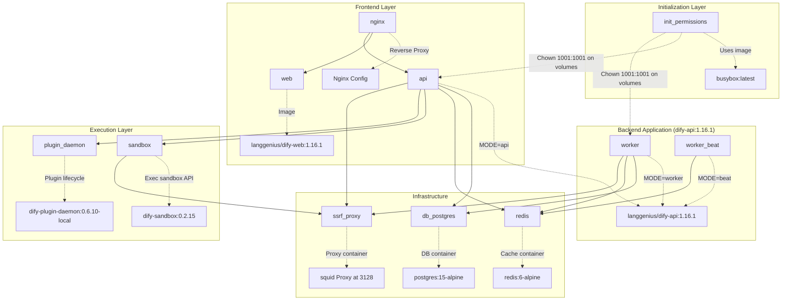
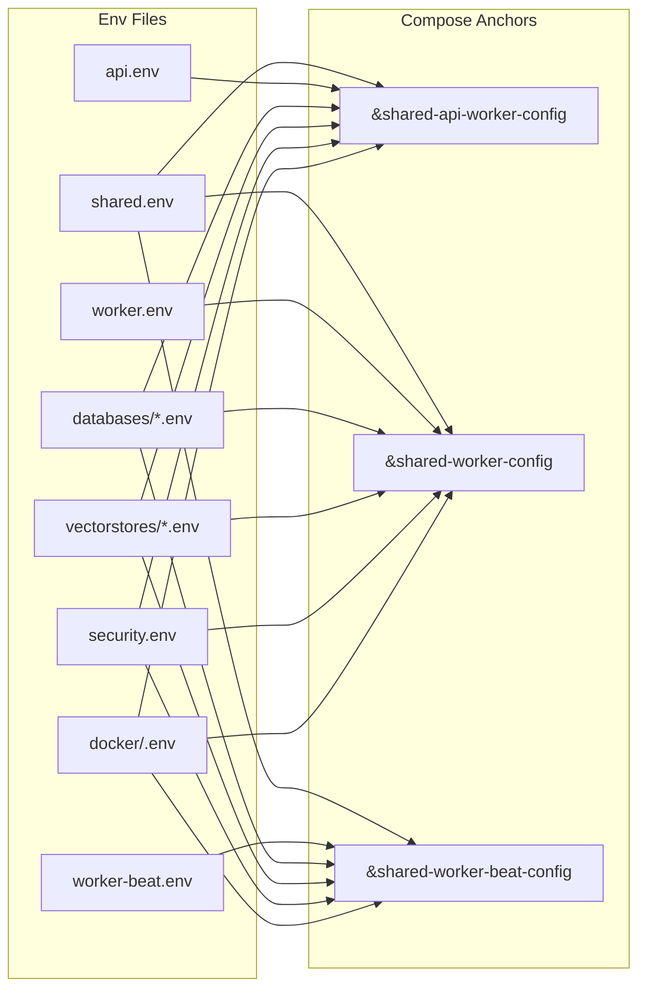
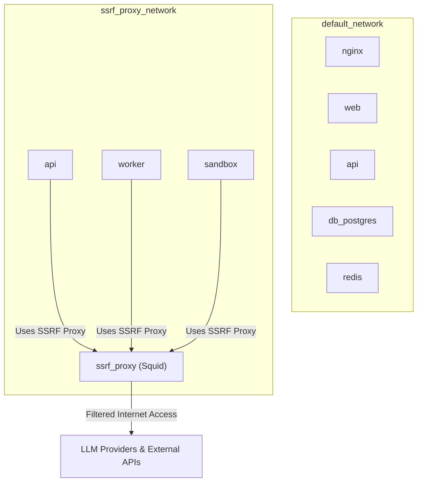

<!-- source: DeepWiki mcp.deepwiki.com · repo langgenius/dify · page 2.1 Service Topology and Docker Compose Stack · fetched 2026-10-26 -->

# Service Topology and Docker Compose Stack

Relevant source files

The following files were used as context for generating this wiki page:

- [api/.env.example](api/.env.example)
- [api/configs/feature/__init__.py](api/configs/feature/__init__.py)
- [api/configs/middleware/__init__.py](api/configs/middleware/__init__.py)
- [api/configs/middleware/vdb/weaviate_config.py](api/configs/middleware/vdb/weaviate_config.py)
- [api/configs/packaging/__init__.py](api/configs/packaging/__init__.py)
- [api/core/rag/datasource/vdb/vector_factory.py](api/core/rag/datasource/vdb/vector_factory.py)
- [api/core/rag/datasource/vdb/vector_type.py](api/core/rag/datasource/vdb/vector_type.py)
- [api/extensions/ext_app_metrics.py](api/extensions/ext_app_metrics.py)
- [api/extensions/ext_celery.py](api/extensions/ext_celery.py)
- [api/extensions/ext_database.py](api/extensions/ext_database.py)
- [api/extensions/ext_import_modules.py](api/extensions/ext_import_modules.py)
- [api/extensions/ext_sentry.py](api/extensions/ext_sentry.py)
- [api/migrations/README](api/migrations/README)
- [api/providers/vdb/vdb-weaviate/tests/unit_tests/test_weaviate_integration_header.py](api/providers/vdb/vdb-weaviate/tests/unit_tests/test_weaviate_integration_header.py)
- [api/pyproject.toml](api/pyproject.toml)
- [api/schedule/queue_monitor_task.py](api/schedule/queue_monitor_task.py)
- [api/tests/integration_tests/.env.example](api/tests/integration_tests/.env.example)
- [api/tests/unit_tests/configs/test_dify_config.py](api/tests/unit_tests/configs/test_dify_config.py)
- [api/tests/unit_tests/core/rag/datasource/vdb/test_vector_factory.py](api/tests/unit_tests/core/rag/datasource/vdb/test_vector_factory.py)
- [api/tests/unit_tests/extensions/test_celery_ssl.py](api/tests/unit_tests/extensions/test_celery_ssl.py)
- [api/uv.lock](api/uv.lock)
- [docker/.env.example](docker/.env.example)
- [docker/docker-compose-template.yaml](docker/docker-compose-template.yaml)
- [docker/docker-compose.middleware.yaml](docker/docker-compose.middleware.yaml)
- [docker/docker-compose.yaml](docker/docker-compose.yaml)
- [docker/envs/core-services/shared.env.example](docker/envs/core-services/shared.env.example)
- [docker/envs/infrastructure/ssrf-proxy.env.example](docker/envs/infrastructure/ssrf-proxy.env.example)
- [docker/envs/middleware.env.example](docker/envs/middleware.env.example)
- [web/package.json](web/package.json)

This document provides a detailed technical explanation of the Docker Compose orchestration for the Dify platform, including the complete service topology, container dependencies, environment variable management, networking, and volumes. It covers how the container architecture maps to the repository codebase and runtime modes, explaining service roles and their interdependencies.

For complementary information, see related pages on [3.1 Docker Build Process and Multi-Stage Images]() and [3.2 Environment Configuration and Runtime Modes]().

---

## Service Topology Overview

Dify orchestrates a multi-container Docker Compose stack comprising several layers of services. These include:

- **Core Application Services**: Backend API server, asynchronous worker processes, and frontend web application.
- **Infrastructure Services**: Databases (PostgreSQL or MySQL), Redis cache, SSRF proxy.
- **Execution Services**: Sandboxed code execution (for safe code runs) and plugin daemon (for plugin lifecycles).

The composition is articulated in `docker/docker-compose.yaml`, leveraging Docker Compose profiles to optionally enable some components like MySQL [docker/docker-compose.yaml:1-5](), [docker/docker-compose.middleware.yaml:1-131]().

### Service to Code Entity Mapping Diagram

This diagram maps the Docker Compose service names to container images, exposed ports, and critical codebase runtime modes or entrypoints, bridging operational names with implementation references.

This clearly connects:

- `init_permissions` container runs a lightweight permissions fix at startup.
- Backend `api`, `worker`, and `worker_beat` share the same container image but operate in distinct modes.
- Frontend served via `web` and proxied by `nginx`.
- `sandbox` service for isolated code execution.
- `plugin_daemon` handles plugin management lifecycle.
- Infrastructure components: PostgreSQL DB, Redis caching, and SSRF proxy via Squid.

**Sources:**  
[docker/docker-compose.yaml:1-250](), [docker/docker-compose.middleware.yaml:1-131](), [docker/docker-compose.middleware.yaml:132-186](), [web/package.json:1-4](), [api/pyproject.toml:1-3]()  

---

## Docker Compose Structure and Environment Management

### Shared Environment Variable Anchors

The Compose stack uses YAML anchors to define reusable environment variable settings blocks, minimizing duplication and improving consistency. The main shared anchors for environment files are:

| Anchor Name                  | Target Services               | Environment Files Included                                                                                                                  |
|-----------------------------|------------------------------|--------------------------------------------------------------------------------------------------------------------------------------------|
| `x-shared-api-worker-config`| `api`                        | `shared.env`, `api.env`, `security.env`, database envs (`db-postgres.env`, `db-mysql.env`), Redis env, vectorstore envs (e.g. `weaviate.env`), `.env`  |
| `x-shared-worker-config`     | `worker`                     | Similar to API but with `worker.env` instead of `api.env`                                                                                   |
| `x-shared-worker-beat-config`| `worker_beat`               | Similar, substituting `worker-beat.env`                                                                                                     |

These environment files configure critical runtime parameters like database credentials, Redis URIs, vector store details, and security tokens. Services inherit these anchors to load consistent configuration [docker/docker-compose.yaml:8-201](), [docker/docker-compose-template.yaml:1-198]().

### Environment File Relationship Diagram

This modular and layered environment loading ensures consistent propagation of key runtime settings across API and worker services.

**Sources:**  
[docker/docker-compose.yaml:8-201](), [docker/docker-compose-template.yaml:1-198]()  

---

## Core Application Services

### Backend Application Services

The core backend runs the `langgenius/dify-api` container image, instantiated in three roles distinguished by the environment variable `MODE`:

| Service      | Mode    | Description                                                                                   | Entrypoint    |
|--------------|---------|-----------------------------------------------------------------------------------------------|---------------|
| `api`        | `api`   | REST API service handles HTTP requests, REST routes, and WebSocket APIs via Flask and Gunicorn. | `/entrypoint.sh`, launches Flask app in API mode. |
| `worker`     | `worker`| Celery worker processes asynchronous tasks like indexing, workflow execution, and triggers.    | `/entrypoint.sh` with worker mode. |
| `worker_beat`| `beat`  | Celery Beat scheduler runs periodic jobs such as cleanup, summary generation.                 | `/entrypoint.sh` with beat mode.  |

The `api` service exposes port 5001, using environment variables to tune concurrency (`SERVER_WORKER_AMOUNT`), worker class (default `gevent`), and timeouts. The workers connect to Redis for task queueing and to the database for persistence.

Sources in the codebase relevant to operation are `api/` for application logic and `extensions/ext_celery.py` showing Celery integration and task scheduling [docker/docker-compose.yaml:220-377](), [api/extensions/ext_celery.py:118-170](), [docker/.env.example:55-67]().

### Frontend Service

The frontend service runs a Next.js-based React application served by the container `langgenius/dify-web`. It listens on port 3000 by default and provides the Console UI and web apps.

The frontend is typically fronted by the `nginx` container which handles SSL termination, routing, and caching proxying.

**Sources:**  
[web/package.json:1-37](), [docker/docker-compose.yaml:100-140](), [docker/.env.example:55-58]()  

---

## Infrastructure and Execution Services

| Service          | Image                         | Port(s) | Function/Role                                         |
|------------------|-------------------------------|---------|------------------------------------------------------|
| `db_postgres`    | `postgres:15-alpine`           | 5432    | PostgreSQL database with tuned config and healthchecks |
| `db_mysql`       | `mysql:8.0`                   | 3306    | MySQL database (optional, profile enabled)           |
| `redis`          | `redis:6-alpine`              | 6379    | Redis cache backing Celery, pubsub, and session data |
| `ssrf_proxy`     | Squid Proxy container         | 3128    | SSRF Proxy for filtered external outbound HTTP       |
| `sandbox`        | `dify-sandbox:0.2.15`         | 8194    | Secure code execution sandbox providing isolated HTTP API for user code execution inside workflows |
| `plugin_daemon`  | `dify-plugin-daemon:0.6.10-local` | 5002   | Plugin lifecycle manager, installation, execution isolation |

The PostgreSQL and MySQL images are configured with startup parameters for performance and persistent volumes for data durability. Redis is configured with authentication and persistent storage.

The `sandbox` is critical for running untrusted user code securely with restricted timeouts and network access controlled via environment variables. The sandbox routes outbound requests through the SSRF proxy for security [docker/docker-compose.middleware.yaml:1-150](), [docker/.env.example:183-200](), [api/configs/feature/__init__.py:114-202]().

The plugin daemon manages third-party plugin lifecycle and runs as an isolated service communicating internally with the API backend [docker/docker-compose.middleware.yaml:157-186]().

**Sources:**  
[docker/docker-compose.middleware.yaml:1-186](), [api/configs/feature/__init__.py:114-202](), [docker/.env.example:183-200](), [api/configs/middleware/__init__.py:140-191]()  

---

## Network Architecture and SSRF Proxy Usage

Dify deploys two isolated Docker networks:

- **`default` network:** Contains core services like `api`, `web`, `nginx`, `db_postgres`, and `redis` communicating freely internally.
- **`ssrf_proxy_network` network:** Contains services such as `api`, `worker`, and `sandbox` which require internet access but must be mediated through an SSRF proxy for security.

Outbound HTTP/HTTPS requests from services on `ssrf_proxy_network` are proxied through the `ssrf_proxy` Squid container, which enforces deny-by-default access to private IP ranges, preventing malicious SSRF attacks.

Network isolation ensures core internal traffic is segregated from external network access, improving security posture.

**Sources:**  
[docker/docker-compose.yaml:70-71](), [docker/docker-compose.middleware.yaml:105-128](), [docker/.env.example:201-218]()  

---

## Volume Management and Persistent Storage

Dify mounts several host volumes into containers to persist user data, database files, and runtime state:

| Host Path                         | Container Path                   | Services               | Purpose                                              |
|----------------------------------|--------------------------------|------------------------|------------------------------------------------------|
| `./volumes/app/storage`           | `/app/api/storage`               | `api`, `worker`        | Stores user uploads, document files, plugin storage  |
| `./volumes/db/data`               | `/var/lib/postgresql/data`       | `db_postgres`          | Persistent PostgreSQL data files                      |
| `./volumes/redis/data`            | `/data`                         | `redis`                | Redis persistent data                                 |
| `./volumes/sandbox/dependencies` | `/dependencies`                  | `sandbox`              | Cached binaries and packages for code execution       |

### Initialization Container: `init_permissions`

`init_permissions` is a short-lived container that runs before API and worker services start to fix ownership permissions of mounted volumes. It changes ownership to UID/GID 1001 (the `dify` user inside containers), preventing permission errors during runtime.

It uses a sentinel file `.init_permissions` in the storage directory to skip repeated execution on subsequent runs [docker/docker-compose.yaml:208-218]().

---

## Summary

This comprehensive stack architecture and Docker Compose orchestration enable Dify to run a modular, scalable system with strong isolation in container services:

- Separate execution modes (API, worker, scheduler) run from the same backend image.
- Frontend served via Next.js behind an Nginx reverse proxy.
- Infrastructure managed with dedicated databases, Redis cache, and SSRF proxy networks.
- Execution environment sandboxed and securely proxied.
- Plugin management segregated in a dedicated daemon.
- Environment and configuration centrally managed via layered `.env` files.
- Persistent volumes ensure data durability.
- Initialization container manages file permissions for smooth operations.

---

**Sources:**  
- [docker/docker-compose.yaml:1-250,208-218]()  
- [docker/docker-compose-template.yaml:1-198]()  
- [docker/docker-compose.middleware.yaml:1-186]()  
- [docker/.env.example:55-218]()  
- [api/extensions/ext_celery.py:118-170]()  
- [api/configs/feature/__init__.py:114-202]()  
- [api/configs/middleware/__init__.py:140-191]()  
- [web/package.json:1-37]()  
- [api/pyproject.toml:1-3]()

---

