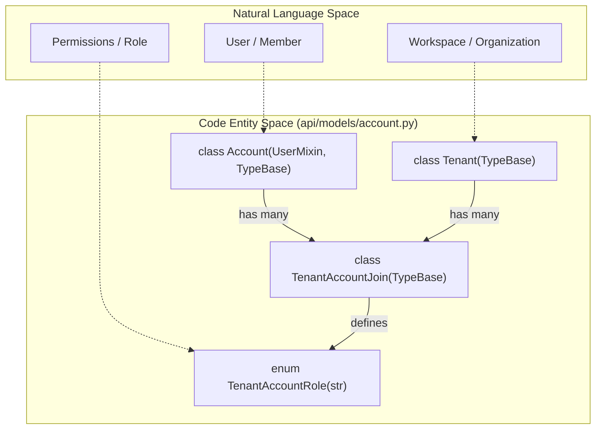
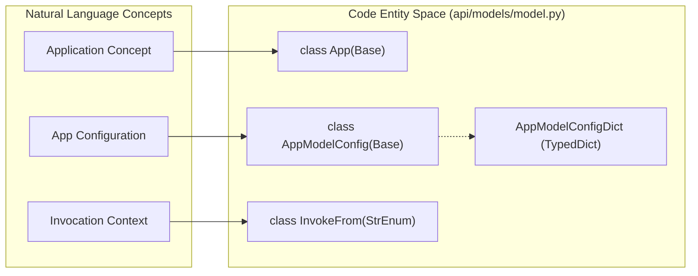
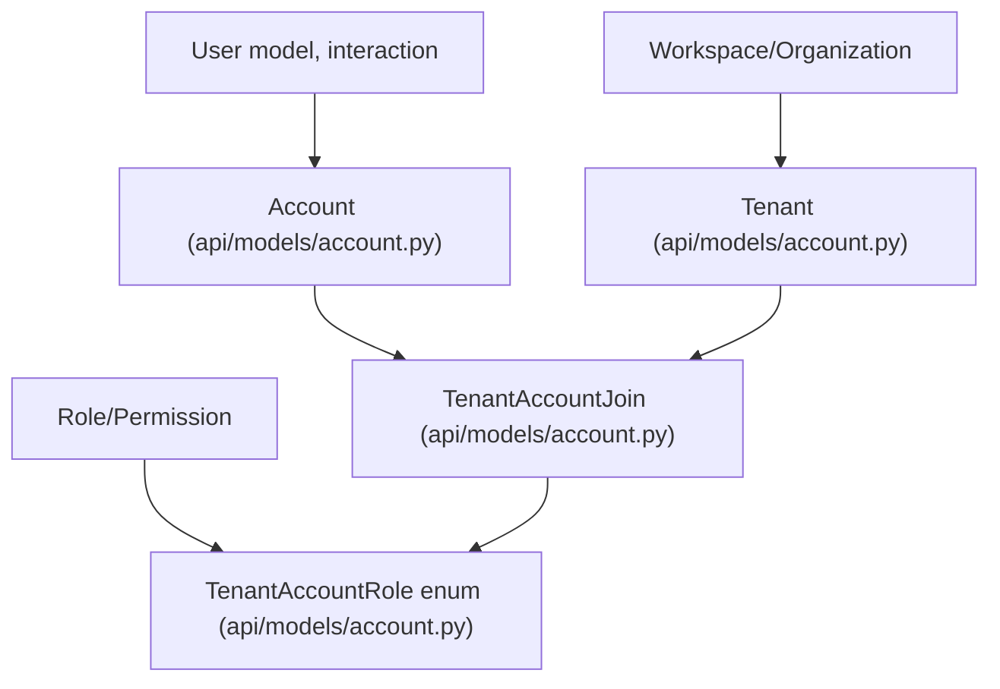
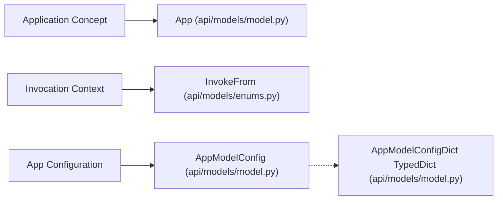

<!-- source: DeepWiki mcp.deepwiki.com · repo langgenius/dify · page 2.2 Core Data Models and Domain Entities · fetched 2026-10-26 -->

# Core Data Models and Domain Entities

<details>
<summary>Relevant source files</summary>

The following files were used as context for generating this wiki page:

- [api/controllers/console/app/model_config_payload.py](api/controllers/console/app/model_config_payload.py)
- [api/models/account.py](api/models/account.py)
- [api/models/api_based_extension.py](api/models/api_based_extension.py)
- [api/models/dataset.py](api/models/dataset.py)
- [api/models/model.py](api/models/model.py)
- [api/models/provider.py](api/models/provider.py)
- [api/models/source.py](api/models/source.py)
- [api/models/task.py](api/models/task.py)
- [api/models/tools.py](api/models/tools.py)
- [api/models/trigger.py](api/models/trigger.py)
- [api/models/web.py](api/models/web.py)
- [api/models/workflow.py](api/models/workflow.py)
- [api/repositories/recommended_app_catalog_repository.py](api/repositories/recommended_app_catalog_repository.py)
- [api/tests/test_containers_integration_tests/models/test_conversation_status_count.py](api/tests/test_containers_integration_tests/models/test_conversation_status_count.py)
- [api/tests/test_containers_integration_tests/models/test_dataset_models.py](api/tests/test_containers_integration_tests/models/test_dataset_models.py)
- [api/tests/test_containers_integration_tests/repositories/test_recommended_app_catalog_repository.py](api/tests/test_containers_integration_tests/repositories/test_recommended_app_catalog_repository.py)
- [api/tests/unit_tests/controllers/console/app/test_model_config_api.py](api/tests/unit_tests/controllers/console/app/test_model_config_api.py)
- [api/tests/unit_tests/models/test_app_models.py](api/tests/unit_tests/models/test_app_models.py)
- [api/tests/unit_tests/models/test_dataset_models.py](api/tests/unit_tests/models/test_dataset_models.py)
- [api/tests/unit_tests/repositories/test_recommended_app_catalog_repository.py](api/tests/unit_tests/repositories/test_recommended_app_catalog_repository.py)
- [packages/contracts/app-model-config.test.ts](packages/contracts/app-model-config.test.ts)

</details>


This document provides a technical reference for the core data models and domain entities in Dify. These SQLAlchemy models embody the persistent data structures foundational to multi-tenancy, applications, workflows, knowledge bases, and tool integrations.

---

## Multi-Tenant Architecture Foundation

Dify implements a strict multi-tenant architecture where all resources are isolated by workspace. The foundational models establish tenant ownership and role-based access control (RBAC).

### Domain to Entity Mapping: Identity and Access

The following diagram bridges the natural language concepts of **Workspace** and **User** to the code-level `Tenant` and `Account` entities.



- `Account` holds user authentication data including login info, profile, status, and role context.
- `Tenant` represents a workspace or organization boundary in a multi-tenant setup.
- `TenantAccountJoin` implements the many-to-many association between user accounts and tenants with role information.
- `TenantAccountRole` enum defines roles such as `OWNER`, `ADMIN`, `EDITOR`, `NORMAL`, and `DATASET_OPERATOR`.

Notable features:
- The `Account` model supports session-aware tenant context switching to ensure consistent role-tenant resolution.
- Tenants hold encrypted keys and optional custom workspace configuration.

Sources: [api/models/account.py:21-78](), [api/models/account.py:89-152](), [api/models/account.py:242-302]()

---

## Application Models

Applications represent Dify’s user-facing entities that orchestrate workflows, chats, or agent interactions powered by LLMs and tools.

### App and AppModelConfig

- **`App`**: Core entity representing an application that belongs to a tenant. Fields include workspace association (`tenant_id`), operational mode (e.g., `chat`, `workflow`, `agent-chat`), status, feature flags (`enable_site`, `enable_api`), icon metadata, and API rate limits [api/models/model.py:678-778]().

- **`AppModelConfig`**: Application-specific configuration entity that stores model provider information, prompts, runtime flags, suggested question settings, agent tool configurations, and other operational parameters [api/models/model.py:420-512]().

### App Mode Enum

Operational types of an app are enumerated in `AppMode` with values such as:

- `CHAT`
- `COMPLETION`
- `WORKFLOW`
- `ADVANCED_CHAT`
- `AGENT_CHAT`
- `AGENT`
- `CHANNEL`
- `RAG_PIPELINE`

These modes dictate how the app runs, its UI behavior, and underlying workflow integration.

Sources: [api/models/model.py:323-393]()

### Entity Association: Application Configuration

This diagram maps natural application concepts to code-level classes managing app configuration and invocation context within the codebase:



---

## Workflow Models

Workflows enable graph-based orchestration with nodes representing discrete processing steps or tasks enabled by LLMs.

### Workflow Entity

- `Workflow` stores the definition of a workflow in JSON format (`graph` column) capturing nodes, edges, and execution metadata.
- Supported workflow types include `workflow`, `chat`, `rag-pipeline`, and `snippet`.
- Supports versioning with draft and published versions.
- Includes creator and timestamp tracking [api/models/workflow.py:175-220]().

### WorkflowRun and WorkflowNodeExecution

- `WorkflowRun`: Represents execution instances of a workflow with execution status, timings, and statistics [api/models/workflow.py:555-645]().
- `WorkflowNodeExecution`: Tracks individual node executions within a run including inputs, outputs, error status, and metadata [api/models/workflow.py:727-832]().

These models enable rich lifecycle tracking and offloading of large execution data when required.

Sources: [api/models/workflow.py:176-225](), [api/models/workflow.py:555-645](), [api/models/workflow.py:727-832]()

---

## Dataset and Knowledge Models

Datasets act as knowledge bases supporting document ingestion, segmentation, and retrieval (RAG pipelines).

### Dataset and Document Entities

- `Dataset`: Metadata entity for knowledge collections including indexing, retrieval models, and permission configurations. Fields like `embedding_model`, `indexing_technique`, and `retrieval_model` configure vector search and retrieval behavior [api/models/dataset.py:100-180]().

- `Document`: Represents individual source files or documents within a dataset. Tracks upload metadata, indexing stages (`waiting`, `parsing`, `indexing`, `completed`), and archival status [api/models/dataset.py:354-470]().

- `DocumentSegment`: Stores text chunks from documents for use in vector indexing and retrieval, with attributes like position, content, tokens, and hit counts [api/models/dataset.py:796-857]().

### Selected Dataset Properties

| Property             | Description                                                  |
| -------------------- | ------------------------------------------------------------ |
| `indexing_technique` | Type of indexing to perform (e.g., `high_quality`, `economy`) |
| `retrieval_model`    | Configuration dict for retrieval setup (top-k, thresholds)  |
| `embedding_model`    | Embedding model name                                           |
| `permission`         | Access control enum for the dataset                           |

### Knowledge Index Node Integration

Within a workflow context, the `KnowledgeIndexNode` manages document chunk indexing. It leverages the `IndexProcessor` component to perform full or preview indexing and triggers summary index generation for RAG pipelines. This node integrates tightly with dataset and document entities, respecting session context and offload settings [api/core/workflow/nodes/knowledge_index/knowledge_index_node.py:31-161]().

Sources: [api/models/dataset.py:100-190](), [api/models/dataset.py:354-470](), [api/models/dataset.py:796-857](), [api/core/workflow/nodes/knowledge_index/knowledge_index_node.py:31-161]()

---

## Tool Provider Models

Dify manages tools and APIs across both built-in integrations and custom API tool providers.

| Model Class           | Tool Type     | Description                                             |
| --------------------- | ------------ | -------------------------------------------------------|
| `BuiltinToolProvider` | Built-in     | Tenant-specific built-in tools with encrypted credentials [api/models/tools.py:74-127]() |
| `ApiToolProvider`     | API-based    | Tools defined by OpenAPI schemas stored as JSON schema  [api/models/tools.py:135-182]() |
| `WorkflowToolProvider`| Workflow     | Workflows published as reusable tools (snippet workflows) [api/models/tools.py:216-281]() |

### OAuth Credentials Management

- `ToolOAuthSystemClient`: Stores system-wide OAuth client credentials [api/models/tools.py:33-49]().
- `ToolOAuthTenantClient`: Tenant-level overrides for OAuth clients [api/models/tools.py:50-70]().

These entities manage the OAuth client configurations and encrypted params essential for secure integration with external service providers.

Sources: [api/models/tools.py:33-281]()

---

## Provider and Model Configuration

- `Provider`: Represents API or LLM providers with details on quota limits, type (custom or system), and credential references. Validity and enablement states are tracked [api/models/provider.py:34-199]().

- `ProviderModel`: Specific model configurations under a provider, with model name, type, validation, and credential linkage.

- `TenantDefaultModel`: Tenant-specific default provider model settings by model type (e.g., chat, embedding).

This layered model structure enables complex provider management for multi-tenant operations and quota tracking.

Sources: [api/models/provider.py:34-199]()

---

## Trigger Models

Event-driven automation via triggers enables workflows to respond to external or scheduled events.

### Key Trigger Models

- `TriggerSubscription`: Stores configured trigger subscriptions, credentials, and parameters, with expiration and visibility management [api/models/trigger.py:68-131]().

- `TriggerOAuthSystemClient` and `TriggerOAuthTenantClient`: Storage for OAuth clients used by triggers at system and tenant level [api/models/trigger.py:158-208]().

- `WorkflowTriggerLog`: Records logs for workflow trigger executions capturing event data and status [api/models/trigger.py:211-270]().

- `WorkflowSchedulePlan`: Manages scheduled execution of workflows via cron expressions and timezone-aware scheduling [api/models/trigger.py:273-300]().

These models enable integration with external events and time-based triggers that invoke workflows dynamically.

Sources: [api/models/trigger.py:68-131](), [api/models/trigger.py:158-208](), [api/models/trigger.py:211-300]()

---

## Implementation Patterns and Integration Notes

### Data Types and Enums

- Primary keys are UUID strings using `StringUUID` for consistent 128-bit UUID representation.
- Enum types utilize a custom `EnumText` type mapping Python enums to string columns for clarity.

### JSON Model Storage

- Complex configurations (e.g., app models, dataset retrieval settings) are stored as JSON blobs within `LongText` or `AdjustedJSON` fields.
- Properties deserialize these JSON configs into Python dicts on-demand for business logic use.

### Example: Lazy Credentials Property in `BuiltinToolProvider`

```python
@property
def credentials(self) -> dict[str, Any]:
    if not self.encrypted_credentials:
        return {}
    return json.loads(self.encrypted_credentials)
```

### Message and Interaction Logs

- Conversation messages and their annotations are tracked via models in `api/models/model.py` supporting app-level message threading.
- Additional features like `SavedMessage` and `PinnedConversation` provide user bookmarking capabilities [api/models/web.py:14-65](), [api/models/model.py:1010-1120]().

---

# Summary Diagrams Bridging Domains to Code

### Identity and Access Domain to Code Entities



### Application Configuration Domain to Code Entities



---

This page outlines Dify's core data models and how they correspond to domain concepts, central to multi-tenant management, app configuration, workflow orchestration, knowledge base handling, tool integration, and event triggers.

Sources:  
[api/models/account.py:21-78](), [api/models/account.py:89-152](), [api/models/account.py:242-302](),  
[api/models/model.py:323-393](), [api/models/model.py:420-512](), [api/models/model.py:678-778](), [api/models/enums.py:179-192](),  
[api/models/workflow.py:175-220](), [api/models/workflow.py:555-645](), [api/models/workflow.py:727-832](),  
[api/models/dataset.py:100-190](), [api/models/dataset.py:354-470](), [api/models/dataset.py:796-857](),  
[api/core/workflow/nodes/knowledge_index/knowledge_index_node.py:31-161](),  
[api/models/tools.py:33-281](),  
[api/models/provider.py:34-199](),  
[api/models/trigger.py:68-131](), [api/models/trigger.py:158-208](), [api/models/trigger.py:211-300](),  
[api/models/model.py:1010-1120](), [api/models/web.py:14-65](), [api/models/tools.py:120-130](), [api/models/types.py:15-210]()

---

