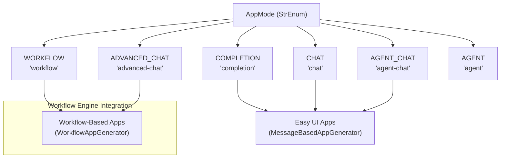
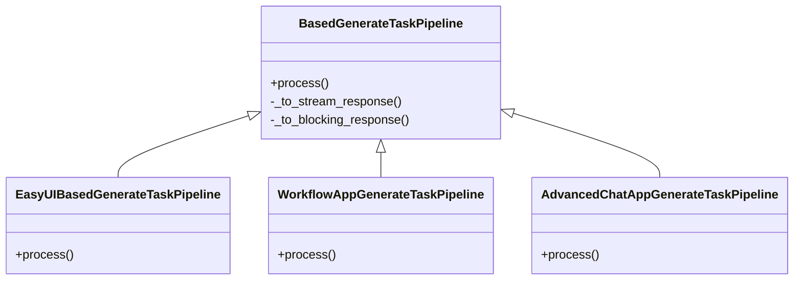
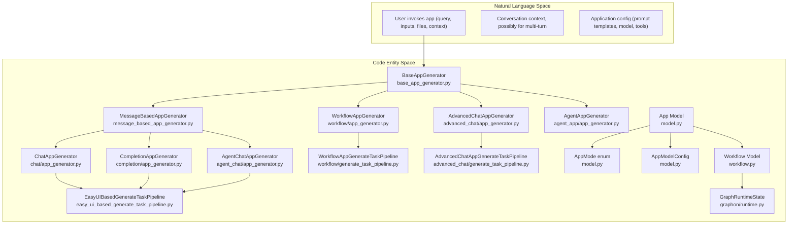

<!-- source: DeepWiki mcp.deepwiki.com · repo langgenius/dify · page 2.3 Application Types and Execution Modes · fetched 2026-10-26 -->

# Application Types and Execution Modes

<details>
<summary>Relevant source files</summary>

The following files were used as context for generating this wiki page:

- [api/core/app/app_config/entities.py](api/core/app/app_config/entities.py)
- [api/core/app/apps/advanced_chat/app_config_manager.py](api/core/app/apps/advanced_chat/app_config_manager.py)
- [api/core/app/apps/advanced_chat/app_generator.py](api/core/app/apps/advanced_chat/app_generator.py)
- [api/core/app/apps/agent_chat/app_config_manager.py](api/core/app/apps/agent_chat/app_config_manager.py)
- [api/core/app/apps/agent_chat/app_generator.py](api/core/app/apps/agent_chat/app_generator.py)
- [api/core/app/apps/base_app_generator.py](api/core/app/apps/base_app_generator.py)
- [api/core/app/apps/chat/app_generator.py](api/core/app/apps/chat/app_generator.py)
- [api/core/app/apps/completion/app_generator.py](api/core/app/apps/completion/app_generator.py)
- [api/core/app/apps/message_based_app_generator.py](api/core/app/apps/message_based_app_generator.py)
- [api/core/app/apps/pipeline/pipeline_generator.py](api/core/app/apps/pipeline/pipeline_generator.py)
- [api/core/app/apps/workflow/app_generator.py](api/core/app/apps/workflow/app_generator.py)
- [api/core/datasource/datasource_manager.py](api/core/datasource/datasource_manager.py)
- [api/core/datasource/entities/datasource_entities.py](api/core/datasource/entities/datasource_entities.py)
- [api/core/ops/base_trace_instance.py](api/core/ops/base_trace_instance.py)
- [api/core/rag/entities/__init__.py](api/core/rag/entities/__init__.py)
- [api/core/rag/entities/index_entities.py](api/core/rag/entities/index_entities.py)
- [api/core/rag/entities/metadata_entities.py](api/core/rag/entities/metadata_entities.py)
- [api/core/rag/entities/processing_entities.py](api/core/rag/entities/processing_entities.py)
- [api/core/rag/entities/retrieval_settings.py](api/core/rag/entities/retrieval_settings.py)
- [api/core/rag/rerank/entity/weight.py](api/core/rag/rerank/entity/weight.py)
- [api/core/workflow/nodes/datasource/datasource_node.py](api/core/workflow/nodes/datasource/datasource_node.py)
- [api/core/workflow/nodes/knowledge_index/entities.py](api/core/workflow/nodes/knowledge_index/entities.py)
- [api/core/workflow/nodes/knowledge_retrieval/entities.py](api/core/workflow/nodes/knowledge_retrieval/entities.py)
- [api/migrations/versions/2025_10_14_1618-d98acf217d43_add_app_mode_for_messsage.py](api/migrations/versions/2025_10_14_1618-d98acf217d43_add_app_mode_for_messsage.py)
- [api/services/entities/knowledge_entities/rag_pipeline_entities.py](api/services/entities/knowledge_entities/rag_pipeline_entities.py)
- [api/tests/unit_tests/core/app/apps/advanced_chat/test_app_generator.py](api/tests/unit_tests/core/app/apps/advanced_chat/test_app_generator.py)
- [api/tests/unit_tests/core/app/apps/pipeline/test_pipeline_config_manager.py](api/tests/unit_tests/core/app/apps/pipeline/test_pipeline_config_manager.py)
- [api/tests/unit_tests/core/app/apps/pipeline/test_pipeline_generator.py](api/tests/unit_tests/core/app/apps/pipeline/test_pipeline_generator.py)
- [api/tests/unit_tests/core/app/apps/pipeline/test_pipeline_queue_manager.py](api/tests/unit_tests/core/app/apps/pipeline/test_pipeline_queue_manager.py)
- [api/tests/unit_tests/core/app/apps/pipeline/test_pipeline_runner.py](api/tests/unit_tests/core/app/apps/pipeline/test_pipeline_runner.py)
- [api/tests/unit_tests/core/app/apps/test_base_app_generator.py](api/tests/unit_tests/core/app/apps/test_base_app_generator.py)
- [api/tests/unit_tests/core/app/apps/test_pause_resume.py](api/tests/unit_tests/core/app/apps/test_pause_resume.py)
- [api/tests/unit_tests/core/app/apps/test_workflow_app_generator.py](api/tests/unit_tests/core/app/apps/test_workflow_app_generator.py)
- [api/tests/unit_tests/core/app/apps/workflow/test_app_generator_extra.py](api/tests/unit_tests/core/app/apps/workflow/test_app_generator_extra.py)
- [api/tests/unit_tests/core/ops/test_base_trace_instance.py](api/tests/unit_tests/core/ops/test_base_trace_instance.py)
- [api/tests/unit_tests/core/workflow/nodes/datasource/test_datasource_node.py](api/tests/unit_tests/core/workflow/nodes/datasource/test_datasource_node.py)
- [api/tests/unit_tests/core/workflow/nodes/test_start_node_json_object.py](api/tests/unit_tests/core/workflow/nodes/test_start_node_json_object.py)
- [api/tests/unit_tests/services/document_service_validation.py](api/tests/unit_tests/services/document_service_validation.py)
- [web/app/components/base/chat/chat/utils.ts](web/app/components/base/chat/chat/utils.ts)

</details>


This document explains the different application types supported by Dify and their execution modes. It covers how apps are configured, how their modes determine execution behavior, and the relationship between app modes, workflows, and agent configurations.

For information about workflow execution details, see [Workflow Definition and Execution Model](#5.1). For RAG-specific configuration, see [Retrieval Strategies and Metadata Filtering](#4.3).

---

## Purpose and Scope

Dify supports several distinct application types, each designed for different use cases. This document describes:

- The `AppMode` enumeration and its possible values.
- How each mode determines application behavior and execution flow.
- The relationship between app modes, `AppModelConfig`, and `Workflow` entities.
- The distinction between "Easy UI" (prompt-based) apps and workflow-based apps.
- The task pipeline architecture for managing streaming and blocking generation responses.
- Execution characteristics including thread management, file scope handling, and draft variable saving.

---

## Application Mode Enumeration

All Dify applications have a `mode` field that determines their type and execution behavior. The available modes are defined in the `AppMode` enum in `models/model.py` [api/models/model.py:227-232]().



- **Easy UI Apps:** `COMPLETION`, `CHAT`, `AGENT_CHAT` modes are simpler, prompt-based apps managed by `MessageBasedAppGenerator`.
- **Workflow-Based Apps:** `WORKFLOW` and `ADVANCED_CHAT` modes involve graph-based execution managed by `WorkflowAppGenerator` and `AdvancedChatAppGenerator`.
- **Agent Mode:** `AGENT` mode represents Agent V2 apps built around the agent runtime and roster.

Sources: [api/models/model.py:227-232](), [api/core/app/apps/message_based_app_generator.py:46-46](), [api/core/app/apps/workflow/app_generator.py:72-72](), [api/core/app/apps/advanced_chat/app_generator.py:75-75](), [api/models/workflow.py:121-123]()

---

## Execution Pipeline Architecture

Dify uses a layered pipeline architecture to process application requests. This pipeline handles input validation, variable preparation, workflow or prompt execution, and streaming or blocking response delivery.

### Task Pipeline Class Hierarchy

The core class `BasedGenerateTaskPipeline` (in `api/core/app/task_pipeline/based_generate_task_pipeline.py`) provides base functionality including event consumption and response streaming. Specialized subclasses implement mode-specific logic.



- **EasyUIBasedGenerateTaskPipeline:** Used by `CompletionAppGenerator`, `ChatAppGenerator`, and `AgentChatAppGenerator` for prompt-based modes.
- **WorkflowAppGenerateTaskPipeline:** Manages node-based graph execution for `WorkflowAppGenerator`.
- **AdvancedChatAppGenerateTaskPipeline:** Used in `AdvancedChatAppGenerator` to integrate workflow execution with chat memory.

Sources: [api/core/app/task_pipeline/based_generate_task_pipeline.py:45-45](), [api/core/app/task_pipeline/easy_ui_based_generate_task_pipeline.py:71-71](), [api/core/app/apps/workflow/generate_task_pipeline.py:77-77](), [api/core/app/apps/advanced_chat/generate_task_pipeline.py:142-142]()

---

## Easy UI (Prompt-Based) Modes

These application modes use simpler prompt and model configuration without a full workflow graph. They are managed by implementations of `MessageBasedAppGenerator`:

### Completion Mode
- **Mode:** `"completion"`
- **Behavior:** Single-turn completion with prompt templates from `CompletionAppGenerator`.
- **Implementation:** `CompletionAppGenerator` generates responses based on user input and prompt templates [api/core/app/apps/completion/app_generator.py]().

### Chat and Agent Chat Modes
- **Modes:** `"chat"`, `"agent-chat"`
- **Behavior:** Multi-turn conversations; Agent Chat adds autonomous agent capabilities (tool calls, reasoning).
- **Implementation Classes:** 
  - `ChatAppGenerator` for `"chat"` [api/core/app/apps/chat/app_generator.py]()
  - `AgentChatAppGenerator` for `"agent-chat"` [api/core/app/apps/agent_chat/app_generator.py]()
- **Configuration:** Uses `AppModelConfig` holding prompt templates, model configs, tools, and file upload configs [api/models/model.py:240-256]().

### Components and Data Flow

- **AppModelConfig:** Defines prompt, model, and tool configs
- **MessageBasedAppGenerator:** Base class handling input, file conversion, and creating `AppGenerateEntity`
- **EasyUIBasedGenerateTaskPipeline:** Coordinates LLM call and streams response [api/core/app/task_pipeline/easy_ui_based_generate_task_pipeline.py]()
- **MessageCycleManager:** Manages conversation states such as generating conversation names and updating message statuses

Sources: [api/core/app/apps/message_based_app_generator.py:46-175](), [api/core/app/task_pipeline/easy_ui_based_generate_task_pipeline.py:110-113](), [api/core/app/apps/completion/app_generator.py](), [api/core/app/apps/chat/app_generator.py](), [api/core/app/apps/agent_chat/app_generator.py:37-83](), [api/models/model.py:240-256]()

---

## Workflow-Based Modes

These modes execute a graph of interconnected nodes, enabling richer workflows than prompt-based UIs. They leverage the `GraphEngine` for runtime node execution:

### Workflow Mode
- **Mode:** `"workflow"`
- **Behavior:** Executes a graph workflow with nodes, stateless from conversation perspective.
- **Primary class:** `WorkflowAppGenerator` [api/core/app/apps/workflow/app_generator.py:72-162]()
- **Execution:** Uses `WorkflowAppGenerateTaskPipeline` to manage lifecycle [api/core/app/apps/workflow/generate_task_pipeline.py]()

### Advanced Chat Mode
- **Mode:** `"advanced-chat"`
- **Behavior:** Combines workflow execution with chat memory, maintaining multi-turn conversations.
- **Primary class:** `AdvancedChatAppGenerator` [api/core/app/apps/advanced_chat/app_generator.py:75-135]()
- **Uses:** `AdvancedChatAppGenerateTaskPipeline` and `AdvancedChatAppRunner` for response generation [api/core/app/apps/advanced_chat/generate_task_pipeline.py]()

### RAG Pipeline Mode
- **Mode:** `"rag-pipeline"`
- **Description:** Specialized workflow type for document indexing and retrieval-augmented generation (RAG).
- **Not a typical user app mode**, but uses the same workflow infrastructure.
- **Identified by:** `WorkflowType.RAG_PIPELINE` in workflow entity [api/models/workflow.py:177-210]()

Sources: [api/core/app/apps/workflow/app_generator.py:72-162](), [api/core/app/apps/advanced_chat/app_generator.py:75-135](), [api/core/app/apps/advanced_chat/generate_task_pipeline.py](), [api/models/workflow.py:121-123,177-210]()

---

## Agent and Agent-Chat Modes

- **Agent Chat Mode (`agent-chat`)**  
  A hybrid mode managed by `AgentChatAppGenerator` that extends standard chat with agent capabilities such as autonomous tool calling and interaction with backend agent runtime. It supports streaming responses and tightly integrates with agent soul configuration [api/core/app/apps/agent_chat/app_generator.py:37-180]().

- **Agent Mode (`agent`)**  
  Advanced Agent framework (Agent V2) where the app backend delegates runtime to the external Dify Agent runtime (`dify-agent`). Managed by `AgentAppGenerator` which orchestrates conversations, messages, and streaming responses, but offloads answer generation to the external backend client via `AgentAppRunner` [api/core/app/apps/agent_app/app_generator.py:78-150]().

Sources: [api/core/app/apps/agent_chat/app_generator.py:37-180](), [api/core/app/apps/agent_app/app_generator.py:78-150]()

---

## Application Data Flow: Natural Language to Code Entity Space

The following diagram illustrates how user application requests in natural language map into code entities, generators, and pipelines fulfilling the request:



- Incoming user queries and inputs are processed by specific `AppGenerator` subclasses depending on the app mode.
- Easy UI apps use `MessageBasedAppGenerator` family with `EasyUIBasedGenerateTaskPipeline`.
- Workflow and advanced chat apps utilize graph-based execution with corresponding task pipelines.
- The `App` entity configures the mode and references a workflow if applicable.
- The `GraphRuntimeState` handles node execution in workflows.

Sources: [api/core/app/apps/base_app_generator.py:71-71](), [api/core/app/apps/message_based_app_generator.py:46-175](), [api/core/app/apps/chat/app_generator.py:18-18](), [api/core/app/apps/completion/app_generator.py](), [api/core/app/apps/agent_chat/app_generator.py:37-83](), [api/core/app/apps/workflow/app_generator.py:72-160](), [api/core/app/apps/advanced_chat/app_generator.py:75-135](), [api/core/app/apps/agent_app/app_generator.py:78-150](), [api/core/app/task_pipeline/easy_ui_based_generate_task_pipeline.py:71-71](), [api/core/app/apps/workflow/generate_task_pipeline.py:77-77](), [api/core/app/apps/advanced_chat/generate_task_pipeline.py:142-172](), [api/models/model.py:227-256](), [api/models/workflow.py:121-123](), [api/graphon/runtime.py]()

---

## Task States and Execution Characteristics

### Task State Entities

These classes maintain the execution state and accumulate results during the generation lifecycle:

| Entity Class                       | App Mode(s)                               | Description                                            |
|----------------------------------|------------------------------------------|--------------------------------------------------------|
| `EasyUITaskState`                 | `CHAT`, `COMPLETION`, `AGENT_CHAT`       | Tracks LLMResult and usage, manages streaming events [api/core/app/task_pipeline/easy_ui_based_generate_task_pipeline.py:76-77]() |
| `WorkflowTaskState`               | `ADVANCED_CHAT`                           | Tracks streaming timing, answers, nodes state [api/core/app/apps/advanced_chat/generate_task_pipeline.py:193-194]() |

### Execution Features

- **Draft Variable Saving:** Workflow execution nodes save temporary state via `DraftVariableSaver` or its DB counterpart for debugging and resumption support. `WorkflowAppGenerator` uses factory creation of these savers bound to node execution and context information [api/core/app/apps/workflow/app_generator.py:34-68]().
- **File Access Scope Management:** `BaseAppGenerator` binds tenant/user context for downstream file lookups, converting user-provided file metadata into internal `File` entities for access control and validation [api/core/app/apps/base_app_generator.py:106-128]().
- **Thread Management:** Blocking workflows and advanced chat apps spawn separate worker threads executed in isolated contexts which are joined with timeout safety to avoid thread leaks while yielding streaming responses [api/core/app/apps/base_app_generator.py:83-104]().
- **TTS and Multi-Modal Support:** Task pipelines support Text-to-Speech audio chunk publishing where enabled and integrate with advanced chat message roles [api/core/app/apps/advanced_chat/generate_task_pipeline.py:67-85]().
- **Rate Limiting & Quota:** The generation entrypoint (`AppGenerateService`) applies rate limiting and quota checks ensuring fair usage prior to pipeline execution [api/services/app_generate_service.py:55-196]().

Sources: [api/core/app/apps/base_app_generator.py:71-128](), [api/core/app/apps/workflow/app_generator.py:34-90](), [api/core/app/task_pipeline/easy_ui_based_generate_task_pipeline.py:75-90](), [api/core/app/apps/advanced_chat/generate_task_pipeline.py:64-85](), [api/services/app_generate_service.py:55-196]()

---

## Implementation Details: Response Conversion

The generation task pipelines for workflow and advanced chat apps convert raw outputs from the graph runtime into client-consumable formats. This involves applying output schemas, variable mapping, file URL signing, and response formatting.

Example snippet from `AdvancedChatAppGenerateTaskPipeline` constructor initializing a response converter:

```python
self._workflow_response_converter = WorkflowResponseConverter(
    application_generate_entity=application_generate_entity,
    user=user,
    system_variables=self._workflow_system_variables,
)
```

This resolver handles the transformation from internal graph output to messages for clients.

Sources: [api/core/app/apps/workflow/generate_task_pipeline.py:119-123](), [api/core/app/apps/advanced_chat/generate_task_pipeline.py:187-191]()

---

# Summary

Dify supports multiple discrete application types with distinct execution models:

- **Easy UI (Prompt-Based) Apps:** `completion`, `chat`, and `agent-chat` use prompt templates and streaming response pipelines via `MessageBasedAppGenerator`.
- **Workflow-Based Apps:** `workflow` and `advanced-chat` execute rich graph workflows with the `GraphEngine`.
- **Agent Apps:** Use agent-specific generators and backends, including the external `dify-agent` runtime for Agent V2.
- Execution pipelines balance between blocking and streaming modes, use thread isolation, manage file access context, and save state for resumption/debugging.

This layered architecture enables Dify to support both simple chat/completion apps and complex agent and workflow-powered applications in a consistent manner.

Sources: Combined from all above-mentioned files and line ranges.

---

