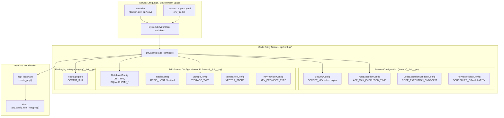
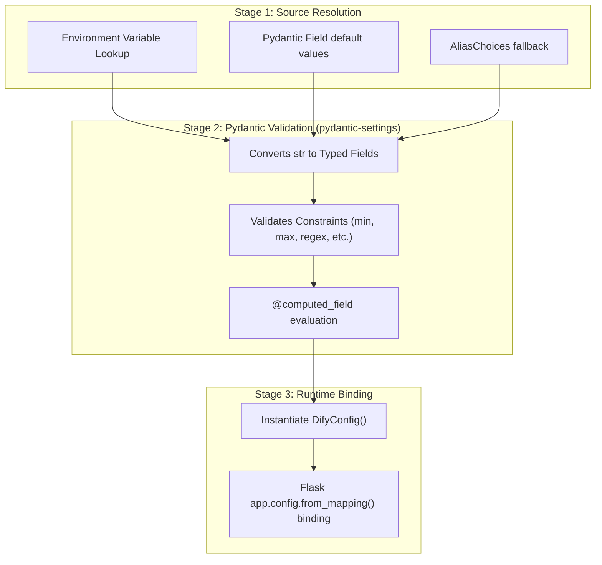
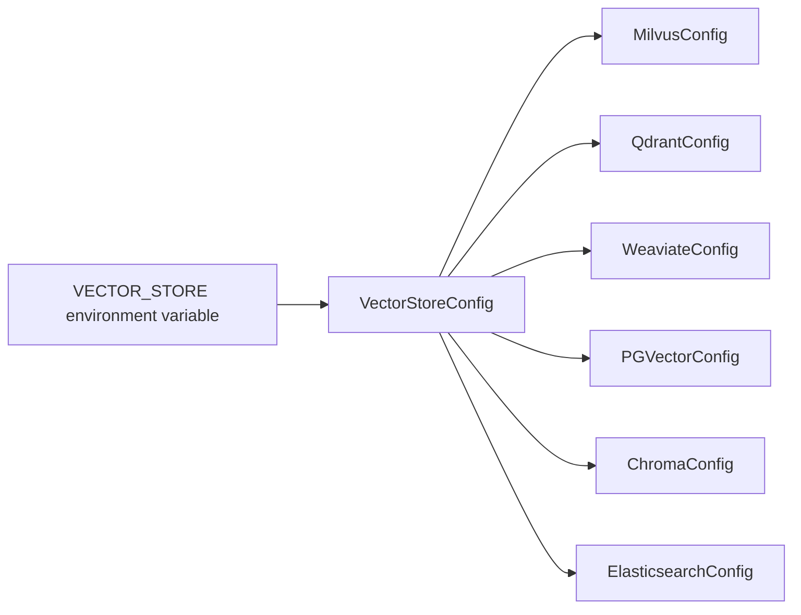

<!-- source: DeepWiki mcp.deepwiki.com · repo langgenius/dify · page 2.4 Configuration Management System · fetched 2026-10-26 -->

# Configuration Management System

<details>
<summary>Relevant source files</summary>

The following files were used as context for generating this wiki page:

- [api/.env.example](api/.env.example)
- [api/configs/feature/__init__.py](api/configs/feature/__init__.py)
- [api/configs/middleware/__init__.py](api/configs/middleware/__init__.py)
- [api/configs/middleware/cache/redis_config.py](api/configs/middleware/cache/redis_config.py)
- [api/configs/middleware/cache/redis_pubsub_config.py](api/configs/middleware/cache/redis_pubsub_config.py)
- [api/configs/middleware/vdb/weaviate_config.py](api/configs/middleware/vdb/weaviate_config.py)
- [api/configs/packaging/__init__.py](api/configs/packaging/__init__.py)
- [api/core/rag/datasource/vdb/vector_factory.py](api/core/rag/datasource/vdb/vector_factory.py)
- [api/core/rag/datasource/vdb/vector_type.py](api/core/rag/datasource/vdb/vector_type.py)
- [api/extensions/ext_app_metrics.py](api/extensions/ext_app_metrics.py)
- [api/extensions/ext_celery.py](api/extensions/ext_celery.py)
- [api/extensions/ext_database.py](api/extensions/ext_database.py)
- [api/extensions/ext_import_modules.py](api/extensions/ext_import_modules.py)
- [api/extensions/ext_redis.py](api/extensions/ext_redis.py)
- [api/extensions/ext_sentry.py](api/extensions/ext_sentry.py)
- [api/libs/broadcast_channel/channel.py](api/libs/broadcast_channel/channel.py)
- [api/libs/broadcast_channel/redis/__init__.py](api/libs/broadcast_channel/redis/__init__.py)
- [api/libs/broadcast_channel/redis/_subscription.py](api/libs/broadcast_channel/redis/_subscription.py)
- [api/libs/broadcast_channel/redis/pubsub_channel.py](api/libs/broadcast_channel/redis/pubsub_channel.py)
- [api/libs/broadcast_channel/redis/sharded_channel.py](api/libs/broadcast_channel/redis/sharded_channel.py)
- [api/libs/broadcast_channel/redis/streams_channel.py](api/libs/broadcast_channel/redis/streams_channel.py)
- [api/libs/broadcast_channel/signals.py](api/libs/broadcast_channel/signals.py)
- [api/migrations/README](api/migrations/README)
- [api/providers/vdb/vdb-weaviate/tests/unit_tests/test_weaviate_integration_header.py](api/providers/vdb/vdb-weaviate/tests/unit_tests/test_weaviate_integration_header.py)
- [api/pyproject.toml](api/pyproject.toml)
- [api/schedule/queue_monitor_task.py](api/schedule/queue_monitor_task.py)
- [api/tests/integration_tests/.env.example](api/tests/integration_tests/.env.example)
- [api/tests/test_containers_integration_tests/libs/broadcast_channel/redis/test_channel.py](api/tests/test_containers_integration_tests/libs/broadcast_channel/redis/test_channel.py)
- [api/tests/test_containers_integration_tests/libs/broadcast_channel/redis/test_sharded_channel.py](api/tests/test_containers_integration_tests/libs/broadcast_channel/redis/test_sharded_channel.py)
- [api/tests/test_containers_integration_tests/libs/broadcast_channel/redis/test_streams_channel.py](api/tests/test_containers_integration_tests/libs/broadcast_channel/redis/test_streams_channel.py)
- [api/tests/unit_tests/commands/test_data_migration_wizard.py](api/tests/unit_tests/commands/test_data_migration_wizard.py)
- [api/tests/unit_tests/configs/test_dify_config.py](api/tests/unit_tests/configs/test_dify_config.py)
- [api/tests/unit_tests/controllers/console/datasets/test_wraps.py](api/tests/unit_tests/controllers/console/datasets/test_wraps.py)
- [api/tests/unit_tests/controllers/console/workspace/test_load_balancing_config.py](api/tests/unit_tests/controllers/console/workspace/test_load_balancing_config.py)
- [api/tests/unit_tests/controllers/console/workspace/test_trigger_providers.py](api/tests/unit_tests/controllers/console/workspace/test_trigger_providers.py)
- [api/tests/unit_tests/core/rag/datasource/vdb/test_vector_factory.py](api/tests/unit_tests/core/rag/datasource/vdb/test_vector_factory.py)
- [api/tests/unit_tests/extensions/test_celery_ssl.py](api/tests/unit_tests/extensions/test_celery_ssl.py)
- [api/tests/unit_tests/extensions/test_ext_request_logging.py](api/tests/unit_tests/extensions/test_ext_request_logging.py)
- [api/tests/unit_tests/extensions/test_pubsub_channel.py](api/tests/unit_tests/extensions/test_pubsub_channel.py)
- [api/tests/unit_tests/extensions/test_redis.py](api/tests/unit_tests/extensions/test_redis.py)
- [api/tests/unit_tests/factories/test_variable_factory.py](api/tests/unit_tests/factories/test_variable_factory.py)
- [api/tests/unit_tests/libs/broadcast_channel/redis/test_channel_unit_tests.py](api/tests/unit_tests/libs/broadcast_channel/redis/test_channel_unit_tests.py)
- [api/tests/unit_tests/libs/broadcast_channel/redis/test_streams_channel_unit_tests.py](api/tests/unit_tests/libs/broadcast_channel/redis/test_streams_channel_unit_tests.py)
- [api/tests/unit_tests/libs/test_pyrefly_type_coverage.py](api/tests/unit_tests/libs/test_pyrefly_type_coverage.py)
- [api/tests/unit_tests/models/test_plugin_entities.py](api/tests/unit_tests/models/test_plugin_entities.py)
- [api/tests/unit_tests/services/test_app_generate_service_streaming_integration.py](api/tests/unit_tests/services/test_app_generate_service_streaming_integration.py)
- [api/tests/unit_tests/tasks/test_duplicate_document_indexing_task.py](api/tests/unit_tests/tasks/test_duplicate_document_indexing_task.py)
- [api/uv.lock](api/uv.lock)
- [docker/.env.example](docker/.env.example)
- [docker/docker-compose-template.yaml](docker/docker-compose-template.yaml)
- [docker/docker-compose.middleware.yaml](docker/docker-compose.middleware.yaml)
- [docker/docker-compose.yaml](docker/docker-compose.yaml)
- [docker/envs/core-services/shared.env.example](docker/envs/core-services/shared.env.example)
- [docker/envs/infrastructure/ssrf-proxy.env.example](docker/envs/infrastructure/ssrf-proxy.env.example)
- [docker/envs/middleware.env.example](docker/envs/middleware.env.example)
- [web/package.json](web/package.json)

</details>


This document provides an in-depth technical overview of the Configuration Management System in Dify. It covers the environment variable system, Pydantic-based settings management, and the configuration flow from `.env` files through Docker Compose down to application runtime components for both backend and frontend.

---

## Architecture Overview

Dify’s configuration system is designed to be type-safe, modular, and environment-aware. It utilizes Pydantic’s `BaseSettings` classes to define structured configurations, loading values primarily from environment variables, which themselves are populated via layered `.env` files and Docker Compose environment file definitions.

The following diagram illustrates the data flow, mapping between natural language / environment configuration sources and code entities that represent configuration classes, culminating in runtime initialization of the backend Flask application:



This layered configuration design enables backend services to maintain a unified, type-checked, validated, and extensible configuration model.

**Sources:**  
[api/configs/feature/__init__.py:1-101](),  
[api/configs/middleware/__init__.py:1-170](),  
[api/configs/packaging/__init__.py:1-14](),  
[docker/docker-compose.yaml:8-68](),  
[docker/docker-compose-template.yaml:2-62]()

---

## Backend Configuration Loading Process

### Three-Stage Configuration Loading with Pydantic

The backend uses Pydantic `BaseSettings` classes to manage configuration. When instantiated, the configuration undergoes the following stages:

1. **Source Resolution:** Environment variables are fetched according to the current environment; if absent, fallback values specified in the Pydantic fields (or aliases) are used.
2. **Validation:** Pydantic coerces simple types (e.g., from string env vars to typed integers, URLs, booleans), validates constraints (such as minimum values or string patterns), and evaluates computed fields (annotated with `@computed_field`).
3. **Binding to Runtime:** The final validated config instance is injected into service factories or Flask app configuration maps, effectively wiring settings into the application runtime.

Diagram illustrating this process:



**Sources:**  
[api/configs/feature/__init__.py:5-15](), [api/configs/feature/__init__.py:150-188](), [api/configs/packaging/__init__.py:6-14]()

---

### Docker Compose Environment File Hierarchy

The configuration layering in production is heavily driven by Docker Compose environment files. The Docker Compose YAML references multiple `.env` file paths in order, forming a layered precedence where variables defined later override earlier ones.

A typical environment file precedence as found in `docker/docker-compose.yaml`:

```yaml
env_file:
  - path: ./envs/core-services/shared.env
  - path: ./envs/core-services/api.env
  - path: ./envs/security.env
  - path: ./envs/databases/db-postgres.env
  - path: ./envs/databases/db-mysql.env
  - path: ./envs/databases/redis.env
  - path: ./envs/vectorstores/weaviate.env
  - path: ./envs/vectorstores/qdrant.env
  - path: ./envs/vectorstores/oceanbase.env
  - path: ./envs/vectorstores/seekdb.env
  - path: ./envs/vectorstores/couchbase.env
  - path: ./envs/vectorstores/pgvector.env
  - path: ./envs/vectorstores/vastbase.env
  - path: ./envs/vectorstores/pgvecto-rs.env
  - path: ./envs/vectorstores/chroma.env
  - path: ./envs/vectorstores/iris.env
  - path: ./envs/vectorstores/oracle.env
  - path: ./envs/vectorstores/opengauss.env
  - path: ./envs/vectorstores/myscale.env
  - path: ./envs/vectorstores/matrixone.env
  - path: ./envs/vectorstores/elasticsearch.env
  - path: ./envs/vectorstores/opensearch.env
  - path: ./envs/vectorstores/milvus.env
  - path: ./envs/infrastructure/nginx.env
  - path: ./envs/infrastructure/certbot.env
  - path: ./envs/infrastructure/ssrf-proxy.env
  - path: ./envs/infrastructure/etcd.env
  - path: ./envs/infrastructure/minio.env
  - path: ./envs/infrastructure/milvus-standalone.env
  - ./.env
```

The last file (`./.env`) usually has the highest precedence enabling overrides for local and environment-specific customizations.

This layered env file system ensures concerns are separated clearly and environment-specific settings can override defaults seamlessly.

**Sources:**  
[docker/docker-compose.yaml:8-68](), [docker/docker-compose-template.yaml:2-62]()

---

## Configuration Class Hierarchy

### Feature Configuration (`api/configs/feature/__init__.py`)

Feature configs define application-specific functional settings primarily related to security, application execution limits, code sandbox integration, and feature toggles.

| Class                   | Description                                      | Important Fields / Example Attributes                                  |
|-------------------------|------------------------------------------------|----------------------------------------------------------------------|
| `SecurityConfig`         | Security keys and token lifetimes               | `SECRET_KEY`, `PASSWORD_PEPPER`, `RESET_PASSWORD_TOKEN_EXPIRY_MINUTES` |
| `AppExecutionConfig`     | App runtime execution limits and concurrency    | `APP_MAX_EXECUTION_TIME`, `APP_MAX_ACTIVE_REQUESTS`                   |
| `CodeExecutionSandboxConfig`| Code sandbox endpoint and API key           | `CODE_EXECUTION_ENDPOINT`, `CODE_EXECUTION_API_KEY`                   |
| `AsyncWorkflowConfig`    | Async workflow scheduling granularity and limits| `SCHEDULER_GRANULARITY`                                               |

Example snippet from `AppExecutionConfig`:

```python
class AppExecutionConfig(BaseSettings):
    APP_MAX_EXECUTION_TIME: PositiveInt = Field(
        description="Maximum allowed execution time for the application in seconds",
        default=3600,
    )
    APP_DEFAULT_ACTIVE_REQUESTS: NonNegativeInt = Field(
        description="Default number of concurrent active requests per app (0 for unlimited)",
        default=0,
    )
    APP_MAX_ACTIVE_REQUESTS: NonNegativeInt = Field(
        description="Maximum number of concurrent active requests per app (0 for unlimited)",
        default=0,
    )
```

This module also contains validation and field metadata leveraged by Pydantic for type coercion and documentation.

**Sources:**  
[api/configs/feature/__init__.py:1-220]()

---

### Middleware Configuration (`api/configs/middleware/__init__.py`)

Middleware configs manage infrastructure service integration including database connections, caches (Redis), storage backends, and vector databases. They are critical for connecting the app runtime with required external services.

| Class                 | Description                               | Key Fields / Notes                                                  |
|-----------------------|-------------------------------------------|-------------------------------------------------------------------|
| `DatabaseConfig`       | Database connection configuration        | `DB_TYPE`, `DB_HOST`, `DB_PORT`, `DB_USERNAME`, `DB_PASSWORD`, `SQLALCHEMY_DATABASE_URI` (computed)|
| `RedisConfig`          | Redis setup including Sentinel and clusters | `REDIS_HOST`, `REDIS_SENTINELS`, `REDIS_PASSWORD`                |
| `StorageConfig`        | File storage backend                      | `STORAGE_TYPE` (e.g. `opendal`, `s3`, `aliyun-oss`, deprecated `local`) |
| `VectorStoreConfig`    | Vector database selection and config     | `VECTOR_STORE` (name string), whitelist flag                      |
| `KeyProviderConfig`    | Tenant credentials encryption provider   | `KEY_PROVIDER_TYPE` (e.g., `local`, `azure-keyvault`)             |

The `DatabaseConfig` class dynamically constructs the `SQLALCHEMY_DATABASE_URI` via a Pydantic computed field property, ensuring consistent URI formation based on component fields.

Example computed field snippet:

```python
@computed_field
@property
def SQLALCHEMY_DATABASE_URI(self) -> str:
    # Compose the database URI from type, user, password, host, port, and db name
    # Handles optional extras and supports PostgreSQL/MySQL/OceanBase
    ...
```

This class also supports connection pool parameters, session timezone overrides, and charset configurations allowing flexible database connectivity.

**Sources:**  
[api/configs/middleware/__init__.py:71-184](),  
[api/.env.example:51-111](),  
[docker/docker-compose.yaml:16-100]()

---

## Environment Variable Resolution Strategy

Dify uses a modular, layered `.env` file and environment variable strategy to configure services. Domain-specific `.env` files (e.g. for databases, Redis, vector stores) are listed explicitly in the docker-compose environment section for each service, making the configuration easily traceable and override-able.

For example, the `db_postgres` and `redis` service blocks in the middleware docker compose file include:

```yaml
services:
  db_postgres:
    env_file:
      - ./middleware.env
    environment:
      POSTGRES_PASSWORD: ${DB_PASSWORD:-difyai123456}
      POSTGRES_DB: ${DB_DATABASE:-dify}
    command: >
      postgres -c 'max_connections=${POSTGRES_MAX_CONNECTIONS:-100}'
               -c 'shared_buffers=${POSTGRES_SHARED_BUFFERS:-128MB}'
               -c 'work_mem=${POSTGRES_WORK_MEM:-4MB}'
               -c 'maintenance_work_mem=${POSTGRES_MAINTENANCE_WORK_MEM:-64MB}'
               -c 'effective_cache_size=${POSTGRES_EFFECTIVE_CACHE_SIZE:-4096MB}'
               -c 'statement_timeout=${POSTGRES_STATEMENT_TIMEOUT:-0}'
               -c 'idle_in_transaction_session_timeout=${POSTGRES_IDLE_IN_TRANSACTION_SESSION_TIMEOUT:-0}'

  redis:
    env_file:
      - ./middleware.env
    environment:
      REDISCLI_AUTH: ${REDIS_PASSWORD:-difyai123456}
    command: redis-server --requirepass ${REDIS_PASSWORD:-difyai123456}
```

By default, core variables like `DB_PASSWORD`, `DB_DATABASE`, and `REDIS_PASSWORD` have sensible defaults but can be overridden by `.env` or environment to provide secure, environment-specific settings.

**Sources:**  
[docker/docker-compose.middleware.yaml:11-22](),  
[docker/docker-compose.middleware.yaml:87-96](),  
[docker/.env.example:51-117]()

---

## Type Safety and Validation

Dify leverages Pydantic’s type system to enforce strong typing and runtime validation for config parameters:

- **Constrained types:** e.g., `PositiveInt`, `NonNegativeInt`, `PositiveFloat` ensure numeric values fall within expected ranges.
- **URL validation:** e.g., `HttpUrl` type enforces valid URLs for external service endpoints (e.g. code sandbox URL).
- **Computed fields:** Complex computed properties combine multiple fields coherently, e.g., the SQLAlchemy DB URI combining DB user, password, and host components.

Example fragment showing a computed DB URI property in `DatabaseConfig`:

```python
@computed_field
@property
def SQLALCHEMY_DATABASE_URI(self) -> str:
    userpass = f"{self.DB_USERNAME}:{self.DB_PASSWORD}@" if self.DB_USERNAME or self.DB_PASSWORD else ""
    query = f"?{self.DB_EXTRAS}" if self.DB_EXTRAS else ""
    if self.DB_TYPE == "postgresql":
        return f"postgresql://{userpass}{self.DB_HOST}:{self.DB_PORT}/{self.DB_DATABASE}{query}"
    # similarly for MySQL, OceanBase ...
```

Validation errors at instantiation-time alert developers to incorrect or missing runtime configuration, improving reliability.

**Sources:**  
[api/configs/feature/__init__.py:104-196](),  
[api/configs/middleware/__init__.py:140-184]()

---

## Storage and Vector Database Configuration

### Storage Backend Selection

Storage backend choice is controlled by the `STORAGE_TYPE` environment variable and represented by `StorageConfig`. Options include:

- `opendal` (default, Apache OpenDAL abstraction)
- `s3` (Amazon S3)
- `aliyun-oss` (Alibaba Cloud)
- `azure-blob` (Azure Blob Storage)
- `google-storage` (Google Cloud Storage)
- Plus others such as `baidu-obs`, `huawei-obs`, `oci-storage`, `tencent-cos`, `volcengine-tos`, `supabase`
- Deprecated: `local` (local filesystem storage)

This modular approach allows easy switching of the storage backend to fit hosting environments or compliance needs.

### Vector Store Selection

Vector similarity search storage is configured by the `VECTOR_STORE` environment variable bound in `VectorStoreConfig`. Supported vector databases include:

- `weaviate`  
- `qdrant`  
- `milvus`  
- `pgvector`  
- `chroma`  
- `elasticsearch`  
- Many others via the included vendor-specific configs (e.g. `MilvusConfig`, `QdrantConfig`, `WeaviateConfig`).

The dependency between the vector store selection variable and specific configuration schemas can be visualized as:



This layering supports flexible backend choice and extensibility for vector search infrastructure.

**Sources:**  
[api/configs/middleware/__init__.py:103-120](),  
[api/configs/middleware/__init__.py:23-52](),  
[docker/.env.example:158-162]()

---

## Frontend Configuration System

The web frontend (Next.js-based) exposes configuration via environment variables prefixed with `NEXT_PUBLIC_`, which are statically injected during build time.

### Frontend Environment Variables

Commonly seen frontend environment variables:

- `CONSOLE_API_URL` — Base URL for Console API  
- `APP_API_URL` — Base API URL for the web application's backend  
- `NEXT_PUBLIC_SOCKET_URL` — WebSocket URL for live event streams  
- Feature toggles such as `NEXT_PUBLIC_ENABLE_AGENT_V2` (enabling Agent V2 UI features)

These variables are typically propagated from backend environment variables via Docker Compose or `.env` files into the frontend environment at build time to control UI behavior and integration endpoints.

Snippet example from `docker/.env.example`:

```bash
CONSOLE_API_URL=http://localhost:5001
APP_API_URL=http://localhost:5001
NEXT_PUBLIC_SOCKET_URL=ws://localhost
NEXT_PUBLIC_ENABLE_AGENT_V2=true
```

This scheme ensures separation of runtime config for backend services and the frontend React app, while aligning environment specifics and feature flags coherently.

**Sources:**  
[web/package.json:12-37](),  
[docker/.env.example:15-26]()

---

# Summary

The Dify Configuration Management System combines Pydantic-based settings classes, layered `.env` file loading, Docker Compose environment injection, and runtime validation to build a unified, type-safe, and extensible configuration environment. It supports backend infrastructure, security credentials, feature toggles, storage and vector database backends, as well as frontend environment variables for the UI.

This design balances flexibility for multi-environment deployment with strict validation guarantees, enabling stable and clear configuration management in both local development and production.

---

**Complete File Source References:**  
- [api/configs/feature/__init__.py:1-220]()  
- [api/configs/middleware/__init__.py:1-184]()  
- [api/configs/packaging/__init__.py:1-14]()  
- [docker/docker-compose.yaml:1-70]()  
- [docker/docker-compose-template.yaml:1-62]()  
- [docker/docker-compose.middleware.yaml:1-110]()  
- [docker/.env.example:1-214]()  
- [web/package.json:1-37]()

---

