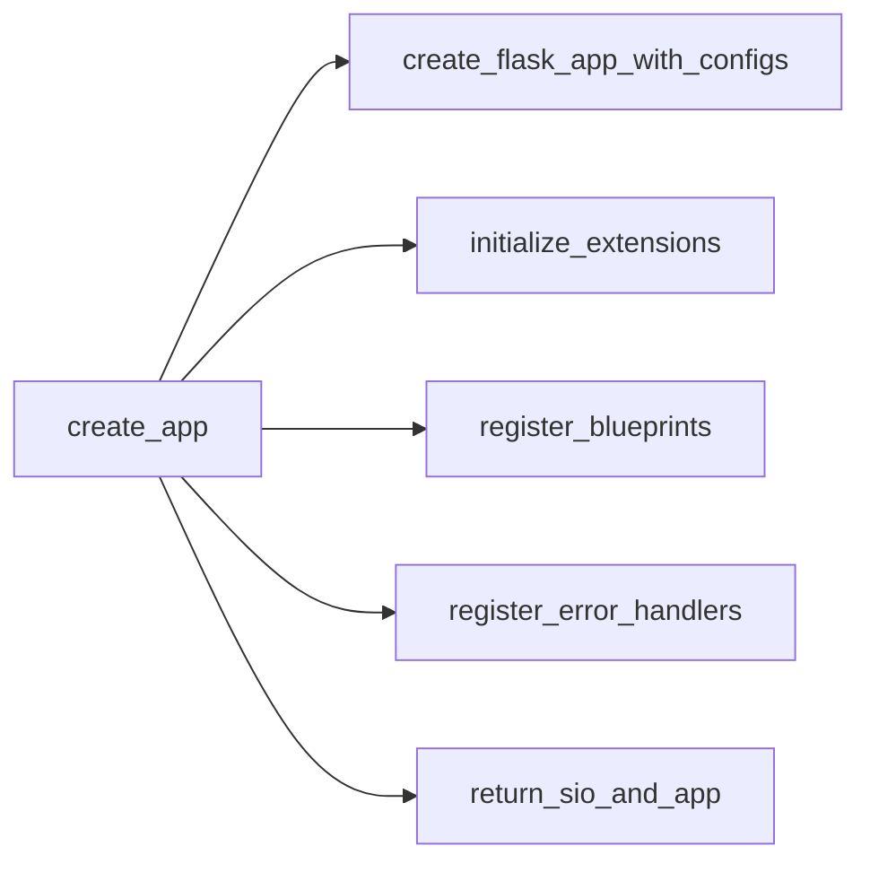
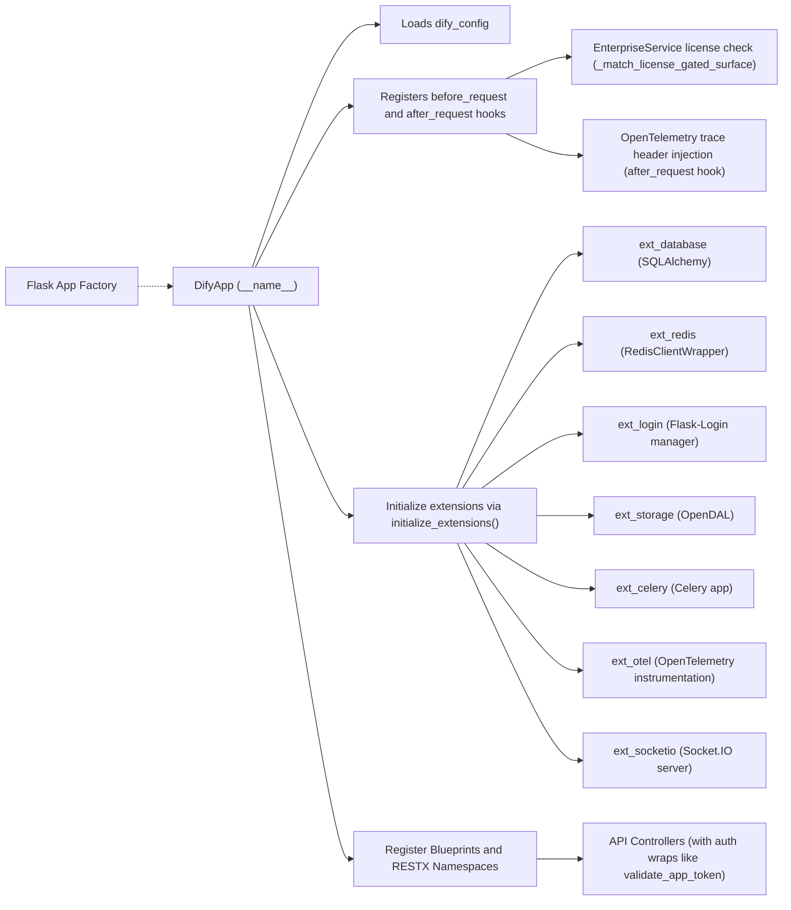

<!-- source: DeepWiki mcp.deepwiki.com · repo langgenius/dify · page 2.5 Flask App Factory, Extensions and Request Lifecycle · fetched 2026-10-26 -->

# Flask App Factory, Extensions and Request Lifecycle

<details>
<summary>Relevant source files</summary>

The following files were used as context for generating this wiki page:

- [.coveragerc](.coveragerc)
- [api/.importlinter](api/.importlinter)
- [api/app.py](api/app.py)
- [api/app_factory.py](api/app_factory.py)
- [api/celery_entrypoint.py](api/celery_entrypoint.py)
- [api/configs/observability/__init__.py](api/configs/observability/__init__.py)
- [api/configs/observability/otel/otel_config.py](api/configs/observability/otel/otel_config.py)
- [api/controllers/console/app/wraps.py](api/controllers/console/app/wraps.py)
- [api/controllers/console/flask_admission.py](api/controllers/console/flask_admission.py)
- [api/controllers/console/wraps.py](api/controllers/console/wraps.py)
- [api/controllers/service_api/wraps.py](api/controllers/service_api/wraps.py)
- [api/core/schemas/registry.py](api/core/schemas/registry.py)
- [api/extensions/ext_application_services.py](api/extensions/ext_application_services.py)
- [api/extensions/ext_blueprints.py](api/extensions/ext_blueprints.py)
- [api/extensions/ext_login.py](api/extensions/ext_login.py)
- [api/extensions/ext_otel.py](api/extensions/ext_otel.py)
- [api/gunicorn.conf.py](api/gunicorn.conf.py)
- [api/libs/external_api.py](api/libs/external_api.py)
- [api/libs/login.py](api/libs/login.py)
- [api/libs/token.py](api/libs/token.py)
- [api/machinery/__init__.py](api/machinery/__init__.py)
- [api/machinery/context.py](api/machinery/context.py)
- [api/machinery/errors.py](api/machinery/errors.py)
- [api/services/account_errors.py](api/services/account_errors.py)
- [api/services/account_ports.py](api/services/account_ports.py)
- [api/services/entities/account_entities.py](api/services/entities/account_entities.py)
- [api/tests/integration_tests/conftest.py](api/tests/integration_tests/conftest.py)
- [api/tests/unit_tests/.ruff.toml](api/tests/unit_tests/.ruff.toml)
- [api/tests/unit_tests/controllers/console/app/test_app_apis.py](api/tests/unit_tests/controllers/console/app/test_app_apis.py)
- [api/tests/unit_tests/controllers/console/app/test_conversation_api.py](api/tests/unit_tests/controllers/console/app/test_conversation_api.py)
- [api/tests/unit_tests/controllers/console/app/test_wraps.py](api/tests/unit_tests/controllers/console/app/test_wraps.py)
- [api/tests/unit_tests/controllers/console/test_wraps.py](api/tests/unit_tests/controllers/console/test_wraps.py)
- [api/tests/unit_tests/core/prompt/test_agent_history_prompt_transform.py](api/tests/unit_tests/core/prompt/test_agent_history_prompt_transform.py)
- [api/tests/unit_tests/core/prompt/test_prompt_message.py](api/tests/unit_tests/core/prompt/test_prompt_message.py)
- [api/tests/unit_tests/core/prompt/test_prompt_transform.py](api/tests/unit_tests/core/prompt/test_prompt_transform.py)
- [api/tests/unit_tests/core/prompt/test_simple_prompt_transform.py](api/tests/unit_tests/core/prompt/test_simple_prompt_transform.py)
- [api/tests/unit_tests/extensions/test_ext_application_services.py](api/tests/unit_tests/extensions/test_ext_application_services.py)
- [api/tests/unit_tests/extensions/test_ext_login.py](api/tests/unit_tests/extensions/test_ext_login.py)
- [api/tests/unit_tests/libs/test_login.py](api/tests/unit_tests/libs/test_login.py)
- [api/tests/unit_tests/libs/test_token.py](api/tests/unit_tests/libs/test_token.py)
- [api/tests/unit_tests/pyrefly.toml](api/tests/unit_tests/pyrefly.toml)
- [api/tests/unit_tests/services/test_feature_service_education.py](api/tests/unit_tests/services/test_feature_service_education.py)
- [api/tests/unit_tests/test_app_factory.py](api/tests/unit_tests/test_app_factory.py)

</details>


This page details the implementation of the Flask application factory in the Dify backend, focusing on how it wires the various extensions such as database, Redis, login, storage, Celery, and OpenTelemetry (OTel). It also explains blueprint registration and how the request lifecycle is managed, including authentication wrappers and error handling. Understanding these core integrations is crucial for grasping how Dify initializes, manages state, and ensures security and observability throughout request processing.

---

## 1. Purpose and Scope

The Flask application factory centralizes configuration and setup of key components needed for the API to run efficiently and securely. This includes extension initialization, route grouping via blueprints, and request lifecycle hooks that enforce licensing, logging, error handling, and trace propagation. The `api/app_factory.py` module implements this with fine-grained control over startup, runtime behavior, and request pre/post processing.

---

## 2. Application Factory: `create_flask_app_with_configs`

### 2.1 Creating the Flask App Instance

- **Function:** `create_flask_app_with_configs()` creates an instance of `DifyApp`, a subclass of Flask tailored for the backend.
- **Configuration:**
  - Loads environment-based configuration via `dify_config`.
  - Sets Flask-RESTX configurations:
    - `RESTX_INCLUDE_ALL_MODELS` is enabled to include all models.
    - `RESTX_ERROR_404_HELP` is disabled to avoid disclosing URL map suggestions on 404 errors for security reasons.
- **Extensions:** The actual extension wiring occurs after the Flask app is created (in the `create_app` function discussed later).

### 2.2 Request Lifecycle Hooks

`create_flask_app_with_configs()` registers two key hooks on the Flask app:

#### 2.2.1 `before_request`

- Initializes logging context for request tracing (`init_request_context()`).
- Manages concurrency context recycling (`RecyclableContextVar.increment_thread_recycles()`).
- Enforces **enterprise license gating** if the deployment edition is `ENTERPRISE`:
  - Checks if the request path matches any license-gated surface, based on URL prefixes.
  - Queries cached license status from `EnterpriseService.get_cached_license_status()`.
  - If the license status is invalid (`INACTIVE`, `EXPIRED`, `LOST`), raises an HTTP exception that enforces user logout or denies the request depending on the endpoint type.
  - Some endpoints have exemptions, such as login, setup, activation, system features, workspace, and version checks in the console API.
  
This mechanism ensures that enterprise-licensed features cannot be accessed without a valid license, yet essential system endpoints remain available.

#### 2.2.2 `after_request`

- Injects OpenTelemetry trace headers, specifically `X-Trace-Id` and `X-Span-Id`, into the HTTP response headers if a valid OTEL span is active.
- This assists downstream telemetry correlation.
- The injection is exception-safe to never disrupt the response flow even if tracing fails.

### 2.3 Important Constants for License Gating

- `_CONSOLE_EXEMPT_PREFIXES`: Console API endpoints exempt from license gating (e.g., `/console/api/login`, `/console/api/setup`).
- `_WEBAPP_EXEMPT_PREFIXES`: Web API endpoints exempted similarly.
- `_LICENSE_GATED_SURFACES`: A tuple of `_LicenseGatedSurface` namedtuples describing URL prefix, exemption prefixes, and factory functions for building appropriate HTTP exceptions on license failure.

The helper function `_match_license_gated_surface(request.path)` identifies if a request should be license-gated, returning gating metadata or `None` if exempt.

```mermaid
flowchart TD
  subgraph LicenseGating
    A["Request path"] --> B{Match license-gated surface?}
    B -- Yes --> C{In exemption prefixes?}
    C -- Yes --> D[Allow request]
    C -- No --> E[Check license status]
    E --> F{License OK?}
    F -- Yes --> D
    F -- No --> G[Raise HTTPException (logout or forbidden)]
  end
```

---

## 3. Main App Factory Entry: `create_app`

- Entry function `create_app()` creates the application for WSGI/ASGI servers.
- Steps inside `create_app()`:
  1. Calls `create_flask_app_with_configs()` to create the Flask app instance configured with environment variables and lifecycle hooks.
  2. Calls `initialize_extensions(app)` to initialize all the Flask extensions (database, redis, login manager, storage, Celery, OpenTelemetry, Socket.IO).
  3. Assigns `app` to the Socket.IO server instance (`sio.app`) for real-time websocket handling.
  4. Registers all Flask Blueprints and namespaces associated with RESTX APIs.
  5. Registers error handlers for unified error response handling.
  6. Returns a tuple `(socketio.WSGIApp, DifyApp)` combining HTTP and websocket serving capabilities.



---

## 4. Extension Initialization: `initialize_extensions`

This function is responsible for wiring all key Flask and third-party extensions for the app instance:

- **Database (`ext_database`)**: Initializes SQLAlchemy database ORM with connection handling.
- **Redis (`ext_redis`)**: Initializes Redis client wrapper for caching, state sharing, and task queue support.
- **Login Manager (`ext_login`)**: Sets up Flask-Login with custom user loading, session management, and unauthorized response handling.
- **Storage (`ext_storage`)**: Sets up OpenDAL based file storage abstraction supporting various backends (S3, OSS, Azure, local).
- **Celery (`ext_celery`)**: Initializes asynchronous task queueing via Celery.
- **OpenTelemetry (`ext_otel`)**: Attaches instrumentation for distributed tracing of HTTP requests and database operations.
- **Socket.IO (`ext_socketio`)**: Sets up Socket.IO server for websocket-based real-time communication.

All these extensions are imported from `api/extensions/*` modules. Each extension exposes an `init_app` method that is called with the Flask app, binding the service to the app's lifecycle.

---

## 5. Blueprint Registration and API Namespace Wiring

- The app factory registers multiple Flask Blueprints:
  - Console admin APIs
  - Service APIs
  - Inner APIs
  - OpenAPI docs and health checks
- Flask-RESTX namespaces are registered to support modular API groups with shared authentication and request handling logic.
- This structure enables separation of concerns and fine-grained control of route grouping, versioning, and middleware application.

---

## 6. Request Lifecycle: Authentication Wrappers and Error Handling

### 6.1 License Enforcement Per Request

- The `before_request()` hook in the app factory enforces license gating.
- Depending on URL, the license gating behaves differently:
  - Console and Web APIs enforce logout via raising `UnauthorizedAndForceLogout`.
  - Bearer token APIs respond with HTTP 403 Forbidden or 503 Service Unavailable to avoid leaking license states.
- This nuanced approach balances security with operational robustness.

### 6.2 Error Types and Handling

- Special exception `UnauthorizedAndForceLogout` is used for UI session logout on license failure.
- Other exceptions like `Forbidden` and `ServiceUnavailable` are used depending on API surface to communicate denial or retry signals.
- Flask error handlers serialize these exceptions into JSON error responses to clients uniformly.

### 6.3 Auth Wrappers (Cross-reference)

- Authentication and authorization decorators such as `validate_app_token` in `controllers/service_api/wraps.py` validate app API tokens and end-user identities.
- These work in complement to app-level license controls and enable per-request security context enrichment.

---

## 7. Data Flow Overview

The application factory coordinates several components involved during startup and request processing:

```mermaid
flowchart TD
    subgraph Init
      A1[Load Configs] --> A2[Create Flask App (DifyApp)]
      A2 --> A3[Initialize Extensions (DB, Redis, Login, Storage, Celery, OTEL, SocketIO)]
      A3 --> A4[Register Blueprints / RESTX Namespaces]
      A4 --> A5[Register Error Handlers]
    end

    subgraph Request
      R1[Incoming HTTP Request] --> R2[before_request hook (context init, license gating)]
      R2 --> R3[Route to Controller via Blueprints]
      R3 --> R4[Controller Authentication Wrappers (e.g. validate_app_token)]
      R4 --> R5[Use Extensions (DB, Redis, Celery, Storage, OTEL)]
      R5 --> R6[Generate HTTP Response]
      R6 --> R7[after_request hook (trace header injection)]
      R7 --> R8[Send Response to Client]
    end
```

---

## 8. Key Classes and Functions Summary

| Name                             | Location                        | Role                                                                                              |
|----------------------------------|--------------------------------|--------------------------------------------------------------------------------------------------|
| `create_flask_app_with_configs()`| `api/app_factory.py:100-158`   | Creates Flask app, configures before/after request hooks, loads environment-based configurations. |
| `create_app()`                   | `api/app_factory.py:161-270`   | Main entrypoint creating app, initializing extensions, registering blueprints, returning WSGI app.|
| `_match_license_gated_surface()` | `api/app_factory.py:87-94`     | Finds if a request path should be license gated and returns gating info.                          |
| `_LicenseGatedSurface`           | `api/app_factory.py:70-73`     | Defines license gated URL prefix, exempt endpoints, and error builders as a NamedTuple.          |
| `initialize_extensions(app)`    | `api/app_factory.py` (inside `create_app()`) | Initializes database, Redis, login, storage, Celery, OTel, SocketIO extensions on Flask app.     |
| `UnauthorizedAndForceLogout`     | `controllers/console/error.py` | Exception to force frontend logout on license failure.                                           |
| `validate_app_token`             | `controllers/service_api/wraps.py` | Decorator enforcing API token validation and request context user setup.                         |

---

## 9. Natural Language to Code Entity Mapping (Diagram 1)

Mapping the conceptual system components to their code implementations in `api/app_factory.py` and related extension modules:



---

## 10. Natural Language to Code Entity Mapping (Diagram 2)

Detailed license gating logic for incoming HTTP requests based on URL prefix and deployment edition:

```mermaid
graph TD
    RequestIn["Incoming HTTP Request (request.path)"]
    
    RequestIn -->|Starts with "/console/api/"| ConsoleAPI["Console API license gating"]
    RequestIn -->|Starts with "/api/"| WebAPI["Web API license gating"]
    RequestIn -->|Starts with "/v1" or "/mcp"| BearerAPI["Bearer token API license gating"]
    RequestIn -->|Starts with "/triggers"| RetryableAPI["Retryable license gating (webhook)"]
    RequestIn --> Others["No license gating"]
    
    subgraph ConsoleGating
      ConsoleAPI --> CheckConsoleExempt["Check exemption prefixes (_CONSOLE_EXEMPT_PREFIXES)"]
      CheckConsoleExempt -- exempt --> ConsoleAllow["Allow request"]
      CheckConsoleExempt -- not exempt --> ConsoleLicenseCheck["Check license status via EnterpriseService"]
      ConsoleLicenseCheck -- valid --> ConsoleAllow
      ConsoleLicenseCheck -- invalid --> ConsoleDeny["Raise UnauthorizedAndForceLogout (401)"]
    end

    subgraph WebAPIGating
      WebAPI --> CheckWebExempt["Check exemption prefixes (_WEBAPP_EXEMPT_PREFIXES)"]
      CheckWebExempt -- exempt --> WebAllow["Allow request"]
      CheckWebExempt -- not exempt --> WebLicenseCheck["Check license status"]
      WebLicenseCheck -- valid --> WebAllow
      WebLicenseCheck -- invalid --> WebDeny["Raise UnauthorizedAndForceLogout (401)"]
    end

    subgraph BearerGating
      BearerAPI --> BearerLicenseCheck["Check license status"]
      BearerLicenseCheck -- valid --> BearerAllow["Allow request"]
      BearerLicenseCheck -- invalid --> BearerDeny["Raise Forbidden (403)"]
    end

    subgraph RetryableGating
      RetryableAPI --> RetryLicenseCheck["Check license status"]
      RetryLicenseCheck -- valid --> RetryAllow["Allow request"]
      RetryLicenseCheck -- invalid --> RetryDeny["Raise ServiceUnavailable (503)"]
    end

    Others --> AllowAll["Allow request without license gating"]
```

---

## Summary

- The Flask app factory in Dify (`api/app_factory.py`) bootstraps the application with configuration, extensions, middleware, blueprints, and error handlers.
- It enforces enterprise license gating carefully depending on API surface and endpoint definition.
- Extensions like database, redis, login, Celery, storage, and OpenTelemetry are initialized cleanly and bound to the Flask app lifecycle.
- Request lifecycle hooks manage logging context, license validation, and trace header propagation.
- Blueprint registration organizes the API into modular namespaces.
- Authentication wrappers complement app-level licensing by validating API tokens and injecting security context.
- This factory design ensures consistent, secure, and observable backend API processing.

---

### Sources

- `api/app_factory.py:1-166`  
- `api/controllers/service_api/wraps.py:1-175`  
- `api/extensions/ext_application_services.py` (referenced for extension wiring)  
- `api/controllers/console/error.py` (for `UnauthorizedAndForceLogout`)  
- `api/extensions/ext_otel.py` (for OpenTelemetry instrumentation)

---

