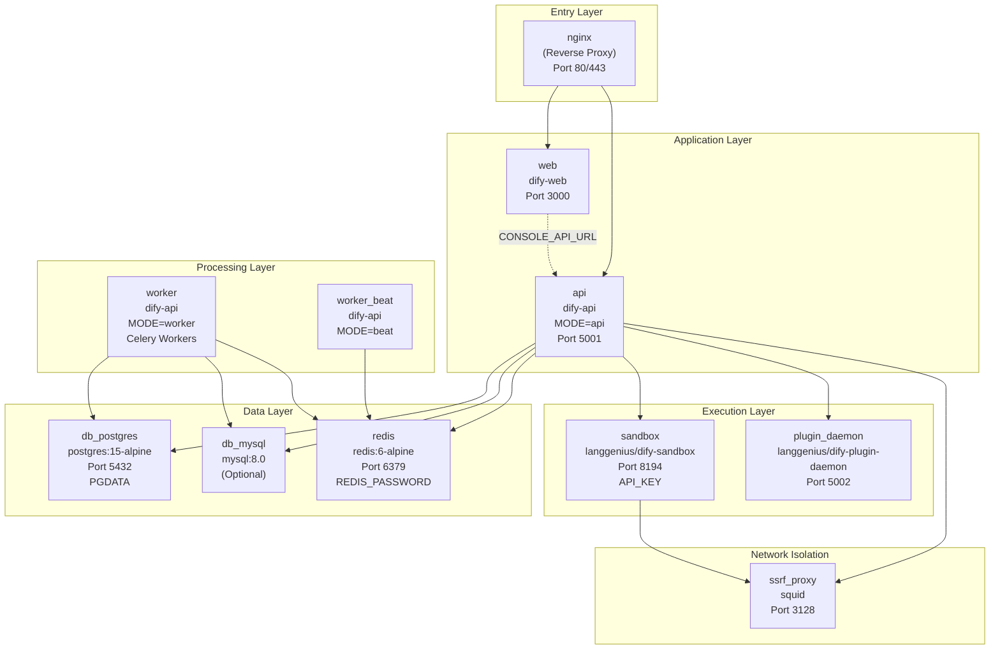
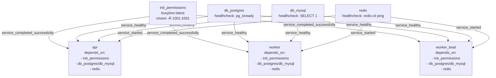
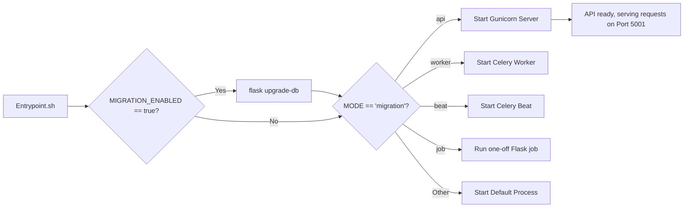
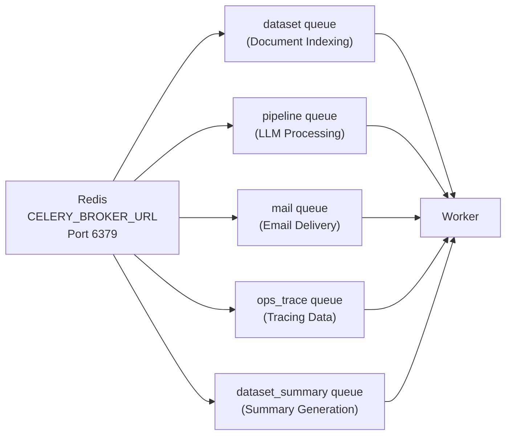
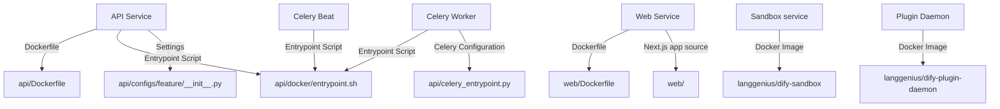
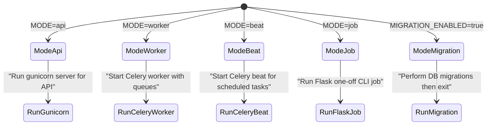

<!-- source: DeepWiki mcp.deepwiki.com · repo langgenius/dify · page 3 Deployment and Operations · fetched 2026-10-26 -->

# Deployment and Operations

<details>
<summary>Relevant source files</summary>

The following files were used as context for generating this wiki page:

- [.devcontainer/devcontainer.json](.devcontainer/devcontainer.json)
- [.devcontainer/post_create_command.sh](.devcontainer/post_create_command.sh)
- [.github/workflows/build-push.yml](.github/workflows/build-push.yml)
- [.github/workflows/docker-build.yml](.github/workflows/docker-build.yml)
- [.gitignore](.gitignore)
- [.vscode/launch.json.template](.vscode/launch.json.template)
- [api/Dockerfile](api/Dockerfile)
- [api/Dockerfile.dockerignore](api/Dockerfile.dockerignore)
- [api/README.md](api/README.md)
- [api/docker/entrypoint.sh](api/docker/entrypoint.sh)
- [api/providers/vdb/vdb-alibabacloud-mysql/src/dify_vdb_alibabacloud_mysql/alibabacloud_mysql_vector.py](api/providers/vdb/vdb-alibabacloud-mysql/src/dify_vdb_alibabacloud_mysql/alibabacloud_mysql_vector.py)
- [api/providers/vdb/vdb-hologres/src/dify_vdb_hologres/hologres_vector.py](api/providers/vdb/vdb-hologres/src/dify_vdb_hologres/hologres_vector.py)
- [api/providers/vdb/vdb-matrixone/src/dify_vdb_matrixone/matrixone_vector.py](api/providers/vdb/vdb-matrixone/src/dify_vdb_matrixone/matrixone_vector.py)
- [api/providers/vdb/vdb-matrixone/tests/unit_tests/test_matrixone_vector.py](api/providers/vdb/vdb-matrixone/tests/unit_tests/test_matrixone_vector.py)
- [api/providers/vdb/vdb-opengauss/src/dify_vdb_opengauss/opengauss.py](api/providers/vdb/vdb-opengauss/src/dify_vdb_opengauss/opengauss.py)
- [api/providers/vdb/vdb-oracle/src/dify_vdb_oracle/oraclevector.py](api/providers/vdb/vdb-oracle/src/dify_vdb_oracle/oraclevector.py)
- [dev/start-web](dev/start-web)
- [dev/start-worker](dev/start-worker)
- [web/Dockerfile](web/Dockerfile)
- [web/Dockerfile.dockerignore](web/Dockerfile.dockerignore)

</details>


This document provides an overview of deployment strategies and operational considerations for the Dify platform. It covers the service architecture, deployment methods, configuration management, runtime modes, and volume management necessary to deploy and operate Dify in production environments.

For detailed information on specific topics:  
- [Docker Build Process and Multi-Stage Images](#3.1) — Multi-stage Dockerfile architecture, build optimization, and image creation for API and Web services.  
- [Environment Configuration and Runtime Modes](#3.2) — Container entrypoint logic, `MODE` environment variable, and different runtime configurations (api, worker, beat, job).  
- [Storage Backends and Vector Database Configuration](#3.3) — OpenDAL storage abstraction, S3/OSS/Azure configuration, and vector database options (23+ implementations).  
- [Background Task Processing with Celery](#3.4) — Celery worker configuration, queue topology, task scheduling with Beat, and async processing patterns.  
- [Cross-Environment Migration and Import/Export Tooling](#3.5) — How app/workflow DSL export/import works across environments, including migration wizards and dependency packaging for tools/plugins.  
- [Data Retention, Cleanup and Log Archival](#3.6) — Retention services for conversations and workflow runs, free-plan expired log cleanup, message cleaning, and archival/restore paths.

For development environment setup, see [Development Environment Setup](#11.1). For system architecture details, see [System Architecture Overview](#2).

---

## Deployment Architecture

The Dify platform consists of multiple containerized services orchestrated via Docker Compose or Kubernetes. The architecture separates concerns into distinct service layers: presentation (web), application (api), background processing (worker/beat), execution isolation (sandbox), and data persistence (databases).

### Service Topology



Sources: [api/Dockerfile:1-123](), [web/Dockerfile:1-89](), [docker/docker-compose.middleware.yaml:1-130]()

**Service Dependencies and Startup Order**



Sources: [docker/docker-compose.middleware.yaml:10-80](), [docker/docker-compose-template.yaml:200-220]()

---

## Deployment Methods

### Docker Compose Deployment

Docker Compose is the recommended method for development, testing, and small-scale production deployments. Pre-configured compose files orchestrate all necessary services including API, Web, worker, databases, Redis, sandbox, and plugin daemon.

**Key Files**:

- `docker/docker-compose.yaml` — main compose file (auto-generated)  
- `docker/docker-compose.middleware.yaml` — focused middleware and core services stack  
- `.env` files for environment variable customization  

**Deployment Steps**:

1. **Configure Environment**: Copy and customize environment files e.g. `.env` file with secrets and ports.  
2. **Select Database**: Choose database profile (PostgreSQL default or MySQL alternative).  
3. **Launch Services**: Start the full stack with docker compose for the chosen profile.  

```bash
cp docker/.env.example docker/.env
docker compose --profile postgresql up -d
```

**Service Profiles**:

| Profile       | Services                                                                                         | Use Case                       |
|---------------|------------------------------------------------------------------------------------------------|-------------------------------|
| `postgresql`  | `db_postgres`, `api`, `worker`, `worker_beat`, `web`, `redis`, `sandbox`, `plugin_daemon`      | Default production setup       |
| `mysql`       | `db_mysql`, `api`, `worker`, `worker_beat`, `web`, `redis`, `sandbox`, `plugin_daemon`         | MySQL-based deployment         |

Sources: [docker/docker-compose.middleware.yaml:5-80](), [docker/.env.example:1-110]()

---

## Service Components

### API Service (`api`)

The API service is the main application server, serving both console and runtime APIs.

- **Image**: built from `api/Dockerfile` with Python 3.13-slim base  
- **Entrypoint Script**: Custom `entrypoint.sh` handles migration, mode dispatch, and starts Gunicorn or Celery [api/docker/entrypoint.sh]()  
- **Runtime Mode**: `MODE=api` runs Gunicorn server with gevent websocket workers  
- **Port**: 5001 by default, configurable  
- **Process Model**: Gunicorn with configurable worker count and worker class  

**Startup Logic Diagram** (from `entrypoint.sh`):



**Important Environment Variables**:

| Variable             | Default   | Description                              |
|----------------------|-----------|----------------------------------------|
| `MODE`               | `api`     | Selects container mode (`api`/`worker`/`beat`/`job`/`migration`) |
| `DIFY_PORT`          | `5001`    | Port the API listens on                 |
| `SERVER_WORKER_AMOUNT` | `1`     | Number of Gunicorn workers              |
| `SERVER_WORKER_CLASS` | `gevent` | Gunicorn worker class                   |
| `MIGRATION_ENABLED`  | `true`    | Auto-run DB migrations on startup      |

Sources: [api/docker/entrypoint.sh:1-135](), [api/Dockerfile:1-127](), [docker/.env.example:38-60]()

### Worker Service (`worker`)

The Worker service runs asynchronous background tasks using Celery.

- **Image**: Same as API image  
- **Runtime Mode**: `MODE=worker` runs Celery worker with queue and concurrency configurations  
- **Scaling**: Supports fixed concurrency or autoscaling mode with min/max workers  
- **Queue Configuration**: Uses multiple specialized queues for isolated task types  

**Queue Communication Diagram**:



**Worker Scaling Variables**:

| Variable             | Default   | Purpose                             |
|----------------------|-----------|-----------------------------------|
| `CELERY_WORKER_AMOUNT`| `4`       | Fixed number of workers            |
| `CELERY_AUTO_SCALE`   | `false`   | Enable autoscaling                 |
| `CELERY_MAX_WORKERS`  | (unset)   | Max workers in autoscaling         |
| `CELERY_MIN_WORKERS`  | (unset)   | Min workers in autoscaling         |

Sources: [api/docker/entrypoint.sh:20-70](), [docker/.env.example:65-80](), [dev/start-worker:1-126]()

### Worker Beat Service (`worker_beat`)

The Beat service runs scheduled recurring tasks via Celery Beat.

- **Image**: Same as API image  
- **Runtime Mode**: `MODE=beat`  
- **Connectivity**: Requires Redis connection; no DB queries or HTTP serving  
- **Instance Count**: Only one Beat instance should run per deployment to avoid duplicate scheduling  

Sources: [api/docker/entrypoint.sh:71-73](), [docker/docker-compose.middleware.yaml:290-292]()

### Web Service (`web`)

The Web service hosts the Next.js frontend application.

- **Image**: `dify-web` image built from `web/Dockerfile`  
- **Framework**: Next.js built with Node.js 24 (alpine base)  
- **Port**: 3000 by default, configurable  
- **Environment**: Injects backend URLs such as `CONSOLE_API_URL` and `APP_API_URL` as Next.js environment variables  

Sources: [web/Dockerfile:1-89](), [docker/docker-compose.middleware.yaml:292]()

### Sandbox Service (`sandbox`)

The Sandbox service performs isolated code execution for workflow `CodeNode` and tool executions.

- **Image**: `langgenius/dify-sandbox`  
- **Port**: 8194  
- **Authentication**: Uses `API_KEY` environment variable for secured API access  
- **Execution Controls**: Timeout and network enable/disable flags  
- **Security**: Limits and isolates execution environment for safety  

Sources: [docker/docker-compose.middleware.yaml:105-128](), [api/configs/feature/__init__.py:109-118]()

### Plugin Daemon Service (`plugin_daemon`)

Manages lifecycle and execution of plugins in isolated environments.

- **Image**: `langgenius/dify-plugin-daemon`  
- **Port**: 5002  
- **Database**: Uses main DB for plugin metadata persistence  

Sources: [docker/docker-compose.middleware.yaml:130-180]()

---

## Configuration Management

### Configuration Hierarchy

Dify uses Pydantic-based configuration models to compose the overall system configuration, enabling validation and runtime injection.

Some key configuration classes include:  
- `SecurityConfig` for secrets, tokens, CSRF, and rate limiting  
- `AppExecutionConfig` for timeout and concurrency limits  
- `CodeExecutionSandboxConfig` for sandbox connection parameters and resource limits  

(Refer to `api/configs/feature/__init__.py` for details.)

### Important Configuration Variables

**Security & Secrets**:

```bash
SECRET_KEY=<generated_random_key>  # For session and token encryption
```

**Database Connection**:

```bash
DB_TYPE=postgresql
DB_USERNAME=postgres
DB_PASSWORD=difyai123456
DB_HOST=db_postgres
DB_PORT=5432
```

**Redis Connection**:

```bash
REDIS_HOST=redis
REDIS_PORT=6379
REDIS_PASSWORD=difyai123456
```

**Celery Worker Config**:

```bash
CELERY_WORKER_AMOUNT=4
CELERY_AUTO_SCALE=false
CELERY_QUEUES=dataset,dataset_summary,workflow,...
```

**API Runtime Config**:

```bash
MODE=api               # api, worker, beat, job, migration
DIFY_PORT=5001
SERVER_WORKER_AMOUNT=1
SERVER_WORKER_CLASS=gevent
MIGRATION_ENABLED=true
```

Sources: [docker/.env.example:1-110](), [api/configs/feature/__init__.py:1-210]()

---

## Volume and Data Persistence

Dify relies on Docker volumes for persistent data storage, including database files, application storage, and caches.

| Host Volume Path           | Container Path               | Service(s)        | Purpose                                      |
|---------------------------|-----------------------------|-------------------|----------------------------------------------|
| `./volumes/db/data`        | `/var/lib/postgresql/data`  | `db_postgres`     | PostgreSQL persistent data                   |
| `./volumes/app/storage`    | `/app/api/storage`           | `api`, `worker`   | User files and uploaded content              |
| `./volumes/redis/data`     | Redis data volume            | `redis`           | Redis persistence (if configured)            |
| `./volumes/plugin_daemon`  | Plugin daemon volume         | `plugin_daemon`   | Plugin metadata and runtime files             |

Volume ownership and permission initialization is ensured by a dedicated `init_permissions` ephemeral container that runs early in the container startup and sets `1001:1001` ownership appropriately.

Sources: [docker/docker-compose.middleware.yaml:20-40](), [docker/docker-compose-template.yaml:200-220]()

---

## Logging and Observability

Dify supports structured logging, with configurable log levels, formats, and output destinations.

| Variable            | Default          | Description                         |
|---------------------|------------------|-----------------------------------|
| `LOG_LEVEL`         | `INFO`           | Log output severity threshold     |
| `LOG_OUTPUT_FORMAT` | `text`           | Output format: `text` or `json`   |
| `LOG_FILE`          | `/app/logs/server.log` | Log file path           |

OpenTelemetry instrumentation is integrated into services to provide distributed tracing and metrics collection, including instrumentation for Celery, Flask, Redis, and SQLAlchemy.

Sources: [docker/.env.example:45-55]()

---

## High-Level Natural Language to Code Entity Association Diagrams

### Deployment Services to Code Artifacts



### Container Runtime Modes to Entrypoint Behavior



Sources: [api/docker/entrypoint.sh:1-135](), [docker/docker-compose-template.yaml:220-270]()

---

This page provides a comprehensive overview of Dify’s deployment and operations strategies, including containerized service topology, configuration hierarchy, and runtime behaviors. For implementation details and step-by-step guides, refer to the child pages:

- [Docker Build Process and Multi-Stage Images](#3.1)  
- [Environment Configuration and Runtime Modes](#3.2)  
- [Storage Backends and Vector Database Configuration](#3.3)  
- [Background Task Processing with Celery](#3.4)  
- [Cross-Environment Migration and Import/Export Tooling](#3.5)  
- [Data Retention, Cleanup and Log Archival](#3.6)

Sources:  
[api/Dockerfile:1-127](), [web/Dockerfile:1-89](), [docker/docker-compose.middleware.yaml:1-130](),  
[api/docker/entrypoint.sh:1-135](), [dev/start-worker:1-126](), [docker/.env.example:1-110](),  
[api/configs/feature/__init__.py:1-210](), [docker/docker-compose-template.yaml:200-220]()

---

