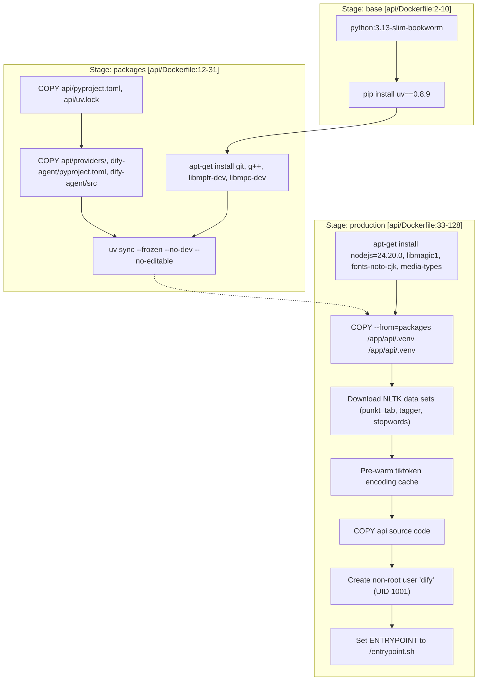
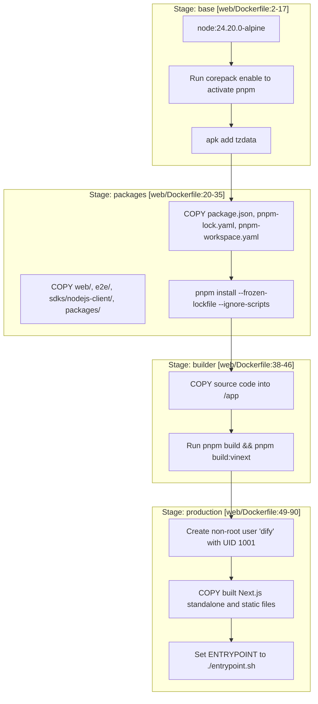
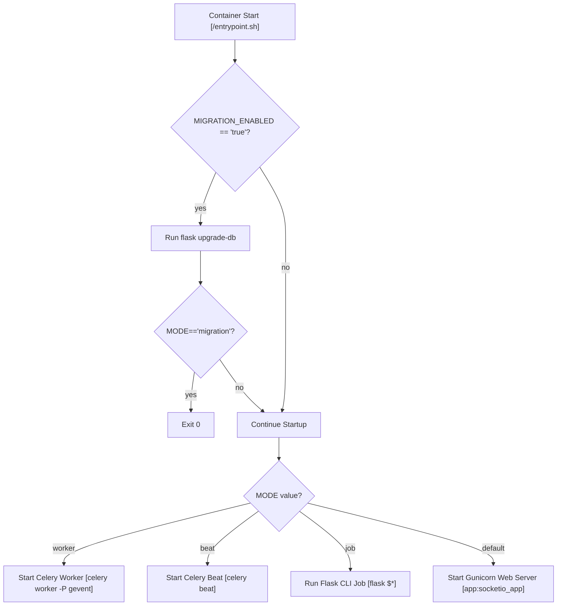
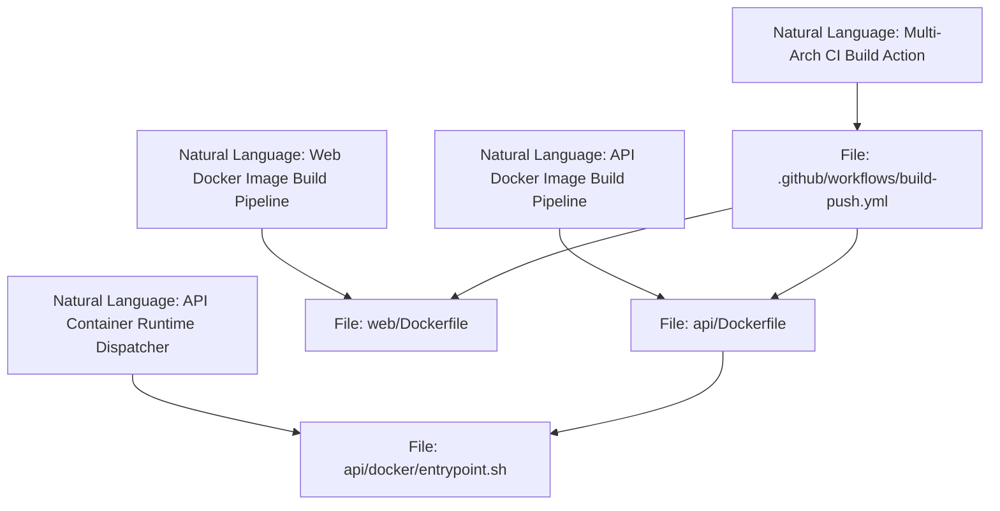

<!-- source: DeepWiki mcp.deepwiki.com · repo langgenius/dify · page 3.1 Docker Build Process and Multi-Stage Images · fetched 2026-10-26 -->

# Docker Build Process and Multi-Stage Images

Relevant source files

The following files were used as context for generating this wiki page:

- [.devcontainer/devcontainer.json](.devcontainer/devcontainer.json)
- [.devcontainer/post_create_command.sh](.devcontainer/post_create_command.sh)
- [.github/workflows/build-push.yml](.github/workflows/build-push.yml)
- [.github/workflows/docker-build.yml](.github/workflows/docker-build.yml)
- [.gitignore](.gitignore)
- [.vscode/launch.json.template](.vscode/launch.json.template)
- [api/Dockerfile](api/Dockerfile)
- [api/Dockerfile.dockerignore](api/Dockerfile.dockerignore)
- [api/README.md](api/README.md)
- [api/docker/entrypoint.sh](api/docker/entrypoint.sh)
- [api/providers/vdb/vdb-alibabacloud-mysql/src/dify_vdb_alibabacloud_mysql/alibabacloud_mysql_vector.py](api/providers/vdb/vdb-alibabacloud-mysql/src/dify_vdb_alibabacloud_mysql/alibabacloud_mysql_vector.py)
- [api/providers/vdb/vdb-hologres/src/dify_vdb_hologres/hologres_vector.py](api/providers/vdb/vdb-hologres/src/dify_vdb_hologres/hologres_vector.py)
- [api/providers/vdb/vdb-matrixone/src/dify_vdb_matrixone/matrixone_vector.py](api/providers/vdb/vdb-matrixone/src/dify_vdb_matrixone/matrixone_vector.py)
- [api/providers/vdb/vdb-matrixone/tests/unit_tests/test_matrixone_vector.py](api/providers/vdb/vdb-matrixone/tests/unit_tests/test_matrixone_vector.py)
- [api/providers/vdb/vdb-opengauss/src/dify_vdb_opengauss/opengauss.py](api/providers/vdb/vdb-opengauss/src/dify_vdb_opengauss/opengauss.py)
- [api/providers/vdb/vdb-oracle/src/dify_vdb_oracle/oraclevector.py](api/providers/vdb/vdb-oracle/src/dify_vdb_oracle/oraclevector.py)
- [dev/start-web](dev/start-web)
- [dev/start-worker](dev/start-worker)
- [web/Dockerfile](web/Dockerfile)
- [web/Dockerfile.dockerignore](web/Dockerfile.dockerignore)

## Purpose and Scope

This document details the Docker image build process for the API and Web services within the Dify platform. It focuses on the multi-stage Dockerfile architecture that optimizes build size and execution speed, the use of modern package managers (`uv` for Python backend, `pnpm` for frontend), and how these configurations produce production-ready containers. This page explains the build stages for API and Web services, key dependency management strategies, security considerations like non-root users, and the runtime entrypoint scripting that controls container behavior.

For runtime environment configurations and execution modes inside containers, refer to [Environment Configuration and Runtime Modes (3.2)]().

Sources: `api/Dockerfile:1-128` [api/Dockerfile:1-127](), `web/Dockerfile:1-90` [web/Dockerfile:1-89]()

---

## Multi-Stage Build Architecture

Dify employs a multi-stage build design in Dockerfiles to separate build-time dependencies and tooling from final runtime images, resulting in leaner, more secure containers. Below are detailed flows for API and Web services.

### API Multi-Stage Build Flow

Defined in `api/Dockerfile`, the API build comprises three primary stages forming a progressive layering:

- **Stage 1: base**  
  Uses the official `python:3.13-slim-bookworm` image and installs the `uv` Python package manager (version 0.8.9) to handle fast dependency synchronization [api/Dockerfile:2-10]().

- **Stage 2: packages**  
  Installs system-level compilation dependencies (`git`, `g++`, `libmpfr-dev`, `libmpc-dev` required for packages like `gmpy2`), then copies package manifests and source trees for `providers` and `dify-agent`. The `uv sync` command builds the virtual environment (`.venv`) using `uv.lock` under a frozen state without development or editable packages [api/Dockerfile:12-31]().

- **Stage 3: production**  
  Prepares the final runtime image by installing Node.js (v24.20.0), file type detection libraries (`libmagic1`), PDF fonts (`fonts-noto-cjk`), and media types. The pre-built `.venv` is copied from the `packages` stage [api/Dockerfile:33-98](). NLTK tokenization data and `tiktoken` encoding caches are pre-warmed [api/Dockerfile:100-109](). Source code is copied into `/app/api/`, ownership is assigned to the non-root `dify` user (UID 1001), and `/entrypoint.sh` is set as the entrypoint [api/Dockerfile:115-127]().

Sources: `api/Dockerfile:2-128` [api/Dockerfile:2-127]()

### Web Multi-Stage Build Flow

Defined in `web/Dockerfile`, the Web service utilizes a Node.js Alpine base image combined with `pnpm` workspaces for efficient monorepo dependency resolution.

- **Stage 1: base**  
  Starts with `node:24.20.0-alpine`, configures timezone data (`tzdata`), and activates package manager tooling via `corepack` [web/Dockerfile:2-17]().

- **Stage 2: packages**  
  Copies workspace manifests (`package.json`, `pnpm-lock.yaml`, `pnpm-workspace.yaml`) and package folders (`web`, `e2e`, `sdks/nodejs-client`, `packages`). Installs dependencies via `pnpm install --frozen-lockfile --ignore-scripts` [web/Dockerfile:20-35]().

- **Stage 3: builder**  
  Copies full repository source code and executes the Next.js production build (`pnpm build && pnpm build:vinext`) [web/Dockerfile:38-46]().

- **Stage 4: production**  
  Configures the non-root `dify` user (UID 1001), copies Next.js standalone outputs, static assets, and `./entrypoint.sh`, setting it as the container entrypoint [web/Dockerfile:49-89]().

Sources: `web/Dockerfile:2-90` [web/Dockerfile:2-89]()

---

## Dependency Management and Optimization

### API: Using `uv` Package Manager

- The backend leverages `uv` for fast dependency locking and virtual environment generation.
- The `.venv` environment is built inside the isolated `packages` stage and copied directly into `production`, avoiding redundant build steps or compiling wheels at container startup [api/Dockerfile:12-31](), [api/Dockerfile:97]().
- `--frozen` flag guarantees reproducible builds against `uv.lock` [api/Dockerfile:30]().

### Web: `pnpm` Workspace Utilization

- Monorepo package sharing is handled through `pnpm-workspace.yaml` [web/Dockerfile:25]().
- Selective file copying allows Docker layer caching for node module installations.
- Next.js standalone output mode bundles only necessary production files, trimming container image footprints.

Sources: `api/Dockerfile:12-31` [api/Dockerfile:12-31](), `web/Dockerfile:20-46` [web/Dockerfile:20-46]()

---

## Security and User Configuration

Containers run under dedicated non-root users (`dify`, UID 1001) to restrict privilege escalation risks.

| Component | User | UID | Implementation Detail |
|---|---|---|---|
| API | dify | 1001 | Created via `useradd -r -u 1001` with `/bin/bash` shell [api/Dockerfile:55-60]() |
| Web | dify | 1001 | Created via `adduser -S -u 1001` with `/bin/ash` shell [web/Dockerfile:68-72]() |

File ownership across application paths is recursively assigned to `dify` [api/Dockerfile:60](), [web/Dockerfile:72]().

Sources: `api/Dockerfile:55-60` [api/Dockerfile:55-60](), `web/Dockerfile:68-72` [web/Dockerfile:68-72]()

---

## Entrypoint Execution Logic

Container entrypoints evaluate environment variables to configure runtime modes.

### API Entrypoint: `api/docker/entrypoint.sh`

- **Migrations**: If `MIGRATION_ENABLED=true`, `flask upgrade-db` runs. If `MODE=migration`, the container terminates successfully [api/docker/entrypoint.sh:11-19]().
- **Worker**: If `MODE=worker`, spawns a Celery worker process with gevent pool, configuring queues based on product edition or `CELERY_QUEUES` overrides [api/docker/entrypoint.sh:21-70]().
- **Beat**: If `MODE=beat`, starts Celery beat scheduler [api/docker/entrypoint.sh:71-73]().
- **Job**: If `MODE=job`, runs one-off CLI commands (e.g., `create-tenant`, `reset-password`) and exits with the command's exit code [api/docker/entrypoint.sh:74-118]().
- **Server**: Default mode launches Gunicorn with `geventwebsocket.gunicorn.workers.GeventWebSocketWorker` on port 5001 [api/docker/entrypoint.sh:120-135]().

Sources: `api/docker/entrypoint.sh:1-135` [api/docker/entrypoint.sh:1-135]()

### Web Entrypoint

The web container delegates startup to `./entrypoint.sh`, launching the production Next.js application server on port 3000 [web/Dockerfile:81-89]().

Sources: `web/Dockerfile:81-89` [web/Dockerfile:81-89]()

---

## Natural Language to Code Mapping

Sources: `api/Dockerfile:1-128` [api/Dockerfile:1-127](), `web/Dockerfile:1-90` [web/Dockerfile:1-89](), `api/docker/entrypoint.sh:1-135` [api/docker/entrypoint.sh:1-135](), `.github/workflows/build-push.yml:1-180` [.github/workflows/build-push.yml:1-180]()

---

# References and Sources

- `api/Dockerfile:1-128` [api/Dockerfile:1-127]()
- `web/Dockerfile:1-90` [web/Dockerfile:1-89]()
- `api/docker/entrypoint.sh:1-135` [api/docker/entrypoint.sh:1-135]()
- `.github/workflows/build-push.yml:1-180` [.github/workflows/build-push.yml:1-180]()

---

